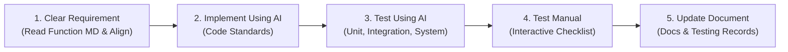

# AI Feature Implementation Lifecycle Rule

When implementing any feature, enhancement, or bug fix using AI in this workspace, all agents must strictly follow this 5-step lifecycle in sequential order. Do not skip any step.

---

## Step 1: Clear Requirement of Function Using AI
**Goal**: Establish 100% clarity on scope, rules, edge cases, and open decisions before writing or touching code.

1. **Locate & Read the Function Specification**:
   - Find and thoroughly read the corresponding feature/function markdown file under `documents/features/<Feature Name>/<Function Name>.md`.
   - Extract the **Function ID** (`REQ-nnn-Fnn`), **Actor**, **Inputs**, **Outcomes**, **Confirmed Rules**, and check for any **Open Decisions** or **Discussion Logs**.
2. **Architectural Schema Inventory & Completeness Check**:
   - Cross-reference **[documents/ARCHITECTURE.md](file:///d:/Semesters/Fall2026/SEP490/Project/SEP490/documents/ARCHITECTURE.md)**, **[documents/neo4j_schema.md](file:///d:/Semesters/Fall2026/SEP490/Project/SEP490/documents/neo4j_schema.md)**, and database schema diagrams for all entities, nodes, tables, and relationships involved in the feature.
   - Inventory **all defined fields and properties** (e.g., for `TargetRole`: `id`, `code`, `title`, `description`, `domainCode`, `familyCode`, `track`, `seniority`, `responsibilities`, `version`, `organizationId`, `assignedExpertId`, `status`, etc.).
   - Verify that the requirements, domain model, API contracts, and UI specifications explicitly account for 100% of the defined fields. No architecturally defined field may be skipped, overlooked, or left unaddressed.
3. **Requirement Clarification & Alignment with the User**:
   - Present a concise summary of the requirement, confirmed rules, inventoried architectural fields, and proposed technical design to the user.
   - Proactively ask questions or flag any open decisions, ambiguities, or architectural trade-offs using `ask_question` or clear prompts.
   - **MANDATORY GATE**: Always align and clear the requirements with the user before proceeding to Step 2 (Implementation). Never jump straight into modifying or creating code.

---

## Step 2: Implement Using AI
**Goal**: Write high-quality, production-ready code adhering to project architecture and standards only after requirement alignment.

1. **Zero Blank / Unused Architecture Fields Enforcement (100% Schema Fidelity)**:
   - **No Empty Defined Fields**: Under NO circumstances should any field, column, or property defined in [documents/ARCHITECTURE.md](file:///d:/Semesters/Fall2026/SEP490/Project/SEP490/documents/ARCHITECTURE.md) (or [documents/neo4j_schema.md](file:///d:/Semesters/Fall2026/SEP490/Project/SEP490/documents/neo4j_schema.md) / PostgreSQL schema) be left blank, unmapped, unseeded, or ignored in the codebase.
   - **Database Seeders & Migrations**: All seed data (`DevelopmentCatalogSeeder`, Flyway baseline/seed scripts, test fixtures) MUST populate every defined field with realistic, domain-appropriate values according to the architectural definition.
   - **Persistence Mappers & Repositories**: Neo4j/PostgreSQL mappers (e.g., `Neo4jTargetRoleMapper`) and queries must map 100% of defined properties to and from persistence records without silently dropping or omitting any property.
   - **Domain & Application DTOs**: Domain entities, value objects, commands, queries, and API response DTOs must model, validate, and transport every defined field.
   - **Frontend UI & Forms**: UI forms (create/edit modals), table columns, and detail dialogs must capture, display, and validate all architectural fields (e.g., track, seniority, responsibilities, version, etc.) so that users never encounter blank or unused data fields.
2. **Design System & UI-UX Pro Max Enforcement**:
   - Strictly follow the design system: CSS variables from `tokens.css` (zero hardcoded hex colors), standard typography scale, snug modern density, and surface elevation.
   - Always reuse shared components from `src/shared/components/ui/` (`<PageHeader />`, `<StatCard />`, `<Button />`, `<Badge />`, `<Card />`, `<Pagination />`, etc.) and `src/shared/components/typography/`.
3. **Clean Architecture & Best Practices**:
   - **Frontend**: Clean separation of concerns (presentation components, custom hooks, Zustand stores/services, i18n phrases).
   - **Backend**: Hexagonal / layered architecture (`domain`, `application`, `adapters`, controllers, services, repositories, validation). No unauthorized cross-layer dependencies (enforced by ArchUnit).
   - **Robust Error Handling**: Handle loading states, empty states, network failures, validation errors, and unauthorized access gracefully.
4. **Zero Frontend Mock Data & Database Migrations**:
   - Remove all mock data related to the task from the frontend (eliminate dummy lists, hardcoded local state mock arrays, or stub stores).
   - Add/import all initial, seed, or baseline data into **PostgreSQL** (via forward-only Flyway migrations under `backend/src/main/resources/db/migration/` for relational/user data) or **Neo4j** (via graph constraints under `db/neo4j/` and development seeder `DevelopmentCatalogSeeder` for catalog nodes and graph edges per [ARCHITECTURE.md](file:///d:/Semesters/Fall2026/SEP490/Project/SEP490/documents/ARCHITECTURE.md) and [neo4j_schema.md](file:///d:/Semesters/Fall2026/SEP490/Project/SEP490/documents/neo4j_schema.md)).
   - Frontend components must fetch and mutate real data from backend API endpoints.

---

## Step 3: Test Using AI (Unit, Integration, and System Testing)
**Goal**: Validate correctness automatically across all testing levels by strictly following the testing guides in `documents/testing/`.

Agents must read and follow the testing guides in `documents/testing/`:
- [documents/testing/README.md](file:///d:/Semesters/Fall2026/SEP490/Project/SEP490/documents/testing/README.md)
- [documents/testing/unit/README.md](file:///d:/Semesters/Fall2026/SEP490/Project/SEP490/documents/testing/unit/README.md)
- [documents/testing/integration/README.md](file:///d:/Semesters/Fall2026/SEP490/Project/SEP490/documents/testing/integration/README.md)
- [documents/testing/system/README.md](file:///d:/Semesters/Fall2026/SEP490/Project/SEP490/documents/testing/system/README.md)

1. **Unit Testing** (Follow `documents/testing/unit/README.md`):
   - Location: `backend/src/test/java/com/adaptlearngraph/<feature>/` (and frontend feature-local tests).
   - Cover pure domain/application policies using JUnit 5, HTTP access with Spring MVC/Security tests, and layer boundaries with ArchUnit.
   - Test boundaries: missing/invalid data, duplicate requests, status transitions, authorization failure.
   - **Architectural Field Assertions**: Assert that domain models, mappers, and DTOs correctly handle and map all defined architectural fields without null or missing values.
2. **Integration Testing** (Follow `documents/testing/integration/README.md`):
   - Location: `backend/src/test/java/com/adaptlearngraph/`.
   - Use disposable Testcontainers databases (PostgreSQL, Neo4j), verifying migrations, cross-store constraints, transaction outbox handoffs, and organization isolation.
   - Verify that seeded and persisted nodes/records contain all non-empty architectural fields (e.g. `seniority`, `responsibilities`, etc.) after database round-trips.
   - Run tests via `.\backend\mvnw.cmd -f backend/pom.xml test`.
3. **System Testing** (Follow `documents/testing/system/README.md`):
   - Test against the complete Compose stack (`compose.dev.yml`), verifying service startup, Flyway/graph initialization, health probes, status proxies, and end-to-end user workflows.
4. **Recording Standards**:
   - For every tested function, record: `REQ-nnn-Fnn` ID, approved acceptance rule, test data and tenant scope, expected outcome, test file, and run result. Do not mark a function covered solely because its database table or endpoint exists.

---

## Step 4: Test Manual
**Goal**: Validate the feature from the end-user perspective through interactive and visual testing.

1. **Interactive Verification & Field Visibility Check**:
   - If a dev server or browser environment is available, interactively inspect the UI (via browser subagent or local checks) for layout correctness, micro-interactions, responsive styling, and transitions.
   - **Verify All Architectural Fields**: Explicitly confirm that every field defined in the architecture (e.g., track, seniority, responsibilities, version, etc.) is visible, properly populated, and editable in UI views, modals, and network payloads without blank or placeholder values.
2. **Structured Manual Testing Checklist for User**:
   - In the final response, provide a clear, actionable **Manual Test Plan** containing:
     1. **Prerequisites**: Required environment, seed data, active tenant/organization, and user role (e.g., Employee/Learner, Manager, Admin).
     2. **Navigation Path**: Exact URL route or button sequence.
     3. **Step-by-Step Scenarios**: Happy path, edge cases, and invalid inputs.
     4. **Expected Results**: Visual state (including non-empty architectural fields), toast messages, network calls, and database updates.

---

## Step 5: Update Document
**Goal**: Keep project documentation, test evidence records, and architectural knowledge fully up to date.

1. **Comprehensive Documentation Updates in `documents/` Folder**:
   - Update everything related to the task in the `documents/` folder.
   - Crucially verify and update **[documents/ARCHITECTURE.md](file:///d:/Semesters/Fall2026/SEP490/Project/SEP490/documents/ARCHITECTURE.md)** (ownership, data baseline, runtime topology, store responsibilities, entity field definitions) and **[documents/neo4j_schema.md](file:///d:/Semesters/Fall2026/SEP490/Project/SEP490/documents/neo4j_schema.md)** (node labels, relationship types, attributes, constraints) whenever persistence, schemas, or data responsibilities are touched.
   - Ensure that any newly introduced or refined field is fully documented with its type, nullability, validation rules, and purpose in `documents/ARCHITECTURE.md`.
2. **Function & Feature Docs**:
   - Update the function specification in `documents/features/<Feature Name>/<Function Name>.md` (e.g. mark status from "In clarification" / "Draft" to implemented, update discussion logs/confirmed rules if resolved).
   - Update sprint plans (`documents/KE_HOACH_10_SPRINT.md`), `documents/PRODUCT_OVERVIEW.md`, and feature index (`documents/features/README.md`) if impacted.
3. **Testing Documentation Records**:
   - Create or update the dedicated feature test plan and evidence file under `documents/testing/<REQ-ID>-<feature-name>.md` following the standard set by [documents/testing/REQ-001-F01-view-target-roles.md](file:///d:/Semesters/Fall2026/SEP490/Project/SEP490/documents/testing/REQ-001-F01-view-target-roles.md).
   - Record test cases, commands, and results in `documents/testing/unit/README.md`, `documents/testing/integration/README.md`, and `documents/testing/system/README.md` under their `REQ-nnn-Fnn` IDs.
   - Create or update the step-by-step manual browser checklist in `documents/testing/system/<REQ-ID>-manual-browser-check.md`.
4. **API & Schema Documentation**:
   - Update API contracts, Swagger/OpenAPI docs, and schema diagrams (`documents/diagrams/`).
