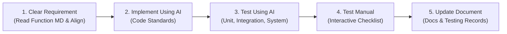

# AI Feature Implementation Lifecycle Rule

When implementing any feature, enhancement, or bug fix using AI in this workspace, all agents must strictly follow this 5-step lifecycle in sequential order. Do not skip any step.

---

## Step 1: Clear Requirement of Function Using AI
**Goal**: Establish 100% clarity on scope, rules, edge cases, and open decisions before writing or touching code.

1. **Locate & Read the Function Specification**:
   - Find and thoroughly read the corresponding feature/function markdown file under `documents/features/<Feature Name>/<Function Name>.md`.
   - Extract the **Function ID** (`REQ-nnn-Fnn`), **Actor**, **Inputs**, **Outcomes**, **Confirmed Rules**, and check for any **Open Decisions** or **Discussion Logs**.
2. **Requirement Clarification & Alignment with the User**:
   - Present a concise summary of the requirement, confirmed rules, and proposed technical design to the user.
   - Proactively ask questions or flag any open decisions, ambiguities, or architectural trade-offs using `ask_question` or clear prompts.
   - **MANDATORY GATE**: Always align and clear the requirements with the user before proceeding to Step 2 (Implementation). Never jump straight into modifying or creating code.

---

## Step 2: Implement Using AI
**Goal**: Write high-quality, production-ready code adhering to project architecture and standards only after requirement alignment.

1. **Design System & UI-UX Pro Max Enforcement**:
   - Strictly follow the design system: CSS variables from `tokens.css` (zero hardcoded hex colors), standard typography scale, snug modern density, and surface elevation.
   - Always reuse shared components from `src/shared/components/ui/` (`<PageHeader />`, `<StatCard />`, `<Button />`, `<Badge />`, `<Card />`, etc.) and `src/shared/components/typography/`.
2. **Clean Architecture & Best Practices**:
   - **Frontend**: Clean separation of concerns (presentation components, custom hooks, Zustand stores/services, i18n phrases).
   - **Backend**: Hexagonal / layered architecture (`domain`, `application`, `adapters`, controllers, services, repositories, validation). No unauthorized cross-layer dependencies (enforced by ArchUnit).
   - **Robust Error Handling**: Handle loading states, empty states, network failures, validation errors, and unauthorized access gracefully.

---

## Step 3: Test Using AI (Unit, Integration, and System Testing)
**Goal**: Validate correctness automatically across all testing levels by strictly following the testing guides in `documents/testing/`.

Agents must read and follow the testing guides in `documents/testing/`:
- [documents/testing/README.md](file:///d:/Semesters/Fall2026/SEP490/Project/SEP490/documents/testing/README.md)
- [documents/testing/unit/README.md](file:///d:/Semesters/Fall2026/SEP490/Project/SEP490/documents/testing/unit/README.md)
- [documents/testing/integration/README.md](file:///d:/Semesters/Fall2026/SEP490/Project/SEP490/documents/testing/integration/README.md)
- [documents/testing/system/README.md](file:///d:/Semesters/Fall2026/SEP490/Project/SEP490/documents/testing/system/README.md)

1. **Unit Testing** (Follow `documents/testing/unit/README.md`):
   - Location: `backend/src/test/java/com/adaptlearngraph/<feature>/` (and frontend feature-local tests).
   - Cover pure domain/application policies using JUnit 5, HTTP access with Spring MVC/Security tests, and layer boundaries with ArchUnit.
   - Test boundaries: missing/invalid data, duplicate requests, status transitions, authorization failure.
2. **Integration Testing** (Follow `documents/testing/integration/README.md`):
   - Location: `backend/src/test/java/com/adaptlearngraph/`.
   - Use disposable Testcontainers databases (PostgreSQL, Neo4j), verifying migrations, cross-store constraints, transaction outbox handoffs, and organization isolation.
   - Run tests via `.\backend\mvnw.cmd -f backend/pom.xml test`.
3. **System Testing** (Follow `documents/testing/system/README.md`):
   - Test against the complete Compose stack (`compose.dev.yml`), verifying service startup, Flyway/graph initialization, health probes, status proxies, and end-to-end user workflows.
4. **Recording Standards**:
   - For every tested function, record: `REQ-nnn-Fnn` ID, approved acceptance rule, test data and tenant scope, expected outcome, test file, and run result. Do not mark a function covered solely because its database table or endpoint exists.

---

## Step 4: Test Manual
**Goal**: Validate the feature from the end-user perspective through interactive and visual testing.

1. **Interactive Verification**:
   - If a dev server or browser environment is available, interactively inspect the UI (via browser subagent or local checks) for layout correctness, micro-interactions, responsive styling, and transitions.
2. **Structured Manual Testing Checklist for User**:
   - In the final response, provide a clear, actionable **Manual Test Plan** containing:
     1. **Prerequisites**: Required environment, seed data, active tenant/organization, and user role (e.g., Employee/Learner, Manager, Admin).
     2. **Navigation Path**: Exact URL route or button sequence.
     3. **Step-by-Step Scenarios**: Happy path, edge cases, and invalid inputs.
     4. **Expected Results**: Visual state, toast messages, network calls, and database updates.

---

## Step 5: Update Document
**Goal**: Keep project documentation, test evidence records, and architectural knowledge fully up to date.

1. **Function & Feature Docs**:
   - Update the function specification in `documents/features/<Feature Name>/<Function Name>.md` (e.g. mark status from "In clarification" / "Draft" to implemented, update discussion logs/confirmed rules if resolved).
2. **Testing Documentation Records**:
   - Record test cases, evidence, and outcomes in the appropriate `documents/testing/` records (unit, integration, system) under their `REQ-nnn-Fnn` IDs.
3. **API & Architecture Documentation**:
   - Update API docs, schema diagrams (`documents/neo4j_schema.md`), and sprint plans (`documents/KE_HOACH_10_SPRINT.md`) if impacted.
