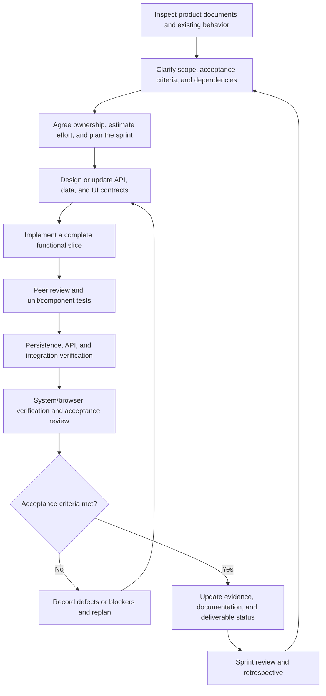

# Capstone Project Report

## Report 2 - Project Management Plan

**Project:** Knowledge Graph-Based Adaptive Learning and Competency Intelligence Platform  
**Abbreviation:** Adapt-Learn-Graph  
**Review:** Review 2  
**Prepared on:** 01 November 2026  
**Project period:** September 2026 - March 2027  
**Document status:** Proposed management plan for review; not a completion or production-readiness certificate  
**Location and date:** Hanoi, November 2026

### Table of Contents

- [I. Record of Changes](#i-record-of-changes)
- [II. Project Management Plan](#ii-project-management-plan)
  - [1. Overview](#1-overview)
    - [1.1 Scope & Estimation](#11-scope--estimation)
    - [1.2 Project Objectives](#12-project-objectives)
    - [1.3 Project Risks](#13-project-risks)
  - [2. Management Approach](#2-management-approach)
    - [2.1 Project Process](#21-project-process)
    - [2.2 Quality Management](#22-quality-management)
    - [2.3 Training Plan](#23-training-plan)
  - [3. Project Deliverables](#3-project-deliverables)
  - [4. Responsibility Assignments](#4-responsibility-assignments)
  - [5. Project Communications](#5-project-communications)
  - [6. Configuration Management](#6-configuration-management)
    - [6.1 Document Management](#61-document-management)
    - [6.2 Source Code Management](#62-source-code-management)
    - [6.3 Tools & Infrastructures](#63-tools--infrastructures)

## I. Record of Changes

| Date | A* M, D | In charge | Change Description |
| --- | --- | --- | --- |
| 01/11/2026 | A | Report preparation with AI assistance | Created the English Project Management Plan using the supplied report template and project documents. Retained the requested four-member functional allocation, reconciled product scope, and introduced explicit planning estimates, responsibilities, quality gates, and delivery assumptions. |

*A - Added; M - Modified; D - Deleted.*

## II. Project Management Plan

### 1. Overview

Adapt-Learn-Graph is a web-based proof of concept for organization-scoped adaptive learning and competency development. It connects assessments, competency profiles, target-role requirements, a knowledge graph, and learning modules to recommend personalized pathways and update them as new assessment evidence becomes available.

The product supports six human actors: Guest, Platform Administrator, System Administrator, L&D Manager, Expert, and Employee. The automated System provides authentication, payment processing, workspace provisioning, assessment evaluation, competency updates, recommendations, notifications, and activity recording. These product actors are distinct from the four project team members.

The plan uses the following project references:

| Reference | Purpose in this plan |
| --- | --- |
| [Report 2 template](../Report2_Project%20Management%20Plan.docx) | Required report structure, table columns, and management topics. |
| [Product Overview](../PRODUCT_OVERVIEW.md) and [Functional Requirements Catalog](../features/README.md) | Product scope, actor responsibilities, and the 48 source-level functional requirements. |
| [Four-person allocation](../PHAN_CONG_4_NGUOI.md) | Requested functional ownership model and producer-consumer handoffs. |
| [Ten-sprint plan](../KE_HOACH_10_SPRINT.md) | Reference sprint windows and dependency-oriented planning. |
| [Architecture](../ARCHITECTURE.md) and [Neo4j schema](../neo4j_schema.md) | Technical boundaries, data ownership, persistence, and integration constraints. |
| [Testing documentation](../testing/README.md) | Verification levels, evidence requirements, and recorded limitations. |

**Planning basis.** The functional grouping of Member 1 to Member 4 follows the requested allocation document. That document and the sprint plan are retained planning snapshots, so this report does not treat their earlier exclusions, effort figures, or workflow rules as current product commitments. The allocation below is a proposed report-level arrangement, not a replacement for an approved technical ownership agreement. Member labels do not assume a name-to-number mapping.

### 1.1 Scope & Estimation

#### Product scope

The delivery scope includes:

- Self-service organization registration, account verification, subscription selection and payment, workspace provisioning, renewal, and Employee-seat enforcement.
- Platform and organization administration, accounts, roles, permissions, departments, occupations, and Expert assignments.
- Expert configuration of target-role requirements, L&D publication, learning-module/content authoring, assessment question banks, and offering approval.
- Baseline and module assessments, RIASEC interest assessment, assessment results and history, and AI-assisted target-role guidance.
- Competency estimation, gap analysis, prerequisite-aware initial pathway generation, Expert initial review, and assessment-driven adaptation.
- Employee pathway and competency visualization, approved learning-content access, individual-skill learning, and progress tracking.
- Employee and department development monitoring, recorded training costs and monetary benefits, and ROI summaries.
- Organization isolation, private sample-content storage, notifications, audit events, reproducible datasets, research evaluation, and deployment documentation.

Professional educational-content production, video-streaming infrastructure, SCORM compliance, generative AI content creation, and replacement of a commercial LMS are outside scope. Subscription cancellation, report export, and a user-facing benchmark workspace are not assumed requirements. Research experiments remain deliverables, separate from product screens.

AI role guidance is directly available to Employees; an additional Expert approval gate for guidance is not planned. Expert confirmation remains mandatory before an Employee starts an initial pathway. RIASEC interests support role guidance but do not establish skill mastery.

#### Estimation method and assumptions

- One man-day represents one team member's working day, not one calendar day.
- Estimates below are newly proposed planning figures, not approved commitments, actual expenditure, or remaining-effort measurements.
- Simple items cover bounded read/update behavior; Medium items include multi-step workflows or a single substantial integration; Complex items include authorization-sensitive automation, cross-store consistency, algorithms, or multi-party lifecycle transitions.
- Items 1-4 include their local requirements clarification, design, implementation, unit/component tests, basic integration checks, and related feature documentation.
- Item 5 covers shared work not already charged to individual functions: cross-cutting architecture, management, whole-system verification, research, deployment, and consolidated reports.
- FR identifiers provide source traceability. Supporting items implement enabling work rather than introduce additional source requirements. A requirement appearing in two slices has one accountable owner, identified in Section 4, and non-overlapping producer/consumer work.
- Existing implementation must be inspected before assigning remaining work. No estimate implies that a documented prototype, historical pass, or partial API is a completed deliverable.

#### Work Breakdown Structure

| # | WBS Item | Complexity | Est. Effort (man-days) |
| --- | --- | --- | ---: |
| **1** | **Platform, identity, security, and operations - Member 1** | | **67** |
| 1.1 | Organization registration, email verification, and resumable registration - FR-01.01 | Complex | 6 |
| 1.2 | Subscription comparison and selection - FR-01.02 | Simple | 2 |
| 1.3 | Guest checkout, payment-status display, and retry interaction - FR-01.03 | Medium | 2 |
| 1.4 | Onboarding-status tracking and workspace handoff - FR-01.04 | Medium | 2 |
| 1.5 | Organization details, workspace suspension, and reactivation - FR-02.01 | Medium | 4 |
| 1.6 | Configuration of existing subscription plans - FR-02.02 | Medium | 3 |
| 1.7 | Platform activity, subscription/payment outcomes, and service-status views - FR-02.03 | Medium | 3 |
| 1.8 | Accounts, activation/deactivation, and organization memberships - FR-03.01 | Medium | 4 |
| 1.9 | Departments and Employee department assignments - FR-03.02 | Medium | 4 |
| 1.10 | Organization roles and permissions - FR-03.03 | Complex | 4 |
| 1.11 | Organization system configuration - FR-03.04 | Simple | 2 |
| 1.12 | Authorized workspace activity and audit views - FR-03.05 | Medium | 2 |
| 1.13 | Organization subscription period, renewal, seats, and history - FR-03.06 | Medium | 3 |
| 1.14 | Employee self-profile reading and permitted updates - FR-06.01 | Simple | 2 |
| 1.15 | Authentication, sessions, credential protection, and organization isolation - FR-07.01 | Complex | 5 |
| 1.16 | Payment requests, verified outcomes, and idempotent payment recording - FR-07.02 | Complex | 5 |
| 1.17 | Recoverable workspace provisioning and initial administrator assignment - FR-07.03 | Complex | 4 |
| 1.18 | Subscription entitlement and Employee-seat enforcement - FR-07.04 | Complex | 4 |
| 1.19 | Shared account, payment, and workflow email delivery - FR-07.10 | Medium | 3 |
| 1.20 | Shared activity recording and sensitive-data-safe audit integration - FR-07.11 | Medium | 3 |
| **2** | **Catalog, knowledge content, and L&D workflows - Member 2** | | **54** |
| 2.1 | Occupations and department links - FR-04.01 | Medium | 4 |
| 2.2 | Occupation/role Expert assignments and authorization references - FR-04.02 | Medium | 3 |
| 2.3 | Target-role creation, maintenance, and assignment - FR-04.03 | Medium | 4 |
| 2.4 | L&D target-role publication, withdrawal, and revision handoff - FR-04.04 | Complex | 4 |
| 2.5 | L&D offering review, approval, and return for revision - FR-04.06 | Complex | 5 |
| 2.6 | Micro-skill management and valid historical references - FR-05.01 | Medium | 4 |
| 2.7 | Role competency requirements, proficiency, and relative importance - FR-05.02 | Medium | 4 |
| 2.8 | Expert submission and revision of completed role configurations - FR-05.03 | Medium | 3 |
| 2.9 | Prerequisite authoring and graph-validity checks - FR-05.04 | Complex | 4 |
| 2.10 | Learning-module authoring, organization, and skill coverage - FR-05.05 | Complex | 5 |
| 2.11 | Expert submission of learning content for approval - FR-05.08 | Medium | 3 |
| 2.12 | Shared question-bank authoring and question-to-skill/difficulty mappings | Medium | 4 |
| 2.13 | Catalog snapshots, graph projections, and mapping handoff | Complex | 3 |
| 2.14 | Sample-content metadata and private-storage integration with Member 1 | Medium | 4 |
| **3** | **Assessments, guidance, adaptive engine, and reporting - Member 3** | | **69** |
| 3.1 | L&D baseline coverage, question selection, and scoring configuration - FR-04.05 | Complex | 5 |
| 3.2 | Employee/department development monitoring and reporting filters - FR-04.07 | Complex | 5 |
| 3.3 | Expert module-assessment configuration using Member 2's question bank - FR-05.06 | Medium | 4 |
| 3.4 | Employee baseline and RIASEC assessment workflows - FR-06.02 | Complex | 5 |
| 3.5 | Own assessment results and history - FR-06.03 | Medium | 3 |
| 3.6 | Employee guidance reading and published-target-role selection/confirmation - FR-06.04 | Medium | 4 |
| 3.7 | Employee module-assessment submission and result handoff - assessment slice of FR-06.08 | Medium | 3 |
| 3.8 | Assessment generation, scoring, and RIASEC interpretation - FR-07.05 | Complex | 6 |
| 3.9 | Evidence-based knowledge tracing, competency estimates, and gap calculation - FR-07.06 | Complex | 8 |
| 3.10 | Local-LLM role suggestions, explanations, and explicit failure handling - FR-07.07 | Complex | 6 |
| 3.11 | Initial graph recommendation and remaining-pathway recalculation - FR-07.08 | Complex | 10 |
| 3.12 | Recorded-cost/benefit aggregation and development ROI - FR-07.09 | Complex | 5 |
| 3.13 | Evidence replay protection and learning-state synchronization/recovery | Complex | 5 |
| **4** | **Learning experience, visualization, and pathway review - Member 4** | | **34** |
| 4.1 | Assigned Expert initial review, module inclusion/exclusion, and confirmation - FR-05.07 | Complex | 6 |
| 4.2 | Employee competency profile and gap visualization - FR-06.05 | Medium | 4 |
| 4.3 | Confirmed-pathway reading and approved learning access - FR-06.06; learning slice of FR-06.08 | Complex | 5 |
| 4.4 | Individual-skill selection, mapped content, and independent learning context - FR-06.07 | Complex | 5 |
| 4.5 | Employee progress and learning-history presentation - FR-06.09 | Medium | 4 |
| 4.6 | Recommendation explanations tied to the engine's evidence and pathway revision | Medium | 3 |
| 4.7 | Shared approved-content presentation and learning-activity capture | Medium | 4 |
| 4.8 | Pathway revision/change presentation and review-state synchronization | Medium | 3 |
| **5** | **Shared project, evaluation, and release activities** | | **76** |
| 5.1 | Shared requirements reconciliation, architecture, relational/graph contracts, and data design | Complex | 12 |
| 5.2 | Planning, progress tracking, risk/decision management, and team coordination | Medium | 10 |
| 5.3 | Whole-system integration, organization-isolation regression, performance, and acceptance evidence | Complex | 16 |
| 5.4 | Two-organization datasets, Content-Based Filtering baseline, and RQ1-RQ3 evaluation | Complex | 20 |
| 5.5 | On-premises deployment, recovery rehearsal, release packaging, and handoff | Complex | 10 |
| 5.6 | Consolidated reports, user guidance, research write-up, and final demonstration preparation | Medium | 8 |
| | **Total Estimated Effort (man-days)** | | **300** |

#### Capacity and schedule feasibility

The reference ten-sprint window runs from 28 September to 06 December 2026. At five working days per member per week, four members provide a nominal capacity of:

**4 members x 5 working days x 10 sprints = 200 man-days.**

The proposed full-project estimate of 300 man-days therefore exceeds that window by **100 man-days**, equivalent to five additional full-capacity team weeks. This is a planning gap, not an approved extension or a statement that 200 man-days have already been spent. Holidays, examinations, training, absences, and actual completed work must be reconciled before committing remaining capacity.

The December checkpoint is consequently an integration/review milestone, not an unconditional promise of complete delivery. Additional implementation, evaluation, and handoff work is provisionally placed within the remaining January-March project period. The team and supervisor must approve actual dates and capacity. If capacity is insufficient, adjust the schedule or seek an explicit scope decision; do not silently remove required workflows or verification gates.

### 1.2 Project Objectives

#### Overall objective

Deliver a demonstrable, documented adaptive-learning platform that maps assessment evidence to organizational competency requirements and prerequisite-aware learning pathways. Demonstrate isolated workflows for at least two organizations and evaluate recommendation relevance, graph latency, and adaptation with reproducible experiments.

#### Quality objectives

The following are proposed management targets, not measured outcomes. Defects are counted once at the stage of first discovery. The defect percentage is that stage's confirmed defects divided by all confirmed defects in the reporting period; it is N/A when no defects have been confirmed. Actual figures will come from the defect log.

| # | Testing Stage | Test Coverage | No. of Defects | % of Defect | Notes |
| --- | --- | --- | --- | --- | --- |
| 1 | Reviewing | Review 100% of changed requirements, API/data contracts, and implementation submissions. | Actual count pending | Actual percentage pending | Each delivered item needs a non-author reviewer and traceable disposition of findings. |
| 2 | Unit Test | Target at least 80% branch coverage for changed domain/algorithm code where supported; test every agreed scoring and authorization rule. | Actual count pending | Actual percentage pending | Numerical examples and boundary cases must be asserted; coverage alone does not prove correctness. |
| 3 | Integration Test | Verify 100% of identified critical persistence/integration contracts and cross-organization denial cases. | Actual count pending | Actual percentage pending | Include PostgreSQL, Neo4j, private-content access, payment replay, and partial-update recovery. |
| 4 | System Test | Exercise every release-critical journey and all six actors using at least two organizations. | Actual count pending | Actual percentage pending | Use the integrated stack and browser tests; retain pending/failed/recovery evidence. |
| 5 | Acceptance Test | Map all 48 source requirements to applicable acceptance scenarios; execute every scenario in the agreed release scope. | Actual count pending | Actual percentage pending | Target zero unresolved critical/high-severity release defects; other open defects require explicit disposition. |

Additional measurable product and research targets are:

| Objective | Target | Verification basis |
| --- | --- | --- |
| Recommendation relevance | Hit Rate@5 >= 80% | Expert-annotated evaluation set; compare graph traversal and Content-Based Filtering on the same held-out inputs. |
| Graph query latency | Complex traversal execution <= 150 ms | Recorded Neo4j environment and dataset; report mean/P95 and individual query results. Agree the acceptance statistic before executing the gate. |
| High-concurrency learner operations | At least 300 concurrent learner interactions with response times <= 500 ms | Dedicated workload for module completions/quiz submissions. Define the response-time statistic and workload mix before execution. |
| Ordinary interactive performance | P95 response time <= 2 seconds with 30 concurrent users | Documented environment and at least two workspaces; measure LLM inference, payment processing, and file transfers separately. |
| Organization isolation | All tested unauthorized cross-organization requests denied | API, graph, background-processing, and private-file negative cases. |
| Recovery and idempotency | No duplicated committed business records in tested retries | Repeat payment notifications, provisioning retries, and assessment submissions; inject failures between related updates. |
| Usability | All tested forms identify invalid inputs and preserve values after validation errors | Desktop/mobile browser verification with clear success, pending, and failure states. |
| Reproducibility | Every reported experiment links to frozen data, parameters, seeds, and raw outputs | Separate development/evaluation inputs and retain the execution environment. |

**Milestone Timeliness (%):** Proposed target >= 90% of approved milestone due dates met. Calculate as milestones accepted by their approved due date divided by milestones due in the reporting period, multiplied by 100. Original dates and approved replanning decisions remain visible; actual timeliness is not yet calculated.

**Allocated Effort (man-days):** Proposed full-project activity distribution:

| Project activity | Allocated effort (man-days) | Distribution |
| --- | ---: | ---: |
| Requirements analysis and clarification | 30 | 10.00% |
| Architecture, data, API, and interface design | 40 | 13.33% |
| Coding and implementation | 120 | 40.00% |
| Reviewing, testing, defect correction, and evaluation | 65 | 21.67% |
| Project management and communications | 15 | 5.00% |
| Deployment, recovery preparation, and handoff | 15 | 5.00% |
| Consolidated documentation and presentation | 15 | 5.00% |
| **Total** | **300** | **100.00%** |

This is an activity-based view of the same WBS effort, not an additional budget. Training is charged to the related activity. Labor effort is the cost-planning unit; no salary, hosting fee, provider charge, or monetary budget has been approved in the source documents. Infrastructure and external-service expenses require separate confirmation before procurement.

### 1.3 Project Risks

Impact and possibility are qualitative planning assessments. The team reviews them each sprint and after any material scope or integration change.

| # | Risk Description | Impact | Possibility | Response Plans |
| --- | --- | --- | --- | --- |
| 1 | Required effort exceeds the nominal ten-sprint capacity. | High | High | Project leader reconciles actual progress and remaining capacity; prioritize dependency-critical slices, reserve later project weeks, and obtain approval for schedule/scope changes. |
| 2 | Planning snapshots, product requirements, technical decisions, and implementation describe different behavior. | High | High | All members maintain a decision log; resolve discrepancies before implementation. Distinguish target behavior from locally verified behavior rather than silently replacing approved runtime contracts. |
| 3 | Member 3 becomes a bottleneck for assessment, algorithms, guidance, and reporting. | High | High | Expose contracts early; Member 2 supplies validated mappings, Member 4 takes presentation work, and Member 1 supports infrastructure. Re-estimate by effort, not by feature count. |
| 4 | PostgreSQL and Neo4j updates diverge or retries duplicate learning/payment records. | High | Medium | Members 1-3 specify data ownership, idempotency, versioned projections, and recovery. Test partial failures and retain reconciliation evidence. |
| 5 | Tenant, assignment, seat, or private-content checks are missing on a protected path. | High | Medium | Member 1 coordinates permission contracts; every owner enforces them server-side and adds two-organization negative tests. Block release on confirmed authorization defects. |
| 6 | Question banks, calibration, mappings, or approved learning content are unavailable. | High | High | Members 2-3 maintain readiness checks and dataset status; obtain Expert validation. Missing resources produce explicit blocked states, not fabricated assessment results. |
| 7 | payOS, SMTP, or local-LLM access is unavailable or unsuitable for acceptance. | High | Medium | Members 1 and 3 validate configuration early, exercise controlled adapter failures, and distinguish local testing from live-provider evidence. Request separate approval for live payment operations. |
| 8 | Graph recommendations fail relevance or latency targets. | High | Medium | Member 3 establishes the CBF baseline and profiles Cypher queries; Member 4 coordinates repeatable experiments. Retain adverse results and adjust the algorithm without changing evaluation data to inflate scores. |
| 9 | RIASEC interests are incorrectly treated as mastery, or adaptation removes required learning. | High | Medium | Member 3 separates interest and knowledge evidence, tests numeric examples, and verifies prerequisite/coverage constraints and preservation of valid Expert adjustments. |
| 10 | UI prototypes or historical test passes are mistaken for completed integration. | High | High | Require current API/persistence and real-stack evidence for delivered slices. Label synthetic, blocked, and not-run checks explicitly. |
| 11 | Deployment, content-storage, reverse-proxy, or CI/CD configuration does not match the target environment. | Medium | Medium | Member 1 owns an environment inventory and deployment rehearsal; Member 4 supports packaging. Document implemented tools separately from planned tools. |
| 12 | Team availability, knowledge gaps, or merge conflicts reduce usable capacity. | Medium | Medium | Use focused training, peer reviews, small contract-aligned changes, documented handoffs, and weekly capacity updates. Escalate critical-path delays promptly. |

### 2. Management Approach

The team uses iterative, dependency-aware delivery with short planning cycles, one accountable owner per function, peer review, and evidence-based acceptance. Work is divided by functional capability rather than by product actor or by separate frontend/backend teams.

### 2.1 Project Process

#### Development process model

Each sprint follows these steps:

1. **Inspection and backlog refinement:** Read the affected functional contract, technical decisions, code, and evidence. Classify behavior as implemented, partial, missing, incorrect, or unverified.
2. **Planning:** Agree a bounded slice, its accountable member, required handoffs, testable acceptance criteria, effort, and available capacity. Unresolved business rules become explicit blockers or decisions.
3. **Design:** Define actor/organization/assignment checks, input validation, field ownership, lifecycle transitions, response/error behavior, and persistence history. Schema changes require an agreed forward migration.
4. **Implementation:** Complete the relevant domain, API, persistence, UI, tests, and documentation surfaces. Reuse shared authorization, notifications, graph/query contracts, and UI components.
5. **Verification:** Run applicable unit, API/security, integration, system, browser, and performance checks. Record exact scope and actual outcomes.
6. **Review and acceptance:** Demonstrate the slice with its real prerequisites. A prototype or test double may support development but cannot satisfy a real integration gate.
7. **Retrospective and replanning:** Review delivery, defects, risks, handoff delays, and remaining capacity; make the next sprint's commitments explicit.

#### Integration dependency gates

| Gate | Primary handoff | Required outcome |
| --- | --- | --- |
| G1 - Identity and workspace access | Member 1 to Members 2-4 | Trusted sessions, organization scope, role/seat controls, and authorized workspace entry. |
| G2 - Available catalog | Member 2 to Members 3-4 | Valid occupation/role assignments, published roles, Expert requirements, prerequisites, and approved offerings with reproducible mappings. |
| G3 - Assessment and guidance | Member 3 using Member 2's inputs | Agreed baseline/module rules, valid evidence, results/RIASEC profiles, AI guidance, and target-role selection with explicit readiness states. |
| G4 - Initial pathway | Member 3 to Member 4 | Gaps, ordered recommendations, explanations, and a reviewable initial draft; authorized Expert confirmation before learning. |
| G5 - Learning and adaptation | Member 4 to Member 3 | Learning activity and assessment evidence update progress/mastery and remaining pathways without duplicate evidence or invalid override loss. |
| G6 - Reporting and release | All members | Independent learning, development/ROI reporting, two-organization regression, research outputs, deployment evidence, and documented limitations. |

Product requirements and retained technical decisions may differ on role-entry and baseline ordering. Member 3 must resolve that difference with the affected owners and supervisor before changing the accepted flow; this management plan does not select a new runtime ordering.

### 2.2 Quality Management

#### Defect prevention

- Define acceptance examples before implementation, including denied access, invalid input, missing configuration, repeated submission, and recovery cases.
- Separate L&D baseline/publication/approval authority from Expert authoring/module-assessment/initial-review authority.
- Use trusted server-side identity and organization membership; browser-provided actor or organization values do not establish authority.
- Preserve legitimate nullability, historical evidence, approved content references, and operation-specific projections.
- Keep password, verification, payment, and private-file secrets out of documents, source control, responses, and logs.
- Check prerequisites and learning coverage so that shorter pathways do not gain credit by skipping required skills.

#### Reviewing

Every deliverable receives a non-author review. Reviewers check behavior, permissions, integration contracts, lifecycle transitions, error handling, tests, and directly related documentation. The author resolves material findings before acceptance; the receiving owner confirms each cross-member handoff.

#### Unit testing

Use the existing backend test stack, ArchUnit boundaries, and frontend Vitest/component tooling. Test domain transitions, scoring, tracing, gap calculations, graph-selection rules, permission decisions, input validation, and UI states. Explicit expected numeric outputs are required for algorithm changes.

#### Integration testing

Use applicable Testcontainers/real-adapter tests to verify PostgreSQL persistence, Neo4j mappings, historical references, tenant boundaries, private-content access, and cross-store recovery. Exercise duplicate payment notifications, assessment replay, invalid assignment, unpublished roles, unapproved content, and failed partial operations.

#### System testing

Run applicable Docker Compose and Playwright journeys against the integrated application. The minimum release-critical coverage includes:

- Register/verify -> select/pay -> provision -> access/renew workspace.
- Manage accounts/departments -> occupations/Expert assignments -> configure/submit target role -> L&D publication.
- Author module/content/assessment -> submit -> approve or return for revision.
- Complete the agreed baseline/RIASEC and role-entry flow -> gaps -> initial pathway -> Expert review/confirmation -> learning/assessment -> adaptation.
- Learn an individual skill without replacing the selected role pathway.
- View development summaries and ROI from traceable cost/benefit records.
- Deny unauthorized cross-organization, assignment, seat, and private-file requests.

Synthetic fixtures and adapter stubs are recorded separately from real-persistence and real-browser evidence. Live email, payment-provider, and production-deployment certification require their own approved checks.

#### Defect tracking and acceptance

The defect log records affected requirement/WBS item, environment, reproduction steps, expected/actual behavior, severity, owner, status, and retest evidence. The workflow is **Open -> Assigned -> Fixed -> Retested -> Closed**, with Reopened and Blocked states where appropriate.

Definition of Done:

1. Scope and acceptance criteria are agreed.
2. Applicable domain/API/persistence/UI surfaces are integrated.
3. Authorization, data integrity, and error states are tested.
4. Peer-review findings are resolved.
5. Required checks have executed with retained evidence.
6. Related feature, architecture/schema, and user documentation are updated where affected.
7. The receiving owner accepts the handoff; any residual limitation has an explicit disposition.

Existing test receipts remain evidence only for their recorded slices and environments. This report does not aggregate historical pass counts into a whole-project acceptance claim.

### 2.3 Training Plan

The following sessions are proposed. Schedule them before the relevant dependency gate, repeating or shortening them after a skills assessment. Duration is participant time; it is included in the activity budget, not added to it.

| Training Area | Participants | When, Duration | Waiver Criteria |
| --- | --- | --- | --- |
| Java Spring Boot, validation, and hexagonal service boundaries | All members; Members 1-3 lead backend examples | Before assigned backend work; 1 working day | Mandatory walkthrough; experienced members may waive exercises after demonstrating an existing tested slice. |
| Git, GitHub, change review, and conflict resolution | All members | Before the next shared integration; 0.5 working day | Mandatory. |
| PostgreSQL, Flyway, transaction ownership, and migration safety | Members 1-3; Member 4 informed | Before schema/integration changes; 0.5 working day | Waive practical exercises only after demonstrating a forward migration and recovery plan. |
| Neo4j ontology, Cypher, prerequisites, and graph projections | Members 2-3; Member 4 joins read/visualization topics | Before catalog/engine handoff; 1 working day | Demonstrate an organization-scoped query, valid mapping, and prerequisite test. |
| Assessment scoring, knowledge tracing, RIASEC, and guidance boundaries | Member 3; Members 2 and 4 support | Before assessment/model acceptance; 1 working day | Demonstrate approved numerical examples and separation of interest from mastery. |
| React, TypeScript, shared UI components, and graph visualization | All members for their UI slices; Member 4 facilitates | Before new integrated screens; 1 working day | Demonstrate a typed API-backed screen meeting shared design and error-state conventions. |
| API authorization, Testcontainers, Playwright, and evidence recording | All members | Before whole-system regression; 1 working day | Mandatory evidence walkthrough; tool exercises may be waived with equivalent recent work. |
| payOS/SMTP adapters, private storage, and secret handling | Member 1; Members 2-3 for consuming contracts | Before provider/storage integration; 0.5 working day | Demonstrate explicit provider-failure behavior and credential-safe configuration. |
| Benchmark methodology and reproducibility | Members 3-4; Members 1-2 support data/environment setup | Before freezing evaluation inputs; 0.5 working day | Demonstrate an experiment rerun from recorded data, parameters, seeds, and raw output. |
| Docker Compose, environment readiness, backup, and recovery | Member 1; all members attend handoff | Before deployment rehearsal; 0.5 working day | Mandatory recovery/handoff walkthrough. |

### 3. Project Deliverables

Dates below are proposed checkpoints using the reference sprint windows, not claims that earlier checkpoints were met. Past-due items require actual-status reconciliation. Institutional review/final-defense dates must be confirmed separately.

| # | Deliverable | Due Date | Notes |
| --- | --- | --- | --- |
| 1 | Project introduction, initial scope, actor/access matrix, and planning baseline | 04/10/2026 - reference checkpoint | Member 1 coordinates; all members reconcile actual coverage and changes. |
| 2 | Organization/department/occupation model, Expert assignments, and API/data contracts | 11/10/2026 - reference checkpoint | Members 1-2 lead; historical dates do not certify current scope. |
| 3 | Target-role configuration/submission/publication design and baseline-configuration contracts | 18/10/2026 - reference checkpoint | Members 2-3 lead; resolve L&D/Expert boundaries. |
| 4 | Module/content/question-bank mappings, assessment rules, and approval contracts | 25/10/2026 - reference checkpoint | Member 2 leads content; Member 3 owns assessment rules; Member 1 supplies private-storage infrastructure. |
| 5 | Assessment evidence/results readiness and Review 2 management report | 01/11/2026 - planned checkpoint | Member 3 leads assessment status; this report is a document deliverable, not application acceptance. |
| 6 | AI guidance and published-role selection integration | 08/11/2026 - proposed | Member 3 leads; no added Expert guidance-approval gate. |
| 7 | Competency gaps, initial recommendation, and Expert-confirmed pathway | 15/11/2026 - proposed | Members 3-4 lead; verify generation/review/learning boundaries. |
| 8 | Approved learning, module assessments, and individual-skill learning | 22/11/2026 - proposed | Member 4 leads experience; Members 2-3 supply approved content and assessment services. |
| 9 | New-evidence adaptation, progress/development summaries, and ROI | 29/11/2026 - proposed | Member 3 leads; Member 4 consumes revision/progress outputs. |
| 10 | Integrated ten-sprint review, risk/capacity reconciliation, and regression/demo package | 06/12/2026 - proposed | All members; explicitly list unfinished scope and additional effort. Not unconditional final acceptance. |
| 11 | Remaining agreed implementation, two-organization sample dataset, and repeatable integration package | January-February 2027; exact date to be approved | Provisionally accommodates the 100-man-day capacity gap; requires a funded-by-capacity backlog and approved milestones. |
| 12 | Research benchmark dataset, CBF baseline, experiment scripts, raw results, and RQ1-RQ3 analysis | February 2027; exact date to be approved | Member 3 owns algorithms; Member 4 coordinates execution/evidence; all members support validation. |
| 13 | Final source package, SRS, SDD, API/schema documentation, test evidence, user guidance, and on-premises deployment/handoff | March 2027; institutional deadline to be confirmed | Member 1 coordinates release; all members contribute. Final acceptance depends on demonstrated scope and disclosed limitations. |

Research delivery must include:

- **RQ1:** Graph traversal versus Content-Based Filtering; 500 synthetic user profiles, with Expert top-five annotation for 50 sample profiles and documented evaluation separation.
- **RQ2:** Neo4j latency at 1,000, 5,000, and 10,000 nodes, with recorded 3-hop to 5-hop traversal conditions, 1,000 executions per size, and mean/P95 results.
- **RQ3:** Simulation of 100 learners comparing adaptive versus static pathways, including remedial-module counts and competency-distance/required-skill coverage checks.
- Frozen datasets, mappings, algorithm parameters, random seeds, environment details, raw outputs, and limitations. An unfavorable result must remain reportable.

### 4. Responsibility Assignments

**D - Do/accountable owner; R - Review; S - Support; I - Informed; blank - Omitted.**

Each responsibility row has one D. All members may contribute across layers, but assistance does not create a second implicit owner. Team roles do not grant application permissions or business approval authority.

#### Functional allocation

| Member | Primary ownership | Main delivery responsibilities |
| --- | --- | --- |
| Member 1 | Identity, security, profile, technical administration, and shared platform services | Authentication/permissions, organization and account lifecycle, departments, subscriptions/payments/provisioning/seats, profile, configuration, audit, shared email/private-storage infrastructure, backend integration, and deployment coordination. |
| Member 2 | Catalog, graph content, and L&D content/role workflows | Occupations, Expert assignments, role requirements/submission/publication, skills/prerequisites, modules/content, question banks/mappings, approved offerings, and reproducible catalog projections. |
| Member 3 | Assessments, guidance, knowledge tracing, adaptive engine, and monitoring | L&D baseline configuration, Expert module-assessment configuration, delivery/scoring/results/RIASEC, AI guidance/role selection, estimates/gaps/recommendations/adaptation/recovery, development summaries, and ROI calculations. |
| Member 4 | Employee learning experience and Expert pathway review | Pathway/explanation/competency visualization, approved learning access, initial review/include/exclude/confirmation, revision/progress presentation, independent-skill learning, and research execution/evidence coordination. |

The functional split retains the requested identity/catalog/engine/learning grouping. Platform onboarding, subscriptions, departments, ROI, private sample content, and research are allocated explicitly so that the report covers the product rather than silently inheriting older exclusions.

#### Responsibility matrix

| Responsibility | Member 1 | Member 2 | Member 3 | Member 4 |
| --- | --- | --- | --- | --- |
| Project planning, progress tracking, and risk log | D | R | R | S |
| Project Introduction and Project Management Plan | D | R | S | R |
| SRS - platform, identity, organization, and subscription requirements | D | R | S | R |
| SRS - catalog, assignments, role publication, and content approval | R | D | R | S |
| SRS - assessments, guidance, engine, and reporting | R | S | D | R |
| SRS - learning experience, review, and independent learning | R | S | R | D |
| Shared architecture, relational contracts, and deployment design | D | R | R | S |
| Neo4j catalog/schema, prerequisites, and graph projections | R | D | R | S |
| Scoring/tracing/recommendation model and algorithm design | R | R | D | S |
| Learning/review interface and visualization design | R | S | R | D |
| Identity, platform/subscription APIs, departments, and shared infrastructure | D | R | S | S |
| Catalog, role/occupation, question-bank, and approval APIs | R | D | R | S |
| Assessment, guidance, adaptive-engine, development, and ROI APIs | R | S | D | R |
| Initial-pathway review commands and learning-experience integration | R | S | R | D |
| Platform/account/subscription UI slices | D | I | S | R |
| Catalog/content/approval UI slices | R | D | S | R |
| Assessment/guidance/development UI slices | S | R | D | R |
| Pathway/graph/independent-learning UI slices | S | R | R | D |
| FR-06.08 end-to-end learning and assessment acceptance | R | S | D | S |
| Own-function unit/API/component tests and evidence - platform | D | R | S | S |
| Own-function unit/API/component tests and evidence - catalog | R | D | R | S |
| Own-function unit/API/component tests and evidence - engine | R | S | D | R |
| Own-function unit/API/component tests and evidence - learning | R | S | R | D |
| Two-organization reference content and catalog dataset | R | D | R | S |
| CBF baseline and algorithm implementation for research | S | R | D | R |
| Frozen experiment inputs, benchmark execution, and reproducibility receipts | S | S | R | D |
| RQ1-RQ3 analysis and research conclusions | R | S | D | S |
| Whole-system/browser test coordination and acceptance evidence index | R | S | S | D |
| Cross-store/backend integration, authorization, and recovery gate | D | S | R | S |
| Consolidated SDD and API/schema documentation | D | S | R | R |
| User guidance, demo script, and final presentation package | R | S | R | D |
| Deployment rehearsal, release package, and operational handoff | D | R | S | S |

The registered project leader approves team planning submissions and escalates schedule/resource decisions to the supervisor. Member 1 maintains the planning artifacts under this proposed split; that responsibility does not assert that Member 1 is the registered leader.

#### Required handoff contracts

1. **Member 1 -> Members 2-4:** Trusted identity, organization membership, roles, entitlements, CSRF/session conventions, notifications, audit, and private-storage access. Member 2 supplies assignment references used by authorization.
2. **Member 2 -> Members 3-4:** Published roles, valid requirements/prerequisites, approved modules/content, question banks, skill/difficulty mappings, and versioned graph projections. L&D publication/approval remains separate from Expert configuration/submission.
3. **Member 3 -> Member 4:** Results, estimates/gaps, proposed pathways, explanations, review constraints, and revision/progress outputs. Member 4 does not duplicate gap calculation or module-selection logic.
4. **Member 4 -> Member 3:** Authorized review/include/exclude/confirm commands, learning activity, and assessment-context references. Member 3 validates engine effects and maintains consistent evidence/state.
5. **Independent learning:** Member 4 owns its experience/context; Member 2 supplies approved mappings/content; Member 3 owns assessment and mastery updates. Selecting an individual skill does not replace the target role or rewrite its pathway.
6. **Research:** Member 2 curates catalog inputs, Member 3 owns graph/CBF algorithms and conclusions, Member 4 coordinates frozen experiment runs and receipts, and Member 1 supplies the repeatable environment.

### 5. Project Communications

The following cadence is proposed; schedule actual meeting times around member and supervisor availability.

| Communication Item | Who/ Target | Purpose | When, Frequency | Type, Tool, Method(s) |
| --- | --- | --- | --- | --- |
| Sprint planning | All members; project leader facilitates | Agree scope, capacity, owners, dependency gates, and acceptance criteria. | Once at the start of each weekly sprint | Meeting plus repository task/backlog updates. |
| Daily coordination | All members | Share completed work, next action, blockers, and handoffs. | Each working day; approximately 10-15 minutes | Short meeting or written team-channel update. |
| API/data handoff review | Producing and consuming owners | Confirm field/store ownership, authorization, lifecycle, errors, and test fixtures. | Before dependent implementation and after material contract changes | Pull request, contract discussion, and decision-log entry. |
| Peer review | Author and assigned non-author reviewer | Identify correctness, integration, security-boundary, and verification gaps. | For every deliverable/change submission | GitHub review and linked findings. |
| Sprint review | All members; supervisor when available | Demonstrate accepted slices and disclose incomplete/blocked work. | Weekly, at sprint end | Integrated demo, evidence links, and status summary. |
| Sprint retrospective | All members | Improve estimation, reviews, handoffs, and defect prevention. | Weekly, after the review; approximately 20-30 minutes | Meeting with specific follow-up tasks. |
| Supervisor progress review | Project leader, relevant owners, supervisor | Confirm scope decisions, academic deliverables, milestone risks, and research method. | Weekly or at agreed academic checkpoints | Scheduled meeting and concise decision/status summary. |
| Risk/blocker escalation | Affected owner -> project leader -> supervisor if needed | Resolve critical-path, privacy/integrity, provider, or capacity problems. | Immediately for critical issues; otherwise within one working day | Direct notification followed by tracked issue/decision. |
| Test and benchmark reporting | Test/evaluation coordinator and all owners | Share failures, coverage, environment, raw evidence, and limitations. | After each relevant run and before acceptance | Per-requirement evidence and reproducible experiment outputs. |
| Release/handoff review | All members and receiving reviewer | Confirm scope, unresolved defects, configuration, recovery, and user guidance. | Before the December checkpoint and final submission | Release checklist, walkthrough, and retained approval/disposition. |

Decisions must record the issue, alternatives, selected outcome, approver, date, affected requirements, and implementation/evidence consequences. Chat is not the sole durable record for a business rule or release exception. Communications must not expose passwords, private keys, provider credentials, or unnecessary personal assessment data.

### 6. Configuration Management

### 6.1 Document Management

- Store the management report in `documents/Review 2`. Maintain product contracts, architecture, schema descriptions, dataset references, and testing evidence in their existing document locations.
- Use descriptive filenames and relative links. Preserve stable FR and legacy REQ/function anchors for traceability; do not renumber or reuse retired identifiers.
- Record material changes in the affected report's Record of Changes, identifying the actual preparation/review responsibility without inventing approvals.
- Review document changes alongside related code/contracts. A management estimate or diagram does not approve a schema or runtime-policy change.
- Keep working proposals and decisions separate from completed feature outcomes. Dedicated testing/evaluation evidence retains commands, environment, scope, actual results, and limitations.
- Preserve historical receipts rather than overwrite them with newer passes. Use Passed, Failed, Blocked, and Not run truthfully and distinguish synthetic checks from real integrations.
- At each approved review/release checkpoint, identify the exact source revision and included documents. Do not invent a branch, commit, sign-off, or completion date in the report.
- Keep personal contact details and secrets out of report copies. Shared datasets should use synthetic profiles and organization-scoped sample content.

### 6.2 Source Code Management

- Use the existing Git/GitHub repository as the source of truth. Confirm the team's integration branch before creating task branches; no new branch policy is represented as already established.
- Prefer small task/requirement-aligned branches or submissions with coherent code, tests, migrations, and directly related documentation.
- Each change identifies its requirement/WBS scope, behavior change, validation performed, and known limitations. Obtain a non-author review before integration.
- Preserve unrelated working-tree changes. Resolve overlapping changes with the owner rather than overwrite them or perform an unapproved destructive reset.
- Protect hexagonal subsystem boundaries and shared helpers. Member 1 coordinates platform integration; Members 2-4 remain responsible for their functional contracts.
- Use forward Flyway migrations for agreed relational changes; preserve applied checksums and data lineage. Keep Neo4j imports/projections reproducible and document cross-store recovery.
- Run focused builds/tests first, then affected integration/system checks. CI automation is a planned deliverable where absent; local checks remain required.
- Externalize credentials and use configuration examples without real secrets. Development-only bypasses or fixtures must not be represented as live-payment, live-email, or production certification.
- Identify approved release source and deployment configuration together. Back up persistent data and document rollback/recovery limitations before an authorized deployment.
- Commits, pushes, deployments, live payment operations, and destructive data operations require the applicable explicit authorization; this document performs none of them.

### 6.3 Tools & Infrastructures

This inventory distinguishes repository-backed tools from planned target integrations. A listed tool is not evidence that every environment is deployed or accepted.

| Category | Tools / Infrastructure |
| --- | --- |
| Technology | Java 21 and Spring Boot backend; React, TypeScript, and Vite frontend; shared Tailwind/UI components; `vis-network` for graph visualization. |
| Database | PostgreSQL for organizations, memberships, subscriptions, workflows, assessments, progress, and reporting records; Neo4j for organization-scoped competency relationships and traversal. |
| Database change management | Flyway forward migrations; reproducible Neo4j imports and versioned projection/mapping records. |
| File storage | MinIO is the planned private sample-content store; backend-controlled organization access and metadata contracts require verification. |
| External/internal integrations | payOS payment adapter and SMTP email integration; internal local-LLM inference for role guidance is a planned capability requiring readiness and acceptance evidence. |
| IDEs/Editors | Visual Studio Code; member-selected Java tooling compatible with the repository build. |
| Diagramming | Mermaid and draw.io; existing architecture/schema diagrams and reproducible diagram sources. |
| Documentation | Markdown in the repository; supplied Microsoft Word report templates; office tools for final submission/export where required. |
| Version Control | Git and GitHub, with task-linked changes and peer review. |
| Build and test | Maven Wrapper, existing Java tests/ArchUnit/Testcontainers, npm scripts, Vitest/component tests, and Playwright. |
| Deployment server | On-premises Docker Compose target. The repository frontend uses Caddy configuration; Nginx is a target reverse-proxy deliverable and must not be claimed as the currently deployed proxy without verification. |
| CI/CD | GitHub Actions is planned; a checked-in workflow and successful runs must be demonstrated before claiming automated delivery. |
| Project management | Repository-backed tasks/issues, sprint status, risk/decision log, and this management plan; exact board conventions require team agreement. |
| Research environment | Frozen synthetic datasets for at least two organizations, graph/CBF experiment scripts, recorded random seeds/configuration, and retained raw RQ1-RQ3 results. |

**Acceptance boundary:** This report establishes a proposed management arrangement and planning targets. It does not declare the whole product complete, convert historical estimates into approved capacity, or certify production deployment.
