# Capstone Project Report

## Report 3 - Software Requirement Specification

**Knowledge Graph-Based Adaptive Learning and Competency Intelligence Platform**  
**Abbreviation:** Adapt-Learn-Graph  
**Review:** Review 2  
**Document version:** 1.0  
**Baseline date:** 29 October 2026  
**Project period:** September 2026 - March 2027  
**Document status:** Review draft; not an acceptance or production-readiness certificate  
**Repository:** SEP490-Fall-2026-GFA26SE64/SEP490  
**Source baseline:** `main`, commit `9b76905c4a2560300efb44ef4d1bc44b559e85ab`, with the inspected working tree  
**Location and date:** Hanoi, October 2026

### Table of Contents

<!-- TOC:START -->

- [I. Record of Changes](#i-record-of-changes)
- [II. Software Requirement Specification](#ii-software-requirement-specification)
  - [1. Product Overview](#1-product-overview)
    - [1.1 Product purpose and scope](#11-product-purpose-and-scope)
    - [1.2 Product context and system boundary](#12-product-context-and-system-boundary)
    - [1.3 Scope baseline versus implementation](#13-scope-baseline-versus-implementation)
  - [2. User Requirements](#2-user-requirements)
    - [2.1 Actors](#21-actors)
    - [2.2 Use Cases](#22-use-cases)
  - [3. Functional Requirements](#3-functional-requirements)
    - [3.1 System Functional Overview](#31-system-functional-overview)
    - [3.2 Organization Onboarding](#32-organization-onboarding)
    - [3.3 Subscription Lifecycle](#33-subscription-lifecycle)
    - [3.4 Platform Administration](#34-platform-administration)
    - [3.5 Workspace Administration](#35-workspace-administration)
    - [3.6 Departments and Job Positions](#36-departments-and-job positions)
    - [3.7 Role Catalog](#37-role-catalog)
    - [3.8 Learning Catalog](#38-learning-catalog)
    - [3.9 Assessment Workflows](#39-assessment-workflows)
    - [3.10 Role Guidance](#310-role-guidance)
    - [3.11 Employee Experience](#311-employee-experience)
    - [3.12 Pathway Review](#312-pathway-review)
    - [3.13 Adaptive Engine](#313-adaptive-engine)
    - [3.14 Development Reporting](#314-development-reporting)
    - [3.15 Notifications and Audit](#315-notifications-and-audit)
  - [4. Non-Functional Requirements](#4-non-functional-requirements)
    - [4.1 External Interfaces](#41-external-interfaces)
    - [4.2 Quality Attributes](#42-quality-attributes)
  - [5. Requirement Appendix](#5-requirement-appendix)
    - [5.1 Business Rules](#51-business-rules)
    - [5.2 Common Requirements](#52-common-requirements)
    - [5.3 Application Messages List](#53-application-messages-list)
    - [5.4 Other Requirements](#54-other-requirements)

<!-- TOC:END -->

# I. Record of Changes

| Date | A*M, D | In charge | Change Description |
| --- | --- | --- | --- |
| 2026-11-06 | M | Documentation preparation with AI assistance | Updated approved ACT-05 Role-Level baseline flow, related state machines and flow-scoped ERDs; retained report styling and dated physical schema history. Documentation only; no runtime/schema change. |
| 2026-11-02 | M | Documentation preparation with AI assistance | Added ACT-10 Question Bank activity and clarified current versus target boundaries for ACT-04/07; linked the matching ST-11/ST-16/ST-23 in the SDD without changing requirement IDs or unrelated diagrams. |
| 2026-11-01 | M | Documentation preparation with AI assistance | Corrected all four conceptual ERD borders by replacing Neo gradient/shadow styling with Classic solid 1.5px borders. Preserved entity and relationship content and regenerated SVG/PNG previews. |
| 2026-11-01 | M | Documentation preparation with AI assistance | Replaced table-level SRS ERDs with four conceptual overviews of 25 core business entities. Aligned entity descriptions with the overviews and retained the detailed relationship views in SDD logical design. |
| 2026-11-01 | M | Documentation preparation with AI assistance | Rewrote Entities Description as conceptual business descriptions, removing migration versions, physical database names and code references while preserving all 76 entity names. |
| 2026-11-01 | M | Documentation preparation with AI assistance | Presented SRS ERDs as conceptual views containing entity names, relationships and cardinalities only. Removed Department/reference fields and PK/FK labels; retained all entities, relationships and individual descriptions. |
| 2026-11-01 | M | Documentation preparation with AI assistance | Added missing department, membership, activation, baseline and pathway entities/relationships to the logical ERDs. Split Entities Description into individual mapped entities and distinguished post-V32 source definitions from the verified database baseline. No database scripts were changed. |
| 2026-11-01 | M | Documentation preparation with AI assistance | Reformatted Screen Authorization with actual role columns, X/blank permissions and nested screen activities. Aligned all 65 screen names with the flows and descriptions; renamed the Guest Plans label to Choose a Subscription. |
| 2026-11-01 | M | Documentation preparation with AI assistance | Aligned Screen Descriptions exactly with the 65 distinct screen names in the five actor screen flows. Removed catalog-only entries without changing diagrams or other requirements. |
| 2026-11-01 | M | Documentation preparation with AI assistance | Reformatted Screen Descriptions into the template's #, Feature, Screen and Description columns, with one page/dialog per row, concise names and functional English descriptions. Preserved screen flows, layout references and use cases. |
| 2026-11-01 | M | Documentation preparation with AI assistance | Shortened all five screen-flow labels and removed URLs and inline-state explanations from diagram nodes. Preserved page/dialog shapes and navigation relationships; route details remain in Screen Descriptions. |
| 2026-11-01 | M | Documentation preparation with AI assistance | Replaced the mixed screen overview with five actor-specific, source-checked page/dialog flows and white-background PNG previews. Updated workspace route prefixes and documented alias, inline-state and navigation limitations. Preserved all 116 use cases and the SDD. |
| 2026-11-01 | M | Documentation preparation with AI assistance | Added concise descriptions for all 116 existing UC-OVERVIEW use cases, with exact diagram-name matching, actor inheritance and source traceability. Preserved the diagram, 48 source FR records and all detailed functions. |
| 2026-11-01 | M | Documentation preparation with AI assistance | Compacted the complete Use Case overview and replaced the oversized 4x PNG with a bounded, browser-decoded export. All actor/use-case names and UML relationships were retained. |
| 2026-11-01 | M | Documentation preparation with AI assistance | Renamed Registered User to Authenticated User and grouped its four shared account use cases next to the actor. Profile editing is inherited as common behavior; all five actor generalizations and System Administrator MFA are retained. |
| 2026-11-01 | M | Documentation preparation with AI assistance | Added Registered User and five actor generalizations; associated Login, Logout, Edit profile and Change password. Added System Administrator MFA as a conditional, mandatory-when-applicable extension of Login. Reused self-profile editing and retained existing business use cases; password-change implementation is not certified. |
| 2026-11-01 | M | Documentation preparation with AI assistance | Removed displayed FR codes and external-service actors from UC-OVERVIEW; expanded 16 Manage goals into supported child use cases using generalization. Preserved all requirement IDs and detailed specifications outside the diagram. |
| 2026-11-01 | M | Documentation preparation with AI assistance | Replaced three flowchart-style use-case previews with one native UML overview: 37 actor goals, 3 supporting cases, correct actor associations and four include relationships. Preserved all 48 source FRs and detailed specifications. |
| 2026-11-01 | M | Documentation preparation with AI assistance | Replaced inline Mermaid previews with existing white-background PNG images to avoid dark Markdown preview canvases. Retained all source links, diagram content and report requirements. |
| 2026-11-01 | M | Documentation preparation with AI assistance | Balanced SRS-CONTEXT into two four-entity columns and expanded connection boundaries. Preserved all 89 named data flows; measured minimum circle attachment spacing of 23 SVG units and synchronized Mermaid/SVG. |
| 2026-11-01 | M | Documentation preparation with AI assistance | Corrected SRS-CONTEXT against published DFD conventions: one system circle, eight external rectangles and separate named business-data arrows; documented the platform boundary and retained Mermaid/SVG synchronization. |
| 2026-11-01 | A | Documentation preparation with AI assistance | Added separate Mermaid source files under documents/diagrams/mermaid and linked each report diagram to its matching file. Preserved all existing diagram content, white-background styling and report requirements. |
| 2026-10-31 | M | Documentation preparation with AI assistance | Condensed sections 3.2-3.15 into short triggers, purposes, screen names, Data field lists and action bullets; left Screen layout blank and retained requirement IDs and scope. |
| 2026-10-31 | M | Documentation preparation with AI assistance | Reformatted all 48 detailed functions in sections 3.2-3.15 into Function Trigger, Function Description, Function Detail and Functionalities bullets; separated data input/output and left Screen layout blank for screenshots without changing the recorded requirement baseline. |
| 2026-10-30 | M | Documentation preparation with AI assistance | Changed diagram backgrounds and neutral containers to white; strengthened neutral borders and sequence lifelines. Preserved the current layouts, package structure, content and user edits; rendered and checked all 69 diagrams. |
| 2026-10-29 | M | Documentation preparation with AI assistance | Refined every Mermaid diagram with token-derived colors, typography, spacing, actor-labeled activities, numbered sequences and complete package grouping. Preserved all business relationships and data definitions; rerendered all 69 diagrams locally. |
| 2026-10-29 | M | Documentation preparation with AI assistance | Converted report diagrams to Mermaid while retaining requirements, data dictionary, relationships, lifecycle transitions and template structure. See the updated SDD validation record. |
| 2026-10-29 | A | Documentation preparation with AI assistance; team review pending | Created the Review 2 SRS from the supplied Report 3 template, Version 2 product scope, the 48-function catalog, current source code and verified database metadata. Added source-format diagrams, traceability, acceptance proposals and explicit implementation boundaries. |

*A - Added; M - Modified; D - Deleted.*

**Template interpretation.** The supplied [Report 3 template](../documents/Report3_Software%20Requirement%20Specification.docx) contains an outdated table of contents referring to a Project Report and Overall Description. Its actual body starts with **I. Record of Changes**, **II. Software Requirement Specification**, **1. Product Overview**, and ends with **5. Requirement Appendix**. This report follows that body, preserves its required section order and table purposes, and regenerates the contents accordingly. Feature/function placeholders and the optional quality-attribute placeholder are replaced with project-specific headings. Word pagination and sample cafeteria content are not carried into Markdown.

**Reading convention.**

- **Required:** scope explicitly stated in the [Version 2 register](../documents/FA26SE267_KNOWLEDGE_GRAPH_BASED_ADAPTIVE_LEARNING__haht43_Version_2.md).
- **Observed:** behavior established by inspected source/configuration or read-only schema metadata; it does not mean that a complete acceptance test passed.
- **Proposed:** a report-level elaboration or design recommendation, not a newly approved product policy. On 29 October 2026 the requester authorized clearly labeled proposals where repository evidence is missing.
- **Not evidenced:** no sufficient implementation/deployment evidence was found in the inspected repository.
- The authoritative source IDs are **FR-01.01 through FR-07.11**, in their existing actor-specific sequences. Historical `REQ-nnn` test IDs remain historical references, not additional requirements. Detailed acceptance scenarios below elaborate the source and require team review where the source catalog leaves them unspecified.
- All diagrams below are displayed as **PNG images**; editable **Mermaid source** is available through the link above each image. SDD supplies corresponding design, state machines and migration-backed physical models.

**Standalone diagrams:** Each diagram has a separate `.mmd` file in [documents/diagrams/mermaid](../documents/diagrams/mermaid), named by its stable diagram ID. The link above each diagram opens that file. PNG images are used for report reading so the Markdown preview theme cannot darken the diagram canvas. After editing a linked Mermaid file, regenerate its SVG and PNG exports. Use a Mermaid viewer supporting frontmatter and ELK for source editing; export with `-b white` to retain the white canvas.

**Diagram presentation:** All diagrams use a pure white canvas and white neutral surfaces, with dark slate arrows, borders and labels. Orange emphasis, semantic status accents and readable sans-serif text are retained. Status names and line styles remain visible, so color is not the sole indicator. Activity steps name their actor directly; decisions use diamonds. Sequence messages are numbered. Package labels are relative to their enclosing namespace/path to avoid repeating long prefixes. Each linked Mermaid file retains its own theme and layout settings. Reports display pre-rendered PNGs instead of inline Mermaid; open the image at full size to read dense diagrams. The source remains compatible with a current Mermaid viewer supporting frontmatter and ELK (validated with Mermaid 12.2.0).

# II. Software Requirement Specification

## 1. Product Overview

### 1.1 Product purpose and scope

Adapt-Learn-Graph is a subscription-based, multi-organization web platform for corporate learning and development. It connects job-role requirements, competencies, micro-skills, assessment evidence and learning offerings. Employees identify gaps against a chosen target role, follow an Expert-reviewed initial learning pathway, and receive pathway updates as subsequent assessments change their estimated mastery. They may also learn individual skills independently of their role pathway.

The product addresses static course sequences, disconnected assessment and learning data, weak semantic mapping, unnecessary training on already-mastered skills, and insufficient evidence for development investment. A knowledge graph represents competency relationships; private employee evidence, workflow state and commercial records have separate ownership. RIASEC represents interests, not demonstrated competence. AI guidance supports an Employee's decision; it does not make that decision or establish mastery.

The release scope includes:

1. Self-service organization registration, verification, subscription purchase and workspace provisioning.
2. Platform oversight, organization membership and permissions, departments, job positions and Expert assignments.
3. L&D-created roles, Expert-configured requirements, L&D publication, and learning-offering approval.
4. Baseline and module assessments, RIASEC, competency profiles, role guidance and Employee role selection.
5. Initial pathway review, adaptive learning, independent skill learning and progress tracking.
6. Employee/department development reporting, recorded training costs/benefits, ROI, notifications and audit.

Native mobile applications, refunds/cancellation workflows, external marketplace course purchasing, HR/payroll integration, automatic certification and report export are **not stated requirements**. Research benchmarking is an academic deliverable, not a subscription access gate.

### 1.2 Product context and system boundary

The System is the automated performer within the application boundary, not a seventh human role. External providers and their transferred data are declared in SDD section 1.1.

**DFD convention and boundary:** This context view uses Yourdon-Coad notation: one circle labeled with the product name represents the entire Adapt-Learn-Graph platform; rectangles represent the six human actors, payOS and Gmail SMTP. Each visible arrow carries one named business data type, so Assessment results and Competency gaps are separate flows. A structured payload such as Organization registration details or Subscription payment request remains one data type, not one arrow per database field. The locally hosted LLM, private storage and databases are inside this product boundary and remain in the SDD architecture rather than this context view. The System is not a separate external actor.

**Reading this detailed context:** All 89 separately named flows are retained. Four external entities occupy each side of the central system, with 45 flows on the left and 44 on the right. ELK model-order settings keep this bilateral arrangement; fixed HTML label dimensions enlarge the central circle while keeping entity rectangles compact, without adding entities or intermediary processes. The minimum measured spacing between circle attachment points is 23 SVG units (previously 4), with no coincident points. The circle is within 10 SVG units of the midpoint between the entity columns. Vertical row alignment remains approximate because each entity has a different number of flows. Use SVG zoom to read this dense requirements view; it does not certify workflow implementation.

**Notation references (checked 1 November 2026):** [Lucidchart - DFD symbols and Yourdon-Coad versus Gane-Sarson](https://lucid.co/diagram/dfd/symbols-and-notation), [Visual Paradigm - context scope and data-flow naming](https://www.visual-paradigm.com/guide/data-flow-diagram/what-is-data-flow-diagram/), and [Mermaid - circle, rectangle and labeled-arrow syntax](https://mermaid.js.org/syntax/flowchart.html).

[Mermaid source: SRS-CONTEXT](../documents/diagrams/mermaid/srs-context.mmd)

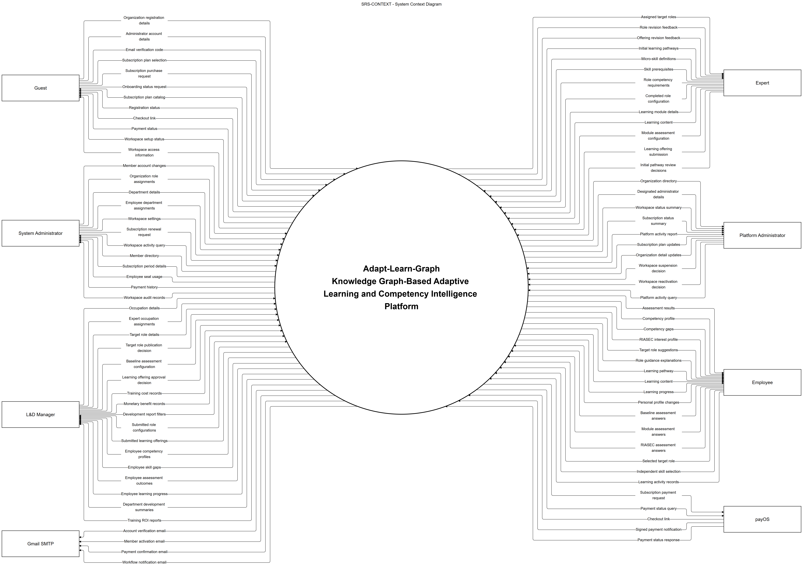

### 1.3 Scope baseline versus implementation

| Area | Required product outcome | Observed boundary on 2026-10-29 |
| --- | --- | --- |
| Onboarding and subscriptions | Purchase, provision, renew and enforce paid access | Connected API/persistence slices exist; live payment/inbox acceptance is not established by this report. |
| Identity and membership | Trusted authentication and organization permissions | Real sessions, single-role membership, activation, seats and administrator MFA exist. General permission editing and all-feature authorization are incomplete. |
| Department/job position management | Persisted administration and Expert assignments | Member assignment uses stored references; management screens remain browser-oriented prototypes. |
| Role/skill catalog | Assigned authoring followed by L&D publication | Legacy CRUD code exists but is gated by `catalog.legacy-api.enabled=true`; it is not the default production-safe authoring service. Existing Expert publication conflicts with Version 2. |
| Baseline | Authorized configuration, delivery, scoring and results | Real workspace-baseline integration is explicitly local-profile-only and needs reviewed graph content, question bank and promoted model resources. |
| Other learning and AI | Module/RIASEC evidence, guidance, mastery updates and adaptive pathways | Prototype screens and schema foundations do not constitute the complete learning engine. |
| Reporting/audit | Actual development, financial inputs and scoped audit views | Some durable events exist; connected ROI/cost-benefit ledger and broad audit dashboards are not evidenced. |
| Deployment | On-premises Compose, Nginx and CI/CD | Development Compose and a Caddy-based production-shaped configuration exist. Nginx, staging and GitHub Actions delivery are planned, not evidenced. |

Evidence precedence is Version 2 for intended scope, later approved decisions for detailed policy, current source/migrations for implementation, and dated test records for only the behavior actually tested. In particular, old one-to-one module/skill descriptions are superseded by many-to-many review datasets; the v0.11 dataset is not proof of a live graph migration.

## 2. User Requirements

### 2.1 Actors

| # | Actor | Description |
| --- | --- | --- |
| 1 | Guest | Registers an organization and initial administrator, compares plans, pays and tracks onboarding before workspace access. |
| 2 | Platform Administrator | Manages platform organizations and existing subscription plans; monitors authorized platform-level activity. Not implicitly entitled to private employee answers or files. |
| 3 | System Administrator | Organization administrator: manages accounts/memberships, roles, departments, workspace settings, subscription and permitted audit views. The current backend role code is `ORGANIZATION_ADMINISTRATOR`. |
| 4 | L&D Manager | Manages job positions and Expert assignments, role creation/publication, baseline configuration, offering approval and development/ROI reporting. |
| 5 | Expert | Authors skills, requirements, prerequisites, modules and assessments in assigned scope; submits work to L&D and confirms initial learning pathways. |
| 6 | Employee | Manages own profile, completes assessments, reviews guidance and gaps, chooses a role, learns and tracks own progress. |
| 7 | System | Internal automated performer: authentication, payments, provisioning, entitlements, assessment evaluation, competency/guidance/pathway/report generation, email and audit. |
| 8 | payOS | External payment provider; returns authenticated payment observations and hosts checkout. |
| 9 | SMTP email service | External delivery service for verification, activation and notifications; SMTP acceptance is not proof of inbox delivery. |
| 10 | Internal inference service | Planned locally hosted LLM interface for role suggestions and explanations. It is not a human reviewer or an external source of mastery truth. |

### 2.2 Use Cases

#### 2.2.1 Diagram(s)

**Use-case notation:** This single UML diagram shows the six concrete human actors outside the Adapt-Learn-Graph system boundary. Authenticated User is only a diagram shorthand that groups shared use cases and avoids repeated connections; it is not an additional product actor. All use cases are ellipses; actor participation uses solid lines without arrowheads. Requirement codes are not shown on the image. External-system actors are intentionally omitted from this actor-focused view; they remain documented in the system context and architecture.

[Mermaid source: UC-OVERVIEW](../documents/diagrams/mermaid/uc-overview.mmd)

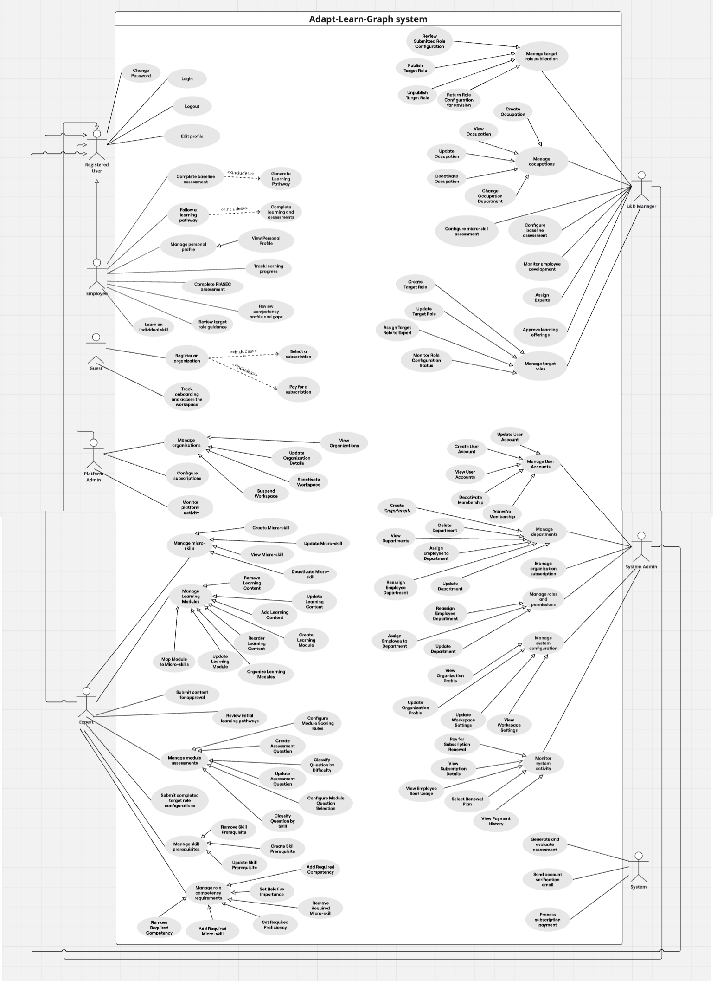

**Scope and relationship notes:**

- Login, Logout, Edit profile and Change password form one compact column beside Authenticated User. The shared profile edit is no longer tied to the Employee-only Manage personal profile group; Employee retains it through actor inheritance. Hidden layout constraints group these cases without introducing visible business relationships.
- The diagram retains the original 37 actor-facing goals and three internal supporting use cases. Seventy-one operations remain attached to management goals; the existing Edit profile operation is now shown only in the shared account cluster, inherited by Employee and the other specialized actors. Login, Logout and Change password are additional explicit shared goals; Edit profile reuses the existing personal-profile update operation instead of duplicating it. MFA authentication is shown separately for System Administrator.
- A solid line with a hollow triangle points from each concrete operation to its general Manage goal. For example, Create Department, View Departments, Update Department, Delete Department, Assign Employee to Department and Reassign Employee Department specialize Manage departments.
- These specializations inherit the parent's actor participation. They are alternative ways to fulfill the management goal, not mandatory steps performed together. They are therefore not modeled as `«include»` relationships.
- Five `«include»` arrows represent mandatory supporting behavior: organization registration to verification email; initial subscription payment and the explicit Pay for Subscription Renewal action to payment processing; baseline and RIASEC completion to assessment evaluation.
- Platform Administrator, System Administrator, L&D Manager, Expert and Employee specialize Authenticated User. Each solid generalization arrow points from the specialized actor to Authenticated User, with a hollow triangle at Authenticated User. They inherit participation in Login, Logout, Edit profile and Change password; Guest does not inherit these associations.
- Authenticated User is a modeling abstraction, not another stored role or permission grant. The name follows the requested actor terminology. Login describes establishing an authenticated session; the actor name alone does not bypass authentication or imply an already-valid session. Edit profile concerns the actor's own permitted information, not administrator-managed roles, department assignments or subscription privileges.
- System Administrator participates in MFA authentication, which has an `«extend»` arrow toward Login. Its extension point is after primary credential verification and before establishing a fully authenticated session. Condition: the account is a System Administrator subject to the MFA policy. MFA is mandatory whenever that condition is true; this is not a user-selectable bypass. No MFA association is added to Authenticated User or Platform Administrator.
- Login and Logout elaborate authentication behavior; Edit profile extends common self-service participation as requested on 1 November 2026. Change password is a user-requested diagram-level requirement and has not been implementation-verified by this documentation change. No new FR identifier or backend feature is introduced here.
- Manage organization subscription does not unconditionally include payment: viewing details/history is distinct from its payment specialization. Authentication remains a precondition for protected business goals.
- Department deletion is present because the source requires it. Account, job position and micro-skill hard deletion is not invented: their specified deactivate operations remain distinct. All constraints and implementation limitations in the SRS still apply.
- PNG export uses the compact validated layout and a maximum of 8,192 pixels per side; the oversized 4x image was replaced. The image was decoded in a browser and checked for complete opaque output before publication. With 116 use cases on one overview, open the image at its original size for readable text; the SVG remains the best format for unlimited zoom.
- Mermaid 12+ native `usecase-beta` syntax is used (currently beta). Hidden layout edges have no business meaning. The image contains 116 use-case ellipses, so use the full-size PNG/SVG for readable detail.
- FR references remain in source comments and the specification catalog for traceability, not in displayed labels. The historical UC-A/UC-B/UC-C files are retained but are not the current overview. No information was copied from the reference image.

**Notation references:** [UML use case diagram conventions](https://www.visual-paradigm.com/guide/uml-unified-modeling-language/what-is-use-case-diagram/) and [Mermaid native use case syntax](https://mermaid.js.org/syntax/usecase.html).

**Business activity diagrams.** The following actor-labeled flowcharts show participation and business handoffs rather than internal algorithms. Bold actor labels stay with each step, preserving ownership without long cross-lane return lines. Planned flows describe required product behavior; they do not assert complete implementation.

[Mermaid source: ACT-01](../documents/diagrams/mermaid/act-01.mmd)

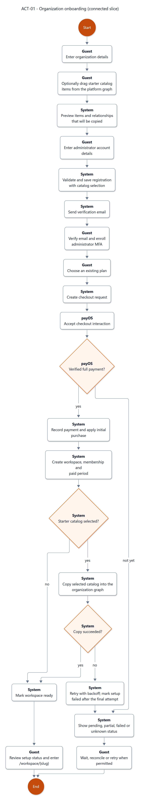

[Mermaid source: ACT-02](../documents/diagrams/mermaid/act-02.mmd)

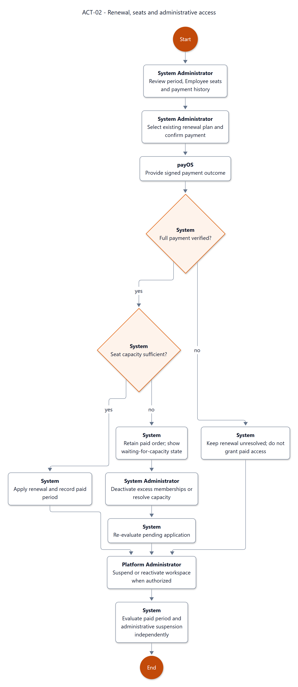

[Mermaid source: ACT-03](../documents/diagrams/mermaid/act-03.mmd)

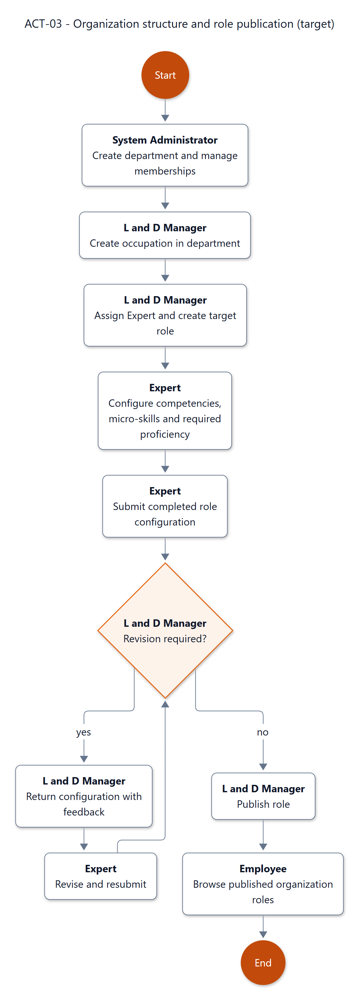

[Mermaid source: ACT-04](../documents/diagrams/mermaid/act-04.mmd)

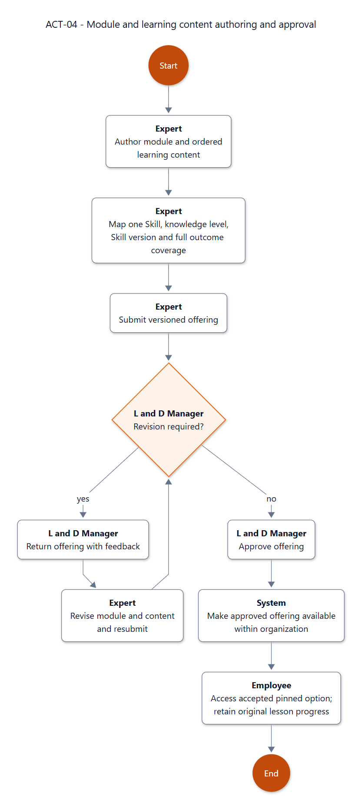

**Diagram scope (ACT-04):** This remains the target learning-offering bundle, including module assessment configuration. The current implemented slice lets the responsible Expert create/import skill-mapped Modules and ordered Text/Video lessons, save drafts and submit complete content; L&D returns or approves the exact Module revision, followed by retryable catalog publication. Other Experts are read-only. Module assessment construction is separate from Question Bank management. Approved publication does not grant every Employee learning access; current pathway, availability and content authorization still apply. See the current Module/Content state machine ST-11 in the SDD.


[Mermaid source: ACT-05](../documents/diagrams/mermaid/act-05.mmd)

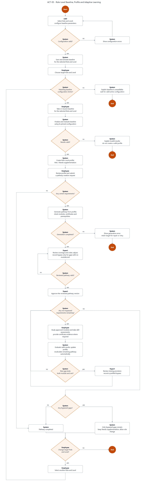

**ACT-05 scope (approved target):** L&D validates and activates a baseline configuration for an organization-scoped Role–Level pair. Employee admission requires the matching Active configuration; valid results create a Role-Level profile with Met / Needs supplementation outcomes. Employee reviews the profile and requests a pathway; Expert review, learning, skill assessment and automatic recalculation follow. Target change is allowed only after completion or when all remaining gaps have accepted bypasses because neither module nor certificate provision exists. Other errors retain the target for repair/retry. A new selection returns to matching baseline admission; historical results are retained. This diagram revision is a target design, not a claim of deployed schema or runtime behavior. ACT-06 guidance remains a separate journey.

[Mermaid source: ACT-07](../documents/diagrams/mermaid/act-07.mmd)

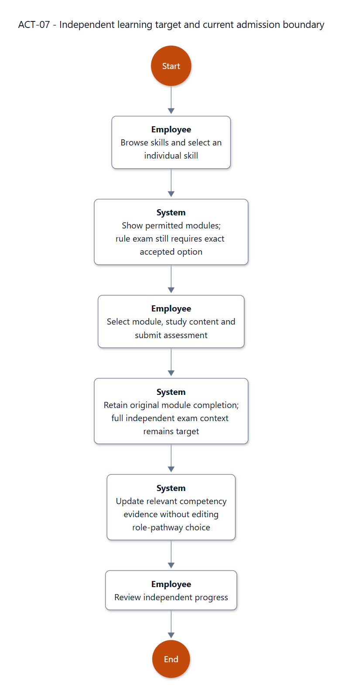

**Diagram scope (ACT-07):** This is a target independent-learning journey, not a claim that the full context/assessment workflow is implemented. The current reader persists authorized lesson/video progress; the independent-skill surface is not yet a complete persisted learning context. Content completion alone does not establish assessment success or mastery. Valid assessment evidence and the separate independent-learning integration are required before competency/progress updates; the selected Role pathway must remain unchanged. ST-23 in the SDD describes the corresponding target business states, not a new database enum.


[Mermaid source: ACT-08](../documents/diagrams/mermaid/act-08.mmd)

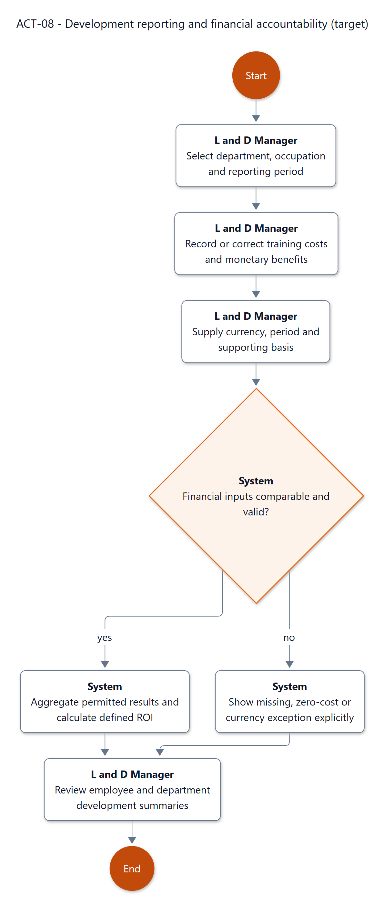

[Mermaid source: ACT-09](../documents/diagrams/mermaid/act-09.mmd)

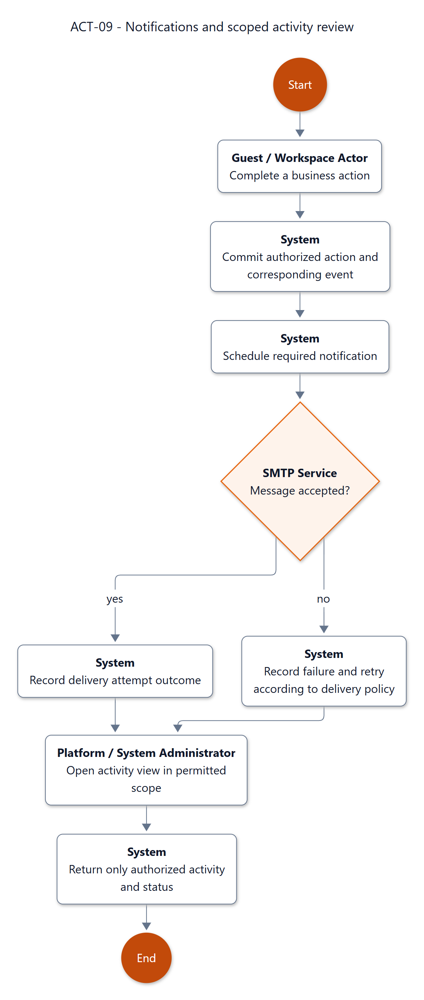

[Mermaid source: ACT-10](../documents/diagrams/mermaid/act-10.mmd)

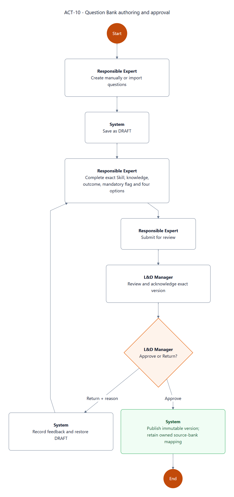

**Diagram scope (ACT-10):** The organization has one Question Bank spanning approved MicroSkills. The responsible Expert creates/imports drafts, completes question content and submits for review. L&D acknowledges the exact submitted version and either returns it with a reason to DRAFT or approves immutable publication. Server-generated codes, ownership, valid content, organization scope and current revision are enforced by the service. Import validation, withdrawal, successor drafts and retirement/reactivation remain specified in the [Question Bank rules](../documents/features/Assessment%20workflows/README.md#fr-05-06); the concise activity diagram shows the main flow only. This is not complete module-exam construction or IRT calibration. ST-16 in the SDD describes the current question-candidate lifecycle.


#### 2.2.2 Descriptions

**Diagram use case descriptions (116 entries).** Each row corresponds to exactly one ellipse in the current UC-OVERVIEW. These are intended behaviors, not a claim of implementation completion. The diagram key is a stable source identifier, not a newly assigned product FR.

- Authenticated User is only a diagram shorthand for shared functions, not a separate product actor or stored role. Shared functions list the actual participants: Platform Administrator, System Administrator, L&D Manager, Expert and Employee. Guest is not a participant.
- Specialized management use cases inherit their parent’s actor participation. System in the table denotes internal supporting behavior, not an external actor.
- Shared profile editing and Change password retain the user-requested scope. Password-change implementation is not verified by adding this description. All organization/assignment/entitlement restrictions and existing implementation qualifications remain applicable.

<!-- DIAGRAM_USE_CASE_DESCRIPTIONS:START -->

| No. | Use Case | Actors | Use Case Description | Diagram / source reference |
| --- | --- | --- | --- | --- |
| 1 | Login | Platform Administrator, System Administrator, L&D Manager, Expert, Employee | Verify primary credentials and establish a session after any required MFA check. | `Login`; [FR-07.01](#fr-07-01) |
| 2 | Logout | Platform Administrator, System Administrator, L&D Manager, Expert, Employee | Terminate the current session and prevent further access through that session. | `Logout`; [FR-07.01](#fr-07-01) |
| 3 | Change password | Platform Administrator, System Administrator, L&D Manager, Expert, Employee | Change the account holder’s password under the approved credential-verification policy; implementation remains unverified. | `ChangePassword`; User-requested shared goal; implementation unverified |
| 4 | MFA authentication | System Administrator | Verify the second factor during Login when the System Administrator MFA policy applies; mandatory under that condition. | `MfaAuthentication`; [FR-07.01](#fr-07-01); conditional extension of Login |
| 5 | Register an organization | Guest | Submit organization and administrator details, verify email and resume incomplete registration. | `UC0101`; [FR-01.01](#fr-01-01) |
| 6 | Select a subscription | Guest | Compare subscription price, currency, duration and Employee seats, then select an available plan. | `UC0102`; [FR-01.02](#fr-01-02) |
| 7 | Pay for a subscription | Guest | Pay for the selected subscription, inspect payment status and retry when permitted. | `UC0103`; [FR-01.03](#fr-01-03) |
| 8 | Track onboarding and access the workspace | Guest | Review registration, payment and workspace setup status before authorized workspace entry. | `UC0104`; [FR-01.04](#fr-01-04) |
| 9 | Manage organizations | Platform Administrator | View organization and administrator information, update permitted details, and suspend or reactivate workspaces. | `UC0201`; [FR-02.01](#fr-02-01) |
| 10 | View Organizations | Platform Administrator | Display permitted organization details, designated administrators and workspace/subscription status. | `UC0201Action1`; [FR-02.01](#fr-02-01); specializes `UC0201` |
| 11 | Update Organization Details | Platform Administrator | Save authorized changes to an organization’s profile without altering private learner evidence. | `UC0201Action2`; [FR-02.01](#fr-02-01); specializes `UC0201` |
| 12 | Suspend Workspace | Platform Administrator | Record an authorized suspension decision and block ordinary workspace access. | `UC0201Action3`; [FR-02.01](#fr-02-01); specializes `UC0201` |
| 13 | Reactivate Workspace | Platform Administrator | Restore administrative workspace availability without creating an unpaid subscription entitlement. | `UC0201Action4`; [FR-02.01](#fr-02-01); specializes `UC0201` |
| 14 | Configure subscriptions | Platform Administrator | Update existing subscription plan terms without changing previously purchased versions. | `UC0202`; [FR-02.02](#fr-02-02) |
| 15 | Monitor platform activity | Platform Administrator | Review registration/setup outcomes, subscription and payment summaries, service errors and platform audit activity. | `UC0203`; [FR-02.03](#fr-02-03) |
| 16 | Manage user accounts | System Administrator | Create, view and update organization accounts and activate or deactivate memberships. | `UC0301`; [FR-03.01](#fr-03-01) |
| 17 | Create User Account | System Administrator | Create an organization account and initiate the applicable recipient activation flow. | `UC0301Action1`; [FR-03.01](#fr-03-01); specializes `UC0301` |
| 18 | View User Accounts | System Administrator | Display authorized organization members and pending account activations. | `UC0301Action2`; [FR-03.01](#fr-03-01); specializes `UC0301` |
| 19 | Update User Account | System Administrator | Edit permitted account/profile/assignment fields while preserving role, reference and seat constraints. | `UC0301Action3`; [FR-03.01](#fr-03-01); specializes `UC0301` |
| 20 | Activate Membership | System Administrator | Activate an eligible membership after checking authorization, role and available Employee-seat capacity. | `UC0301Action4`; [FR-03.01](#fr-03-01); specializes `UC0301` |
| 21 | Deactivate Membership | System Administrator | Disable ordinary membership access while preserving history and the last required administrator. | `UC0301Action5`; [FR-03.01](#fr-03-01); specializes `UC0301` |
| 22 | Manage departments | System Administrator | Create, view, update or delete departments and manage Employee department assignments. | `UC0302`; [FR-03.02](#fr-03-02) |
| 23 | Create Department | System Administrator | Create a department owned by the authorized organization. | `UC0302Action1`; [FR-03.02](#fr-03-02); specializes `UC0302` |
| 24 | View Departments | System Administrator | Display organization departments and their permitted Employee assignments. | `UC0302Action2`; [FR-03.02](#fr-03-02); specializes `UC0302` |
| 25 | Update Department | System Administrator | Save permitted department-detail changes without breaking existing references. | `UC0302Action3`; [FR-03.02](#fr-03-02); specializes `UC0302` |
| 26 | Delete Department | System Administrator | Delete a department only under an approved policy that preserves or resolves existing references. | `UC0302Action4`; [FR-03.02](#fr-03-02); specializes `UC0302` |
| 27 | Assign Employee to Department | System Administrator | Assign an organization Employee to a valid same-organization department. | `UC0302Action5`; [FR-03.02](#fr-03-02); specializes `UC0302` |
| 28 | Reassign Employee Department | System Administrator | Move an Employee’s department assignment while preserving valid job position links and history. | `UC0302Action6`; [FR-03.02](#fr-03-02); specializes `UC0302` |
| 29 | Manage roles and permissions | System Administrator | Assign organization roles and manage permitted workspace access. | `UC0303`; [FR-03.03](#fr-03-03) |
| 30 | Assign Organization Role | System Administrator | Assign the permitted organization-side role under the current single-role account policy. | `UC0303Action1`; [FR-03.03](#fr-03-03); specializes `UC0303` |
| 31 | Remove Organization Role | System Administrator | Remove or replace a role assignment without violating the required administrator and single-role safeguards. | `UC0303Action2`; [FR-03.03](#fr-03-03); specializes `UC0303` |
| 32 | Configure Workspace Access Permissions | System Administrator | Update permitted workspace access without granting authority through browser-selected roles or organization IDs. | `UC0303Action3`; [FR-03.03](#fr-03-03); specializes `UC0303` |
| 33 | Manage system configuration | System Administrator | View and update organization profile details and approved workspace settings. | `UC0304`; [FR-03.04](#fr-03-04) |
| 34 | View Organization Profile | System Administrator | Display the authorized organization’s current profile information. | `UC0304Action1`; [FR-03.04](#fr-03-04); specializes `UC0304` |
| 35 | Update Organization Profile | System Administrator | Save permitted organization profile changes with validation and access checks. | `UC0304Action2`; [FR-03.04](#fr-03-04); specializes `UC0304` |
| 36 | View Workspace Settings | System Administrator | Display the organization’s approved saved workspace configuration. | `UC0304Action3`; [FR-03.04](#fr-03-04); specializes `UC0304` |
| 37 | Update Workspace Settings | System Administrator | Save approved workspace settings without treating illustrative prototype options as enforced behavior. | `UC0304Action4`; [FR-03.04](#fr-03-04); specializes `UC0304` |
| 38 | Monitor system activity | System Administrator | Review authorized organization administrative and learning-workflow audit activity. | `UC0305`; [FR-03.05](#fr-03-05) |
| 39 | Manage organization subscription | System Administrator | View subscription periods, seats and payment history, select a renewal plan and pay for renewal. | `UC0306`; [FR-03.06](#fr-03-06) |
| 40 | View Subscription Details | System Administrator | Display current and scheduled paid subscription periods and their purchased terms. | `UC0306Action1`; [FR-03.06](#fr-03-06); specializes `UC0306` |
| 41 | View Employee Seat Usage | System Administrator | Display allocated Employee seats and the organization’s active Employee membership usage. | `UC0306Action2`; [FR-03.06](#fr-03-06); specializes `UC0306` |
| 42 | View Payment History | System Administrator | Display payment orders and verified outcomes owned by the organization. | `UC0306Action3`; [FR-03.06](#fr-03-06); specializes `UC0306` |
| 43 | Select Renewal Plan | System Administrator | Choose an existing subscription plan/version for the organization’s renewal. | `UC0306Action4`; [FR-03.06](#fr-03-06); specializes `UC0306` |
| 44 | Pay for Subscription Renewal | System Administrator | Pay for selected renewal terms; apply verified payment only when period and capacity conditions permit. | `UC0306Action5`; [FR-03.06](#fr-03-06); specializes `UC0306` |
| 45 | Manage job positions | L&D Manager | Manage job position details, department associations and active availability within the organization. | `UC0401`; [FR-04.01](#fr-04-01) |
| 46 | Create Job Position | L&D Manager | Create an organization job position with its required valid department association. | `UC0401Action1`; [FR-04.01](#fr-04-01); specializes `UC0401` |
| 47 | View Job Positions | L&D Manager | Display job positions, department associations and availability within the permitted organization. | `UC0401Action2`; [FR-04.01](#fr-04-01); specializes `UC0401` |
| 48 | Update Job Position | L&D Manager | Save authorized job position-detail changes while preserving catalog and historical references. | `UC0401Action3`; [FR-04.01](#fr-04-01); specializes `UC0401` |
| 49 | Deactivate Job Position | L&D Manager | Stop new job position availability while retaining historical assignments, role selections and assessment evidence. | `UC0401Action4`; [FR-04.01](#fr-04-01); specializes `UC0401` |
| 50 | Change Job Position Department | L&D Manager | Update an job position’s association to a valid same-organization department. | `UC0401Action5`; [FR-04.01](#fr-04-01); specializes `UC0401` |
| 51 | Assign Experts | L&D Manager | Assign or remove eligible Experts from job positions and view their current assignments. | `UC0402`; [FR-04.02](#fr-04-02) |
| 52 | Manage target roles | L&D Manager | Create and update job position target roles, assign Experts and monitor configuration status. | `UC0403`; [FR-04.03](#fr-04-03) |
| 53 | Create Target Role | L&D Manager | Create a target-role draft within an authorized job position; it is not selectable until published. | `UC0403Action1`; [FR-04.03](#fr-04-03); specializes `UC0403` |
| 54 | Update Target Role | L&D Manager | Save permitted role-detail changes without silently overwriting submitted requirements or historical selections. | `UC0403Action2`; [FR-04.03](#fr-04-03); specializes `UC0403` |
| 55 | Assign Target Role to Expert | L&D Manager | Assign configuration responsibility to an eligible Expert within the authorized scope. | `UC0403Action3`; [FR-04.03](#fr-04-03); specializes `UC0403` |
| 56 | Monitor Role Configuration Status | L&D Manager | Display the assigned role’s configuration and submission progress. | `UC0403Action4`; [FR-04.03](#fr-04-03); specializes `UC0403` |
| 57 | Manage target role publication | L&D Manager | Review submitted role requirements, publish or unpublish target roles and return configurations for revision. | `UC0404`; [FR-04.04](#fr-04-04) |
| 58 | Review Submitted Role Configuration | L&D Manager | Inspect the exact Expert-submitted role requirements before a publication or revision decision. | `UC0404Action1`; [FR-04.04](#fr-04-04); specializes `UC0404` |
| 59 | Publish Target Role | L&D Manager | Publish an eligible submitted role configuration for permitted organization Employees. | `UC0404Action2`; [FR-04.04](#fr-04-04); specializes `UC0404` |
| 60 | Unpublish Target Role | L&D Manager | Remove a role’s current availability while preserving previous configurations and learner-selection history. | `UC0404Action3`; [FR-04.04](#fr-04-04); specializes `UC0404` |
| 61 | Return Role Configuration for Revision | L&D Manager | Send a submitted configuration back to its Expert with actionable revision feedback. | `UC0404Action4`; [FR-04.04](#fr-04-04); specializes `UC0404` |
| 62 | Manage baseline assessment configuration | L&D Manager | Configure baseline competency coverage, question selection and scoring rules. | `UC0405`; [FR-04.05](#fr-04-05) |
| 63 | Configure Baseline Competency Coverage | L&D Manager | Choose the permitted Job Position competency/skill coverage for baseline assessment. | `UC0405Action1`; [FR-04.05](#fr-04-05); specializes `UC0405` |
| 64 | Configure Baseline Question Selection | L&D Manager | Save feasible baseline selection rules and question/time bounds without changing released attempt versions. | `UC0405Action2`; [FR-04.05](#fr-04-05); specializes `UC0405` |
| 65 | Configure Baseline Scoring Rules | L&D Manager | Define validated baseline evaluation rules under the applicable versioned policy. | `UC0405Action3`; [FR-04.05](#fr-04-05); specializes `UC0405` |
| 66 | Approve learning offerings | L&D Manager | Review a submitted module, content and assessment bundle, then approve or return it for revision. | `UC0406`; [FR-04.06](#fr-04-06) |
| 67 | Monitor employee development | L&D Manager | View development and ROI summaries, filter reporting scope and maintain training cost/benefit records. | `UC0407`; [FR-04.07](#fr-04-07) |
| 68 | Manage micro-skills | Expert | Manage micro-skill definitions, proficiency information and availability within assigned job positions. | `UC0501`; [FR-05.01](#fr-05-01) |
| 69 | Create Micro-skill | Expert | Create a stable skill definition and proficiency information in the Expert’s assigned scope. | `UC0501Action1`; [FR-05.01](#fr-05-01); specializes `UC0501` |
| 70 | View Micro-skills | Expert | Browse permitted skill identities, definitions, proficiency information and availability. | `UC0501Action2`; [FR-05.01](#fr-05-01); specializes `UC0501` |
| 71 | Update Micro-skill | Expert | Save authorized changes to a skill definition while preserving assessment references. | `UC0501Action3`; [FR-05.01](#fr-05-01); specializes `UC0501` |
| 72 | Deactivate Micro-skill | Expert | Stop new skill availability without deleting existing evidence or historical catalog references. | `UC0501Action4`; [FR-05.01](#fr-05-01); specializes `UC0501` |
| 73 | Manage role competency requirements | Expert | Define required competencies, micro-skills, proficiency and relative importance for assigned roles. | `UC0502`; [FR-05.02](#fr-05-02) |
| 74 | Add Required Competency | Expert | Add an eligible competency requirement to the assigned target-role configuration. | `UC0502Action1`; [FR-05.02](#fr-05-02); specializes `UC0502` |
| 75 | Remove Required Competency | Expert | Remove a competency requirement from the editable assigned-role configuration while preserving historical versions. | `UC0502Action2`; [FR-05.02](#fr-05-02); specializes `UC0502` |
| 76 | Add Required Micro-skill | Expert | Add an eligible micro-skill requirement to the assigned target role/level. | `UC0502Action3`; [FR-05.02](#fr-05-02); specializes `UC0502` |
| 77 | Remove Required Micro-skill | Expert | Remove a micro-skill requirement from the editable configuration without rewriting historical evidence. | `UC0502Action4`; [FR-05.02](#fr-05-02); specializes `UC0502` |
| 78 | Set Required Proficiency | Expert | Set the required proficiency for an applicable role/level skill requirement. | `UC0502Action5`; [FR-05.02](#fr-05-02); specializes `UC0502` |
| 79 | Set Relative Importance | Expert | Set a requirement’s relative importance under an approved weighting policy. | `UC0502Action6`; [FR-05.02](#fr-05-02); specializes `UC0502` |
| 80 | Submit completed target role configurations | Expert | Submit completed target-role requirements to L&D and revise returned configurations. | `UC0503`; [FR-05.03](#fr-05-03) |
| 81 | Manage skill prerequisites | Expert | Create, update or remove directed prerequisite relationships without introducing self-links or cycles. | `UC0504`; [FR-05.04](#fr-05-04) |
| 82 | Create Skill Prerequisite | Expert | Add a directed skill-readiness dependency after rejecting self-links and cycles. | `UC0504Action1`; [FR-05.04](#fr-05-04); specializes `UC0504` |
| 83 | Update Skill Prerequisite | Expert | Change an authorized prerequisite/readiness requirement without introducing a cycle. | `UC0504Action2`; [FR-05.04](#fr-05-04); specializes `UC0504` |
| 84 | Remove Skill Prerequisite | Expert | Remove an authorized directed prerequisite relationship. | `UC0504Action3`; [FR-05.04](#fr-05-04); specializes `UC0504` |
| 85 | Manage learning modules | Expert | Author and organize modules, skill mappings and ordered learning content. | `UC0505`; [FR-05.05](#fr-05-05) |
| 86 | Create Learning Module | Expert | Create an assigned-scope learning-module draft with stable module identity. | `UC0505Action1`; [FR-05.05](#fr-05-05); specializes `UC0505` |
| 87 | Update Learning Module | Expert | Save permitted module changes as appropriate versions, preserving previously used content. | `UC0505Action2`; [FR-05.05](#fr-05-05); specializes `UC0505` |
| 88 | Organize Learning Modules | Expert | Arrange authored modules within their permitted offering/catalog organization. | `UC0505Action3`; [FR-05.05](#fr-05-05); specializes `UC0505` |
| 89 | Map Module to Micro-skills | Expert | Define many-to-many teaching coverage between a module and eligible micro-skills. | `UC0505Action4`; [FR-05.05](#fr-05-05); specializes `UC0505` |
| 90 | Add Learning Content | Expert | Add an authorized content item or private object reference to the module. | `UC0505Action5`; [FR-05.05](#fr-05-05); specializes `UC0505` |
| 91 | Update Learning Content | Expert | Revise module content while retaining content-version identity and historical references. | `UC0505Action6`; [FR-05.05](#fr-05-05); specializes `UC0505` |
| 92 | Reorder Learning Content | Expert | Change the saved order of content items within a module. | `UC0505Action7`; [FR-05.05](#fr-05-05); specializes `UC0505` |
| 93 | Remove Learning Content | Expert | Remove an item from editable module content without deleting history-bearing approved versions. | `UC0505Action8`; [FR-05.05](#fr-05-05); specializes `UC0505` |
| 94 | Manage module assessments | Expert | Author module questions and configure skill/difficulty classification, selection and scoring rules. | `UC0506`; [FR-05.06](#fr-05-06) |
| 95 | Create Assessment Question | Expert | Author a complete module question with options, protected answer data and required classification. | `UC0506Action1`; [FR-05.06](#fr-05-06); specializes `UC0506` |
| 96 | Update Assessment Question | Expert | Revise an editable module question without changing versions pinned by learner attempts. | `UC0506Action2`; [FR-05.06](#fr-05-06); specializes `UC0506` |
| 97 | Classify Question by Skill | Expert | Associate a question with an eligible micro-skill for evidence/scoring interpretation. | `UC0506Action3`; [FR-05.06](#fr-05-06); specializes `UC0506` |
| 98 | Classify Question by Difficulty | Expert | Set the question’s permitted difficulty classification under the assessment model. | `UC0506Action4`; [FR-05.06](#fr-05-06); specializes `UC0506` |
| 99 | Configure Module Question Selection | Expert | Define eligible question-selection rules for the assigned module assessment. | `UC0506Action5`; [FR-05.06](#fr-05-06); specializes `UC0506` |
| 100 | Configure Module Scoring Rules | Expert | Define validated answer-evaluation and outcome rules for the assigned module assessment. | `UC0506Action6`; [FR-05.06](#fr-05-06); specializes `UC0506` |
| 101 | Review initial learning pathways | Expert | Review initial pathways, include or exclude suggested modules and confirm the exact pathway version. | `UC0507`; [FR-05.07](#fr-05-07) |
| 102 | Submit content for approval | Expert | Submit a new or revised module/content/assessment bundle for L&D approval. | `UC0508`; [FR-05.08](#fr-05-08) |
| 103 | Manage personal profile | Employee | Manage own permitted personal and work-related profile information; Edit profile is inherited through Authenticated User. | `UC0601`; [FR-06.01](#fr-06-01) |
| 104 | View Personal Profile | Employee | Display the Employee’s own personal and work-related profile information. | `UC0601Action1`; [FR-06.01](#fr-06-01); specializes `UC0601` |
| 105 | Edit profile | Platform Administrator, System Administrator, L&D Manager, Expert, Employee | Save permitted own-account profile changes; do not edit administrator-owned roles, assignments or entitlement. | `UC0601Action2`; [FR-06.01](#fr-06-01); user-requested shared actor scope |
| 106 | Complete baseline assessment | Employee | Start or resume the required baseline, submit answers and review valid results. | `UC0602`; [FR-06.02](#fr-06-02) |
| 107 | Complete RIASEC assessment | Employee | Complete the selected interest questionnaire and receive purpose-specific RIASEC scores. | `UC0603`; [FR-06.03](#fr-06-03) |
| 108 | Review target role guidance | Employee | Review AI role suggestions and explanations, then explicitly choose an eligible published organization role. | `UC0604`; [FR-06.04](#fr-06-04) |
| 109 | Review competency profile and gaps | Employee | View own competency evidence and gaps against the selected target role. | `UC0605`; [FR-06.05](#fr-06-05) |
| 110 | Follow a learning pathway | Employee | Follow the Expert-confirmed initial pathway and review later remaining-pathway updates. | `UC0606`; [FR-06.06](#fr-06-06) |
| 111 | Learn an individual skill | Employee | Select a micro-skill and access its approved mapped modules for independent learning. | `UC0607`; [FR-06.07](#fr-06-07) |
| 112 | Complete learning and assessments | Employee | Study authorized module content, take module assessments and submit answers. | `UC0608`; [FR-06.08](#fr-06-08) |
| 113 | Track learning progress | Employee | Review saved learning activities, assessment outcomes, competency progress and pathway status. | `UC0609`; [FR-06.09](#fr-06-09) |
| 114 | Process subscription payment | System (internal supporting behavior) | Create payment requests, verify payment evidence and record/apply eligible outcomes without duplicates. | `UC0702`; [FR-07.02](#fr-07-02) |
| 115 | Generate and evaluate assessment | System (internal supporting behavior) | Generate eligible assessment items and evaluate answers using the applicable versioned assessment/scoring policy. | `UC0705`; [FR-07.05](#fr-07-05) |
| 116 | Send account verification email | System (internal supporting behavior) | Send the recorded recipient an account-verification message and expose delivery failure or retry status. | `UC0710`; [FR-07.10](#fr-07-10); account-verification slice |

<!-- DIAGRAM_USE_CASE_DESCRIPTIONS:END -->

**Source requirement catalog (48 FRs).** The unchanged table below retains the original source-level requirements, including automated functions not separately expanded in the overview. Each source function continues to link to its detailed functional specification.

<!-- USE_CASE_TABLE:START -->

| ID | Use Case | Actors | Use Case Description |
| --- | --- | --- | --- |
| [FR-01.01](#fr-01-01) | Register an organization | Guest | The Guest shall submit organization and contact details, create an administrator account, verify the account email, and resume an incomplete registration. |
| [FR-01.02](#fr-01-02) | Select a subscription | Guest | The Guest shall view existing subscription plans, compare their price, currency, duration, and allocated Employee seats, and select a plan. |
| [FR-01.03](#fr-01-03) | Pay for a subscription | Guest | The Guest shall pay for the selected subscription, view payment status, and retry an unsuccessful payment. |
| [FR-01.04](#fr-01-04) | Track onboarding and access the workspace | Guest | The Guest shall view registration, payment, and workspace setup status and access the organization workspace. |
| [FR-02.01](#fr-02-01) | Manage organizations | Platform Administrator | The Platform Administrator shall view registered organizations, workspace and subscription status, and designated organization administrators; update organization details; and suspend or reactivate workspaces. |
| [FR-02.02](#fr-02-02) | Configure subscriptions | Platform Administrator | The Platform Administrator shall update existing subscription plans’ name, description, price, currency, duration, and allocated Employee-seat limit. |
| [FR-02.03](#fr-02-03) | Monitor platform activity | Platform Administrator | The Platform Administrator shall view registration and workspace setup outcomes, organization and subscription counts, payment status and amounts, service errors, and administrative audit events. |
| [FR-03.01](#fr-03-01) | Manage user accounts | System Administrator | The System Administrator shall create, view, and update user accounts and activate or deactivate organization memberships. |
| [FR-03.02](#fr-03-02) | Manage departments | System Administrator | The System Administrator shall create, view, update, and delete departments and assign or reassign employees to departments within the organization. |
| [FR-03.03](#fr-03-03) | Manage roles and permissions | System Administrator | The System Administrator shall assign or remove organization-side roles and manage workspace access permissions. |
| [FR-03.04](#fr-03-04) | Manage system configuration | System Administrator | The System Administrator shall view and update organization profile details and workspace settings. |
| [FR-03.05](#fr-03-05) | Monitor system activity | System Administrator | The System Administrator shall view workspace activity and audit records, including role and content changes, approvals, publications, assessment submissions, and pathway reviews. |
| [FR-03.06](#fr-03-06) | Manage organization subscription | System Administrator | The System Administrator shall view subscription details, the paid period, allocated and used Employee seats, and payment history; select an existing plan for renewal; and pay to renew the subscription. |
| [FR-04.01](#fr-04-01) | Manage job positions | L&D Manager | The L&D Manager shall create, view, update, and deactivate job positions, attach an job position to a department during creation, and update its department association. |
| [FR-04.02](#fr-04-02) | Assign Experts | L&D Manager | The L&D Manager shall assign or remove Experts from job positions and view their current assignments. |
| [FR-04.03](#fr-04-03) | Manage target roles | L&D Manager | The L&D Manager shall create and update target role details within job positions, assign target roles to Experts, and monitor configuration status. |
| [FR-04.04](#fr-04-04) | Manage target role publication | L&D Manager | The L&D Manager shall review submitted target role configurations, publish or unpublish target roles, and return configurations to Experts for revision. |
| [FR-04.05](#fr-04-05) | Manage baseline assessment configuration | L&D Manager | The L&D Manager shall configure baseline competency coverage, question-selection rules, and scoring rules. |
| [FR-04.06](#fr-04-06) | Approve learning offerings | L&D Manager | The L&D Manager shall review submitted learning modules, learning content, and module assessments; approve them; or return them to Experts for revision. |
| [FR-04.07](#fr-04-07) | Monitor employee development | L&D Manager | The L&D Manager shall view employee competency profiles, skill gaps, assessment outcomes, learning progress, training ROI, and department development summaries; filter results by department, job position, and reporting period; and record or update training costs and monetary benefits with their period, currency, and supporting basis. |
| [FR-05.01](#fr-05-01) | Manage micro-skills | Expert | The Expert shall create, view, update, and deactivate micro-skills within assigned job positions, including descriptions and proficiency levels. |
| [FR-05.02](#fr-05-02) | Manage role competency requirements | Expert | The Expert shall add or remove required competencies and micro-skills for assigned target roles and set required proficiency levels and relative importance. |
| [FR-05.03](#fr-05-03) | Submit completed target role configurations | Expert | The Expert shall submit completed target role competency configurations to the L&D Manager and revise returned configurations. |
| [FR-05.04](#fr-05-04) | Manage skill prerequisites | Expert | The Expert shall define, update, and remove prerequisite relationships between micro-skills. |
| [FR-05.05](#fr-05-05) | Manage learning modules | Expert | The Expert shall create, update, and organize learning modules, map modules to micro-skills, and add, update, organize, or remove learning content within each module. |
| [FR-05.06](#fr-05-06) | Manage module assessments | Expert | The Expert shall create and update questions for assigned modules, classify questions by micro-skill and difficulty, and configure question-selection and scoring rules. |
| [FR-05.07](#fr-05-07) | Review initial learning pathways | Expert | The Expert shall review initial learning pathways, include or exclude suggested modules, and confirm the pathways. |
| [FR-05.08](#fr-05-08) | Submit content for approval | Expert | The Expert shall submit new or revised learning modules, including their learning content and module assessments, to the L&D Manager for approval. |
| [FR-06.01](#fr-06-01) | Manage personal profile | Employee | The Employee shall view and update personal and work-related profile information. |
| [FR-06.02](#fr-06-02) | Complete baseline assessment | Employee | The Employee shall take the baseline assessment and submit answers. |
| [FR-06.03](#fr-06-03) | Complete RIASEC assessment | Employee | The Employee shall complete the RIASEC interest assessment and submit answers. |
| [FR-06.04](#fr-06-04) | Review target role guidance | Employee | The Employee shall view AI-generated role suggestions and comments and select or confirm a published target role within the organization. |
| [FR-06.05](#fr-06-05) | Review competency profile and gaps | Employee | The Employee shall view the current competency profile and skill gaps against the selected target role. |
| [FR-06.06](#fr-06-06) | Follow a learning pathway | Employee | The Employee shall view and follow their learning pathway, access its recommended modules, and view pathway updates. |
| [FR-06.07](#fr-06-07) | Learn an individual skill | Employee | The Employee shall browse available micro-skills, select a skill for independent learning, and access its mapped learning modules and content. |
| [FR-06.08](#fr-06-08) | Complete learning and assessments | Employee | The Employee shall access learning modules and their learning content, take module assessments, and submit answers. |
| [FR-06.09](#fr-06-09) | Track learning progress | Employee | The Employee shall view completed learning activities, assessment outcomes, competency progress, and pathway status. |
| [FR-07.01](#fr-07-01) | Authenticate users and authorize access | System | The System shall authenticate users, manage sign-in sessions, and authorize access to platform and organization functions. |
| [FR-07.02](#fr-07-02) | Process subscription payments | System | The System shall create payment requests, verify payment outcomes, and record payment status and transaction history. |
| [FR-07.03](#fr-07-03) | Provision organization workspaces | System | The System shall create organization workspaces, activate subscriptions, and assign the initial System Administrator. |
| [FR-07.04](#fr-07-04) | Maintain subscription entitlements | System | The System shall update subscription and renewal status, track allocated and used Employee seats, and control workspace access. |
| [FR-07.05](#fr-07-05) | Generate and evaluate assessments | System | The System shall generate baseline and module assessments, score submitted answers, and calculate RIASEC interest profiles. |
| [FR-07.06](#fr-07-06) | Update competency profiles and gaps | System | The System shall update employee mastery estimates and competency profiles and calculate gaps against selected target roles. |
| [FR-07.07](#fr-07-07) | Generate target role guidance | System | The System shall generate AI-assisted target role suggestions and explanations for Employees. |
| [FR-07.08](#fr-07-08) | Generate and adapt learning pathways | System | The System shall recommend learning modules, generate initial learning pathways, and recalculate remaining pathways from updated assessment results. |
| [FR-07.09](#fr-07-09) | Generate development summaries and ROI | System | The System shall aggregate employee and department development results and calculate training ROI from recorded costs and monetary benefits. |
| [FR-07.10](#fr-07-10) | Send email notifications | System | The System shall send account-verification emails and notifications about payment status and workflow updates. |
| [FR-07.11](#fr-07-11) | Record system activity | System | The System shall record administrative actions, payment events, content and role changes, assessment submissions, and pathway updates. |

<!-- USE_CASE_TABLE:END -->

## 3. Functional Requirements

### 3.1 System Functional Overview

#### 3.1.1 Screens Flow

The five flows below reflect the current [router](../frontend/src/app/App.tsx), [workspace navigation](../frontend/src/shared/layouts/WorkspaceLayout.tsx) and actual page/dialog components. They cover Guest, Expert, L&D Manager, System Administrator and Platform Administrator. The screen-description table covers these same flows; Employee requirements elsewhere in this SRS remain unchanged.

**Notation and reading rules**

- **Rectangle:** a routed page. **Rounded rectangle:** an actual overlay dialog/modal; it has no separate page URL. Ellipses are not used. These are explicitly defined screen-flow conventions, not UML activity-diagram symbols.
- **Solid arrow:** an implemented navigation control, dialog action or configured checkout callback. **Dotted arrow:** direct-address/invitation route availability, not proof of an implemented menu link. Arrow captions state the action or condition; save/confirm paths require a successful action.
- Diagram nodes and Screen Descriptions use **short screen names**, without URLs. Page/dialog shapes carry the notation rather than repeated "Dialog" labels. Route definitions remain in the linked router; in routing notes, `W` means `/workspace/:workspaceSlug`, as defined by [workspace paths](../frontend/src/shared/auth/workspacePaths.ts).
- Sidebar choices are drawn once from the actor's default home for readability. They are sibling destinations, **not a required business sequence**. Actor-scoped pages using `WorkspaceLayout` share that navigation; dialog close/cancel returns to its owner page.
- Registration steps, sign-in MFA/recovery, tabs, filters, profile forms and inline renewal/status panels remain inside their page. Aliases and Draft/version query parameters are not counted as new screens. Selected core dialogs are shown, not every import, metadata or warning overlay.
- Default homes follow [role-home routing](../frontend/src/shared/auth/workspaceRole.ts): Expert target roles, L&D job positions, System Administrator subscription and Platform Administrator subscriptions. A validated `returnTo` can override the default after sign-in.
- Route visibility is not an authorization grant. Trusted role, workspace, assignment, feature and entitlement guards can show blocked/unavailable states instead of page content.

**Guest**

[Mermaid source: SCREEN-GUEST](../documents/diagrams/mermaid/screen-flow-guest.mmd)

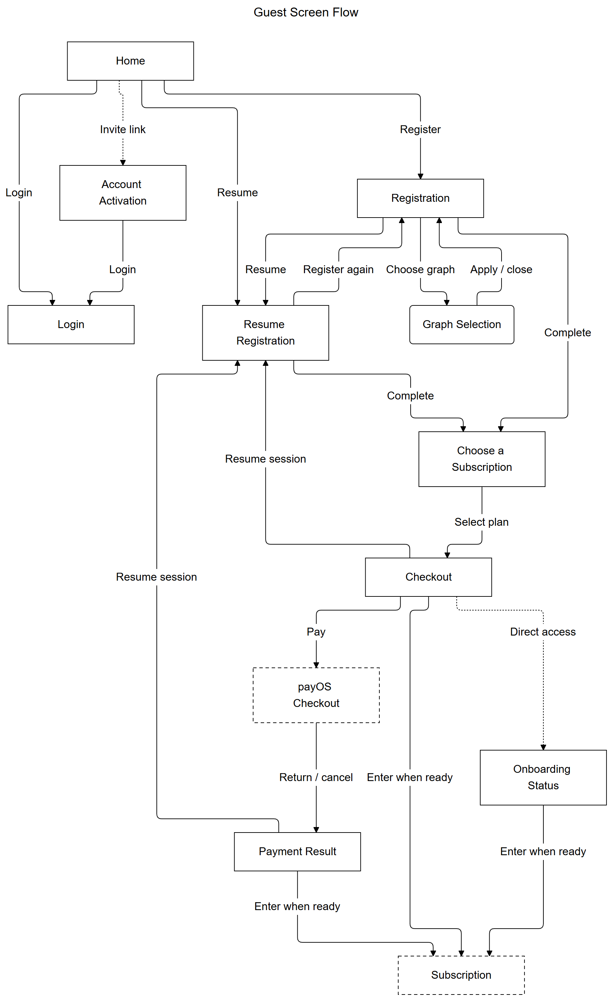

The optional initial-graph picker is a dialog in the **organization registration step**, not after completed registration. Checkout, payment result and onboarding status render related payment/setup panels; a paid state does not automatically navigate to another application page. The workspace-entry action requires an applied order and a READY workspace. payOS is a separately labeled external browser page, never an application dialog; development bypass is not evidence of a real payment.

**Expert**

[Mermaid source: SCREEN-EXPERT](../documents/diagrams/mermaid/screen-flow-expert.mmd)

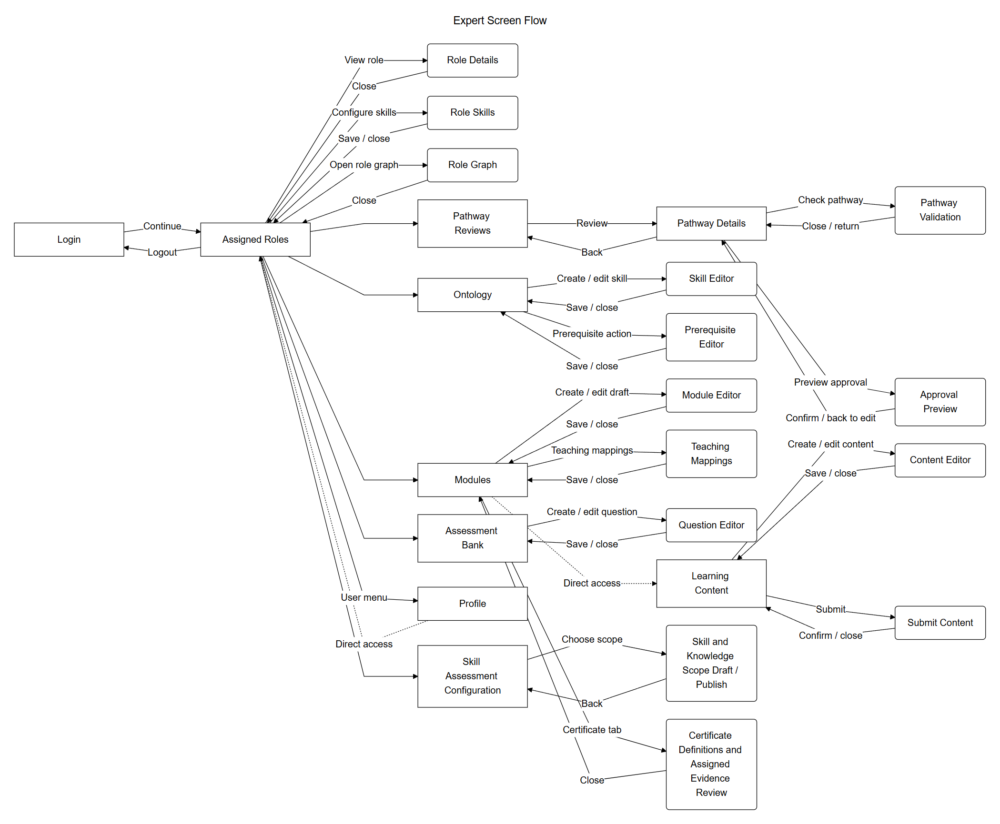

Pathway details are a routed page; role details/configuration and pathway checks/approval previews are dialogs. Assessment questions and blueprints are tabs on one page. The learning-content page is registered but has no verified Expert sidebar link, so its entry is dotted. Its current reader-preview link targets an Employee route and is not represented as authorized Expert navigation.

**L&D Manager**

[Mermaid source: SCREEN-LD-MANAGER](../documents/diagrams/mermaid/screen-flow-ld-manager.mmd)

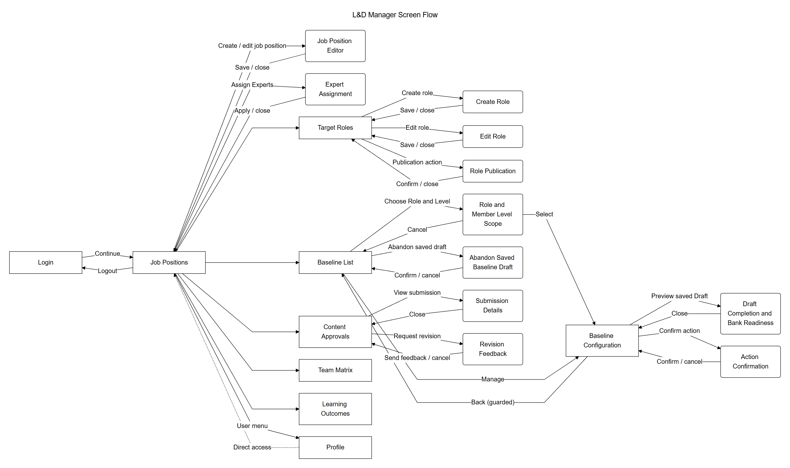

The Baseline Config menu alias leads to the baseline directory. Managing a selected Job Position opens its configuration page; Draft/released versions are page states, while baseline preview and lifecycle confirmations are real dialogs. `/ld-manager/dashboard` and `/ld-manager/learning-outcomes` render the same dashboard component. Legacy redirects to account administration or Expert authoring do not create L&D permissions.

**System Administrator**

[Mermaid source: SCREEN-SYSTEM-ADMIN](../documents/diagrams/mermaid/screen-flow-system-admin.mmd)

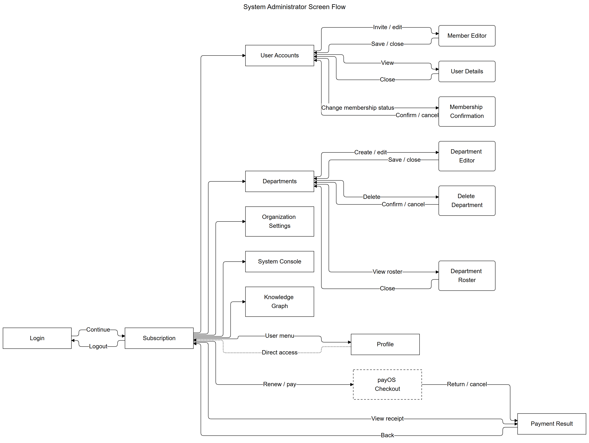

Administrator MFA is inline on `/login`, not a separate MFA page/dialog. User details, membership confirmation and department roster are dialogs; roster assignment controls stay inside the roster. Renewal plan selection is inline on subscription, while a payment-history receipt has its own route. The design-system showcase and server-status utility are omitted from this primary business-navigation flow.

**Platform Administrator**

[Mermaid source: SCREEN-PLATFORM-ADMIN](../documents/diagrams/mermaid/screen-flow-platform-admin.mmd)

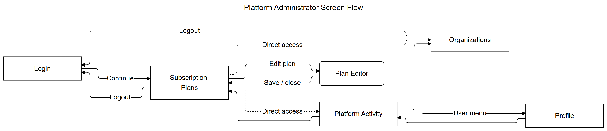

The active Organizations route uses `PlatformWorkspacePage`, not the older `PlatformOrganizationsPage`. Its suspend/reactivate controls are inline, with no confirmation dialog in the active component. Organizations and subscription-plan configuration use `SubscriptionShell`, which currently has Home/Sign out but **no actor sidebar**; dotted entries accurately expose that navigation gap rather than inventing buttons. Activity uses `WorkspaceLayout` and supplies the indicated actor-menu links.

**Source verification and limitations**

| Evidence | Source checked |
| --- | --- |
| Page registration, aliases and workspace scoping | [App](../frontend/src/app/App.tsx), [workspace paths](../frontend/src/shared/auth/workspacePaths.ts), [workspace router](../frontend/src/shared/auth/workspaceRouter.tsx), [role homes](../frontend/src/shared/auth/workspaceRole.ts). |
| Shared sidebar/profile/sign-out controls | [WorkspaceLayout](../frontend/src/shared/layouts/WorkspaceLayout.tsx), [SubscriptionShell](../frontend/src/shared/components/ui/SubscriptionShell.tsx). |
| Guest steps, graph dialog and checkout/status actions | [GuestRegisterPage](../frontend/src/features/guest/GuestRegisterPage.tsx), [GuestCatalogPicker](../frontend/src/features/guest/GuestCatalogPicker.tsx), [GuestSubscriptionPage](../frontend/src/features/subscription/GuestSubscriptionPage.tsx), [PaymentStatusPanel](../frontend/src/features/subscription/PaymentStatusPanel.tsx). |
| Expert page/detail and core dialogs | [Assigned roles](../frontend/src/features/expert/target-roles/ExpertAssignedRolesPage.tsx), [pathway details](../frontend/src/features/expert/pathway-review/ExpertPathwayDetailPage.tsx), [content authoring](../frontend/src/features/expert/content/LearningContentAuthoringPage.tsx), [modules](../frontend/src/features/manager/modules/LearningModulesPage.tsx), [assessment bank](../frontend/src/features/manager/assessment-bank/AssessmentBankPage.tsx), [ontology](../frontend/src/features/manager/ontology/CompetencyOntologyPage.tsx). |
| L&D list/configuration and dialogs | [Job Positions](../frontend/src/features/manager/job positions/Job PositionsManagementPage.tsx), [target roles](../frontend/src/features/manager/target-roles/TargetRolesPage.tsx), [baseline directory](../frontend/src/features/manager/baseline-assessments/AdaptiveBaselineDirectory.tsx), [baseline configuration](../frontend/src/features/manager/baseline-assessments/AdaptiveBaselinePage.tsx), [baseline preview](../frontend/src/features/manager/baseline-assessments/AdaptiveAssessmentPreview.tsx), [approvals](../frontend/src/features/manager/approvals/ContentApprovalQueuePage.tsx). |
| Administrator member/department/billing screens | [User management](../frontend/src/features/administration/user-management/UserManagementPage.tsx), [departments](../frontend/src/features/administration/departments/DepartmentsManagementPage.tsx), [subscription](../frontend/src/features/administration/subscription/OrganizationSubscriptionPage.tsx). |
| Active platform screens and plan dialog | [Platform workspace controls](../frontend/src/features/subscription/PlatformWorkspaceControls.tsx), [platform plans](../frontend/src/features/subscription/PlatformPlansPage.tsx), [platform activity](../frontend/src/features/platform-admin/PlatformActivityMonitoringPage.tsx). |

Verification is against the current source and local diagram/image rendering, **not a new end-to-end acceptance run**. The shared tenant profile page/sidebar still depends on a saved actor presentation in parts of the current implementation; the diagrams therefore do not promise a role-correct sidebar return from `W/profile`. Profile edit/password forms are inline. Backend persistence and the earlier implementation-status notes are not re-certified by this screen-flow revision. The historical [mixed screen-flow source](../documents/diagrams/mermaid/screen-flow.mmd) is retained but superseded by these five diagrams.

#### 3.1.2 Screen Descriptions

The layout codes below are schematic wireframes, not screenshots or proof of completed UI. They fulfill the template's layout reference for the detailed functions without duplicating an identical frame for every operation.

| Layout | Schematic composition |
| --- | --- |
| WF-01 Authentication/onboarding | Public header / step indicator / organization or account form / field errors / primary Continue action / resume link / pending-delivery panel. |
| WF-02 Plans/billing | Page header / subscription or status summary / comparable plan cards or order receipt / immutable terms / action footer / explicit waiting and failure panel. |
| WF-03 Administration | Workspace sidebar / page header / filter and search toolbar / paged table / detail or edit dialog / status confirmation / toast. |
| WF-04 Catalog authoring | Workspace sidebar / job position-role selector / catalog list or graph / editable detail pane / save-submit controls / revision feedback. |
| WF-05 Assessment | Scope and assessment title / server-bound progress and timer / question and options / save or submit controls / confirmation dialog / terminal result and recovery. |
| WF-06 Employee development | Sidebar / role and readiness header / competency or gap cards / graph or module list / pathway version and next action / empty/unavailable state. |
| WF-07 Review | Submission queue / selected version / requirements or content preview / comments / Approve, Return or Confirm controls / decision history. |
| WF-08 Reporting | Page header / department-job position-period filters / summary cards / table/chart / financial input editor / missing-data and currency explanation. |

```text
WF-03 example
+----------------+--------------------------------------------------------+
| Workspace      | Page title                         Primary action      |
| navigation     | Search | Role / Status / Department filters            |
|                +--------------------------------------------------------+
|                | Table: record | role | assignment | status | actions   |
|                | Authorized rows and explicit empty/error states        |
|                +--------------------------------------------------------+
|                | Pagination               Detail / Edit dialog          |
+----------------+--------------------------------------------------------+
```

The Screen column uses the exact names shown in the five screen-flow diagrams in section 3.1.1. Each row describes one page or dialog; shared names are listed once, giving 65 distinct entries. Permitted actions depend on the user's role and scope. The implementation and navigation limitations in section 3.1.1 still apply.

| # | Feature | Screen | Description |
| --- | --- | --- | --- |
| 1 | Authentication | Login | Accept sign-in credentials, complete required MFA within the same page, and continue to a permitted workspace. |
| 2 | Authentication | Account Activation | Allow an invited recipient to activate an account using the invitation token and proceed to sign-in. |
| 3 | Account Management | Profile | Display personal account information and provide inline forms for editing the profile name and changing the password. |
| 4 | Onboarding | Home | Introduce the platform and provide entry points for organization registration, resuming registration and sign-in. |
| 5 | Onboarding | Registration | Collect organization and administrator details, select optional initial graph data, and complete email verification and required MFA. |
| 6 | Onboarding | Resume Registration | Restore a saved registration session and allow the administrator to complete outstanding verification or continue to plan selection. |
| 7 | Onboarding | Graph Selection | Open a dialog to select catalog branches, preview included graph data, and apply the initial graph selection. |
| 8 | Subscriptions | Choose a Subscription | Display available subscription plans and their terms, allowing a completed registration to select a plan and create an order. |
| 9 | Payment | Checkout | Display the current order, payment and setup status, and provide actions to open checkout or enter a ready workspace. |
| 10 | Payment | payOS Checkout | Open the external payment provider's checkout page and return to the application after payment or cancellation. |
| 11 | Payment | Payment Result | Display the initial-purchase or renewal order receipt and current payment/application status, with appropriate continuation or return actions. |
| 12 | Provisioning | Onboarding Status | Display payment application and workspace setup progress, allowing workspace entry when the required readiness conditions are met. |
| 13 | Organization Billing | Subscription | Display subscription periods, Employee seats and payment history, with inline renewal selection and payment-status controls. |
| 14 | Platform Subscriptions | Subscription Plans | Display existing platform plan terms, provide plan editing, and show inline organization workspace controls. |
| 15 | Platform Subscriptions | Plan Editor | Open a dialog to edit a subscription plan and save a new version without changing previously purchased terms. |
| 16 | Platform Administration | Organizations | Display organization workspaces and provide inline suspension and reactivation controls for the Platform Administrator. |
| 17 | Platform Monitoring | Platform Activity | Display platform activity records and provide search, severity filtering, pagination and export controls. |
| 18 | Expert Role Review | Assigned Roles | List the Expert's assigned target roles and provide access to role details, skill configuration and graph views. |
| 19 | Expert Role Review | Role Details | Open a read-only dialog displaying the selected target role's attributes and competency requirements. |
| 20 | Expert Role Review | Role Skills | Open a dialog to configure competency and skill requirements for an assigned target role. |
| 21 | Expert Role Review | Role Graph | Open a dialog visualizing the selected role's competency and skill relationships. |
| 22 | Pathway Review | Pathway Reviews | List pathways awaiting Expert review and open the selected pathway's detail page. |
| 23 | Pathway Review | Pathway Details | Display the selected pathway and provide review, validation and approval-preview actions, with navigation back to the review list. |
| 24 | Pathway Review | Pathway Validation | Open a dialog displaying pathway validation checks and findings before an approval decision. |
| 25 | Pathway Review | Approval Preview | Open a dialog to preview the proposed pathway approval and confirm the decision or return to editing. |
| 26 | Competency Authoring | Ontology | Browse and maintain competency and micro-skill structures, prerequisites and related graph information. |
| 27 | Competency Authoring | Skill Editor | Open a dialog to create or edit a micro-skill and save its attributes. |
| 28 | Competency Authoring | Prerequisite Editor | Open a dialog to configure prerequisite relationships between skills. |
| 29 | Module Authoring | Modules | Browse learning modules and access draft editing, teaching mappings, submission and lifecycle actions. |
| 30 | Module Authoring | Module Editor | Open a dialog to create or edit a learning module draft. |
| 31 | Module Authoring | Teaching Mappings | Open a dialog to maintain the competencies and skills taught by the selected module. |
| 32 | Assessment Authoring | Assessment Bank | Browse questions and blueprints in separate tabs on one page, with authoring, detail and import controls. |
| 33 | Assessment Authoring | Question Editor | Open a dialog to create or edit an assessment question and its answer configuration. |
| 34 | Content Authoring | Learning Content | Browse learning content packages and access editing, deletion and submission for L&D review. |
| 35 | Content Authoring | Content Editor | Open a dialog to create or edit a learning content package and its lesson content. |
| 36 | Content Authoring | Submit Content | Open a confirmation dialog before submitting the selected content package to the L&D approval queue. |
| 37 | Job Position Management | Job Positions | Browse job positions and access job position editing, Expert assignment, import and deactivation actions. |
| 38 | Job Position Management | Job Position Editor | Open a dialog to create or edit an job position and its associated attributes. |
| 39 | Job Position Management | Expert Assignment | Open a dialog to assign and manage the Experts responsible for an job position. |
| 40 | Target Role Management | Target Roles | Browse organization target roles and manage role attributes, Expert assignments and publication actions. |
| 41 | Target Role Management | Create Role | Open a dialog to define a new target role within the selected job position. |
| 42 | Target Role Management | Edit Role | Open a dialog to update a target role's attributes and assigned Expert. |
| 43 | Target Role Management | Role Publication | Open a dialog to review the selected target role before confirming its publication action. |
| 44 | Baseline Management | Baseline List | List baseline drafts and released versions by job position, with controls to manage configurations or deactivate active versions. |
| 45 | Baseline Management | Job Position Selection | Open a dialog to choose an job position and enter its baseline configuration page. |
| 46 | Baseline Management | Deactivate Baseline | Open a confirmation dialog requiring a reason before deactivating an active baseline version. |
| 47 | Baseline Management | Baseline Configuration | Configure an job position's baseline draft or released version, with save, preview and lifecycle actions. |
| 48 | Baseline Management | Baseline Preview | Open a dialog to preview the saved baseline draft without starting an Employee assessment attempt. |
| 49 | Baseline Management | Action Confirmation | Open a dialog to confirm baseline lifecycle actions or navigation that would leave unsaved changes. |
| 50 | Content Approval | Content Approvals | Display learning offering submissions and provide review, approval and revision-feedback actions. |
| 51 | Content Approval | Submission Details | Open a dialog displaying the selected offering's submission details, structure and review information. |
| 52 | Content Approval | Revision Feedback | Open a dialog to enter and send actionable revision instructions for a selected offering submission. |
| 53 | Development Reporting | Team Matrix | Display team competency comparisons using the available organizational and learning filters. |
| 54 | Development Reporting | Learning Outcomes | Display learning and development summaries, charts and comparisons for the L&D Manager. |
| 55 | User Management | User Accounts | List organization members and provide invitation, editing, detail and membership-status controls. |
| 56 | User Management | Member Editor | Open a dialog to invite an organization member or edit an existing member's permitted account and membership details. |
| 57 | User Management | User Details | Open a dialog displaying the selected user's account and organization membership information. |
| 58 | User Management | Membership Confirmation | Open a dialog to confirm activation or deactivation of an organization membership. |
| 59 | Department Management | Departments | List organization departments and provide editing, deletion and roster-management actions. |
| 60 | Department Management | Department Editor | Open a dialog to create or edit a department's details. |
| 61 | Department Management | Delete Department | Open a confirmation dialog before deleting the selected department. |
| 62 | Department Management | Department Roster | Open a dialog displaying department members, with assignment and reassignment controls inside the roster. |
| 63 | Organization Administration | Organization Settings | Display organization settings and provide the available inline configuration forms. |
| 64 | Organization Administration | System Console | Display the organization administration overview and available operational information. |
| 65 | Knowledge Graph | Knowledge Graph | Display the organization's knowledge graph and provide visualization and exploration controls. |

All `W` paths use the workspace prefix defined above; the table does not imply that unprefixed tenant URLs remain valid. `W/employee/riasec` redirects to `W/employee/assessment?tab=baseline`; `W/employee/guidance` redirects to `W/employee/upskilling?tab=roles`; skill aliases redirect to the skills tab. `W/ld-manager/users` redirects to `W/admin/users` but does not authorize account management. Old workspace-scoped `/learner/*` and `/manager/*` aliases must not be counted as separate capabilities.

#### 3.1.3 Screen Authorization

This is the **required authorization matrix**, not a claim that every prototype or legacy endpoint enforces it. **X** means the role is permitted to access the screen or perform the activity within its authorized scope; a **blank cell** means no permission is granted. Bold rows use the exact screen names from sections 3.1.1 and 3.1.2. Indented rows identify activities requiring an explicit permission.

Guests may use public entry screens, valid invitation links and their own registration/payment session. Platform Administrator permissions are platform-scoped. System Administrator and L&D Manager permissions are limited to their authorized organization; Expert authoring and review require the relevant assignment. Profile permissions apply only to the user's own account. Screen access does not grant unrestricted access to every record.

| Screen | Guest | Platform Administrator | System Administrator | L&D Manager | Expert | Employee |
| --- | --- | --- | --- | --- | --- | --- |
| **Login** | X | X | X | X | X | X |
| &nbsp;&nbsp;Enter credentials and sign in | X | X | X | X | X | X |
| &nbsp;&nbsp;Complete System Administrator MFA or recovery |  |  | X |  |  |  |
| **Account Activation** | X |  |  |  |  |  |
| &nbsp;&nbsp;Activate an invited account with a valid token | X |  |  |  |  |  |
| **Profile** |  | X | X | X | X | X |
| &nbsp;&nbsp;Query own profile |  | X | X | X | X | X |
| &nbsp;&nbsp;Update own profile |  | X | X | X | X | X |
| &nbsp;&nbsp;Change own password |  | X | X | X | X | X |
| **Home** | X | X | X | X | X | X |
| **Registration** | X |  |  |  |  |  |
| &nbsp;&nbsp;Register an organization and administrator | X |  |  |  |  |  |
| &nbsp;&nbsp;Verify registration email and required MFA | X |  |  |  |  |  |
| **Resume Registration** | X |  |  |  |  |  |
| &nbsp;&nbsp;Query and complete own saved registration | X |  |  |  |  |  |
| **Graph Selection** | X |  |  |  |  |  |
| &nbsp;&nbsp;Select initial graph data for own registration | X |  |  |  |  |  |
| **Choose a Subscription** | X |  |  |  |  |  |
| &nbsp;&nbsp;Select a plan and create an initial order | X |  |  |  |  |  |
| **Checkout** | X |  |  |  |  |  |
| &nbsp;&nbsp;Query own order and open payment checkout | X |  |  |  |  |  |
| &nbsp;&nbsp;Enter the ready workspace as its administrator | X |  |  |  |  |  |
| **payOS Checkout** | X |  | X |  |  |  |
| &nbsp;&nbsp;Pay for own registration or organization renewal | X |  | X |  |  |  |
| **Payment Result** | X |  | X |  |  |  |
| &nbsp;&nbsp;Query own registration payment result | X |  |  |  |  |  |
| &nbsp;&nbsp;Query managed organization payment result |  |  | X |  |  |  |
| **Onboarding Status** | X |  |  |  |  |  |
| &nbsp;&nbsp;Query own setup status and enter when ready | X |  |  |  |  |  |
| **Subscription** |  |  | X |  |  |  |
| &nbsp;&nbsp;Query managed subscription, seats and payment history |  |  | X |  |  |  |
| &nbsp;&nbsp;Renew the managed organization subscription |  |  | X |  |  |  |
| **Subscription Plans** |  | X |  |  |  |  |
| &nbsp;&nbsp;Query platform subscription plans |  | X |  |  |  |  |
| **Plan Editor** |  | X |  |  |  |  |
| &nbsp;&nbsp;Update platform plan terms as a new version |  | X |  |  |  |  |
| **Organizations** |  | X |  |  |  |  |
| &nbsp;&nbsp;Query platform organizations |  | X |  |  |  |  |
| &nbsp;&nbsp;Suspend or reactivate an organization workspace |  | X |  |  |  |  |
| **Platform Activity** |  | X |  |  |  |  |
| &nbsp;&nbsp;Query and export platform activity |  | X |  |  |  |  |
| **Assigned Roles** |  |  |  |  | X |  |
| &nbsp;&nbsp;Query assigned target roles |  |  |  |  | X |  |
| **Role Details** |  |  |  |  | X |  |
| **Role Skills** |  |  |  |  | X |  |
| &nbsp;&nbsp;Update and submit assigned role requirements |  |  |  |  | X |  |
| **Role Graph** |  |  |  |  | X |  |
| **Pathway Reviews** |  |  |  |  | X |  |
| &nbsp;&nbsp;Query assigned pathway reviews |  |  |  |  | X |  |
| **Pathway Details** |  |  |  |  | X |  |
| **Pathway Validation** |  |  |  |  | X |  |
| **Approval Preview** |  |  |  |  | X |  |
| &nbsp;&nbsp;Confirm the assigned pathway review decision |  |  |  |  | X |  |
| **Ontology** |  |  |  |  | X |  |
| &nbsp;&nbsp;Query competencies and skills in assigned scope |  |  |  |  | X |  |
| **Skill Editor** |  |  |  |  | X |  |
| &nbsp;&nbsp;Create or update skills in assigned scope |  |  |  |  | X |  |
| **Prerequisite Editor** |  |  |  |  | X |  |
| &nbsp;&nbsp;Update prerequisite relationships in assigned scope |  |  |  |  | X |  |
| **Modules** |  |  |  |  | X |  |
| &nbsp;&nbsp;Query and submit modules in assigned scope |  |  |  |  | X |  |
| **Module Editor** |  |  |  |  | X |  |
| &nbsp;&nbsp;Create or update module drafts in assigned scope |  |  |  |  | X |  |
| **Teaching Mappings** |  |  |  |  | X |  |
| &nbsp;&nbsp;Update assigned module teaching mappings |  |  |  |  | X |  |
| **Assessment Bank** |  |  |  |  | X |  |
| &nbsp;&nbsp;Query questions and blueprints in assigned scope |  |  |  |  | X |  |
| **Question Editor** |  |  |  |  | X |  |
| &nbsp;&nbsp;Create or update questions in assigned scope |  |  |  |  | X |  |
| **Learning Content** |  |  |  |  | X |  |
| &nbsp;&nbsp;Query and delete permitted content drafts |  |  |  |  | X |  |
| **Content Editor** |  |  |  |  | X |  |
| &nbsp;&nbsp;Create or update content in assigned scope |  |  |  |  | X |  |
| **Submit Content** |  |  |  |  | X |  |
| &nbsp;&nbsp;Submit assigned content for L&D approval |  |  |  |  | X |  |
| **Job Positions** |  |  |  | X |  |  |
| &nbsp;&nbsp;Query and manage organization job positions |  |  |  | X |  |  |
| **Job Position Editor** |  |  |  | X |  |  |
| &nbsp;&nbsp;Create or update managed job positions |  |  |  | X |  |  |
| **Expert Assignment** |  |  |  | X |  |  |
| &nbsp;&nbsp;Assign Experts to managed job positions |  |  |  | X |  |  |
| **Target Roles** |  |  |  | X |  |  |
| &nbsp;&nbsp;Query managed target roles |  |  |  | X |  |  |
| **Create Role** |  |  |  | X |  |  |
| &nbsp;&nbsp;Create a role in a managed job position |  |  |  | X |  |  |
| **Edit Role** |  |  |  | X |  |  |
| &nbsp;&nbsp;Update managed role attributes and Expert assignment |  |  |  | X |  |  |
| **Role Publication** |  |  |  | X |  |  |
| &nbsp;&nbsp;Publish, unpublish or return managed role configurations |  |  |  | X |  |  |
| **Baseline List** |  |  |  | X |  |  |
| &nbsp;&nbsp;Query organization baseline drafts and versions |  |  |  | X |  |  |
| **Job Position Selection** |  |  |  | X |  |  |
| **Deactivate Baseline** |  |  |  | X |  |  |
| &nbsp;&nbsp;Deactivate a managed active baseline with a reason |  |  |  | X |  |  |
| **Baseline Configuration** |  |  |  | X |  |  |
| &nbsp;&nbsp;Create or update a managed baseline draft |  |  |  | X |  |  |
| &nbsp;&nbsp;Activate a managed baseline version |  |  |  | X |  |  |
| **Baseline Preview** |  |  |  | X |  |  |
| **Action Confirmation** |  |  |  | X |  |  |
| **Content Approvals** |  |  |  | X |  |  |
| &nbsp;&nbsp;Query organization offering submissions |  |  |  | X |  |  |
| &nbsp;&nbsp;Approve or return managed offering submissions |  |  |  | X |  |  |
| **Submission Details** |  |  |  | X |  |  |
| **Revision Feedback** |  |  |  | X |  |  |
| &nbsp;&nbsp;Request revision of a managed offering |  |  |  | X |  |  |
| **Team Matrix** |  |  |  | X |  |  |
| &nbsp;&nbsp;Query permitted Employee and department development data |  |  |  | X |  |  |
| **Learning Outcomes** |  |  |  | X |  |  |
| &nbsp;&nbsp;Query managed development and ROI information |  |  |  | X |  |  |
| &nbsp;&nbsp;Record or update training costs and monetary benefits |  |  |  | X |  |  |
| **User Accounts** |  |  | X |  |  |  |
| &nbsp;&nbsp;Query members of the managed organization |  |  | X |  |  |  |
| &nbsp;&nbsp;Remediate managed Employee seat capacity |  |  | X |  |  |  |
| **Member Editor** |  |  | X |  |  |  |
| &nbsp;&nbsp;Invite or update a managed organization member |  |  | X |  |  |  |
| **User Details** |  |  | X |  |  |  |
| **Membership Confirmation** |  |  | X |  |  |  |
| &nbsp;&nbsp;Activate or deactivate a managed membership |  |  | X |  |  |  |
| **Departments** |  |  | X |  |  |  |
| &nbsp;&nbsp;Query managed departments |  |  | X |  |  |  |
| **Department Editor** |  |  | X |  |  |  |
| &nbsp;&nbsp;Create or update managed departments |  |  | X |  |  |  |
| **Delete Department** |  |  | X |  |  |  |
| &nbsp;&nbsp;Delete a managed department |  |  | X |  |  |  |
| **Department Roster** |  |  | X |  |  |  |
| &nbsp;&nbsp;Query managed department members |  |  | X |  |  |  |
| &nbsp;&nbsp;Assign or reassign managed department members |  |  | X |  |  |  |
| **Organization Settings** |  |  | X |  |  |  |
| &nbsp;&nbsp;Update managed organization settings |  |  | X |  |  |  |
| **System Console** |  |  | X |  |  |  |
| &nbsp;&nbsp;Query managed organization administration and audit data |  |  | X |  |  |  |
| **Knowledge Graph** |  |  | X |  |  |  |
| &nbsp;&nbsp;Query the managed organization's knowledge graph |  |  | X |  |  |  |

Activities express required permission boundaries, not proof that every control is implemented on its screen. Training-cost and monetary-benefit recording retains the implementation limitations documented elsewhere. The external payOS screen is an authorized checkout handoff, not an application-managed page. Onboarding workspace entry changes the registration session into its verified System Administrator session; it does not grant a Guest access to Subscription.

Employee learning screens are outside the five screen flows above. Employee permissions elsewhere in this SRS remain limited to their own role selections, assessment answers/results, mastery and learning resources; omission from this table does not remove those requirements.

Server-side account/session, organization membership, business role, assignment and entitlement checks are independent. UI visibility, browser company IDs, route aliases and role menus cannot supply authority. Platform administration is not a blanket permission to read assessment answers or private content. Recovery/billing permissions for expired or capacity-blocked workspaces must remain narrower than normal learning access.

#### 3.1.4 Non-Screen Functions

| # | Feature | System Function | Description |
| --- | --- | --- | --- |
| 1 | Identity | Authenticate/authorize, FR-07.01 | Resolve trusted principal, session assurance, membership and permitted resource scope on each protected operation. |
| 2 | Payments | Process payment, FR-07.02 | Create/query provider order, verify original signed webhook, retain observations and retry without duplicate application. |
| 3 | Provisioning | Provision workspace, FR-07.03 | Atomically apply an eligible initial purchase to organization/workspace/membership/period records. |
| 4 | Entitlements | Maintain access, FR-07.04 | Evaluate current paid period, administrative suspension and Employee-seat usage; preserve renewal intent. |
| 5 | Assessment | Generate/evaluate, FR-07.05 | Pin versions/content, score server-side, finalize exactly once logically, and preserve result/history. Includes planned module and RIASEC evaluation. |
| 6 | Competency | Update profiles/gaps, FR-07.06 | Use valid assessment evidence and a versioned model; do not substitute interests or activity completion for mastery. |
| 7 | Guidance | Generate suggestions, FR-07.07 | Invoke planned local LLM with minimized input and expose suggestions directly to the Employee. |
| 8 | Adaptation | Generate/recalculate pathways, FR-07.08 | Produce gap/prerequisite-aware modules; respect initial Expert confirmation and subsequent assessment-driven updates. |
| 9 | Reporting | Generate summaries/ROI, FR-07.09 | Aggregate scoped evidence and actual recorded financial inputs under a defined reporting/currency policy. |
| 10 | Delivery | Send email, FR-07.10 | Durable verification, activation and payment notifications exist; wider workflow email remains incomplete. |
| 11 | Audit | Record activity, FR-07.11 | Preserve actor, action, scope, outcome and source correlation without leaking secrets or answer content. |
| 12 | Assessment operations | Deadline finalization and calibration | Baseline deadline worker and IRT calibration/promotion support the assessment requirements; not additional user roles. |
| 13 | Platform operations | Schema migration and health | Flyway migrations and health/status facilities support deployment; they must not manufacture reviewed catalog content. |

#### 3.1.5 Entity Relationship Diagram

The four **flow-scoped conceptual ERDs** cover ACT-05 only: Role–Level configuration, baseline/profile, skill provision and pathway learning. Subscription, payment, onboarding and ROI are outside these views. They show the approved target model, not an applied migration. Full target attributes, types, keys and nullability are in [SDD section 2.2](Report4_Software%20Design%20Document.md#22-logical-database-design).

Cardinality applies to these flow relationships. Account represents an existing authenticated actor; TargetRole is a professional goal, distinct from actor permissions.

**1. Role-Level Selection and Baseline Configuration**

[Mermaid source: CERD-01](../documents/diagrams/mermaid/cerd-01.mmd)

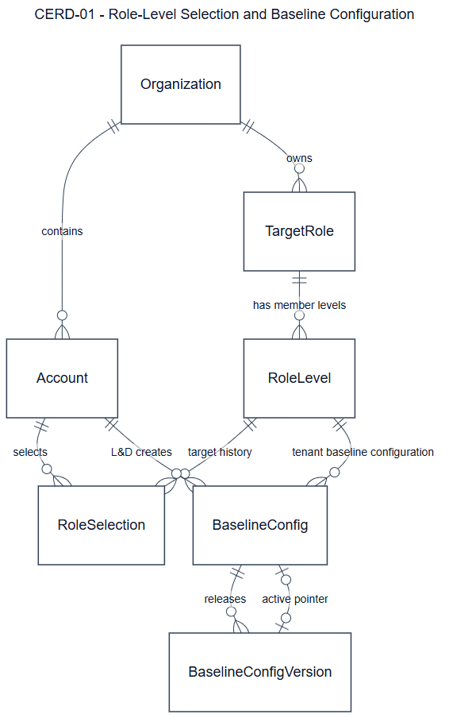

**2. Assessment and Role-Level Profile**

[Mermaid source: CERD-02](../documents/diagrams/mermaid/cerd-02.mmd)

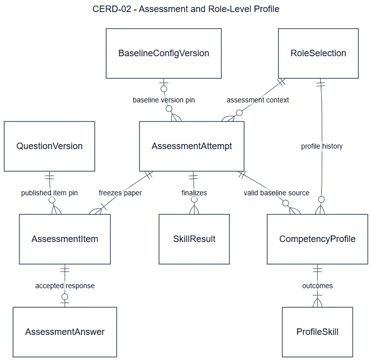

**3. Role Requirements and Learning Provision**

[Mermaid source: CERD-03](../documents/diagrams/mermaid/cerd-03.mmd)

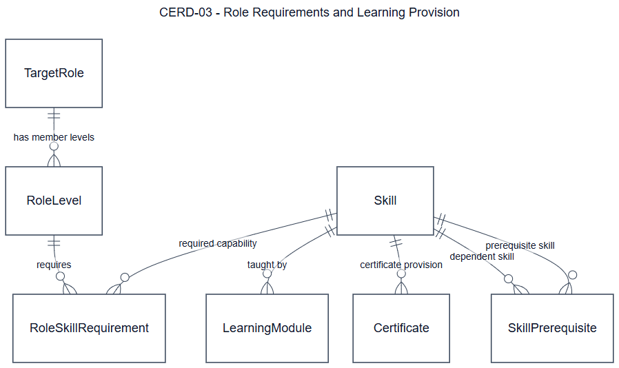

**4. Pathway Review, Learning and Bypass**

[Mermaid source: CERD-04](../documents/diagrams/mermaid/cerd-04.mmd)

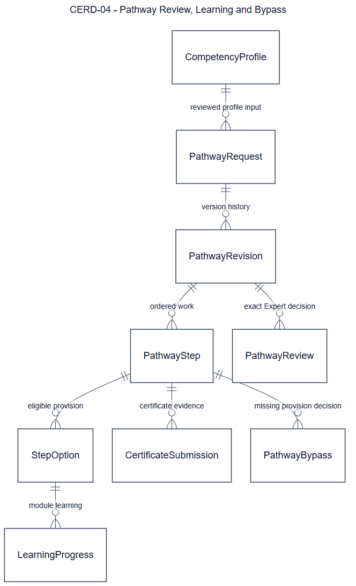

**Entities Description**

Each row describes one entity used by this flow. Existing shared identity/content entities are references to their owners, not replacement account or learning systems.

| # | Entity | Description |
| --- | --- | --- |
| 1 | Organization | Existing tenant boundary. |
| 2 | Account | Existing authenticated Employee, L&D or Expert reference; credentials remain outside the flow model. |
| 3 | TargetRole | Published professional target role, distinct from actor permissions. |
| 4 | RoleLevel | A Level belonging to a specific target Role. |
| 5 | RoleSelection | Current and historical Employee Role-Level choices. |
| 6 | BaselineConfig | L&D configuration identity and active pointer scoped to Role-Level. |
| 7 | BaselineConfigVersion | Immutable validated configuration, including the exact assessed skill set and rules. |
| 8 | Skill | Assessable catalog skill with versioned definition. |
| 9 | RoleSkillRequirement | Explicit skill requirement for a Role-Level. |
| 10 | QuestionVersion | Existing published question version; protected answer data remains server-side. |
| 11 | AssessmentAttempt | Frozen baseline or skill-assessment context and timing. |
| 12 | AssessmentItem | Presented immutable item and its exact requirement context. |
| 13 | AssessmentAnswer | Accepted response for one presented item. |
| 14 | SkillResult | Final per-skill result; invalid results do not initialize a valid profile. |
| 15 | CompetencyProfile | Versioned profile for one Employee Role-Level selection. |
| 16 | ProfileSkill | Met or Needs supplementation outcome with valid source provenance. |
| 17 | LearningModule | Existing approved module; exactly one taught skill. |
| 18 | Certificate | Catalog certificate definition attached to an exact skill requirement. |
| 19 | SkillPrerequisite | Exact dependent and prerequisite skill-level pair. |
| 20 | CertificateSubmission | Employee evidence and genuine Expert decision for a certificate. |
| 21 | PathwayRequest | Explicit request from the reviewed profile; errors retain the selected target. |
| 22 | PathwayRevision | Generated, reviewed and automatically adapted pathway versions. |
| 23 | PathwayStep | Required skill work, with module/certificate provision and bypass kept separate from achievement. |
| 24 | StepOption | Eligible version-pinned module or certificate for one step. |
| 25 | PathwayReview | Actual Expert review of an exact pathway revision. |
| 26 | LearningProgress | Existing content progress owner referenced by selected pathway option. |
| 27 | PathwayBypass | Accepted missing-provision decision; never evidence of achievement. |

### 3.2 Organization Onboarding

<a id="fr-01-01"></a>

#### 3.2.1 Register an organization - FR-01.01

**Function Trigger:** Guest opens Register or Resume Registration.

**Function Description:**

- **Purpose:** Allow Guest to register an organization and create its administrator account.
- **Interface:** Registration, Email Verification and MFA Setup screens
- **Screen layout:**

**Function Detail:**

- **Data:**
  - Organization Name
  - Workspace Slug (optional)
  - Industry (optional)
  - Headcount (optional)
  - Administrator Name
  - Administrator Email
  - Password
  - Email Verification Code
  - MFA Code
  - Registration Status

- **Functionalities:**
  - Submit organization and administrator details.
  - Validate required fields and reject duplicate email or workspace slug.
  - Send, resend and verify the email code.
  - Set up administrator MFA and issue recovery codes.
  - Resume incomplete registration without creating duplicates.
  - Show validation errors and preserve non-secret form values.

<a id="fr-01-04"></a>

#### 3.2.2 Track onboarding and access the workspace - FR-01.04

**Function Trigger:** Guest opens Onboarding Status after checkout.

**Function Description:**

- **Purpose:** Allow Guest to track setup and enter the organization workspace.
- **Interface:** Payment Result and Onboarding Status screens
- **Screen layout:**

**Function Detail:**

- **Data:**
  - Registration Reference
  - Payment Order Reference
  - Registration Status
  - Payment Status
  - Workspace Setup Status
  - Workspace Access Status

- **Functionalities:**
  - Display current registration, payment and workspace setup status.
  - Show pending, failed and unavailable states with recovery actions.
  - Allow workspace entry only after verified payment and completed setup.
  - Restrict status access to the registration owner.
  - Do not accept the checkout redirect as payment confirmation.

<a id="fr-07-03"></a>

#### 3.2.3 Provision organization workspaces - FR-07.03

**Function Trigger:** System receives a verified initial subscription payment.

**Function Description:**

- **Purpose:** Create the organization workspace and activate its initial subscription.
- **Interface:** Background Provisioning Service
- **Screen layout:**

**Function Detail:**

- **Data:**
  - Registration Reference
  - Organization
  - Purchased Plan Version
  - Payment Order
  - Verified Amount and Currency
  - Initial Administrator
  - Paid Period
  - Setup Status

- **Functionalities:**
  - Create the logical organization workspace.
  - Assign the initial System Administrator membership.
  - Activate the purchased subscription period.
  - Record provisioning and payment-application outcomes.
  - Retry recoverable failures without duplicating workspaces or subscriptions.

### 3.3 Subscription Lifecycle

<a id="fr-01-02"></a>

#### 3.3.1 Select a subscription - FR-01.02

**Function Trigger:** Guest opens Subscription Plans.

**Function Description:**

- **Purpose:** Allow Guest to compare and select an available subscription.
- **Interface:** Subscription Plans screen
- **Screen layout:**

**Function Detail:**

- **Data:**
  - Plan Name
  - Description
  - Price
  - Currency
  - Duration
  - Employee Seats
  - Plan Version

- **Functionalities:**
  - Display existing subscription plans and their terms.
  - Compare price, duration and Employee-seat allocation.
  - Select a plan version for checkout.
  - Show unavailable or changed plans before payment.
  - Do not grant paid access from plan selection alone.

<a id="fr-01-03"></a>

#### 3.3.2 Pay for a subscription - FR-01.03

**Function Trigger:** Guest confirms a plan and opens Checkout.

**Function Description:**

- **Purpose:** Allow Guest to pay for an organization subscription.
- **Interface:** Checkout and Payment Result screens
- **Screen layout:**

**Function Detail:**

- **Data:**
  - Registration Reference
  - Selected Plan Version
  - Order Reference
  - Amount
  - Currency
  - Checkout Link
  - Payment Status
  - Application Status

- **Functionalities:**
  - Create a payment order using the selected plan terms.
  - Redirect Guest to payOS checkout.
  - Display the order-specific payment and application result.
  - Allow retry or replacement only when the previous order permits it.
  - Prevent duplicate orders when the same request is retried.
  - Keep pending, partial and unknown payments separate from confirmed payment.

<a id="fr-02-02"></a>

#### 3.3.3 Configure subscriptions - FR-02.02

**Function Trigger:** Platform Administrator selects an existing subscription plan to edit.

**Function Description:**

- **Purpose:** Allow Platform Administrator to update subscription offerings.
- **Interface:** Subscription Plan Configuration screen
- **Screen layout:**

**Function Detail:**

- **Data:**
  - Plan Name
  - Description
  - Price
  - Currency
  - Duration in Months
  - Employee-seat Limit
  - Plan Version

- **Functionalities:**
  - View and edit existing plan details.
  - Validate positive price, duration and Employee-seat allocation.
  - Save changes as a new plan version.
  - Reject stale edits and preserve previously purchased terms.
  - Show the current VND-only limitation; other currency support remains pending.

<a id="fr-03-06"></a>

#### 3.3.4 Manage organization subscription - FR-03.06

**Function Trigger:** System Administrator opens Organization Subscription.

**Function Description:**

- **Purpose:** Allow System Administrator to review and renew the organization subscription.
- **Interface:** Organization Subscription and Renewal Result screens
- **Screen layout:**

**Function Detail:**

- **Data:**
  - Subscription Plan
  - Current Paid Period
  - Scheduled Paid Period
  - Allocated Seats
  - Used Seats
  - Renewal Plan
  - Payment History
  - Renewal Status

- **Functionalities:**
  - Display subscription details, paid periods and Employee-seat usage.
  - View owned payment history and results.
  - Select an existing plan and pay for renewal.
  - Apply verified renewals once without overlapping paid periods.
  - Show capacity remediation when the purchased seat limit is insufficient.
  - Preserve payment evidence while renewal application is pending.

<a id="fr-07-02"></a>

#### 3.3.5 Process subscription payments - FR-07.02

**Function Trigger:** System processes checkout requests, payment queries or payOS webhooks.

**Function Description:**

- **Purpose:** Verify payment outcomes and record subscription transactions.
- **Interface:** Payment Processing Service and payOS Webhook
- **Screen layout:**

**Function Detail:**

- **Data:**
  - Order Code
  - Purchased Plan Terms
  - Expected Amount
  - Currency
  - Provider Link
  - Signed Payment Observation
  - Payment Status
  - Transaction History

- **Functionalities:**
  - Create or query payment using the same order identity.
  - Verify provider responses and webhook signatures.
  - Match the order, amount and currency before accepting payment.
  - Store verified observations and apply eligible payments.
  - Handle duplicate events without duplicate entitlement.
  - Retain unresolved or mismatched payments for explicit recovery.

<a id="fr-07-04"></a>

#### 3.3.6 Maintain subscription entitlements - FR-07.04

**Function Trigger:** System checks workspace access or processes membership and renewal changes.

**Function Description:**

- **Purpose:** Control workspace access and Employee-seat entitlements.
- **Interface:** Subscription Entitlement Service
- **Screen layout:**

**Function Detail:**

- **Data:**
  - Organization
  - Membership Role and Status
  - Paid Period
  - Allocated Employee Seats
  - Active Employee Count
  - Suspension Status
  - Requested Action

- **Functionalities:**
  - Check paid access and administrative suspension separately.
  - Count active Employee memberships against the seat limit.
  - Prevent concurrent admissions from exceeding capacity.
  - Update entitlements after eligible payment and renewal events.
  - Deny ordinary access when expired, suspended or unready.
  - Allow only permitted billing and capacity-recovery actions.

### 3.4 Platform Administration

<a id="fr-02-01"></a>

#### 3.4.1 Manage organizations - FR-02.01

**Function Trigger:** Platform Administrator opens Organizations.

**Function Description:**

- **Purpose:** Allow Platform Administrator to oversee organizations and workspace access.
- **Interface:** Organization List and Details screens
- **Screen layout:**

**Function Detail:**

- **Data:**
  - Organization Details
  - Designated Administrator
  - Workspace Status
  - Subscription Status
  - Suspension Status

- **Functionalities:**
  - View registered organizations and designated administrators.
  - View workspace and subscription status.
  - Update permitted organization details.
  - Suspend or reactivate workspaces with an audit record.
  - Do not grant paid periods through reactivation.
  - Exclude private learner answers and files from platform oversight.

<a id="fr-02-03"></a>

#### 3.4.2 Monitor platform activity - FR-02.03

**Function Trigger:** Platform Administrator opens Platform Activity.

**Function Description:**

- **Purpose:** Allow Platform Administrator to monitor platform operations.
- **Interface:** Platform Activity screen
- **Screen layout:**

**Function Detail:**

- **Data:**
  - Reporting Period
  - Registration Outcomes
  - Workspace Setup Outcomes
  - Organization Count
  - Subscription Count
  - Payment Status and Amount
  - Service Errors
  - Administrative Audit Events

- **Functionalities:**
  - Display registration and workspace setup outcomes.
  - Show organization and subscription counts.
  - Review payment amounts, statuses and service errors.
  - View authorized administrative audit events.
  - Distinguish unavailable information from zero activity.

### 3.5 Workspace Administration

<a id="fr-03-01"></a>

#### 3.5.1 Manage user accounts - FR-03.01

**Function Trigger:** System Administrator opens User Management.

**Function Description:**

- **Purpose:** Allow System Administrator to manage organization accounts and memberships.
- **Interface:** User List, Member Details and Activation screens
- **Screen layout:**

**Function Detail:**

- **Data:**
  - Full Name
  - Email
  - Organization Role
  - Employee Department
  - Employee Job Position
  - Membership Status
  - Invitation Status
  - Activation Proof
  - Password (recipient-set)

- **Functionalities:**
  - List members and pending activations.
  - Invite members and resend activation invitations.
  - Edit member profile, role and assignment details.
  - Activate or deactivate memberships with seat and last-administrator checks.
  - Validate that Employee job position belongs to the selected organization department.
  - Let recipients activate once and choose their own password.

<a id="fr-03-03"></a>

#### 3.5.2 Manage roles and permissions - FR-03.03

**Function Trigger:** System Administrator edits a member role or access.

**Function Description:**

- **Purpose:** Allow System Administrator to manage organization roles and workspace permissions.
- **Interface:** Member Role and Access controls
- **Screen layout:**

**Function Detail:**

- **Data:**
  - Member
  - Organization Role
  - Membership Status
  - Workspace Access Permissions

- **Functionalities:**
  - Assign or remove organization-side roles and access permissions.
  - Enforce the current one-role-per-account policy.
  - Prevent platform and organization role mixing.
  - Protect the last administrator and enforce Employee-seat rules.
  - Apply committed changes to subsequent protected requests.

<a id="fr-03-04"></a>

#### 3.5.3 Manage system configuration - FR-03.04

**Function Trigger:** System Administrator opens Organization Settings.

**Function Description:**

- **Purpose:** Allow System Administrator to update organization profile and workspace settings.
- **Interface:** Organization Settings screen
- **Screen layout:**

**Function Detail:**

- **Data:**
  - Organization Profile
  - Workspace Settings
  - Setting Values
  - Save Status

- **Functionalities:**
  - Display current organization profile and settings.
  - Edit and save permitted values.
  - Reject invalid, unauthorized or stale changes.
  - Retain previously saved settings when an update fails.
  - Apply only approved settings with defined runtime behavior.

<a id="fr-03-05"></a>

#### 3.5.4 Monitor system activity - FR-03.05

**Function Trigger:** System Administrator opens Workspace Activity.

**Function Description:**

- **Purpose:** Allow System Administrator to review organization activity.
- **Interface:** Workspace Activity screen
- **Screen layout:**

**Function Detail:**

- **Data:**
  - Actor
  - Action
  - Event Time
  - Outcome
  - Role and Content Changes
  - Approval and Publication Events
  - Assessment Submissions
  - Pathway Reviews

- **Functionalities:**
  - Display administrative and learning-workflow activity.
  - Show actor, action, time and outcome for each event.
  - Restrict records to the authorized organization.
  - Exclude credentials and protected answer content.
  - Show unavailable audit data explicitly.

<a id="fr-07-01"></a>

#### 3.5.5 Authenticate users and authorize access - FR-07.01

**Function Trigger:** User signs in, signs out or requests a protected function.

**Function Description:**

- **Purpose:** Authenticate users and enforce authorized platform or workspace access.
- **Interface:** Sign-in, MFA and Activation screens; Authorization Service
- **Screen layout:**

**Function Detail:**

- **Data:**
  - Email
  - Password
  - MFA or Recovery Proof
  - Session
  - Account Role
  - Membership Status
  - Organization
  - Assignment
  - Subscription Access

- **Functionalities:**
  - Validate credentials and account eligibility.
  - Require Organization Administrator MFA under the current policy.
  - Create, validate and terminate sign-in sessions.
  - Check role, organization, assignment and subscription access.
  - Reject expired sessions, inactive memberships and unauthorized requests.
  - Do not treat browser-selected roles or company IDs as authority.

### 3.6 Departments and Job Positions

<a id="fr-03-02"></a>

#### 3.6.1 Manage departments - FR-03.02

**Function Trigger:** System Administrator opens Departments.

**Function Description:**

- **Purpose:** Allow System Administrator to manage departments and Employee assignments.
- **Interface:** Department List and Details screens
- **Screen layout:**

**Function Detail:**

- **Data:**
  - Department
  - Department Details
  - Organization
  - Assigned Employees
  - Assignment Changes

- **Functionalities:**
  - Create, view and update departments.
  - Assign or reassign Employees to departments.
  - Delete departments only under an approved reference-preserving policy.
  - Reject cross-organization assignments.
  - Preserve membership and assessment history.

<a id="fr-04-01"></a>

#### 3.6.2 Manage job positions - FR-04.01

**Function Trigger:** L&D Manager opens Job Positions.

**Function Description:**

- **Purpose:** Allow L&D Manager to manage organization job positions.
- **Interface:** Job Position List and Details screens
- **Screen layout:**

**Function Detail:**

- **Data:**
  - Job Position
  - Job Position Details
  - Organization Department
  - Active Status

- **Functionalities:**
  - Create and view job positions.
  - Attach a valid department when creating an job position.
  - Update job position details and department association.
  - Deactivate job positions while preserving historical records.
  - Reject cross-organization department references.

<a id="fr-04-02"></a>

#### 3.6.3 Assign Experts - FR-04.02

**Function Trigger:** L&D Manager opens an job position and selects Expert assignments.

**Function Description:**

- **Purpose:** Allow L&D Manager to assign Experts to job positions.
- **Interface:** Job Position Expert Assignment screen
- **Screen layout:**

**Function Detail:**

- **Data:**
  - Job Position
  - Eligible Expert
  - Organization
  - Assignment Status

- **Functionalities:**
  - Display current job position Expert assignments.
  - Assign eligible active Experts from the same organization.
  - Remove assignments and restrict further authoring.
  - Preserve previous submissions and assignment history.
  - Reject unauthorized or cross-organization assignments.

### 3.7 Role Catalog

<a id="fr-04-03"></a>

#### 3.7.1 Manage target roles - FR-04.03

**Function Trigger:** L&D Manager opens Target Roles.

**Function Description:**

- **Purpose:** Allow L&D Manager to create roles and assign configuration work.
- **Interface:** Target Role List and Details screens
- **Screen layout:**

**Function Detail:**

- **Data:**
  - Role Identity
  - Role Details
  - Job Position
  - Assigned Expert
  - Configuration Version
  - Configuration Status

- **Functionalities:**
  - Create and update roles within an job position.
  - Assign target roles to Experts.
  - View role details and configuration progress.
  - Reject duplicate identities and stale edits.
  - Keep draft roles unavailable for Employee selection.

<a id="fr-04-04"></a>

#### 3.7.2 Manage target role publication - FR-04.04

**Function Trigger:** L&D Manager opens a submitted target-role configuration.

**Function Description:**

- **Purpose:** Allow L&D Manager to control target-role publication.
- **Interface:** Target Role Review screen
- **Screen layout:**

**Function Detail:**

- **Data:**
  - Target Role
  - Submitted Version
  - Competency Requirements
  - Publication Status
  - Review Decision
  - Revision Feedback

- **Functionalities:**
  - Review the exact submitted role configuration.
  - Publish or unpublish eligible target roles.
  - Return configurations to Experts with revision feedback.
  - Reject stale, incomplete or unauthorized publication.
  - Preserve Expert-authored requirements and historical selections.
  - Allow Employees to choose only eligible published roles.

<a id="fr-05-02"></a>

#### 3.7.3 Manage role competency requirements - FR-05.02

**Function Trigger:** Expert opens an assigned target-role configuration.

**Function Description:**

- **Purpose:** Allow Expert to define role competency requirements.
- **Interface:** Role Competency Configuration screen
- **Screen layout:**

**Function Detail:**

- **Data:**
  - Assigned Target Role
  - Role Level
  - Competencies
  - Micro-skills
  - Required Proficiency
  - Relative Importance
  - Configuration Version

- **Functionalities:**
  - Add or remove required competencies and micro-skills.
  - Set required proficiency and relative importance.
  - Save requirements for the applicable role level.
  - Restrict edits to assigned roles and valid skill references.
  - Reject stale or invalid configuration changes.

<a id="fr-05-03"></a>

#### 3.7.4 Submit completed target role configurations - FR-05.03

**Function Trigger:** Expert selects Submit on an assigned role configuration.

**Function Description:**

- **Purpose:** Allow Expert to submit completed role requirements for L&D review.
- **Interface:** Role Configuration Submission screen
- **Screen layout:**

**Function Detail:**

- **Data:**
  - Assigned Target Role
  - Configuration Version
  - Completion Status
  - Submission Status
  - Revision Feedback

- **Functionalities:**
  - Validate configuration completeness before submission.
  - Submit the exact completed version to L&D.
  - View feedback on returned configurations.
  - Revise and resubmit returned work.
  - Keep submission separate from publication.

### 3.8 Learning Catalog

<a id="fr-04-06"></a>

#### 3.8.1 Approve learning offerings - FR-04.06

**Function Trigger:** L&D Manager opens Learning Offering Approvals.

**Function Description:**

- **Purpose:** Allow L&D Manager to approve or return learning offerings.
- **Interface:** Offering Approval Queue and Review screens
- **Screen layout:**

**Function Detail:**

- **Data:**
  - Learning Module
  - Ordered Content
  - Module Assessment
  - Submitted Version
  - Review Decision
  - Revision Feedback
  - Approval Status

- **Functionalities:**
  - View submitted learning offerings.
  - Review module, content and assessment as one versioned bundle.
  - Approve eligible offerings or return them with feedback.
  - Reject stale or incomplete submissions.
  - Make only approved versions available to permitted Employees.

<a id="fr-05-01"></a>

#### 3.8.2 Manage micro-skills - FR-05.01

**Function Trigger:** Expert opens the assigned job position ontology.

**Function Description:**

- **Purpose:** Allow Expert to manage micro-skill definitions.
- **Interface:** Micro-skill List and Editor screens
- **Screen layout:**

**Function Detail:**

- **Data:**
  - Micro-skill Identity
  - Name
  - Definition
  - Proficiency Information
  - Assigned Job Position
  - Active Status

- **Functionalities:**
  - Create, view and update micro-skills.
  - Define descriptions and proficiency information.
  - Deactivate skills without deleting historical evidence.
  - Restrict authoring to assigned scope.
  - Reject duplicate or invalid definitions.

<a id="fr-05-04"></a>

#### 3.8.3 Manage skill prerequisites - FR-05.04

**Function Trigger:** Expert opens the skill prerequisite editor.

**Function Description:**

- **Purpose:** Allow Expert to manage prerequisite relationships between micro-skills.
- **Interface:** Prerequisite Graph Editor
- **Screen layout:**

**Function Detail:**

- **Data:**
  - Dependent Skill
  - Prerequisite Skill
  - Required Readiness Score
  - Relationship Status

- **Functionalities:**
  - View prerequisite relationships.
  - Create, update or remove directed prerequisites.
  - Validate readiness scores.
  - Reject self-links and cycles without changing the graph.
  - Restrict changes to authorized assigned scope.

<a id="fr-05-05"></a>

#### 3.8.4 Manage learning modules - FR-05.05

**Function Trigger:** Expert opens Learning Modules or Content Authoring.

**Function Description:**

- **Purpose:** Allow Expert to organize modules, skill mappings and learning content.
- **Interface:** Module List and Content Editor screens
- **Screen layout:**

**Function Detail:**

- **Data:**
  - Module Identity
  - Module Details
  - Mapped Micro-skills
  - Content Items
  - Content Order
  - Content Version
  - Private File Reference

- **Functionalities:**
  - Create and update learning modules.
  - Map multiple skills to modules and multiple modules to skills.
  - Add, edit, reorder or remove module content.
  - Save versioned module and content information.
  - Protect private content with organization-scoped access.

<a id="fr-05-08"></a>

#### 3.8.5 Submit content for approval - FR-05.08

**Function Trigger:** Expert selects Submit for Approval on a learning offering.

**Function Description:**

- **Purpose:** Allow Expert to submit new or revised content for L&D approval.
- **Interface:** Offering Submission screen
- **Screen layout:**

**Function Detail:**

- **Data:**
  - Learning Module
  - Content Version
  - Module Assessment
  - Offering Version
  - Submission Status
  - Revision Feedback

- **Functionalities:**
  - Validate the complete module, content and assessment bundle.
  - Submit the exact offering version to L&D.
  - View return feedback and revise the offering.
  - Resubmit without losing decision history.
  - Keep unapproved content unavailable to Employees.

### 3.9 Assessment Workflows

<a id="fr-04-05"></a>

#### 3.9.1 Manage baseline assessment configuration - FR-04.05

**Function Trigger:** L&D Manager opens Baseline Assessments and selects an Job Position.

**Function Description:**

- **Purpose:** Allow L&D Manager to configure and activate baseline assessments.
- **Interface:** Baseline List, Configuration and Preview screens
- **Screen layout:**

**Function Detail:**

- **Data:**
  - Job Position
  - Baseline Name
  - Competency Coverage
  - Question-selection Rules
  - Scoring Rules
  - Maximum Questions
  - Total Duration
  - Draft Revision
  - Active Version

- **Functionalities:**
  - View Drafts, active versions and history.
  - Create or continue the single Job Position Draft.
  - Save coverage and valid question/time settings.
  - Preview the saved Draft and resolve readiness issues.
  - Activate, replace or deactivate a version after confirmation.
  - Discard a Draft explicitly without changing historical attempts.
  - Preserve existing attempt and profile version bindings.

<a id="fr-05-06"></a>

#### 3.9.2 Manage module assessments - FR-05.06

**Function Trigger:** Expert opens an assigned module assessment.

**Function Description:**

- **Purpose:** Allow Expert to author questions and assessment rules.
- **Interface:** Module Assessment Editor
- **Screen layout:**

**Function Detail:**

- **Data:**
  - Assigned Module
  - Question Content
  - Answer Options
  - Correct Answer
  - Rationale
  - Micro-skill
  - Difficulty
  - Selection Rules
  - Scoring Rules
  - Assessment Version

- **Functionalities:**
  - Create and update module questions.
  - Classify questions by micro-skill and difficulty.
  - Configure question selection and scoring.
  - Validate complete questions and protected answer data.
  - Include the assessment in the offering submission.
  - Preserve versions already used by learners.

<a id="fr-06-02"></a>

#### 3.9.3 Complete baseline assessment - FR-06.02

**Function Trigger:** Employee selects Start or Resume from the baseline next step.

**Function Description:**

- **Purpose:** Allow Employee to complete the required Job Position baseline.
- **Interface:** Baseline Assessment and Result screens
- **Screen layout:**

**Function Detail:**

- **Data:**
  - Selected Role
  - Job Position
  - Attempt Reference
  - Question and Options
  - Answers
  - Progress
  - Deadline
  - Submission Status
  - Result
  - Skill Mastery

- **Functionalities:**
  - Check coverage, entitlement and baseline readiness.
  - Start or resume the Employee-owned attempt.
  - Display questions and accept answers using pinned versions.
  - Submit manually or finalize under the server deadline policy.
  - Show results and mastery only from valid evidence.
  - Explain invalidation and permitted recovery.
  - Prevent duplicate submissions and role changes during an active attempt.

<a id="fr-06-03"></a>

#### 3.9.4 Complete RIASEC assessment - FR-06.03

**Function Trigger:** Employee opens the RIASEC assessment.

**Function Description:**

- **Purpose:** Allow Employee to assess career interests.
- **Interface:** RIASEC Questionnaire and Result screens
- **Screen layout:**

**Function Detail:**

- **Data:**
  - Instrument Version
  - Questions
  - Responses
  - RIASEC Dimension Scores
  - Interest Profile
  - Scoring Version

- **Functionalities:**
  - Display the selected interest questionnaire.
  - Accept and validate Employee responses.
  - Calculate six interest dimensions using the defined scoring method.
  - Display the interest profile and interpretation.
  - Keep interest results separate from competency mastery.

<a id="fr-06-08"></a>

#### 3.9.5 Complete learning and assessments - FR-06.08

**Function Trigger:** Employee opens an authorized learning module.

**Function Description:**

- **Purpose:** Allow Employee to study content and complete module assessments.
- **Interface:** Module Reader, Assessment and Result screens
- **Screen layout:**

**Function Detail:**

- **Data:**
  - Module
  - Approved Content Version
  - Content Order
  - Assessment Version
  - Questions and Answers
  - Learning Progress
  - Completion Status
  - Assessment Result

- **Functionalities:**
  - Load the requested approved module and ordered content.
  - Check learner, organization and subscription access.
  - Start the module assessment and submit answers.
  - Record completion and results once.
  - Display saved progress and assessment outcomes.
  - Do not award mastery from viewing content alone.

<a id="fr-07-05"></a>

#### 3.9.6 Generate and evaluate assessments - FR-07.05

**Function Trigger:** System receives an authorized assessment start, answer or finalization request.

**Function Description:**

- **Purpose:** Generate assessments and evaluate submitted responses.
- **Interface:** Assessment Generation and Evaluation Service
- **Screen layout:**

**Function Detail:**

- **Data:**
  - Assessment Purpose
  - Approved Question Versions
  - Selection Rules
  - Scoring Rules
  - Learner Responses
  - Attempt Deadline
  - Model Version
  - Result

- **Functionalities:**
  - Generate eligible baseline or module questions.
  - Preserve the attempt content and scoring versions.
  - Evaluate answers on the server.
  - Calculate competency evidence or purpose-specific RIASEC results.
  - Reject duplicate submissions and unavailable dependencies.
  - Exclude invalid evidence from mastery initialization.

### 3.10 Role Guidance

<a id="fr-06-04"></a>

#### 3.10.1 Review target role guidance - FR-06.04

**Function Trigger:** Employee opens Target Role Guidance.

**Function Description:**

- **Purpose:** Allow Employee to review suggestions and choose a target role.
- **Interface:** Role Guidance and Target Role Selection screens
- **Screen layout:**

**Function Detail:**

- **Data:**
  - Role Suggestions
  - AI Comments
  - Published Roles
  - Role Requirements
  - Current Selection
  - Selected Role
  - Selection Status

- **Functionalities:**
  - Display AI role suggestions and comments directly to Employee.
  - View published organization roles and requirements.
  - Explicitly select or confirm a target role.
  - Show the applicable baseline or learning next step.
  - Reject unavailable roles and changes during an active assessment.
  - Retain previous selections and applicable Job Position coverage.

<a id="fr-07-07"></a>

#### 3.10.2 Generate target role guidance - FR-07.07

**Function Trigger:** Employee requests guidance when relevant assessment evidence exists.

**Function Description:**

- **Purpose:** Generate explainable role suggestions for Employee.
- **Interface:** Guidance Service and Internal LLM Interface
- **Screen layout:**

**Function Detail:**

- **Data:**
  - Competency Summary
  - RIASEC Profile
  - Authorized Role Candidates
  - Model Version
  - Prompt Context
  - Suggested Roles
  - Explanations

- **Functionalities:**
  - Prepare minimized competency and interest context.
  - Request suggestions from the internal local model.
  - Validate suggested roles against authorized published candidates.
  - Return explanations directly to Employee.
  - Record model and input provenance.
  - Show inference failure without inventing advice or changing mastery.

### 3.11 Employee Experience

<a id="fr-06-01"></a>

#### 3.11.1 Manage personal profile - FR-06.01

**Function Trigger:** Employee opens My Profile.

**Function Description:**

- **Purpose:** Allow Employee to view and update permitted profile information.
- **Interface:** Personal Profile screen
- **Screen layout:**

**Function Detail:**

- **Data:**
  - Personal Information
  - Work-related Information
  - Organization Assignment (read-only)
  - Save Status

- **Functionalities:**
  - Display the Employee-owned profile.
  - Edit permitted personal and work-related fields.
  - Validate and save profile changes.
  - Keep roles, assignments and subscription access administrator-controlled.
  - Reject unauthorized profile access.

<a id="fr-06-05"></a>

#### 3.11.2 Review competency profile and gaps - FR-06.05

**Function Trigger:** Employee opens Competency Overview or My Mastery.

**Function Description:**

- **Purpose:** Allow Employee to review competencies and target-role gaps.
- **Interface:** Competency Profile and Gap Analysis screens
- **Screen layout:**

**Function Detail:**

- **Data:**
  - Selected Target Role
  - Required Skills
  - Required Proficiency
  - Current Mastery
  - Skill Gaps
  - Evidence Status
  - Profile Version

- **Functionalities:**
  - Display the Employee competency profile.
  - Compare valid mastery with selected-role requirements.
  - Show skill gaps and evidence provenance.
  - Distinguish unknown, pending and valid zero mastery.
  - Restrict results to the authorized Employee.

<a id="fr-06-06"></a>

#### 3.11.3 Follow a learning pathway - FR-06.06

**Function Trigger:** Employee opens My Learning Pathway.

**Function Description:**

- **Purpose:** Allow Employee to follow the confirmed learning pathway.
- **Interface:** Learning Pathway screen
- **Screen layout:**

**Function Detail:**

- **Data:**
  - Selected Role
  - Pathway Version
  - Recommended Modules
  - Expert Confirmation
  - Completed Activities
  - Pathway Updates
  - Pathway Status

- **Functionalities:**
  - Display the confirmed initial pathway and recommended modules.
  - Allow access to permitted learning content.
  - Show subsequent pathway updates and their status.
  - Retain completed work and applicable review decisions.
  - Block initial pathway access before Expert confirmation.

<a id="fr-06-07"></a>

#### 3.11.4 Learn an individual skill - FR-06.07

**Function Trigger:** Employee opens Skills and selects an individual skill.

**Function Description:**

- **Purpose:** Allow Employee to learn skills independently of the role pathway.
- **Interface:** Skills Catalog and Module Selection screens
- **Screen layout:**

**Function Detail:**

- **Data:**
  - Micro-skill
  - Mapped Approved Modules
  - Learning Content
  - Independent Learning Progress
  - Assessment Evidence

- **Functionalities:**
  - Browse available micro-skills.
  - View mapped approved modules and content.
  - Select a module for independent learning.
  - Track independent progress separately.
  - Reuse valid evidence without silently changing the selected role or pathway.

<a id="fr-06-09"></a>

#### 3.11.5 Track learning progress - FR-06.09

**Function Trigger:** Employee opens Learning Progress or History.

**Function Description:**

- **Purpose:** Allow Employee to track learning and competency development.
- **Interface:** Learning Progress and History screens
- **Screen layout:**

**Function Detail:**

- **Data:**
  - Completed Activities
  - Module Completion
  - Assessment Outcomes
  - Competency Progress
  - Pathway Status
  - Record Time
  - Processing Status

- **Functionalities:**
  - Display completed learning activities and assessment results.
  - Show competency progress and current pathway status.
  - Distinguish content views, completion and mastery.
  - Reconcile counters with saved learning records.
  - Show pending processing and preserve progress across sessions.

### 3.12 Pathway Review

<a id="fr-05-07"></a>

#### 3.12.1 Review initial learning pathways - FR-05.07

**Function Trigger:** Expert opens an assigned initial learning pathway.

**Function Description:**

- **Purpose:** Allow Expert to review and confirm the initial pathway.
- **Interface:** Initial Pathway Review List and Details screens
- **Screen layout:**

**Function Detail:**

- **Data:**
  - Employee
  - Job Position
  - Pathway Version
  - Suggested Modules
  - Include or Exclude Decision
  - Override Rationale
  - Confirmation Status

- **Functionalities:**
  - Review the Employee context and suggested modules.
  - Include or exclude modules under the review policy.
  - Confirm the exact initial pathway version.
  - Reject stale reviews and unauthorized access.
  - Preserve decisions for compatible later adaptations.

### 3.13 Adaptive Engine

<a id="fr-07-06"></a>

#### 3.13.1 Update competency profiles and gaps - FR-07.06

**Function Trigger:** System receives valid new assessment evidence.

**Function Description:**

- **Purpose:** Update competency profiles and target-role gaps.
- **Interface:** Competency and Gap Update Service
- **Screen layout:**

**Function Detail:**

- **Data:**
  - Employee
  - Assessment Evidence
  - Skill Mapping
  - Model Version
  - Mastery Estimates
  - Selected-role Requirements
  - Profile Version
  - Processing Status

- **Functionalities:**
  - Apply accepted evidence to skill mastery estimates.
  - Create a reproducible competency profile revision.
  - Calculate gaps against the selected role.
  - Prevent duplicate evidence application.
  - Retain unknown states and valid zero values.
  - Keep prior committed profiles available during processing failures.

<a id="fr-07-08"></a>

#### 3.13.2 Generate and adapt learning pathways - FR-07.08

**Function Trigger:** System detects target-role gaps or updated assessment evidence.

**Function Description:**

- **Purpose:** Generate and adapt personalized learning pathways.
- **Interface:** Recommendation and Pathway Service
- **Screen layout:**

**Function Detail:**

- **Data:**
  - Target-role Requirements
  - Mastery and Gaps
  - Skill Prerequisites
  - Approved Module Coverage
  - Completed Work
  - Expert Overrides
  - Pathway Version

- **Functionalities:**
  - Recommend modules using gaps, prerequisites and approved coverage.
  - Generate the initial pathway for Expert confirmation.
  - Recalculate remaining steps after relevant assessment results.
  - Preserve completed work and compatible Expert decisions.
  - Count multi-skill modules once.
  - Explain blocked pathways without skipping required skills.
  - Prevent duplicate versions for repeated source events.

### 3.14 Development Reporting

<a id="fr-04-07"></a>

#### 3.14.1 Monitor employee development - FR-04.07

**Function Trigger:** L&D Manager opens Employee Development.

**Function Description:**

- **Purpose:** Allow L&D Manager to monitor development and training investment.
- **Interface:** Development Dashboard and Financial Input screens
- **Screen layout:**

**Function Detail:**

- **Data:**
  - Employee
  - Department
  - Job Position
  - Reporting Period
  - Competency Profile and Gaps
  - Assessment Outcomes
  - Learning Progress
  - Training Costs
  - Monetary Benefits
  - Currency
  - Supporting Basis
  - ROI

- **Functionalities:**
  - View employee profiles, gaps, outcomes and progress.
  - Filter reports by department, job position and period.
  - View department development summaries and ROI.
  - Record or update actual training costs and monetary benefits.
  - Validate period, currency and supporting basis.
  - Show missing inputs and non-calculable ROI explicitly.

<a id="fr-07-09"></a>

#### 3.14.2 Generate development summaries and ROI - FR-07.09

**Function Trigger:** System receives an authorized development reporting request.

**Function Description:**

- **Purpose:** Generate development summaries and training ROI.
- **Interface:** Development Reporting and ROI Service
- **Screen layout:**

**Function Detail:**

- **Data:**
  - Reporting Scope
  - Department
  - Job Position
  - Reporting Period
  - Development Records
  - Training Costs
  - Monetary Benefits
  - Currency
  - Supporting Basis

- **Functionalities:**
  - Aggregate authorized Employee and department development records.
  - Reconcile financial totals with recorded costs and benefits.
  - Use the proposed formula: ROI = (benefits - costs) / costs x 100.
  - Return not calculable when costs are zero or inputs are incomparable.
  - Disclose missing data and unsupported currency conversion.
  - Keep actual ROI separate from predictive scenarios.

### 3.15 Notifications and Audit

<a id="fr-07-10"></a>

#### 3.15.1 Send email notifications - FR-07.10

**Function Trigger:** System records a verification, activation, payment or workflow notification event.

**Function Description:**

- **Purpose:** Send relevant account and workflow email notifications.
- **Interface:** Notification Service and SMTP Adapter
- **Screen layout:**

**Function Detail:**

- **Data:**
  - Recipient Email
  - Event Type
  - Safe Message Content
  - Verification or Activation Proof
  - Delivery Status
  - Retry Count
  - Failure Reason

- **Functionalities:**
  - Queue the required notification for the stored recipient.
  - Send consistent HTML and plain-text email.
  - Record SMTP acceptance, failures and retries.
  - Exclude passwords, recovery secrets and payment credentials.
  - Keep committed business outcomes independent of email delivery.
  - Do not treat SMTP acceptance as guaranteed inbox delivery.

<a id="fr-07-11"></a>

#### 3.15.2 Record system activity - FR-07.11

**Function Trigger:** System processes an administrative, payment or learning-workflow action.

**Function Description:**

- **Purpose:** Maintain traceable system activity records.
- **Interface:** Audit Recording Service
- **Screen layout:**

**Function Detail:**

- **Data:**
  - Actor
  - Organization
  - Event Identity
  - Event Type
  - Event Time
  - Operation
  - Outcome
  - Correlation Reference

- **Functionalities:**
  - Record administrative, payment and learning-workflow events.
  - Store actual actor, time, scope and outcome.
  - Preserve append-only activity history.
  - Avoid duplicate business events when requests are retried.
  - Exclude sensitive credentials and protected answer content.
  - Restrict activity reads to the permitted scope.

## 4. Non-Functional Requirements

### 4.1 External Interfaces

| Interface | Requirement |
| --- | --- |
| User interface | Browser-based, role-specific screens; reuse project design system, accessible labels, visible focus, keyboard operation and explicit pending/failure/empty states. Existing English/Vietnamese UI support is an implementation fact; this report is English. |
| Business API | JSON over HTTP locally and HTTPS at deployment boundary; authenticate using server-owned sessions; validate input, organization/assignment scope and idempotent commands. Versioned existing routes use `/api/v1`. |
| Payment | payOS checkout, query and signature-verified webhook; signed server evidence and expected order terms govern payment acceptance. Do not trust redirect query strings as proof. |
| Email | Gmail SMTP is the product choice; configurable SMTP with TLS is implemented. Delivery content contains only necessary recipient/action information. |
| Graph | Internal competency graph access; preserve graph IDs, requirement semantics and dataset version. No cross-store foreign-key enforcement is assumed. |
| File storage | Planned MinIO private objects. Backend authorizes tenant, offering and learner access before retrieval; public object possession is not authorization. |
| AI | Planned local model over internal inference API; minimized evidence and authorized role candidates; identifiable model/input version and explicit failure states. |
| Hardware/mobile | No specialized hardware or native mobile client specified. Deployment resource sizing must be recorded with performance evidence rather than invented. |

### 4.2 Quality Attributes

#### 4.2.1 Usability

| ID | Requirement / verification |
| --- | --- |
| NFR-U01 | Required by Version 2: forms identify missing/invalid inputs, retain non-secret values after validation errors and show success/pending/failure for registration, payments, assessments and submissions. Verify each named flow with valid/invalid inputs. |
| NFR-U02 | Proposed acceptance: key actions are keyboard-operable, controls have accessible names and dialogs restore focus; inspect with component tests and Playwright. No blanket WCAG certification is claimed. |
| NFR-U03 | Proposed acceptance: test representative 360px, 768px and 1440px widths; primary forms/actions remain usable without page-level horizontal clipping. Complex graph/table scrolling may be explicitly contained. |
| NFR-U04 | Unknown, empty, unconfigured, blocked and loading states are distinct; a failed request must not become sample success data. Validate offline/dependency-failure cases. |

#### 4.2.2 Reliability

| ID | Requirement / verification |
| --- | --- |
| NFR-R01 | Required: retries/duplicate notifications create no duplicate payments, subscriptions, workspaces or submissions. Verify exact request replay, concurrent requests and worker crash/retry scenarios. |
| NFR-R02 | Required: saved records remain consistent and failed operations recover without losing committed data. Test rollback, durable outbox/job state and version-pinned recovery across PostgreSQL/Neo4j boundaries. |
| NFR-R03 | Required: historical selections, purchased terms, assessment content/model pins and valid nulls are retained; no destructive reseed is an ordinary recovery procedure. |
| NFR-R04 | Availability percentage, MTBF, MTTR, RPO and RTO are not specified in the source. Proposed review action: agree service hours, backup frequency and recovery budget, then demonstrate restoration before claiming an SLA. |

#### 4.2.3 Performance

These are **targets**, not measurements from this documentation task. Distinct product and research workloads must not be conflated.

| ID | Source target | Measurement condition / acceptance evidence |
| --- | --- | --- |
| NFR-P01 | Ordinary interactive requests P95 <=2 seconds | 30 concurrent users across at least two organizations in a documented environment; report endpoint mix, dataset size, run duration and percentile distribution. Exclude and separately report LLM, payment and file transfer. |
| NFR-P02 | Backend supports >=300 concurrent learner interactions with response times <=500ms | Dedicated module-completion/quiz-submission workload. Source does not specify percentile; report full distribution and maximum, not silently weaken the threshold to an invented percentile. |
| NFR-P03 | Complex Neo4j traversal <=150ms | Frozen query suite and graph size; record hardware, indexes, cold/warm conditions and per-query results. Separate database time from end-user latency. |
| NFR-P04 | Recommendation Hit Rate@5 >=80% | Expert-annotated held-out baseline dataset; fixed metric definition, candidate universe, seeds and evaluation outputs; compare graph traversal with Content-Based Filtering. |

#### 4.2.4 Security, Isolation and Reproducibility

| ID | Requirement / verification |
| --- | --- |
| NFR-S01 | Required: protected functions and files require authenticated, authorized organization access. Test cross-tenant reads/writes, role mismatch, removed assignment, suspended membership and expired entitlement. |
| NFR-S02 | Required: protect credentials and payment information; audit administrative/payment actions. Proposed deployment controls include TLS termination, managed secrets, private database/object-store networks and log redaction. |
| NFR-S03 | Protect assessment answer keys and avoid leaking internal scoring state; safe result projections expose only authorized evidence. Verify both required returned fields and prohibited fields. |
| NFR-E01 | Required: version datasets, mappings, assessment rules, model/algorithm parameters and seeds; separate development and held-out evaluation data and retain raw benchmark outputs. |
| NFR-E02 | Required: separate interest signals, observed scores, estimated mastery and recommendation outcomes; retain explainable source/version provenance. |
| NFR-M01 | Observed architectural standard: domain independence and application ports are checked by ArchUnit. Proposed acceptance for changes includes affected tests, frontend type/build checks and browser validation. |

## 5. Requirement Appendix

### 5.1 Business Rules

`V2` means directly grounded in source scope; `Current` means observed detailed policy; `Proposed` requires product/design approval before implementation.

| ID | Rule Definition |
| --- | --- |
| BR-01 | V2: every protected business operation is scoped by organization and appropriate role/assignment; platform and organization authority are separate. |
| BR-02 | Current: exactly one role per account; platform administrator and organization membership are mutually exclusive identity contexts. |
| BR-03 | Current: Organization Administrators require MFA; Platform Administrator authentication is password-only under the present single-role policy. |
| BR-04 | V2: Guest must verify administrator email and complete onboarding before workspace handoff. Payment and setup completion are separate facts. |
| BR-05 | V2/Current: order terms are immutable purchased-version snapshots; later plan edits do not rewrite history. |
| BR-06 | V2: provider-authenticated payment evidence, not browser redirect state, determines payment acceptance. |
| BR-07 | Current: plan price currency is VND, positive whole amount; duration is positive calendar months and seats positive whole Employees. Broader currency editing remains a source-scope gap. |
| BR-08 | V2/Current: duplicate payment observations and retries cannot duplicate paid application, workspace or period. |
| BR-09 | Current: paid periods do not overlap; suspension does not create or remove purchased payment evidence. |
| BR-10 | V2/Current: Employee admission respects serialized seat allocation; reduced-capacity renewal may wait for explicit remediation. |
| BR-11 | V2: job position belongs to an organization department; Expert authoring is limited to assignment. |
| BR-12 | V2: Expert submits completed role requirements; L&D publishes/unpublishes or returns for revision. Expert direct publication is not the target policy. |
| BR-13 | V2: module, content and module assessment form the submitted offering; L&D approves or returns it. |
| BR-14 | V2: module/skill learning coverage is many-to-many. One module addressing several gaps is not multiple independent purchases or completions. |
| BR-15 | V2/Current catalog validation: prerequisites are directed and acyclic; self-prerequisites are invalid. |
| BR-16 | V2: RIASEC is interest evidence, never proof of skill mastery. |
| BR-17 | V2: Employee sees AI guidance directly and explicitly chooses a published organization role; no Expert guidance-approval gate. |
| BR-18 | Current baseline: one stable Job Position blueprint, one open Draft and one active version; released versions are immutable. |
| BR-19 | Current baseline: selection commits separately from assessment start. Same-Job Position role changes reuse applicable coverage; in-progress assessment blocks role change. |
| BR-20 | Current baseline: valid low/zero mastery is present evidence; missing/unknown/null or invalid evidence is not complete coverage. |
| BR-21 | Current baseline: new attempts pin pool, content, policy, model/mapping and deadline; resume/history does not repin to current configuration. |
| BR-22 | Current baseline: insufficient manual submission can invalidate without mastery; replacement uses approved retained context rather than rewriting the attempt. |
| BR-23 | V2: initial pathway is confirmed by Expert; later assessment results trigger remaining-pathway recalculation, not only failed results. |
| BR-24 | V2: independent skill learning must not silently replace the Employee's selected role/pathway. |
| BR-25 | V2: ROI uses recorded costs and monetary benefits with period, currency and supporting basis. Formula, zero-cost and conversion policy in this report are explicitly proposed. |
| BR-26 | V2/Current: review identities/timestamps reflect actual decisions; unreviewed dataset rows retain null reviewer/time. |
| BR-27 | Current: SMTP acceptance and inbox delivery are different; durable application success does not require immediate successful email delivery. |
| BR-28 | V2: no destructive data reset, live payment, production deployment or schema change is authorized by creation of these reports. |

### 5.2 Common Requirements

| ID | Common requirement |
| --- | --- |
| CR-01 | Derive actor and organization from trusted server identity; revalidate resource ownership before querying or changing it. |
| CR-02 | Validate type, requiredness, range and reference consistency at the API boundary and enforce invariants in domain/persistence layers. |
| CR-03 | Preserve historical records and legitimate nulls. `null`, unknown, unconfigured and zero have different meanings. |
| CR-04 | Use exact idempotency key/body and expected revisions for supported commands. After an uncertain outcome, replay the same command rather than silently create a new one. |
| CR-05 | Surface stale conflicts and require refresh/reconfirmation; do not silently overwrite another actor's change. |
| CR-06 | Use server time for accepted event timestamps/deadlines; display user-friendly dates without changing stored identity or duration. |
| CR-07 | Read APIs do not finalize attempts, publish content or manufacture receipts merely because time has passed. |
| CR-08 | Store only intended public DTO fields in UI state; credentials, answer keys and raw payment provider data are excluded from ordinary views. |
| CR-09 | Every successful or failed mutation has explicit UI feedback; unavailable dependencies do not become zero counts, empty mastery or demo success. |
| CR-10 | Preserve current shared design components/tokens; no feature breadcrumbs outside the design-system showcase. |
| CR-11 | Testing spans unit/component, API/authorization, persistence/integration and system/browser levels. Historical per-REQ evidence is retained and not relabeled as a new pass. |

### 5.3 Application Messages List

`Current` rows quote or summarize inspected application messages/codes. `Proposed` rows are report message IDs for future localization, not claims that those IDs already exist in source.

| # | Message code | Message Type | Context | Content |
| --- | --- | --- | --- | --- |
| 1 | INVALID_INPUT (Current) | Field error | Missing registration name | This field is required (maximum {maximum} characters). |
| 2 | INVALID_INPUT (Current) | Field error | Password invalid | Use a password with 12-128 characters. |
| 3 | SIGNUP_CONFLICT (Current) | Form error | Existing/conflicting registration | Registration cannot be created with these details. Sign in to resume an existing registration. |
| 4 | SLUG_UNAVAILABLE (Current) | Field error | Reserved/taken workspace slug | This workspace slug is already reserved. Choose another or leave it empty. |
| 5 | EXPIRED_PROOF (Current) | Form error | Expired verification code | The email code expired. Request a new code. |
| 6 | FORBIDDEN (Current) | Access panel | No active ready workspace membership | No active, ready workspace membership is available. Resume onboarding or contact your administrator. |
| 7 | INVALID_INPUT (Current) | Field error | Unsupported subscription currency | Only VND subscription prices are supported. |
| 8 | PROVIDER_UNAVAILABLE (Current) | Pending/retry panel | No authenticated terminal unpaid outcome | The provider has not established a terminal unpaid outcome. |
| 9 | CONFIGURATION_UPDATE_REQUIRED (Current code) | Readiness panel | Legacy active configuration cannot admit new attempts | Update required. New baseline starts are unavailable. |
| 10 | ROLE_NOT_AVAILABLE (Current code) | Availability panel | Requested role is not selectable | This role is not currently available. |
| 11 | R2-MSG-11 (Proposed) | Empty state | No authorized search result | No results match the selected filters. |
| 12 | R2-MSG-12 (Proposed) | Success toast | Confirmed durable save | Changes saved successfully. |
| 13 | R2-MSG-13 (Proposed) | Conflict dialog | Stale revision | This record has changed. Refresh and confirm your changes again. |
| 14 | R2-MSG-14 (Proposed) | Billing state | Paid renewal waiting for seats | Payment received. Resolve Employee-seat capacity to apply this renewal. |
| 15 | R2-MSG-15 (Proposed) | Dependency state | AI inference unavailable | Role guidance is temporarily unavailable. Your saved assessment results are unchanged. |
| 16 | R2-MSG-16 (Proposed) | Reporting explanation | Zero cost or incomplete finance inputs | ROI cannot be calculated for the selected inputs. Review costs, benefits, period and currency. |
| 17 | R2-MSG-17 (Proposed) | Review confirmation | Offering returned | Revision requested. Review the feedback before resubmitting. |
| 18 | R2-MSG-18 (Proposed) | Assessment result | Invalidated/insufficient evidence | This attempt did not produce sufficient valid mastery evidence. Review the available recovery action. |

### 5.4 Other Requirements

#### 5.4.1 Verification and review acceptance

Acceptance of the **reports** requires: template-body section coverage; all 48 source functions represented; actor-participating main workflows; logical and physical data models; source-format state machines for principal lifecycle entities; SDD technology/provider/DevOps/environment/AI declarations; valid local links; and explicit evidence/proposal separation.

Acceptance of the **product** requires independent tests of the specified behavior. This documentation task does not claim the performance targets, live provider delivery, real learning engine or production deployment passed.

Manual review procedure:

1. In VS Code, open this report and the companion SDD in `Review 2`; compare numbered headings with the supplied DOCX bodies.
2. Follow a source FR from the use-case table to its function details and corresponding SDD design group.
3. Preview Mermaid locally using a Mermaid-capable Markdown viewer or Mermaid CLI; never upload private schema/source to a public renderer.
4. Review SDD's V1-V32 migration ledger, physical dictionary and current/proposed schema boundaries.
5. If separately authorized to verify runtime, use the configured development base URL (default `http://127.0.0.1:8088`), with real test identities, two isolated organizations, configured test email/payment adapters and approved catalog/bank/model resources.
6. Verify `/register` -> `/packages` -> `/guest/checkout` -> result -> setup; `/admin/users` and billing; L&D baseline configuration; Employee role selection -> start/resume -> result/mastery. Expected missing-resource states must remain explicit.
7. Do not perform real payment, email delivery, seed/import, deployment or destructive reset merely to review this document. Prototype flows are reviewed as gaps, not successful acceptance tests.

#### 5.4.2 Open decisions and implementation gaps

| Topic | Required follow-up |
| --- | --- |
| Authoring/publication | Replace gated legacy role/skill writes with current-model, trusted assignment-scoped workflows and the Expert-submit/L&D-publish split. |
| Learning/content | Approve persistent module/content/assessment bundle, private MinIO access and revision workflow design. |
| AI/RIASEC | Select/version instrument and local model; approve minimized inference contract, failure handling and guidance entry ordering. |
| Adaptive engine | Implement evidence-to-mastery, gap calculation, initial review and recalculation with replay/recovery semantics. |
| Financial reporting | Approve actual costs/benefits schema, currency/period/zero-cost rules and realized-versus-scenario distinction. |
| Operations | Confirm hosting, staging/production URLs, branch protections, CI/CD, backups/restore and AI development-use declaration. SDD contains labeled proposals, not invented deployment facts. |
| Evidence | Execute source NFR benchmarks and full two-organization acceptance with real approved resources; retain per-REQ results and provider exclusions. |

#### 5.4.3 References and traceability

| Reference | Use in this report |
| --- | --- |
| [Report 3 template](../documents/Report3_Software%20Requirement%20Specification.docx) | Required report body structure, actors/use cases, screen authorization, function details and appendices. |
| [Version 2 register](../documents/FA26SE267_KNOWLEDGE_GRAPH_BASED_ADAPTIVE_LEARNING__haht43_Version_2.md) | Product purpose, six human actors, 48 source requirements and NFR targets. |
| [Feature catalog](../documents/features/README.md) | Stable FR IDs and domain ownership; follow domain links for exact source descriptions. |
| [Current architecture](../documents/ARCHITECTURE.md) | Target/current distinction and integration history; older embedded snapshots require current-source reconciliation. |
| [Router](../frontend/src/app/App.tsx) | Reachable screens and redirects. |
| [Role/baseline contract](../documents/technical/baseline/Role%20Selection%20and%20Job Position%20Baseline.md) | Selection, profile coverage, admission and history rules. |
| [Baseline lifecycle contract](../documents/technical/baseline/Job Position%20Baseline%20Lifecycle%20and%20Transition.md) | Draft/version states, bounds and concurrency semantics. |
| [Current ontology review](../documents/dataset/ONTOLOGY.md) | v0.11 review package and many-to-many coverage; not live deployment proof. |
| [Testing guide](../documents/testing/README.md) | Verification tiers and historical per-REQ evidence. |
| [Report 4 - SDD](Report4_Software%20Design%20Document.md) | System/packages, technology declarations, complete physical schema, detailed classes/sequences and state machines. |
