# Capstone Project Report

## Report 4 - Software Design Document

**Knowledge Graph-Based Adaptive Learning and Competency Intelligence Platform**  
**Abbreviation:** Adapt-Learn-Graph  
**Review:** Review 2  
**Document version:** 1.0  
**Baseline date:** 29 October 2026  
**Project period:** September 2026 - March 2027  
**Document status:** Review draft; current design evidence and explicitly labeled target proposals  
**Repository:** SEP490-Fall-2026-GFA26SE64/SEP490  
**Source baseline:** `main`, commit `9b76905c4a2560300efb44ef4d1bc44b559e85ab`, with the inspected working tree  
**Location and date:** Hanoi, October 2026

### Table of Contents

<!-- TOC:START -->

- [I. Record of Changes](#i-record-of-changes)
- [II. Software Design Document](#ii-software-design-document)
  - [1. System Design](#1-system-design)
    - [1.1 System Architecture](#11-system-architecture)
    - [1.2 Package Diagram](#12-package-diagram)
  - [2. Database Design](#2-database-design)
    - [2.1 Physical baseline, script ownership and verification](#21-physical-baseline-script-ownership-and-verification)
    - [2.2 Logical database design](#22-logical-database-design)
    - [2.3 Physical ERDs and Table Descriptions](#23-physical-erds-and-table-descriptions)
    - [2.4 Neo4j design and controlled import](#24-neo4j-design-and-controlled-import)
    - [2.5 Target schema gaps and API visibility](#25-target-schema-gaps-and-api-visibility)
  - [3. Detailed Design](#3-detailed-design)
    - [3.1 Identity, Registration and Workspace Administration](#31-identity-registration-and-workspace-administration)
    - [3.2 Subscriptions, Payments and Platform Controls](#32-subscriptions-payments-and-platform-controls)
    - [3.3 Organization Catalog, Role Publication and Learning Offerings](#33-organization-catalog-role-publication-and-learning-offerings)
    - [3.4 Baseline, Assessment Evidence and IRT](#34-baseline-assessment-evidence-and-irt)
    - [3.5 Role Selection, Guidance and Adaptive Learning](#35-role-selection-guidance-and-adaptive-learning)
    - [3.6 Development Summaries and ROI](#36-development-summaries-and-roi)
    - [3.7 Notifications, Audit and Asynchronous Recovery](#37-notifications-audit-and-asynchronous-recovery)
    - [3.8 API and Error Contract Cross-Reference](#38-api-and-error-contract-cross-reference)
    - [3.9 Verification, Limitations and Submission Readiness](#39-verification-limitations-and-submission-readiness)

<!-- TOC:END -->

# I. Record of Changes

| Date | A*M, D | In charge | Change Description |
| --- | --- | --- | --- |
| 2026-11-06 | M | Documentation preparation with AI assistance | Updated only ST-14 to explicit submission and L&D-configured pass/fail rules; removed evidence, auto-submit and adaptive-stop branches from this diagram. |
| 2026-11-06 | M | Documentation preparation with AI assistance | Standardized only ST-13, ST-14, ST-16, ST-17, ST-18 and ST-19 to the unchanged ST-01 visual reference. Removed ST-15 from the current report; all other state diagrams retain their previous sources and images. State/transition content is unchanged. |
| 2026-11-06 | M | Documentation preparation with AI assistance | Updated approved ACT-05 Role-Level baseline flow, related state machines and flow-scoped ERDs; retained report styling and dated physical schema history. Documentation only; no runtime/schema change. |
| 2026-11-02 | M | Documentation preparation with AI assistance | Aligned ST-11 Module/Content and ST-16 Question Bank titles/notes with their updated diagrams; added ST-23 Independent Skill Learning and updated lifecycle coverage. Retained target/current boundaries and existing physical schema. |
| 2026-11-01 | M | Documentation preparation with AI assistance | Simplified the backend package view into Presentation, Application, Domain and Infrastructure layers with Shared support. Added embedded package icons and retained only selected dependency arrows. |
| 2026-11-01 | M | Documentation preparation with AI assistance | Corrected the backend overview to expose hexagonal package layers, input/output ports and adapter roles using the actual identity module structure. Replaced module-family descriptions with layer-package descriptions; no source packages were renamed or created. |
| 2026-11-01 | M | Documentation preparation with AI assistance | Aligned architecture descriptions with the eight named service groups and supporting components. Replaced exhaustive package previews with actual backend/frontend overviews and No, Package, Description tables; retained detailed inventories as references. |
| 2026-11-01 | M | Documentation preparation with AI assistance | Adopted the user-provided System Architecture image for section 1.1, preserving the supplied image unchanged. Retained the detailed Mermaid alternative and implementation/readiness limitations. |
| 2026-11-01 | M | Documentation preparation with AI assistance | Separated SRS core conceptual overviews from detailed logical ERDs. Retained the four detailed relationship views in section 2.2 and preserved the complete baseline physical table/constraint dictionary. |
| 2026-11-01 | M | Documentation preparation with AI assistance | Replaced inline Mermaid previews with existing white-background PNG images to avoid dark Markdown preview canvases. Retained all source links, diagram content and report requirements. |
| 2026-11-01 | A | Documentation preparation with AI assistance | Added separate Mermaid source files under documents/diagrams/mermaid and linked each report diagram to its matching file. Preserved all existing diagram content, white-background styling and report requirements. |
| 2026-10-30 | M | Documentation preparation with AI assistance | Changed diagram backgrounds and neutral containers to white; strengthened neutral borders and sequence lifelines. Preserved the current layouts, package structure, content and user edits; rendered and checked all 69 diagrams. |
| 2026-10-29 | M | Documentation preparation with AI assistance | Refined every Mermaid diagram with token-derived colors, typography, spacing, actor-labeled activities, numbered sequences and complete package grouping. Preserved all business relationships and data definitions; rerendered all 69 diagrams locally. |
| 2026-10-29 | M | Documentation preparation with AI assistance | Expanded PKG-01 and PKG-02 to include every repository Java package and frontend source/verification directory inside the diagrams, with explicit declaration-only and test-only labels. Reran targeted inventory and rendering checks. |
| 2026-10-29 | M | Documentation preparation with AI assistance | Converted report diagrams to Mermaid while retaining requirements, data dictionary, relationships, lifecycle transitions and template structure. See the updated SDD validation record. |
| 2026-10-29 | A | Documentation preparation with AI assistance; team review pending | Created Review 2 SDD following the supplied Report 4 body. Added system/package design, technology/service/DevOps/AI declarations, migration-verified database dictionary, detailed classes/sequences and principal entity state machines. |

*A - Added; M - Modified; D - Deleted.*

**Template conformance.** This document follows the body of the [Report 4 template](../documents/Report4_Software%20Design%20Document.docx): Record of Changes; System Design with System Architecture and Package Diagram; Database Design with table/key descriptions; and Detailed Design with class specifications and sequence diagrams. Additional numbered subsections contain the requested technology declarations, ERDs and state machines without replacing the template's mandatory structure.

**Evidence contract.** “Current” means supported by inspected source, manifests or a read-only schema query. “Target” means required by [Version 2](../documents/FA26SE267_KNOWLEDGE_GRAPH_BASED_ADAPTIVE_LEARNING__haht43_Version_2.md). “Proposed” means a report-level design recommendation authorized for clear inclusion by the requester, not an approved implementation or completed deployment. No human approval signature, live provider acceptance or benchmark result is fabricated.

All diagrams are displayed as **PNG images**, with links to their editable **Mermaid source**. Existing SQL migrations/import scripts remain the executable database sources; this report does not create a competing schema or mutate a database. The companion [SRS](Report3_Software%20Requirement%20Specification.md) defines all 48 FRs, actor permissions, activity diagrams, screen flows and acceptance proposals.

**Standalone diagrams:** Each diagram has a separate `.mmd` file in [documents/diagrams/mermaid](../documents/diagrams/mermaid), named by its stable diagram ID. The link above each diagram opens that file. PNG images are used for report reading so the Markdown preview theme cannot darken the diagram canvas. After editing a linked Mermaid file, regenerate its SVG and PNG exports. Use a Mermaid viewer supporting frontmatter and ELK for source editing; export with `-b white` to retain the white canvas.

**Diagram presentation:** All diagrams use a pure white canvas and white neutral surfaces, with dark slate arrows, borders and labels. Orange emphasis, semantic status accents and readable sans-serif text are retained. Status names and line styles remain visible, so color is not the sole indicator. Activity steps name their actor directly; decisions use diamonds. Sequence messages are numbered. Package labels are relative to their enclosing namespace/path to avoid repeating long prefixes. Each linked Mermaid file retains its own theme and layout settings. Reports display pre-rendered PNGs instead of inline Mermaid; open the image at full size to read dense diagrams. The source remains compatible with a current Mermaid viewer supporting frontmatter and ELK (validated with Mermaid 12.2.0).

**Theme provenance:** Mermaid cannot read application CSS variables from a standalone Markdown file. The embedded theme values are a documentation snapshot derived from [the shared design tokens](../frontend/src/shared/styles/tokens.css): primary/hover, secondary, card, background, foreground, muted/border and status colors. The 30 October background-only revision uses the white card/surface value for the canvas and neutral groups and the darker slate text-secondary value for visible boundaries/lifelines. Semantic accent fills remain unchanged. These values do not introduce frontend application styles or change the runtime design system. Export with an explicit white canvas (Mermaid CLI `-b white`) rather than a transparent background; the surrounding Markdown application may control its own page background.

# II. Software Design Document

## 1. System Design

### 1.1 System Architecture

#### 1.1.1 Architecture style and System Overview

The current application is a **modular monolith** with a React web client and Java Spring Boot backend. API adapters invoke application use cases; use cases depend on domain types and output ports rather than database/provider implementations. PostgreSQL is the transaction/evidence store; Neo4j is the competency-catalog/traversal store. Background processing uses durable PostgreSQL outbox/job records.

The target adds complete private content, local inference, workflow approvals, adaptive knowledge tracing and actual development/ROI reporting. The following user-approved image presents this **target logical architecture**. Its eight service groups are functional modules within one Spring Boot backend, not eight independently deployed microservices or proof that every capability is complete.

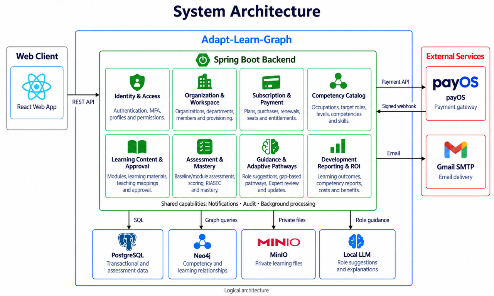

**Detailed editable alternative:** [Mermaid source: SYS-01](../documents/diagrams/mermaid/sys-01.mmd) · [Detailed architecture preview](../documents/diagrams/mermaid/sys-01.png). This retained diagram is a separate detailed view, not the source used to generate the supplied image.

**Diagram notes:**

- Trusted workspace-baseline configuration is currently profile-gated to local and excluded from prod. This diagram does not claim production learning readiness.
- MinIO, local LLM and incomplete business capabilities in the target image remain subject to the evidence and limitations below; their depiction does not establish live deployment or acceptance.

**Component Descriptions**

| No | Component | Description |
| --- | --- | --- |
| 01 | React Web App | Provides role-based screens, forms, learning views, visualizations and feedback, communicating with the backend through REST APIs. |
| 02 | Identity and Access Service | Handles authentication, MFA, account profiles, sessions, roles and access checks. |
| 03 | Organization and Workspace Service | Handles organization onboarding, workspace provisioning, departments, members and organization administration. |
| 04 | Subscription and Payment Service | Handles subscription plans, purchases, renewals, payment verification, seat allocation and entitlement enforcement. |
| 05 | Competency Catalog Service | Manages job position, target-role, level, competency, skill and prerequisite relationships. |
| 06 | Learning Content and Approval Service | Handles learning modules, materials, teaching mappings and offering submission/approval. |
| 07 | Assessment and Mastery Service | Handles baseline/module assessments, question selection, scoring, RIASEC and mastery estimation. |
| 08 | Guidance and Adaptive Pathways Service | Coordinates role suggestions, gap-based pathway generation, Expert review and pathway updates. |
| 09 | Development Reporting and ROI Service | Provides competency and learning-outcome reports, training-cost/benefit recording and ROI analysis. |
| 10 | PostgreSQL | Stores transactional, identity, subscription, workflow, assessment and learning-evidence records. |
| 11 | Neo4j | Stores competency-catalog relationships and learning coverage used for graph queries and traversal. |
| 12 | MinIO | Provides private learning-file storage, with file access authorized by the backend. |
| 13 | Local LLM | Provides internally hosted role suggestions and explanations using appropriately minimized learning inputs. |
| 14 | payOS | Provides payment checkout, status queries and signed payment webhooks. |
| 15 | Gmail SMTP | Delivers verification and system workflow emails. |

The eight Service names describe logical functional groups, not independently deployed applications or a one-to-one Java package map. Notifications, audit and background processing are shared backend capabilities rather than a ninth service group.

**Implementation boundaries:** The table describes the target responsibilities in the approved image. Connected identity/subscription and workspace-baseline slices do not establish completion of all learning, RIASEC, reporting or inference functions. MinIO and a concrete local LLM remain target integrations; live payment/email acceptance is not certified here. The runtime web entry, schema migration and detailed data ownership remain described in the following design/deployment sections.

#### 1.1.2 Data ownership and consistency

| Data | Authoritative owner | Cross-boundary rule |
| --- | --- | --- |
| Credentials, proofs, sessions, memberships, roles | Identity / PostgreSQL | Do not put secrets or authority in client storage or graph nodes. |
| Plans, purchased snapshots, provider observations, paid periods | Subscription / PostgreSQL | Provider signature and immutable terms govern application; payment redirects are hints only. |
| Organization/department/job position grants | PostgreSQL references and approved organization contracts | A catalog ID alone does not grant tenant access. V32 binds organization to explicit graph Job Position resources. |
| Role/skill/prerequisite/teaching relationships | Neo4j | Stable string IDs and versioned snapshot context; tenant/review eligibility must be checked by trusted adapters. |
| Question content, answer keys, attempts and results | Assessment / PostgreSQL | Immutable pins and safe DTO projections; correct answers are not ordinary Employee fields. |
| Baseline mastery/profile | PostgreSQL result/evidence/profile tables | Valid low/zero values differ from missing evidence; no automatic reinterpretation under new models. |
| Module metadata, ordering and approval | Target backend / PostgreSQL | Full target aggregate still requires design and forward migration; graph `contentUri` is not a private content service. |
| Content objects | Target MinIO | Store object locator/version in relational metadata; authorize before object access. |
| AI explanations | Target guidance service / approved persistence | Retain model/input provenance; do not let prose overwrite mastery. |
| Pathway versions and Expert overrides | Target pathway service / PostgreSQL | Initial confirmation gate and subsequent adaptation retain committed history. |
| Costs, benefits and actual ROI | Target reporting/finance records / PostgreSQL | Existing `roi_scenario` is not a complete actual cost-benefit ledger. |
| Audit and outbox events | PostgreSQL | Commit related mutation/event atomically where possible; asynchronous delivery is recoverable, not cross-store ACID. |

PostgreSQL transactions cannot atomically commit arbitrary Neo4j, MinIO or external provider operations. Current assessment admission revalidates catalog/resource fingerprints and pins immutable snapshots. Proposed broader synchronization uses versioned projections and durable event/receipt processing; an unavailable or stale projection remains explicitly blocked, rather than being filled with mock data.

#### 1.1.3 Third-party services declaration

| Service / provider | Purpose | Data sent out or across service boundary | Status, version and controls |
| --- | --- | --- | --- |
| payOS | Subscription checkout, status query and signed webhook | Merchant authentication headers; server-generated order code, exact amount, plan/item name, quantity, short description, expiry and return/cancel callback URLs. Query uses order/link identity. No learner answers, RIASEC, profile mastery or learning files are required. | Implemented adapter; `payos-java` **2.0.1**. Verify response/webhook signatures and order terms. Live merchant acceptance not run here. Credentials remain environment-injected and are not printed in reports. |
| Gmail SMTP | Account verification and transactional email | Recipient email, verification code or activation link when applicable, safe account/payment/workflow notification content. | Required provider; implemented configurable SMTP via Spring Mail. SMTP is a protocol/service, not a pinned Gmail application version. STARTTLS is configured. Actual provider account/inbox delivery not evidenced by documentation inspection. |
| MinIO, self-hosted | Private learning content/file storage | Authorized object bytes, organization-scoped object locator and metadata; no authentication password or raw payment secret. | Planned; server/client version not pinned, no service present in Compose. Proposed least-privilege backend access and expiring authorized downloads. |
| Local LLM, self-hosted | AI-assisted role guidance | Proposed minimized competency summary, normalized RIASEC vector, allowed role candidate IDs/requirements and non-identifying prompt context. | Planned; engine, model weights, quantization and version not selected in repository. Internal-only interface; no required third-party cloud AI API. |
| GitHub | Source control and target CI/CD | Repository commits, pull-request metadata and proposed build/test artifacts; no runtime learner data is required. | Repository platform confirmed; Actions workflows and deployed registry are not evidenced. Secret material must never be committed or emitted in logs. |
| O*NET / ESCO / SFIA / UK Government Digital and Data source materials | Offline ontology provenance/review | Dataset retrieval and citation, not runtime learner submissions. | O*NET 31.0 and SFIA 9 are documented dataset sources. Local ontology mappings are proposals, not official equivalence or license certification. |
| Authentication provider | Authentication | No external identity-provider exchange required by current code; credentials are processed by the application. | Built-in Spring Security/session implementation, not a verified Auth0/Firebase/Keycloak integration. |
| Mailpit | Local test mail capture | Test recipient and message content only in isolated verification environments. | Test Compose image **v1.27**; not the production email provider. |

#### 1.1.4 Development technologies and versions

For JavaScript dependencies, “manifest” is the declared range and “locked” is the resolved version in the checked-in lockfile. Mutable image tags pin only the specificity shown; an exact image digest was not recorded.

| Layer | Technology | Version / source | Use and qualification |
| --- | --- | --- | --- |
| Frontend | React / React DOM | Manifest `^19.2.8`; locked **19.3.0** | Web component/rendering framework. |
| Frontend | TypeScript | Manifest `~6.0.2`; locked **6.0.3** | Static typing and build-time checking. |
| Frontend tooling | Vite | Manifest `^8.3.0`; locked **8.3.0** | Dev server/proxy and production build. |
| UI styling | Tailwind CSS / Vite plugin | **4.3.3** resolved | Project tokens, shared UI and layout conventions. |
| Navigation | React Router DOM | **7.18.4** | Active route families and redirects. |
| Server state | TanStack React Query | **5.103.0** | Fetch/mutation lifecycle and scoped cache. |
| Graph visualization | vis-network | **10.1.2** | Catalog/pathway graph visualization. D3.js is a source option, not a declared dependency. |
| Frontend runtime/build | Node.js | Docker image **22-alpine** | Exact patch/digest not pinned by the Dockerfile. |
| Frontend tests | Vitest / Playwright | **5.0.2** / **1.63.0** | Unit/component and browser suites. |
| Frontend lint | Oxlint | Manifest `^1.81.0`; locked **1.83.0** | Existing lint command. |
| Backend | Java | **21** | Compilation/runtime target; Temurin 21 container JRE. |
| Backend framework | Spring Boot | **3.5.16** | MVC, validation, security, mail, sessions, Actuator, JDBC/JPA. |
| Backend build | Maven | Docker build **3.9.11** | Build image `maven:3.9.11-eclipse-temurin-21`. |
| Backend serialization | Jackson BOM | **2.21.8** | Explicit version management in backend POM. |
| OTP | java-otp | **1.0.0** | Administrator authenticator support. |
| Payments | payos-java | **2.0.1** | Merchant adapter and verification. |
| Architecture tests | ArchUnit | **1.4.1** | Domain/application/API dependency rules. |
| Database | PostgreSQL | **17.6**, image `17.6-alpine` | Transactional schema/evidence; live metadata reports 17.6. |
| Graph database | Neo4j Community | Image **5.26-community** | Graph reads/traversal and controlled import. Patch/digest not specified. |
| Database migration | Flyway core/PostgreSQL module | Managed by Spring Boot **3.5.16** BOM; no independent version override | 32 checked-in SQL migrations; exact transitively resolved version should be recorded in a release SBOM. |
| Drivers/test containers | PostgreSQL JDBC, Neo4j Java driver, Testcontainers | Managed by Spring Boot **3.5.16** BOM | Not independently pinned in project POM; do not invent a direct version. |
| Static serving/proxy | Caddy | Image **2-alpine** | Current production-shaped SPA/API proxy. |
| Target proxy | Nginx | Not pinned / not implemented in current Dockerfile | Version 2 delivery target. |
| Containers/orchestration | Docker / Docker Compose | Compose files present; host engine/plugin versions not pinned | On-premises deployment approach; no Kubernetes requirement. |
| Offline data tools | Python | Interpreter version not specified | Dataset validation/import/generation scripts, not a separate Python business backend. Python launcher was unavailable in this documentation session; Node was used for read-only metadata validation. |
| Mobile | Native mobile framework | Not applicable | Web application only; responsive browser acceptance is proposed in SRS. |
| Target storage/inference | MinIO / local LLM | Not selected or pinned | Must be declared with concrete versions before deployment claims. |

Evidence: [frontend manifest](../frontend/package.json), [lockfile](../frontend/package-lock.json), [backend POM](../backend/pom.xml), [frontend Dockerfile](../frontend/Dockerfile), [backend Dockerfile](../backend/Dockerfile), [development Compose](../compose.dev.yml) and [production Compose](../compose.prod.yml).

#### 1.1.5 Source control and DevOps declaration

| Topic | Current evidence | Proposed review/deployment policy |
| --- | --- | --- |
| Platform | GitHub repository `SEP490-Fall-2026-GFA26SE64/SEP490`. Inspected branch is `main`. | GitHub remains the collaboration platform. |
| Branch rules | No repository-enforced branch protection or documented full branch workflow was verified. Local branch names cannot prove hosted protection settings. | Protect `main`; use `feature/<FR-or-topic>` and `fix/<topic>` branches; merge through reviewed PRs; require at least one human reviewer and applicable checks. |
| CI | No `.github/workflows` workflow files found. | PR jobs: backend tests including ArchUnit, frontend `npm ci`, unit tests, lint and build, then approved database/browser integration jobs. |
| CD | No successful deployment pipeline/registry evidence found. | Build immutable images after approved merge; record commit/image digest, migrate controlled staging, run smoke checks, then manually approve production. |
| Dependency reproducibility | npm lockfile; Maven dependency/BOM declarations; versioned migration scripts. | Generate release dependency/SBOM inventory; pin image digests; retain build logs and migration checksum record. |
| Secrets | Configuration reads environment variables; actual secret values are excluded from this report. | Inject protected deployment secrets; never put `.env` values in artifacts/logs or ask reviewers to paste them into chat. |
| Database checks | Current V1-V32 checksums were compared to applied Flyway history using read-only metadata. | Block releases on migration history mismatch; preserve applied files and add forward migrations only. |
| Review evidence | Dedicated unit/integration/system evidence directories exist. | Keep failures, exclusions and blocked checks; no inferred “Passed” from a scaffold, source file or old run. |

**Proposed CI sequence (not an existing workflow):** checkout locked revision -> restore declared dependencies -> backend tests -> frontend tests/lint/build -> isolated PostgreSQL/Neo4j integration -> browser scenarios with test-only payment/email fixtures -> package immutable images -> retain evidence -> approval-gated deployment. Integration tests must not use production merchant accounts or alter the shared development database.

#### 1.1.6 Deployment environments and rollback

| Environment | Current configuration / location | Deployment and acceptance | Rollback |
| --- | --- | --- | --- |
| Development | Local/on-premises Docker Compose, default entry [compose.yaml](../compose.yaml) includes [compose.dev.yml](../compose.dev.yml). Default web `http://127.0.0.1:8088`; API `127.0.0.1:18080`; PostgreSQL `127.0.0.1:15432`; Neo4j HTTP/Bolt `127.0.0.1:7474/7687`. Ports can be overridden. | PostgreSQL/Neo4j health -> one-shot migration -> API (`local,workspace-baseline`) -> Vite web. No automatic approved question bank/model/graph seed. Current containers were inspected, not restarted. | Rebuild/reselect compatible application image; preserve volumes and historical IDs. Database downgrade is not automatic. |
| Isolated verification | Registration/identity/subscription Compose overrides and per-REQ test evidence. Test SMTP may use Mailpit; fixtures are test-only. | Use separate project/database and explicit fixtures. Historical example URLs (8092/8093) are evidence-specific, not guaranteed current endpoints. | Dispose only authorized isolated resources; never reset shared databases as a test shortcut. |
| Staging | No dedicated Compose file, host, DNS, TLS endpoint or deployed instance evidenced. | Proposed isolated on-premises host/project, production-like secrets/networking and representative sanitized data. Validate migration and restore before production. | Redeploy previous compatible image digest; restore isolated paired stores only through an approved, tested procedure. |
| Production | [compose.prod.yml](../compose.prod.yml) is production-shaped configuration, not proof of an actual deployment. API profile is `prod`; current web is Caddy on loopback port 8088. | Target on-premises host and Nginx/TLS entry. Set public HTTPS callback origin, protected secrets and private networks. The trusted workspace-baseline configuration is excluded from `prod`, so full learning delivery cannot be claimed from this file alone. | Proposed release rollback: stop new writes safely, preserve evidence, deploy previous schema-compatible image; use a forward corrective migration for incompatible schema. Full restore requires approved downtime/data-loss assessment and matched PostgreSQL/Neo4j/object snapshots. |

**Operational sequence, proposed for an authorized release:**

1. Record commit, image digests, target host, configuration names and migration lineage; take verified backups without exposing secrets.
2. Validate staging with the same database lineage and catalog snapshot. Do not point a database with the former assessment V8-V26 lineage at the integrated V1-V32 directory.
3. Run the one-shot migration, inspect Flyway history, then start API/web. Do not enable a seed/import profile as a deployment convenience.
4. Verify health, secure session/callback behavior, two-tenant authorization, one safe read flow and approved test-only payment/assessment scenarios.
5. Promote only with explicit approval; record deployed version. `restart: unless-stopped` is process policy, not a tested availability or recovery guarantee.
6. On failure, prefer compatible image rollback or forward fix. Never edit applied migration checksums, silently downgrade schemas, run `down -v`, or reseed reviewed/history-bearing data.

The production-shaped proxy is HTTP-only internally; secure cookies require a real HTTPS termination/public origin at the deployment boundary. No TLS certificate, target DNS, backup schedule, RPO/RTO, production hardware sizing or exercised rollback is evidenced in the repository.

#### 1.1.7 AI tools and models declaration

Separate **AI used by the product** from **AI used during development**.

| Tool / model | Stage(s) | Evidence and declared status | Human control / data boundary |
| --- | --- | --- | --- |
| AI assistant using Copilot SDK in VS Code | This Review 2 requirements/design documentation, local source inspection and documentation consistency checks | Used for this task. The underlying model identifier/version is not recorded as verifiable repository metadata and is therefore **not declared as a guessed model**. | Team review/sign-off remains pending. Local source/schema was not sent to a public diagram renderer or external research service during this task. |
| Repository agent/skill customizations | Intended specification, design, implementation, testing and review workflows | Customization files exist, but they do not prove which tool/model actually produced each historical change. A per-stage usage log is not evidenced. | Proposed log records tool, model/version, date, stage, output, human reviewer and verification. Existence of a skill is not proof of execution. |
| Specific historical coding/testing/review models | Code generation, test generation and review | **Not evidenced**; team must supply the real tool/model list if required for final submission. No claim of Claude/GPT/Gemini use is inferred from filenames or optional instructions. | Do not fabricate model names, test outcomes or human approvals. |
| Locally hosted language model | Product runtime role guidance | Required target; engine/model/weight version, quantization and prompt version **not selected in inspected runtime**. | Proposed internal inference API with minimized competency/interest data, authorized role IDs, validation and explicit failure behavior. |
| AI-assisted ontology/content preparation | Dataset design/content scaffolding | Catalog contains authored review materials; precise historical model provenance is not evidenced. All current v0.11 definitions remain `NEEDS_EXPERT_REVIEW`. | Do not label generated scaffolds as expert-approved courses or use missing reviewer identities/timestamps. |

Before final institutional submission, the team should complete an AI usage register with factual model/version and stage information. This report supplies every required declaration field while visibly retaining “not evidenced” where no factual value is available.

### 1.2 Package Diagram

This section shows **package overviews**, not an exhaustive list of nested packages, classes or test directories. The backend view exposes hexagonal package layers and adapter roles; the frontend view shows principal source-directory groups. Detailed inventory sources are retained as references but are not displayed as the main views.

#### 1.2.1 Backend packages and dependency direction

The root namespace is `com.adaptlearngraph`. Feature modules include `identity`, `subscription`, `catalog`, `competency`, `assessment`, `learning`, `pathway`, `recommendation`, `platform`, `analytics`, `evaluation` and `synchronization`. Instead of listing those families alone, this overview shows the actual **identity module's hexagonal structure** as a representative pattern: `api`, `application`, `application.port.in`, `application.port.out`, `domain` and `infrastructure`, together with shared packages. Other modules can omit or specialize layers; the example is not a claim that every module has identical packages.

[Mermaid source: Backend Package Overview](../documents/diagrams/mermaid/pkg-overview-backend.mmd)

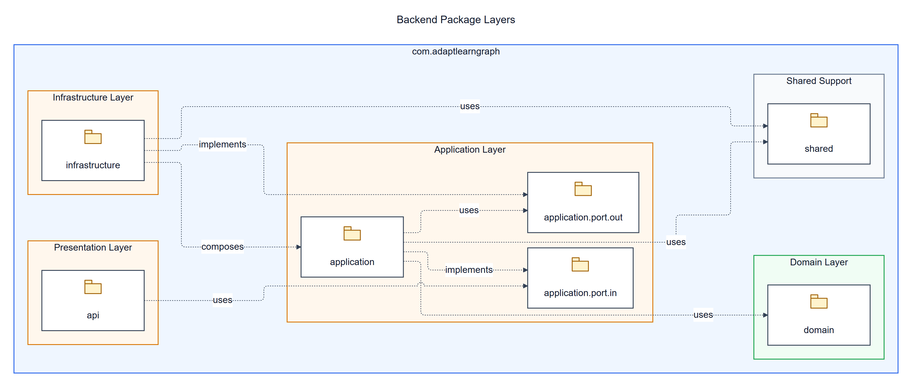

**Reading the overview:** Packages are grouped into **Presentation Layer**, **Application Layer**, **Domain Layer** and **Infrastructure Layer**, with **Shared Support** alongside them. Each package uses the same tabbed-package icon. Layer names are organizational labels, not additional Java namespaces. Shared subpackages are collapsed into `shared` for readability and remain described below.

Dotted arrows show selected source dependencies, not runtime request flow. Inbound adapters use input ports; application services implement input ports and use output ports/domain types; infrastructure implements output ports and composes services. Domain types do not depend on API, application or infrastructure. Secondary dependencies are omitted from this overview.

**Adapter naming:** `Adapter In` and `Adapter Out` are role annotations, not literal package names. The repository has no declared `adapter.in` or `adapter.out` namespace. REST inbound adapters reside in `api`; outbound persistence/provider adapters reside in `infrastructure`, alongside runtime composition and bootstrap classes. Some infrastructure classes also implement input use cases, so infrastructure is not exclusively outbound.

**Package Descriptions**

| No | Package | Description |
| --- | --- | --- |
| 01 | `com.adaptlearngraph` | Root backend package containing the Spring Boot entry class and top-level module organization. |
| 02 | `api` | Inbound REST adapters, request/response contracts and validation that delegate to application input ports. |
| 03 | `application` | Application services and use-case orchestration using domain rules and output ports. |
| 04 | `application.port.in` | Input interfaces defining the operations offered by the application to inbound adapters. |
| 05 | `application.port.out` | Output interfaces defining persistence, identity, secret-management and delivery capabilities needed by use cases. |
| 06 | `domain` | Business models, value types, policies and failures independent of framework and adapter implementations. |
| 07 | `infrastructure` | Persistence/provider adapters, runtime configuration and composition, transaction integration and bootstrap support. |
| 08 | `shared` | Namespace grouping reusable domain and infrastructure support across feature modules. |
| 09 | `shared.domain` | Shared domain policies and types used by application logic. |
| 10 | `shared.infrastructure` | Shared runtime/integration support and its specialized subpackages. |
| 11 | `shared.infrastructure.mail` | Reusable transactional email contracts and delivery infrastructure. |

Rows 02-07 are relative to `com.adaptlearngraph.identity` in this diagram; shared rows are relative to `com.adaptlearngraph`. Adapter roles are explained above rather than falsely listed as additional packages.

The [architecture test](../backend/src/test/java/com/adaptlearngraph/architecture/LayeredArchitectureTest.java) records the dependency constraints. Representative source evidence includes [MemberActivationController](../backend/src/main/java/com/adaptlearngraph/apis/MemberActivationController.java), [RegistrationService](../backend/src/main/java/com/adaptlearngraph/services/RegistrationService.java), [JdbcRegistrationStore](../backend/src/main/java/com/adaptlearngraph/repository/JdbcRegistrationStore.java) and [DevelopmentWorkspaceAccountBootstrap](../backend/src/main/java/com/adaptlearngraph/config/DevelopmentWorkspaceAccountBootstrap.java). Bootstrap is infrastructure composition, not a domain or port package. This documentation revision does not rename application packages or certify a new application test run.

**Detailed inventory reference:** [PKG-01 source](../documents/diagrams/mermaid/pkg-01.mmd) · [PKG-01 image](../documents/diagrams/mermaid/pkg-01.png). The previous inventory is retained rather than regenerated as part of this overview revision.

#### 1.2.2 Frontend packages

In the TypeScript frontend, packages mean source-directory groups, not separately published npm packages. The overview shows only the source root and its four principal groups; actor-specific screens and nested shared folders are intentionally collapsed. Dotted arrows show selected imports, not REST calls or an exhaustive dependency graph.

[Mermaid source: Frontend Package Overview](../documents/diagrams/mermaid/pkg-overview-frontend.mmd)

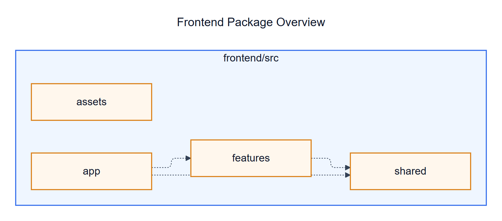

**Package Descriptions**

| No | Package | Description |
| --- | --- | --- |
| 01 | `frontend/src` | Source root containing the React bootstrap entry and top-level application organization. |
| 02 | `app` | Application routing, providers and composition of feature pages. |
| 03 | `features` | Actor-oriented pages, domain-specific UI logic and feature integrations. |
| 04 | `shared` | Reusable API/auth helpers, UI components, hooks, layouts, translations, stores and styles. |
| 05 | `assets` | Static source assets used by the frontend. |

**Detailed inventory reference:** [PKG-02 source](../documents/diagrams/mermaid/pkg-02.mmd) · [PKG-02 image](../documents/diagrams/mermaid/pkg-02.png). Verification directories and nested feature/shared packages remain in that reference, not in the main overview.

## 2. Database Design

### 2.1 Physical baseline, script ownership and verification

The current PostgreSQL `platform` schema was captured from the already-running development PostgreSQL using a **repeatable-read, read-only transaction** over `pg_catalog` and `public.flyway_schema_history`. No application rows, credentials, learner answers or payment payloads were extracted. No migration, import, write, restart or reset was performed.

**Historical verified baseline: PostgreSQL 17.6; V1-V32; 113 tables; 916 columns; 237 foreign keys.** Every applied migration was successful and its Flyway CRC32 matched the corresponding checked-in SQL file. The retained physical dictionary and archived DB-* diagrams use that dated metadata. The Role-Level flow ERDs in section 2.2 describe the approved target and are not a live database export.

The existing [postgresql-schema-catalog.json](../documents/diagrams/postgresql-schema-catalog.json) describes an older 89-table assessment lineage and contains script names no longer present in the integrated migration directory. It was **not** used as the current database truth. Historical diagrams/architecture paragraphs are similarly date-scoped. The report does not modify those historical artifacts.

**Files Description**

| File / directory | Purpose and execution boundary |
| --- | --- |
| [db/migration](../backend/src/main/resources/db/migration) | Executable PostgreSQL schema source, V1-V32 in numeric order, applied by Flyway. These existing scripts are the “database script” paired with this report's physical ERDs. |
| [application.yml](../backend/src/main/resources/application.yml) | Flyway location, JDBC/Neo4j/session settings and Hibernate `ddl-auto: validate`. |
| [compose.dev.yml](../compose.dev.yml), [compose.prod.yml](../compose.prod.yml) | Run schema migration before API startup; distinct profile behavior. |
| [Generate-PostgresqlDiagrams.ps1](../documents/diagrams/Generate-PostgresqlDiagrams.ps1) | Existing diagram-generation tooling; inspect its environment/lineage before use. |
| [Generate-PostgresqlDiagrams.py](../documents/diagrams/Generate-PostgresqlDiagrams.py) | Existing read-only catalog query used as metadata-query prior art. Its static table groups/snapshot are not assumed current. |
| [ontology_seed.json](../documents/dataset/import/ontology_seed.json) | v0.9 runtime-input catalog, 833 nodes and 4,638 relationships, including 85 modules. |
| [ontology_seed-v011.json](../documents/dataset/import/ontology_seed-v011.json) | Separate v0.11 review catalog, 994 nodes and 5,121 relationships, including 246 modules. Not a live migration. |
| [import_neo4j.py](../documents/dataset/import/import_neo4j.py), [validate_dataset.py](../documents/dataset/import/validate_dataset.py) | Current controlled graph validation/import; creates six ID uniqueness constraints and rejects incompatible snapshots. Does not supply SQL foreign keys. |
| [db/neo4j/README.md](../backend/src/main/resources/db/neo4j/README.md) | Distinguishes historical graph scripts/cutovers from current runtime and review packages. |

**Lineage constraint:** original identity/subscription V1-V12 is retained. Incoming assessment work formerly numbered V8-V26 was integrated as V13-V31, with V32 adding explicit workspace-baseline resources. A database that applied the former lineage cannot be switched to this directory merely by editing migration history or accepting new checksums.

#### 2.1.1 Migration ledger

The checksum column is the full signed Flyway CRC32 verified against the running schema. SHA-256 prefixes identify the inspected source bytes; they are not signatures or a substitute for full release artifacts.

<!-- MIGRATIONS:START -->

| Version | Executable script | Verified Flyway checksum | Source SHA-256 prefix |
| --- | --- | --- | --- |
| V1 | [V1__initialize_platform_schema.sql](../backend/src/main/resources/db/migration/V1__initialize_platform_schema.sql) | -996555326 | 9e9ceeaebc2f2eba |
| V2 | [V2__identity_catalog_and_processing.sql](../backend/src/main/resources/db/migration/V2__identity_catalog_and_processing.sql) | -1975842268 | 18140b491728a917 |
| V3 | [V3__assessment_evidence_and_learning.sql](../backend/src/main/resources/db/migration/V3__assessment_evidence_and_learning.sql) | -1741254678 | a80f8e89f4c6f4f3 |
| V4 | [V4__pathway_analytics_and_evaluation.sql](../backend/src/main/resources/db/migration/V4__pathway_analytics_and_evaluation.sql) | 1805290226 | c2d43a80c658f069 |
| V5 | [V5__publication_and_activity_guards.sql](../backend/src/main/resources/db/migration/V5__publication_and_activity_guards.sql) | -741739431 | 0b3ff5ed272e4ebc |
| V6 | [V6__organization_baseline.sql](../backend/src/main/resources/db/migration/V6__organization_baseline.sql) | 1148597275 | 3fb21db03d24455c |
| V7 | [V7__target_role_selection_command.sql](../backend/src/main/resources/db/migration/V7__target_role_selection_command.sql) | -826639885 | 8eec7ad70bf293bb |
| V8 | [V8__organization_registration.sql](../backend/src/main/resources/db/migration/V8__organization_registration.sql) | 1078279438 | 5d7f40d3d534d560 |
| V9 | [V9__subscription_lifecycle.sql](../backend/src/main/resources/db/migration/V9__subscription_lifecycle.sql) | -53106023 | 3e7531e24adeaef5 |
| V10 | [V10__workspace_identity_support.sql](../backend/src/main/resources/db/migration/V10__workspace_identity_support.sql) | -1645780626 | 38ce22d59c888e64 |
| V11 | [V11__subscription_period_guards.sql](../backend/src/main/resources/db/migration/V11__subscription_period_guards.sql) | 1955686220 | cbece7983ea86dae |
| V12 | [V12__single_account_role.sql](../backend/src/main/resources/db/migration/V12__single_account_role.sql) | -1693760114 | e322bed59afa4f73 |
| V13 | [V13__baseline_question_metadata.sql](../backend/src/main/resources/db/migration/V13__baseline_question_metadata.sql) | -958529426 | 7f716fea4e825f70 |
| V14 | [V14__baseline_blueprint.sql](../backend/src/main/resources/db/migration/V14__baseline_blueprint.sql) | -1488394481 | d550d6a298605ba1 |
| V15 | [V15__baseline_blueprint_write_idempotency.sql](../backend/src/main/resources/db/migration/V15__baseline_blueprint_write_idempotency.sql) | -406452938 | 6efecb2360fa1d06 |
| V16 | [V16__baseline_assessment_generation.sql](../backend/src/main/resources/db/migration/V16__baseline_assessment_generation.sql) | 305115675 | 11a39e745f08e1c5 |
| V17 | [V17__baseline_assessment_review_publish.sql](../backend/src/main/resources/db/migration/V17__baseline_assessment_review_publish.sql) | 1670694760 | 90fe26d114b4f527 |
| V18 | [V18__job position_blueprint_identity.sql](../backend/src/main/resources/db/migration/V18__job position_blueprint_identity.sql) | -1992663521 | a9135f5534eb1c4a |
| V19 | [V19__baseline_assessment_management.sql](../backend/src/main/resources/db/migration/V19__baseline_assessment_management.sql) | 1966272887 | ba913205f765353d |
| V20 | [V20__baseline_management_command_idempotency.sql](../backend/src/main/resources/db/migration/V20__baseline_management_command_idempotency.sql) | -489468397 | c237a3c5cb67b86a |
| V21 | [V21__baseline_answer_reveal_audit.sql](../backend/src/main/resources/db/migration/V21__baseline_answer_reveal_audit.sql) | 919091195 | b7735c744556dd39 |
| V22 | [V22__fix_baseline_management_actor_trigger.sql](../backend/src/main/resources/db/migration/V22__fix_baseline_management_actor_trigger.sql) | -913315742 | 0bc2811a14571502 |
| V23 | [V23__adaptive_baseline_blueprint_and_irt_versions.sql](../backend/src/main/resources/db/migration/V23__adaptive_baseline_blueprint_and_irt_versions.sql) | 242615654 | abbc0686648eadeb |
| V24 | [V24__adaptive_baseline_attempt.sql](../backend/src/main/resources/db/migration/V24__adaptive_baseline_attempt.sql) | 975611633 | bb2562cd01f25781 |
| V25 | [V25__job position_baseline_scope_compatibility.sql](../backend/src/main/resources/db/migration/V25__job position_baseline_scope_compatibility.sql) | 2137365147 | 6dfec5d2fd4fe6da |
| V26 | [V26__job position_baseline_name_and_time_limits.sql](../backend/src/main/resources/db/migration/V26__job position_baseline_name_and_time_limits.sql) | -935442136 | c1b2cb79b6140bdf |
| V27 | [V27__job position_baseline_draft_conversion_receipt.sql](../backend/src/main/resources/db/migration/V27__job position_baseline_draft_conversion_receipt.sql) | 859223100 | 65f04ae3c2e873b2 |
| V28 | [V28__irt_scoped_parameter_promotion.sql](../backend/src/main/resources/db/migration/V28__irt_scoped_parameter_promotion.sql) | -1125147424 | 4f5c8b69db4a7d42 |
| V29 | [V29__baseline_draft_discard_receipt.sql](../backend/src/main/resources/db/migration/V29__baseline_draft_discard_receipt.sql) | -71600753 | 4d21100bd1d5d989 |
| V30 | [V30__current_role_selection_and_job position_profile.sql](../backend/src/main/resources/db/migration/V30__current_role_selection_and_job position_profile.sql) | 1717114679 | 6107ba3e440cdc92 |
| V31 | [V31__insufficient_evidence_manual_submission.sql](../backend/src/main/resources/db/migration/V31__insufficient_evidence_manual_submission.sql) | -738341887 | 521dcb12b37df11f |
| V32 | [V32__workspace_baseline_resources.sql](../backend/src/main/resources/db/migration/V32__workspace_baseline_resources.sql) | 608834404 | 9d406120924ef06f |

<!-- MIGRATIONS:END -->

### 2.2 Logical database design

The following four ERDs model only the approved ACT-05 flow. Every entity box lists its complete attribute set **as defined for this target flow model**, including types, keys and nullability. Existing shared entities are scoped references, not exhaustive replacements for their owning physical tables; the full historical physical dictionary remains in section 2.3. This model is proposed documentation, not an applied schema change.

**Notation and constraints:** PK/FK identify target logical keys. REQUIRED/NULLABLE describe field nullability. Catalog IDs refer across stores and are not SQL-enforced foreign keys into Neo4j. Tenant-bearing references must match organization and learner ownership, including joins whose compact FK label names only the entity. Time fields are timestamptz. JSON snapshots contain validated, versioned rules/outcomes, never executable organization-supplied code.

**1. Role-Level Selection and Baseline Configuration**

[Mermaid source: LERD-01](../documents/diagrams/mermaid/lerd-01.mmd)

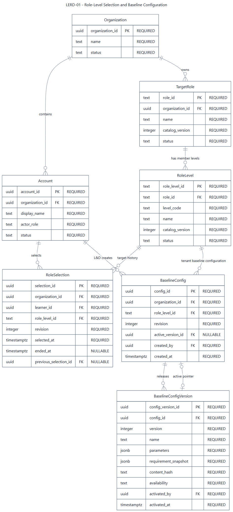

**2. Assessment and Role-Level Profile**

[Mermaid source: LERD-02](../documents/diagrams/mermaid/lerd-02.mmd)

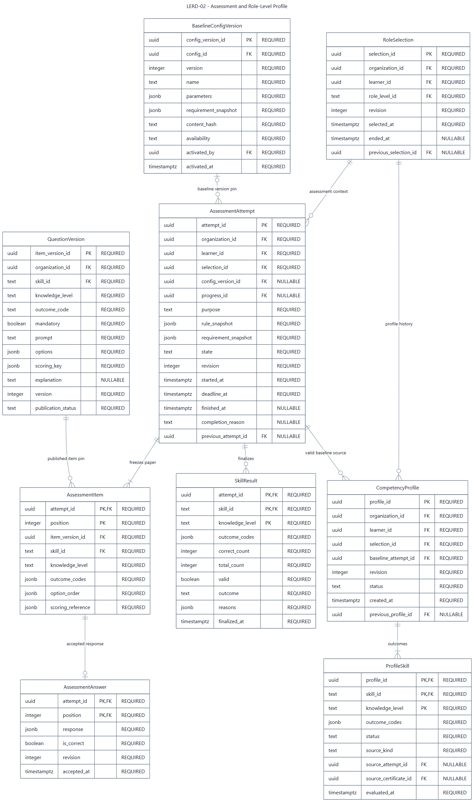

**3. Role Requirements and Learning Provision**

[Mermaid source: LERD-03](../documents/diagrams/mermaid/lerd-03.mmd)

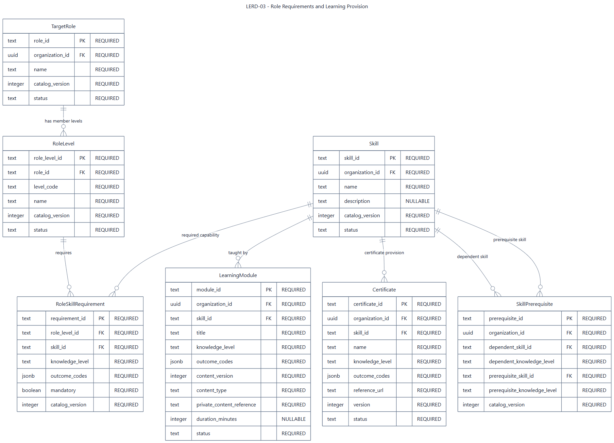

**4. Pathway Review, Learning and Bypass**

[Mermaid source: LERD-04](../documents/diagrams/mermaid/lerd-04.mmd)

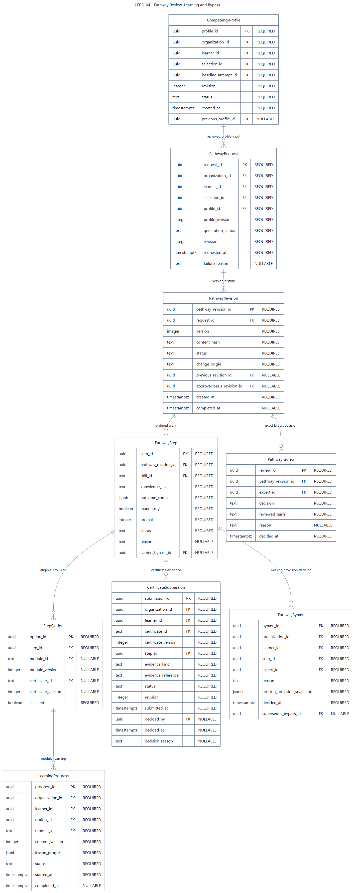

**Cross-view references:** the same entity name in different views denotes the same owner and key, not a copied table. The following links connect the views without repeating large entity boxes.

| Referencing field | Referenced entity/key | Rule |
| --- | --- | --- |
| AssessmentAttempt.progress_id | LearningProgress.progress_id | Required for skill assessment; null for baseline. |
| AssessmentItem.skill_id, SkillResult.skill_id, ProfileSkill.skill_id, PathwayStep.skill_id | Skill.skill_id | Exact catalog skill plus frozen knowledge level/outcomes. |
| ProfileSkill.source_attempt_id | AssessmentAttempt.attempt_id | Present for an assessment source, scoped to the same learner. |
| ProfileSkill.source_certificate_id | CertificateSubmission.submission_id | Present for accepted certificate evidence; never an unreviewed submission. |
| StepOption.module_id | LearningModule.module_id | Pin module_version to approved content_version. |
| StepOption.certificate_id, CertificateSubmission.certificate_id | Certificate.certificate_id | Pin the exact certificate definition version. |
| LearningProgress.module_id | LearningModule.module_id | Preserve original content version and progress ownership. |
| PathwayReview.expert_id, PathwayBypass.expert_id, CertificateSubmission.decided_by | Account.account_id | Genuine authorized Expert, with current organization/assignment checks. |
| BaselineConfigVersion.activated_by | Account.account_id | Genuine authorized L&D activation. |
| PathwayStep.carried_bypass_id | PathwayBypass.bypass_id | Optional preserved bypass source; never achievement. |

**Flow invariants**

- BaselineConfig is unique per organization and RoleLevel; its optional active pointer must reference a validated version of that same config. New versions preserve previous attempts and history. RoleLevel must belong to the selected Role.
- Baseline AssessmentAttempt requires config_version_id and no progress_id. Skill assessment requires progress_id and separately validated rule_snapshot; baseline configuration is not silently reused as skill-assessment policy. Exactly one assessment context applies. Resume retains paper, configuration and deadline.
- AssessmentAnswer uses the composite presented-item reference (attempt_id, position). SkillResult belongs to that same attempt; invalid results and missing data are not Met or a fabricated numerical zero.
- Profile status is Met only when all applicable mandatory requirements are met; otherwise valid unmet results are Needs supplementation. No valid profile is created from an invalid baseline. Profile revisions preserve original results and distinguish diagnostic baseline sources from accepted learning/certificate evidence.
- StepOption binds exactly one provision: module_id + module_version OR certificate_id + certificate_version. Module alternatives must match the exact skill/knowledge/outcomes and approved content. Certificate submissions retain private evidence references; pending/rejected decisions do not award achievement.
- PathwayReview records a real Expert decision on an exact revision/hash. Automatic recalculation uses change_origin and approval_basis_revision_id; it must not fabricate a new Expert approval. A newly discovered missing-provision gap needs a scoped bypass decision, not repeat approval of every adaptation.
- Bypass requires absence of both eligible module and certificate provision, a genuine Expert/reason/time and preserved source step. It remains Needs supplementation. Any non-bypassed blocking requirement keeps Role and Level locked, including pending generation/review and processing errors. Completion or bypass-only releases target change; a running attempt still blocks replacement. Historical selection/profile/pathway data remains queryable.
- No-learning-required closes the request without creating an artificial learning task. Other generation errors remain bound to the same target for repair/retry. New target selection returns to its matching Active baseline config; old baseline results are not silently treated as a new assessment.

#### 2.2.1 Historical physical constraints (V1-V32)

These retained constraints describe the dated implementation, including Job Position baseline ownership. They do not override the approved Role-Level target above; reconciling physical mappings requires a separately approved implementation/migration.

| Concern | Current rule / relevant source |
| --- | --- |
| Single role | V12 membership/account triggers and unique rules enforce the current one-role identity policy and platform/organization separation. |
| Paid periods | V11 interval guards prevent overlapping subscription periods; paid terms remain immutable. |
| Tenant resource binding | V32 `workspace_baseline_resource` has PK `(organization_id, graph_job position_id)`, unique `(organization_id, job position_reference_id)` and composite FK to the same-organization job position reference. |
| Optional baseline resource pins | V32 `question_bank_id`, `model_version_id`, `mastery_mapping_version_id` are nullable: null means unconfigured, not default/demo approved resource. |
| Question-bank owner | V32 trigger checks the bank creator account's organization; the FK alone does not establish tenant ownership. |
| Registration | State/email/completion timestamp consistency is checked; account secrets/proofs are stored separately from public registration DTOs. |
| Payment | `PAID` requires observed exact amount and actual paid timestamp; `UNPAID_TERMINAL` requires observed zero paid amount. |
| Payment application | `APPLIED` requires an applied time and period reference; other application states retain null application outputs. |
| Adaptive attempt | `IN_PROGRESS` has no terminal time/reason; terminal states have consistent actual finish time, completion reason and deadline rules. |
| Mastery | UNKNOWN is not numerical zero; valid estimated/effective values and evidence status are constrained separately. |
| Released baseline | Draft state/identity, version registry and activation pointer have distinct keys; closing a draft does not mutate a released version. |
| Current role | V30 persists string-based current Role selections and Job Position profiles without rewriting legacy UUID selections. |
| Invalidation | V31 supports insufficient manual finalization without fabricated mastery/profile. |
| PostgreSQL schema history | `public.flyway_schema_history` is migration bookkeeping, outside the 113 `platform` business/support tables. |

### 2.3 Physical ERDs and Table Descriptions

The report displays only flow-related ERDs in section 2.2, with all target attributes. Historical whole-system key-only DB-01 through DB-08 renders are retained as archived artifacts; they are not the Role-Level design and are not reproduced here. Their original physical definitions and full table/field dictionary below are preserved for traceability.

| Historical view | Archived source |
| --- | --- |
| DB-01 | [Mermaid source](../documents/diagrams/mermaid/db-01.mmd) |
| DB-02 | [Mermaid source](../documents/diagrams/mermaid/db-02.mmd) |
| DB-03 | [Mermaid source](../documents/diagrams/mermaid/db-03.mmd) |
| DB-04 | [Mermaid source](../documents/diagrams/mermaid/db-04.mmd) |
| DB-05 | [Mermaid source](../documents/diagrams/mermaid/db-05.mmd) |
| DB-06 | [Mermaid source](../documents/diagrams/mermaid/db-06.mmd) |
| DB-07 | [Mermaid source](../documents/diagrams/mermaid/db-07.mmd) |
| DB-08 | [Mermaid source](../documents/diagrams/mermaid/db-08.mmd) |

#### 2.3.1 Table Descriptions

Every table is listed below with purpose and its real primary/foreign keys. “Foundation” means the table exists but the corresponding end-to-end product service may not.

<!-- TABLE_DESCRIPTIONS:START -->

| No | Table | Description | Primary keys | Foreign keys |
| --- | --- | --- | --- | --- |
| 1 | [account](#table-account) | Account identity, active state and internal credential linkage. | `account_id` | FK005 to `organization`; FK006 to `organizational_unit`; FK007 to `organizational_unit` |
| 2 | [account_recovery_code](#table-account-recovery-code) | Internal hashed single-use recovery proofs. | `account_id`, `code_hash` | FK001 to `account_totp` |
| 3 | [account_role](#table-account-role) | Historical/account-level role assignment under current single-role guards. | `account_id`, `role_code` | FK002 to `account`; FK003 to `application_role` |
| 4 | [account_totp](#table-account-totp) | Internal encrypted authenticator enrollment and replay protection. | `account_id` | FK004 to `account` |
| 5 | [activity_requirement](#table-activity-requirement) | Assessment requirement attached to learning activity. | `activity_id`, `assessment_version_id` | FK008 to `learning_activity`; FK009 to `module_assessment_binding` |
| 6 | [analytics_snapshot](#table-analytics-snapshot) | Versioned analytics output foundation. | `analytics_snapshot_id` | FK010 to `cohort_snapshot` |
| 7 | [application_role](#table-application-role) | Registered application role vocabulary. | `role_code` | None |
| 8 | [assessment_assignment](#table-assessment-assignment) | Learner assessment assignment lifecycle foundation. | `assignment_id` | FK011 to `activity_requirement`; FK012 to `learning_activity`; FK013 to `assessment_version`; FK014 to `learner_state` |
| 9 | [assessment_attempt](#table-assessment-attempt) | Legacy/shared attempt snapshot and response lifecycle foundation. | `attempt_id` | FK015 to `assessment_assignment` |
| 10 | [assessment_availability](#table-assessment-availability) | Versioned assessment availability history. | `assessment_version_id`, `revision` | FK016 to `assessment_version`; FK017 to `account` |
| 11 | [assessment_item](#table-assessment-item) | Ordered item inclusion in an assessment version. | `assessment_version_id`, `item_position` | FK018 to `assessment_version`; FK019 to `item_version` |
| 12 | [assessment_result](#table-assessment-result) | Legacy/shared terminal assessment result. | `attempt_id` | FK020 to `assessment_attempt` |
| 13 | [assessment_version](#table-assessment-version) | Versioned assessment definition and legacy baseline publication state. | `assessment_version_id` | FK021 to `baseline_blueprint_version`; FK022 to `account`; FK023 to `account` |
| 14 | [audit_event](#table-audit-event) | Actual actor/action/outcome audit trail. | `audit_event_id` | FK024 to `account` |
| 15 | [baseline_adaptive_attempt](#table-baseline-adaptive-attempt) | Current pinned adaptive attempt, deadline and terminal reason. | `attempt_id` | FK025 to `baseline_adaptive_blueprint_role`; FK026 to `learner_state`; FK027 to `account`; FK028 to `baseline_adaptive_blueprint_version`; FK029 to `baseline_adaptive_attempt` |
| 16 | [baseline_adaptive_blueprint_role](#table-baseline-adaptive-blueprint-role) | Pinned role requirement snapshot in adaptive version. | `blueprint_id`, `blueprint_version`, `role_id` | FK030 to `baseline_adaptive_blueprint_version` |
| 17 | [baseline_adaptive_blueprint_skill](#table-baseline-adaptive-blueprint-skill) | Pinned role-skill union input in adaptive version. | `blueprint_id`, `blueprint_version`, `role_id`, `micro_skill_id` | FK031 to `baseline_adaptive_blueprint_role` |
| 18 | [baseline_adaptive_blueprint_version](#table-baseline-adaptive-blueprint-version) | Immutable adaptive configuration, resource pins and full-Job Position policy. | `blueprint_id`, `version` | FK032 to `baseline_blueprint`; FK033 to `irt_parameter_set`; FK034 to `account`; FK035 to `mastery_mapping_version`; FK036 to `model_version` |
| 19 | [baseline_adaptive_blueprint_working_revision](#table-baseline-adaptive-blueprint-working-revision) | Current adaptive editable Draft identity/settings/state. | `working_revision_id` | FK037 to `baseline_blueprint`; FK038 to `account`; FK039 to `account` |
| 20 | [baseline_answer_reveal_audit](#table-baseline-answer-reveal-audit) | Protected answer-review access audit. | `answer_reveal_audit_id` | FK040 to `account`; FK041 to `assessment_version`; FK042 to `organization` |
| 21 | [baseline_assessment_series](#table-baseline-assessment-series) | Legacy Job Position assessment series/current working state. | `organization_id`, `job position_id` | FK043 to `assessment_version`; FK044 to `baseline_blueprint`; FK045 to `baseline_blueprint_version`; FK046 to `assessment_version`; FK047 to `organization`; FK048 to `baseline_blueprint_working_revision` |
| 22 | [baseline_assessment_transition](#table-baseline-assessment-transition) | Legacy management transition history. | `transition_id` | FK049 to `assessment_version`; FK050 to `baseline_assessment_series`; FK051 to `baseline_blueprint_version`; FK052 to `assessment_version`; FK053 to `assessment_version`; FK054 to `baseline_blueprint_version`; FK055 to `baseline_blueprint_working_revision`; FK056 to `account`; FK057 to `assessment_version`; FK058 to `baseline_blueprint_working_revision` |
| 23 | [baseline_attempt_command](#table-baseline-attempt-command) | Attempt operation idempotency receipt scoped to tenant and actor. | `organization_id`, `actor_id`, `idempotency_key` | FK059 to `baseline_adaptive_attempt` |
| 24 | [baseline_attempt_item](#table-baseline-attempt-item) | Delivered item sequence and content snapshot. | `attempt_id`, `position` | FK060 to `baseline_attempt_pool_item` |
| 25 | [baseline_attempt_pool_item](#table-baseline-attempt-pool-item) | Immutable eligible item pool captured for attempt. | `attempt_id`, `item_version_id` | FK061 to `baseline_attempt_skill_state`; FK062 to `baseline_adaptive_attempt`; FK063 to `irt_item_parameter` |
| 26 | [baseline_attempt_response](#table-baseline-attempt-response) | Accepted response for a delivered position. | `attempt_id`, `position` | FK064 to `baseline_attempt_item` |
| 27 | [baseline_attempt_result](#table-baseline-attempt-result) | Valid terminal adaptive result summary. | `attempt_id` | FK065 to `baseline_adaptive_attempt`; FK066 to `outbox_event` |
| 28 | [baseline_attempt_skill_result](#table-baseline-attempt-skill-result) | Terminal per-skill result and confidence. | `attempt_id`, `micro_skill_id` | FK067 to `baseline_attempt_skill_state`; FK068 to `mastery_mapping_version` |
| 29 | [baseline_attempt_skill_state](#table-baseline-attempt-skill-state) | Internal per-skill adaptive progress, theta and uncertainty. | `attempt_id`, `micro_skill_id` | FK069 to `baseline_adaptive_attempt` |
| 30 | [baseline_blueprint](#table-baseline-blueprint) | Stable organization/Job Position baseline identity. | `blueprint_id` | FK089 to `account`; FK090 to `organization` |
| 31 | [baseline_blueprint_activation](#table-baseline-blueprint-activation) | Current active baseline pointer for organization/Job Position. | `organization_id`, `job position_id` | FK074 to `account`; FK075 to `baseline_blueprint`; FK076 to `baseline_adaptive_blueprint_version` |
| 32 | [baseline_blueprint_activation_event](#table-baseline-blueprint-activation-event) | Activation/deactivation/replacement history. | `activation_event_id` | FK070 to `baseline_blueprint`; FK071 to `baseline_blueprint_activation`; FK072 to `baseline_adaptive_blueprint_version`; FK073 to `account` |
| 33 | [baseline_blueprint_command](#table-baseline-blueprint-command) | Adaptive management exact replay receipt. | `organization_id`, `actor_id`, `idempotency_key` | FK077 to `account`; FK078 to `baseline_blueprint` |
| 34 | [baseline_blueprint_role](#table-baseline-blueprint-role) | Legacy blueprint role coverage and bounds. | `blueprint_id`, `blueprint_version`, `role_id` | FK079 to `baseline_blueprint_version` |
| 35 | [baseline_blueprint_skill](#table-baseline-blueprint-skill) | Legacy blueprint role-skill coverage snapshot. | `blueprint_id`, `blueprint_version`, `role_id`, `micro_skill_id` | FK080 to `baseline_blueprint_role` |
| 36 | [baseline_blueprint_version](#table-baseline-blueprint-version) | Legacy immutable baseline blueprint settings. | `blueprint_id`, `version` | FK082 to `account`; FK083 to `baseline_blueprint` |
| 37 | [baseline_blueprint_version_registry](#table-baseline-blueprint-version-registry) | Blueprint/version identity shared across compatible formats. | `blueprint_id`, `version` | FK081 to `baseline_blueprint` |
| 38 | [baseline_blueprint_working_registry](#table-baseline-blueprint-working-registry) | Unique open working revision registration. | `blueprint_id` | FK084 to `baseline_blueprint` |
| 39 | [baseline_blueprint_working_revision](#table-baseline-blueprint-working-revision) | Legacy mutable Draft with revision and close state. | `working_revision_id` | FK085 to `baseline_assessment_series`; FK086 to `baseline_blueprint_version`; FK087 to `account`; FK088 to `account` |
| 40 | [baseline_management_command](#table-baseline-management-command) | Legacy management command idempotency receipt. | `actor_id`, `idempotency_key` | FK091 to `account`; FK092 to `baseline_assessment_series` |
| 41 | [baseline_mastery_evidence](#table-baseline-mastery-evidence) | Valid pinned baseline mastery evidence and provenance. | `attempt_id`, `micro_skill_id` | FK093 to `baseline_adaptive_attempt`; FK094 to `baseline_attempt_result`; FK095 to `baseline_attempt_skill_result`; FK096 to `mastery_mapping_version`; FK097 to `model_version`; FK098 to `irt_parameter_set` |
| 42 | [catalog_guard](#table-catalog-guard) | Catalog release availability and manifest consistency guard. | `guard_id` | None |
| 43 | [catalog_reference](#table-catalog-reference) | Versioned relational references to graph/catalog identities. | `catalog_ref_id` | FK099 to `catalog_release` |
| 44 | [catalog_release](#table-catalog-release) | Immutable catalog release provenance. | `release_id` | None |
| 45 | [cohort_member](#table-cohort-member) | Learner membership and provenance in cohort snapshot. | `cohort_snapshot_id`, `learner_id` | FK100 to `profile_revision`; FK101 to `profile_revision`; FK102 to `cohort_snapshot`; FK103 to `learner_state` |
| 46 | [cohort_snapshot](#table-cohort-snapshot) | Frozen reporting population and filter context. | `cohort_snapshot_id` | FK104 to `account`; FK105 to `catalog_reference` |
| 47 | [completion_pass](#table-completion-pass) | Satisfied assessment requirement for activity completion. | `activity_id`, `assessment_version_id` | FK106 to `activity_requirement`; FK107 to `module_completion`; FK108 to `assessment_result` |
| 48 | [department_reference](#table-department-reference) | Stored same-organization department lookup for member assignment. | `department_id` | FK109 to `organization` |
| 49 | [employee_job position_profile](#table-employee-job position-profile) | Applicable Job Position mastery/profile initialization binding. | `organization_id`, `learner_id`, `job position_id` | FK110 to `baseline_adaptive_attempt`; FK111 to `baseline_adaptive_blueprint_version` |
| 50 | [employee_role_selection](#table-employee-role-selection) | Current string-ID Role selection history and immutable snapshot. | `selection_id` | FK113 to `learner_state` |
| 51 | [employee_role_selection_request](#table-employee-role-selection-request) | Current Role selection retry receipt. | `organization_id`, `learner_id`, `retry_key` | FK112 to `employee_role_selection` |
| 52 | [evaluation_artifact](#table-evaluation-artifact) | Retained evaluation output artifact metadata. | `artifact_id` | FK114 to `evaluation_run` |
| 53 | [evaluation_run](#table-evaluation-run) | Reproducible research/evaluation execution status and version pins. | `evaluation_run_id` | FK115 to `catalog_release`; FK116 to `account`; FK117 to `model_version`; FK118 to `recommendation_version` |
| 54 | [evidence_application](#table-evidence-application) | Idempotent application of an observation to a processing stream. | `processing_stream_id`, `observation_id` | FK119 to `evidence_observation`; FK120 to `profile_revision` |
| 55 | [evidence_observation](#table-evidence-observation) | Immutable observed assessment evidence. | `observation_id` | FK121 to `item_response`; FK122 to `assessment_attempt`; FK123 to `item_skill_mapping` |
| 56 | [evidence_policy_version](#table-evidence-policy-version) | Versioned evidence acceptance/interpretation policy foundation. | `policy_version_id` | FK124 to `account` |
| 57 | [irt_calibration_run](#table-irt-calibration-run) | Actual calibration execution status and output provenance. | `calibration_run_id` | FK125 to `model_version`; FK126 to `irt_parameter_set` |
| 58 | [irt_effective_parameter_selection](#table-irt-effective-parameter-selection) | Organization/bank/model effective parameter-set pointer. | `organization_id`, `question_bank_id`, `model_version_id` | FK127 to `irt_parameter_set`; FK128 to `account`; FK129 to `model_version`; FK130 to `organization`; FK131 to `question_bank` |
| 59 | [irt_item_parameter](#table-irt-item-parameter) | Item/skill parameter values within a parameter set. | `parameter_set_id`, `item_version_id`, `micro_skill_id` | FK132 to `item_version`; FK133 to `irt_parameter_set` |
| 60 | [irt_parameter_promotion_command](#table-irt-parameter-promotion-command) | Scoped parameter promotion command receipt/history. | `organization_id`, `actor_id`, `idempotency_key` | FK134 to `irt_parameter_set`; FK135 to `irt_effective_parameter_selection`; FK136 to `irt_parameter_set`; FK137 to `account` |
| 61 | [irt_parameter_set](#table-irt-parameter-set) | Built/candidate/promoted item-parameter set. | `parameter_set_id` | FK138 to `account`; FK139 to `model_version` |
| 62 | [item_response](#table-item-response) | Legacy/shared attempt item answer. | `attempt_id`, `item_position` | FK140 to `assessment_item`; FK141 to `assessment_attempt` |
| 63 | [item_skill_mapping](#table-item-skill-mapping) | Versioned item-to-skill evidence mapping. | `mapping_version_id` | FK142 to `item_version`; FK143 to `catalog_reference` |
| 64 | [item_version](#table-item-version) | Immutable/versioned question content, metadata and protected answer material. | `item_version_id` | FK144 to `question_bank` |
| 65 | [learner_state](#table-learner-state) | Learner coordination and current revision pointers. | `learner_id` | FK145 to `account` |
| 66 | [learning_activity](#table-learning-activity) | Learner module/activity context foundation. | `activity_id` | FK146 to `learner_state`; FK147 to `catalog_reference` |
| 67 | [manager_scope](#table-manager-scope) | Manager-to-organizational-unit scope foundation. | `manager_id`, `unit_id` | FK148 to `account`; FK149 to `organizational_unit` |
| 68 | [mastery_estimate](#table-mastery-estimate) | Per-skill mastery values and evidence quality in a profile revision. | `profile_revision_id`, `skill_ref_id` | FK150 to `profile_revision`; FK151 to `catalog_reference` |
| 69 | [mastery_mapping_version](#table-mastery-mapping-version) | Versioned transformation from technical estimate to mastery semantics. | `mastery_mapping_version_id` | None |
| 70 | [model_version](#table-model-version) | Versioned assessment/mastery model configuration. | `model_version_id` | FK152 to `account` |
| 71 | [module_assessment_binding](#table-module-assessment-binding) | Versioned catalog module-to-assessment binding foundation. | `module_ref_id`, `assessment_version_id` | FK153 to `assessment_version`; FK154 to `catalog_reference` |
| 72 | [module_completion](#table-module-completion) | Activity-level module completion fact. | `activity_id` | FK155 to `learning_activity`; FK156 to `progress_revision` |
| 73 | [job position_department_reference](#table-job position-department-reference) | Stored job position-to-department association for assignment and baseline grants. | `job position_reference_id` | FK157 to `department_reference`; FK158 to `organization` |
| 74 | [organization](#table-organization) | Organization tenant identity and administrative availability. | `organization_id` | None |
| 75 | [organization_membership](#table-organization-membership) | Account membership, access state, revision and assignment references. | `membership_id` | FK160 to `account`; FK161 to `account`; FK162 to `department_reference`; FK163 to `job position_department_reference`; FK164 to `organization` |
| 76 | [organization_membership_role](#table-organization-membership-role) | Exactly-one organization membership role under V12 guards. | `membership_id`, `role_code` | FK159 to `organization_membership` |
| 77 | [organization_registration](#table-organization-registration) | Resumable organization and initial administrator onboarding. | `registration_id` | FK165 to `account` |
| 78 | [organization_workspace](#table-organization-workspace) | Logical organization workspace setup and readiness. | `workspace_id` | FK166 to `organization`; FK167 to `organization_registration` |
| 79 | [organizational_unit](#table-organizational-unit) | Legacy organizational hierarchy with preserved nullable organization ownership. | `unit_id` | FK168 to `organization`; FK169 to `organizational_unit` |
| 80 | [outbox_event](#table-outbox-event) | Durable business event committed for asynchronous processing. | `event_id` | None |
| 81 | [pathway_approval](#table-pathway-approval) | Expert decision on a pathway revision. | `approval_id` | FK170 to `account`; FK171 to `pathway_revision` |
| 82 | [pathway_revision](#table-pathway-revision) | Generated/reviewed/current/superseded pathway snapshot foundation. | `pathway_revision_id` | FK172 to `recommendation_run` |
| 83 | [pathway_step](#table-pathway-step) | Ordered module choice and decision metadata in pathway. | `step_id` | FK173 to `learning_activity`; FK174 to `pathway_revision` |
| 84 | [payment_application](#table-payment-application) | Unique entitlement/provisioning application of paid order. | `application_id` | FK175 to `subscription_intent`; FK176 to `payment_order`; FK177 to `payment_order`; FK178 to `subscription_period` |
| 85 | [payment_observation](#table-payment-observation) | Retained provider observation and verification/reconciliation evidence. | `observation_id` | FK179 to `payment_order` |
| 86 | [payment_order](#table-payment-order) | Immutable checkout terms, provider identity and verified payment state. | `order_id` | FK180 to `account`; FK181 to `subscription_intent`; FK182 to `payment_order`; FK183 to `subscription_plan_version` |
| 87 | [platform_administrator](#table-platform-administrator) | Platform-only administrator authority. | `account_id` | FK184 to `account`; FK185 to `account` |
| 88 | [processing_job](#table-processing-job) | Handler execution status, leases, attempts and retry scheduling. | `job_id` | FK186 to `outbox_event`; FK187 to `learner_state`; FK188 to `processing_job` |
| 89 | [processing_receipt](#table-processing-receipt) | Unique event-handler processing outcome. | `event_id`, `handler` | None |
| 90 | [processing_stream](#table-processing-stream) | Versioned evidence processing context for a learner/model. | `processing_stream_id` | FK189 to `learner_state`; FK190 to `model_version`; FK191 to `evidence_policy_version` |
| 91 | [profile_revision](#table-profile-revision) | Versioned competency profile completion/processing state foundation. | `profile_revision_id` | FK192 to `processing_stream` |
| 92 | [progress_revision](#table-progress-revision) | Versioned learning progress projection foundation. | `progress_revision_id` | FK193 to `learner_state` |
| 93 | [publication_request](#table-publication-request) | Controlled pathway publication request/outcome foundation. | `publication_request_id` | FK194 to `account`; FK195 to `pathway_revision` |
| 94 | [question_bank](#table-question-bank) | Question collection and author identity. | `question_bank_id` | FK196 to `account` |
| 95 | [recommendation_candidate](#table-recommendation-candidate) | Ranked candidate/module output of a recommendation run. | `recommendation_run_id`, `rank` | FK197 to `catalog_reference`; FK198 to `recommendation_run` |
| 96 | [recommendation_run](#table-recommendation-run) | Reproducible recommendation execution and input revisions. | `recommendation_run_id` | FK199 to `catalog_release`; FK200 to `model_version`; FK201 to `evidence_policy_version`; FK202 to `profile_revision`; FK203 to `profile_revision`; FK204 to `progress_revision`; FK205 to `recommendation_version`; FK206 to `target_selection` |
| 97 | [recommendation_version](#table-recommendation-version) | Versioned recommendation policy/configuration foundation. | `recommendation_version_id` | FK207 to `account` |
| 98 | [registration_email_verification](#table-registration-email-verification) | Email proof generation, expiry, consumption and resend bookkeeping. | `account_id` | FK208 to `organization_registration` |
| 99 | [registration_rate_limit](#table-registration-rate-limit) | Authentication/registration rate-limit buckets. | `bucket_key` | None |
| 100 | [registration_session](#table-registration-session) | Spring Session JDBC session metadata used by current authentication. | `primary_id` | None |
| 101 | [registration_session_attributes](#table-registration-session-attributes) | Serialized server session attributes; not public profile fields. | `session_primary_id`, `attribute_name` | FK209 to `registration_session` |
| 102 | [roi_scenario](#table-roi-scenario) | ROI scenario inputs/output foundation, not actual cost-benefit ledger. | `scenario_id` | FK210 to `cohort_snapshot`; FK211 to `account` |
| 103 | [session](#table-session) | Legacy account session foundation; distinct from JDBC registration_session. | `session_id` | FK212 to `account` |
| 104 | [subscription](#table-subscription) | Organization subscription agreement identity. | `subscription_id` | FK222 to `organization` |
| 105 | [subscription_intent](#table-subscription-intent) | Initial purchase or renewal business intent across eligible orders. | `intent_id` | FK213 to `payment_order`; FK214 to `organization`; FK215 to `account`; FK216 to `organization_registration` |
| 106 | [subscription_period](#table-subscription-period) | Immutable paid access interval with allocated terms/seats. | `period_id` | FK217 to `payment_order`; FK218 to `subscription` |
| 107 | [subscription_plan](#table-subscription-plan) | Stable subscription plan identity/current-version reference. | `plan_id` | FK221 to `subscription_plan_version` |
| 108 | [subscription_plan_version](#table-subscription-plan-version) | Immutable plan name, price, currency, duration and seat terms. | `version_id` | FK219 to `account`; FK220 to `subscription_plan` |
| 109 | [target_selection](#table-target-selection) | Legacy learner target-role selection history. | `selection_id` | FK225 to `learner_state`; FK226 to `catalog_reference` |
| 110 | [target_selection_request](#table-target-selection-request) | Legacy selection command replay and rejected/successful outcome. | `request_id` | FK223 to `account`; FK224 to `target_selection` |
| 111 | [workspace_account_profile](#table-workspace-account-profile) | Current workspace name/profile projection separate from registration snapshot. | `account_id` | FK227 to `account` |
| 112 | [workspace_activation](#table-workspace-activation) | Pending member invitation/activation and single-use proof lifecycle. | `activation_id` | FK228 to `account`; FK229 to `account`; FK230 to `department_reference`; FK231 to `job position_department_reference`; FK232 to `organization` |
| 113 | [workspace_baseline_resource](#table-workspace-baseline-resource) | Explicit organization/graph-Job Position grant and nullable bank/model/mapping pins. | `organization_id`, `graph_job position_id` | FK233 to `mastery_mapping_version`; FK234 to `model_version`; FK235 to `job position_department_reference`; FK236 to `organization`; FK237 to `question_bank` |

<!-- TABLE_DESCRIPTIONS:END -->

#### 2.3.2 Complete column and constraint dictionary

The following expandable records include **all 916 current columns**. `Required = Yes` corresponds to PostgreSQL `NOT NULL`; PK/FK markers identify key participation, and the exact composite FK definitions remain authoritative. Defaults are database expressions, not sample values. This internal design inventory does **not** make sensitive/server-managed fields visible or editable through APIs.

<!-- DATA_DICTIONARY:START -->

1. account - 8 columns; 3 foreign keys

Account identity, active state and internal credential linkage.

| Column | PostgreSQL type | Required | Key participation | Default |
| --- | --- | --- | --- | --- |
| `account_id` | `uuid` | Yes | PK | None |
| `unit_id` | `uuid` | No | FK | None |
| `identifier` | `text` | Yes | - | None |
| `normalized_identifier` | `text` | Yes | - | None |
| `password_hash` | `text` | Yes | - | None |
| `active` | `boolean` | Yes | - | `true` |
| `created_at` | `timestamp with time zone` | Yes | - | `now()` |
| `organization_id` | `uuid` | No | FK | None |

**Constraints**

| ID / name | Kind | Exact database definition |
| --- | --- | --- |
| `account_check` | Check | `CHECK (normalized_identifier = lower(btrim(identifier)) AND normalized_identifier <> ''::text)` |
| `account_identity_organization_key` | Unique | `UNIQUE (account_id, organization_id)` |
| `account_normalized_identifier_key` | Unique | `UNIQUE (normalized_identifier)` |
| FK005 / `account_organization_id_fkey` | Foreign key | `FOREIGN KEY (organization_id) REFERENCES platform.organization(organization_id)` |
| `account_organization_identity_key` | Unique | `UNIQUE (account_id, organization_id)` |
| `account_password_hash_check` | Check | `CHECK (password_hash <> ''::text)` |
| `account_pkey` | Primary key | `PRIMARY KEY (account_id)` |
| FK006 / `account_unit_id_fkey` | Foreign key | `FOREIGN KEY (unit_id) REFERENCES platform.organizational_unit(unit_id)` |
| FK007 / `account_unit_org_fk` | Foreign key | `FOREIGN KEY (unit_id, organization_id) REFERENCES platform.organizational_unit(unit_id, organization_id)` |

**Indexes (including constraint-backed indexes)**

| Index | Definition |
| --- | --- |
| `account_identity_organization_key` | `CREATE UNIQUE INDEX account_identity_organization_key ON platform.account USING btree (account_id, organization_id)` |
| `account_normalized_identifier_key` | `CREATE UNIQUE INDEX account_normalized_identifier_key ON platform.account USING btree (normalized_identifier)` |
| `account_org_idx` | `CREATE INDEX account_org_idx ON platform.account USING btree (organization_id)` |
| `account_organization_identity_key` | `CREATE UNIQUE INDEX account_organization_identity_key ON platform.account USING btree (account_id, organization_id)` |
| `account_pkey` | `CREATE UNIQUE INDEX account_pkey ON platform.account USING btree (account_id)` |
| `account_unit_idx` | `CREATE INDEX account_unit_idx ON platform.account USING btree (unit_id)` |

**Non-internal triggers**

| Trigger | Enabled mode | Definition |
| --- | --- | --- |
| `account_role_boundary` | O | `CREATE TRIGGER account_role_boundary BEFORE UPDATE OF organization_id ON platform.account FOR EACH ROW EXECUTE FUNCTION platform.guard_role_boundary()` |

2. account_recovery_code - 4 columns; 1 foreign keys

Internal hashed single-use recovery proofs.

| Column | PostgreSQL type | Required | Key participation | Default |
| --- | --- | --- | --- | --- |
| `account_id` | `uuid` | Yes | PK, FK | None |
| `code_hash` | `platform.content_hash` | Yes | PK | None |
| `created_at` | `timestamp with time zone` | Yes | - | None |
| `consumed_at` | `timestamp with time zone` | No | - | None |

**Constraints**

| ID / name | Kind | Exact database definition |
| --- | --- | --- |
| FK001 / `account_recovery_code_account_id_fkey` | Foreign key | `FOREIGN KEY (account_id) REFERENCES platform.account_totp(account_id)` |
| `account_recovery_code_pkey` | Primary key | `PRIMARY KEY (account_id, code_hash)` |

**Indexes (including constraint-backed indexes)**

| Index | Definition |
| --- | --- |
| `account_recovery_code_pkey` | `CREATE UNIQUE INDEX account_recovery_code_pkey ON platform.account_recovery_code USING btree (account_id, code_hash)` |

3. account_role - 2 columns; 2 foreign keys

Historical/account-level role assignment under current single-role guards.

| Column | PostgreSQL type | Required | Key participation | Default |
| --- | --- | --- | --- | --- |
| `account_id` | `uuid` | Yes | PK, FK | None |
| `role_code` | `text` | Yes | PK, FK | None |

**Constraints**

| ID / name | Kind | Exact database definition |
| --- | --- | --- |
| FK002 / `account_role_account_id_fkey` | Foreign key | `FOREIGN KEY (account_id) REFERENCES platform.account(account_id)` |
| `account_role_pkey` | Primary key | `PRIMARY KEY (account_id, role_code)` |
| FK003 / `account_role_role_code_fkey` | Foreign key | `FOREIGN KEY (role_code) REFERENCES platform.application_role(role_code)` |

**Indexes (including constraint-backed indexes)**

| Index | Definition |
| --- | --- |
| `account_role_pkey` | `CREATE UNIQUE INDEX account_role_pkey ON platform.account_role USING btree (account_id, role_code)` |

4. account_totp - 4 columns; 1 foreign keys

Internal encrypted authenticator enrollment and replay protection.

| Column | PostgreSQL type | Required | Key participation | Default |
| --- | --- | --- | --- | --- |
| `account_id` | `uuid` | Yes | PK, FK | None |
| `encrypted_secret` | `text` | Yes | - | None |
| `enabled_at` | `timestamp with time zone` | Yes | - | None |
| `last_used_step` | `bigint` | Yes | - | None |

**Constraints**

| ID / name | Kind | Exact database definition |
| --- | --- | --- |
| FK004 / `account_totp_account_id_fkey` | Foreign key | `FOREIGN KEY (account_id) REFERENCES platform.account(account_id)` |
| `account_totp_encrypted_secret_check` | Check | `CHECK (encrypted_secret <> ''::text)` |
| `account_totp_last_used_step_check` | Check | `CHECK (last_used_step >= 0)` |
| `account_totp_pkey` | Primary key | `PRIMARY KEY (account_id)` |

**Indexes (including constraint-backed indexes)**

| Index | Definition |
| --- | --- |
| `account_totp_pkey` | `CREATE UNIQUE INDEX account_totp_pkey ON platform.account_totp USING btree (account_id)` |

5. activity_requirement - 5 columns; 2 foreign keys

Assessment requirement attached to learning activity.

| Column | PostgreSQL type | Required | Key participation | Default |
| --- | --- | --- | --- | --- |
| `activity_id` | `uuid` | Yes | PK, FK | None |
| `module_ref_id` | `uuid` | Yes | FK | None |
| `assessment_version_id` | `uuid` | Yes | PK, FK | None |
| `required` | `boolean` | Yes | FK | None |
| `manifest_hash` | `platform.content_hash` | Yes | FK | None |

**Constraints**

| ID / name | Kind | Exact database definition |
| --- | --- | --- |
| FK008 / `activity_requirement_activity_id_module_ref_id_manifest_ha_fkey` | Foreign key | `FOREIGN KEY (activity_id, module_ref_id, manifest_hash) REFERENCES platform.learning_activity(activity_id, module_ref_id, required_assessment_set_hash)` |
| FK009 / `activity_requirement_module_ref_id_assessment_version_id_r_fkey` | Foreign key | `FOREIGN KEY (module_ref_id, assessment_version_id, required, manifest_hash) REFERENCES platform.module_assessment_binding(module_ref_id, assessment_version_id, required, manifest_hash)` |
| `activity_requirement_pkey` | Primary key | `PRIMARY KEY (activity_id, assessment_version_id)` |

**Indexes (including constraint-backed indexes)**

| Index | Definition |
| --- | --- |
| `activity_requirement_pkey` | `CREATE UNIQUE INDEX activity_requirement_pkey ON platform.activity_requirement USING btree (activity_id, assessment_version_id)` |

**Non-internal triggers**

| Trigger | Enabled mode | Definition |
| --- | --- | --- |
| `immutable_history` | O | `CREATE TRIGGER immutable_history BEFORE DELETE OR UPDATE ON platform.activity_requirement FOR EACH ROW EXECUTE FUNCTION platform.reject_history_mutation()` |

6. analytics_snapshot - 7 columns; 1 foreign keys

Versioned analytics output foundation.

| Column | PostgreSQL type | Required | Key participation | Default |
| --- | --- | --- | --- | --- |
| `analytics_snapshot_id` | `uuid` | Yes | PK | None |
| `cohort_snapshot_id` | `uuid` | Yes | FK | None |
| `metric_version` | `text` | Yes | - | None |
| `privacy_policy_version` | `text` | Yes | - | None |
| `results` | `jsonb` | Yes | - | None |
| `result_hash` | `platform.content_hash` | Yes | - | None |
| `created_at` | `timestamp with time zone` | Yes | - | `now()` |

**Constraints**

| ID / name | Kind | Exact database definition |
| --- | --- | --- |
| FK010 / `analytics_snapshot_cohort_snapshot_id_fkey` | Foreign key | `FOREIGN KEY (cohort_snapshot_id) REFERENCES platform.cohort_snapshot(cohort_snapshot_id)` |
| `analytics_snapshot_pkey` | Primary key | `PRIMARY KEY (analytics_snapshot_id)` |
| `analytics_snapshot_results_check` | Check | `CHECK (jsonb_typeof(results) = 'object'::text)` |

**Indexes (including constraint-backed indexes)**

| Index | Definition |
| --- | --- |
| `analytics_snapshot_pkey` | `CREATE UNIQUE INDEX analytics_snapshot_pkey ON platform.analytics_snapshot USING btree (analytics_snapshot_id)` |

**Non-internal triggers**

| Trigger | Enabled mode | Definition |
| --- | --- | --- |
| `immutable_history` | O | `CREATE TRIGGER immutable_history BEFORE DELETE OR UPDATE ON platform.analytics_snapshot FOR EACH ROW EXECUTE FUNCTION platform.reject_history_mutation()` |

7. application_role - 1 columns; 0 foreign keys

Registered application role vocabulary.

| Column | PostgreSQL type | Required | Key participation | Default |
| --- | --- | --- | --- | --- |
| `role_code` | `text` | Yes | PK | None |

**Constraints**

| ID / name | Kind | Exact database definition |
| --- | --- | --- |
| `application_role_pkey` | Primary key | `PRIMARY KEY (role_code)` |
| `application_role_role_code_check` | Check | `CHECK (role_code = ANY (ARRAY['LEARNER'::text, 'LD_MANAGER'::text, 'ADMINISTRATOR'::text, 'EMPLOYEE'::text, 'DOMAIN_EXPERT'::text, 'ORGANIZATION_ADMINISTRATOR'::text, 'PLATFORM_ADMINISTRATOR'::text]))` |

**Indexes (including constraint-backed indexes)**

| Index | Definition |
| --- | --- |
| `application_role_pkey` | `CREATE UNIQUE INDEX application_role_pkey ON platform.application_role USING btree (role_code)` |

8. assessment_assignment - 10 columns; 4 foreign keys

Learner assessment assignment lifecycle foundation.

| Column | PostgreSQL type | Required | Key participation | Default |
| --- | --- | --- | --- | --- |
| `assignment_id` | `uuid` | Yes | PK | None |
| `learner_id` | `uuid` | Yes | FK | None |
| `assessment_version_id` | `uuid` | Yes | FK | None |
| `purpose` | `text` | Yes | FK | None |
| `activity_id` | `uuid` | No | FK | None |
| `activity_context` | `uuid` | No | - | `COALESCE(activity_id, '00000000-0000-0000-0000-000000000000'::uuid)` |
| `available_from` | `timestamp with time zone` | Yes | - | None |
| `available_until` | `timestamp with time zone` | No | - | None |
| `attempt_limit` | `integer` | Yes | - | None |
| `status` | `text` | Yes | - | None |

**Constraints**

| ID / name | Kind | Exact database definition |
| --- | --- | --- |
| FK011 / `assessment_assignment_activity_id_assessment_version_id_fkey` | Foreign key | `FOREIGN KEY (activity_id, assessment_version_id) REFERENCES platform.activity_requirement(activity_id, assessment_version_id)` |
| FK012 / `assessment_assignment_activity_id_learner_id_fkey` | Foreign key | `FOREIGN KEY (activity_id, learner_id) REFERENCES platform.learning_activity(activity_id, learner_id)` |
| FK013 / `assessment_assignment_assessment_version_id_purpose_fkey` | Foreign key | `FOREIGN KEY (assessment_version_id, purpose) REFERENCES platform.assessment_version(assessment_version_id, purpose)` |
| `assessment_assignment_assignment_id_learner_id_assessment_v_key` | Unique | `UNIQUE (assignment_id, learner_id, assessment_version_id, activity_context)` |
| `assessment_assignment_attempt_limit_check` | Check | `CHECK (attempt_limit > 0)` |
| `assessment_assignment_check` | Check | `CHECK (purpose = 'BASELINE'::text AND activity_id IS NULL OR purpose = 'MODULE'::text AND activity_id IS NOT NULL)` |
| `assessment_assignment_check1` | Check | `CHECK (available_until IS NULL OR available_until > available_from)` |
| FK014 / `assessment_assignment_learner_id_fkey` | Foreign key | `FOREIGN KEY (learner_id) REFERENCES platform.learner_state(learner_id)` |
| `assessment_assignment_pkey` | Primary key | `PRIMARY KEY (assignment_id)` |
| `assessment_assignment_purpose_check` | Check | `CHECK (purpose = ANY (ARRAY['BASELINE'::text, 'MODULE'::text]))` |
| `assessment_assignment_status_check` | Check | `CHECK (status = ANY (ARRAY['ACTIVE'::text, 'REVOKED'::text, 'CLOSED'::text]))` |

**Indexes (including constraint-backed indexes)**

| Index | Definition |
| --- | --- |
| `assessment_assignment_assignment_id_learner_id_assessment_v_key` | `CREATE UNIQUE INDEX assessment_assignment_assignment_id_learner_id_assessment_v_key ON platform.assessment_assignment USING btree (assignment_id, learner_id, assessment_version_id, activity_context)` |
| `assessment_assignment_pkey` | `CREATE UNIQUE INDEX assessment_assignment_pkey ON platform.assessment_assignment USING btree (assignment_id)` |
| `assignment_learner_idx` | `CREATE INDEX assignment_learner_idx ON platform.assessment_assignment USING btree (learner_id, status)` |

9. assessment_attempt - 13 columns; 1 foreign keys

Legacy/shared attempt snapshot and response lifecycle foundation.

| Column | PostgreSQL type | Required | Key participation | Default |
| --- | --- | --- | --- | --- |
| `attempt_id` | `uuid` | Yes | PK | None |
| `assignment_id` | `uuid` | Yes | FK | None |
| `learner_id` | `uuid` | Yes | FK | None |
| `assessment_version_id` | `uuid` | Yes | FK | None |
| `activity_id` | `uuid` | No | - | None |
| `activity_context` | `uuid` | No | FK | `COALESCE(activity_id, '00000000-0000-0000-0000-000000000000'::uuid)` |
| `operation` | `text` | Yes | - | `'SUBMIT_ASSESSMENT'::text` |
| `idempotency_key` | `text` | Yes | - | None |
| `request_hash` | `platform.content_hash` | Yes | - | None |
| `frozen_context` | `jsonb` | Yes | - | None |
| `submission_sequence` | `bigint` | Yes | - | None |
| `attempt_number` | `integer` | Yes | - | None |
| `accepted_at` | `timestamp with time zone` | Yes | - | `now()` |

**Constraints**

| ID / name | Kind | Exact database definition |
| --- | --- | --- |
| `assessment_attempt_assignment_id_attempt_number_key` | Unique | `UNIQUE (assignment_id, attempt_number)` |
| FK015 / `assessment_attempt_assignment_id_learner_id_assessment_ver_fkey` | Foreign key | `FOREIGN KEY (assignment_id, learner_id, assessment_version_id, activity_context) REFERENCES platform.assessment_assignment(assignment_id, learner_id, assessment_version_id, activity_context)` |
| `assessment_attempt_attempt_id_assessment_version_id_key` | Unique | `UNIQUE (attempt_id, assessment_version_id)` |
| `assessment_attempt_attempt_id_learner_id_assessment_version_key` | Unique | `UNIQUE (attempt_id, learner_id, assessment_version_id, activity_context)` |
| `assessment_attempt_attempt_id_learner_id_key` | Unique | `UNIQUE (attempt_id, learner_id)` |
| `assessment_attempt_attempt_number_check` | Check | `CHECK (attempt_number > 0)` |
| `assessment_attempt_frozen_context_check` | Check | `CHECK (jsonb_typeof(frozen_context) = 'object'::text)` |
| `assessment_attempt_idempotency_key_check` | Check | `CHECK (btrim(idempotency_key) <> ''::text)` |
| `assessment_attempt_learner_id_operation_idempotency_key_key` | Unique | `UNIQUE (learner_id, operation, idempotency_key)` |
| `assessment_attempt_learner_id_submission_sequence_key` | Unique | `UNIQUE (learner_id, submission_sequence)` |
| `assessment_attempt_operation_check` | Check | `CHECK (operation = 'SUBMIT_ASSESSMENT'::text)` |
| `assessment_attempt_pkey` | Primary key | `PRIMARY KEY (attempt_id)` |
| `assessment_attempt_submission_sequence_check` | Check | `CHECK (submission_sequence > 0)` |

**Indexes (including constraint-backed indexes)**

| Index | Definition |
| --- | --- |
| `assessment_attempt_assignment_id_attempt_number_key` | `CREATE UNIQUE INDEX assessment_attempt_assignment_id_attempt_number_key ON platform.assessment_attempt USING btree (assignment_id, attempt_number)` |
| `assessment_attempt_attempt_id_assessment_version_id_key` | `CREATE UNIQUE INDEX assessment_attempt_attempt_id_assessment_version_id_key ON platform.assessment_attempt USING btree (attempt_id, assessment_version_id)` |
| `assessment_attempt_attempt_id_learner_id_assessment_version_key` | `CREATE UNIQUE INDEX assessment_attempt_attempt_id_learner_id_assessment_version_key ON platform.assessment_attempt USING btree (attempt_id, learner_id, assessment_version_id, activity_context)` |
| `assessment_attempt_attempt_id_learner_id_key` | `CREATE UNIQUE INDEX assessment_attempt_attempt_id_learner_id_key ON platform.assessment_attempt USING btree (attempt_id, learner_id)` |
| `assessment_attempt_learner_id_operation_idempotency_key_key` | `CREATE UNIQUE INDEX assessment_attempt_learner_id_operation_idempotency_key_key ON platform.assessment_attempt USING btree (learner_id, operation, idempotency_key)` |
| `assessment_attempt_learner_id_submission_sequence_key` | `CREATE UNIQUE INDEX assessment_attempt_learner_id_submission_sequence_key ON platform.assessment_attempt USING btree (learner_id, submission_sequence)` |
| `assessment_attempt_pkey` | `CREATE UNIQUE INDEX assessment_attempt_pkey ON platform.assessment_attempt USING btree (attempt_id)` |

**Non-internal triggers**

| Trigger | Enabled mode | Definition |
| --- | --- | --- |
| `immutable_history` | O | `CREATE TRIGGER immutable_history BEFORE DELETE OR UPDATE ON platform.assessment_attempt FOR EACH ROW EXECUTE FUNCTION platform.reject_history_mutation()` |

10. assessment_availability - 5 columns; 2 foreign keys

Versioned assessment availability history.

| Column | PostgreSQL type | Required | Key participation | Default |
| --- | --- | --- | --- | --- |
| `assessment_version_id` | `uuid` | Yes | PK, FK | None |
| `revision` | `bigint` | Yes | PK | None |
| `available` | `boolean` | Yes | - | None |
| `decided_by` | `uuid` | Yes | FK | None |
| `decided_at` | `timestamp with time zone` | Yes | - | `now()` |

**Constraints**

| ID / name | Kind | Exact database definition |
| --- | --- | --- |
| FK016 / `assessment_availability_assessment_version_id_fkey` | Foreign key | `FOREIGN KEY (assessment_version_id) REFERENCES platform.assessment_version(assessment_version_id)` |
| FK017 / `assessment_availability_decided_by_fkey` | Foreign key | `FOREIGN KEY (decided_by) REFERENCES platform.account(account_id)` |
| `assessment_availability_pkey` | Primary key | `PRIMARY KEY (assessment_version_id, revision)` |
| `assessment_availability_revision_check` | Check | `CHECK (revision > 0)` |

**Indexes (including constraint-backed indexes)**

| Index | Definition |
| --- | --- |
| `assessment_availability_pkey` | `CREATE UNIQUE INDEX assessment_availability_pkey ON platform.assessment_availability USING btree (assessment_version_id, revision)` |

**Non-internal triggers**

| Trigger | Enabled mode | Definition |
| --- | --- | --- |
| `immutable_history` | O | `CREATE TRIGGER immutable_history BEFORE DELETE OR UPDATE ON platform.assessment_availability FOR EACH ROW EXECUTE FUNCTION platform.reject_history_mutation()` |

11. assessment_item - 7 columns; 2 foreign keys

Ordered item inclusion in an assessment version.

| Column | PostgreSQL type | Required | Key participation | Default |
| --- | --- | --- | --- | --- |
| `assessment_version_id` | `uuid` | Yes | PK, FK | None |
| `item_position` | `integer` | Yes | PK | None |
| `item_version_id` | `uuid` | Yes | FK | None |
| `required` | `boolean` | Yes | - | None |
| `scoring_weight` | `numeric` | Yes | - | None |
| `role_id` | `text` | No | - | None |
| `role_name_snapshot` | `text` | No | - | None |

**Constraints**

| ID / name | Kind | Exact database definition |
| --- | --- | --- |
| FK018 / `assessment_item_assessment_version_id_fkey` | Foreign key | `FOREIGN KEY (assessment_version_id) REFERENCES platform.assessment_version(assessment_version_id)` |
| `assessment_item_assessment_version_id_item_position_item_ve_key` | Unique | `UNIQUE (assessment_version_id, item_position, item_version_id)` |
| `assessment_item_item_position_check` | Check | `CHECK (item_position > 0)` |
| FK019 / `assessment_item_item_version_id_fkey` | Foreign key | `FOREIGN KEY (item_version_id) REFERENCES platform.item_version(item_version_id)` |
| `assessment_item_pkey` | Primary key | `PRIMARY KEY (assessment_version_id, item_position)` |
| `assessment_item_role_snapshot_complete` | Check | `CHECK (role_id IS NULL AND role_name_snapshot IS NULL OR role_id IS NOT NULL AND btrim(role_id) <> ''::text AND role_name_snapshot IS NOT NULL AND btrim(role_name_snapshot) <> ''::text)` |
| `assessment_item_scoring_weight_check` | Check | `CHECK (scoring_weight >= 0::numeric AND scoring_weight < 'Infinity'::numeric)` |

**Indexes (including constraint-backed indexes)**

| Index | Definition |
| --- | --- |
| `assessment_item_assessment_version_id_item_position_item_ve_key` | `CREATE UNIQUE INDEX assessment_item_assessment_version_id_item_position_item_ve_key ON platform.assessment_item USING btree (assessment_version_id, item_position, item_version_id)` |
| `assessment_item_pkey` | `CREATE UNIQUE INDEX assessment_item_pkey ON platform.assessment_item USING btree (assessment_version_id, item_position)` |

**Non-internal triggers**

| Trigger | Enabled mode | Definition |
| --- | --- | --- |
| `assessment_item_generation_context` | O | `CREATE TRIGGER assessment_item_generation_context BEFORE INSERT OR UPDATE ON platform.assessment_item FOR EACH ROW EXECUTE FUNCTION platform.validate_assessment_item_generation_context()` |
| `assessment_items_frozen` | O | `CREATE TRIGGER assessment_items_frozen BEFORE INSERT OR DELETE OR UPDATE ON platform.assessment_item FOR EACH ROW EXECUTE FUNCTION platform.guard_published_children()` |
| `reviewed_assessment_items_frozen` | O | `CREATE TRIGGER reviewed_assessment_items_frozen BEFORE INSERT OR DELETE OR UPDATE ON platform.assessment_item FOR EACH ROW EXECUTE FUNCTION platform.guard_reviewed_assessment_items()` |

12. assessment_result - 10 columns; 1 foreign keys

Legacy/shared terminal assessment result.

| Column | PostgreSQL type | Required | Key participation | Default |
| --- | --- | --- | --- | --- |
| `attempt_id` | `uuid` | Yes | PK, FK | None |
| `learner_id` | `uuid` | Yes | FK | None |
| `assessment_version_id` | `uuid` | Yes | FK | None |
| `activity_id` | `uuid` | No | - | None |
| `activity_context` | `uuid` | No | FK | `COALESCE(activity_id, '00000000-0000-0000-0000-000000000000'::uuid)` |
| `score` | `platform.unit_interval` | Yes | - | None |
| `pass_threshold` | `platform.unit_interval` | Yes | - | None |
| `passed` | `boolean` | No | - | `((score)::numeric >= (pass_threshold)::numeric)` |
| `scoring_version` | `text` | Yes | - | None |
| `scored_at` | `timestamp with time zone` | Yes | - | `now()` |

**Constraints**

| ID / name | Kind | Exact database definition |
| --- | --- | --- |
| `assessment_result_attempt_id_learner_id_activity_id_assessm_key` | Unique | `UNIQUE (attempt_id, learner_id, activity_id, assessment_version_id, passed)` |
| FK020 / `assessment_result_attempt_id_learner_id_assessment_version_fkey` | Foreign key | `FOREIGN KEY (attempt_id, learner_id, assessment_version_id, activity_context) REFERENCES platform.assessment_attempt(attempt_id, learner_id, assessment_version_id, activity_context)` |
| `assessment_result_pkey` | Primary key | `PRIMARY KEY (attempt_id)` |

**Indexes (including constraint-backed indexes)**

| Index | Definition |
| --- | --- |
| `assessment_result_attempt_id_learner_id_activity_id_assessm_key` | `CREATE UNIQUE INDEX assessment_result_attempt_id_learner_id_activity_id_assessm_key ON platform.assessment_result USING btree (attempt_id, learner_id, activity_id, assessment_version_id, passed)` |
| `assessment_result_pkey` | `CREATE UNIQUE INDEX assessment_result_pkey ON platform.assessment_result USING btree (attempt_id)` |

**Non-internal triggers**

| Trigger | Enabled mode | Definition |
| --- | --- | --- |
| `fixed_scoring_context` | O | `CREATE TRIGGER fixed_scoring_context BEFORE INSERT ON platform.assessment_result FOR EACH ROW EXECUTE FUNCTION platform.validate_scoring_context()` |
| `immutable_history` | O | `CREATE TRIGGER immutable_history BEFORE DELETE OR UPDATE ON platform.assessment_result FOR EACH ROW EXECUTE FUNCTION platform.reject_history_mutation()` |

13. assessment_version - 21 columns; 3 foreign keys

Versioned assessment definition and legacy baseline publication state.

| Column | PostgreSQL type | Required | Key participation | Default |
| --- | --- | --- | --- | --- |
| `assessment_version_id` | `uuid` | Yes | PK | None |
| `assessment_id` | `uuid` | Yes | - | None |
| `version` | `integer` | Yes | - | None |
| `title` | `text` | Yes | - | None |
| `purpose` | `text` | Yes | - | None |
| `pass_threshold` | `platform.unit_interval` | No | - | None |
| `scoring_version` | `text` | Yes | - | None |
| `publication_state` | `text` | Yes | - | `'DRAFT'::text` |
| `content_hash` | `platform.content_hash` | Yes | - | None |
| `blueprint_id` | `uuid` | No | FK | None |
| `blueprint_version` | `integer` | No | FK | None |
| `generation_seed` | `bigint` | No | - | None |
| `created_by` | `uuid` | No | FK | None |
| `created_at` | `timestamp with time zone` | No | - | None |
| `generation_idempotency_key` | `text` | No | - | None |
| `generation_request_hash` | `platform.content_hash` | No | - | None |
| `reviewed_by` | `uuid` | No | FK | None |
| `reviewed_at` | `timestamp with time zone` | No | - | None |
| `reviewed_content_hash` | `platform.content_hash` | No | - | None |
| `draft_revision` | `bigint` | Yes | - | `1` |
| `baseline_candidate_state` | `text` | No | - | None |

**Constraints**

| ID / name | Kind | Exact database definition |
| --- | --- | --- |
| `assessment_version_assessment_id_version_key` | Unique | `UNIQUE (assessment_id, version)` |
| `assessment_version_assessment_version_id_purpose_key` | Unique | `UNIQUE (assessment_version_id, purpose)` |
| `assessment_version_baseline_candidate_complete` | Check | `CHECK ((baseline_candidate_state IS NOT NULL) = (purpose = 'BASELINE'::text AND blueprint_id IS NOT NULL))` |
| `assessment_version_baseline_candidate_state_check` | Check | `CHECK (baseline_candidate_state = ANY (ARRAY['OPEN'::text, 'CLOSED'::text]))` |
| FK021 / `assessment_version_blueprint_fk` | Foreign key | `FOREIGN KEY (blueprint_id, blueprint_version) REFERENCES platform.baseline_blueprint_version(blueprint_id, version)` |
| FK022 / `assessment_version_created_by_fkey` | Foreign key | `FOREIGN KEY (created_by) REFERENCES platform.account(account_id)` |
| `assessment_version_draft_revision_check` | Check | `CHECK (draft_revision > 0)` |
| `assessment_version_generation_metadata_complete` | Check | `CHECK (blueprint_id IS NULL AND blueprint_version IS NULL AND generation_seed IS NULL AND created_by IS NULL AND created_at IS NULL AND generation_idempotency_key IS NULL AND generation_request_hash IS NULL OR purpose = 'BASELINE'::text AND blueprint_id IS NOT NULL AND blueprint_version IS NOT NULL AND generation_seed IS NOT NULL AND created_by IS NOT NULL AND created_at IS NOT NULL AND generation_idempotency_key IS NOT NULL AND btrim(generation_idempotency_key) <> ''::text AND generation_request_hash IS NOT NULL)` |
| `assessment_version_pkey` | Primary key | `PRIMARY KEY (assessment_version_id)` |
| `assessment_version_publication_state_check` | Check | `CHECK (publication_state = ANY (ARRAY['DRAFT'::text, 'PUBLISHED'::text]))` |
| `assessment_version_purpose_check` | Check | `CHECK (purpose = ANY (ARRAY['BASELINE'::text, 'MODULE'::text]))` |
| `assessment_version_review_metadata_complete` | Check | `CHECK (reviewed_by IS NULL AND reviewed_at IS NULL AND reviewed_content_hash IS NULL OR reviewed_by IS NOT NULL AND reviewed_at IS NOT NULL AND reviewed_content_hash IS NOT NULL AND reviewed_content_hash::text = content_hash::text)` |
| FK023 / `assessment_version_reviewed_by_fkey` | Foreign key | `FOREIGN KEY (reviewed_by) REFERENCES platform.account(account_id)` |
| `assessment_version_threshold_by_purpose` | Check | `CHECK (purpose = 'BASELINE'::text OR pass_threshold IS NOT NULL)` |
| `assessment_version_version_check` | Check | `CHECK (version > 0)` |

**Indexes (including constraint-backed indexes)**

| Index | Definition |
| --- | --- |
| `assessment_version_assessment_id_version_key` | `CREATE UNIQUE INDEX assessment_version_assessment_id_version_key ON platform.assessment_version USING btree (assessment_id, version)` |
| `assessment_version_assessment_version_id_purpose_key` | `CREATE UNIQUE INDEX assessment_version_assessment_version_id_purpose_key ON platform.assessment_version USING btree (assessment_version_id, purpose)` |
| `assessment_version_generation_request_unique` | `CREATE UNIQUE INDEX assessment_version_generation_request_unique ON platform.assessment_version USING btree (created_by, generation_idempotency_key) WHERE (generation_idempotency_key IS NOT NULL)` |
| `assessment_version_one_open_baseline_candidate` | `CREATE UNIQUE INDEX assessment_version_one_open_baseline_candidate ON platform.assessment_version USING btree (blueprint_id) WHERE (baseline_candidate_state = 'OPEN'::text)` |
| `assessment_version_pkey` | `CREATE UNIQUE INDEX assessment_version_pkey ON platform.assessment_version USING btree (assessment_version_id)` |

**Non-internal triggers**

| Trigger | Enabled mode | Definition |
| --- | --- | --- |
| `assessment_publication_guard` | O | `CREATE TRIGGER assessment_publication_guard BEFORE INSERT OR DELETE OR UPDATE ON platform.assessment_version FOR EACH ROW EXECUTE FUNCTION platform.guard_published_definition()` |
| `baseline_assessment_tenant_scope` | O | `CREATE TRIGGER baseline_assessment_tenant_scope BEFORE INSERT OR UPDATE ON platform.assessment_version FOR EACH ROW EXECUTE FUNCTION platform.validate_baseline_assessment_tenant()` |

14. audit_event - 9 columns; 1 foreign keys

Actual actor/action/outcome audit trail.

| Column | PostgreSQL type | Required | Key participation | Default |
| --- | --- | --- | --- | --- |
| `audit_event_id` | `uuid` | Yes | PK | None |
| `actor_id` | `uuid` | No | FK | None |
| `service_name` | `text` | No | - | None |
| `action` | `text` | Yes | - | None |
| `resource_id` | `uuid` | Yes | - | None |
| `resource_revision` | `text` | No | - | None |
| `occurred_at` | `timestamp with time zone` | Yes | - | `now()` |
| `outcome` | `text` | Yes | - | None |
| `correlation_id` | `uuid` | Yes | - | None |

**Constraints**

| ID / name | Kind | Exact database definition |
| --- | --- | --- |
| FK024 / `audit_event_actor_id_fkey` | Foreign key | `FOREIGN KEY (actor_id) REFERENCES platform.account(account_id)` |
| `audit_event_check` | Check | `CHECK (actor_id IS NOT NULL OR service_name IS NOT NULL)` |
| `audit_event_pkey` | Primary key | `PRIMARY KEY (audit_event_id)` |

**Indexes (including constraint-backed indexes)**

| Index | Definition |
| --- | --- |
| `audit_event_pkey` | `CREATE UNIQUE INDEX audit_event_pkey ON platform.audit_event USING btree (audit_event_id)` |
| `audit_resource_idx` | `CREATE INDEX audit_resource_idx ON platform.audit_event USING btree (resource_id, occurred_at)` |

**Non-internal triggers**

| Trigger | Enabled mode | Definition |
| --- | --- | --- |
| `audit_append_only` | O | `CREATE TRIGGER audit_append_only BEFORE DELETE OR UPDATE ON platform.audit_event FOR EACH ROW EXECUTE FUNCTION platform.reject_history_mutation()` |

15. baseline_adaptive_attempt - 23 columns; 5 foreign keys

Current pinned adaptive attempt, deadline and terminal reason.

| Column | PostgreSQL type | Required | Key participation | Default |
| --- | --- | --- | --- | --- |
| `attempt_id` | `uuid` | Yes | PK | None |
| `organization_id` | `uuid` | Yes | FK | None |
| `learner_id` | `uuid` | Yes | FK | None |
| `job position_id` | `text` | Yes | FK | None |
| `attempt_purpose` | `text` | Yes | - | None |
| `target_role_id` | `text` | No | FK | None |
| `target_selection_revision` | `bigint` | No | - | None |
| `blueprint_id` | `uuid` | Yes | FK | None |
| `blueprint_version` | `integer` | Yes | FK | None |
| `model_version_id` | `uuid` | Yes | - | None |
| `mastery_mapping_version_id` | `uuid` | Yes | - | None |
| `parameter_set_id` | `uuid` | Yes | - | None |
| `catalog_fingerprint` | `text` | Yes | - | None |
| `max_questions` | `integer` | Yes | - | None |
| `time_limit_seconds` | `integer` | Yes | - | None |
| `state` | `text` | Yes | - | `'IN_PROGRESS'::text` |
| `revision` | `bigint` | Yes | - | `1` |
| `started_at` | `timestamp with time zone` | Yes | - | `clock_timestamp()` |
| `deadline_at` | `timestamp with time zone` | Yes | - | None |
| `finished_at` | `timestamp with time zone` | No | - | None |
| `completion_reason` | `text` | No | - | None |
| `replaces_attempt_id` | `uuid` | No | FK | None |
| `scope_policy` | `text` | No | - | None |

**Constraints**

| ID / name | Kind | Exact database definition |
| --- | --- | --- |
| `adaptive_attempt_complete` | t | `TRIGGER DEFERRABLE INITIALLY DEFERRED` |
| `baseline_adaptive_attempt_attempt_id_check` | Check | `CHECK (attempt_id <> '00000000-0000-0000-0000-000000000000'::uuid)` |
| `baseline_adaptive_attempt_attempt_id_organization_id_key` | Unique | `UNIQUE (attempt_id, organization_id)` |
| `baseline_adaptive_attempt_attempt_id_organization_id_learne_key` | Unique | `UNIQUE (attempt_id, organization_id, learner_id, job position_id)` |
| `baseline_adaptive_attempt_attempt_id_parameter_set_id_key` | Unique | `UNIQUE (attempt_id, parameter_set_id)` |
| `baseline_adaptive_attempt_attempt_purpose_check` | Check | `CHECK (attempt_purpose = ANY (ARRAY['ROLE_REQUIREMENT'::text, 'JOB_POSITION_EXPLORATION'::text]))` |
| FK025 / `baseline_adaptive_attempt_blueprint_id_blueprint_version_t_fkey` | Foreign key | `FOREIGN KEY (blueprint_id, blueprint_version, target_role_id) REFERENCES platform.baseline_adaptive_blueprint_role(blueprint_id, blueprint_version, role_id)` |
| `baseline_adaptive_attempt_catalog_fingerprint_check` | Check | `CHECK (btrim(catalog_fingerprint) <> ''::text)` |
| `baseline_adaptive_attempt_check` | Check | `CHECK (attempt_purpose = 'ROLE_REQUIREMENT'::text AND target_role_id IS NOT NULL OR attempt_purpose = 'JOB_POSITION_EXPLORATION'::text AND target_role_id IS NULL AND target_selection_revision IS NULL)` |
| `baseline_adaptive_attempt_check1` | Check | `CHECK (deadline_at = (started_at + time_limit_seconds::double precision * '00:00:01'::interval))` |
| `baseline_adaptive_attempt_check2` | Check | `CHECK (isfinite(started_at) AND isfinite(deadline_at))` |
| `baseline_adaptive_attempt_check3` | Check | `CHECK (replaces_attempt_id IS NULL OR replaces_attempt_id <> attempt_id)` |
| FK026 / `baseline_adaptive_attempt_learner_id_fkey` | Foreign key | `FOREIGN KEY (learner_id) REFERENCES platform.learner_state(learner_id)` |
| FK027 / `baseline_adaptive_attempt_learner_id_organization_id_fkey` | Foreign key | `FOREIGN KEY (learner_id, organization_id) REFERENCES platform.account(account_id, organization_id)` |
| `baseline_adaptive_attempt_max_questions_check` | Check | `CHECK (max_questions > 0)` |
| `baseline_adaptive_attempt_job position_id_check` | Check | `CHECK (job position_id <> ''::text AND job position_id = btrim(job position_id))` |
| FK028 / `baseline_adaptive_attempt_organization_id_job position_id_bl_fkey` | Foreign key | `FOREIGN KEY (organization_id, job position_id, blueprint_id, blueprint_version) REFERENCES platform.baseline_adaptive_blueprint_version(organization_id, job position_id, blueprint_id, version)` |
| `baseline_adaptive_attempt_pkey` | Primary key | `PRIMARY KEY (attempt_id)` |
| `baseline_adaptive_attempt_replaces_attempt_id_key` | Unique | `UNIQUE (replaces_attempt_id)` |
| FK029 / `baseline_adaptive_attempt_replaces_attempt_id_organization_fkey` | Foreign key | `FOREIGN KEY (replaces_attempt_id, organization_id, learner_id, job position_id) REFERENCES platform.baseline_adaptive_attempt(attempt_id, organization_id, learner_id, job position_id)` |
| `baseline_adaptive_attempt_revision_check` | Check | `CHECK (revision > 0)` |
| `baseline_adaptive_attempt_scope_policy_check` | Check | `CHECK (scope_policy IS NULL OR scope_policy = 'FULL_JOB_POSITION_V2'::text)` |
| `baseline_adaptive_attempt_state_check` | Check | `CHECK (state = ANY (ARRAY['IN_PROGRESS'::text, 'SUBMITTED'::text, 'AUTO_SUBMITTED'::text, 'INVALIDATED'::text]))` |
| `baseline_adaptive_attempt_target_selection_revision_check` | Check | `CHECK (target_selection_revision > 0)` |
| `baseline_adaptive_attempt_terminal_check` | Check | `CHECK (state = 'IN_PROGRESS'::text AND finished_at IS NULL AND completion_reason IS NULL OR finished_at IS NOT NULL AND completion_reason IS NOT NULL AND isfinite(finished_at) AND finished_at >= started_at AND (state = 'SUBMITTED'::text AND completion_reason = 'MANUAL'::text AND finished_at < deadline_at OR state = 'AUTO_SUBMITTED'::text AND (completion_reason = 'ADAPTIVE_STOP'::text AND finished_at < deadline_at OR completion_reason = 'DEADLINE'::text AND finished_at >= deadline_at) OR state = 'INVALIDATED'::text AND (completion_reason = 'TECHNICAL_FAILURE'::text OR completion_reason = 'MANUAL'::text AND finished_at < deadline_at OR completion_reason = 'DEADLINE'::text AND finished_at >= deadline_at)))` |
| `baseline_adaptive_attempt_time_limit_seconds_check` | Check | `CHECK (time_limit_seconds > 0)` |

**Indexes (including constraint-backed indexes)**

| Index | Definition |
| --- | --- |
| `baseline_adaptive_attempt_attempt_id_organization_id_key` | `CREATE UNIQUE INDEX baseline_adaptive_attempt_attempt_id_organization_id_key ON platform.baseline_adaptive_attempt USING btree (attempt_id, organization_id)` |
| `baseline_adaptive_attempt_attempt_id_organization_id_learne_key` | `CREATE UNIQUE INDEX baseline_adaptive_attempt_attempt_id_organization_id_learne_key ON platform.baseline_adaptive_attempt USING btree (attempt_id, organization_id, learner_id, job position_id)` |
| `baseline_adaptive_attempt_attempt_id_parameter_set_id_key` | `CREATE UNIQUE INDEX baseline_adaptive_attempt_attempt_id_parameter_set_id_key ON platform.baseline_adaptive_attempt USING btree (attempt_id, parameter_set_id)` |
| `baseline_adaptive_attempt_pkey` | `CREATE UNIQUE INDEX baseline_adaptive_attempt_pkey ON platform.baseline_adaptive_attempt USING btree (attempt_id)` |
| `baseline_adaptive_attempt_replaces_attempt_id_key` | `CREATE UNIQUE INDEX baseline_adaptive_attempt_replaces_attempt_id_key ON platform.baseline_adaptive_attempt USING btree (replaces_attempt_id)` |
| `baseline_attempt_blueprint_idx` | `CREATE INDEX baseline_attempt_blueprint_idx ON platform.baseline_adaptive_attempt USING btree (blueprint_id, blueprint_version)` |
| `baseline_attempt_deadline_idx` | `CREATE INDEX baseline_attempt_deadline_idx ON platform.baseline_adaptive_attempt USING btree (deadline_at, attempt_id) WHERE (state = 'IN_PROGRESS'::text)` |
| `baseline_attempt_history_idx` | `CREATE INDEX baseline_attempt_history_idx ON platform.baseline_adaptive_attempt USING btree (organization_id, learner_id, job position_id, started_at DESC, attempt_id)` |
| `baseline_attempt_one_active_idx` | `CREATE UNIQUE INDEX baseline_attempt_one_active_idx ON platform.baseline_adaptive_attempt USING btree (organization_id, learner_id, job position_id) WHERE (state = 'IN_PROGRESS'::text)` |
| `baseline_attempt_one_root_idx` | `CREATE UNIQUE INDEX baseline_attempt_one_root_idx ON platform.baseline_adaptive_attempt USING btree (organization_id, learner_id, job position_id) WHERE (replaces_attempt_id IS NULL)` |
| `baseline_attempt_one_success_idx` | `CREATE UNIQUE INDEX baseline_attempt_one_success_idx ON platform.baseline_adaptive_attempt USING btree (organization_id, learner_id, job position_id) WHERE (state = ANY (ARRAY['SUBMITTED'::text, 'AUTO_SUBMITTED'::text]))` |
| `baseline_job position_retiring_idx` | `CREATE INDEX baseline_job position_retiring_idx ON platform.baseline_adaptive_attempt USING btree (organization_id, blueprint_id, blueprint_version) WHERE (state = 'IN_PROGRESS'::text)` |

**Non-internal triggers**

| Trigger | Enabled mode | Definition |
| --- | --- | --- |
| `adaptive_attempt_complete` | O | `CREATE CONSTRAINT TRIGGER adaptive_attempt_complete AFTER INSERT OR UPDATE ON platform.baseline_adaptive_attempt DEFERRABLE INITIALLY DEFERRED FOR EACH ROW EXECUTE FUNCTION platform.validate_adaptive_attempt_aggregate()` |
| `adaptive_attempt_header` | O | `CREATE TRIGGER adaptive_attempt_header BEFORE INSERT OR DELETE OR UPDATE ON platform.baseline_adaptive_attempt FOR EACH ROW EXECUTE FUNCTION platform.guard_adaptive_attempt_header()` |

16. baseline_adaptive_blueprint_role - 7 columns; 1 foreign keys

Pinned role requirement snapshot in adaptive version.

| Column | PostgreSQL type | Required | Key participation | Default |
| --- | --- | --- | --- | --- |
| `blueprint_id` | `uuid` | Yes | PK, FK | None |
| `blueprint_version` | `integer` | Yes | PK, FK | None |
| `role_id` | `text` | Yes | PK | None |
| `role_name_snapshot` | `text` | Yes | - | None |
| `catalog_version` | `text` | Yes | - | None |
| `max_questions` | `integer` | No | - | None |
| `time_limit_seconds` | `integer` | No | - | None |

**Constraints**

| ID / name | Kind | Exact database definition |
| --- | --- | --- |
| FK030 / `baseline_adaptive_blueprint_r_blueprint_id_blueprint_versi_fkey` | Foreign key | `FOREIGN KEY (blueprint_id, blueprint_version) REFERENCES platform.baseline_adaptive_blueprint_version(blueprint_id, version)` |
| `baseline_adaptive_blueprint_role_catalog_version_check` | Check | `CHECK (btrim(catalog_version) <> ''::text)` |
| `baseline_adaptive_blueprint_role_max_questions_check` | Check | `CHECK (max_questions > 0)` |
| `baseline_adaptive_blueprint_role_pkey` | Primary key | `PRIMARY KEY (blueprint_id, blueprint_version, role_id)` |
| `baseline_adaptive_blueprint_role_role_id_check` | Check | `CHECK (btrim(role_id) <> ''::text AND role_id = btrim(role_id))` |
| `baseline_adaptive_blueprint_role_role_name_snapshot_check` | Check | `CHECK (btrim(role_name_snapshot) <> ''::text)` |
| `baseline_adaptive_blueprint_role_time_limit_seconds_check` | Check | `CHECK (time_limit_seconds > 0)` |

**Indexes (including constraint-backed indexes)**

| Index | Definition |
| --- | --- |
| `baseline_adaptive_blueprint_role_pkey` | `CREATE UNIQUE INDEX baseline_adaptive_blueprint_role_pkey ON platform.baseline_adaptive_blueprint_role USING btree (blueprint_id, blueprint_version, role_id)` |

**Non-internal triggers**

| Trigger | Enabled mode | Definition |
| --- | --- | --- |
| `adaptive_role_membership_insert` | O | `CREATE TRIGGER adaptive_role_membership_insert BEFORE INSERT ON platform.baseline_adaptive_blueprint_role FOR EACH ROW EXECUTE FUNCTION platform.guard_adaptive_membership_insert()` |
| `immutable_history` | O | `CREATE TRIGGER immutable_history BEFORE DELETE OR UPDATE ON platform.baseline_adaptive_blueprint_role FOR EACH ROW EXECUTE FUNCTION platform.reject_history_mutation()` |

17. baseline_adaptive_blueprint_skill - 6 columns; 1 foreign keys

Pinned role-skill union input in adaptive version.

| Column | PostgreSQL type | Required | Key participation | Default |
| --- | --- | --- | --- | --- |
| `blueprint_id` | `uuid` | Yes | PK, FK | None |
| `blueprint_version` | `integer` | Yes | PK, FK | None |
| `role_id` | `text` | Yes | PK, FK | None |
| `micro_skill_id` | `text` | Yes | PK | None |
| `micro_skill_name_snapshot` | `text` | Yes | - | None |
| `catalog_version` | `text` | Yes | - | None |

**Constraints**

| ID / name | Kind | Exact database definition |
| --- | --- | --- |
| FK031 / `baseline_adaptive_blueprint_s_blueprint_id_blueprint_versi_fkey` | Foreign key | `FOREIGN KEY (blueprint_id, blueprint_version, role_id) REFERENCES platform.baseline_adaptive_blueprint_role(blueprint_id, blueprint_version, role_id)` |
| `baseline_adaptive_blueprint_ski_micro_skill_name_snapshot_check` | Check | `CHECK (btrim(micro_skill_name_snapshot) <> ''::text)` |
| `baseline_adaptive_blueprint_skill_catalog_version_check` | Check | `CHECK (btrim(catalog_version) <> ''::text)` |
| `baseline_adaptive_blueprint_skill_micro_skill_id_check` | Check | `CHECK (btrim(micro_skill_id) <> ''::text AND micro_skill_id = btrim(micro_skill_id))` |
| `baseline_adaptive_blueprint_skill_pkey` | Primary key | `PRIMARY KEY (blueprint_id, blueprint_version, role_id, micro_skill_id)` |

**Indexes (including constraint-backed indexes)**

| Index | Definition |
| --- | --- |
| `baseline_adaptive_blueprint_skill_pkey` | `CREATE UNIQUE INDEX baseline_adaptive_blueprint_skill_pkey ON platform.baseline_adaptive_blueprint_skill USING btree (blueprint_id, blueprint_version, role_id, micro_skill_id)` |

**Non-internal triggers**

| Trigger | Enabled mode | Definition |
| --- | --- | --- |
| `adaptive_skill_membership_insert` | O | `CREATE TRIGGER adaptive_skill_membership_insert BEFORE INSERT ON platform.baseline_adaptive_blueprint_skill FOR EACH ROW EXECUTE FUNCTION platform.guard_adaptive_membership_insert()` |
| `immutable_history` | O | `CREATE TRIGGER immutable_history BEFORE DELETE OR UPDATE ON platform.baseline_adaptive_blueprint_skill FOR EACH ROW EXECUTE FUNCTION platform.reject_history_mutation()` |

18. baseline_adaptive_blueprint_version - 17 columns; 5 foreign keys

Immutable adaptive configuration, resource pins and full-Job Position policy.

| Column | PostgreSQL type | Required | Key participation | Default |
| --- | --- | --- | --- | --- |
| `blueprint_id` | `uuid` | Yes | PK, FK | None |
| `version` | `integer` | Yes | PK | None |
| `organization_id` | `uuid` | Yes | FK | None |
| `job position_id` | `text` | Yes | FK | None |
| `name` | `text` | Yes | - | None |
| `job position_name_snapshot` | `text` | Yes | - | None |
| `catalog_fingerprint` | `text` | Yes | - | None |
| `exploration_max_questions` | `integer` | No | - | None |
| `exploration_time_limit_seconds` | `integer` | No | - | None |
| `model_version_id` | `uuid` | Yes | FK | None |
| `mastery_mapping_version_id` | `uuid` | Yes | FK | None |
| `parameter_set_id` | `uuid` | Yes | FK | None |
| `created_by` | `uuid` | Yes | FK | None |
| `created_at` | `timestamp with time zone` | Yes | - | `now()` |
| `scope_policy` | `text` | No | - | None |
| `job position_max_questions` | `integer` | No | - | None |
| `job position_time_limit_seconds` | `integer` | No | - | None |

**Constraints**

| ID / name | Kind | Exact database definition |
| --- | --- | --- |
| `adaptive_blueprint_finalized` | t | `TRIGGER DEFERRABLE INITIALLY DEFERRED` |
| `adaptive_blueprint_scope_bounds` | Check | `CHECK (scope_policy IS NULL AND job position_max_questions IS NULL AND job position_time_limit_seconds IS NULL AND exploration_max_questions IS NOT NULL AND exploration_time_limit_seconds IS NOT NULL OR scope_policy IS NOT NULL AND scope_policy = 'FULL_JOB_POSITION_V2'::text AND job position_max_questions IS NOT NULL AND job position_max_questions > 0 AND job position_time_limit_seconds IS NOT NULL AND job position_time_limit_seconds > 0 AND exploration_max_questions IS NULL AND exploration_time_limit_seconds IS NULL)` |
| `baseline_adaptive_blueprint__exploration_time_limit_secon_check` | Check | `CHECK (exploration_time_limit_seconds > 0)` |
| FK032 / `baseline_adaptive_blueprint_v_blueprint_id_organization_id_fkey` | Foreign key | `FOREIGN KEY (blueprint_id, organization_id, job position_id) REFERENCES platform.baseline_blueprint(blueprint_id, organization_id, job position_id)` |
| `baseline_adaptive_blueprint_v_organization_id_job position_id_key` | Unique | `UNIQUE (organization_id, job position_id, blueprint_id, version)` |
| FK033 / `baseline_adaptive_blueprint_v_parameter_set_id_model_versi_fkey` | Foreign key | `FOREIGN KEY (parameter_set_id, model_version_id) REFERENCES platform.irt_parameter_set(parameter_set_id, model_version_id)` |
| FK034 / `baseline_adaptive_blueprint_ver_created_by_organization_id_fkey` | Foreign key | `FOREIGN KEY (created_by, organization_id) REFERENCES platform.account(account_id, organization_id)` |
| `baseline_adaptive_blueprint_ver_exploration_max_questions_check` | Check | `CHECK (exploration_max_questions > 0)` |
| FK035 / `baseline_adaptive_blueprint_ver_mastery_mapping_version_id_fkey` | Foreign key | `FOREIGN KEY (mastery_mapping_version_id) REFERENCES platform.mastery_mapping_version(mastery_mapping_version_id)` |
| `baseline_adaptive_blueprint_vers_job position_name_snapshot_check` | Check | `CHECK (btrim(job position_name_snapshot) <> ''::text)` |
| `baseline_adaptive_blueprint_version_catalog_fingerprint_check` | Check | `CHECK (btrim(catalog_fingerprint) <> ''::text)` |
| FK036 / `baseline_adaptive_blueprint_version_model_version_id_fkey` | Foreign key | `FOREIGN KEY (model_version_id) REFERENCES platform.model_version(model_version_id)` |
| `baseline_adaptive_blueprint_version_name_check` | Check | `CHECK (btrim(name) <> ''::text)` |
| `baseline_adaptive_blueprint_version_pkey` | Primary key | `PRIMARY KEY (blueprint_id, version)` |
| `baseline_adaptive_blueprint_version_version_check` | Check | `CHECK (version > 0)` |
| `job position_baseline_name_time_limits` | Check (not validated) | `CHECK ( CASE     WHEN scope_policy = 'FULL_JOB_POSITION_V2'::text THEN char_length(btrim(name)) <= 100 AND job position_time_limit_seconds::bigint >= (job position_max_questions::bigint * 30) AND job position_time_limit_seconds::bigint <= (job position_max_questions::bigint * 120)     ELSE true END) NOT VALID` |

**Indexes (including constraint-backed indexes)**

| Index | Definition |
| --- | --- |
| `baseline_adaptive_blueprint_v_organization_id_job position_id_key` | `CREATE UNIQUE INDEX baseline_adaptive_blueprint_v_organization_id_job position_id_key ON platform.baseline_adaptive_blueprint_version USING btree (organization_id, job position_id, blueprint_id, version)` |
| `baseline_adaptive_blueprint_version_pkey` | `CREATE UNIQUE INDEX baseline_adaptive_blueprint_version_pkey ON platform.baseline_adaptive_blueprint_version USING btree (blueprint_id, version)` |
| `baseline_job position_version_list_idx` | `CREATE INDEX baseline_job position_version_list_idx ON platform.baseline_adaptive_blueprint_version USING btree (organization_id, created_at DESC, blueprint_id, version)` |

**Non-internal triggers**

| Trigger | Enabled mode | Definition |
| --- | --- | --- |
| `adaptive_blueprint_finalized` | O | `CREATE CONSTRAINT TRIGGER adaptive_blueprint_finalized AFTER INSERT ON platform.baseline_adaptive_blueprint_version DEFERRABLE INITIALLY DEFERRED FOR EACH ROW EXECUTE FUNCTION platform.validate_adaptive_blueprint_finalization()` |
| `baseline_adaptive_version_namespace` | O | `CREATE TRIGGER baseline_adaptive_version_namespace BEFORE INSERT ON platform.baseline_adaptive_blueprint_version FOR EACH ROW EXECUTE FUNCTION platform.guard_baseline_version_namespace()` |
| `immutable_history` | O | `CREATE TRIGGER immutable_history BEFORE DELETE OR UPDATE ON platform.baseline_adaptive_blueprint_version FOR EACH ROW EXECUTE FUNCTION platform.reject_history_mutation()` |

19. baseline_adaptive_blueprint_working_revision - 12 columns; 3 foreign keys

Current adaptive editable Draft identity/settings/state.

| Column | PostgreSQL type | Required | Key participation | Default |
| --- | --- | --- | --- | --- |
| `working_revision_id` | `uuid` | Yes | PK | None |
| `organization_id` | `uuid` | Yes | FK | None |
| `job position_id` | `text` | Yes | FK | None |
| `blueprint_id` | `uuid` | Yes | FK | None |
| `revision` | `bigint` | Yes | - | None |
| `configuration` | `jsonb` | Yes | - | None |
| `state` | `text` | Yes | - | None |
| `created_by` | `uuid` | Yes | FK | None |
| `created_at` | `timestamp with time zone` | Yes | - | `now()` |
| `updated_by` | `uuid` | Yes | FK | None |
| `updated_at` | `timestamp with time zone` | Yes | - | None |
| `closed_at` | `timestamp with time zone` | No | - | None |

**Constraints**

| ID / name | Kind | Exact database definition |
| --- | --- | --- |
| FK037 / `baseline_adaptive_blueprint_w_blueprint_id_organization_id_fkey` | Foreign key | `FOREIGN KEY (blueprint_id, organization_id, job position_id) REFERENCES platform.baseline_blueprint(blueprint_id, organization_id, job position_id)` |
| FK038 / `baseline_adaptive_blueprint_wor_created_by_organization_id_fkey` | Foreign key | `FOREIGN KEY (created_by, organization_id) REFERENCES platform.account(account_id, organization_id)` |
| FK039 / `baseline_adaptive_blueprint_wor_updated_by_organization_id_fkey` | Foreign key | `FOREIGN KEY (updated_by, organization_id) REFERENCES platform.account(account_id, organization_id)` |
| `baseline_adaptive_blueprint_working_revisio_configuration_check` | Check | `CHECK (platform.valid_adaptive_blueprint_configuration(configuration))` |
| `baseline_adaptive_blueprint_working_revision_check` | Check | `CHECK ((state = 'OPEN'::text) = (closed_at IS NULL))` |
| `baseline_adaptive_blueprint_working_revision_pkey` | Primary key | `PRIMARY KEY (working_revision_id)` |
| `baseline_adaptive_blueprint_working_revision_revision_check` | Check | `CHECK (revision > 0)` |
| `baseline_adaptive_blueprint_working_revision_state_check` | Check | `CHECK (state = ANY (ARRAY['OPEN'::text, 'FINALIZED'::text, 'ABANDONED'::text]))` |

**Indexes (including constraint-backed indexes)**

| Index | Definition |
| --- | --- |
| `baseline_adaptive_blueprint_one_working_idx` | `CREATE UNIQUE INDEX baseline_adaptive_blueprint_one_working_idx ON platform.baseline_adaptive_blueprint_working_revision USING btree (organization_id, job position_id) WHERE (state = 'OPEN'::text)` |
| `baseline_adaptive_blueprint_working_revision_pkey` | `CREATE UNIQUE INDEX baseline_adaptive_blueprint_working_revision_pkey ON platform.baseline_adaptive_blueprint_working_revision USING btree (working_revision_id)` |
| `baseline_job position_draft_list_idx` | `CREATE INDEX baseline_job position_draft_list_idx ON platform.baseline_adaptive_blueprint_working_revision USING btree (organization_id, updated_at DESC, working_revision_id) WHERE (state = 'OPEN'::text)` |

**Non-internal triggers**

| Trigger | Enabled mode | Definition |
| --- | --- | --- |
| `adaptive_working_revision_history` | O | `CREATE TRIGGER adaptive_working_revision_history BEFORE DELETE OR UPDATE ON platform.baseline_adaptive_blueprint_working_revision FOR EACH ROW EXECUTE FUNCTION platform.guard_adaptive_working_revision()` |
| `baseline_adaptive_working_namespace` | O | `CREATE TRIGGER baseline_adaptive_working_namespace BEFORE INSERT OR UPDATE ON platform.baseline_adaptive_blueprint_working_revision FOR EACH ROW EXECUTE FUNCTION platform.guard_baseline_working_namespace()` |

20. baseline_answer_reveal_audit - 6 columns; 3 foreign keys

Protected answer-review access audit.

| Column | PostgreSQL type | Required | Key participation | Default |
| --- | --- | --- | --- | --- |
| `answer_reveal_audit_id` | `uuid` | Yes | PK | None |
| `organization_id` | `uuid` | Yes | FK | None |
| `assessment_version_id` | `uuid` | Yes | FK | None |
| `actor_id` | `uuid` | Yes | FK | None |
| `revealed_at` | `timestamp with time zone` | Yes | - | None |
| `item_count` | `integer` | Yes | - | None |

**Constraints**

| ID / name | Kind | Exact database definition |
| --- | --- | --- |
| FK040 / `baseline_answer_reveal_audit_actor_id_fkey` | Foreign key | `FOREIGN KEY (actor_id) REFERENCES platform.account(account_id)` |
| FK041 / `baseline_answer_reveal_audit_assessment_version_id_fkey` | Foreign key | `FOREIGN KEY (assessment_version_id) REFERENCES platform.assessment_version(assessment_version_id)` |
| `baseline_answer_reveal_audit_item_count_check` | Check | `CHECK (item_count > 0)` |
| FK042 / `baseline_answer_reveal_audit_organization_id_fkey` | Foreign key | `FOREIGN KEY (organization_id) REFERENCES platform.organization(organization_id)` |
| `baseline_answer_reveal_audit_pkey` | Primary key | `PRIMARY KEY (answer_reveal_audit_id)` |

**Indexes (including constraint-backed indexes)**

| Index | Definition |
| --- | --- |
| `baseline_answer_reveal_audit_pkey` | `CREATE UNIQUE INDEX baseline_answer_reveal_audit_pkey ON platform.baseline_answer_reveal_audit USING btree (answer_reveal_audit_id)` |
| `idx_baseline_answer_reveal_audit_assessment` | `CREATE INDEX idx_baseline_answer_reveal_audit_assessment ON platform.baseline_answer_reveal_audit USING btree (organization_id, assessment_version_id, revealed_at DESC)` |

21. baseline_assessment_series - 10 columns; 6 foreign keys

Legacy Job Position assessment series/current working state.

| Column | PostgreSQL type | Required | Key participation | Default |
| --- | --- | --- | --- | --- |
| `organization_id` | `uuid` | Yes | PK, FK | None |
| `job position_id` | `text` | Yes | PK, FK | None |
| `blueprint_id` | `uuid` | Yes | FK | None |
| `series_revision` | `bigint` | Yes | - | `1` |
| `working_revision_id` | `uuid` | No | FK | None |
| `pending_blueprint_version` | `integer` | No | FK | None |
| `open_assessment_version_id` | `uuid` | No | FK | None |
| `active_assessment_version_id` | `uuid` | No | FK | None |
| `created_at` | `timestamp with time zone` | Yes | - | `now()` |
| `updated_at` | `timestamp with time zone` | Yes | - | `now()` |

**Constraints**

| ID / name | Kind | Exact database definition |
| --- | --- | --- |
| FK043 / `baseline_assessment_series_active_assessment_version_id_fkey` | Foreign key | `FOREIGN KEY (active_assessment_version_id) REFERENCES platform.assessment_version(assessment_version_id)` |
| `baseline_assessment_series_blueprint_id_key` | Unique | `UNIQUE (blueprint_id)` |
| FK044 / `baseline_assessment_series_blueprint_id_organization_id_oc_fkey` | Foreign key | `FOREIGN KEY (blueprint_id, organization_id, job position_id) REFERENCES platform.baseline_blueprint(blueprint_id, organization_id, job position_id)` |
| FK045 / `baseline_assessment_series_blueprint_id_pending_blueprint__fkey` | Foreign key | `FOREIGN KEY (blueprint_id, pending_blueprint_version) REFERENCES platform.baseline_blueprint_version(blueprint_id, version)` |
| `baseline_assessment_series_check` | Check | `CHECK (working_revision_id IS NULL OR pending_blueprint_version IS NULL)` |
| `baseline_assessment_series_check1` | Check | `CHECK (open_assessment_version_id IS NULL OR open_assessment_version_id IS DISTINCT FROM active_assessment_version_id)` |
| `baseline_assessment_series_job position_id_check` | Check | `CHECK (btrim(job position_id) <> ''::text)` |
| FK046 / `baseline_assessment_series_open_assessment_version_id_fkey` | Foreign key | `FOREIGN KEY (open_assessment_version_id) REFERENCES platform.assessment_version(assessment_version_id)` |
| FK047 / `baseline_assessment_series_organization_id_fkey` | Foreign key | `FOREIGN KEY (organization_id) REFERENCES platform.organization(organization_id)` |
| `baseline_assessment_series_pending_blueprint_version_check` | Check | `CHECK (pending_blueprint_version > 0)` |
| `baseline_assessment_series_pkey` | Primary key | `PRIMARY KEY (organization_id, job position_id)` |
| `baseline_assessment_series_series_revision_check` | Check | `CHECK (series_revision > 0)` |
| FK048 / `baseline_assessment_series_working_revision_fk` | Foreign key | `FOREIGN KEY (working_revision_id) REFERENCES platform.baseline_blueprint_working_revision(working_revision_id)` |

**Indexes (including constraint-backed indexes)**

| Index | Definition |
| --- | --- |
| `baseline_assessment_series_active_release_unique` | `CREATE UNIQUE INDEX baseline_assessment_series_active_release_unique ON platform.baseline_assessment_series USING btree (active_assessment_version_id) WHERE (active_assessment_version_id IS NOT NULL)` |
| `baseline_assessment_series_blueprint_id_key` | `CREATE UNIQUE INDEX baseline_assessment_series_blueprint_id_key ON platform.baseline_assessment_series USING btree (blueprint_id)` |
| `baseline_assessment_series_open_candidate_unique` | `CREATE UNIQUE INDEX baseline_assessment_series_open_candidate_unique ON platform.baseline_assessment_series USING btree (open_assessment_version_id) WHERE (open_assessment_version_id IS NOT NULL)` |
| `baseline_assessment_series_pkey` | `CREATE UNIQUE INDEX baseline_assessment_series_pkey ON platform.baseline_assessment_series USING btree (organization_id, job position_id)` |

**Non-internal triggers**

| Trigger | Enabled mode | Definition |
| --- | --- | --- |
| `baseline_assessment_series_consistent` | O | `CREATE TRIGGER baseline_assessment_series_consistent BEFORE INSERT OR UPDATE ON platform.baseline_assessment_series FOR EACH ROW EXECUTE FUNCTION platform.validate_baseline_assessment_series()` |

22. baseline_assessment_transition - 18 columns; 10 foreign keys

Legacy management transition history.

| Column | PostgreSQL type | Required | Key participation | Default |
| --- | --- | --- | --- | --- |
| `transition_id` | `uuid` | Yes | PK | `gen_random_uuid()` |
| `organization_id` | `uuid` | Yes | FK | None |
| `job position_id` | `text` | Yes | FK | None |
| `series_revision` | `bigint` | Yes | - | None |
| `transition` | `text` | Yes | - | None |
| `actor_id` | `uuid` | Yes | FK | None |
| `occurred_at` | `timestamp with time zone` | Yes | - | None |
| `reason` | `text` | No | - | None |
| `previous_working_revision_id` | `uuid` | No | FK | None |
| `previous_pending_blueprint_id` | `uuid` | No | FK | None |
| `previous_pending_blueprint_version` | `integer` | No | FK | None |
| `previous_open_assessment_version_id` | `uuid` | No | FK | None |
| `previous_active_assessment_version_id` | `uuid` | No | FK | None |
| `working_revision_id` | `uuid` | No | FK | None |
| `pending_blueprint_id` | `uuid` | No | FK | None |
| `pending_blueprint_version` | `integer` | No | FK | None |
| `open_assessment_version_id` | `uuid` | No | FK | None |
| `active_assessment_version_id` | `uuid` | No | FK | None |

**Constraints**

| ID / name | Kind | Exact database definition |
| --- | --- | --- |
| FK049 / `baseline_assessment_transitio_active_assessment_version_id_fkey` | Foreign key | `FOREIGN KEY (active_assessment_version_id) REFERENCES platform.assessment_version(assessment_version_id)` |
| FK050 / `baseline_assessment_transitio_organization_id_job position_i_fkey` | Foreign key | `FOREIGN KEY (organization_id, job position_id) REFERENCES platform.baseline_assessment_series(organization_id, job position_id)` |
| `baseline_assessment_transitio_organization_id_job position_id_key` | Unique | `UNIQUE (organization_id, job position_id, series_revision)` |
| FK051 / `baseline_assessment_transitio_pending_blueprint_id_pending_fkey` | Foreign key | `FOREIGN KEY (pending_blueprint_id, pending_blueprint_version) REFERENCES platform.baseline_blueprint_version(blueprint_id, version)` |
| FK052 / `baseline_assessment_transitio_previous_active_assessment_v_fkey` | Foreign key | `FOREIGN KEY (previous_active_assessment_version_id) REFERENCES platform.assessment_version(assessment_version_id)` |
| FK053 / `baseline_assessment_transitio_previous_open_assessment_ver_fkey` | Foreign key | `FOREIGN KEY (previous_open_assessment_version_id) REFERENCES platform.assessment_version(assessment_version_id)` |
| FK054 / `baseline_assessment_transitio_previous_pending_blueprint_i_fkey` | Foreign key | `FOREIGN KEY (previous_pending_blueprint_id, previous_pending_blueprint_version) REFERENCES platform.baseline_blueprint_version(blueprint_id, version)` |
| FK055 / `baseline_assessment_transitio_previous_working_revision_id_fkey` | Foreign key | `FOREIGN KEY (previous_working_revision_id) REFERENCES platform.baseline_blueprint_working_revision(working_revision_id)` |
| FK056 / `baseline_assessment_transition_actor_id_fkey` | Foreign key | `FOREIGN KEY (actor_id) REFERENCES platform.account(account_id)` |
| `baseline_assessment_transition_check` | Check | `CHECK ((previous_pending_blueprint_id IS NULL) = (previous_pending_blueprint_version IS NULL))` |
| `baseline_assessment_transition_check1` | Check | `CHECK ((pending_blueprint_id IS NULL) = (pending_blueprint_version IS NULL))` |
| FK057 / `baseline_assessment_transition_open_assessment_version_id_fkey` | Foreign key | `FOREIGN KEY (open_assessment_version_id) REFERENCES platform.assessment_version(assessment_version_id)` |
| `baseline_assessment_transition_pkey` | Primary key | `PRIMARY KEY (transition_id)` |
| `baseline_assessment_transition_reason_check` | Check | `CHECK (reason IS NULL OR btrim(reason) <> ''::text)` |
| `baseline_assessment_transition_series_revision_check` | Check | `CHECK (series_revision > 1)` |
| `baseline_assessment_transition_transition_check` | Check | `CHECK (transition = ANY (ARRAY['WORKING_REVISION_STARTED'::text, 'WORKING_REVISION_SAVED'::text, 'BLUEPRINT_FINALIZED'::text, 'ASSESSMENT_DRAFT_OPENED'::text, 'ASSESSMENT_DRAFT_EDITED'::text, 'ASSESSMENT_REVIEWED'::text, 'REVIEWED_CANDIDATE_REPLACED'::text, 'ACTIVE_ASSESSMENT_SWITCHED'::text, 'HISTORICAL_ASSESSMENT_RESTORED'::text, 'ACTIVE_ASSESSMENT_DISABLED'::text, 'PENDING_CHANGE_ABANDONED'::text]))` |
| FK058 / `baseline_assessment_transition_working_revision_id_fkey` | Foreign key | `FOREIGN KEY (working_revision_id) REFERENCES platform.baseline_blueprint_working_revision(working_revision_id)` |

**Indexes (including constraint-backed indexes)**

| Index | Definition |
| --- | --- |
| `baseline_assessment_transitio_organization_id_job position_id_key` | `CREATE UNIQUE INDEX baseline_assessment_transitio_organization_id_job position_id_key ON platform.baseline_assessment_transition USING btree (organization_id, job position_id, series_revision)` |
| `baseline_assessment_transition_pkey` | `CREATE UNIQUE INDEX baseline_assessment_transition_pkey ON platform.baseline_assessment_transition USING btree (transition_id)` |
| `baseline_assessment_transition_scope_time_idx` | `CREATE INDEX baseline_assessment_transition_scope_time_idx ON platform.baseline_assessment_transition USING btree (organization_id, job position_id, occurred_at DESC)` |

**Non-internal triggers**

| Trigger | Enabled mode | Definition |
| --- | --- | --- |
| `baseline_transition_actor_scope` | O | `CREATE TRIGGER baseline_transition_actor_scope BEFORE INSERT ON platform.baseline_assessment_transition FOR EACH ROW EXECUTE FUNCTION platform.validate_baseline_management_actor()` |
| `immutable_history` | O | `CREATE TRIGGER immutable_history BEFORE DELETE OR UPDATE ON platform.baseline_assessment_transition FOR EACH ROW EXECUTE FUNCTION platform.reject_history_mutation()` |

23. baseline_attempt_command - 9 columns; 1 foreign keys

Attempt operation idempotency receipt scoped to tenant and actor.

| Column | PostgreSQL type | Required | Key participation | Default |
| --- | --- | --- | --- | --- |
| `organization_id` | `uuid` | Yes | PK, FK | None |
| `actor_id` | `uuid` | Yes | PK, FK | None |
| `idempotency_key` | `text` | Yes | PK | None |
| `attempt_id` | `uuid` | Yes | FK | None |
| `job position_id` | `text` | Yes | FK | None |
| `operation` | `text` | Yes | - | None |
| `request_hash` | `platform.content_hash` | Yes | - | None |
| `response_payload` | `jsonb` | Yes | - | None |
| `created_at` | `timestamp with time zone` | Yes | - | None |

**Constraints**

| ID / name | Kind | Exact database definition |
| --- | --- | --- |
| FK059 / `baseline_attempt_command_attempt_id_organization_id_actor__fkey` | Foreign key | `FOREIGN KEY (attempt_id, organization_id, actor_id, job position_id) REFERENCES platform.baseline_adaptive_attempt(attempt_id, organization_id, learner_id, job position_id)` |
| `baseline_attempt_command_idempotency_key_check` | Check | `CHECK (idempotency_key <> ''::text AND idempotency_key = btrim(idempotency_key) AND char_length(idempotency_key) <= 200)` |
| `baseline_attempt_command_operation_check` | Check | `CHECK (operation = ANY (ARRAY['START'::text, 'ANSWER'::text, 'SUBMIT'::text]))` |
| `baseline_attempt_command_pkey` | Primary key | `PRIMARY KEY (organization_id, actor_id, idempotency_key)` |
| `baseline_attempt_command_response_payload_check` | Check | `CHECK (jsonb_typeof(response_payload) = 'object'::text)` |

**Indexes (including constraint-backed indexes)**

| Index | Definition |
| --- | --- |
| `baseline_attempt_command_attempt_idx` | `CREATE INDEX baseline_attempt_command_attempt_idx ON platform.baseline_attempt_command USING btree (attempt_id, created_at)` |
| `baseline_attempt_command_pkey` | `CREATE UNIQUE INDEX baseline_attempt_command_pkey ON platform.baseline_attempt_command USING btree (organization_id, actor_id, idempotency_key)` |

**Non-internal triggers**

| Trigger | Enabled mode | Definition |
| --- | --- | --- |
| `immutable_history` | O | `CREATE TRIGGER immutable_history BEFORE DELETE OR UPDATE ON platform.baseline_attempt_command FOR EACH ROW EXECUTE FUNCTION platform.reject_history_mutation()` |

24. baseline_attempt_item - 8 columns; 1 foreign keys

Delivered item sequence and content snapshot.

| Column | PostgreSQL type | Required | Key participation | Default |
| --- | --- | --- | --- | --- |
| `attempt_id` | `uuid` | Yes | PK, FK | None |
| `organization_id` | `uuid` | Yes | FK | None |
| `position` | `integer` | Yes | PK | None |
| `item_version_id` | `uuid` | Yes | FK | None |
| `micro_skill_id` | `text` | Yes | FK | None |
| `option_order` | `jsonb` | Yes | - | None |
| `selection_trace` | `jsonb` | Yes | - | None |
| `presented_at` | `timestamp with time zone` | Yes | - | None |

**Constraints**

| ID / name | Kind | Exact database definition |
| --- | --- | --- |
| `adaptive_attempt_complete` | t | `TRIGGER DEFERRABLE INITIALLY DEFERRED` |
| `baseline_attempt_item_attempt_id_item_version_id_key` | Unique | `UNIQUE (attempt_id, item_version_id)` |
| FK060 / `baseline_attempt_item_attempt_id_organization_id_item_vers_fkey` | Foreign key | `FOREIGN KEY (attempt_id, organization_id, item_version_id, micro_skill_id) REFERENCES platform.baseline_attempt_pool_item(attempt_id, organization_id, item_version_id, micro_skill_id)` |
| `baseline_attempt_item_attempt_id_organization_id_position_key` | Unique | `UNIQUE (attempt_id, organization_id, "position")` |
| `baseline_attempt_item_option_order_check` | Check | `CHECK (platform.valid_baseline_option_order(option_order))` |
| `baseline_attempt_item_pkey` | Primary key | `PRIMARY KEY (attempt_id, "position")` |
| `baseline_attempt_item_position_check` | Check | `CHECK ("position" > 0)` |
| `baseline_attempt_item_selection_trace_check` | Check | `CHECK (jsonb_typeof(selection_trace) = 'object'::text)` |

**Indexes (including constraint-backed indexes)**

| Index | Definition |
| --- | --- |
| `baseline_attempt_item_attempt_id_item_version_id_key` | `CREATE UNIQUE INDEX baseline_attempt_item_attempt_id_item_version_id_key ON platform.baseline_attempt_item USING btree (attempt_id, item_version_id)` |
| `baseline_attempt_item_attempt_id_organization_id_position_key` | `CREATE UNIQUE INDEX baseline_attempt_item_attempt_id_organization_id_position_key ON platform.baseline_attempt_item USING btree (attempt_id, organization_id, "position")` |
| `baseline_attempt_item_pkey` | `CREATE UNIQUE INDEX baseline_attempt_item_pkey ON platform.baseline_attempt_item USING btree (attempt_id, "position")` |

**Non-internal triggers**

| Trigger | Enabled mode | Definition |
| --- | --- | --- |
| `adaptive_attempt_child` | O | `CREATE TRIGGER adaptive_attempt_child BEFORE INSERT OR DELETE OR UPDATE ON platform.baseline_attempt_item FOR EACH ROW EXECUTE FUNCTION platform.guard_adaptive_attempt_child()` |
| `adaptive_attempt_complete` | O | `CREATE CONSTRAINT TRIGGER adaptive_attempt_complete AFTER INSERT OR UPDATE ON platform.baseline_attempt_item DEFERRABLE INITIALLY DEFERRED FOR EACH ROW EXECUTE FUNCTION platform.validate_adaptive_attempt_aggregate()` |

25. baseline_attempt_pool_item - 5 columns; 3 foreign keys

Immutable eligible item pool captured for attempt.

| Column | PostgreSQL type | Required | Key participation | Default |
| --- | --- | --- | --- | --- |
| `attempt_id` | `uuid` | Yes | PK, FK | None |
| `organization_id` | `uuid` | Yes | FK | None |
| `parameter_set_id` | `uuid` | Yes | FK | None |
| `item_version_id` | `uuid` | Yes | PK, FK | None |
| `micro_skill_id` | `text` | Yes | FK | None |

**Constraints**

| ID / name | Kind | Exact database definition |
| --- | --- | --- |
| `baseline_attempt_pool_item_attempt_id_organization_id_item__key` | Unique | `UNIQUE (attempt_id, organization_id, item_version_id, micro_skill_id)` |
| FK061 / `baseline_attempt_pool_item_attempt_id_organization_id_micr_fkey` | Foreign key | `FOREIGN KEY (attempt_id, organization_id, micro_skill_id) REFERENCES platform.baseline_attempt_skill_state(attempt_id, organization_id, micro_skill_id)` |
| FK062 / `baseline_attempt_pool_item_attempt_id_parameter_set_id_fkey` | Foreign key | `FOREIGN KEY (attempt_id, parameter_set_id) REFERENCES platform.baseline_adaptive_attempt(attempt_id, parameter_set_id)` |
| FK063 / `baseline_attempt_pool_item_parameter_set_id_item_version_i_fkey` | Foreign key | `FOREIGN KEY (parameter_set_id, item_version_id, micro_skill_id) REFERENCES platform.irt_item_parameter(parameter_set_id, item_version_id, micro_skill_id)` |
| `baseline_attempt_pool_item_pkey` | Primary key | `PRIMARY KEY (attempt_id, item_version_id)` |

**Indexes (including constraint-backed indexes)**

| Index | Definition |
| --- | --- |
| `baseline_attempt_pool_item_attempt_id_organization_id_item__key` | `CREATE UNIQUE INDEX baseline_attempt_pool_item_attempt_id_organization_id_item__key ON platform.baseline_attempt_pool_item USING btree (attempt_id, organization_id, item_version_id, micro_skill_id)` |
| `baseline_attempt_pool_item_pkey` | `CREATE UNIQUE INDEX baseline_attempt_pool_item_pkey ON platform.baseline_attempt_pool_item USING btree (attempt_id, item_version_id)` |

**Non-internal triggers**

| Trigger | Enabled mode | Definition |
| --- | --- | --- |
| `adaptive_attempt_child` | O | `CREATE TRIGGER adaptive_attempt_child BEFORE INSERT OR DELETE OR UPDATE ON platform.baseline_attempt_pool_item FOR EACH ROW EXECUTE FUNCTION platform.guard_adaptive_attempt_child()` |

26. baseline_attempt_response - 7 columns; 1 foreign keys

Accepted response for a delivered position.

| Column | PostgreSQL type | Required | Key participation | Default |
| --- | --- | --- | --- | --- |
| `attempt_id` | `uuid` | Yes | PK, FK | None |
| `organization_id` | `uuid` | Yes | FK | None |
| `position` | `integer` | Yes | PK, FK | None |
| `response_payload` | `jsonb` | Yes | - | None |
| `is_correct` | `boolean` | Yes | - | None |
| `accepted_at` | `timestamp with time zone` | Yes | - | None |
| `request_id` | `uuid` | Yes | - | None |

**Constraints**

| ID / name | Kind | Exact database definition |
| --- | --- | --- |
| `adaptive_attempt_complete` | t | `TRIGGER DEFERRABLE INITIALLY DEFERRED` |
| FK064 / `baseline_attempt_response_attempt_id_organization_id_posit_fkey` | Foreign key | `FOREIGN KEY (attempt_id, organization_id, "position") REFERENCES platform.baseline_attempt_item(attempt_id, organization_id, "position")` |
| `baseline_attempt_response_organization_id_request_id_key` | Unique | `UNIQUE (organization_id, request_id)` |
| `baseline_attempt_response_pkey` | Primary key | `PRIMARY KEY (attempt_id, "position")` |
| `baseline_attempt_response_response_payload_check` | Check | `CHECK (jsonb_typeof(response_payload) = 'object'::text)` |

**Indexes (including constraint-backed indexes)**

| Index | Definition |
| --- | --- |
| `baseline_attempt_response_organization_id_request_id_key` | `CREATE UNIQUE INDEX baseline_attempt_response_organization_id_request_id_key ON platform.baseline_attempt_response USING btree (organization_id, request_id)` |
| `baseline_attempt_response_pkey` | `CREATE UNIQUE INDEX baseline_attempt_response_pkey ON platform.baseline_attempt_response USING btree (attempt_id, "position")` |

**Non-internal triggers**

| Trigger | Enabled mode | Definition |
| --- | --- | --- |
| `adaptive_attempt_child` | O | `CREATE TRIGGER adaptive_attempt_child BEFORE INSERT OR DELETE OR UPDATE ON platform.baseline_attempt_response FOR EACH ROW EXECUTE FUNCTION platform.guard_adaptive_attempt_child()` |
| `adaptive_attempt_complete` | O | `CREATE CONSTRAINT TRIGGER adaptive_attempt_complete AFTER INSERT OR UPDATE ON platform.baseline_attempt_response DEFERRABLE INITIALLY DEFERRED FOR EACH ROW EXECUTE FUNCTION platform.validate_adaptive_attempt_aggregate()` |

27. baseline_attempt_result - 8 columns; 2 foreign keys

Valid terminal adaptive result summary.

| Column | PostgreSQL type | Required | Key participation | Default |
| --- | --- | --- | --- | --- |
| `attempt_id` | `uuid` | Yes | PK, FK | None |
| `organization_id` | `uuid` | Yes | FK | None |
| `answered_count` | `integer` | Yes | - | None |
| `correct_count` | `integer` | Yes | - | None |
| `raw_score` | `numeric` | No | - | `((correct_count)::numeric / (answered_count)::numeric)` |
| `result_status` | `text` | Yes | - | None |
| `scored_at` | `timestamp with time zone` | Yes | - | None |
| `mastery_event_id` | `uuid` | Yes | FK | None |

**Constraints**

| ID / name | Kind | Exact database definition |
| --- | --- | --- |
| `adaptive_attempt_complete` | t | `TRIGGER DEFERRABLE INITIALLY DEFERRED` |
| `baseline_attempt_result_answered_count_check` | Check | `CHECK (answered_count > 0)` |
| FK065 / `baseline_attempt_result_attempt_id_organization_id_fkey` | Foreign key | `FOREIGN KEY (attempt_id, organization_id) REFERENCES platform.baseline_adaptive_attempt(attempt_id, organization_id)` |
| `baseline_attempt_result_attempt_id_organization_id_mastery__key` | Unique | `UNIQUE (attempt_id, organization_id, mastery_event_id)` |
| `baseline_attempt_result_check` | Check | `CHECK (correct_count >= 0 AND correct_count <= answered_count)` |
| FK066 / `baseline_attempt_result_mastery_event_id_fkey` | Foreign key | `FOREIGN KEY (mastery_event_id) REFERENCES platform.outbox_event(event_id)` |
| `baseline_attempt_result_mastery_event_id_key` | Unique | `UNIQUE (mastery_event_id)` |
| `baseline_attempt_result_pkey` | Primary key | `PRIMARY KEY (attempt_id)` |
| `baseline_attempt_result_result_status_check` | Check | `CHECK (result_status = ANY (ARRAY['SUBMITTED'::text, 'AUTO_SUBMITTED'::text]))` |

**Indexes (including constraint-backed indexes)**

| Index | Definition |
| --- | --- |
| `baseline_attempt_result_attempt_id_organization_id_mastery__key` | `CREATE UNIQUE INDEX baseline_attempt_result_attempt_id_organization_id_mastery__key ON platform.baseline_attempt_result USING btree (attempt_id, organization_id, mastery_event_id)` |
| `baseline_attempt_result_mastery_event_id_key` | `CREATE UNIQUE INDEX baseline_attempt_result_mastery_event_id_key ON platform.baseline_attempt_result USING btree (mastery_event_id)` |
| `baseline_attempt_result_pkey` | `CREATE UNIQUE INDEX baseline_attempt_result_pkey ON platform.baseline_attempt_result USING btree (attempt_id)` |

**Non-internal triggers**

| Trigger | Enabled mode | Definition |
| --- | --- | --- |
| `adaptive_attempt_child` | O | `CREATE TRIGGER adaptive_attempt_child BEFORE INSERT OR DELETE OR UPDATE ON platform.baseline_attempt_result FOR EACH ROW EXECUTE FUNCTION platform.guard_adaptive_attempt_child()` |
| `adaptive_attempt_complete` | O | `CREATE CONSTRAINT TRIGGER adaptive_attempt_complete AFTER INSERT OR UPDATE ON platform.baseline_attempt_result DEFERRABLE INITIALLY DEFERRED FOR EACH ROW EXECUTE FUNCTION platform.validate_adaptive_attempt_aggregate()` |

28. baseline_attempt_skill_result - 10 columns; 2 foreign keys

Terminal per-skill result and confidence.

| Column | PostgreSQL type | Required | Key participation | Default |
| --- | --- | --- | --- | --- |
| `attempt_id` | `uuid` | Yes | PK, FK | None |
| `organization_id` | `uuid` | Yes | FK | None |
| `micro_skill_id` | `text` | Yes | PK, FK | None |
| `theta` | `numeric` | Yes | - | None |
| `standard_error` | `numeric` | Yes | - | None |
| `estimated_mastery` | `platform.unit_interval` | Yes | - | None |
| `mastery` | `platform.unit_interval` | Yes | - | None |
| `confidence_label` | `text` | Yes | - | None |
| `mastery_mapping_version_id` | `uuid` | Yes | FK | None |
| `finalized_at` | `timestamp with time zone` | Yes | - | None |

**Constraints**

| ID / name | Kind | Exact database definition |
| --- | --- | --- |
| `adaptive_attempt_complete` | t | `TRIGGER DEFERRABLE INITIALLY DEFERRED` |
| FK067 / `baseline_attempt_skill_result_attempt_id_organization_id_m_fkey` | Foreign key | `FOREIGN KEY (attempt_id, organization_id, micro_skill_id) REFERENCES platform.baseline_attempt_skill_state(attempt_id, organization_id, micro_skill_id)` |
| `baseline_attempt_skill_result_attempt_id_organization_id_mi_key` | Unique | `UNIQUE (attempt_id, organization_id, micro_skill_id)` |
| `baseline_attempt_skill_result_check` | Check | `CHECK (mastery::numeric <= estimated_mastery::numeric)` |
| `baseline_attempt_skill_result_confidence_label_check` | Check | `CHECK (btrim(confidence_label) <> ''::text)` |
| FK068 / `baseline_attempt_skill_result_mastery_mapping_version_id_fkey` | Foreign key | `FOREIGN KEY (mastery_mapping_version_id) REFERENCES platform.mastery_mapping_version(mastery_mapping_version_id)` |
| `baseline_attempt_skill_result_pkey` | Primary key | `PRIMARY KEY (attempt_id, micro_skill_id)` |
| `baseline_attempt_skill_result_standard_error_check` | Check | `CHECK (standard_error > 0::numeric AND standard_error < 'Infinity'::numeric)` |
| `baseline_attempt_skill_result_theta_check` | Check | `CHECK (theta > '-Infinity'::numeric AND theta < 'Infinity'::numeric)` |

**Indexes (including constraint-backed indexes)**

| Index | Definition |
| --- | --- |
| `baseline_attempt_skill_result_attempt_id_organization_id_mi_key` | `CREATE UNIQUE INDEX baseline_attempt_skill_result_attempt_id_organization_id_mi_key ON platform.baseline_attempt_skill_result USING btree (attempt_id, organization_id, micro_skill_id)` |
| `baseline_attempt_skill_result_pkey` | `CREATE UNIQUE INDEX baseline_attempt_skill_result_pkey ON platform.baseline_attempt_skill_result USING btree (attempt_id, micro_skill_id)` |

**Non-internal triggers**

| Trigger | Enabled mode | Definition |
| --- | --- | --- |
| `adaptive_attempt_child` | O | `CREATE TRIGGER adaptive_attempt_child BEFORE INSERT OR DELETE OR UPDATE ON platform.baseline_attempt_skill_result FOR EACH ROW EXECUTE FUNCTION platform.guard_adaptive_attempt_child()` |
| `adaptive_attempt_complete` | O | `CREATE CONSTRAINT TRIGGER adaptive_attempt_complete AFTER INSERT OR UPDATE ON platform.baseline_attempt_skill_result DEFERRABLE INITIALLY DEFERRED FOR EACH ROW EXECUTE FUNCTION platform.validate_adaptive_attempt_aggregate()` |

29. baseline_attempt_skill_state - 9 columns; 1 foreign keys

Internal per-skill adaptive progress, theta and uncertainty.

| Column | PostgreSQL type | Required | Key participation | Default |
| --- | --- | --- | --- | --- |
| `attempt_id` | `uuid` | Yes | PK, FK | None |
| `organization_id` | `uuid` | Yes | FK | None |
| `micro_skill_id` | `text` | Yes | PK | None |
| `theta` | `numeric` | Yes | - | None |
| `standard_error` | `numeric` | Yes | - | None |
| `test_information` | `numeric` | Yes | - | None |
| `answered_count` | `integer` | Yes | - | `0` |
| `revision` | `bigint` | Yes | - | `1` |
| `updated_at` | `timestamp with time zone` | Yes | - | None |

**Constraints**

| ID / name | Kind | Exact database definition |
| --- | --- | --- |
| `adaptive_attempt_complete` | t | `TRIGGER DEFERRABLE INITIALLY DEFERRED` |
| `baseline_attempt_skill_state_answered_count_check` | Check | `CHECK (answered_count >= 0)` |
| FK069 / `baseline_attempt_skill_state_attempt_id_organization_id_fkey` | Foreign key | `FOREIGN KEY (attempt_id, organization_id) REFERENCES platform.baseline_adaptive_attempt(attempt_id, organization_id)` |
| `baseline_attempt_skill_state_attempt_id_organization_id_mic_key` | Unique | `UNIQUE (attempt_id, organization_id, micro_skill_id)` |
| `baseline_attempt_skill_state_check` | Check | `CHECK (revision = (answered_count::bigint + 1))` |
| `baseline_attempt_skill_state_micro_skill_id_check` | Check | `CHECK (micro_skill_id <> ''::text AND micro_skill_id = btrim(micro_skill_id))` |
| `baseline_attempt_skill_state_pkey` | Primary key | `PRIMARY KEY (attempt_id, micro_skill_id)` |
| `baseline_attempt_skill_state_standard_error_check` | Check | `CHECK (standard_error > 0::numeric AND standard_error < 'Infinity'::numeric)` |
| `baseline_attempt_skill_state_test_information_check` | Check | `CHECK (test_information >= 0::numeric AND test_information < 'Infinity'::numeric)` |
| `baseline_attempt_skill_state_theta_check` | Check | `CHECK (theta > '-Infinity'::numeric AND theta < 'Infinity'::numeric)` |

**Indexes (including constraint-backed indexes)**

| Index | Definition |
| --- | --- |
| `baseline_attempt_skill_state_attempt_id_organization_id_mic_key` | `CREATE UNIQUE INDEX baseline_attempt_skill_state_attempt_id_organization_id_mic_key ON platform.baseline_attempt_skill_state USING btree (attempt_id, organization_id, micro_skill_id)` |
| `baseline_attempt_skill_state_pkey` | `CREATE UNIQUE INDEX baseline_attempt_skill_state_pkey ON platform.baseline_attempt_skill_state USING btree (attempt_id, micro_skill_id)` |

**Non-internal triggers**

| Trigger | Enabled mode | Definition |
| --- | --- | --- |
| `adaptive_attempt_child` | O | `CREATE TRIGGER adaptive_attempt_child BEFORE INSERT OR DELETE OR UPDATE ON platform.baseline_attempt_skill_state FOR EACH ROW EXECUTE FUNCTION platform.guard_adaptive_attempt_child()` |
| `adaptive_attempt_complete` | O | `CREATE CONSTRAINT TRIGGER adaptive_attempt_complete AFTER INSERT OR UPDATE ON platform.baseline_attempt_skill_state DEFERRABLE INITIALLY DEFERRED FOR EACH ROW EXECUTE FUNCTION platform.validate_adaptive_attempt_aggregate()` |

30. baseline_blueprint - 5 columns; 2 foreign keys

Stable organization/Job Position baseline identity.

| Column | PostgreSQL type | Required | Key participation | Default |
| --- | --- | --- | --- | --- |
| `blueprint_id` | `uuid` | Yes | PK | None |
| `job position_id` | `text` | No | - | None |
| `created_by` | `uuid` | Yes | FK | None |
| `created_at` | `timestamp with time zone` | Yes | - | `now()` |
| `organization_id` | `uuid` | No | FK | None |

**Constraints**

| ID / name | Kind | Exact database definition |
| --- | --- | --- |
| FK089 / `baseline_blueprint_created_by_fkey` | Foreign key | `FOREIGN KEY (created_by) REFERENCES platform.account(account_id)` |
| `baseline_blueprint_job position_id_check` | Check | `CHECK (job position_id IS NULL OR btrim(job position_id) <> ''::text)` |
| `baseline_blueprint_org_identity_key` | Unique | `UNIQUE (blueprint_id, organization_id, job position_id)` |
| FK090 / `baseline_blueprint_organization_id_fkey` | Foreign key | `FOREIGN KEY (organization_id) REFERENCES platform.organization(organization_id)` |
| `baseline_blueprint_organization_required` | Check | `CHECK (job position_id IS NULL OR organization_id IS NOT NULL)` |
| `baseline_blueprint_pkey` | Primary key | `PRIMARY KEY (blueprint_id)` |

**Indexes (including constraint-backed indexes)**

| Index | Definition |
| --- | --- |
| `baseline_blueprint_org_identity_key` | `CREATE UNIQUE INDEX baseline_blueprint_org_identity_key ON platform.baseline_blueprint USING btree (blueprint_id, organization_id, job position_id)` |
| `baseline_blueprint_organization_job position_unique` | `CREATE UNIQUE INDEX baseline_blueprint_organization_job position_unique ON platform.baseline_blueprint USING btree (organization_id, job position_id) WHERE ((organization_id IS NOT NULL) AND (job position_id IS NOT NULL))` |
| `baseline_blueprint_pkey` | `CREATE UNIQUE INDEX baseline_blueprint_pkey ON platform.baseline_blueprint USING btree (blueprint_id)` |

**Non-internal triggers**

| Trigger | Enabled mode | Definition |
| --- | --- | --- |
| `immutable_history` | O | `CREATE TRIGGER immutable_history BEFORE DELETE OR UPDATE ON platform.baseline_blueprint FOR EACH ROW EXECUTE FUNCTION platform.reject_history_mutation()` |

31. baseline_blueprint_activation - 8 columns; 3 foreign keys

Current active baseline pointer for organization/Job Position.

| Column | PostgreSQL type | Required | Key participation | Default |
| --- | --- | --- | --- | --- |
| `organization_id` | `uuid` | Yes | PK, FK | None |
| `job position_id` | `text` | Yes | PK, FK | None |
| `blueprint_id` | `uuid` | Yes | FK | None |
| `blueprint_version` | `integer` | No | FK | None |
| `activation_revision` | `bigint` | Yes | - | None |
| `state` | `text` | No | - | ` CASE     WHEN (blueprint_version IS NULL) THEN 'DISABLED'::text     ELSE 'ACTIVE'::text END` |
| `activated_by` | `uuid` | Yes | FK | None |
| `activated_at` | `timestamp with time zone` | Yes | - | None |

**Constraints**

| ID / name | Kind | Exact database definition |
| --- | --- | --- |
| `baseline_activation_audited` | t | `TRIGGER DEFERRABLE INITIALLY DEFERRED` |
| FK074 / `baseline_blueprint_activation_activated_by_organization_id_fkey` | Foreign key | `FOREIGN KEY (activated_by, organization_id) REFERENCES platform.account(account_id, organization_id)` |
| `baseline_blueprint_activation_activation_revision_check` | Check | `CHECK (activation_revision > 0)` |
| FK075 / `baseline_blueprint_activation_blueprint_id_organization_id_fkey` | Foreign key | `FOREIGN KEY (blueprint_id, organization_id, job position_id) REFERENCES platform.baseline_blueprint(blueprint_id, organization_id, job position_id)` |
| FK076 / `baseline_blueprint_activation_organization_id_job position_i_fkey` | Foreign key | `FOREIGN KEY (organization_id, job position_id, blueprint_id, blueprint_version) REFERENCES platform.baseline_adaptive_blueprint_version(organization_id, job position_id, blueprint_id, version)` |
| `baseline_blueprint_activation_pkey` | Primary key | `PRIMARY KEY (organization_id, job position_id)` |

**Indexes (including constraint-backed indexes)**

| Index | Definition |
| --- | --- |
| `baseline_blueprint_activation_pkey` | `CREATE UNIQUE INDEX baseline_blueprint_activation_pkey ON platform.baseline_blueprint_activation USING btree (organization_id, job position_id)` |

**Non-internal triggers**

| Trigger | Enabled mode | Definition |
| --- | --- | --- |
| `baseline_activation_audited` | O | `CREATE CONSTRAINT TRIGGER baseline_activation_audited AFTER INSERT OR UPDATE ON platform.baseline_blueprint_activation DEFERRABLE INITIALLY DEFERRED FOR EACH ROW EXECUTE FUNCTION platform.validate_baseline_activation_event()` |
| `baseline_activation_revision` | O | `CREATE TRIGGER baseline_activation_revision BEFORE INSERT OR DELETE OR UPDATE ON platform.baseline_blueprint_activation FOR EACH ROW EXECUTE FUNCTION platform.guard_baseline_activation()` |

32. baseline_blueprint_activation_event - 10 columns; 4 foreign keys

Activation/deactivation/replacement history.

| Column | PostgreSQL type | Required | Key participation | Default |
| --- | --- | --- | --- | --- |
| `activation_event_id` | `uuid` | Yes | PK | `gen_random_uuid()` |
| `organization_id` | `uuid` | Yes | FK | None |
| `job position_id` | `text` | Yes | FK | None |
| `activation_revision` | `bigint` | Yes | - | None |
| `blueprint_id` | `uuid` | Yes | FK | None |
| `blueprint_version` | `integer` | No | FK | None |
| `operation` | `text` | Yes | - | None |
| `actor_id` | `uuid` | Yes | FK | None |
| `reason` | `text` | No | - | None |
| `occurred_at` | `timestamp with time zone` | Yes | - | None |

**Constraints**

| ID / name | Kind | Exact database definition |
| --- | --- | --- |
| FK070 / `baseline_blueprint_activatio_blueprint_id_organization_id_fkey1` | Foreign key | `FOREIGN KEY (blueprint_id, organization_id, job position_id) REFERENCES platform.baseline_blueprint(blueprint_id, organization_id, job position_id)` |
| FK071 / `baseline_blueprint_activatio_organization_id_job position_i_fkey1` | Foreign key | `FOREIGN KEY (organization_id, job position_id) REFERENCES platform.baseline_blueprint_activation(organization_id, job position_id)` |
| FK072 / `baseline_blueprint_activatio_organization_id_job position_i_fkey2` | Foreign key | `FOREIGN KEY (organization_id, job position_id, blueprint_id, blueprint_version) REFERENCES platform.baseline_adaptive_blueprint_version(organization_id, job position_id, blueprint_id, version)` |
| FK073 / `baseline_blueprint_activation_eve_actor_id_organization_id_fkey` | Foreign key | `FOREIGN KEY (actor_id, organization_id) REFERENCES platform.account(account_id, organization_id)` |
| `baseline_blueprint_activation_event_activation_revision_check` | Check | `CHECK (activation_revision > 0)` |
| `baseline_blueprint_activation_event_check` | Check | `CHECK (operation = 'FINALIZE'::text AND blueprint_version IS NOT NULL OR operation = 'DISABLE'::text AND blueprint_version IS NULL AND reason IS NOT NULL AND btrim(reason) <> ''::text)` |
| `baseline_blueprint_activation_event_operation_check` | Check | `CHECK (operation = ANY (ARRAY['FINALIZE'::text, 'DISABLE'::text]))` |
| `baseline_blueprint_activation_event_pkey` | Primary key | `PRIMARY KEY (activation_event_id)` |
| `baseline_blueprint_activation_organization_id_job position_id_key` | Unique | `UNIQUE (organization_id, job position_id, activation_revision)` |

**Indexes (including constraint-backed indexes)**

| Index | Definition |
| --- | --- |
| `baseline_blueprint_activation_event_pkey` | `CREATE UNIQUE INDEX baseline_blueprint_activation_event_pkey ON platform.baseline_blueprint_activation_event USING btree (activation_event_id)` |
| `baseline_blueprint_activation_event_time_idx` | `CREATE INDEX baseline_blueprint_activation_event_time_idx ON platform.baseline_blueprint_activation_event USING btree (organization_id, job position_id, occurred_at DESC)` |
| `baseline_blueprint_activation_organization_id_job position_id_key` | `CREATE UNIQUE INDEX baseline_blueprint_activation_organization_id_job position_id_key ON platform.baseline_blueprint_activation_event USING btree (organization_id, job position_id, activation_revision)` |
| `baseline_blueprint_finalization_version_idx` | `CREATE UNIQUE INDEX baseline_blueprint_finalization_version_idx ON platform.baseline_blueprint_activation_event USING btree (blueprint_id, blueprint_version) WHERE (operation = 'FINALIZE'::text)` |

**Non-internal triggers**

| Trigger | Enabled mode | Definition |
| --- | --- | --- |
| `baseline_activation_event_matches_pointer` | O | `CREATE TRIGGER baseline_activation_event_matches_pointer BEFORE INSERT ON platform.baseline_blueprint_activation_event FOR EACH ROW EXECUTE FUNCTION platform.guard_baseline_activation_event()` |
| `immutable_history` | O | `CREATE TRIGGER immutable_history BEFORE DELETE OR UPDATE ON platform.baseline_blueprint_activation_event FOR EACH ROW EXECUTE FUNCTION platform.reject_history_mutation()` |

33. baseline_blueprint_command - 9 columns; 2 foreign keys

Adaptive management exact replay receipt.

| Column | PostgreSQL type | Required | Key participation | Default |
| --- | --- | --- | --- | --- |
| `organization_id` | `uuid` | Yes | PK, FK | None |
| `actor_id` | `uuid` | Yes | PK, FK | None |
| `idempotency_key` | `text` | Yes | PK | None |
| `job position_id` | `text` | Yes | FK | None |
| `blueprint_id` | `uuid` | Yes | FK | None |
| `operation` | `text` | Yes | - | None |
| `request_hash` | `platform.content_hash` | Yes | - | None |
| `response_payload` | `jsonb` | Yes | - | None |
| `created_at` | `timestamp with time zone` | Yes | - | None |

**Constraints**

| ID / name | Kind | Exact database definition |
| --- | --- | --- |
| FK077 / `baseline_blueprint_command_actor_id_organization_id_fkey` | Foreign key | `FOREIGN KEY (actor_id, organization_id) REFERENCES platform.account(account_id, organization_id)` |
| FK078 / `baseline_blueprint_command_blueprint_id_organization_id_oc_fkey` | Foreign key | `FOREIGN KEY (blueprint_id, organization_id, job position_id) REFERENCES platform.baseline_blueprint(blueprint_id, organization_id, job position_id)` |
| `baseline_blueprint_command_idempotency_key_check` | Check | `CHECK (btrim(idempotency_key) <> ''::text)` |
| `baseline_blueprint_command_operation_check` | Check | `CHECK (operation = ANY (ARRAY['SAVE'::text, 'CONVERT'::text, 'FINALIZE'::text, 'DISABLE'::text, 'DISCARD'::text]))` |
| `baseline_blueprint_command_pkey` | Primary key | `PRIMARY KEY (organization_id, actor_id, idempotency_key)` |
| `baseline_blueprint_command_response_payload_check` | Check | `CHECK (jsonb_typeof(response_payload) = 'object'::text)` |

**Indexes (including constraint-backed indexes)**

| Index | Definition |
| --- | --- |
| `baseline_blueprint_command_pkey` | `CREATE UNIQUE INDEX baseline_blueprint_command_pkey ON platform.baseline_blueprint_command USING btree (organization_id, actor_id, idempotency_key)` |

**Non-internal triggers**

| Trigger | Enabled mode | Definition |
| --- | --- | --- |
| `immutable_history` | O | `CREATE TRIGGER immutable_history BEFORE DELETE OR UPDATE ON platform.baseline_blueprint_command FOR EACH ROW EXECUTE FUNCTION platform.reject_history_mutation()` |

34. baseline_blueprint_role - 9 columns; 1 foreign keys

Legacy blueprint role coverage and bounds.

| Column | PostgreSQL type | Required | Key participation | Default |
| --- | --- | --- | --- | --- |
| `blueprint_id` | `uuid` | Yes | PK, FK | None |
| `blueprint_version` | `integer` | Yes | PK, FK | None |
| `role_id` | `text` | Yes | PK | None |
| `role_name_snapshot` | `text` | Yes | - | None |
| `enabled` | `boolean` | Yes | - | None |
| `total_question_count` | `integer` | Yes | - | None |
| `easy_score_weight` | `platform.unit_interval` | Yes | - | None |
| `medium_score_weight` | `platform.unit_interval` | Yes | - | None |
| `hard_score_weight` | `platform.unit_interval` | Yes | - | None |

**Constraints**

| ID / name | Kind | Exact database definition |
| --- | --- | --- |
| FK079 / `baseline_blueprint_role_blueprint_id_blueprint_version_fkey` | Foreign key | `FOREIGN KEY (blueprint_id, blueprint_version) REFERENCES platform.baseline_blueprint_version(blueprint_id, version)` |
| `baseline_blueprint_role_check` | Check | `CHECK ((easy_score_weight::numeric + medium_score_weight::numeric + hard_score_weight::numeric) = 1::numeric)` |
| `baseline_blueprint_role_pkey` | Primary key | `PRIMARY KEY (blueprint_id, blueprint_version, role_id)` |
| `baseline_blueprint_role_role_id_check` | Check | `CHECK (btrim(role_id) <> ''::text)` |
| `baseline_blueprint_role_role_name_snapshot_check` | Check | `CHECK (btrim(role_name_snapshot) <> ''::text)` |
| `baseline_blueprint_role_total` | t | `TRIGGER DEFERRABLE INITIALLY DEFERRED` |
| `baseline_blueprint_role_total_question_count_check` | Check | `CHECK (total_question_count >= 0)` |

**Indexes (including constraint-backed indexes)**

| Index | Definition |
| --- | --- |
| `baseline_blueprint_role_pkey` | `CREATE UNIQUE INDEX baseline_blueprint_role_pkey ON platform.baseline_blueprint_role USING btree (blueprint_id, blueprint_version, role_id)` |

**Non-internal triggers**

| Trigger | Enabled mode | Definition |
| --- | --- | --- |
| `baseline_blueprint_role_total` | O | `CREATE CONSTRAINT TRIGGER baseline_blueprint_role_total AFTER INSERT ON platform.baseline_blueprint_role DEFERRABLE INITIALLY DEFERRED FOR EACH ROW EXECUTE FUNCTION platform.validate_baseline_blueprint_role_total()` |
| `immutable_history` | O | `CREATE TRIGGER immutable_history BEFORE DELETE OR UPDATE ON platform.baseline_blueprint_role FOR EACH ROW EXECUTE FUNCTION platform.reject_history_mutation()` |

35. baseline_blueprint_skill - 8 columns; 1 foreign keys

Legacy blueprint role-skill coverage snapshot.

| Column | PostgreSQL type | Required | Key participation | Default |
| --- | --- | --- | --- | --- |
| `blueprint_id` | `uuid` | Yes | PK, FK | None |
| `blueprint_version` | `integer` | Yes | PK, FK | None |
| `role_id` | `text` | Yes | PK, FK | None |
| `micro_skill_id` | `text` | Yes | PK | None |
| `micro_skill_name_snapshot` | `text` | Yes | - | None |
| `easy_question_count` | `integer` | Yes | - | None |
| `medium_question_count` | `integer` | Yes | - | None |
| `hard_question_count` | `integer` | Yes | - | None |

**Constraints**

| ID / name | Kind | Exact database definition |
| --- | --- | --- |
| FK080 / `baseline_blueprint_skill_blueprint_id_blueprint_version_ro_fkey` | Foreign key | `FOREIGN KEY (blueprint_id, blueprint_version, role_id) REFERENCES platform.baseline_blueprint_role(blueprint_id, blueprint_version, role_id)` |
| `baseline_blueprint_skill_easy_question_count_check` | Check | `CHECK (easy_question_count >= 0)` |
| `baseline_blueprint_skill_hard_question_count_check` | Check | `CHECK (hard_question_count >= 0)` |
| `baseline_blueprint_skill_medium_question_count_check` | Check | `CHECK (medium_question_count >= 0)` |
| `baseline_blueprint_skill_micro_skill_id_check` | Check | `CHECK (btrim(micro_skill_id) <> ''::text)` |
| `baseline_blueprint_skill_micro_skill_name_snapshot_check` | Check | `CHECK (btrim(micro_skill_name_snapshot) <> ''::text)` |
| `baseline_blueprint_skill_pkey` | Primary key | `PRIMARY KEY (blueprint_id, blueprint_version, role_id, micro_skill_id)` |
| `baseline_blueprint_skill_total` | t | `TRIGGER DEFERRABLE INITIALLY DEFERRED` |

**Indexes (including constraint-backed indexes)**

| Index | Definition |
| --- | --- |
| `baseline_blueprint_skill_pkey` | `CREATE UNIQUE INDEX baseline_blueprint_skill_pkey ON platform.baseline_blueprint_skill USING btree (blueprint_id, blueprint_version, role_id, micro_skill_id)` |

**Non-internal triggers**

| Trigger | Enabled mode | Definition |
| --- | --- | --- |
| `baseline_blueprint_skill_total` | O | `CREATE CONSTRAINT TRIGGER baseline_blueprint_skill_total AFTER INSERT ON platform.baseline_blueprint_skill DEFERRABLE INITIALLY DEFERRED FOR EACH ROW EXECUTE FUNCTION platform.validate_baseline_blueprint_role_total()` |
| `immutable_history` | O | `CREATE TRIGGER immutable_history BEFORE DELETE OR UPDATE ON platform.baseline_blueprint_skill FOR EACH ROW EXECUTE FUNCTION platform.reject_history_mutation()` |

36. baseline_blueprint_version - 9 columns; 2 foreign keys

Legacy immutable baseline blueprint settings.

| Column | PostgreSQL type | Required | Key participation | Default |
| --- | --- | --- | --- | --- |
| `blueprint_id` | `uuid` | Yes | PK, FK | None |
| `version` | `integer` | Yes | PK | None |
| `name` | `text` | Yes | - | None |
| `job position_id` | `text` | No | - | None |
| `job position_name_snapshot` | `text` | No | - | None |
| `created_by` | `uuid` | Yes | FK | None |
| `created_at` | `timestamp with time zone` | Yes | - | `now()` |
| `idempotency_key` | `text` | Yes | - | None |
| `request_hash` | `platform.content_hash` | Yes | - | None |

**Constraints**

| ID / name | Kind | Exact database definition |
| --- | --- | --- |
| `baseline_blueprint_actor_request_unique` | Unique | `UNIQUE (created_by, idempotency_key)` |
| `baseline_blueprint_idempotency_key_not_blank` | Check | `CHECK (btrim(idempotency_key) <> ''::text)` |
| `baseline_blueprint_version_check` | Check | `CHECK (job position_id IS NULL AND job position_name_snapshot IS NULL OR job position_id IS NOT NULL AND btrim(job position_id) <> ''::text AND job position_name_snapshot IS NOT NULL AND btrim(job position_name_snapshot) <> ''::text)` |
| FK082 / `baseline_blueprint_version_created_by_fkey` | Foreign key | `FOREIGN KEY (created_by) REFERENCES platform.account(account_id)` |
| FK083 / `baseline_blueprint_version_identity_fk` | Foreign key | `FOREIGN KEY (blueprint_id) REFERENCES platform.baseline_blueprint(blueprint_id)` |
| `baseline_blueprint_version_name_check` | Check | `CHECK (btrim(name) <> ''::text)` |
| `baseline_blueprint_version_pkey` | Primary key | `PRIMARY KEY (blueprint_id, version)` |
| `baseline_blueprint_version_version_check` | Check | `CHECK (version > 0)` |

**Indexes (including constraint-backed indexes)**

| Index | Definition |
| --- | --- |
| `baseline_blueprint_actor_request_unique` | `CREATE UNIQUE INDEX baseline_blueprint_actor_request_unique ON platform.baseline_blueprint_version USING btree (created_by, idempotency_key)` |
| `baseline_blueprint_version_pkey` | `CREATE UNIQUE INDEX baseline_blueprint_version_pkey ON platform.baseline_blueprint_version USING btree (blueprint_id, version)` |

**Non-internal triggers**

| Trigger | Enabled mode | Definition |
| --- | --- | --- |
| `baseline_blueprint_job position_identity` | O | `CREATE TRIGGER baseline_blueprint_job position_identity BEFORE INSERT ON platform.baseline_blueprint_version FOR EACH ROW EXECUTE FUNCTION platform.validate_baseline_blueprint_job position_identity()` |
| `baseline_fixed_version_namespace` | O | `CREATE TRIGGER baseline_fixed_version_namespace BEFORE INSERT ON platform.baseline_blueprint_version FOR EACH ROW EXECUTE FUNCTION platform.guard_baseline_version_namespace()` |
| `immutable_history` | O | `CREATE TRIGGER immutable_history BEFORE DELETE OR UPDATE ON platform.baseline_blueprint_version FOR EACH ROW EXECUTE FUNCTION platform.reject_history_mutation()` |

37. baseline_blueprint_version_registry - 3 columns; 1 foreign keys

Blueprint/version identity shared across compatible formats.

| Column | PostgreSQL type | Required | Key participation | Default |
| --- | --- | --- | --- | --- |
| `blueprint_id` | `uuid` | Yes | PK, FK | None |
| `version` | `integer` | Yes | PK | None |
| `contract_family` | `text` | Yes | - | None |

**Constraints**

| ID / name | Kind | Exact database definition |
| --- | --- | --- |
| FK081 / `baseline_blueprint_version_registry_blueprint_id_fkey` | Foreign key | `FOREIGN KEY (blueprint_id) REFERENCES platform.baseline_blueprint(blueprint_id)` |
| `baseline_blueprint_version_registry_contract_family_check` | Check | `CHECK (contract_family = ANY (ARRAY['FIXED'::text, 'ADAPTIVE'::text]))` |
| `baseline_blueprint_version_registry_pkey` | Primary key | `PRIMARY KEY (blueprint_id, version)` |
| `baseline_blueprint_version_registry_version_check` | Check | `CHECK (version > 0)` |

**Indexes (including constraint-backed indexes)**

| Index | Definition |
| --- | --- |
| `baseline_blueprint_version_registry_pkey` | `CREATE UNIQUE INDEX baseline_blueprint_version_registry_pkey ON platform.baseline_blueprint_version_registry USING btree (blueprint_id, version)` |

**Non-internal triggers**

| Trigger | Enabled mode | Definition |
| --- | --- | --- |
| `immutable_history` | O | `CREATE TRIGGER immutable_history BEFORE DELETE OR UPDATE ON platform.baseline_blueprint_version_registry FOR EACH ROW EXECUTE FUNCTION platform.reject_history_mutation()` |

38. baseline_blueprint_working_registry - 3 columns; 1 foreign keys

Unique open working revision registration.

| Column | PostgreSQL type | Required | Key participation | Default |
| --- | --- | --- | --- | --- |
| `blueprint_id` | `uuid` | Yes | PK, FK | None |
| `working_revision_id` | `uuid` | Yes | - | None |
| `contract_family` | `text` | Yes | - | None |

**Constraints**

| ID / name | Kind | Exact database definition |
| --- | --- | --- |
| FK084 / `baseline_blueprint_working_registry_blueprint_id_fkey` | Foreign key | `FOREIGN KEY (blueprint_id) REFERENCES platform.baseline_blueprint(blueprint_id)` |
| `baseline_blueprint_working_registry_contract_family_check` | Check | `CHECK (contract_family = ANY (ARRAY['FIXED'::text, 'ADAPTIVE'::text]))` |
| `baseline_blueprint_working_registry_pkey` | Primary key | `PRIMARY KEY (blueprint_id)` |
| `baseline_blueprint_working_registry_working_revision_id_key` | Unique | `UNIQUE (working_revision_id)` |

**Indexes (including constraint-backed indexes)**

| Index | Definition |
| --- | --- |
| `baseline_blueprint_working_registry_pkey` | `CREATE UNIQUE INDEX baseline_blueprint_working_registry_pkey ON platform.baseline_blueprint_working_registry USING btree (blueprint_id)` |
| `baseline_blueprint_working_registry_working_revision_id_key` | `CREATE UNIQUE INDEX baseline_blueprint_working_registry_working_revision_id_key ON platform.baseline_blueprint_working_registry USING btree (working_revision_id)` |

39. baseline_blueprint_working_revision - 15 columns; 4 foreign keys

Legacy mutable Draft with revision and close state.

| Column | PostgreSQL type | Required | Key participation | Default |
| --- | --- | --- | --- | --- |
| `working_revision_id` | `uuid` | Yes | PK | None |
| `organization_id` | `uuid` | Yes | FK | None |
| `job position_id` | `text` | Yes | FK | None |
| `blueprint_id` | `uuid` | Yes | FK | None |
| `base_version` | `integer` | No | FK | None |
| `revision` | `bigint` | Yes | - | `1` |
| `name` | `text` | Yes | - | None |
| `job position_name_snapshot` | `text` | Yes | - | None |
| `roles` | `jsonb` | Yes | - | None |
| `state` | `text` | Yes | - | `'OPEN'::text` |
| `created_by` | `uuid` | Yes | FK | None |
| `created_at` | `timestamp with time zone` | Yes | - | `now()` |
| `updated_by` | `uuid` | Yes | FK | None |
| `updated_at` | `timestamp with time zone` | Yes | - | `now()` |
| `closed_at` | `timestamp with time zone` | No | - | None |

**Constraints**

| ID / name | Kind | Exact database definition |
| --- | --- | --- |
| FK085 / `baseline_blueprint_working_re_organization_id_job position_i_fkey` | Foreign key | `FOREIGN KEY (organization_id, job position_id) REFERENCES platform.baseline_assessment_series(organization_id, job position_id)` |
| FK086 / `baseline_blueprint_working_revis_blueprint_id_base_version_fkey` | Foreign key | `FOREIGN KEY (blueprint_id, base_version) REFERENCES platform.baseline_blueprint_version(blueprint_id, version)` |
| `baseline_blueprint_working_revis_job position_name_snapshot_check` | Check | `CHECK (btrim(job position_name_snapshot) <> ''::text)` |
| `baseline_blueprint_working_revision_base_version_check` | Check | `CHECK (base_version > 0)` |
| `baseline_blueprint_working_revision_check` | Check | `CHECK (state = 'OPEN'::text AND closed_at IS NULL OR state <> 'OPEN'::text AND closed_at IS NOT NULL)` |
| FK087 / `baseline_blueprint_working_revision_created_by_fkey` | Foreign key | `FOREIGN KEY (created_by) REFERENCES platform.account(account_id)` |
| `baseline_blueprint_working_revision_name_check` | Check | `CHECK (btrim(name) <> ''::text)` |
| `baseline_blueprint_working_revision_pkey` | Primary key | `PRIMARY KEY (working_revision_id)` |
| `baseline_blueprint_working_revision_revision_check` | Check | `CHECK (revision > 0)` |
| `baseline_blueprint_working_revision_roles_check` | Check | `CHECK (jsonb_typeof(roles) = 'array'::text)` |
| `baseline_blueprint_working_revision_state_check` | Check | `CHECK (state = ANY (ARRAY['OPEN'::text, 'FINALIZED'::text, 'ABANDONED'::text]))` |
| FK088 / `baseline_blueprint_working_revision_updated_by_fkey` | Foreign key | `FOREIGN KEY (updated_by) REFERENCES platform.account(account_id)` |

**Indexes (including constraint-backed indexes)**

| Index | Definition |
| --- | --- |
| `baseline_blueprint_one_open_working_revision` | `CREATE UNIQUE INDEX baseline_blueprint_one_open_working_revision ON platform.baseline_blueprint_working_revision USING btree (organization_id, job position_id) WHERE (state = 'OPEN'::text)` |
| `baseline_blueprint_working_revision_pkey` | `CREATE UNIQUE INDEX baseline_blueprint_working_revision_pkey ON platform.baseline_blueprint_working_revision USING btree (working_revision_id)` |

**Non-internal triggers**

| Trigger | Enabled mode | Definition |
| --- | --- | --- |
| `baseline_fixed_working_namespace` | O | `CREATE TRIGGER baseline_fixed_working_namespace BEFORE INSERT OR UPDATE ON platform.baseline_blueprint_working_revision FOR EACH ROW EXECUTE FUNCTION platform.guard_baseline_working_namespace()` |
| `baseline_working_revision_actor_scope` | O | `CREATE TRIGGER baseline_working_revision_actor_scope BEFORE INSERT OR UPDATE ON platform.baseline_blueprint_working_revision FOR EACH ROW EXECUTE FUNCTION platform.validate_baseline_management_actor()` |
| `closed_baseline_working_revision_immutable` | O | `CREATE TRIGGER closed_baseline_working_revision_immutable BEFORE DELETE OR UPDATE ON platform.baseline_blueprint_working_revision FOR EACH ROW EXECUTE FUNCTION platform.guard_closed_baseline_working_revision()` |

40. baseline_management_command - 8 columns; 2 foreign keys

Legacy management command idempotency receipt.

| Column | PostgreSQL type | Required | Key participation | Default |
| --- | --- | --- | --- | --- |
| `actor_id` | `uuid` | Yes | PK, FK | None |
| `idempotency_key` | `text` | Yes | PK | None |
| `organization_id` | `uuid` | Yes | FK | None |
| `job position_id` | `text` | Yes | FK | None |
| `operation` | `text` | Yes | - | None |
| `request_hash` | `platform.content_hash` | Yes | - | None |
| `response_json` | `jsonb` | Yes | - | None |
| `created_at` | `timestamp with time zone` | Yes | - | None |

**Constraints**

| ID / name | Kind | Exact database definition |
| --- | --- | --- |
| FK091 / `baseline_management_command_actor_id_fkey` | Foreign key | `FOREIGN KEY (actor_id) REFERENCES platform.account(account_id)` |
| `baseline_management_command_idempotency_key_check` | Check | `CHECK (btrim(idempotency_key) <> ''::text)` |
| `baseline_management_command_operation_check` | Check | `CHECK (btrim(operation) <> ''::text)` |
| FK092 / `baseline_management_command_organization_id_job position_id_fkey` | Foreign key | `FOREIGN KEY (organization_id, job position_id) REFERENCES platform.baseline_assessment_series(organization_id, job position_id)` |
| `baseline_management_command_pkey` | Primary key | `PRIMARY KEY (actor_id, idempotency_key)` |
| `baseline_management_command_response_json_check` | Check | `CHECK (jsonb_typeof(response_json) = 'object'::text)` |

**Indexes (including constraint-backed indexes)**

| Index | Definition |
| --- | --- |
| `baseline_management_command_pkey` | `CREATE UNIQUE INDEX baseline_management_command_pkey ON platform.baseline_management_command USING btree (actor_id, idempotency_key)` |

**Non-internal triggers**

| Trigger | Enabled mode | Definition |
| --- | --- | --- |
| `baseline_command_actor_scope` | O | `CREATE TRIGGER baseline_command_actor_scope BEFORE INSERT ON platform.baseline_management_command FOR EACH ROW EXECUTE FUNCTION platform.validate_baseline_command_actor()` |
| `immutable_history` | O | `CREATE TRIGGER immutable_history BEFORE DELETE OR UPDATE ON platform.baseline_management_command FOR EACH ROW EXECUTE FUNCTION platform.reject_history_mutation()` |

41. baseline_mastery_evidence - 15 columns; 6 foreign keys

Valid pinned baseline mastery evidence and provenance.

| Column | PostgreSQL type | Required | Key participation | Default |
| --- | --- | --- | --- | --- |
| `attempt_id` | `uuid` | Yes | PK, FK | None |
| `organization_id` | `uuid` | Yes | FK | None |
| `learner_id` | `uuid` | Yes | FK | None |
| `job position_id` | `text` | Yes | FK | None |
| `micro_skill_id` | `text` | Yes | PK, FK | None |
| `model_version_id` | `uuid` | Yes | FK | None |
| `mastery_mapping_version_id` | `uuid` | Yes | FK | None |
| `parameter_set_id` | `uuid` | Yes | FK | None |
| `theta` | `numeric` | Yes | - | None |
| `standard_error` | `numeric` | Yes | - | None |
| `estimated_mastery` | `platform.unit_interval` | Yes | - | None |
| `mastery` | `platform.unit_interval` | Yes | - | None |
| `confidence_label` | `text` | Yes | - | None |
| `mastery_event_id` | `uuid` | Yes | FK | None |
| `emitted_at` | `timestamp with time zone` | Yes | - | None |

**Constraints**

| ID / name | Kind | Exact database definition |
| --- | --- | --- |
| `adaptive_attempt_complete` | t | `TRIGGER DEFERRABLE INITIALLY DEFERRED` |
| FK093 / `baseline_mastery_evidence_attempt_id_organization_id_learn_fkey` | Foreign key | `FOREIGN KEY (attempt_id, organization_id, learner_id, job position_id) REFERENCES platform.baseline_adaptive_attempt(attempt_id, organization_id, learner_id, job position_id)` |
| FK094 / `baseline_mastery_evidence_attempt_id_organization_id_maste_fkey` | Foreign key | `FOREIGN KEY (attempt_id, organization_id, mastery_event_id) REFERENCES platform.baseline_attempt_result(attempt_id, organization_id, mastery_event_id)` |
| FK095 / `baseline_mastery_evidence_attempt_id_organization_id_micro_fkey` | Foreign key | `FOREIGN KEY (attempt_id, organization_id, micro_skill_id) REFERENCES platform.baseline_attempt_skill_result(attempt_id, organization_id, micro_skill_id)` |
| FK096 / `baseline_mastery_evidence_mastery_mapping_version_id_fkey` | Foreign key | `FOREIGN KEY (mastery_mapping_version_id) REFERENCES platform.mastery_mapping_version(mastery_mapping_version_id)` |
| FK097 / `baseline_mastery_evidence_model_version_id_fkey` | Foreign key | `FOREIGN KEY (model_version_id) REFERENCES platform.model_version(model_version_id)` |
| FK098 / `baseline_mastery_evidence_parameter_set_id_fkey` | Foreign key | `FOREIGN KEY (parameter_set_id) REFERENCES platform.irt_parameter_set(parameter_set_id)` |
| `baseline_mastery_evidence_pkey` | Primary key | `PRIMARY KEY (attempt_id, micro_skill_id)` |

**Indexes (including constraint-backed indexes)**

| Index | Definition |
| --- | --- |
| `baseline_mastery_evidence_learner_idx` | `CREATE INDEX baseline_mastery_evidence_learner_idx ON platform.baseline_mastery_evidence USING btree (organization_id, learner_id, job position_id)` |
| `baseline_mastery_evidence_pkey` | `CREATE UNIQUE INDEX baseline_mastery_evidence_pkey ON platform.baseline_mastery_evidence USING btree (attempt_id, micro_skill_id)` |

**Non-internal triggers**

| Trigger | Enabled mode | Definition |
| --- | --- | --- |
| `adaptive_attempt_child` | O | `CREATE TRIGGER adaptive_attempt_child BEFORE INSERT OR DELETE OR UPDATE ON platform.baseline_mastery_evidence FOR EACH ROW EXECUTE FUNCTION platform.guard_adaptive_attempt_child()` |
| `adaptive_attempt_complete` | O | `CREATE CONSTRAINT TRIGGER adaptive_attempt_complete AFTER INSERT OR UPDATE ON platform.baseline_mastery_evidence DEFERRABLE INITIALLY DEFERRED FOR EACH ROW EXECUTE FUNCTION platform.validate_adaptive_attempt_aggregate()` |

42. catalog_guard - 8 columns; 0 foreign keys

Catalog release availability and manifest consistency guard.

| Column | PostgreSQL type | Required | Key participation | Default |
| --- | --- | --- | --- | --- |
| `guard_id` | `integer` | Yes | PK | None |
| `state` | `text` | Yes | - | None |
| `intent_id` | `uuid` | No | - | None |
| `release_id` | `uuid` | No | - | None |
| `source_revision` | `bigint` | Yes | - | `0` |
| `availability_revision` | `bigint` | Yes | - | `0` |
| `manifest_hash` | `platform.content_hash` | No | - | None |
| `updated_at` | `timestamp with time zone` | Yes | - | `now()` |

**Constraints**

| ID / name | Kind | Exact database definition |
| --- | --- | --- |
| `catalog_guard_availability_revision_check` | Check | `CHECK (availability_revision >= 0)` |
| `catalog_guard_check` | Check | `CHECK (state <> 'OPEN'::text OR release_id IS NOT NULL AND manifest_hash IS NOT NULL)` |
| `catalog_guard_guard_id_check` | Check | `CHECK (guard_id = 1)` |
| `catalog_guard_pkey` | Primary key | `PRIMARY KEY (guard_id)` |
| `catalog_guard_source_revision_check` | Check | `CHECK (source_revision >= 0)` |
| `catalog_guard_state_check` | Check | `CHECK (state = ANY (ARRAY['BLOCKED'::text, 'OPEN'::text]))` |

**Indexes (including constraint-backed indexes)**

| Index | Definition |
| --- | --- |
| `catalog_guard_pkey` | `CREATE UNIQUE INDEX catalog_guard_pkey ON platform.catalog_guard USING btree (guard_id)` |

43. catalog_reference - 7 columns; 1 foreign keys

Versioned relational references to graph/catalog identities.

| Column | PostgreSQL type | Required | Key participation | Default |
| --- | --- | --- | --- | --- |
| `catalog_ref_id` | `uuid` | Yes | PK | None |
| `entity_id` | `uuid` | Yes | - | None |
| `version_id` | `uuid` | Yes | - | None |
| `release_id` | `uuid` | Yes | FK | None |
| `kind` | `text` | Yes | - | None |
| `source_hash` | `platform.content_hash` | Yes | - | None |
| `confirmed_at` | `timestamp with time zone` | Yes | - | None |

**Constraints**

| ID / name | Kind | Exact database definition |
| --- | --- | --- |
| `catalog_reference_catalog_ref_id_kind_key` | Unique | `UNIQUE (catalog_ref_id, kind)` |
| `catalog_reference_catalog_ref_id_release_id_key` | Unique | `UNIQUE (catalog_ref_id, release_id)` |
| `catalog_reference_entity_id_version_id_release_id_kind_key` | Unique | `UNIQUE (entity_id, version_id, release_id, kind)` |
| `catalog_reference_kind_check` | Check | `CHECK (kind = ANY (ARRAY['JOB_DOMAIN'::text, 'TARGET_ROLE'::text, 'MACRO_COMPETENCY'::text, 'MICRO_SKILL'::text, 'LEARNING_MODULE'::text]))` |
| `catalog_reference_pkey` | Primary key | `PRIMARY KEY (catalog_ref_id)` |
| FK099 / `catalog_reference_release_id_fkey` | Foreign key | `FOREIGN KEY (release_id) REFERENCES platform.catalog_release(release_id)` |

**Indexes (including constraint-backed indexes)**

| Index | Definition |
| --- | --- |
| `catalog_reference_catalog_ref_id_kind_key` | `CREATE UNIQUE INDEX catalog_reference_catalog_ref_id_kind_key ON platform.catalog_reference USING btree (catalog_ref_id, kind)` |
| `catalog_reference_catalog_ref_id_release_id_key` | `CREATE UNIQUE INDEX catalog_reference_catalog_ref_id_release_id_key ON platform.catalog_reference USING btree (catalog_ref_id, release_id)` |
| `catalog_reference_entity_id_version_id_release_id_kind_key` | `CREATE UNIQUE INDEX catalog_reference_entity_id_version_id_release_id_kind_key ON platform.catalog_reference USING btree (entity_id, version_id, release_id, kind)` |
| `catalog_reference_pkey` | `CREATE UNIQUE INDEX catalog_reference_pkey ON platform.catalog_reference USING btree (catalog_ref_id)` |
| `catalog_reference_release_idx` | `CREATE INDEX catalog_reference_release_idx ON platform.catalog_reference USING btree (release_id)` |

**Non-internal triggers**

| Trigger | Enabled mode | Definition |
| --- | --- | --- |
| `immutable_history` | O | `CREATE TRIGGER immutable_history BEFORE DELETE OR UPDATE ON platform.catalog_reference FOR EACH ROW EXECUTE FUNCTION platform.reject_history_mutation()` |

44. catalog_release - 5 columns; 0 foreign keys

Immutable catalog release provenance.

| Column | PostgreSQL type | Required | Key participation | Default |
| --- | --- | --- | --- | --- |
| `release_id` | `uuid` | Yes | PK | None |
| `source_revision` | `bigint` | Yes | - | None |
| `manifest_hash` | `platform.content_hash` | Yes | - | None |
| `source_event_id` | `uuid` | Yes | - | None |
| `confirmed_at` | `timestamp with time zone` | Yes | - | None |

**Constraints**

| ID / name | Kind | Exact database definition |
| --- | --- | --- |
| `catalog_release_pkey` | Primary key | `PRIMARY KEY (release_id)` |
| `catalog_release_source_event_id_key` | Unique | `UNIQUE (source_event_id)` |
| `catalog_release_source_revision_check` | Check | `CHECK (source_revision > 0)` |
| `catalog_release_source_revision_key` | Unique | `UNIQUE (source_revision)` |

**Indexes (including constraint-backed indexes)**

| Index | Definition |
| --- | --- |
| `catalog_release_pkey` | `CREATE UNIQUE INDEX catalog_release_pkey ON platform.catalog_release USING btree (release_id)` |
| `catalog_release_source_event_id_key` | `CREATE UNIQUE INDEX catalog_release_source_event_id_key ON platform.catalog_release USING btree (source_event_id)` |
| `catalog_release_source_revision_key` | `CREATE UNIQUE INDEX catalog_release_source_revision_key ON platform.catalog_release USING btree (source_revision)` |

**Non-internal triggers**

| Trigger | Enabled mode | Definition |
| --- | --- | --- |
| `immutable_history` | O | `CREATE TRIGGER immutable_history BEFORE DELETE OR UPDATE ON platform.catalog_release FOR EACH ROW EXECUTE FUNCTION platform.reject_history_mutation()` |

45. cohort_member - 5 columns; 4 foreign keys

Learner membership and provenance in cohort snapshot.

| Column | PostgreSQL type | Required | Key participation | Default |
| --- | --- | --- | --- | --- |
| `cohort_snapshot_id` | `uuid` | Yes | PK, FK | None |
| `learner_id` | `uuid` | Yes | PK, FK | None |
| `before_profile_revision_id` | `uuid` | No | FK | None |
| `after_profile_revision_id` | `uuid` | No | FK | None |
| `exclusion_reason` | `text` | No | - | None |

**Constraints**

| ID / name | Kind | Exact database definition |
| --- | --- | --- |
| FK100 / `cohort_member_after_profile_revision_id_learner_id_fkey` | Foreign key | `FOREIGN KEY (after_profile_revision_id, learner_id) REFERENCES platform.profile_revision(profile_revision_id, learner_id)` |
| FK101 / `cohort_member_before_profile_revision_id_learner_id_fkey` | Foreign key | `FOREIGN KEY (before_profile_revision_id, learner_id) REFERENCES platform.profile_revision(profile_revision_id, learner_id)` |
| FK102 / `cohort_member_cohort_snapshot_id_fkey` | Foreign key | `FOREIGN KEY (cohort_snapshot_id) REFERENCES platform.cohort_snapshot(cohort_snapshot_id)` |
| FK103 / `cohort_member_learner_id_fkey` | Foreign key | `FOREIGN KEY (learner_id) REFERENCES platform.learner_state(learner_id)` |
| `cohort_member_pkey` | Primary key | `PRIMARY KEY (cohort_snapshot_id, learner_id)` |

**Indexes (including constraint-backed indexes)**

| Index | Definition |
| --- | --- |
| `cohort_member_pkey` | `CREATE UNIQUE INDEX cohort_member_pkey ON platform.cohort_member USING btree (cohort_snapshot_id, learner_id)` |

**Non-internal triggers**

| Trigger | Enabled mode | Definition |
| --- | --- | --- |
| `immutable_history` | O | `CREATE TRIGGER immutable_history BEFORE DELETE OR UPDATE ON platform.cohort_member FOR EACH ROW EXECUTE FUNCTION platform.reject_history_mutation()` |

46. cohort_snapshot - 9 columns; 2 foreign keys

Frozen reporting population and filter context.

| Column | PostgreSQL type | Required | Key participation | Default |
| --- | --- | --- | --- | --- |
| `cohort_snapshot_id` | `uuid` | Yes | PK | None |
| `created_by` | `uuid` | Yes | FK | None |
| `role_ref_id` | `uuid` | Yes | FK | None |
| `role_kind` | `text` | Yes | FK | `'TARGET_ROLE'::text` |
| `period_start` | `timestamp with time zone` | Yes | - | None |
| `period_end` | `timestamp with time zone` | Yes | - | None |
| `definition` | `jsonb` | Yes | - | None |
| `definition_hash` | `platform.content_hash` | Yes | - | None |
| `created_at` | `timestamp with time zone` | Yes | - | `now()` |

**Constraints**

| ID / name | Kind | Exact database definition |
| --- | --- | --- |
| `cohort_snapshot_check` | Check | `CHECK (period_end > period_start)` |
| FK104 / `cohort_snapshot_created_by_fkey` | Foreign key | `FOREIGN KEY (created_by) REFERENCES platform.account(account_id)` |
| `cohort_snapshot_definition_check` | Check | `CHECK (jsonb_typeof(definition) = 'object'::text)` |
| `cohort_snapshot_pkey` | Primary key | `PRIMARY KEY (cohort_snapshot_id)` |
| `cohort_snapshot_role_kind_check` | Check | `CHECK (role_kind = 'TARGET_ROLE'::text)` |
| FK105 / `cohort_snapshot_role_ref_id_role_kind_fkey` | Foreign key | `FOREIGN KEY (role_ref_id, role_kind) REFERENCES platform.catalog_reference(catalog_ref_id, kind)` |

**Indexes (including constraint-backed indexes)**

| Index | Definition |
| --- | --- |
| `cohort_snapshot_pkey` | `CREATE UNIQUE INDEX cohort_snapshot_pkey ON platform.cohort_snapshot USING btree (cohort_snapshot_id)` |

**Non-internal triggers**

| Trigger | Enabled mode | Definition |
| --- | --- | --- |
| `immutable_history` | O | `CREATE TRIGGER immutable_history BEFORE DELETE OR UPDATE ON platform.cohort_snapshot FOR EACH ROW EXECUTE FUNCTION platform.reject_history_mutation()` |

47. completion_pass - 5 columns; 3 foreign keys

Satisfied assessment requirement for activity completion.

| Column | PostgreSQL type | Required | Key participation | Default |
| --- | --- | --- | --- | --- |
| `activity_id` | `uuid` | Yes | PK, FK | None |
| `assessment_version_id` | `uuid` | Yes | PK, FK | None |
| `learner_id` | `uuid` | Yes | FK | None |
| `attempt_id` | `uuid` | Yes | FK | None |
| `passed` | `boolean` | Yes | FK | `true` |

**Constraints**

| ID / name | Kind | Exact database definition |
| --- | --- | --- |
| FK106 / `completion_pass_activity_id_assessment_version_id_fkey` | Foreign key | `FOREIGN KEY (activity_id, assessment_version_id) REFERENCES platform.activity_requirement(activity_id, assessment_version_id)` |
| FK107 / `completion_pass_activity_id_learner_id_fkey` | Foreign key | `FOREIGN KEY (activity_id, learner_id) REFERENCES platform.module_completion(activity_id, learner_id)` |
| FK108 / `completion_pass_attempt_id_learner_id_activity_id_assessme_fkey` | Foreign key | `FOREIGN KEY (attempt_id, learner_id, activity_id, assessment_version_id, passed) REFERENCES platform.assessment_result(attempt_id, learner_id, activity_id, assessment_version_id, passed)` |
| `completion_pass_passed_check` | Check | `CHECK (passed)` |
| `completion_pass_pkey` | Primary key | `PRIMARY KEY (activity_id, assessment_version_id)` |

**Indexes (including constraint-backed indexes)**

| Index | Definition |
| --- | --- |
| `completion_pass_pkey` | `CREATE UNIQUE INDEX completion_pass_pkey ON platform.completion_pass USING btree (activity_id, assessment_version_id)` |

**Non-internal triggers**

| Trigger | Enabled mode | Definition |
| --- | --- | --- |
| `immutable_history` | O | `CREATE TRIGGER immutable_history BEFORE DELETE OR UPDATE ON platform.completion_pass FOR EACH ROW EXECUTE FUNCTION platform.reject_history_mutation()` |

48. department_reference - 4 columns; 1 foreign keys

Stored same-organization department lookup for member assignment.

| Column | PostgreSQL type | Required | Key participation | Default |
| --- | --- | --- | --- | --- |
| `department_id` | `uuid` | Yes | PK | None |
| `organization_id` | `uuid` | Yes | FK | None |
| `name` | `text` | Yes | - | None |
| `active` | `boolean` | Yes | - | None |

**Constraints**

| ID / name | Kind | Exact database definition |
| --- | --- | --- |
| `department_reference_department_id_organization_id_key` | Unique | `UNIQUE (department_id, organization_id)` |
| `department_reference_name_check` | Check | `CHECK (btrim(name) <> ''::text)` |
| FK109 / `department_reference_organization_id_fkey` | Foreign key | `FOREIGN KEY (organization_id) REFERENCES platform.organization(organization_id)` |
| `department_reference_pkey` | Primary key | `PRIMARY KEY (department_id)` |

**Indexes (including constraint-backed indexes)**

| Index | Definition |
| --- | --- |
| `department_reference_department_id_organization_id_key` | `CREATE UNIQUE INDEX department_reference_department_id_organization_id_key ON platform.department_reference USING btree (department_id, organization_id)` |
| `department_reference_pkey` | `CREATE UNIQUE INDEX department_reference_pkey ON platform.department_reference USING btree (department_id)` |

49. employee_job position_profile - 10 columns; 2 foreign keys

Applicable Job Position mastery/profile initialization binding.

| Column | PostgreSQL type | Required | Key participation | Default |
| --- | --- | --- | --- | --- |
| `organization_id` | `uuid` | Yes | PK, FK | None |
| `learner_id` | `uuid` | Yes | PK, FK | None |
| `job position_id` | `text` | Yes | PK, FK | None |
| `attempt_id` | `uuid` | Yes | FK | None |
| `blueprint_id` | `uuid` | Yes | FK | None |
| `blueprint_version` | `integer` | Yes | FK | None |
| `catalog_fingerprint` | `text` | Yes | - | None |
| `required_skills` | `jsonb` | Yes | - | None |
| `mastery` | `jsonb` | Yes | - | None |
| `initialized_at` | `timestamp with time zone` | Yes | - | None |

**Constraints**

| ID / name | Kind | Exact database definition |
| --- | --- | --- |
| `employee_job position_profile_attempt_id_key` | Unique | `UNIQUE (attempt_id)` |
| FK110 / `employee_job position_profile_attempt_id_organization_id_lea_fkey` | Foreign key | `FOREIGN KEY (attempt_id, organization_id, learner_id, job position_id) REFERENCES platform.baseline_adaptive_attempt(attempt_id, organization_id, learner_id, job position_id)` |
| FK111 / `employee_job position_profile_blueprint_id_blueprint_version_fkey` | Foreign key | `FOREIGN KEY (blueprint_id, blueprint_version) REFERENCES platform.baseline_adaptive_blueprint_version(blueprint_id, version)` |
| `employee_job position_profile_blueprint_version_check` | Check | `CHECK (blueprint_version > 0)` |
| `employee_job position_profile_mastery_check` | Check | `CHECK (jsonb_typeof(mastery) = 'object'::text AND mastery <> '{}'::jsonb)` |
| `employee_job position_profile_pkey` | Primary key | `PRIMARY KEY (organization_id, learner_id, job position_id)` |
| `employee_job position_profile_required_skills_check` | Check | `CHECK (jsonb_typeof(required_skills) = 'array'::text AND jsonb_array_length(required_skills) > 0)` |

**Indexes (including constraint-backed indexes)**

| Index | Definition |
| --- | --- |
| `employee_job position_profile_attempt_id_key` | `CREATE UNIQUE INDEX employee_job position_profile_attempt_id_key ON platform.employee_job position_profile USING btree (attempt_id)` |
| `employee_job position_profile_pkey` | `CREATE UNIQUE INDEX employee_job position_profile_pkey ON platform.employee_job position_profile USING btree (organization_id, learner_id, job position_id)` |

**Non-internal triggers**

| Trigger | Enabled mode | Definition |
| --- | --- | --- |
| `employee_job position_profile_initial_immutable` | O | `CREATE TRIGGER employee_job position_profile_initial_immutable BEFORE DELETE OR UPDATE ON platform.employee_job position_profile FOR EACH ROW EXECUTE FUNCTION platform.reject_history_mutation()` |

50. employee_role_selection - 9 columns; 1 foreign keys

Current string-ID Role selection history and immutable snapshot.

| Column | PostgreSQL type | Required | Key participation | Default |
| --- | --- | --- | --- | --- |
| `selection_id` | `uuid` | Yes | PK | None |
| `organization_id` | `uuid` | Yes | - | None |
| `learner_id` | `uuid` | Yes | FK | None |
| `role_id` | `text` | Yes | - | None |
| `job position_id` | `text` | Yes | - | None |
| `role_snapshot` | `jsonb` | Yes | - | None |
| `target_revision` | `bigint` | Yes | - | None |
| `selected_at` | `timestamp with time zone` | Yes | - | None |
| `ended_at` | `timestamp with time zone` | No | - | None |

**Constraints**

| ID / name | Kind | Exact database definition |
| --- | --- | --- |
| `employee_role_selection_check` | Check | `CHECK (ended_at IS NULL OR ended_at >= selected_at)` |
| FK113 / `employee_role_selection_learner_id_fkey` | Foreign key | `FOREIGN KEY (learner_id) REFERENCES platform.learner_state(learner_id)` |
| `employee_role_selection_job position_id_check` | Check | `CHECK (btrim(job position_id) <> ''::text)` |
| `employee_role_selection_organization_id_learner_id_target_r_key` | Unique | `UNIQUE (organization_id, learner_id, target_revision)` |
| `employee_role_selection_pkey` | Primary key | `PRIMARY KEY (selection_id)` |
| `employee_role_selection_role_id_check` | Check | `CHECK (btrim(role_id) <> ''::text)` |
| `employee_role_selection_role_snapshot_check` | Check | `CHECK (jsonb_typeof(role_snapshot) = 'object'::text)` |
| `employee_role_selection_target_revision_check` | Check | `CHECK (target_revision > 0)` |

**Indexes (including constraint-backed indexes)**

| Index | Definition |
| --- | --- |
| `employee_role_selection_current` | `CREATE UNIQUE INDEX employee_role_selection_current ON platform.employee_role_selection USING btree (organization_id, learner_id) WHERE (ended_at IS NULL)` |
| `employee_role_selection_organization_id_learner_id_target_r_key` | `CREATE UNIQUE INDEX employee_role_selection_organization_id_learner_id_target_r_key ON platform.employee_role_selection USING btree (organization_id, learner_id, target_revision)` |
| `employee_role_selection_pkey` | `CREATE UNIQUE INDEX employee_role_selection_pkey ON platform.employee_role_selection USING btree (selection_id)` |

51. employee_role_selection_request - 7 columns; 1 foreign keys

Current Role selection retry receipt.

| Column | PostgreSQL type | Required | Key participation | Default |
| --- | --- | --- | --- | --- |
| `organization_id` | `uuid` | Yes | PK | None |
| `learner_id` | `uuid` | Yes | PK | None |
| `retry_key` | `text` | Yes | PK | None |
| `request_hash` | `platform.content_hash` | Yes | - | None |
| `selection_id` | `uuid` | Yes | FK | None |
| `response` | `jsonb` | Yes | - | None |
| `created_at` | `timestamp with time zone` | Yes | - | `now()` |

**Constraints**

| ID / name | Kind | Exact database definition |
| --- | --- | --- |
| `employee_role_selection_request_pkey` | Primary key | `PRIMARY KEY (organization_id, learner_id, retry_key)` |
| `employee_role_selection_request_response_check` | Check | `CHECK (jsonb_typeof(response) = 'object'::text)` |
| FK112 / `employee_role_selection_request_selection_id_fkey` | Foreign key | `FOREIGN KEY (selection_id) REFERENCES platform.employee_role_selection(selection_id)` |

**Indexes (including constraint-backed indexes)**

| Index | Definition |
| --- | --- |
| `employee_role_selection_request_pkey` | `CREATE UNIQUE INDEX employee_role_selection_request_pkey ON platform.employee_role_selection_request USING btree (organization_id, learner_id, retry_key)` |

**Non-internal triggers**

| Trigger | Enabled mode | Definition |
| --- | --- | --- |
| `employee_role_request_immutable` | O | `CREATE TRIGGER employee_role_request_immutable BEFORE DELETE OR UPDATE ON platform.employee_role_selection_request FOR EACH ROW EXECUTE FUNCTION platform.reject_history_mutation()` |

52. evaluation_artifact - 6 columns; 1 foreign keys

Retained evaluation output artifact metadata.

| Column | PostgreSQL type | Required | Key participation | Default |
| --- | --- | --- | --- | --- |
| `artifact_id` | `uuid` | Yes | PK | None |
| `evaluation_run_id` | `uuid` | Yes | FK | None |
| `artifact_kind` | `text` | Yes | - | None |
| `relative_path` | `text` | Yes | - | None |
| `content_hash` | `platform.content_hash` | Yes | - | None |
| `byte_size` | `bigint` | Yes | - | None |

**Constraints**

| ID / name | Kind | Exact database definition |
| --- | --- | --- |
| `evaluation_artifact_byte_size_check` | Check | `CHECK (byte_size >= 0)` |
| FK114 / `evaluation_artifact_evaluation_run_id_fkey` | Foreign key | `FOREIGN KEY (evaluation_run_id) REFERENCES platform.evaluation_run(evaluation_run_id)` |
| `evaluation_artifact_evaluation_run_id_relative_path_key` | Unique | `UNIQUE (evaluation_run_id, relative_path)` |
| `evaluation_artifact_pkey` | Primary key | `PRIMARY KEY (artifact_id)` |
| `evaluation_artifact_relative_path_check` | Check | `CHECK (relative_path !~ '(^[/\\]\|(^\|/)\.\.(/\|$)\|:)'::text)` |

**Indexes (including constraint-backed indexes)**

| Index | Definition |
| --- | --- |
| `evaluation_artifact_evaluation_run_id_relative_path_key` | `CREATE UNIQUE INDEX evaluation_artifact_evaluation_run_id_relative_path_key ON platform.evaluation_artifact USING btree (evaluation_run_id, relative_path)` |
| `evaluation_artifact_pkey` | `CREATE UNIQUE INDEX evaluation_artifact_pkey ON platform.evaluation_artifact USING btree (artifact_id)` |

**Non-internal triggers**

| Trigger | Enabled mode | Definition |
| --- | --- | --- |
| `immutable_history` | O | `CREATE TRIGGER immutable_history BEFORE DELETE OR UPDATE ON platform.evaluation_artifact FOR EACH ROW EXECUTE FUNCTION platform.reject_history_mutation()` |

53. evaluation_run - 14 columns; 4 foreign keys

Reproducible research/evaluation execution status and version pins.

| Column | PostgreSQL type | Required | Key participation | Default |
| --- | --- | --- | --- | --- |
| `evaluation_run_id` | `uuid` | Yes | PK | None |
| `created_by` | `uuid` | Yes | FK | None |
| `idempotency_key` | `text` | Yes | - | None |
| `request_hash` | `platform.content_hash` | Yes | - | None |
| `dataset_version` | `text` | Yes | - | None |
| `model_version_id` | `uuid` | Yes | FK | None |
| `recommendation_version_id` | `uuid` | Yes | FK | None |
| `catalog_release_id` | `uuid` | Yes | FK | None |
| `baseline_version` | `text` | Yes | - | None |
| `seed` | `bigint` | Yes | - | None |
| `environment` | `jsonb` | Yes | - | None |
| `frozen_manifest` | `jsonb` | Yes | - | None |
| `status` | `text` | Yes | - | None |
| `created_at` | `timestamp with time zone` | Yes | - | `now()` |

**Constraints**

| ID / name | Kind | Exact database definition |
| --- | --- | --- |
| FK115 / `evaluation_run_catalog_release_id_fkey` | Foreign key | `FOREIGN KEY (catalog_release_id) REFERENCES platform.catalog_release(release_id)` |
| FK116 / `evaluation_run_created_by_fkey` | Foreign key | `FOREIGN KEY (created_by) REFERENCES platform.account(account_id)` |
| `evaluation_run_created_by_idempotency_key_key` | Unique | `UNIQUE (created_by, idempotency_key)` |
| `evaluation_run_environment_check` | Check | `CHECK (jsonb_typeof(environment) = 'object'::text)` |
| `evaluation_run_frozen_manifest_check` | Check | `CHECK (jsonb_typeof(frozen_manifest) = 'object'::text)` |
| `evaluation_run_idempotency_key_check` | Check | `CHECK (btrim(idempotency_key) <> ''::text)` |
| FK117 / `evaluation_run_model_version_id_fkey` | Foreign key | `FOREIGN KEY (model_version_id) REFERENCES platform.model_version(model_version_id)` |
| `evaluation_run_pkey` | Primary key | `PRIMARY KEY (evaluation_run_id)` |
| FK118 / `evaluation_run_recommendation_version_id_fkey` | Foreign key | `FOREIGN KEY (recommendation_version_id) REFERENCES platform.recommendation_version(recommendation_version_id)` |
| `evaluation_run_status_check` | Check | `CHECK (status = ANY (ARRAY['PENDING'::text, 'RUNNING'::text, 'SUCCEEDED'::text, 'FAILED'::text]))` |

**Indexes (including constraint-backed indexes)**

| Index | Definition |
| --- | --- |
| `evaluation_run_created_by_idempotency_key_key` | `CREATE UNIQUE INDEX evaluation_run_created_by_idempotency_key_key ON platform.evaluation_run USING btree (created_by, idempotency_key)` |
| `evaluation_run_pkey` | `CREATE UNIQUE INDEX evaluation_run_pkey ON platform.evaluation_run USING btree (evaluation_run_id)` |

54. evidence_application - 5 columns; 2 foreign keys

Idempotent application of an observation to a processing stream.

| Column | PostgreSQL type | Required | Key participation | Default |
| --- | --- | --- | --- | --- |
| `processing_stream_id` | `uuid` | Yes | PK, FK | None |
| `observation_id` | `uuid` | Yes | PK, FK | None |
| `learner_id` | `uuid` | Yes | FK | None |
| `profile_revision_id` | `uuid` | Yes | FK | None |
| `applied_at` | `timestamp with time zone` | Yes | - | `now()` |

**Constraints**

| ID / name | Kind | Exact database definition |
| --- | --- | --- |
| FK119 / `evidence_application_observation_id_learner_id_fkey` | Foreign key | `FOREIGN KEY (observation_id, learner_id) REFERENCES platform.evidence_observation(observation_id, learner_id)` |
| `evidence_application_pkey` | Primary key | `PRIMARY KEY (processing_stream_id, observation_id)` |
| FK120 / `evidence_application_profile_revision_id_learner_id_proces_fkey` | Foreign key | `FOREIGN KEY (profile_revision_id, learner_id, processing_stream_id) REFERENCES platform.profile_revision(profile_revision_id, learner_id, processing_stream_id)` |

**Indexes (including constraint-backed indexes)**

| Index | Definition |
| --- | --- |
| `evidence_application_pkey` | `CREATE UNIQUE INDEX evidence_application_pkey ON platform.evidence_application USING btree (processing_stream_id, observation_id)` |

**Non-internal triggers**

| Trigger | Enabled mode | Definition |
| --- | --- | --- |
| `immutable_history` | O | `CREATE TRIGGER immutable_history BEFORE DELETE OR UPDATE ON platform.evidence_application FOR EACH ROW EXECUTE FUNCTION platform.reject_history_mutation()` |

55. evidence_observation - 10 columns; 3 foreign keys

Immutable observed assessment evidence.

| Column | PostgreSQL type | Required | Key participation | Default |
| --- | --- | --- | --- | --- |
| `observation_id` | `uuid` | Yes | PK | None |
| `attempt_id` | `uuid` | Yes | FK | None |
| `learner_id` | `uuid` | Yes | FK | None |
| `item_position` | `integer` | Yes | FK | None |
| `item_version_id` | `uuid` | Yes | FK | None |
| `mapping_version_id` | `uuid` | Yes | FK | None |
| `skill_ref_id` | `uuid` | Yes | FK | None |
| `outcome` | `boolean` | Yes | - | None |
| `weight` | `platform.positive_weight` | Yes | FK | None |
| `source_kind` | `text` | Yes | - | None |

**Constraints**

| ID / name | Kind | Exact database definition |
| --- | --- | --- |
| FK121 / `evidence_observation_attempt_id_item_position_item_version_fkey` | Foreign key | `FOREIGN KEY (attempt_id, item_position, item_version_id) REFERENCES platform.item_response(attempt_id, item_position, item_version_id)` |
| `evidence_observation_attempt_id_item_position_mapping_versi_key` | Unique | `UNIQUE (attempt_id, item_position, mapping_version_id)` |
| FK122 / `evidence_observation_attempt_id_learner_id_fkey` | Foreign key | `FOREIGN KEY (attempt_id, learner_id) REFERENCES platform.assessment_attempt(attempt_id, learner_id)` |
| FK123 / `evidence_observation_mapping_version_id_item_version_id_sk_fkey` | Foreign key | `FOREIGN KEY (mapping_version_id, item_version_id, skill_ref_id, weight) REFERENCES platform.item_skill_mapping(mapping_version_id, item_version_id, skill_ref_id, evidence_weight)` |
| `evidence_observation_observation_id_learner_id_key` | Unique | `UNIQUE (observation_id, learner_id)` |
| `evidence_observation_pkey` | Primary key | `PRIMARY KEY (observation_id)` |
| `evidence_observation_source_kind_check` | Check | `CHECK (source_kind = 'OBJECTIVE_ASSESSMENT'::text)` |

**Indexes (including constraint-backed indexes)**

| Index | Definition |
| --- | --- |
| `evidence_observation_attempt_id_item_position_mapping_versi_key` | `CREATE UNIQUE INDEX evidence_observation_attempt_id_item_position_mapping_versi_key ON platform.evidence_observation USING btree (attempt_id, item_position, mapping_version_id)` |
| `evidence_observation_observation_id_learner_id_key` | `CREATE UNIQUE INDEX evidence_observation_observation_id_learner_id_key ON platform.evidence_observation USING btree (observation_id, learner_id)` |
| `evidence_observation_pkey` | `CREATE UNIQUE INDEX evidence_observation_pkey ON platform.evidence_observation USING btree (observation_id)` |

**Non-internal triggers**

| Trigger | Enabled mode | Definition |
| --- | --- | --- |
| `immutable_history` | O | `CREATE TRIGGER immutable_history BEFORE DELETE OR UPDATE ON platform.evidence_observation FOR EACH ROW EXECUTE FUNCTION platform.reject_history_mutation()` |

56. evidence_policy_version - 7 columns; 1 foreign keys

Versioned evidence acceptance/interpretation policy foundation.

| Column | PostgreSQL type | Required | Key participation | Default |
| --- | --- | --- | --- | --- |
| `policy_version_id` | `uuid` | Yes | PK | None |
| `policy_name` | `text` | Yes | - | None |
| `version` | `integer` | Yes | - | None |
| `configuration` | `jsonb` | Yes | - | None |
| `configuration_hash` | `platform.content_hash` | Yes | - | None |
| `approved_by` | `uuid` | No | FK | None |
| `approved_at` | `timestamp with time zone` | No | - | None |

**Constraints**

| ID / name | Kind | Exact database definition |
| --- | --- | --- |
| FK124 / `evidence_policy_version_approved_by_fkey` | Foreign key | `FOREIGN KEY (approved_by) REFERENCES platform.account(account_id)` |
| `evidence_policy_version_check` | Check | `CHECK ((approved_by IS NULL) = (approved_at IS NULL))` |
| `evidence_policy_version_configuration_check` | Check | `CHECK (jsonb_typeof(configuration) = 'object'::text)` |
| `evidence_policy_version_pkey` | Primary key | `PRIMARY KEY (policy_version_id)` |
| `evidence_policy_version_policy_name_version_key` | Unique | `UNIQUE (policy_name, version)` |
| `evidence_policy_version_version_check` | Check | `CHECK (version > 0)` |

**Indexes (including constraint-backed indexes)**

| Index | Definition |
| --- | --- |
| `evidence_policy_version_pkey` | `CREATE UNIQUE INDEX evidence_policy_version_pkey ON platform.evidence_policy_version USING btree (policy_version_id)` |
| `evidence_policy_version_policy_name_version_key` | `CREATE UNIQUE INDEX evidence_policy_version_policy_name_version_key ON platform.evidence_policy_version USING btree (policy_name, version)` |

57. irt_calibration_run - 10 columns; 2 foreign keys

Actual calibration execution status and output provenance.

| Column | PostgreSQL type | Required | Key participation | Default |
| --- | --- | --- | --- | --- |
| `calibration_run_id` | `uuid` | Yes | PK | None |
| `model_version_id` | `uuid` | Yes | FK | None |
| `input_dataset_ref` | `text` | Yes | - | None |
| `configuration` | `jsonb` | Yes | - | None |
| `status` | `text` | Yes | - | None |
| `output_parameter_set_id` | `uuid` | No | FK | None |
| `diagnostics` | `jsonb` | Yes | - | `'{}'::jsonb` |
| `created_at` | `timestamp with time zone` | Yes | - | `now()` |
| `started_at` | `timestamp with time zone` | No | - | None |
| `completed_at` | `timestamp with time zone` | No | - | None |

**Constraints**

| ID / name | Kind | Exact database definition |
| --- | --- | --- |
| `irt_calibration_run_check` | Check | `CHECK (status = 'PENDING'::text AND started_at IS NULL AND completed_at IS NULL OR status = 'RUNNING'::text AND started_at IS NOT NULL AND completed_at IS NULL OR (status = ANY (ARRAY['SUCCEEDED'::text, 'FAILED'::text])) AND started_at IS NOT NULL AND completed_at IS NOT NULL)` |
| `irt_calibration_run_check1` | Check | `CHECK ((status = 'SUCCEEDED'::text) = (output_parameter_set_id IS NOT NULL))` |
| `irt_calibration_run_check2` | Check | `CHECK (completed_at IS NULL OR completed_at >= started_at)` |
| `irt_calibration_run_configuration_check` | Check | `CHECK (jsonb_typeof(configuration) = 'object'::text)` |
| `irt_calibration_run_diagnostics_check` | Check | `CHECK (jsonb_typeof(diagnostics) = 'object'::text)` |
| `irt_calibration_run_input_dataset_ref_check` | Check | `CHECK (btrim(input_dataset_ref) <> ''::text)` |
| FK125 / `irt_calibration_run_model_version_id_fkey` | Foreign key | `FOREIGN KEY (model_version_id) REFERENCES platform.model_version(model_version_id)` |
| `irt_calibration_run_output_parameter_set_id_key` | Unique | `UNIQUE (output_parameter_set_id)` |
| FK126 / `irt_calibration_run_output_parameter_set_id_model_version__fkey` | Foreign key | `FOREIGN KEY (output_parameter_set_id, model_version_id) REFERENCES platform.irt_parameter_set(parameter_set_id, model_version_id)` |
| `irt_calibration_run_pkey` | Primary key | `PRIMARY KEY (calibration_run_id)` |
| `irt_calibration_run_status_check` | Check | `CHECK (status = ANY (ARRAY['PENDING'::text, 'RUNNING'::text, 'SUCCEEDED'::text, 'FAILED'::text]))` |

**Indexes (including constraint-backed indexes)**

| Index | Definition |
| --- | --- |
| `irt_calibration_run_output_parameter_set_id_key` | `CREATE UNIQUE INDEX irt_calibration_run_output_parameter_set_id_key ON platform.irt_calibration_run USING btree (output_parameter_set_id)` |
| `irt_calibration_run_pkey` | `CREATE UNIQUE INDEX irt_calibration_run_pkey ON platform.irt_calibration_run USING btree (calibration_run_id)` |

**Non-internal triggers**

| Trigger | Enabled mode | Definition |
| --- | --- | --- |
| `irt_calibration_run_history` | O | `CREATE TRIGGER irt_calibration_run_history BEFORE INSERT OR DELETE OR UPDATE ON platform.irt_calibration_run FOR EACH ROW EXECUTE FUNCTION platform.guard_irt_calibration_run()` |

58. irt_effective_parameter_selection - 7 columns; 5 foreign keys

Organization/bank/model effective parameter-set pointer.

| Column | PostgreSQL type | Required | Key participation | Default |
| --- | --- | --- | --- | --- |
| `organization_id` | `uuid` | Yes | PK, FK | None |
| `question_bank_id` | `uuid` | Yes | PK, FK | None |
| `model_version_id` | `uuid` | Yes | PK, FK | None |
| `parameter_set_id` | `uuid` | Yes | FK | None |
| `selection_revision` | `bigint` | Yes | - | None |
| `selected_by` | `uuid` | Yes | FK | None |
| `selected_at` | `timestamp with time zone` | Yes | - | None |

**Constraints**

| ID / name | Kind | Exact database definition |
| --- | --- | --- |
| FK127 / `irt_effective_parameter_selec_parameter_set_id_model_versi_fkey` | Foreign key | `FOREIGN KEY (parameter_set_id, model_version_id) REFERENCES platform.irt_parameter_set(parameter_set_id, model_version_id)` |
| FK128 / `irt_effective_parameter_select_selected_by_organization_id_fkey` | Foreign key | `FOREIGN KEY (selected_by, organization_id) REFERENCES platform.account(account_id, organization_id)` |
| FK129 / `irt_effective_parameter_selection_model_version_id_fkey` | Foreign key | `FOREIGN KEY (model_version_id) REFERENCES platform.model_version(model_version_id)` |
| FK130 / `irt_effective_parameter_selection_organization_id_fkey` | Foreign key | `FOREIGN KEY (organization_id) REFERENCES platform.organization(organization_id)` |
| `irt_effective_parameter_selection_pkey` | Primary key | `PRIMARY KEY (organization_id, question_bank_id, model_version_id)` |
| FK131 / `irt_effective_parameter_selection_question_bank_id_fkey` | Foreign key | `FOREIGN KEY (question_bank_id) REFERENCES platform.question_bank(question_bank_id)` |
| `irt_effective_parameter_selection_selection_revision_check` | Check | `CHECK (selection_revision > 0)` |
| `irt_effective_selection_receipt` | t | `TRIGGER DEFERRABLE INITIALLY DEFERRED` |

**Indexes (including constraint-backed indexes)**

| Index | Definition |
| --- | --- |
| `irt_effective_parameter_selection_pkey` | `CREATE UNIQUE INDEX irt_effective_parameter_selection_pkey ON platform.irt_effective_parameter_selection USING btree (organization_id, question_bank_id, model_version_id)` |

**Non-internal triggers**

| Trigger | Enabled mode | Definition |
| --- | --- | --- |
| `irt_effective_selection_guard` | O | `CREATE TRIGGER irt_effective_selection_guard BEFORE INSERT OR DELETE OR UPDATE ON platform.irt_effective_parameter_selection FOR EACH ROW EXECUTE FUNCTION platform.guard_irt_effective_selection()` |
| `irt_effective_selection_receipt` | O | `CREATE CONSTRAINT TRIGGER irt_effective_selection_receipt AFTER INSERT OR UPDATE ON platform.irt_effective_parameter_selection DEFERRABLE INITIALLY DEFERRED FOR EACH ROW EXECUTE FUNCTION platform.validate_irt_selection_receipt()` |

59. irt_item_parameter - 7 columns; 2 foreign keys

Item/skill parameter values within a parameter set.

| Column | PostgreSQL type | Required | Key participation | Default |
| --- | --- | --- | --- | --- |
| `parameter_set_id` | `uuid` | Yes | PK, FK | None |
| `item_version_id` | `uuid` | Yes | PK, FK | None |
| `micro_skill_id` | `text` | Yes | PK, FK | None |
| `discrimination_a` | `numeric` | Yes | - | None |
| `difficulty_b` | `numeric` | Yes | - | None |
| `guessing_c` | `numeric` | Yes | - | None |
| `fit_diagnostics` | `jsonb` | Yes | - | `'{}'::jsonb` |

**Constraints**

| ID / name | Kind | Exact database definition |
| --- | --- | --- |
| `irt_item_parameter_difficulty_b_check` | Check | `CHECK (difficulty_b > '-Infinity'::numeric AND difficulty_b < 'Infinity'::numeric)` |
| `irt_item_parameter_discrimination_a_check` | Check | `CHECK (discrimination_a > 0::numeric AND discrimination_a < 'Infinity'::numeric)` |
| `irt_item_parameter_fit_diagnostics_check` | Check | `CHECK (jsonb_typeof(fit_diagnostics) = 'object'::text)` |
| `irt_item_parameter_guessing_c_check` | Check | `CHECK (guessing_c >= 0::numeric AND guessing_c < 1::numeric)` |
| FK132 / `irt_item_parameter_item_version_id_micro_skill_id_fkey` | Foreign key | `FOREIGN KEY (item_version_id, micro_skill_id) REFERENCES platform.item_version(item_version_id, micro_skill_id)` |
| `irt_item_parameter_micro_skill_id_check` | Check | `CHECK (btrim(micro_skill_id) <> ''::text)` |
| FK133 / `irt_item_parameter_parameter_set_id_fkey` | Foreign key | `FOREIGN KEY (parameter_set_id) REFERENCES platform.irt_parameter_set(parameter_set_id)` |
| `irt_item_parameter_pkey` | Primary key | `PRIMARY KEY (parameter_set_id, item_version_id, micro_skill_id)` |

**Indexes (including constraint-backed indexes)**

| Index | Definition |
| --- | --- |
| `irt_item_parameter_pkey` | `CREATE UNIQUE INDEX irt_item_parameter_pkey ON platform.irt_item_parameter USING btree (parameter_set_id, item_version_id, micro_skill_id)` |
| `irt_item_parameter_skill_idx` | `CREATE INDEX irt_item_parameter_skill_idx ON platform.irt_item_parameter USING btree (parameter_set_id, micro_skill_id, item_version_id)` |

**Non-internal triggers**

| Trigger | Enabled mode | Definition |
| --- | --- | --- |
| `immutable_history` | O | `CREATE TRIGGER immutable_history BEFORE DELETE OR UPDATE ON platform.irt_item_parameter FOR EACH ROW EXECUTE FUNCTION platform.reject_history_mutation()` |
| `irt_parameter_insert` | O | `CREATE TRIGGER irt_parameter_insert BEFORE INSERT ON platform.irt_item_parameter FOR EACH ROW EXECUTE FUNCTION platform.guard_irt_parameter_insert()` |

60. irt_parameter_promotion_command - 13 columns; 4 foreign keys

Scoped parameter promotion command receipt/history.

| Column | PostgreSQL type | Required | Key participation | Default |
| --- | --- | --- | --- | --- |
| `organization_id` | `uuid` | Yes | PK, FK | None |
| `actor_id` | `uuid` | Yes | PK, FK | None |
| `idempotency_key` | `text` | Yes | PK | None |
| `question_bank_id` | `uuid` | Yes | FK | None |
| `model_version_id` | `uuid` | Yes | FK | None |
| `request_hash` | `platform.content_hash` | Yes | - | None |
| `parameter_set_id` | `uuid` | Yes | FK | None |
| `parameter_hash` | `platform.content_hash` | Yes | - | None |
| `expected_revision` | `bigint` | Yes | - | None |
| `expected_parameter_set_id` | `uuid` | No | FK | None |
| `selection_revision` | `bigint` | Yes | - | None |
| `reason` | `text` | Yes | - | None |
| `occurred_at` | `timestamp with time zone` | Yes | - | None |

**Constraints**

| ID / name | Kind | Exact database definition |
| --- | --- | --- |
| FK134 / `irt_parameter_promotion_comma_expected_parameter_set_id_mo_fkey` | Foreign key | `FOREIGN KEY (expected_parameter_set_id, model_version_id) REFERENCES platform.irt_parameter_set(parameter_set_id, model_version_id)` |
| FK135 / `irt_parameter_promotion_comma_organization_id_question_ban_fkey` | Foreign key | `FOREIGN KEY (organization_id, question_bank_id, model_version_id) REFERENCES platform.irt_effective_parameter_selection(organization_id, question_bank_id, model_version_id)` |
| `irt_parameter_promotion_comma_organization_id_question_ban_key1` | Unique | `UNIQUE (organization_id, question_bank_id, model_version_id, parameter_set_id)` |
| `irt_parameter_promotion_comma_organization_id_question_bank_key` | Unique | `UNIQUE (organization_id, question_bank_id, model_version_id, selection_revision)` |
| FK136 / `irt_parameter_promotion_comma_parameter_set_id_model_versi_fkey` | Foreign key | `FOREIGN KEY (parameter_set_id, model_version_id) REFERENCES platform.irt_parameter_set(parameter_set_id, model_version_id)` |
| FK137 / `irt_parameter_promotion_command_actor_id_organization_id_fkey` | Foreign key | `FOREIGN KEY (actor_id, organization_id) REFERENCES platform.account(account_id, organization_id)` |
| `irt_parameter_promotion_command_check` | Check | `CHECK (selection_revision = (expected_revision + 1))` |
| `irt_parameter_promotion_command_check1` | Check | `CHECK ((expected_revision = 0) = (expected_parameter_set_id IS NULL))` |
| `irt_parameter_promotion_command_expected_revision_check` | Check | `CHECK (expected_revision >= 0)` |
| `irt_parameter_promotion_command_idempotency_key_check` | Check | `CHECK (btrim(idempotency_key) <> ''::text AND char_length(idempotency_key) <= 200)` |
| `irt_parameter_promotion_command_pkey` | Primary key | `PRIMARY KEY (organization_id, actor_id, idempotency_key)` |
| `irt_parameter_promotion_command_reason_check` | Check | `CHECK (btrim(reason) <> ''::text AND char_length(reason) <= 1000)` |

**Indexes (including constraint-backed indexes)**

| Index | Definition |
| --- | --- |
| `irt_parameter_promotion_comma_organization_id_question_ban_key1` | `CREATE UNIQUE INDEX irt_parameter_promotion_comma_organization_id_question_ban_key1 ON platform.irt_parameter_promotion_command USING btree (organization_id, question_bank_id, model_version_id, parameter_set_id)` |
| `irt_parameter_promotion_comma_organization_id_question_bank_key` | `CREATE UNIQUE INDEX irt_parameter_promotion_comma_organization_id_question_bank_key ON platform.irt_parameter_promotion_command USING btree (organization_id, question_bank_id, model_version_id, selection_revision)` |
| `irt_parameter_promotion_command_pkey` | `CREATE UNIQUE INDEX irt_parameter_promotion_command_pkey ON platform.irt_parameter_promotion_command USING btree (organization_id, actor_id, idempotency_key)` |

**Non-internal triggers**

| Trigger | Enabled mode | Definition |
| --- | --- | --- |
| `irt_promotion_command_immutable` | O | `CREATE TRIGGER irt_promotion_command_immutable BEFORE DELETE OR UPDATE ON platform.irt_parameter_promotion_command FOR EACH ROW EXECUTE FUNCTION platform.reject_history_mutation()` |
| `irt_promotion_receipt_guard` | O | `CREATE TRIGGER irt_promotion_receipt_guard BEFORE INSERT ON platform.irt_parameter_promotion_command FOR EACH ROW EXECUTE FUNCTION platform.guard_irt_promotion_receipt()` |

61. irt_parameter_set - 8 columns; 2 foreign keys

Built/candidate/promoted item-parameter set.

| Column | PostgreSQL type | Required | Key participation | Default |
| --- | --- | --- | --- | --- |
| `parameter_set_id` | `uuid` | Yes | PK | None |
| `model_version_id` | `uuid` | Yes | FK | None |
| `source` | `text` | Yes | - | None |
| `status` | `text` | Yes | - | None |
| `parameter_hash` | `platform.content_hash` | Yes | - | None |
| `created_at` | `timestamp with time zone` | Yes | - | `now()` |
| `activated_by` | `uuid` | No | FK | None |
| `activated_at` | `timestamp with time zone` | No | - | None |

**Constraints**

| ID / name | Kind | Exact database definition |
| --- | --- | --- |
| FK138 / `irt_parameter_set_activated_by_fkey` | Foreign key | `FOREIGN KEY (activated_by) REFERENCES platform.account(account_id)` |
| `irt_parameter_set_check` | Check | `CHECK (status = 'PROMOTED'::text AND activated_by IS NOT NULL AND activated_at IS NOT NULL OR status <> 'PROMOTED'::text AND activated_by IS NULL AND activated_at IS NULL)` |
| FK139 / `irt_parameter_set_model_version_id_fkey` | Foreign key | `FOREIGN KEY (model_version_id) REFERENCES platform.model_version(model_version_id)` |
| `irt_parameter_set_parameter_set_id_model_version_id_key` | Unique | `UNIQUE (parameter_set_id, model_version_id)` |
| `irt_parameter_set_pkey` | Primary key | `PRIMARY KEY (parameter_set_id)` |
| `irt_parameter_set_sealed` | t | `TRIGGER DEFERRABLE INITIALLY DEFERRED` |
| `irt_parameter_set_source_check` | Check | `CHECK (source = ANY (ARRAY['SEEDED'::text, 'CALIBRATED'::text]))` |
| `irt_parameter_set_status_check` | Check | `CHECK (status = ANY (ARRAY['BUILDING'::text, 'CANDIDATE'::text, 'PROMOTED'::text]))` |

**Indexes (including constraint-backed indexes)**

| Index | Definition |
| --- | --- |
| `irt_parameter_set_parameter_set_id_model_version_id_key` | `CREATE UNIQUE INDEX irt_parameter_set_parameter_set_id_model_version_id_key ON platform.irt_parameter_set USING btree (parameter_set_id, model_version_id)` |
| `irt_parameter_set_pkey` | `CREATE UNIQUE INDEX irt_parameter_set_pkey ON platform.irt_parameter_set USING btree (parameter_set_id)` |
| `irt_parameter_set_promoted_idx` | `CREATE INDEX irt_parameter_set_promoted_idx ON platform.irt_parameter_set USING btree (model_version_id, activated_at DESC) WHERE (status = 'PROMOTED'::text)` |

**Non-internal triggers**

| Trigger | Enabled mode | Definition |
| --- | --- | --- |
| `irt_parameter_set_lifecycle` | O | `CREATE TRIGGER irt_parameter_set_lifecycle BEFORE INSERT OR DELETE OR UPDATE ON platform.irt_parameter_set FOR EACH ROW EXECUTE FUNCTION platform.guard_irt_parameter_set()` |
| `irt_parameter_set_sealed` | O | `CREATE CONSTRAINT TRIGGER irt_parameter_set_sealed AFTER INSERT OR UPDATE ON platform.irt_parameter_set DEFERRABLE INITIALLY DEFERRED FOR EACH ROW EXECUTE FUNCTION platform.validate_irt_parameter_seal()` |

62. item_response - 5 columns; 2 foreign keys

Legacy/shared attempt item answer.

| Column | PostgreSQL type | Required | Key participation | Default |
| --- | --- | --- | --- | --- |
| `attempt_id` | `uuid` | Yes | PK, FK | None |
| `item_position` | `integer` | Yes | PK, FK | None |
| `assessment_version_id` | `uuid` | Yes | FK | None |
| `item_version_id` | `uuid` | Yes | FK | None |
| `response_payload` | `jsonb` | Yes | - | None |

**Constraints**

| ID / name | Kind | Exact database definition |
| --- | --- | --- |
| FK140 / `item_response_assessment_version_id_item_position_item_ver_fkey` | Foreign key | `FOREIGN KEY (assessment_version_id, item_position, item_version_id) REFERENCES platform.assessment_item(assessment_version_id, item_position, item_version_id)` |
| FK141 / `item_response_attempt_id_assessment_version_id_fkey` | Foreign key | `FOREIGN KEY (attempt_id, assessment_version_id) REFERENCES platform.assessment_attempt(attempt_id, assessment_version_id)` |
| `item_response_attempt_id_item_position_item_version_id_key` | Unique | `UNIQUE (attempt_id, item_position, item_version_id)` |
| `item_response_pkey` | Primary key | `PRIMARY KEY (attempt_id, item_position)` |

**Indexes (including constraint-backed indexes)**

| Index | Definition |
| --- | --- |
| `item_response_attempt_id_item_position_item_version_id_key` | `CREATE UNIQUE INDEX item_response_attempt_id_item_position_item_version_id_key ON platform.item_response USING btree (attempt_id, item_position, item_version_id)` |
| `item_response_pkey` | `CREATE UNIQUE INDEX item_response_pkey ON platform.item_response USING btree (attempt_id, item_position)` |

**Non-internal triggers**

| Trigger | Enabled mode | Definition |
| --- | --- | --- |
| `immutable_history` | O | `CREATE TRIGGER immutable_history BEFORE DELETE OR UPDATE ON platform.item_response FOR EACH ROW EXECUTE FUNCTION platform.reject_history_mutation()` |

63. item_skill_mapping - 5 columns; 2 foreign keys

Versioned item-to-skill evidence mapping.

| Column | PostgreSQL type | Required | Key participation | Default |
| --- | --- | --- | --- | --- |
| `mapping_version_id` | `uuid` | Yes | PK | None |
| `item_version_id` | `uuid` | Yes | FK | None |
| `skill_ref_id` | `uuid` | Yes | FK | None |
| `skill_kind` | `text` | Yes | FK | `'MICRO_SKILL'::text` |
| `evidence_weight` | `platform.positive_weight` | Yes | - | None |

**Constraints**

| ID / name | Kind | Exact database definition |
| --- | --- | --- |
| FK142 / `item_skill_mapping_item_version_id_fkey` | Foreign key | `FOREIGN KEY (item_version_id) REFERENCES platform.item_version(item_version_id)` |
| `item_skill_mapping_item_version_id_skill_ref_id_key` | Unique | `UNIQUE (item_version_id, skill_ref_id)` |
| `item_skill_mapping_mapping_version_id_item_version_id_skill_key` | Unique | `UNIQUE (mapping_version_id, item_version_id, skill_ref_id, evidence_weight)` |
| `item_skill_mapping_pkey` | Primary key | `PRIMARY KEY (mapping_version_id)` |
| `item_skill_mapping_skill_kind_check` | Check | `CHECK (skill_kind = 'MICRO_SKILL'::text)` |
| FK143 / `item_skill_mapping_skill_ref_id_skill_kind_fkey` | Foreign key | `FOREIGN KEY (skill_ref_id, skill_kind) REFERENCES platform.catalog_reference(catalog_ref_id, kind)` |

**Indexes (including constraint-backed indexes)**

| Index | Definition |
| --- | --- |
| `item_skill_mapping_item_version_id_skill_ref_id_key` | `CREATE UNIQUE INDEX item_skill_mapping_item_version_id_skill_ref_id_key ON platform.item_skill_mapping USING btree (item_version_id, skill_ref_id)` |
| `item_skill_mapping_mapping_version_id_item_version_id_skill_key` | `CREATE UNIQUE INDEX item_skill_mapping_mapping_version_id_item_version_id_skill_key ON platform.item_skill_mapping USING btree (mapping_version_id, item_version_id, skill_ref_id, evidence_weight)` |
| `item_skill_mapping_pkey` | `CREATE UNIQUE INDEX item_skill_mapping_pkey ON platform.item_skill_mapping USING btree (mapping_version_id)` |

**Non-internal triggers**

| Trigger | Enabled mode | Definition |
| --- | --- | --- |
| `item_mappings_frozen` | O | `CREATE TRIGGER item_mappings_frozen BEFORE INSERT OR DELETE OR UPDATE ON platform.item_skill_mapping FOR EACH ROW EXECUTE FUNCTION platform.guard_published_children()` |

64. item_version - 12 columns; 1 foreign keys

Immutable/versioned question content, metadata and protected answer material.

| Column | PostgreSQL type | Required | Key participation | Default |
| --- | --- | --- | --- | --- |
| `item_version_id` | `uuid` | Yes | PK | None |
| `item_id` | `uuid` | Yes | - | None |
| `version` | `integer` | Yes | - | None |
| `question_bank_id` | `uuid` | Yes | FK | None |
| `prompt` | `text` | Yes | - | None |
| `response_schema` | `jsonb` | Yes | - | None |
| `protected_key` | `jsonb` | Yes | - | None |
| `publication_state` | `text` | Yes | - | `'DRAFT'::text` |
| `content_hash` | `platform.content_hash` | Yes | - | None |
| `micro_skill_id` | `text` | No | - | None |
| `micro_skill_name_snapshot` | `text` | No | - | None |
| `difficulty` | `text` | No | - | None |

**Constraints**

| ID / name | Kind | Exact database definition |
| --- | --- | --- |
| `item_version_baseline_metadata_complete` | Check | `CHECK (micro_skill_id IS NULL AND micro_skill_name_snapshot IS NULL AND difficulty IS NULL OR micro_skill_id IS NOT NULL AND btrim(micro_skill_id) <> ''::text AND micro_skill_name_snapshot IS NOT NULL AND btrim(micro_skill_name_snapshot) <> ''::text AND difficulty IS NOT NULL)` |
| `item_version_difficulty_check` | Check | `CHECK (difficulty IS NULL OR (difficulty = ANY (ARRAY['EASY'::text, 'MEDIUM'::text, 'HARD'::text])))` |
| `item_version_item_id_version_key` | Unique | `UNIQUE (item_id, version)` |
| `item_version_micro_skill_identity_key` | Unique | `UNIQUE (item_version_id, micro_skill_id)` |
| `item_version_pkey` | Primary key | `PRIMARY KEY (item_version_id)` |
| `item_version_publication_state_check` | Check | `CHECK (publication_state = ANY (ARRAY['DRAFT'::text, 'PUBLISHED'::text]))` |
| FK144 / `item_version_question_bank_id_fkey` | Foreign key | `FOREIGN KEY (question_bank_id) REFERENCES platform.question_bank(question_bank_id)` |
| `item_version_response_schema_check` | Check | `CHECK (jsonb_typeof(response_schema) = 'object'::text)` |
| `item_version_version_check` | Check | `CHECK (version > 0)` |

**Indexes (including constraint-backed indexes)**

| Index | Definition |
| --- | --- |
| `item_version_baseline_selection_idx` | `CREATE INDEX item_version_baseline_selection_idx ON platform.item_version USING btree (micro_skill_id, difficulty) WHERE ((publication_state = 'PUBLISHED'::text) AND (micro_skill_id IS NOT NULL))` |
| `item_version_item_id_version_key` | `CREATE UNIQUE INDEX item_version_item_id_version_key ON platform.item_version USING btree (item_id, version)` |
| `item_version_micro_skill_identity_key` | `CREATE UNIQUE INDEX item_version_micro_skill_identity_key ON platform.item_version USING btree (item_version_id, micro_skill_id)` |
| `item_version_pkey` | `CREATE UNIQUE INDEX item_version_pkey ON platform.item_version USING btree (item_version_id)` |

**Non-internal triggers**

| Trigger | Enabled mode | Definition |
| --- | --- | --- |
| `item_publication_guard` | O | `CREATE TRIGGER item_publication_guard BEFORE INSERT OR DELETE OR UPDATE ON platform.item_version FOR EACH ROW EXECUTE FUNCTION platform.guard_published_definition()` |

65. learner_state - 5 columns; 1 foreign keys

Learner coordination and current revision pointers.

| Column | PostgreSQL type | Required | Key participation | Default |
| --- | --- | --- | --- | --- |
| `learner_id` | `uuid` | Yes | PK, FK | None |
| `submission_sequence` | `bigint` | Yes | - | `0` |
| `profile_revision` | `bigint` | Yes | - | `0` |
| `progress_revision` | `bigint` | Yes | - | `0` |
| `target_revision` | `bigint` | Yes | - | `0` |

**Constraints**

| ID / name | Kind | Exact database definition |
| --- | --- | --- |
| FK145 / `learner_state_learner_id_fkey` | Foreign key | `FOREIGN KEY (learner_id) REFERENCES platform.account(account_id)` |
| `learner_state_pkey` | Primary key | `PRIMARY KEY (learner_id)` |
| `learner_state_profile_revision_check` | Check | `CHECK (profile_revision >= 0)` |
| `learner_state_progress_revision_check` | Check | `CHECK (progress_revision >= 0)` |
| `learner_state_submission_sequence_check` | Check | `CHECK (submission_sequence >= 0)` |
| `learner_state_target_revision_check` | Check | `CHECK (target_revision >= 0)` |

**Indexes (including constraint-backed indexes)**

| Index | Definition |
| --- | --- |
| `learner_state_pkey` | `CREATE UNIQUE INDEX learner_state_pkey ON platform.learner_state USING btree (learner_id)` |

66. learning_activity - 7 columns; 2 foreign keys

Learner module/activity context foundation.

| Column | PostgreSQL type | Required | Key participation | Default |
| --- | --- | --- | --- | --- |
| `activity_id` | `uuid` | Yes | PK | None |
| `learner_id` | `uuid` | Yes | FK | None |
| `module_ref_id` | `uuid` | Yes | FK | None |
| `module_kind` | `text` | Yes | FK | `'LEARNING_MODULE'::text` |
| `kind` | `text` | Yes | - | None |
| `required_assessment_set_hash` | `platform.content_hash` | Yes | - | None |
| `created_at` | `timestamp with time zone` | Yes | - | `now()` |

**Constraints**

| ID / name | Kind | Exact database definition |
| --- | --- | --- |
| `activity_has_requirements` | t | `TRIGGER DEFERRABLE INITIALLY DEFERRED` |
| `learning_activity_activity_id_check` | Check | `CHECK (activity_id <> '00000000-0000-0000-0000-000000000000'::uuid)` |
| `learning_activity_activity_id_learner_id_key` | Unique | `UNIQUE (activity_id, learner_id)` |
| `learning_activity_activity_id_module_ref_id_required_assess_key` | Unique | `UNIQUE (activity_id, module_ref_id, required_assessment_set_hash)` |
| `learning_activity_kind_check` | Check | `CHECK (kind = ANY (ARRAY['PATHWAY'::text, 'FOUNDATIONAL'::text, 'REMEDIAL'::text, 'RETRY'::text]))` |
| FK146 / `learning_activity_learner_id_fkey` | Foreign key | `FOREIGN KEY (learner_id) REFERENCES platform.learner_state(learner_id)` |
| `learning_activity_module_kind_check` | Check | `CHECK (module_kind = 'LEARNING_MODULE'::text)` |
| FK147 / `learning_activity_module_ref_id_module_kind_fkey` | Foreign key | `FOREIGN KEY (module_ref_id, module_kind) REFERENCES platform.catalog_reference(catalog_ref_id, kind)` |
| `learning_activity_pkey` | Primary key | `PRIMARY KEY (activity_id)` |

**Indexes (including constraint-backed indexes)**

| Index | Definition |
| --- | --- |
| `learning_activity_activity_id_learner_id_key` | `CREATE UNIQUE INDEX learning_activity_activity_id_learner_id_key ON platform.learning_activity USING btree (activity_id, learner_id)` |
| `learning_activity_activity_id_module_ref_id_required_assess_key` | `CREATE UNIQUE INDEX learning_activity_activity_id_module_ref_id_required_assess_key ON platform.learning_activity USING btree (activity_id, module_ref_id, required_assessment_set_hash)` |
| `learning_activity_pkey` | `CREATE UNIQUE INDEX learning_activity_pkey ON platform.learning_activity USING btree (activity_id)` |

**Non-internal triggers**

| Trigger | Enabled mode | Definition |
| --- | --- | --- |
| `activity_has_requirements` | O | `CREATE CONSTRAINT TRIGGER activity_has_requirements AFTER INSERT ON platform.learning_activity DEFERRABLE INITIALLY DEFERRED FOR EACH ROW EXECUTE FUNCTION platform.validate_activity_requirements()` |
| `immutable_history` | O | `CREATE TRIGGER immutable_history BEFORE DELETE OR UPDATE ON platform.learning_activity FOR EACH ROW EXECUTE FUNCTION platform.reject_history_mutation()` |

67. manager_scope - 2 columns; 2 foreign keys

Manager-to-organizational-unit scope foundation.

| Column | PostgreSQL type | Required | Key participation | Default |
| --- | --- | --- | --- | --- |
| `manager_id` | `uuid` | Yes | PK, FK | None |
| `unit_id` | `uuid` | Yes | PK, FK | None |

**Constraints**

| ID / name | Kind | Exact database definition |
| --- | --- | --- |
| FK148 / `manager_scope_manager_id_fkey` | Foreign key | `FOREIGN KEY (manager_id) REFERENCES platform.account(account_id)` |
| `manager_scope_pkey` | Primary key | `PRIMARY KEY (manager_id, unit_id)` |
| FK149 / `manager_scope_unit_id_fkey` | Foreign key | `FOREIGN KEY (unit_id) REFERENCES platform.organizational_unit(unit_id)` |

**Indexes (including constraint-backed indexes)**

| Index | Definition |
| --- | --- |
| `manager_scope_pkey` | `CREATE UNIQUE INDEX manager_scope_pkey ON platform.manager_scope USING btree (manager_id, unit_id)` |

68. mastery_estimate - 7 columns; 2 foreign keys

Per-skill mastery values and evidence quality in a profile revision.

| Column | PostgreSQL type | Required | Key participation | Default |
| --- | --- | --- | --- | --- |
| `profile_revision_id` | `uuid` | Yes | PK, FK | None |
| `skill_ref_id` | `uuid` | Yes | PK, FK | None |
| `skill_kind` | `text` | Yes | FK | `'MICRO_SKILL'::text` |
| `objective_value` | `platform.unit_interval` | No | - | None |
| `provisional_value` | `platform.unit_interval` | No | - | None |
| `effective_value` | `platform.unit_interval` | No | - | None |
| `evidence_status` | `text` | Yes | - | None |

**Constraints**

| ID / name | Kind | Exact database definition |
| --- | --- | --- |
| `mastery_estimate_check` | Check | `CHECK (evidence_status = 'UNKNOWN'::text AND effective_value IS NULL AND objective_value IS NULL OR evidence_status = 'PROVISIONAL'::text AND effective_value IS NOT NULL AND provisional_value IS NOT NULL AND objective_value IS NULL OR evidence_status = 'OBJECTIVE'::text AND effective_value IS NOT NULL AND objective_value IS NOT NULL)` |
| `mastery_estimate_evidence_status_check` | Check | `CHECK (evidence_status = ANY (ARRAY['UNKNOWN'::text, 'PROVISIONAL'::text, 'OBJECTIVE'::text]))` |
| `mastery_estimate_pkey` | Primary key | `PRIMARY KEY (profile_revision_id, skill_ref_id)` |
| FK150 / `mastery_estimate_profile_revision_id_fkey` | Foreign key | `FOREIGN KEY (profile_revision_id) REFERENCES platform.profile_revision(profile_revision_id)` |
| `mastery_estimate_skill_kind_check` | Check | `CHECK (skill_kind = 'MICRO_SKILL'::text)` |
| FK151 / `mastery_estimate_skill_ref_id_skill_kind_fkey` | Foreign key | `FOREIGN KEY (skill_ref_id, skill_kind) REFERENCES platform.catalog_reference(catalog_ref_id, kind)` |

**Indexes (including constraint-backed indexes)**

| Index | Definition |
| --- | --- |
| `mastery_estimate_pkey` | `CREATE UNIQUE INDEX mastery_estimate_pkey ON platform.mastery_estimate USING btree (profile_revision_id, skill_ref_id)` |

**Non-internal triggers**

| Trigger | Enabled mode | Definition |
| --- | --- | --- |
| `immutable_history` | O | `CREATE TRIGGER immutable_history BEFORE DELETE OR UPDATE ON platform.mastery_estimate FOR EACH ROW EXECUTE FUNCTION platform.reject_history_mutation()` |

69. mastery_mapping_version - 5 columns; 0 foreign keys

Versioned transformation from technical estimate to mastery semantics.

| Column | PostgreSQL type | Required | Key participation | Default |
| --- | --- | --- | --- | --- |
| `mastery_mapping_version_id` | `uuid` | Yes | PK | None |
| `mapping_type` | `text` | Yes | - | None |
| `configuration` | `jsonb` | Yes | - | None |
| `configuration_hash` | `platform.content_hash` | Yes | - | None |
| `created_at` | `timestamp with time zone` | Yes | - | `now()` |

**Constraints**

| ID / name | Kind | Exact database definition |
| --- | --- | --- |
| `mastery_mapping_version_configuration_check` | Check | `CHECK (jsonb_typeof(configuration) = 'object'::text)` |
| `mastery_mapping_version_configuration_check1` | Check | `CHECK (configuration ? 'k'::text AND jsonb_typeof(configuration -> 'k'::text) = 'number'::text AND ((configuration ->> 'k'::text)::numeric) > 0::numeric AND ((configuration ->> 'k'::text)::numeric) < 'Infinity'::numeric)` |
| `mastery_mapping_version_mapping_type_check` | Check | `CHECK (mapping_type = 'LOGISTIC_CONSERVATIVE_V1'::text)` |
| `mastery_mapping_version_pkey` | Primary key | `PRIMARY KEY (mastery_mapping_version_id)` |

**Indexes (including constraint-backed indexes)**

| Index | Definition |
| --- | --- |
| `mastery_mapping_version_pkey` | `CREATE UNIQUE INDEX mastery_mapping_version_pkey ON platform.mastery_mapping_version USING btree (mastery_mapping_version_id)` |

**Non-internal triggers**

| Trigger | Enabled mode | Definition |
| --- | --- | --- |
| `immutable_history` | O | `CREATE TRIGGER immutable_history BEFORE DELETE OR UPDATE ON platform.mastery_mapping_version FOR EACH ROW EXECUTE FUNCTION platform.reject_history_mutation()` |

70. model_version - 8 columns; 1 foreign keys

Versioned assessment/mastery model configuration.

| Column | PostgreSQL type | Required | Key participation | Default |
| --- | --- | --- | --- | --- |
| `model_version_id` | `uuid` | Yes | PK | None |
| `algorithm` | `text` | Yes | - | None |
| `version` | `text` | Yes | - | None |
| `parameter_hash` | `platform.content_hash` | Yes | - | None |
| `configuration` | `jsonb` | Yes | - | None |
| `artifact_ref` | `text` | Yes | - | None |
| `approved_by` | `uuid` | No | FK | None |
| `approved_at` | `timestamp with time zone` | No | - | None |

**Constraints**

| ID / name | Kind | Exact database definition |
| --- | --- | --- |
| `model_version_algorithm_version_key` | Unique | `UNIQUE (algorithm, version)` |
| FK152 / `model_version_approved_by_fkey` | Foreign key | `FOREIGN KEY (approved_by) REFERENCES platform.account(account_id)` |
| `model_version_check` | Check | `CHECK ((approved_by IS NULL) = (approved_at IS NULL))` |
| `model_version_configuration_check` | Check | `CHECK (jsonb_typeof(configuration) = 'object'::text)` |
| `model_version_pkey` | Primary key | `PRIMARY KEY (model_version_id)` |

**Indexes (including constraint-backed indexes)**

| Index | Definition |
| --- | --- |
| `model_version_algorithm_version_key` | `CREATE UNIQUE INDEX model_version_algorithm_version_key ON platform.model_version USING btree (algorithm, version)` |
| `model_version_pkey` | `CREATE UNIQUE INDEX model_version_pkey ON platform.model_version USING btree (model_version_id)` |

**Non-internal triggers**

| Trigger | Enabled mode | Definition |
| --- | --- | --- |
| `irt_model_version_pinned` | O | `CREATE TRIGGER irt_model_version_pinned BEFORE DELETE OR UPDATE ON platform.model_version FOR EACH ROW EXECUTE FUNCTION platform.guard_irt_model_version()` |

71. module_assessment_binding - 6 columns; 2 foreign keys

Versioned catalog module-to-assessment binding foundation.

| Column | PostgreSQL type | Required | Key participation | Default |
| --- | --- | --- | --- | --- |
| `module_ref_id` | `uuid` | Yes | PK, FK | None |
| `module_kind` | `text` | Yes | FK | `'LEARNING_MODULE'::text` |
| `assessment_version_id` | `uuid` | Yes | PK, FK | None |
| `assessment_purpose` | `text` | Yes | FK | `'MODULE'::text` |
| `required` | `boolean` | Yes | - | None |
| `manifest_hash` | `platform.content_hash` | Yes | - | None |

**Constraints**

| ID / name | Kind | Exact database definition |
| --- | --- | --- |
| `module_assessment_binding_assessment_purpose_check` | Check | `CHECK (assessment_purpose = 'MODULE'::text)` |
| FK153 / `module_assessment_binding_assessment_version_id_assessment_fkey` | Foreign key | `FOREIGN KEY (assessment_version_id, assessment_purpose) REFERENCES platform.assessment_version(assessment_version_id, purpose)` |
| `module_assessment_binding_module_kind_check` | Check | `CHECK (module_kind = 'LEARNING_MODULE'::text)` |
| `module_assessment_binding_module_ref_id_assessment_version__key` | Unique | `UNIQUE (module_ref_id, assessment_version_id, required, manifest_hash)` |
| FK154 / `module_assessment_binding_module_ref_id_module_kind_fkey` | Foreign key | `FOREIGN KEY (module_ref_id, module_kind) REFERENCES platform.catalog_reference(catalog_ref_id, kind)` |
| `module_assessment_binding_pkey` | Primary key | `PRIMARY KEY (module_ref_id, assessment_version_id)` |

**Indexes (including constraint-backed indexes)**

| Index | Definition |
| --- | --- |
| `module_assessment_binding_module_ref_id_assessment_version__key` | `CREATE UNIQUE INDEX module_assessment_binding_module_ref_id_assessment_version__key ON platform.module_assessment_binding USING btree (module_ref_id, assessment_version_id, required, manifest_hash)` |
| `module_assessment_binding_pkey` | `CREATE UNIQUE INDEX module_assessment_binding_pkey ON platform.module_assessment_binding USING btree (module_ref_id, assessment_version_id)` |

**Non-internal triggers**

| Trigger | Enabled mode | Definition |
| --- | --- | --- |
| `immutable_history` | O | `CREATE TRIGGER immutable_history BEFORE DELETE OR UPDATE ON platform.module_assessment_binding FOR EACH ROW EXECUTE FUNCTION platform.reject_history_mutation()` |

72. module_completion - 4 columns; 2 foreign keys

Activity-level module completion fact.

| Column | PostgreSQL type | Required | Key participation | Default |
| --- | --- | --- | --- | --- |
| `activity_id` | `uuid` | Yes | PK, FK | None |
| `learner_id` | `uuid` | Yes | FK | None |
| `progress_revision_id` | `uuid` | Yes | FK | None |
| `completed_at` | `timestamp with time zone` | Yes | - | `now()` |

**Constraints**

| ID / name | Kind | Exact database definition |
| --- | --- | --- |
| `complete_required_assessments` | t | `TRIGGER DEFERRABLE INITIALLY DEFERRED` |
| FK155 / `module_completion_activity_id_learner_id_fkey` | Foreign key | `FOREIGN KEY (activity_id, learner_id) REFERENCES platform.learning_activity(activity_id, learner_id)` |
| `module_completion_activity_id_learner_id_key` | Unique | `UNIQUE (activity_id, learner_id)` |
| `module_completion_pkey` | Primary key | `PRIMARY KEY (activity_id)` |
| FK156 / `module_completion_progress_revision_id_learner_id_fkey` | Foreign key | `FOREIGN KEY (progress_revision_id, learner_id) REFERENCES platform.progress_revision(progress_revision_id, learner_id)` |

**Indexes (including constraint-backed indexes)**

| Index | Definition |
| --- | --- |
| `module_completion_activity_id_learner_id_key` | `CREATE UNIQUE INDEX module_completion_activity_id_learner_id_key ON platform.module_completion USING btree (activity_id, learner_id)` |
| `module_completion_pkey` | `CREATE UNIQUE INDEX module_completion_pkey ON platform.module_completion USING btree (activity_id)` |

**Non-internal triggers**

| Trigger | Enabled mode | Definition |
| --- | --- | --- |
| `complete_required_assessments` | O | `CREATE CONSTRAINT TRIGGER complete_required_assessments AFTER INSERT ON platform.module_completion DEFERRABLE INITIALLY DEFERRED FOR EACH ROW EXECUTE FUNCTION platform.validate_completion()` |
| `immutable_history` | O | `CREATE TRIGGER immutable_history BEFORE DELETE OR UPDATE ON platform.module_completion FOR EACH ROW EXECUTE FUNCTION platform.reject_history_mutation()` |

73. job position_department_reference - 6 columns; 2 foreign keys

Stored job position-to-department association for assignment and baseline grants.

| Column | PostgreSQL type | Required | Key participation | Default |
| --- | --- | --- | --- | --- |
| `job position_reference_id` | `uuid` | Yes | PK | None |
| `job position_id` | `uuid` | Yes | - | None |
| `organization_id` | `uuid` | Yes | FK | None |
| `department_id` | `uuid` | Yes | FK | None |
| `name` | `text` | Yes | - | None |
| `active` | `boolean` | Yes | - | None |

**Constraints**

| ID / name | Kind | Exact database definition |
| --- | --- | --- |
| FK157 / `job position_department_referen_department_id_organization_i_fkey` | Foreign key | `FOREIGN KEY (department_id, organization_id) REFERENCES platform.department_reference(department_id, organization_id)` |
| `job position_department_referen_job position_id_organization_id_key` | Unique | `UNIQUE (job position_id, organization_id)` |
| `job position_department_referen_job position_reference_id_depar_key` | Unique | `UNIQUE (job position_reference_id, department_id, organization_id)` |
| `job position_department_reference_name_check` | Check | `CHECK (btrim(name) <> ''::text)` |
| FK158 / `job position_department_reference_organization_id_fkey` | Foreign key | `FOREIGN KEY (organization_id) REFERENCES platform.organization(organization_id)` |
| `job position_department_reference_pkey` | Primary key | `PRIMARY KEY (job position_reference_id)` |
| `job position_reference_tenant_key` | Unique | `UNIQUE (job position_reference_id, organization_id)` |

**Indexes (including constraint-backed indexes)**

| Index | Definition |
| --- | --- |
| `job position_department_referen_job position_id_organization_id_key` | `CREATE UNIQUE INDEX job position_department_referen_job position_id_organization_id_key ON platform.job position_department_reference USING btree (job position_id, organization_id)` |
| `job position_department_referen_job position_reference_id_depar_key` | `CREATE UNIQUE INDEX job position_department_referen_job position_reference_id_depar_key ON platform.job position_department_reference USING btree (job position_reference_id, department_id, organization_id)` |
| `job position_department_reference_pkey` | `CREATE UNIQUE INDEX job position_department_reference_pkey ON platform.job position_department_reference USING btree (job position_reference_id)` |
| `job position_reference_tenant_key` | `CREATE UNIQUE INDEX job position_reference_tenant_key ON platform.job position_department_reference USING btree (job position_reference_id, organization_id)` |

74. organization - 5 columns; 0 foreign keys

Organization tenant identity and administrative availability.

| Column | PostgreSQL type | Required | Key participation | Default |
| --- | --- | --- | --- | --- |
| `organization_id` | `uuid` | Yes | PK | `gen_random_uuid()` |
| `code` | `text` | Yes | - | None |
| `name` | `text` | Yes | - | None |
| `status` | `text` | Yes | - | `'ACTIVE'::text` |
| `created_at` | `timestamp with time zone` | Yes | - | `now()` |

**Constraints**

| ID / name | Kind | Exact database definition |
| --- | --- | --- |
| `organization_code_check` | Check | `CHECK (code = upper(btrim(code)) AND code <> ''::text)` |
| `organization_code_key` | Unique | `UNIQUE (code)` |
| `organization_name_check` | Check | `CHECK (btrim(name) <> ''::text)` |
| `organization_pkey` | Primary key | `PRIMARY KEY (organization_id)` |
| `organization_status_check` | Check | `CHECK (status = ANY (ARRAY['ACTIVE'::text, 'SUSPENDED'::text]))` |

**Indexes (including constraint-backed indexes)**

| Index | Definition |
| --- | --- |
| `organization_code_key` | `CREATE UNIQUE INDEX organization_code_key ON platform.organization USING btree (code)` |
| `organization_pkey` | `CREATE UNIQUE INDEX organization_pkey ON platform.organization USING btree (organization_id)` |

75. organization_membership - 9 columns; 5 foreign keys

Account membership, access state, revision and assignment references.

| Column | PostgreSQL type | Required | Key participation | Default |
| --- | --- | --- | --- | --- |
| `membership_id` | `uuid` | Yes | PK | None |
| `account_id` | `uuid` | Yes | FK | None |
| `organization_id` | `uuid` | Yes | FK | None |
| `active` | `boolean` | Yes | - | None |
| `department_id` | `uuid` | No | FK | None |
| `job position_reference_id` | `uuid` | No | FK | None |
| `revision` | `bigint` | Yes | - | `0` |
| `created_at` | `timestamp with time zone` | Yes | - | None |
| `updated_at` | `timestamp with time zone` | Yes | - | None |

**Constraints**

| ID / name | Kind | Exact database definition |
| --- | --- | --- |
| `employee_membership_assignment_guard` | t | `TRIGGER DEFERRABLE INITIALLY DEFERRED` |
| `membership_requires_role` | t | `TRIGGER DEFERRABLE INITIALLY DEFERRED` |
| FK160 / `organization_membership_account_id_fkey` | Foreign key | `FOREIGN KEY (account_id) REFERENCES platform.account(account_id)` |
| `organization_membership_account_id_key` | Unique | `UNIQUE (account_id)` |
| FK161 / `organization_membership_account_id_organization_id_fkey` | Foreign key | `FOREIGN KEY (account_id, organization_id) REFERENCES platform.account(account_id, organization_id)` |
| `organization_membership_check` | Check | `CHECK (job position_reference_id IS NULL OR department_id IS NOT NULL)` |
| FK162 / `organization_membership_department_id_organization_id_fkey` | Foreign key | `FOREIGN KEY (department_id, organization_id) REFERENCES platform.department_reference(department_id, organization_id)` |
| `organization_membership_membership_id_organization_id_key` | Unique | `UNIQUE (membership_id, organization_id)` |
| FK163 / `organization_membership_job position_reference_id_department_fkey` | Foreign key | `FOREIGN KEY (job position_reference_id, department_id, organization_id) REFERENCES platform.job position_department_reference(job position_reference_id, department_id, organization_id)` |
| FK164 / `organization_membership_organization_id_fkey` | Foreign key | `FOREIGN KEY (organization_id) REFERENCES platform.organization(organization_id)` |
| `organization_membership_pkey` | Primary key | `PRIMARY KEY (membership_id)` |
| `organization_membership_revision_check` | Check | `CHECK (revision >= 0)` |

**Indexes (including constraint-backed indexes)**

| Index | Definition |
| --- | --- |
| `organization_membership_account_id_key` | `CREATE UNIQUE INDEX organization_membership_account_id_key ON platform.organization_membership USING btree (account_id)` |
| `organization_membership_membership_id_organization_id_key` | `CREATE UNIQUE INDEX organization_membership_membership_id_organization_id_key ON platform.organization_membership USING btree (membership_id, organization_id)` |
| `organization_membership_org_idx` | `CREATE INDEX organization_membership_org_idx ON platform.organization_membership USING btree (organization_id, active)` |
| `organization_membership_pkey` | `CREATE UNIQUE INDEX organization_membership_pkey ON platform.organization_membership USING btree (membership_id)` |

**Non-internal triggers**

| Trigger | Enabled mode | Definition |
| --- | --- | --- |
| `employee_membership_assignment_guard` | O | `CREATE CONSTRAINT TRIGGER employee_membership_assignment_guard AFTER INSERT OR UPDATE ON platform.organization_membership DEFERRABLE INITIALLY DEFERRED FOR EACH ROW EXECUTE FUNCTION platform.validate_employee_assignment()` |
| `membership_requires_role` | O | `CREATE CONSTRAINT TRIGGER membership_requires_role AFTER INSERT OR UPDATE ON platform.organization_membership DEFERRABLE INITIALLY DEFERRED FOR EACH ROW EXECUTE FUNCTION platform.require_membership_role()` |
| `membership_role_boundary` | O | `CREATE TRIGGER membership_role_boundary BEFORE INSERT OR UPDATE ON platform.organization_membership FOR EACH ROW EXECUTE FUNCTION platform.guard_role_boundary()` |

76. organization_membership_role - 2 columns; 1 foreign keys

Exactly-one organization membership role under V12 guards.

| Column | PostgreSQL type | Required | Key participation | Default |
| --- | --- | --- | --- | --- |
| `membership_id` | `uuid` | Yes | PK, FK | None |
| `role_code` | `text` | Yes | PK | None |

**Constraints**

| ID / name | Kind | Exact database definition |
| --- | --- | --- |
| `employee_role_assignment_guard` | t | `TRIGGER DEFERRABLE INITIALLY DEFERRED` |
| `membership_role_required` | t | `TRIGGER DEFERRABLE INITIALLY DEFERRED` |
| `membership_single_role` | Unique | `UNIQUE (membership_id)` |
| FK159 / `organization_membership_role_membership_id_fkey` | Foreign key | `FOREIGN KEY (membership_id) REFERENCES platform.organization_membership(membership_id)` |
| `organization_membership_role_pkey` | Primary key | `PRIMARY KEY (membership_id, role_code)` |
| `organization_membership_role_role_code_check` | Check | `CHECK (role_code = ANY (ARRAY['EMPLOYEE'::text, 'DOMAIN_EXPERT'::text, 'LD_MANAGER'::text, 'ORGANIZATION_ADMINISTRATOR'::text]))` |

**Indexes (including constraint-backed indexes)**

| Index | Definition |
| --- | --- |
| `membership_single_role` | `CREATE UNIQUE INDEX membership_single_role ON platform.organization_membership_role USING btree (membership_id)` |
| `organization_membership_role_pkey` | `CREATE UNIQUE INDEX organization_membership_role_pkey ON platform.organization_membership_role USING btree (membership_id, role_code)` |

**Non-internal triggers**

| Trigger | Enabled mode | Definition |
| --- | --- | --- |
| `employee_role_assignment_guard` | O | `CREATE CONSTRAINT TRIGGER employee_role_assignment_guard AFTER INSERT OR UPDATE ON platform.organization_membership_role DEFERRABLE INITIALLY DEFERRED FOR EACH ROW EXECUTE FUNCTION platform.validate_employee_assignment()` |
| `membership_role_required` | O | `CREATE CONSTRAINT TRIGGER membership_role_required AFTER INSERT OR DELETE OR UPDATE ON platform.organization_membership_role DEFERRABLE INITIALLY DEFERRED FOR EACH ROW EXECUTE FUNCTION platform.require_membership_role()` |

77. organization_registration - 14 columns; 1 foreign keys

Resumable organization and initial administrator onboarding.

| Column | PostgreSQL type | Required | Key participation | Default |
| --- | --- | --- | --- | --- |
| `registration_id` | `uuid` | Yes | PK | None |
| `account_id` | `uuid` | Yes | FK | None |
| `organization_name` | `character varying(200)` | Yes | - | None |
| `workspace_slug` | `character varying(63)` | Yes | - | None |
| `industry` | `text` | No | - | None |
| `headcount` | `text` | No | - | None |
| `admin_name` | `character varying(120)` | Yes | - | None |
| `state` | `text` | Yes | - | `'EMAIL_PENDING'::text` |
| `email_verified_at` | `timestamp with time zone` | No | - | None |
| `completed_at` | `timestamp with time zone` | No | - | None |
| `auth_version` | `bigint` | Yes | - | `0` |
| `recovery_required` | `boolean` | Yes | - | `false` |
| `created_at` | `timestamp with time zone` | Yes | - | None |
| `updated_at` | `timestamp with time zone` | Yes | - | None |

**Constraints**

| ID / name | Kind | Exact database definition |
| --- | --- | --- |
| FK165 / `organization_registration_account_id_fkey` | Foreign key | `FOREIGN KEY (account_id) REFERENCES platform.account(account_id)` |
| `organization_registration_account_id_key` | Unique | `UNIQUE (account_id)` |
| `organization_registration_admin_name_check` | Check | `CHECK (btrim(admin_name::text) <> ''::text)` |
| `organization_registration_auth_version_check` | Check | `CHECK (auth_version >= 0)` |
| `organization_registration_check` | Check | `CHECK ((state = 'EMAIL_PENDING'::text) = (email_verified_at IS NULL))` |
| `organization_registration_check1` | Check | `CHECK ((state = 'REGISTERED'::text) = (completed_at IS NOT NULL))` |
| `organization_registration_headcount_check` | Check | `CHECK (headcount = ANY (ARRAY['1 - 20 employees'::text, '21 - 50 employees'::text, '51 - 200 employees'::text, '200+ employees'::text]))` |
| `organization_registration_industry_check` | Check | `CHECK (industry = ANY (ARRAY['Software Engineering & AI'::text, 'Cloud Infrastructure & DevOps'::text, 'Data Engineering & Analytics'::text, 'Cybersecurity & Network Systems'::text, 'Enterprise Financial Technology'::text]))` |
| `organization_registration_organization_name_check` | Check | `CHECK (btrim(organization_name::text) <> ''::text)` |
| `organization_registration_pkey` | Primary key | `PRIMARY KEY (registration_id)` |
| `organization_registration_state_check` | Check | `CHECK (state = ANY (ARRAY['EMAIL_PENDING'::text, 'MFA_PENDING'::text, 'REGISTERED'::text]))` |
| `organization_registration_workspace_slug_check` | Check | `CHECK (workspace_slug::text ~ '^[a-z0-9][a-z0-9-]{1,61}[a-z0-9]$'::text)` |
| `organization_registration_workspace_slug_key` | Unique | `UNIQUE (workspace_slug)` |

**Indexes (including constraint-backed indexes)**

| Index | Definition |
| --- | --- |
| `organization_registration_account_id_key` | `CREATE UNIQUE INDEX organization_registration_account_id_key ON platform.organization_registration USING btree (account_id)` |
| `organization_registration_pkey` | `CREATE UNIQUE INDEX organization_registration_pkey ON platform.organization_registration USING btree (registration_id)` |
| `organization_registration_workspace_slug_key` | `CREATE UNIQUE INDEX organization_registration_workspace_slug_key ON platform.organization_registration USING btree (workspace_slug)` |

78. organization_workspace - 8 columns; 2 foreign keys

Logical organization workspace setup and readiness.

| Column | PostgreSQL type | Required | Key participation | Default |
| --- | --- | --- | --- | --- |
| `workspace_id` | `uuid` | Yes | PK | None |
| `organization_id` | `uuid` | Yes | FK | None |
| `registration_id` | `uuid` | Yes | FK | None |
| `slug` | `character varying(63)` | Yes | - | None |
| `setup_state` | `text` | Yes | - | None |
| `created_at` | `timestamp with time zone` | Yes | - | None |
| `ready_at` | `timestamp with time zone` | No | - | None |
| `failure_code` | `text` | No | - | None |

**Constraints**

| ID / name | Kind | Exact database definition |
| --- | --- | --- |
| `organization_workspace_check` | Check | `CHECK ((setup_state = 'READY'::text) = (ready_at IS NOT NULL))` |
| FK166 / `organization_workspace_organization_id_fkey` | Foreign key | `FOREIGN KEY (organization_id) REFERENCES platform.organization(organization_id)` |
| `organization_workspace_organization_id_key` | Unique | `UNIQUE (organization_id)` |
| `organization_workspace_pkey` | Primary key | `PRIMARY KEY (workspace_id)` |
| FK167 / `organization_workspace_registration_id_fkey` | Foreign key | `FOREIGN KEY (registration_id) REFERENCES platform.organization_registration(registration_id)` |
| `organization_workspace_registration_id_key` | Unique | `UNIQUE (registration_id)` |
| `organization_workspace_setup_state_check` | Check | `CHECK (setup_state = ANY (ARRAY['PROVISIONING'::text, 'READY'::text, 'FAILED'::text]))` |
| `organization_workspace_slug_key` | Unique | `UNIQUE (slug)` |

**Indexes (including constraint-backed indexes)**

| Index | Definition |
| --- | --- |
| `organization_workspace_organization_id_key` | `CREATE UNIQUE INDEX organization_workspace_organization_id_key ON platform.organization_workspace USING btree (organization_id)` |
| `organization_workspace_pkey` | `CREATE UNIQUE INDEX organization_workspace_pkey ON platform.organization_workspace USING btree (workspace_id)` |
| `organization_workspace_registration_id_key` | `CREATE UNIQUE INDEX organization_workspace_registration_id_key ON platform.organization_workspace USING btree (registration_id)` |
| `organization_workspace_slug_key` | `CREATE UNIQUE INDEX organization_workspace_slug_key ON platform.organization_workspace USING btree (slug)` |

79. organizational_unit - 4 columns; 2 foreign keys

Legacy organizational hierarchy with preserved nullable organization ownership.

| Column | PostgreSQL type | Required | Key participation | Default |
| --- | --- | --- | --- | --- |
| `unit_id` | `uuid` | Yes | PK | None |
| `parent_unit_id` | `uuid` | No | FK | None |
| `name` | `text` | Yes | - | None |
| `organization_id` | `uuid` | No | FK | None |

**Constraints**

| ID / name | Kind | Exact database definition |
| --- | --- | --- |
| `organizational_unit_check` | Check | `CHECK (parent_unit_id <> unit_id)` |
| `organizational_unit_name_check` | Check | `CHECK (btrim(name) <> ''::text)` |
| `organizational_unit_org_key` | Unique | `UNIQUE (unit_id, organization_id)` |
| FK168 / `organizational_unit_organization_id_fkey` | Foreign key | `FOREIGN KEY (organization_id) REFERENCES platform.organization(organization_id)` |
| FK169 / `organizational_unit_parent_unit_id_fkey` | Foreign key | `FOREIGN KEY (parent_unit_id) REFERENCES platform.organizational_unit(unit_id)` |
| `organizational_unit_pkey` | Primary key | `PRIMARY KEY (unit_id)` |

**Indexes (including constraint-backed indexes)**

| Index | Definition |
| --- | --- |
| `organizational_unit_org_idx` | `CREATE INDEX organizational_unit_org_idx ON platform.organizational_unit USING btree (organization_id)` |
| `organizational_unit_org_key` | `CREATE UNIQUE INDEX organizational_unit_org_key ON platform.organizational_unit USING btree (unit_id, organization_id)` |
| `organizational_unit_parent_idx` | `CREATE INDEX organizational_unit_parent_idx ON platform.organizational_unit USING btree (parent_unit_id)` |
| `organizational_unit_pkey` | `CREATE UNIQUE INDEX organizational_unit_pkey ON platform.organizational_unit USING btree (unit_id)` |

80. outbox_event - 8 columns; 0 foreign keys

Durable business event committed for asynchronous processing.

| Column | PostgreSQL type | Required | Key participation | Default |
| --- | --- | --- | --- | --- |
| `event_id` | `uuid` | Yes | PK | None |
| `event_type` | `text` | Yes | - | None |
| `aggregate_id` | `uuid` | Yes | - | None |
| `source_revision` | `bigint` | Yes | - | None |
| `payload` | `jsonb` | Yes | - | None |
| `correlation_id` | `uuid` | Yes | - | None |
| `created_at` | `timestamp with time zone` | Yes | - | `now()` |
| `delivered_at` | `timestamp with time zone` | No | - | None |

**Constraints**

| ID / name | Kind | Exact database definition |
| --- | --- | --- |
| `outbox_event_event_type_aggregate_id_source_revision_key` | Unique | `UNIQUE (event_type, aggregate_id, source_revision)` |
| `outbox_event_payload_check` | Check | `CHECK (jsonb_typeof(payload) = 'object'::text)` |
| `outbox_event_pkey` | Primary key | `PRIMARY KEY (event_id)` |
| `outbox_event_source_revision_check` | Check | `CHECK (source_revision >= 0)` |

**Indexes (including constraint-backed indexes)**

| Index | Definition |
| --- | --- |
| `outbox_event_event_type_aggregate_id_source_revision_key` | `CREATE UNIQUE INDEX outbox_event_event_type_aggregate_id_source_revision_key ON platform.outbox_event USING btree (event_type, aggregate_id, source_revision)` |
| `outbox_event_pkey` | `CREATE UNIQUE INDEX outbox_event_pkey ON platform.outbox_event USING btree (event_id)` |
| `outbox_undelivered_idx` | `CREATE INDEX outbox_undelivered_idx ON platform.outbox_event USING btree (created_at) WHERE (delivered_at IS NULL)` |

81. pathway_approval - 5 columns; 2 foreign keys

Expert decision on a pathway revision.

| Column | PostgreSQL type | Required | Key participation | Default |
| --- | --- | --- | --- | --- |
| `approval_id` | `uuid` | Yes | PK | None |
| `pathway_revision_id` | `uuid` | Yes | FK | None |
| `administrator_id` | `uuid` | Yes | FK | None |
| `approved_hash` | `platform.content_hash` | Yes | FK | None |
| `approved_at` | `timestamp with time zone` | Yes | - | `now()` |

**Constraints**

| ID / name | Kind | Exact database definition |
| --- | --- | --- |
| FK170 / `pathway_approval_administrator_id_fkey` | Foreign key | `FOREIGN KEY (administrator_id) REFERENCES platform.account(account_id)` |
| FK171 / `pathway_approval_pathway_revision_id_approved_hash_fkey` | Foreign key | `FOREIGN KEY (pathway_revision_id, approved_hash) REFERENCES platform.pathway_revision(pathway_revision_id, content_hash)` |
| `pathway_approval_pathway_revision_id_key` | Unique | `UNIQUE (pathway_revision_id)` |
| `pathway_approval_pkey` | Primary key | `PRIMARY KEY (approval_id)` |

**Indexes (including constraint-backed indexes)**

| Index | Definition |
| --- | --- |
| `pathway_approval_pathway_revision_id_key` | `CREATE UNIQUE INDEX pathway_approval_pathway_revision_id_key ON platform.pathway_approval USING btree (pathway_revision_id)` |
| `pathway_approval_pkey` | `CREATE UNIQUE INDEX pathway_approval_pkey ON platform.pathway_approval USING btree (approval_id)` |

**Non-internal triggers**

| Trigger | Enabled mode | Definition |
| --- | --- | --- |
| `immutable_history` | O | `CREATE TRIGGER immutable_history BEFORE DELETE OR UPDATE ON platform.pathway_approval FOR EACH ROW EXECUTE FUNCTION platform.reject_history_mutation()` |

82. pathway_revision - 11 columns; 1 foreign keys

Generated/reviewed/current/superseded pathway snapshot foundation.

| Column | PostgreSQL type | Required | Key participation | Default |
| --- | --- | --- | --- | --- |
| `pathway_revision_id` | `uuid` | Yes | PK | None |
| `pathway_id` | `uuid` | Yes | - | None |
| `recommendation_run_id` | `uuid` | Yes | FK | None |
| `learner_id` | `uuid` | Yes | FK | None |
| `selection_id` | `uuid` | Yes | FK | None |
| `revision` | `integer` | Yes | - | None |
| `content_hash` | `platform.content_hash` | Yes | - | None |
| `status` | `text` | Yes | - | `'GENERATED'::text` |
| `validation_status` | `text` | Yes | - | `'UNVALIDATED'::text` |
| `published_at` | `timestamp with time zone` | No | - | None |
| `created_at` | `timestamp with time zone` | Yes | - | `now()` |

**Constraints**

| ID / name | Kind | Exact database definition |
| --- | --- | --- |
| `pathway_revision_check` | Check | `CHECK (status <> 'PUBLISHED_CURRENT'::text OR published_at IS NOT NULL AND validation_status = 'VALID'::text)` |
| `pathway_revision_pathway_id_revision_key` | Unique | `UNIQUE (pathway_id, revision)` |
| `pathway_revision_pathway_revision_id_content_hash_key` | Unique | `UNIQUE (pathway_revision_id, content_hash)` |
| `pathway_revision_pathway_revision_id_learner_id_key` | Unique | `UNIQUE (pathway_revision_id, learner_id)` |
| `pathway_revision_pkey` | Primary key | `PRIMARY KEY (pathway_revision_id)` |
| FK172 / `pathway_revision_recommendation_run_id_learner_id_selectio_fkey` | Foreign key | `FOREIGN KEY (recommendation_run_id, learner_id, selection_id) REFERENCES platform.recommendation_run(recommendation_run_id, learner_id, selection_id)` |
| `pathway_revision_revision_check` | Check | `CHECK (revision > 0)` |
| `pathway_revision_status_check` | Check | `CHECK (status = ANY (ARRAY['GENERATED'::text, 'IN_REVIEW'::text, 'APPROVED'::text, 'PUBLISHED_CURRENT'::text, 'SUPERSEDED'::text]))` |
| `pathway_revision_validation_status_check` | Check | `CHECK (validation_status = ANY (ARRAY['UNVALIDATED'::text, 'VALID'::text, 'STALE'::text, 'BLOCKED'::text, 'UNRESOLVED'::text]))` |

**Indexes (including constraint-backed indexes)**

| Index | Definition |
| --- | --- |
| `one_current_pathway_per_learner` | `CREATE UNIQUE INDEX one_current_pathway_per_learner ON platform.pathway_revision USING btree (learner_id) WHERE (status = 'PUBLISHED_CURRENT'::text)` |
| `pathway_revision_pathway_id_revision_key` | `CREATE UNIQUE INDEX pathway_revision_pathway_id_revision_key ON platform.pathway_revision USING btree (pathway_id, revision)` |
| `pathway_revision_pathway_revision_id_content_hash_key` | `CREATE UNIQUE INDEX pathway_revision_pathway_revision_id_content_hash_key ON platform.pathway_revision USING btree (pathway_revision_id, content_hash)` |
| `pathway_revision_pathway_revision_id_learner_id_key` | `CREATE UNIQUE INDEX pathway_revision_pathway_revision_id_learner_id_key ON platform.pathway_revision USING btree (pathway_revision_id, learner_id)` |
| `pathway_revision_pkey` | `CREATE UNIQUE INDEX pathway_revision_pkey ON platform.pathway_revision USING btree (pathway_revision_id)` |

**Non-internal triggers**

| Trigger | Enabled mode | Definition |
| --- | --- | --- |
| `pathway_content_frozen` | O | `CREATE TRIGGER pathway_content_frozen BEFORE DELETE OR UPDATE ON platform.pathway_revision FOR EACH ROW EXECUTE FUNCTION platform.guard_pathway_content()` |
| `pathway_requires_approval` | O | `CREATE TRIGGER pathway_requires_approval BEFORE INSERT OR UPDATE ON platform.pathway_revision FOR EACH ROW EXECUTE FUNCTION platform.validate_pathway_approval()` |

83. pathway_step - 7 columns; 2 foreign keys

Ordered module choice and decision metadata in pathway.

| Column | PostgreSQL type | Required | Key participation | Default |
| --- | --- | --- | --- | --- |
| `step_id` | `uuid` | Yes | PK | None |
| `pathway_revision_id` | `uuid` | Yes | FK | None |
| `learner_id` | `uuid` | Yes | FK | None |
| `activity_id` | `uuid` | Yes | FK | None |
| `ordinal` | `integer` | Yes | - | None |
| `required` | `boolean` | Yes | - | None |
| `rationale` | `jsonb` | Yes | - | None |

**Constraints**

| ID / name | Kind | Exact database definition |
| --- | --- | --- |
| FK173 / `pathway_step_activity_id_learner_id_fkey` | Foreign key | `FOREIGN KEY (activity_id, learner_id) REFERENCES platform.learning_activity(activity_id, learner_id)` |
| `pathway_step_ordinal_check` | Check | `CHECK (ordinal > 0)` |
| `pathway_step_pathway_revision_id_activity_id_key` | Unique | `UNIQUE (pathway_revision_id, activity_id)` |
| FK174 / `pathway_step_pathway_revision_id_learner_id_fkey` | Foreign key | `FOREIGN KEY (pathway_revision_id, learner_id) REFERENCES platform.pathway_revision(pathway_revision_id, learner_id)` |
| `pathway_step_pathway_revision_id_ordinal_key` | Unique | `UNIQUE (pathway_revision_id, ordinal)` |
| `pathway_step_pkey` | Primary key | `PRIMARY KEY (step_id)` |

**Indexes (including constraint-backed indexes)**

| Index | Definition |
| --- | --- |
| `pathway_step_pathway_revision_id_activity_id_key` | `CREATE UNIQUE INDEX pathway_step_pathway_revision_id_activity_id_key ON platform.pathway_step USING btree (pathway_revision_id, activity_id)` |
| `pathway_step_pathway_revision_id_ordinal_key` | `CREATE UNIQUE INDEX pathway_step_pathway_revision_id_ordinal_key ON platform.pathway_step USING btree (pathway_revision_id, ordinal)` |
| `pathway_step_pkey` | `CREATE UNIQUE INDEX pathway_step_pkey ON platform.pathway_step USING btree (step_id)` |

**Non-internal triggers**

| Trigger | Enabled mode | Definition |
| --- | --- | --- |
| `immutable_history` | O | `CREATE TRIGGER immutable_history BEFORE DELETE OR UPDATE ON platform.pathway_step FOR EACH ROW EXECUTE FUNCTION platform.reject_history_mutation()` |
| `pathway_steps_frozen` | O | `CREATE TRIGGER pathway_steps_frozen BEFORE INSERT ON platform.pathway_step FOR EACH ROW EXECUTE FUNCTION platform.guard_pathway_step_insert()` |

84. payment_application - 8 columns; 4 foreign keys

Unique entitlement/provisioning application of paid order.

| Column | PostgreSQL type | Required | Key participation | Default |
| --- | --- | --- | --- | --- |
| `application_id` | `uuid` | Yes | PK | None |
| `order_id` | `uuid` | Yes | FK | None |
| `intent_id` | `uuid` | Yes | FK | None |
| `state` | `text` | Yes | - | None |
| `period_id` | `uuid` | No | FK | None |
| `applied_at` | `timestamp with time zone` | No | - | None |
| `failure_code` | `text` | No | - | None |
| `updated_at` | `timestamp with time zone` | Yes | - | None |

**Constraints**

| ID / name | Kind | Exact database definition |
| --- | --- | --- |
| `payment_application_check` | Check | `CHECK ((state = 'APPLIED'::text) = (applied_at IS NOT NULL AND period_id IS NOT NULL))` |
| `payment_application_check1` | Check | `CHECK (state = 'APPLIED'::text OR applied_at IS NULL AND period_id IS NULL)` |
| FK175 / `payment_application_intent_id_fkey` | Foreign key | `FOREIGN KEY (intent_id) REFERENCES platform.subscription_intent(intent_id)` |
| `payment_application_intent_id_key` | Unique | `UNIQUE (intent_id)` |
| FK176 / `payment_application_intent_id_order_id_fkey` | Foreign key | `FOREIGN KEY (intent_id, order_id) REFERENCES platform.payment_order(intent_id, order_id)` |
| FK177 / `payment_application_order_id_fkey` | Foreign key | `FOREIGN KEY (order_id) REFERENCES platform.payment_order(order_id)` |
| `payment_application_order_id_key` | Unique | `UNIQUE (order_id)` |
| FK178 / `payment_application_period_id_fkey` | Foreign key | `FOREIGN KEY (period_id) REFERENCES platform.subscription_period(period_id)` |
| `payment_application_period_id_key` | Unique | `UNIQUE (period_id)` |
| `payment_application_pkey` | Primary key | `PRIMARY KEY (application_id)` |
| `payment_application_state_check` | Check | `CHECK (state = ANY (ARRAY['PENDING'::text, 'WAITING_CAPACITY'::text, 'APPLIED'::text, 'EXCEPTION'::text]))` |

**Indexes (including constraint-backed indexes)**

| Index | Definition |
| --- | --- |
| `payment_application_intent_id_key` | `CREATE UNIQUE INDEX payment_application_intent_id_key ON platform.payment_application USING btree (intent_id)` |
| `payment_application_order_id_key` | `CREATE UNIQUE INDEX payment_application_order_id_key ON platform.payment_application USING btree (order_id)` |
| `payment_application_period_id_key` | `CREATE UNIQUE INDEX payment_application_period_id_key ON platform.payment_application USING btree (period_id)` |
| `payment_application_pkey` | `CREATE UNIQUE INDEX payment_application_pkey ON platform.payment_application USING btree (application_id)` |

85. payment_observation - 13 columns; 1 foreign keys

Retained provider observation and verification/reconciliation evidence.

| Column | PostgreSQL type | Required | Key participation | Default |
| --- | --- | --- | --- | --- |
| `observation_id` | `uuid` | Yes | PK | None |
| `order_id` | `uuid` | No | FK | None |
| `provider_order_code` | `bigint` | Yes | - | None |
| `provider_reference` | `text` | No | - | None |
| `payment_link_id` | `text` | No | - | None |
| `amount` | `bigint` | No | - | None |
| `currency` | `text` | No | - | None |
| `observed_status` | `text` | Yes | - | None |
| `payload_digest` | `platform.content_hash` | Yes | - | None |
| `source` | `text` | Yes | - | None |
| `received_at` | `timestamp with time zone` | Yes | - | None |
| `provider_paid_at` | `timestamp with time zone` | No | - | None |
| `disposition` | `text` | Yes | - | None |

**Constraints**

| ID / name | Kind | Exact database definition |
| --- | --- | --- |
| `payment_observation_amount_check` | Check | `CHECK (amount >= 0)` |
| `payment_observation_disposition_check` | Check | `CHECK (disposition = ANY (ARRAY['RECORDED'::text, 'QUARANTINED'::text, 'MISMATCH'::text]))` |
| FK179 / `payment_observation_order_id_fkey` | Foreign key | `FOREIGN KEY (order_id) REFERENCES platform.payment_order(order_id)` |
| `payment_observation_pkey` | Primary key | `PRIMARY KEY (observation_id)` |
| `payment_observation_source_check` | Check | `CHECK (source = ANY (ARRAY['CREATE'::text, 'QUERY'::text, 'WEBHOOK'::text]))` |
| `payment_observation_source_provider_order_code_payload_dige_key` | Unique | `UNIQUE (source, provider_order_code, payload_digest)` |

**Indexes (including constraint-backed indexes)**

| Index | Definition |
| --- | --- |
| `payment_observation_order_idx` | `CREATE INDEX payment_observation_order_idx ON platform.payment_observation USING btree (order_id, received_at)` |
| `payment_observation_pkey` | `CREATE UNIQUE INDEX payment_observation_pkey ON platform.payment_observation USING btree (observation_id)` |
| `payment_observation_reference_idx` | `CREATE INDEX payment_observation_reference_idx ON platform.payment_observation USING btree (provider_reference) WHERE (provider_reference IS NOT NULL)` |
| `payment_observation_source_provider_order_code_payload_dige_key` | `CREATE UNIQUE INDEX payment_observation_source_provider_order_code_payload_dige_key ON platform.payment_observation USING btree (source, provider_order_code, payload_digest)` |

**Non-internal triggers**

| Trigger | Enabled mode | Definition |
| --- | --- | --- |
| `payment_observation_immutable` | O | `CREATE TRIGGER payment_observation_immutable BEFORE DELETE OR UPDATE ON platform.payment_observation FOR EACH ROW EXECUTE FUNCTION platform.reject_subscription_history_mutation()` |

86. payment_order - 27 columns; 4 foreign keys

Immutable checkout terms, provider identity and verified payment state.

| Column | PostgreSQL type | Required | Key participation | Default |
| --- | --- | --- | --- | --- |
| `order_id` | `uuid` | Yes | PK | None |
| `intent_id` | `uuid` | Yes | FK | None |
| `created_by` | `uuid` | Yes | FK | None |
| `attempt` | `integer` | Yes | - | None |
| `provider_order_code` | `bigint` | Yes | - | `nextval('platform.payos_order_code_seq'::regclass)` |
| `plan_id` | `uuid` | Yes | FK | None |
| `plan_version_id` | `uuid` | Yes | FK | None |
| `name` | `text` | Yes | - | None |
| `description` | `text` | Yes | - | None |
| `price_vnd` | `bigint` | Yes | - | None |
| `currency` | `character varying(3)` | Yes | - | None |
| `duration_months` | `integer` | Yes | - | None |
| `employee_seats` | `integer` | Yes | - | None |
| `idempotency_key` | `uuid` | Yes | - | None |
| `request_digest` | `platform.content_hash` | Yes | - | None |
| `payment_status` | `text` | Yes | - | `'CREATING'::text` |
| `provider_status` | `text` | No | - | None |
| `payment_link_id` | `text` | No | - | None |
| `checkout_url` | `text` | No | - | None |
| `observed_paid_amount` | `bigint` | No | - | None |
| `paid_at` | `timestamp with time zone` | No | - | None |
| `last_checked_at` | `timestamp with time zone` | No | - | None |
| `failure_code` | `text` | No | - | None |
| `supersedes_order_id` | `uuid` | No | FK | None |
| `revision` | `bigint` | Yes | - | `0` |
| `created_at` | `timestamp with time zone` | Yes | - | None |
| `expires_at` | `timestamp with time zone` | Yes | - | None |

**Constraints**

| ID / name | Kind | Exact database definition |
| --- | --- | --- |
| `payment_order_attempt_check` | Check | `CHECK (attempt > 0)` |
| `payment_order_check` | Check | `CHECK (expires_at = (created_at + '00:30:00'::interval))` |
| `payment_order_check1` | Check | `CHECK (supersedes_order_id IS DISTINCT FROM order_id)` |
| `payment_order_check2` | Check | `CHECK (payment_status <> 'UNPAID_TERMINAL'::text OR observed_paid_amount IS NOT NULL AND observed_paid_amount = 0)` |
| `payment_order_check3` | Check | `CHECK (payment_status <> 'PAID'::text OR observed_paid_amount IS NOT NULL AND observed_paid_amount = price_vnd AND paid_at IS NOT NULL)` |
| FK180 / `payment_order_created_by_fkey` | Foreign key | `FOREIGN KEY (created_by) REFERENCES platform.account(account_id)` |
| `payment_order_created_by_idempotency_key_key` | Unique | `UNIQUE (created_by, idempotency_key)` |
| `payment_order_currency_check` | Check | `CHECK (currency::text = 'VND'::text)` |
| `payment_order_description_check` | Check | `CHECK (btrim(description) <> ''::text)` |
| `payment_order_duration_months_check` | Check | `CHECK (duration_months > 0)` |
| `payment_order_employee_seats_check` | Check | `CHECK (employee_seats > 0)` |
| `payment_order_intent_id_attempt_key` | Unique | `UNIQUE (intent_id, attempt)` |
| FK181 / `payment_order_intent_id_fkey` | Foreign key | `FOREIGN KEY (intent_id) REFERENCES platform.subscription_intent(intent_id)` |
| `payment_order_intent_id_order_id_key` | Unique | `UNIQUE (intent_id, order_id)` |
| FK182 / `payment_order_intent_id_supersedes_order_id_fkey` | Foreign key | `FOREIGN KEY (intent_id, supersedes_order_id) REFERENCES platform.payment_order(intent_id, order_id)` |
| `payment_order_name_check` | Check | `CHECK (btrim(name) <> ''::text)` |
| `payment_order_observed_paid_amount_check` | Check | `CHECK (observed_paid_amount >= 0)` |
| `payment_order_payment_link_id_key` | Unique | `UNIQUE (payment_link_id)` |
| `payment_order_payment_status_check` | Check | `CHECK (payment_status = ANY (ARRAY['CREATING'::text, 'PENDING'::text, 'UNKNOWN'::text, 'PARTIAL'::text, 'PAID'::text, 'UNPAID_TERMINAL'::text, 'EXCEPTION'::text]))` |
| `payment_order_pkey` | Primary key | `PRIMARY KEY (order_id)` |
| FK183 / `payment_order_plan_id_plan_version_id_fkey` | Foreign key | `FOREIGN KEY (plan_id, plan_version_id) REFERENCES platform.subscription_plan_version(plan_id, version_id)` |
| `payment_order_price_vnd_check` | Check | `CHECK (price_vnd >= 1 AND price_vnd <= '9007199254740991'::bigint)` |
| `payment_order_provider_order_code_check` | Check | `CHECK (provider_order_code >= 1 AND provider_order_code <= '9007199254740991'::bigint)` |
| `payment_order_provider_order_code_key` | Unique | `UNIQUE (provider_order_code)` |
| `payment_order_revision_check` | Check | `CHECK (revision >= 0)` |

**Indexes (including constraint-backed indexes)**

| Index | Definition |
| --- | --- |
| `payment_one_open_attempt_idx` | `CREATE UNIQUE INDEX payment_one_open_attempt_idx ON platform.payment_order USING btree (intent_id) WHERE (payment_status = ANY (ARRAY['CREATING'::text, 'PENDING'::text, 'UNKNOWN'::text, 'PARTIAL'::text]))` |
| `payment_order_created_by_idempotency_key_key` | `CREATE UNIQUE INDEX payment_order_created_by_idempotency_key_key ON platform.payment_order USING btree (created_by, idempotency_key)` |
| `payment_order_intent_id_attempt_key` | `CREATE UNIQUE INDEX payment_order_intent_id_attempt_key ON platform.payment_order USING btree (intent_id, attempt)` |
| `payment_order_intent_id_order_id_key` | `CREATE UNIQUE INDEX payment_order_intent_id_order_id_key ON platform.payment_order USING btree (intent_id, order_id)` |
| `payment_order_payment_link_id_key` | `CREATE UNIQUE INDEX payment_order_payment_link_id_key ON platform.payment_order USING btree (payment_link_id)` |
| `payment_order_pkey` | `CREATE UNIQUE INDEX payment_order_pkey ON platform.payment_order USING btree (order_id)` |
| `payment_order_provider_order_code_key` | `CREATE UNIQUE INDEX payment_order_provider_order_code_key ON platform.payment_order USING btree (provider_order_code)` |
| `payment_reconciliation_idx` | `CREATE INDEX payment_reconciliation_idx ON platform.payment_order USING btree (last_checked_at, created_at) WHERE (payment_status = ANY (ARRAY['CREATING'::text, 'PENDING'::text, 'UNKNOWN'::text, 'PARTIAL'::text]))` |

**Non-internal triggers**

| Trigger | Enabled mode | Definition |
| --- | --- | --- |
| `payment_order_snapshot_immutable` | O | `CREATE TRIGGER payment_order_snapshot_immutable BEFORE DELETE OR UPDATE ON platform.payment_order FOR EACH ROW EXECUTE FUNCTION platform.protect_payment_order_snapshot()` |

87. platform_administrator - 4 columns; 2 foreign keys

Platform-only administrator authority.

| Column | PostgreSQL type | Required | Key participation | Default |
| --- | --- | --- | --- | --- |
| `account_id` | `uuid` | Yes | PK, FK | None |
| `granted_at` | `timestamp with time zone` | Yes | - | None |
| `granted_by` | `uuid` | No | FK | None |
| `grant_source` | `text` | Yes | - | None |

**Constraints**

| ID / name | Kind | Exact database definition |
| --- | --- | --- |
| FK184 / `platform_administrator_account_id_fkey` | Foreign key | `FOREIGN KEY (account_id) REFERENCES platform.account(account_id)` |
| `platform_administrator_check` | Check | `CHECK ((grant_source = 'OPERATOR'::text) = (granted_by IS NULL))` |
| `platform_administrator_grant_source_check` | Check | `CHECK (grant_source = ANY (ARRAY['OPERATOR'::text, 'PLATFORM_ADMINISTRATOR'::text]))` |
| FK185 / `platform_administrator_granted_by_fkey` | Foreign key | `FOREIGN KEY (granted_by) REFERENCES platform.account(account_id)` |
| `platform_administrator_pkey` | Primary key | `PRIMARY KEY (account_id)` |

**Indexes (including constraint-backed indexes)**

| Index | Definition |
| --- | --- |
| `platform_administrator_pkey` | `CREATE UNIQUE INDEX platform_administrator_pkey ON platform.platform_administrator USING btree (account_id)` |

**Non-internal triggers**

| Trigger | Enabled mode | Definition |
| --- | --- | --- |
| `platform_role_boundary` | O | `CREATE TRIGGER platform_role_boundary BEFORE INSERT OR UPDATE ON platform.platform_administrator FOR EACH ROW EXECUTE FUNCTION platform.guard_role_boundary()` |

88. processing_job - 13 columns; 3 foreign keys

Handler execution status, leases, attempts and retry scheduling.

| Column | PostgreSQL type | Required | Key participation | Default |
| --- | --- | --- | --- | --- |
| `job_id` | `uuid` | Yes | PK | None |
| `event_id` | `uuid` | Yes | FK | None |
| `handler` | `text` | Yes | - | None |
| `learner_id` | `uuid` | No | FK | None |
| `submission_sequence` | `bigint` | No | - | None |
| `predecessor_job_id` | `uuid` | No | FK | None |
| `status` | `text` | Yes | - | `'PENDING'::text` |
| `lease_owner` | `text` | No | - | None |
| `lease_expires_at` | `timestamp with time zone` | No | - | None |
| `attempts` | `integer` | Yes | - | `0` |
| `next_retry_at` | `timestamp with time zone` | Yes | - | `now()` |
| `failure_code` | `text` | No | - | None |
| `created_at` | `timestamp with time zone` | Yes | - | `now()` |

**Constraints**

| ID / name | Kind | Exact database definition |
| --- | --- | --- |
| `processing_job_attempts_check` | Check | `CHECK (attempts >= 0)` |
| `processing_job_check` | Check | `CHECK ((lease_owner IS NULL) = (lease_expires_at IS NULL))` |
| `processing_job_check1` | Check | `CHECK (status <> 'RUNNING'::text OR lease_owner IS NOT NULL)` |
| `processing_job_check2` | Check | `CHECK (predecessor_job_id <> job_id)` |
| `processing_job_check3` | Check | `CHECK (submission_sequence IS NULL OR learner_id IS NOT NULL)` |
| FK186 / `processing_job_event_id_fkey` | Foreign key | `FOREIGN KEY (event_id) REFERENCES platform.outbox_event(event_id)` |
| `processing_job_event_id_handler_key` | Unique | `UNIQUE (event_id, handler)` |
| FK187 / `processing_job_learner_id_fkey` | Foreign key | `FOREIGN KEY (learner_id) REFERENCES platform.learner_state(learner_id)` |
| `processing_job_pkey` | Primary key | `PRIMARY KEY (job_id)` |
| FK188 / `processing_job_predecessor_job_id_fkey` | Foreign key | `FOREIGN KEY (predecessor_job_id) REFERENCES platform.processing_job(job_id)` |
| `processing_job_status_check` | Check | `CHECK (status = ANY (ARRAY['PENDING'::text, 'RUNNING'::text, 'SUCCEEDED'::text, 'RETRY'::text, 'FAILED'::text, 'BLOCKED'::text]))` |
| `processing_job_submission_sequence_check` | Check | `CHECK (submission_sequence > 0)` |

**Indexes (including constraint-backed indexes)**

| Index | Definition |
| --- | --- |
| `processing_job_event_id_handler_key` | `CREATE UNIQUE INDEX processing_job_event_id_handler_key ON platform.processing_job USING btree (event_id, handler)` |
| `processing_job_lease_idx` | `CREATE INDEX processing_job_lease_idx ON platform.processing_job USING btree (lease_expires_at) WHERE (status = 'RUNNING'::text)` |
| `processing_job_order_idx` | `CREATE INDEX processing_job_order_idx ON platform.processing_job USING btree (learner_id, submission_sequence)` |
| `processing_job_pkey` | `CREATE UNIQUE INDEX processing_job_pkey ON platform.processing_job USING btree (job_id)` |
| `processing_job_ready_idx` | `CREATE INDEX processing_job_ready_idx ON platform.processing_job USING btree (next_retry_at, created_at) WHERE (status = ANY (ARRAY['PENDING'::text, 'RETRY'::text]))` |

89. processing_receipt - 4 columns; 0 foreign keys

Unique event-handler processing outcome.

| Column | PostgreSQL type | Required | Key participation | Default |
| --- | --- | --- | --- | --- |
| `event_id` | `uuid` | Yes | PK | None |
| `handler` | `text` | Yes | PK | None |
| `source_revision` | `bigint` | Yes | - | None |
| `applied_at` | `timestamp with time zone` | Yes | - | `now()` |

**Constraints**

| ID / name | Kind | Exact database definition |
| --- | --- | --- |
| `processing_receipt_pkey` | Primary key | `PRIMARY KEY (event_id, handler)` |
| `processing_receipt_source_revision_check` | Check | `CHECK (source_revision >= 0)` |

**Indexes (including constraint-backed indexes)**

| Index | Definition |
| --- | --- |
| `processing_receipt_pkey` | `CREATE UNIQUE INDEX processing_receipt_pkey ON platform.processing_receipt USING btree (event_id, handler)` |

**Non-internal triggers**

| Trigger | Enabled mode | Definition |
| --- | --- | --- |
| `immutable_history` | O | `CREATE TRIGGER immutable_history BEFORE DELETE OR UPDATE ON platform.processing_receipt FOR EACH ROW EXECUTE FUNCTION platform.reject_history_mutation()` |

90. processing_stream - 5 columns; 3 foreign keys

Versioned evidence processing context for a learner/model.

| Column | PostgreSQL type | Required | Key participation | Default |
| --- | --- | --- | --- | --- |
| `processing_stream_id` | `uuid` | Yes | PK | None |
| `learner_id` | `uuid` | Yes | FK | None |
| `model_version_id` | `uuid` | Yes | FK | None |
| `policy_version_id` | `uuid` | Yes | FK | None |
| `created_at` | `timestamp with time zone` | Yes | - | `now()` |

**Constraints**

| ID / name | Kind | Exact database definition |
| --- | --- | --- |
| FK189 / `processing_stream_learner_id_fkey` | Foreign key | `FOREIGN KEY (learner_id) REFERENCES platform.learner_state(learner_id)` |
| FK190 / `processing_stream_model_version_id_fkey` | Foreign key | `FOREIGN KEY (model_version_id) REFERENCES platform.model_version(model_version_id)` |
| `processing_stream_pkey` | Primary key | `PRIMARY KEY (processing_stream_id)` |
| FK191 / `processing_stream_policy_version_id_fkey` | Foreign key | `FOREIGN KEY (policy_version_id) REFERENCES platform.evidence_policy_version(policy_version_id)` |
| `processing_stream_processing_stream_id_learner_id_model_ver_key` | Unique | `UNIQUE (processing_stream_id, learner_id, model_version_id, policy_version_id)` |

**Indexes (including constraint-backed indexes)**

| Index | Definition |
| --- | --- |
| `processing_stream_pkey` | `CREATE UNIQUE INDEX processing_stream_pkey ON platform.processing_stream USING btree (processing_stream_id)` |
| `processing_stream_processing_stream_id_learner_id_model_ver_key` | `CREATE UNIQUE INDEX processing_stream_processing_stream_id_learner_id_model_ver_key ON platform.processing_stream USING btree (processing_stream_id, learner_id, model_version_id, policy_version_id)` |

**Non-internal triggers**

| Trigger | Enabled mode | Definition |
| --- | --- | --- |
| `immutable_history` | O | `CREATE TRIGGER immutable_history BEFORE DELETE OR UPDATE ON platform.processing_stream FOR EACH ROW EXECUTE FUNCTION platform.reject_history_mutation()` |

91. profile_revision - 9 columns; 1 foreign keys

Versioned competency profile completion/processing state foundation.

| Column | PostgreSQL type | Required | Key participation | Default |
| --- | --- | --- | --- | --- |
| `profile_revision_id` | `uuid` | Yes | PK | None |
| `learner_id` | `uuid` | Yes | FK | None |
| `processing_stream_id` | `uuid` | Yes | FK | None |
| `model_version_id` | `uuid` | Yes | FK | None |
| `policy_version_id` | `uuid` | Yes | FK | None |
| `revision_number` | `bigint` | Yes | - | None |
| `evidence_watermark` | `bigint` | Yes | - | None |
| `status` | `text` | Yes | - | None |
| `created_at` | `timestamp with time zone` | Yes | - | `now()` |

**Constraints**

| ID / name | Kind | Exact database definition |
| --- | --- | --- |
| `profile_revision_evidence_watermark_check` | Check | `CHECK (evidence_watermark >= 0)` |
| `profile_revision_learner_id_revision_number_key` | Unique | `UNIQUE (learner_id, revision_number)` |
| `profile_revision_pkey` | Primary key | `PRIMARY KEY (profile_revision_id)` |
| FK192 / `profile_revision_processing_stream_id_learner_id_model_ver_fkey` | Foreign key | `FOREIGN KEY (processing_stream_id, learner_id, model_version_id, policy_version_id) REFERENCES platform.processing_stream(processing_stream_id, learner_id, model_version_id, policy_version_id)` |
| `profile_revision_profile_revision_id_learner_id_key` | Unique | `UNIQUE (profile_revision_id, learner_id)` |
| `profile_revision_profile_revision_id_learner_id_processing__key` | Unique | `UNIQUE (profile_revision_id, learner_id, processing_stream_id)` |
| `profile_revision_profile_revision_id_model_version_id_polic_key` | Unique | `UNIQUE (profile_revision_id, model_version_id, policy_version_id)` |
| `profile_revision_revision_number_check` | Check | `CHECK (revision_number > 0)` |
| `profile_revision_status_check` | Check | `CHECK (status = ANY (ARRAY['COMPLETE'::text, 'PENDING'::text, 'BLOCKED'::text]))` |

**Indexes (including constraint-backed indexes)**

| Index | Definition |
| --- | --- |
| `profile_revision_learner_id_revision_number_key` | `CREATE UNIQUE INDEX profile_revision_learner_id_revision_number_key ON platform.profile_revision USING btree (learner_id, revision_number)` |
| `profile_revision_pkey` | `CREATE UNIQUE INDEX profile_revision_pkey ON platform.profile_revision USING btree (profile_revision_id)` |
| `profile_revision_profile_revision_id_learner_id_key` | `CREATE UNIQUE INDEX profile_revision_profile_revision_id_learner_id_key ON platform.profile_revision USING btree (profile_revision_id, learner_id)` |
| `profile_revision_profile_revision_id_learner_id_processing__key` | `CREATE UNIQUE INDEX profile_revision_profile_revision_id_learner_id_processing__key ON platform.profile_revision USING btree (profile_revision_id, learner_id, processing_stream_id)` |
| `profile_revision_profile_revision_id_model_version_id_polic_key` | `CREATE UNIQUE INDEX profile_revision_profile_revision_id_model_version_id_polic_key ON platform.profile_revision USING btree (profile_revision_id, model_version_id, policy_version_id)` |

**Non-internal triggers**

| Trigger | Enabled mode | Definition |
| --- | --- | --- |
| `immutable_history` | O | `CREATE TRIGGER immutable_history BEFORE DELETE OR UPDATE ON platform.profile_revision FOR EACH ROW EXECUTE FUNCTION platform.reject_history_mutation()` |

92. progress_revision - 6 columns; 1 foreign keys

Versioned learning progress projection foundation.

| Column | PostgreSQL type | Required | Key participation | Default |
| --- | --- | --- | --- | --- |
| `progress_revision_id` | `uuid` | Yes | PK | None |
| `learner_id` | `uuid` | Yes | FK | None |
| `revision_number` | `bigint` | Yes | - | None |
| `activity_snapshot` | `jsonb` | Yes | - | None |
| `snapshot_hash` | `platform.content_hash` | Yes | - | None |
| `created_at` | `timestamp with time zone` | Yes | - | `now()` |

**Constraints**

| ID / name | Kind | Exact database definition |
| --- | --- | --- |
| `progress_revision_activity_snapshot_check` | Check | `CHECK (jsonb_typeof(activity_snapshot) = 'array'::text)` |
| FK193 / `progress_revision_learner_id_fkey` | Foreign key | `FOREIGN KEY (learner_id) REFERENCES platform.learner_state(learner_id)` |
| `progress_revision_learner_id_revision_number_key` | Unique | `UNIQUE (learner_id, revision_number)` |
| `progress_revision_pkey` | Primary key | `PRIMARY KEY (progress_revision_id)` |
| `progress_revision_progress_revision_id_learner_id_key` | Unique | `UNIQUE (progress_revision_id, learner_id)` |
| `progress_revision_revision_number_check` | Check | `CHECK (revision_number > 0)` |

**Indexes (including constraint-backed indexes)**

| Index | Definition |
| --- | --- |
| `progress_revision_learner_id_revision_number_key` | `CREATE UNIQUE INDEX progress_revision_learner_id_revision_number_key ON platform.progress_revision USING btree (learner_id, revision_number)` |
| `progress_revision_pkey` | `CREATE UNIQUE INDEX progress_revision_pkey ON platform.progress_revision USING btree (progress_revision_id)` |
| `progress_revision_progress_revision_id_learner_id_key` | `CREATE UNIQUE INDEX progress_revision_progress_revision_id_learner_id_key ON platform.progress_revision USING btree (progress_revision_id, learner_id)` |

**Non-internal triggers**

| Trigger | Enabled mode | Definition |
| --- | --- | --- |
| `immutable_history` | O | `CREATE TRIGGER immutable_history BEFORE DELETE OR UPDATE ON platform.progress_revision FOR EACH ROW EXECUTE FUNCTION platform.reject_history_mutation()` |

93. publication_request - 8 columns; 2 foreign keys

Controlled pathway publication request/outcome foundation.

| Column | PostgreSQL type | Required | Key participation | Default |
| --- | --- | --- | --- | --- |
| `publication_request_id` | `uuid` | Yes | PK | None |
| `actor_id` | `uuid` | Yes | FK | None |
| `pathway_revision_id` | `uuid` | Yes | FK | None |
| `idempotency_key` | `text` | Yes | - | None |
| `request_hash` | `platform.content_hash` | Yes | - | None |
| `status` | `text` | Yes | - | None |
| `outcome_code` | `text` | No | - | None |
| `created_at` | `timestamp with time zone` | Yes | - | `now()` |

**Constraints**

| ID / name | Kind | Exact database definition |
| --- | --- | --- |
| FK194 / `publication_request_actor_id_fkey` | Foreign key | `FOREIGN KEY (actor_id) REFERENCES platform.account(account_id)` |
| `publication_request_actor_id_idempotency_key_key` | Unique | `UNIQUE (actor_id, idempotency_key)` |
| `publication_request_idempotency_key_check` | Check | `CHECK (btrim(idempotency_key) <> ''::text)` |
| FK195 / `publication_request_pathway_revision_id_fkey` | Foreign key | `FOREIGN KEY (pathway_revision_id) REFERENCES platform.pathway_revision(pathway_revision_id)` |
| `publication_request_pkey` | Primary key | `PRIMARY KEY (publication_request_id)` |
| `publication_request_status_check` | Check | `CHECK (status = ANY (ARRAY['PENDING'::text, 'SUCCEEDED'::text, 'REJECTED'::text]))` |

**Indexes (including constraint-backed indexes)**

| Index | Definition |
| --- | --- |
| `publication_request_actor_id_idempotency_key_key` | `CREATE UNIQUE INDEX publication_request_actor_id_idempotency_key_key ON platform.publication_request USING btree (actor_id, idempotency_key)` |
| `publication_request_pkey` | `CREATE UNIQUE INDEX publication_request_pkey ON platform.publication_request USING btree (publication_request_id)` |

94. question_bank - 4 columns; 1 foreign keys

Question collection and author identity.

| Column | PostgreSQL type | Required | Key participation | Default |
| --- | --- | --- | --- | --- |
| `question_bank_id` | `uuid` | Yes | PK | None |
| `name` | `text` | Yes | - | None |
| `created_by` | `uuid` | Yes | FK | None |
| `created_at` | `timestamp with time zone` | Yes | - | `now()` |

**Constraints**

| ID / name | Kind | Exact database definition |
| --- | --- | --- |
| FK196 / `question_bank_created_by_fkey` | Foreign key | `FOREIGN KEY (created_by) REFERENCES platform.account(account_id)` |
| `question_bank_pkey` | Primary key | `PRIMARY KEY (question_bank_id)` |

**Indexes (including constraint-backed indexes)**

| Index | Definition |
| --- | --- |
| `question_bank_pkey` | `CREATE UNIQUE INDEX question_bank_pkey ON platform.question_bank USING btree (question_bank_id)` |

95. recommendation_candidate - 5 columns; 2 foreign keys

Ranked candidate/module output of a recommendation run.

| Column | PostgreSQL type | Required | Key participation | Default |
| --- | --- | --- | --- | --- |
| `recommendation_run_id` | `uuid` | Yes | PK, FK | None |
| `rank` | `integer` | Yes | PK | None |
| `module_ref_id` | `uuid` | Yes | FK | None |
| `module_kind` | `text` | Yes | FK | `'LEARNING_MODULE'::text` |
| `explanation` | `jsonb` | Yes | - | None |

**Constraints**

| ID / name | Kind | Exact database definition |
| --- | --- | --- |
| `recommendation_candidate_explanation_check` | Check | `CHECK (jsonb_typeof(explanation) = 'object'::text)` |
| `recommendation_candidate_module_kind_check` | Check | `CHECK (module_kind = 'LEARNING_MODULE'::text)` |
| FK197 / `recommendation_candidate_module_ref_id_module_kind_fkey` | Foreign key | `FOREIGN KEY (module_ref_id, module_kind) REFERENCES platform.catalog_reference(catalog_ref_id, kind)` |
| `recommendation_candidate_pkey` | Primary key | `PRIMARY KEY (recommendation_run_id, rank)` |
| `recommendation_candidate_rank_check` | Check | `CHECK (rank >= 1 AND rank <= 5)` |
| FK198 / `recommendation_candidate_recommendation_run_id_fkey` | Foreign key | `FOREIGN KEY (recommendation_run_id) REFERENCES platform.recommendation_run(recommendation_run_id)` |
| `recommendation_candidate_recommendation_run_id_module_ref_i_key` | Unique | `UNIQUE (recommendation_run_id, module_ref_id)` |

**Indexes (including constraint-backed indexes)**

| Index | Definition |
| --- | --- |
| `recommendation_candidate_pkey` | `CREATE UNIQUE INDEX recommendation_candidate_pkey ON platform.recommendation_candidate USING btree (recommendation_run_id, rank)` |
| `recommendation_candidate_recommendation_run_id_module_ref_i_key` | `CREATE UNIQUE INDEX recommendation_candidate_recommendation_run_id_module_ref_i_key ON platform.recommendation_candidate USING btree (recommendation_run_id, module_ref_id)` |

**Non-internal triggers**

| Trigger | Enabled mode | Definition |
| --- | --- | --- |
| `immutable_history` | O | `CREATE TRIGGER immutable_history BEFORE DELETE OR UPDATE ON platform.recommendation_candidate FOR EACH ROW EXECUTE FUNCTION platform.reject_history_mutation()` |

96. recommendation_run - 17 columns; 8 foreign keys

Reproducible recommendation execution and input revisions.

| Column | PostgreSQL type | Required | Key participation | Default |
| --- | --- | --- | --- | --- |
| `recommendation_run_id` | `uuid` | Yes | PK | None |
| `learner_id` | `uuid` | Yes | FK | None |
| `selection_id` | `uuid` | Yes | FK | None |
| `profile_revision_id` | `uuid` | Yes | FK | None |
| `progress_revision_id` | `uuid` | Yes | FK | None |
| `catalog_release_id` | `uuid` | Yes | FK | None |
| `availability_revision` | `bigint` | Yes | - | None |
| `policy_version_id` | `uuid` | Yes | FK | None |
| `model_version_id` | `uuid` | Yes | FK | None |
| `recommendation_version_id` | `uuid` | Yes | FK | None |
| `seed` | `bigint` | Yes | - | None |
| `input_hash` | `platform.content_hash` | Yes | - | None |
| `frozen_input` | `jsonb` | Yes | - | None |
| `status` | `text` | Yes | - | None |
| `unresolved_skills` | `jsonb` | Yes | - | `'[]'::jsonb` |
| `failure_code` | `text` | No | - | None |
| `created_at` | `timestamp with time zone` | Yes | - | `now()` |

**Constraints**

| ID / name | Kind | Exact database definition |
| --- | --- | --- |
| `recommendation_run_availability_revision_check` | Check | `CHECK (availability_revision >= 0)` |
| FK199 / `recommendation_run_catalog_release_id_fkey` | Foreign key | `FOREIGN KEY (catalog_release_id) REFERENCES platform.catalog_release(release_id)` |
| `recommendation_run_frozen_input_check` | Check | `CHECK (jsonb_typeof(frozen_input) = 'object'::text)` |
| FK200 / `recommendation_run_model_version_id_fkey` | Foreign key | `FOREIGN KEY (model_version_id) REFERENCES platform.model_version(model_version_id)` |
| `recommendation_run_pkey` | Primary key | `PRIMARY KEY (recommendation_run_id)` |
| FK201 / `recommendation_run_policy_version_id_fkey` | Foreign key | `FOREIGN KEY (policy_version_id) REFERENCES platform.evidence_policy_version(policy_version_id)` |
| FK202 / `recommendation_run_profile_revision_id_learner_id_fkey` | Foreign key | `FOREIGN KEY (profile_revision_id, learner_id) REFERENCES platform.profile_revision(profile_revision_id, learner_id)` |
| FK203 / `recommendation_run_profile_revision_id_model_version_id_po_fkey` | Foreign key | `FOREIGN KEY (profile_revision_id, model_version_id, policy_version_id) REFERENCES platform.profile_revision(profile_revision_id, model_version_id, policy_version_id)` |
| FK204 / `recommendation_run_progress_revision_id_learner_id_fkey` | Foreign key | `FOREIGN KEY (progress_revision_id, learner_id) REFERENCES platform.progress_revision(progress_revision_id, learner_id)` |
| `recommendation_run_recommendation_run_id_learner_id_selecti_key` | Unique | `UNIQUE (recommendation_run_id, learner_id, selection_id)` |
| FK205 / `recommendation_run_recommendation_version_id_fkey` | Foreign key | `FOREIGN KEY (recommendation_version_id) REFERENCES platform.recommendation_version(recommendation_version_id)` |
| FK206 / `recommendation_run_selection_id_learner_id_fkey` | Foreign key | `FOREIGN KEY (selection_id, learner_id) REFERENCES platform.target_selection(selection_id, learner_id)` |
| `recommendation_run_status_check` | Check | `CHECK (status = ANY (ARRAY['PENDING'::text, 'RUNNING'::text, 'SUCCEEDED'::text, 'FAILED'::text, 'BLOCKED'::text]))` |
| `recommendation_run_unresolved_skills_check` | Check | `CHECK (jsonb_typeof(unresolved_skills) = 'array'::text)` |

**Indexes (including constraint-backed indexes)**

| Index | Definition |
| --- | --- |
| `recommendation_run_pkey` | `CREATE UNIQUE INDEX recommendation_run_pkey ON platform.recommendation_run USING btree (recommendation_run_id)` |
| `recommendation_run_recommendation_run_id_learner_id_selecti_key` | `CREATE UNIQUE INDEX recommendation_run_recommendation_run_id_learner_id_selecti_key ON platform.recommendation_run USING btree (recommendation_run_id, learner_id, selection_id)` |

97. recommendation_version - 8 columns; 1 foreign keys

Versioned recommendation policy/configuration foundation.

| Column | PostgreSQL type | Required | Key participation | Default |
| --- | --- | --- | --- | --- |
| `recommendation_version_id` | `uuid` | Yes | PK | None |
| `algorithm` | `text` | Yes | - | None |
| `version` | `text` | Yes | - | None |
| `contract_version` | `text` | Yes | - | None |
| `configuration` | `jsonb` | Yes | - | None |
| `artifact_hash` | `platform.content_hash` | Yes | - | None |
| `approved_by` | `uuid` | No | FK | None |
| `approved_at` | `timestamp with time zone` | No | - | None |

**Constraints**

| ID / name | Kind | Exact database definition |
| --- | --- | --- |
| `recommendation_version_algorithm_version_key` | Unique | `UNIQUE (algorithm, version)` |
| FK207 / `recommendation_version_approved_by_fkey` | Foreign key | `FOREIGN KEY (approved_by) REFERENCES platform.account(account_id)` |
| `recommendation_version_check` | Check | `CHECK ((approved_by IS NULL) = (approved_at IS NULL))` |
| `recommendation_version_configuration_check` | Check | `CHECK (jsonb_typeof(configuration) = 'object'::text)` |
| `recommendation_version_pkey` | Primary key | `PRIMARY KEY (recommendation_version_id)` |

**Indexes (including constraint-backed indexes)**

| Index | Definition |
| --- | --- |
| `recommendation_version_algorithm_version_key` | `CREATE UNIQUE INDEX recommendation_version_algorithm_version_key ON platform.recommendation_version USING btree (algorithm, version)` |
| `recommendation_version_pkey` | `CREATE UNIQUE INDEX recommendation_version_pkey ON platform.recommendation_version USING btree (recommendation_version_id)` |

98. registration_email_verification - 8 columns; 1 foreign keys

Email proof generation, expiry, consumption and resend bookkeeping.

| Column | PostgreSQL type | Required | Key participation | Default |
| --- | --- | --- | --- | --- |
| `account_id` | `uuid` | Yes | PK, FK | None |
| `code_hmac` | `platform.content_hash` | Yes | - | None |
| `generation` | `bigint` | Yes | - | None |
| `expires_at` | `timestamp with time zone` | Yes | - | None |
| `consumed_at` | `timestamp with time zone` | No | - | None |
| `last_sent_at` | `timestamp with time zone` | Yes | - | None |
| `window_started_at` | `timestamp with time zone` | Yes | - | None |
| `sends_in_window` | `integer` | Yes | - | None |

**Constraints**

| ID / name | Kind | Exact database definition |
| --- | --- | --- |
| FK208 / `registration_email_verification_account_id_fkey` | Foreign key | `FOREIGN KEY (account_id) REFERENCES platform.organization_registration(account_id)` |
| `registration_email_verification_generation_check` | Check | `CHECK (generation > 0)` |
| `registration_email_verification_pkey` | Primary key | `PRIMARY KEY (account_id)` |
| `registration_email_verification_sends_in_window_check` | Check | `CHECK (sends_in_window >= 1 AND sends_in_window <= 5)` |

**Indexes (including constraint-backed indexes)**

| Index | Definition |
| --- | --- |
| `registration_email_verification_pkey` | `CREATE UNIQUE INDEX registration_email_verification_pkey ON platform.registration_email_verification USING btree (account_id)` |

99. registration_rate_limit - 4 columns; 0 foreign keys

Authentication/registration rate-limit buckets.

| Column | PostgreSQL type | Required | Key participation | Default |
| --- | --- | --- | --- | --- |
| `bucket_key` | `platform.content_hash` | Yes | PK | None |
| `window_started_at` | `timestamp with time zone` | Yes | - | None |
| `attempts` | `integer` | Yes | - | None |
| `blocked_until` | `timestamp with time zone` | No | - | None |

**Constraints**

| ID / name | Kind | Exact database definition |
| --- | --- | --- |
| `registration_rate_limit_attempts_check` | Check | `CHECK (attempts >= 0)` |
| `registration_rate_limit_pkey` | Primary key | `PRIMARY KEY (bucket_key)` |

**Indexes (including constraint-backed indexes)**

| Index | Definition |
| --- | --- |
| `registration_rate_limit_pkey` | `CREATE UNIQUE INDEX registration_rate_limit_pkey ON platform.registration_rate_limit USING btree (bucket_key)` |

100. registration_session - 7 columns; 0 foreign keys

Spring Session JDBC session metadata used by current authentication.

| Column | PostgreSQL type | Required | Key participation | Default |
| --- | --- | --- | --- | --- |
| `primary_id` | `character(36)` | Yes | PK | None |
| `session_id` | `character(36)` | Yes | - | None |
| `creation_time` | `bigint` | Yes | - | None |
| `last_access_time` | `bigint` | Yes | - | None |
| `max_inactive_interval` | `integer` | Yes | - | None |
| `expiry_time` | `bigint` | Yes | - | None |
| `principal_name` | `character varying(100)` | No | - | None |

**Constraints**

| ID / name | Kind | Exact database definition |
| --- | --- | --- |
| `registration_session_pkey` | Primary key | `PRIMARY KEY (primary_id)` |
| `registration_session_session_id_key` | Unique | `UNIQUE (session_id)` |

**Indexes (including constraint-backed indexes)**

| Index | Definition |
| --- | --- |
| `registration_session_expiry_idx` | `CREATE INDEX registration_session_expiry_idx ON platform.registration_session USING btree (expiry_time)` |
| `registration_session_pkey` | `CREATE UNIQUE INDEX registration_session_pkey ON platform.registration_session USING btree (primary_id)` |
| `registration_session_principal_idx` | `CREATE INDEX registration_session_principal_idx ON platform.registration_session USING btree (principal_name)` |
| `registration_session_session_id_key` | `CREATE UNIQUE INDEX registration_session_session_id_key ON platform.registration_session USING btree (session_id)` |

101. registration_session_attributes - 3 columns; 1 foreign keys

Serialized server session attributes; not public profile fields.

| Column | PostgreSQL type | Required | Key participation | Default |
| --- | --- | --- | --- | --- |
| `session_primary_id` | `character(36)` | Yes | PK, FK | None |
| `attribute_name` | `character varying(200)` | Yes | PK | None |
| `attribute_bytes` | `bytea` | Yes | - | None |

**Constraints**

| ID / name | Kind | Exact database definition |
| --- | --- | --- |
| `registration_session_attributes_pkey` | Primary key | `PRIMARY KEY (session_primary_id, attribute_name)` |
| FK209 / `registration_session_attributes_session_primary_id_fkey` | Foreign key | `FOREIGN KEY (session_primary_id) REFERENCES platform.registration_session(primary_id) ON DELETE CASCADE` |

**Indexes (including constraint-backed indexes)**

| Index | Definition |
| --- | --- |
| `registration_session_attributes_pkey` | `CREATE UNIQUE INDEX registration_session_attributes_pkey ON platform.registration_session_attributes USING btree (session_primary_id, attribute_name)` |

102. roi_scenario - 12 columns; 2 foreign keys

ROI scenario inputs/output foundation, not actual cost-benefit ledger.

| Column | PostgreSQL type | Required | Key participation | Default |
| --- | --- | --- | --- | --- |
| `scenario_id` | `uuid` | Yes | PK | None |
| `owner_id` | `uuid` | Yes | FK | None |
| `cohort_snapshot_id` | `uuid` | Yes | FK | None |
| `period_start` | `date` | Yes | - | None |
| `period_end` | `date` | Yes | - | None |
| `currency` | `text` | Yes | - | None |
| `cost` | `numeric` | Yes | - | None |
| `benefit` | `numeric` | No | - | None |
| `assumptions` | `jsonb` | Yes | - | None |
| `sources` | `jsonb` | Yes | - | None |
| `calculation_version` | `text` | Yes | - | None |
| `revision` | `bigint` | Yes | - | `1` |

**Constraints**

| ID / name | Kind | Exact database definition |
| --- | --- | --- |
| `roi_scenario_benefit_check` | Check | `CHECK (benefit >= 0::numeric AND benefit < 'Infinity'::numeric)` |
| `roi_scenario_check` | Check | `CHECK (period_end > period_start)` |
| FK210 / `roi_scenario_cohort_snapshot_id_fkey` | Foreign key | `FOREIGN KEY (cohort_snapshot_id) REFERENCES platform.cohort_snapshot(cohort_snapshot_id)` |
| `roi_scenario_cost_check` | Check | `CHECK (cost > 0::numeric AND cost < 'Infinity'::numeric)` |
| `roi_scenario_currency_check` | Check | `CHECK (currency ~ '^[A-Z]{3}$'::text)` |
| FK211 / `roi_scenario_owner_id_fkey` | Foreign key | `FOREIGN KEY (owner_id) REFERENCES platform.account(account_id)` |
| `roi_scenario_pkey` | Primary key | `PRIMARY KEY (scenario_id)` |
| `roi_scenario_revision_check` | Check | `CHECK (revision > 0)` |

**Indexes (including constraint-backed indexes)**

| Index | Definition |
| --- | --- |
| `roi_owner_idx` | `CREATE INDEX roi_owner_idx ON platform.roi_scenario USING btree (owner_id)` |
| `roi_scenario_pkey` | `CREATE UNIQUE INDEX roi_scenario_pkey ON platform.roi_scenario USING btree (scenario_id)` |

103. session - 6 columns; 1 foreign keys

Legacy account session foundation; distinct from JDBC registration_session.

| Column | PostgreSQL type | Required | Key participation | Default |
| --- | --- | --- | --- | --- |
| `session_id` | `uuid` | Yes | PK | None |
| `account_id` | `uuid` | Yes | FK | None |
| `token_hash` | `platform.content_hash` | Yes | - | None |
| `created_at` | `timestamp with time zone` | Yes | - | `now()` |
| `expires_at` | `timestamp with time zone` | Yes | - | None |
| `revoked_at` | `timestamp with time zone` | No | - | None |

**Constraints**

| ID / name | Kind | Exact database definition |
| --- | --- | --- |
| FK212 / `session_account_id_fkey` | Foreign key | `FOREIGN KEY (account_id) REFERENCES platform.account(account_id)` |
| `session_check` | Check | `CHECK (expires_at > created_at)` |
| `session_pkey` | Primary key | `PRIMARY KEY (session_id)` |
| `session_token_hash_key` | Unique | `UNIQUE (token_hash)` |

**Indexes (including constraint-backed indexes)**

| Index | Definition |
| --- | --- |
| `session_account_idx` | `CREATE INDEX session_account_idx ON platform.session USING btree (account_id)` |
| `session_pkey` | `CREATE UNIQUE INDEX session_pkey ON platform.session USING btree (session_id)` |
| `session_token_hash_key` | `CREATE UNIQUE INDEX session_token_hash_key ON platform.session USING btree (token_hash)` |

104. subscription - 4 columns; 1 foreign keys

Organization subscription agreement identity.

| Column | PostgreSQL type | Required | Key participation | Default |
| --- | --- | --- | --- | --- |
| `subscription_id` | `uuid` | Yes | PK | None |
| `organization_id` | `uuid` | Yes | FK | None |
| `revision` | `bigint` | Yes | - | `0` |
| `created_at` | `timestamp with time zone` | Yes | - | None |

**Constraints**

| ID / name | Kind | Exact database definition |
| --- | --- | --- |
| FK222 / `subscription_organization_id_fkey` | Foreign key | `FOREIGN KEY (organization_id) REFERENCES platform.organization(organization_id)` |
| `subscription_organization_id_key` | Unique | `UNIQUE (organization_id)` |
| `subscription_pkey` | Primary key | `PRIMARY KEY (subscription_id)` |
| `subscription_revision_check` | Check | `CHECK (revision >= 0)` |

**Indexes (including constraint-backed indexes)**

| Index | Definition |
| --- | --- |
| `subscription_organization_id_key` | `CREATE UNIQUE INDEX subscription_organization_id_key ON platform.subscription USING btree (organization_id)` |
| `subscription_pkey` | `CREATE UNIQUE INDEX subscription_pkey ON platform.subscription USING btree (subscription_id)` |

105. subscription_intent - 9 columns; 4 foreign keys

Initial purchase or renewal business intent across eligible orders.

| Column | PostgreSQL type | Required | Key participation | Default |
| --- | --- | --- | --- | --- |
| `intent_id` | `uuid` | Yes | PK, FK | None |
| `kind` | `text` | Yes | - | None |
| `state` | `text` | Yes | - | `'OPEN'::text` |
| `registration_id` | `uuid` | No | FK | None |
| `organization_id` | `uuid` | No | FK | None |
| `owner_account_id` | `uuid` | Yes | FK | None |
| `applied_order_id` | `uuid` | No | FK | None |
| `created_at` | `timestamp with time zone` | Yes | - | None |
| `updated_at` | `timestamp with time zone` | Yes | - | None |

**Constraints**

| ID / name | Kind | Exact database definition |
| --- | --- | --- |
| FK213 / `subscription_intent_applied_order_fk` | Foreign key | `FOREIGN KEY (intent_id, applied_order_id) REFERENCES platform.payment_order(intent_id, order_id)` |
| `subscription_intent_check` | Check | `CHECK (kind = 'PURCHASE'::text AND registration_id IS NOT NULL AND organization_id IS NULL OR kind = 'RENEWAL'::text AND registration_id IS NULL AND organization_id IS NOT NULL)` |
| `subscription_intent_check1` | Check | `CHECK ((state = 'APPLIED'::text) = (applied_order_id IS NOT NULL))` |
| `subscription_intent_kind_check` | Check | `CHECK (kind = ANY (ARRAY['PURCHASE'::text, 'RENEWAL'::text]))` |
| FK214 / `subscription_intent_organization_id_fkey` | Foreign key | `FOREIGN KEY (organization_id) REFERENCES platform.organization(organization_id)` |
| FK215 / `subscription_intent_owner_account_id_fkey` | Foreign key | `FOREIGN KEY (owner_account_id) REFERENCES platform.account(account_id)` |
| `subscription_intent_pkey` | Primary key | `PRIMARY KEY (intent_id)` |
| FK216 / `subscription_intent_registration_id_fkey` | Foreign key | `FOREIGN KEY (registration_id) REFERENCES platform.organization_registration(registration_id)` |
| `subscription_intent_state_check` | Check | `CHECK (state = ANY (ARRAY['OPEN'::text, 'APPLYING'::text, 'WAITING_CAPACITY'::text, 'APPLIED'::text, 'EXCEPTION'::text]))` |

**Indexes (including constraint-backed indexes)**

| Index | Definition |
| --- | --- |
| `subscription_initial_intent_idx` | `CREATE UNIQUE INDEX subscription_initial_intent_idx ON platform.subscription_intent USING btree (registration_id) WHERE (kind = 'PURCHASE'::text)` |
| `subscription_intent_pkey` | `CREATE UNIQUE INDEX subscription_intent_pkey ON platform.subscription_intent USING btree (intent_id)` |
| `subscription_unresolved_renewal_idx` | `CREATE UNIQUE INDEX subscription_unresolved_renewal_idx ON platform.subscription_intent USING btree (organization_id) WHERE ((kind = 'RENEWAL'::text) AND (state <> 'APPLIED'::text))` |

106. subscription_period - 8 columns; 2 foreign keys

Immutable paid access interval with allocated terms/seats.

| Column | PostgreSQL type | Required | Key participation | Default |
| --- | --- | --- | --- | --- |
| `period_id` | `uuid` | Yes | PK | None |
| `subscription_id` | `uuid` | Yes | FK | None |
| `order_id` | `uuid` | Yes | FK | None |
| `starts_at` | `timestamp with time zone` | Yes | - | None |
| `ends_at` | `timestamp with time zone` | Yes | - | None |
| `billing_zone` | `text` | Yes | - | None |
| `anniversary_day` | `integer` | Yes | - | None |
| `created_at` | `timestamp with time zone` | Yes | - | None |

**Constraints**

| ID / name | Kind | Exact database definition |
| --- | --- | --- |
| `subscription_period_anniversary_day_check` | Check | `CHECK (anniversary_day >= 1 AND anniversary_day <= 31)` |
| `subscription_period_billing_zone_check` | Check | `CHECK (billing_zone = 'Asia/Ho_Chi_Minh'::text)` |
| `subscription_period_check` | Check | `CHECK (ends_at > starts_at)` |
| FK217 / `subscription_period_order_id_fkey` | Foreign key | `FOREIGN KEY (order_id) REFERENCES platform.payment_order(order_id)` |
| `subscription_period_order_id_key` | Unique | `UNIQUE (order_id)` |
| `subscription_period_pkey` | Primary key | `PRIMARY KEY (period_id)` |
| FK218 / `subscription_period_subscription_id_fkey` | Foreign key | `FOREIGN KEY (subscription_id) REFERENCES platform.subscription(subscription_id)` |

**Indexes (including constraint-backed indexes)**

| Index | Definition |
| --- | --- |
| `subscription_period_boundary_idx` | `CREATE INDEX subscription_period_boundary_idx ON platform.subscription_period USING btree (subscription_id, starts_at, ends_at)` |
| `subscription_period_order_id_key` | `CREATE UNIQUE INDEX subscription_period_order_id_key ON platform.subscription_period USING btree (order_id)` |
| `subscription_period_pkey` | `CREATE UNIQUE INDEX subscription_period_pkey ON platform.subscription_period USING btree (period_id)` |

**Non-internal triggers**

| Trigger | Enabled mode | Definition |
| --- | --- | --- |
| `subscription_period_immutable` | O | `CREATE TRIGGER subscription_period_immutable BEFORE DELETE OR UPDATE ON platform.subscription_period FOR EACH ROW EXECUTE FUNCTION platform.reject_subscription_history_mutation()` |
| `subscription_period_overlap_guard` | O | `CREATE TRIGGER subscription_period_overlap_guard BEFORE INSERT ON platform.subscription_period FOR EACH ROW EXECUTE FUNCTION platform.reject_overlapping_subscription_period()` |

107. subscription_plan - 3 columns; 1 foreign keys

Stable subscription plan identity/current-version reference.

| Column | PostgreSQL type | Required | Key participation | Default |
| --- | --- | --- | --- | --- |
| `plan_id` | `uuid` | Yes | PK, FK | None |
| `code` | `text` | Yes | - | None |
| `current_version_id` | `uuid` | Yes | FK | None |

**Constraints**

| ID / name | Kind | Exact database definition |
| --- | --- | --- |
| `subscription_plan_code_check` | Check | `CHECK (code = lower(btrim(code)) AND code <> ''::text)` |
| `subscription_plan_code_key` | Unique | `UNIQUE (code)` |
| FK221 / `subscription_plan_current_version_fk` | Foreign key | `FOREIGN KEY (plan_id, current_version_id) REFERENCES platform.subscription_plan_version(plan_id, version_id) DEFERRABLE INITIALLY DEFERRED` |
| `subscription_plan_pkey` | Primary key | `PRIMARY KEY (plan_id)` |

**Indexes (including constraint-backed indexes)**

| Index | Definition |
| --- | --- |
| `subscription_plan_code_key` | `CREATE UNIQUE INDEX subscription_plan_code_key ON platform.subscription_plan USING btree (code)` |
| `subscription_plan_pkey` | `CREATE UNIQUE INDEX subscription_plan_pkey ON platform.subscription_plan USING btree (plan_id)` |

108. subscription_plan_version - 12 columns; 2 foreign keys

Immutable plan name, price, currency, duration and seat terms.

| Column | PostgreSQL type | Required | Key participation | Default |
| --- | --- | --- | --- | --- |
| `version_id` | `uuid` | Yes | PK | None |
| `plan_id` | `uuid` | Yes | FK | None |
| `revision` | `bigint` | Yes | - | None |
| `name` | `text` | Yes | - | None |
| `description` | `text` | Yes | - | None |
| `price_vnd` | `bigint` | Yes | - | None |
| `currency` | `character varying(3)` | Yes | - | None |
| `duration_months` | `integer` | Yes | - | None |
| `employee_seats` | `integer` | Yes | - | None |
| `created_at` | `timestamp with time zone` | Yes | - | None |
| `created_by` | `uuid` | No | FK | None |
| `creation_source` | `text` | Yes | - | None |

**Constraints**

| ID / name | Kind | Exact database definition |
| --- | --- | --- |
| `subscription_plan_version_check` | Check | `CHECK ((creation_source = 'SYSTEM'::text) = (created_by IS NULL))` |
| FK219 / `subscription_plan_version_created_by_fkey` | Foreign key | `FOREIGN KEY (created_by) REFERENCES platform.account(account_id)` |
| `subscription_plan_version_creation_source_check` | Check | `CHECK (creation_source = ANY (ARRAY['SYSTEM'::text, 'PLATFORM_ADMINISTRATOR'::text]))` |
| `subscription_plan_version_currency_check` | Check | `CHECK (currency::text = 'VND'::text)` |
| `subscription_plan_version_description_check` | Check | `CHECK (btrim(description) <> ''::text)` |
| `subscription_plan_version_duration_months_check` | Check | `CHECK (duration_months > 0)` |
| `subscription_plan_version_employee_seats_check` | Check | `CHECK (employee_seats > 0)` |
| `subscription_plan_version_name_check` | Check | `CHECK (btrim(name) <> ''::text)` |
| `subscription_plan_version_pkey` | Primary key | `PRIMARY KEY (version_id)` |
| FK220 / `subscription_plan_version_plan_id_fkey` | Foreign key | `FOREIGN KEY (plan_id) REFERENCES platform.subscription_plan(plan_id)` |
| `subscription_plan_version_plan_id_revision_key` | Unique | `UNIQUE (plan_id, revision)` |
| `subscription_plan_version_plan_id_version_id_key` | Unique | `UNIQUE (plan_id, version_id)` |
| `subscription_plan_version_price_vnd_check` | Check | `CHECK (price_vnd >= 1 AND price_vnd <= '9007199254740991'::bigint)` |
| `subscription_plan_version_revision_check` | Check | `CHECK (revision > 0)` |

**Indexes (including constraint-backed indexes)**

| Index | Definition |
| --- | --- |
| `subscription_plan_version_pkey` | `CREATE UNIQUE INDEX subscription_plan_version_pkey ON platform.subscription_plan_version USING btree (version_id)` |
| `subscription_plan_version_plan_id_revision_key` | `CREATE UNIQUE INDEX subscription_plan_version_plan_id_revision_key ON platform.subscription_plan_version USING btree (plan_id, revision)` |
| `subscription_plan_version_plan_id_version_id_key` | `CREATE UNIQUE INDEX subscription_plan_version_plan_id_version_id_key ON platform.subscription_plan_version USING btree (plan_id, version_id)` |

**Non-internal triggers**

| Trigger | Enabled mode | Definition |
| --- | --- | --- |
| `subscription_plan_version_immutable` | O | `CREATE TRIGGER subscription_plan_version_immutable BEFORE DELETE OR UPDATE ON platform.subscription_plan_version FOR EACH ROW EXECUTE FUNCTION platform.reject_subscription_history_mutation()` |

109. target_selection - 7 columns; 2 foreign keys

Legacy learner target-role selection history.

| Column | PostgreSQL type | Required | Key participation | Default |
| --- | --- | --- | --- | --- |
| `selection_id` | `uuid` | Yes | PK | None |
| `learner_id` | `uuid` | Yes | FK | None |
| `role_ref_id` | `uuid` | Yes | FK | None |
| `role_kind` | `text` | Yes | FK | `'TARGET_ROLE'::text` |
| `selected_at` | `timestamp with time zone` | Yes | - | `now()` |
| `ended_at` | `timestamp with time zone` | No | - | None |
| `role_snapshot` | `jsonb` | No | - | None |

**Constraints**

| ID / name | Kind | Exact database definition |
| --- | --- | --- |
| `target_selection_check` | Check | `CHECK (ended_at IS NULL OR ended_at >= selected_at)` |
| FK225 / `target_selection_learner_id_fkey` | Foreign key | `FOREIGN KEY (learner_id) REFERENCES platform.learner_state(learner_id)` |
| `target_selection_pkey` | Primary key | `PRIMARY KEY (selection_id)` |
| `target_selection_role_kind_check` | Check | `CHECK (role_kind = 'TARGET_ROLE'::text)` |
| FK226 / `target_selection_role_ref_id_role_kind_fkey` | Foreign key | `FOREIGN KEY (role_ref_id, role_kind) REFERENCES platform.catalog_reference(catalog_ref_id, kind)` |
| `target_selection_role_snapshot_object` | Check | `CHECK (role_snapshot IS NULL OR jsonb_typeof(role_snapshot) = 'object'::text)` |
| `target_selection_selection_id_learner_id_key` | Unique | `UNIQUE (selection_id, learner_id)` |

**Indexes (including constraint-backed indexes)**

| Index | Definition |
| --- | --- |
| `one_active_target_per_learner` | `CREATE UNIQUE INDEX one_active_target_per_learner ON platform.target_selection USING btree (learner_id) WHERE (ended_at IS NULL)` |
| `target_selection_pkey` | `CREATE UNIQUE INDEX target_selection_pkey ON platform.target_selection USING btree (selection_id)` |
| `target_selection_selection_id_learner_id_key` | `CREATE UNIQUE INDEX target_selection_selection_id_learner_id_key ON platform.target_selection USING btree (selection_id, learner_id)` |

110. target_selection_request - 12 columns; 2 foreign keys

Legacy selection command replay and rejected/successful outcome.

| Column | PostgreSQL type | Required | Key participation | Default |
| --- | --- | --- | --- | --- |
| `request_id` | `uuid` | Yes | PK | None |
| `actor_id` | `uuid` | Yes | FK | None |
| `operation` | `text` | Yes | - | `'SELECT_TARGET_ROLE'::text` |
| `idempotency_key` | `text` | Yes | - | None |
| `request_hash` | `platform.content_hash` | Yes | - | None |
| `status` | `text` | Yes | - | `'PENDING'::text` |
| `result_selection_id` | `uuid` | No | FK | None |
| `result_target_revision` | `bigint` | No | - | None |
| `result_changed` | `boolean` | No | - | None |
| `outcome_code` | `text` | No | - | None |
| `created_at` | `timestamp with time zone` | Yes | - | `now()` |
| `completed_at` | `timestamp with time zone` | No | - | None |

**Constraints**

| ID / name | Kind | Exact database definition |
| --- | --- | --- |
| FK223 / `target_selection_request_actor_id_fkey` | Foreign key | `FOREIGN KEY (actor_id) REFERENCES platform.account(account_id)` |
| `target_selection_request_actor_id_operation_idempotency_key_key` | Unique | `UNIQUE (actor_id, operation, idempotency_key)` |
| `target_selection_request_check` | Check | `CHECK (status = 'PENDING'::text AND completed_at IS NULL AND result_selection_id IS NULL AND result_target_revision IS NULL AND result_changed IS NULL AND outcome_code IS NULL OR status = 'SUCCEEDED'::text AND completed_at IS NOT NULL AND result_selection_id IS NOT NULL AND result_target_revision IS NOT NULL AND result_changed IS NOT NULL AND outcome_code IS NULL OR status = 'REJECTED'::text AND completed_at IS NOT NULL AND result_selection_id IS NULL AND result_target_revision IS NULL AND result_changed IS NULL AND outcome_code IS NOT NULL AND btrim(outcome_code) <> ''::text)` |
| `target_selection_request_idempotency_key_check` | Check | `CHECK (btrim(idempotency_key) <> ''::text)` |
| `target_selection_request_operation_check` | Check | `CHECK (operation = 'SELECT_TARGET_ROLE'::text)` |
| `target_selection_request_pkey` | Primary key | `PRIMARY KEY (request_id)` |
| FK224 / `target_selection_request_result_selection_id_actor_id_fkey` | Foreign key | `FOREIGN KEY (result_selection_id, actor_id) REFERENCES platform.target_selection(selection_id, learner_id)` |
| `target_selection_request_result_target_revision_check` | Check | `CHECK (result_target_revision >= 0)` |
| `target_selection_request_status_check` | Check | `CHECK (status = ANY (ARRAY['PENDING'::text, 'SUCCEEDED'::text, 'REJECTED'::text]))` |

**Indexes (including constraint-backed indexes)**

| Index | Definition |
| --- | --- |
| `target_selection_request_actor_id_operation_idempotency_key_key` | `CREATE UNIQUE INDEX target_selection_request_actor_id_operation_idempotency_key_key ON platform.target_selection_request USING btree (actor_id, operation, idempotency_key)` |
| `target_selection_request_pending_idx` | `CREATE INDEX target_selection_request_pending_idx ON platform.target_selection_request USING btree (created_at) WHERE (status = 'PENDING'::text)` |
| `target_selection_request_pkey` | `CREATE UNIQUE INDEX target_selection_request_pkey ON platform.target_selection_request USING btree (request_id)` |

111. workspace_account_profile - 5 columns; 1 foreign keys

Current workspace name/profile projection separate from registration snapshot.

| Column | PostgreSQL type | Required | Key participation | Default |
| --- | --- | --- | --- | --- |
| `account_id` | `uuid` | Yes | PK, FK | None |
| `full_name` | `character varying(120)` | Yes | - | None |
| `email_verified_at` | `timestamp with time zone` | Yes | - | None |
| `auth_version` | `bigint` | Yes | - | `0` |
| `recovery_required` | `boolean` | Yes | - | `false` |

**Constraints**

| ID / name | Kind | Exact database definition |
| --- | --- | --- |
| FK227 / `workspace_account_profile_account_id_fkey` | Foreign key | `FOREIGN KEY (account_id) REFERENCES platform.account(account_id)` |
| `workspace_account_profile_auth_version_check` | Check | `CHECK (auth_version >= 0)` |
| `workspace_account_profile_full_name_check` | Check | `CHECK (btrim(full_name::text) <> ''::text)` |
| `workspace_account_profile_pkey` | Primary key | `PRIMARY KEY (account_id)` |

**Indexes (including constraint-backed indexes)**

| Index | Definition |
| --- | --- |
| `workspace_account_profile_pkey` | `CREATE UNIQUE INDEX workspace_account_profile_pkey ON platform.workspace_account_profile USING btree (account_id)` |

112. workspace_activation - 15 columns; 5 foreign keys

Pending member invitation/activation and single-use proof lifecycle.

| Column | PostgreSQL type | Required | Key participation | Default |
| --- | --- | --- | --- | --- |
| `activation_id` | `uuid` | Yes | PK | None |
| `organization_id` | `uuid` | Yes | FK | None |
| `created_by` | `uuid` | Yes | FK | None |
| `full_name` | `character varying(120)` | Yes | - | None |
| `email` | `character varying(254)` | Yes | - | None |
| `roles` | `text[]` | Yes | - | None |
| `department_id` | `uuid` | No | FK | None |
| `job position_reference_id` | `uuid` | No | FK | None |
| `proof_hash` | `platform.content_hash` | Yes | - | None |
| `generation` | `bigint` | Yes | - | None |
| `expires_at` | `timestamp with time zone` | Yes | - | None |
| `created_at` | `timestamp with time zone` | Yes | - | None |
| `last_sent_at` | `timestamp with time zone` | Yes | - | None |
| `consumed_at` | `timestamp with time zone` | No | - | None |
| `account_id` | `uuid` | No | FK | None |

**Constraints**

| ID / name | Kind | Exact database definition |
| --- | --- | --- |
| `pending_activation_single_role` | Check | `CHECK (consumed_at IS NOT NULL OR cardinality(roles) = 1)` |
| FK228 / `workspace_activation_account_id_fkey` | Foreign key | `FOREIGN KEY (account_id) REFERENCES platform.account(account_id)` |
| `workspace_activation_check` | Check | `CHECK (job position_reference_id IS NULL OR department_id IS NOT NULL)` |
| `workspace_activation_check1` | Check | `CHECK (NOT ('EMPLOYEE'::text = ANY (roles)) OR department_id IS NOT NULL AND job position_reference_id IS NOT NULL)` |
| `workspace_activation_check2` | Check | `CHECK ((consumed_at IS NULL) = (account_id IS NULL))` |
| `workspace_activation_check3` | Check | `CHECK (expires_at = (last_sent_at + '00:10:00'::interval))` |
| FK229 / `workspace_activation_created_by_fkey` | Foreign key | `FOREIGN KEY (created_by) REFERENCES platform.account(account_id)` |
| FK230 / `workspace_activation_department_id_organization_id_fkey` | Foreign key | `FOREIGN KEY (department_id, organization_id) REFERENCES platform.department_reference(department_id, organization_id)` |
| `workspace_activation_email_check` | Check | `CHECK (email::text = lower(btrim(email::text)) AND email::text <> ''::text)` |
| `workspace_activation_full_name_check` | Check | `CHECK (btrim(full_name::text) <> ''::text)` |
| `workspace_activation_generation_check` | Check | `CHECK (generation > 0)` |
| FK231 / `workspace_activation_job position_reference_id_department_id_fkey` | Foreign key | `FOREIGN KEY (job position_reference_id, department_id, organization_id) REFERENCES platform.job position_department_reference(job position_reference_id, department_id, organization_id)` |
| FK232 / `workspace_activation_organization_id_fkey` | Foreign key | `FOREIGN KEY (organization_id) REFERENCES platform.organization(organization_id)` |
| `workspace_activation_pkey` | Primary key | `PRIMARY KEY (activation_id)` |
| `workspace_activation_proof_hash_key` | Unique | `UNIQUE (proof_hash)` |
| `workspace_activation_roles_check` | Check | `CHECK (cardinality(roles) > 0 AND array_position(roles, NULL::text) IS NULL AND roles <@ ARRAY['EMPLOYEE'::text, 'DOMAIN_EXPERT'::text, 'LD_MANAGER'::text, 'ORGANIZATION_ADMINISTRATOR'::text])` |

**Indexes (including constraint-backed indexes)**

| Index | Definition |
| --- | --- |
| `workspace_activation_pkey` | `CREATE UNIQUE INDEX workspace_activation_pkey ON platform.workspace_activation USING btree (activation_id)` |
| `workspace_activation_proof_hash_key` | `CREATE UNIQUE INDEX workspace_activation_proof_hash_key ON platform.workspace_activation USING btree (proof_hash)` |
| `workspace_pending_activation_email_idx` | `CREATE UNIQUE INDEX workspace_pending_activation_email_idx ON platform.workspace_activation USING btree (email) WHERE (consumed_at IS NULL)` |

113. workspace_baseline_resource - 6 columns; 5 foreign keys

Explicit organization/graph-Job Position grant and nullable bank/model/mapping pins.

| Column | PostgreSQL type | Required | Key participation | Default |
| --- | --- | --- | --- | --- |
| `organization_id` | `uuid` | Yes | PK, FK | None |
| `job position_reference_id` | `uuid` | Yes | FK | None |
| `graph_job position_id` | `text` | Yes | PK | None |
| `question_bank_id` | `uuid` | No | FK | None |
| `model_version_id` | `uuid` | No | FK | None |
| `mastery_mapping_version_id` | `uuid` | No | FK | None |

**Constraints**

| ID / name | Kind | Exact database definition |
| --- | --- | --- |
| `workspace_baseline_resource_graph_job position_id_check` | Check | `CHECK (graph_job position_id <> ''::text AND graph_job position_id = btrim(graph_job position_id))` |
| FK233 / `workspace_baseline_resource_mastery_mapping_version_id_fkey` | Foreign key | `FOREIGN KEY (mastery_mapping_version_id) REFERENCES platform.mastery_mapping_version(mastery_mapping_version_id)` |
| FK234 / `workspace_baseline_resource_model_version_id_fkey` | Foreign key | `FOREIGN KEY (model_version_id) REFERENCES platform.model_version(model_version_id)` |
| FK235 / `workspace_baseline_resource_job position_reference_id_organi_fkey` | Foreign key | `FOREIGN KEY (job position_reference_id, organization_id) REFERENCES platform.job position_department_reference(job position_reference_id, organization_id)` |
| FK236 / `workspace_baseline_resource_organization_id_fkey` | Foreign key | `FOREIGN KEY (organization_id) REFERENCES platform.organization(organization_id)` |
| `workspace_baseline_resource_organization_id_job position_refe_key` | Unique | `UNIQUE (organization_id, job position_reference_id)` |
| `workspace_baseline_resource_pkey` | Primary key | `PRIMARY KEY (organization_id, graph_job position_id)` |
| FK237 / `workspace_baseline_resource_question_bank_id_fkey` | Foreign key | `FOREIGN KEY (question_bank_id) REFERENCES platform.question_bank(question_bank_id)` |

**Indexes (including constraint-backed indexes)**

| Index | Definition |
| --- | --- |
| `workspace_baseline_resource_organization_id_job position_refe_key` | `CREATE UNIQUE INDEX workspace_baseline_resource_organization_id_job position_refe_key ON platform.workspace_baseline_resource USING btree (organization_id, job position_reference_id)` |
| `workspace_baseline_resource_pkey` | `CREATE UNIQUE INDEX workspace_baseline_resource_pkey ON platform.workspace_baseline_resource USING btree (organization_id, graph_job position_id)` |

**Non-internal triggers**

| Trigger | Enabled mode | Definition |
| --- | --- | --- |
| `baseline_bank_tenant_guard` | O | `CREATE TRIGGER baseline_bank_tenant_guard BEFORE INSERT OR UPDATE ON platform.workspace_baseline_resource FOR EACH ROW EXECUTE FUNCTION platform.validate_baseline_bank_owner()` |

<!-- DATA_DICTIONARY:END -->

### 2.4 Neo4j design and controlled import

#### 2.4.1 Versioned graph packages

| Package | Nodes | Relationships | Modules / TEACHES | Status |
| --- | --- | --- | --- | --- |
| `ontology_seed.json` v0.9 | 833 | 4,638 | 85 modules / 181 TEACHES pairs | Runtime-input artifact; schema metadata inspection did not certify the live graph's exact snapshot. |
| `ontology_seed-v011.json` v0.11 | 994 | 5,121 | 246 modules / 664 TEACHES pairs | Separate review package; all module review statuses remain NEEDS_EXPERT_REVIEW. No deployment/import performed. |

Both packages have five Job Positions, 48 TargetRoles, 144 Levels, 472 Competencies and 79 MicroSkills. v0.11 adds teaching focus/difficulty and review duration/price fields without changing the six labels/seven relationship types. Old [neo4j_schema.md](../documents/neo4j_schema.md) descriptions of v0.8 one-to-one TEACHES are historical, not the current many-to-many rule.

[Mermaid source: GRAPH-01](../documents/diagrams/mermaid/graph-01.mmd)

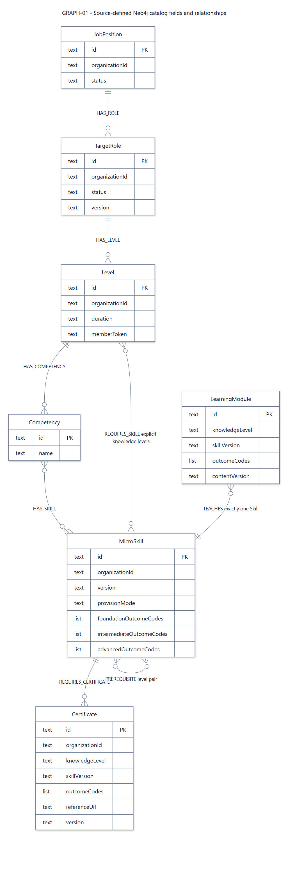

**Diagram notes (GRAPH-01):**

- Common node/edge fields: id, version, status, reviewStatus, reviewedBy and reviewedAt. Null reviewer/time is preserved. Duration/price and teachingFocus/difficultyLevel describe v0.11, not an automatic runtime v0.9 schema conversion.

#### 2.4.2 Graph field and relationship contract

| Element | Definition and validation |
| --- | --- |
| Common identity | Stable string `id`; version/status/review metadata on nodes and relationships. Import validates IDs/endpoints and snapshot integrity. |
| Review metadata | `NEEDS_EXPERT_REVIEW`, `APPROVED`, `REJECTED`; reviewer/time remain absent/null until real review. Dataset review is not interchangeable with L&D business publication. |
| Job Position interests | Six normalized O*NET OI dimensions in [0,1], computed from source 1..7 scale as `(value - 1) / 6`. This is job positional interest data, not Employee mastery. |
| Role/Level | Each TargetRole has one owning Job Position; current package has three Levels per role. Level-specific skill sets may differ/overlap without being nested. |
| Competency | Group of required skills for its owning Level; no independent RIASEC or competency score is added. |
| REQUIRES_SKILL | Requirement belongs to the Level-Skill pair; `requiredScore` and applicable metadata are not global Module difficulty. |
| TEACHES | Many-to-many. v0.11 pair has `teachingFocus = PRIMARY/SUPPORTING/INCIDENTAL` and `difficultyLevel = LOW/MEDIUM/HIGH`. Incidental exposure must not be treated as closing a gap. |
| Coverage validation | v0.11 package requires one PRIMARY skill per module, at least one provider per skill and LOW/MEDIUM/HIGH PRIMARY options for each of 79 skills. These are package review-completeness rules, not universal database cardinalities. |
| Prerequisite | Directed MicroSkill-to-MicroSkill only; validate no self-link or cycle. `requiredScore` is retained; deprecated fields are not silently mapped. |
| Module duration/price | v0.11 review estimates, not verified vendor prices, training costs, payments or measured learning gains. Count a multi-skill module once when estimating totals. |
| Content locator | `contentUri` refers to representative source/scaffold content; not evidence that the application serves approved private MinIO objects. |
| Tenant ownership | Raw reference packages are not full tenant membership/assignment models. Trusted resource binding and explicit future organization-scoped authoring/projection are required. |

#### 2.4.3 Import script correspondence

The current importer consumes the v0.11 review package, validates entity/relationship fields and endpoint types, creates six per-label `id` uniqueness constraints and imports only into an empty or exactly compatible graph. Community uniqueness constraints alone do not enforce acyclicity, cardinality, publication, review or tenant authorization; those remain validated application/import rules.

A controlled import must pin the chosen dataset path/version and compare counts/IDs/pairs after import. The existing runtime v0.9 and review v0.11 artifacts cannot be overlaid by assumption. No graph data or historical learner pins were changed during report preparation.

### 2.5 Target schema gaps and API visibility

| Target area | Current physical support | Proposed next design, not current DDL |
| --- | --- | --- |
| Full department/job position/Expert lifecycle | Reference tables and baseline resource binding | Approved organization-owned aggregates and assignment history; forward migration preserving member/attempt references. |
| Role submission and L&D publication | Legacy graph state and catalog references | Separate content/configuration version, submission, decision and publication identity; no fabricated mapping from legacy ACTIVE. |
| Private learning offering | Graph module identity/content URI and assessment bindings | Module/content metadata, ordered content versions, object version locator and offering approval aggregate; MinIO private objects. |
| RIASEC/guidance | Prototype UI and job position interest vector | Versioned instrument result, minimized inference input/output provenance and authorized role recommendations. |
| Ongoing tracing/adaptation | Evidence/profile/pathway foundations | Idempotent evidence application, versioned gaps, override-preserving recalculation and initial confirmation. |
| Realized ROI | Analytics/cohort and `roi_scenario` foundation | Actual costs/benefits ledger with period/currency/basis and versioned report calculation. |
| Audit readers | Durable `audit_event` and selected events | Scoped administrator query contract, retention and privacy policy. |

Sensitive fields (password hashes, encrypted MFA material, HMAC proofs, provider evidence, answer keys, internal scoring parameters) stay internal. Historical nullable fields remain nullable even if a newly created DTO requires a value. Server-generated IDs, timestamps, revisions and reviewer identities are not accepted merely because they appear in this dictionary.

## 3. Detailed Design

**Design traceability and reuse.** The template permits reusing structurally identical class/sequence diagrams. The groups below cover all 14 SRS domains. Classes labeled `planned` are design proposals, not files that exist in the repository. Current class diagrams show relevant responsibilities only, not every private member.

| SRS domains / FRs | Design group | Distinctive responsibility |
| --- | --- | --- |
| Organization onboarding; workspace administration: FR-01.01/01.04/07.03, FR-03.01/03.03/03.04/03.05/07.01 | 3.1, with commercial provisioning in 3.2 | Verification, sessions, membership, setting/audit gaps. |
| Subscription lifecycle; platform administration: FR-01.02/01.03/02.01/02.02/02.03/03.06/07.02/07.04 | 3.2 | Immutable terms, verified payment, access and seats. |
| Departments/job positions; role catalog; learning catalog; module authoring: FR-03.02, FR-04.01..04.04/04.06, FR-05.01..05.06/05.08 | 3.3 | Assignment, Expert authoring, L&D publication/approval. |
| Assessment workflows: FR-04.05/06.02/06.03/06.08/07.05 | 3.4 | Blueprint/version, pinned attempt, scoring and RIASEC/module gaps. |
| Role guidance; Employee experience; pathway review; adaptive engine: FR-05.07, FR-06.01/06.04..06.07/06.09, FR-07.06..07.08 | 3.5 | Selection/profile flow, guidance, initial review and adaptation. |
| Development reporting: FR-04.07/07.09 | 3.6 | Actual finance inputs, reporting and ROI. |
| Notifications/audit: FR-07.10/07.11 | 3.7 | Durable events, asynchronous delivery and read scope. |

### 3.1 Identity, Registration and Workspace Administration

#### 3.1.1 Class Diagram and Class Specifications

[Mermaid source: CLS-01](../documents/diagrams/mermaid/cls-01.mmd)

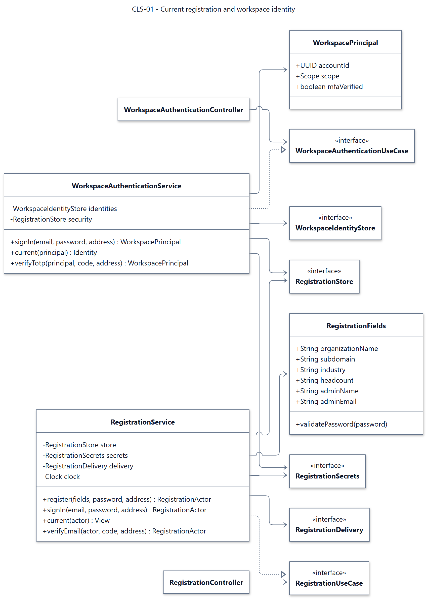

| Class / contract | Specification |
| --- | --- |
| [RegistrationFields](../backend/src/main/java/com/adaptlearngraph/entities/RegistrationFields.java) | Immutable normalized registration input; validates name/email/password/slug and optional fixed-choice fields. Null optional industry/headcount/slug is legitimate. |
| [RegistrationService](../backend/src/main/java/com/adaptlearngraph/services/RegistrationService.java) | Owns atomic registration, email proof, MFA enrollment/recovery and resumable stage. Uses injected clock, secrets and transactional store. |
| `RegistrationStore` | Output port for account/registration/proof/rate-limit/audit operations and transaction/locking scope. |
| `RegistrationSecrets` | Hash/match credentials; HMAC proofs and encrypt MFA material; configuration failure is explicit. |
| `RegistrationDelivery` | Readiness and durable verification-delivery boundary, not direct business-success guarantee from SMTP. |
| [WorkspaceAuthenticationService](../backend/src/main/java/com/adaptlearngraph/services/WorkspaceAuthenticationService.java) | Validates exactly one role, active account and eligible workspace; resolves role-specific MFA stage and safe identity projection. |
| [WorkspaceIdentityStore.Credential](../backend/src/main/java/com/adaptlearngraph/repository/WorkspaceIdentityStore.java) | Internal credential/membership snapshot. `requiresMfa()` checks Organization Administrator; platform identity requires exactly the platform role. Redacted `toString()`. |
| `WorkspacePrincipal` | Server session authority and assurance state; not accepted from browser-selected role/company data. |
| Member activation adapters | Single-use invitation proof, recipient-chosen password and current tenant/seat/reference validation; separate from public registration. |
| Settings/audit read service | Planned completion; current browser settings/sample audit are not represented as implemented persistence classes. |

#### 3.1.2 Register and verify organization sequence

[Mermaid source: SEQ-01](../documents/diagrams/mermaid/seq-01.mmd)

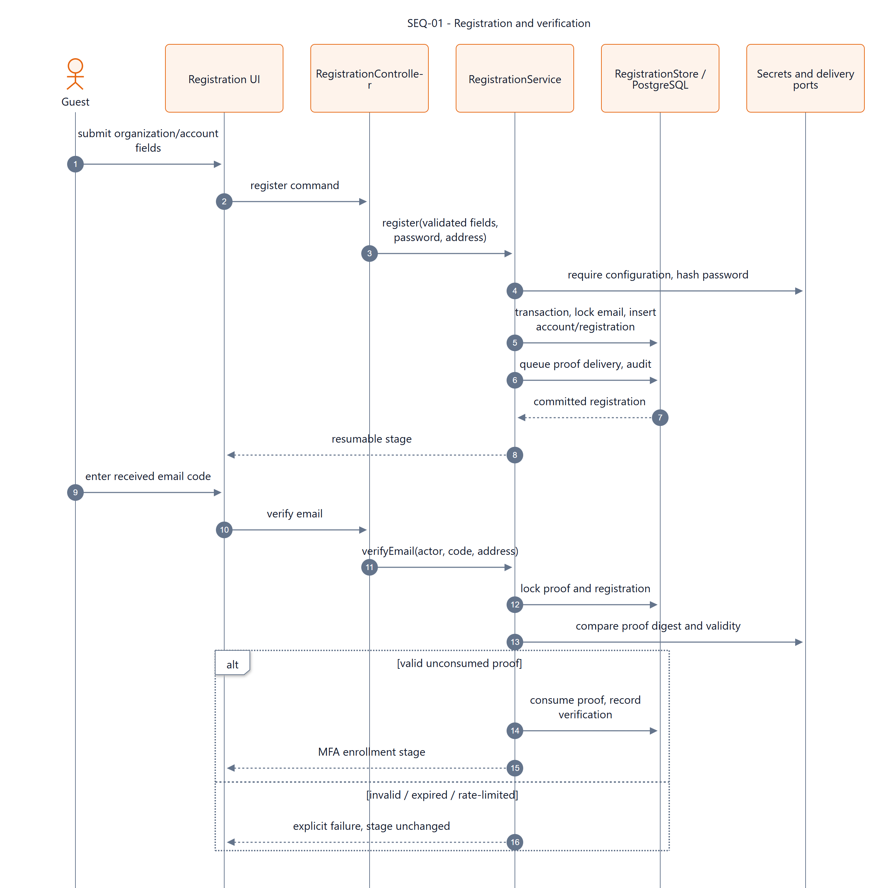

#### 3.1.3 Sign-in and membership authorization sequence

[Mermaid source: SEQ-02](../documents/diagrams/mermaid/seq-02.mmd)

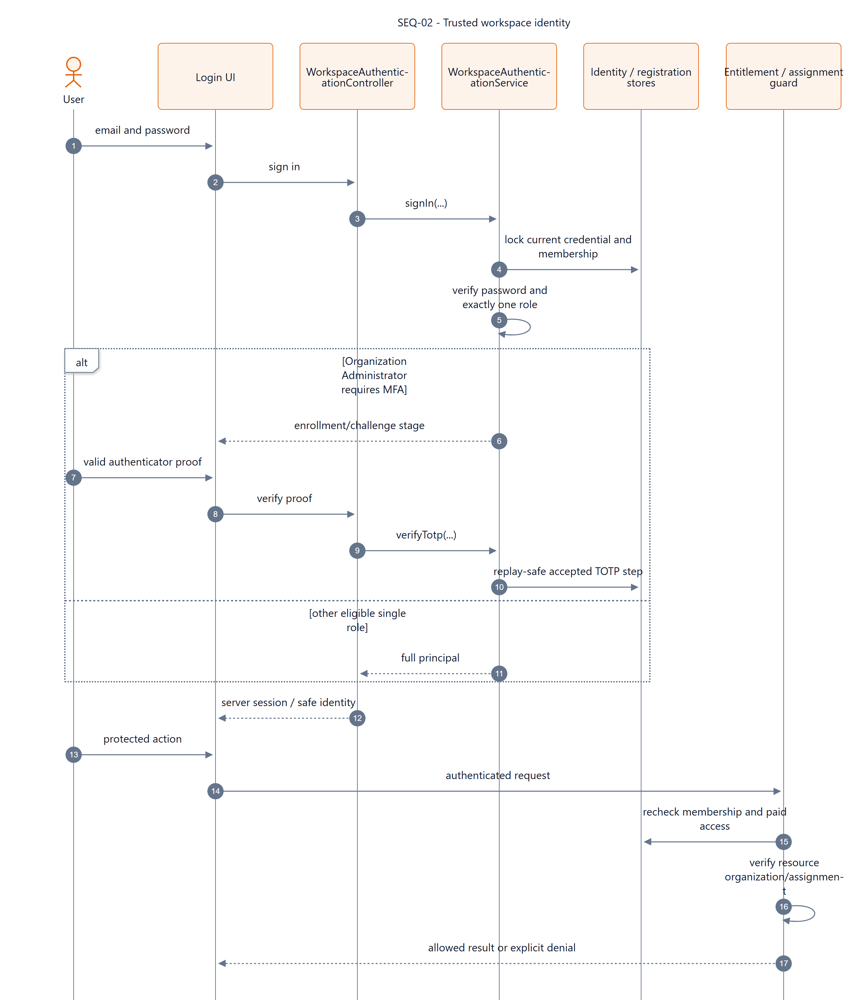

#### 3.1.4 Identity lifecycle state machines

[Mermaid source: ST-01](../documents/diagrams/mermaid/st-01.mmd)

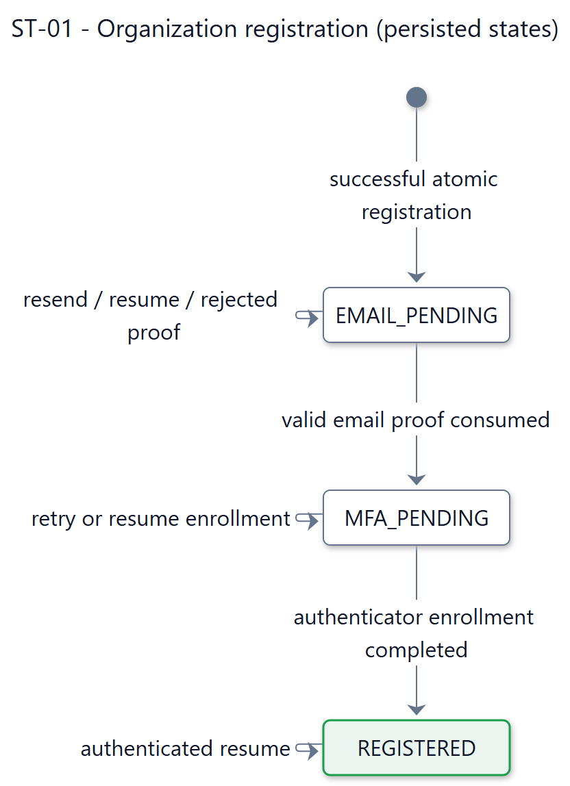

**Diagram notes (ST-01):**

- Registration complete is not payment complete. Workspace readiness belongs to a separate aggregate.

[Mermaid source: ST-02](../documents/diagrams/mermaid/st-02.mmd)

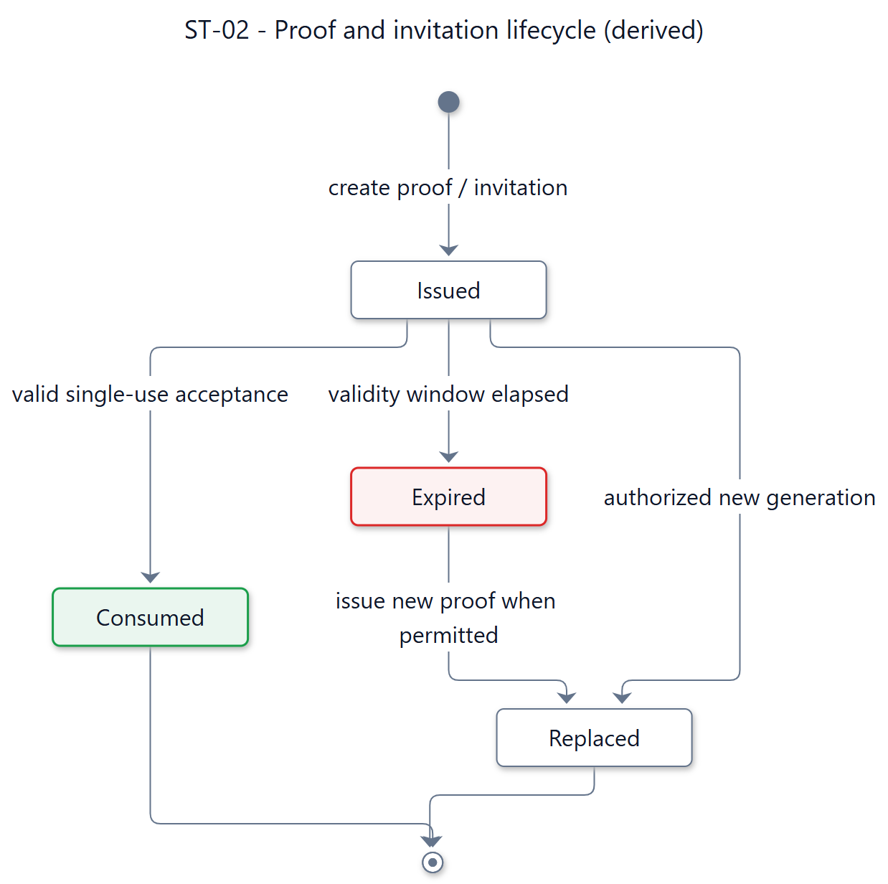

**Diagram notes (ST-02):**

- Derived from generation, expiry and consumed/activation fields; not a new shared PostgreSQL status enum. Replaying consumed or replaced proof cannot activate twice.

[Mermaid source: ST-03](../documents/diagrams/mermaid/st-03.mmd)

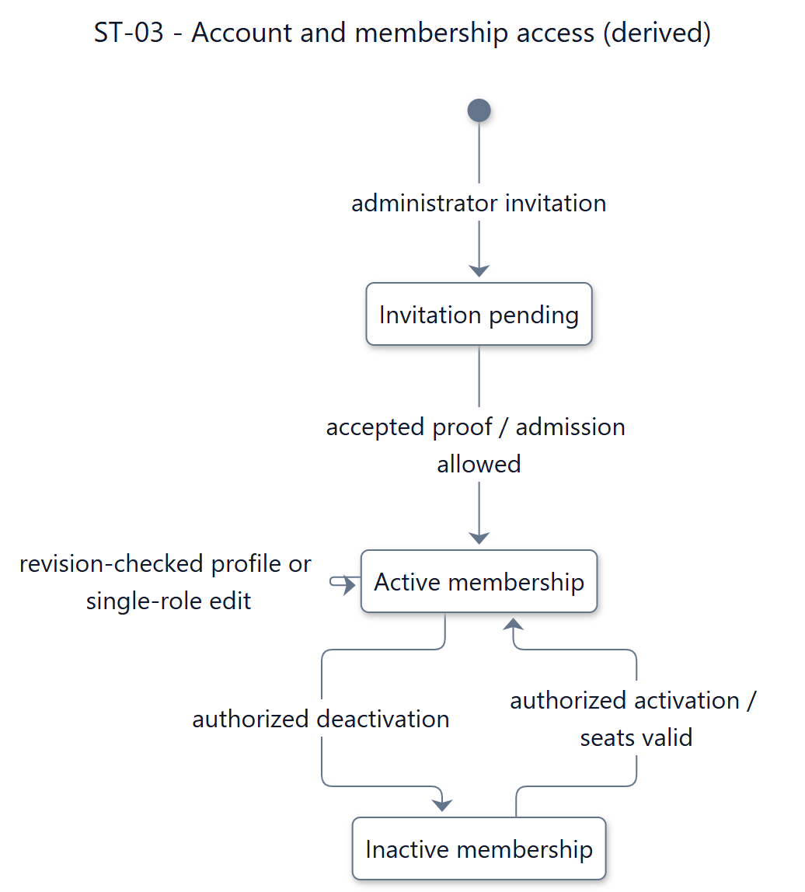

**Diagram notes (ST-03):**

- Account active, membership active, MFA assurance and paid access are independent facts. No account hard-delete transition is required.

[Mermaid source: ST-04](../documents/diagrams/mermaid/st-04.mmd)

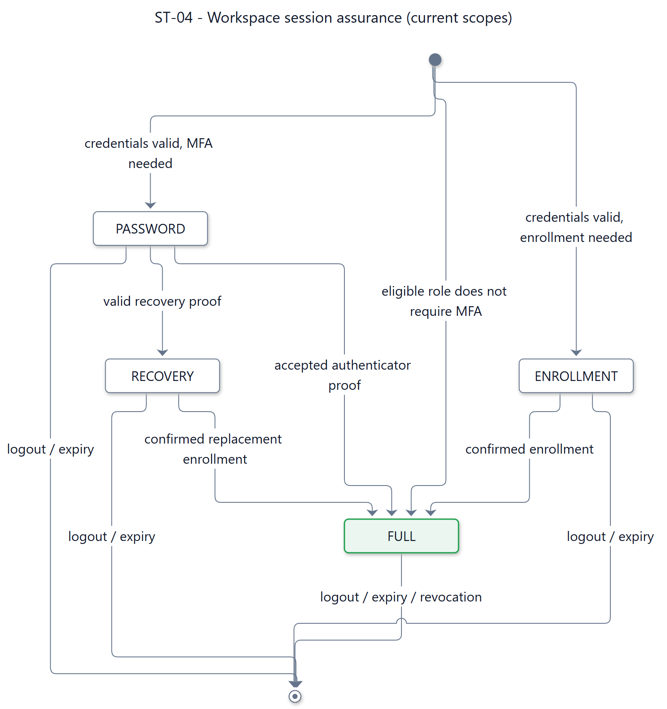

**Diagram notes (ST-04):**

- Session FULL still requires current membership, organization, assignment and entitlement authorization.

### 3.2 Subscriptions, Payments and Platform Controls

#### 3.2.1 Class Diagram and Class Specifications

[Mermaid source: CLS-02](../documents/diagrams/mermaid/cls-02.mmd)

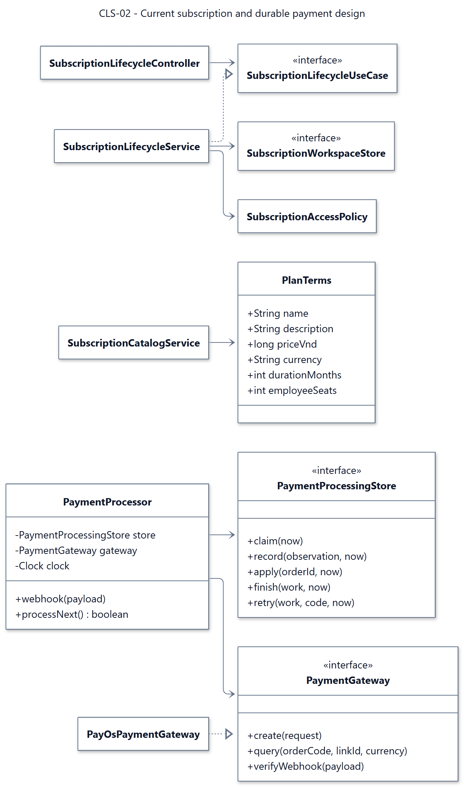

| Class / contract | Specification |
| --- | --- |
| [PlanTerms](../backend/src/main/java/com/adaptlearngraph/entities/PlanTerms.java) | Validated immutable terms; nonblank name/description, supported VND integer amount, positive calendar months and Employee seats. |
| `SubscriptionCatalogService` | Read existing plans and update through expected-version immutable successor terms. |
| `SubscriptionLifecycleService` | Purchase/renewal/status, member/suspension and access orchestration through explicit identity/workspace ports. |
| `SubscriptionAccessPolicy` | Distinguishes ordinary workspace, billing/recovery and membership actions under time/seat/suspension constraints. |
| [PaymentProcessor](../backend/src/main/java/com/adaptlearngraph/services/PaymentProcessor.java) | Claims durable work; handles PAYMENT_APPLY or query/create; retries explicit provider failures; callback URL depends on initial versus organization renewal order. |
| [PayOsPaymentGateway](../backend/src/main/java/com/adaptlearngraph/helper/PayOsPaymentGateway.java) | Provider client, response/webhook verification and normalized observations; uses official SDK 2.0.1. |
| `PaymentProcessingStore` / JDBC adapter | Fenced work claim, immutable observations, application uniqueness, retry/finish and transactional provisioning. |
| `SubscriptionWorkspaceStore` / JDBC adapter | Membership/seat/reference validation and current workspace entitlement. |

#### 3.2.2 Checkout, verification and application sequence

[Mermaid source: SEQ-03](../documents/diagrams/mermaid/seq-03.mmd)

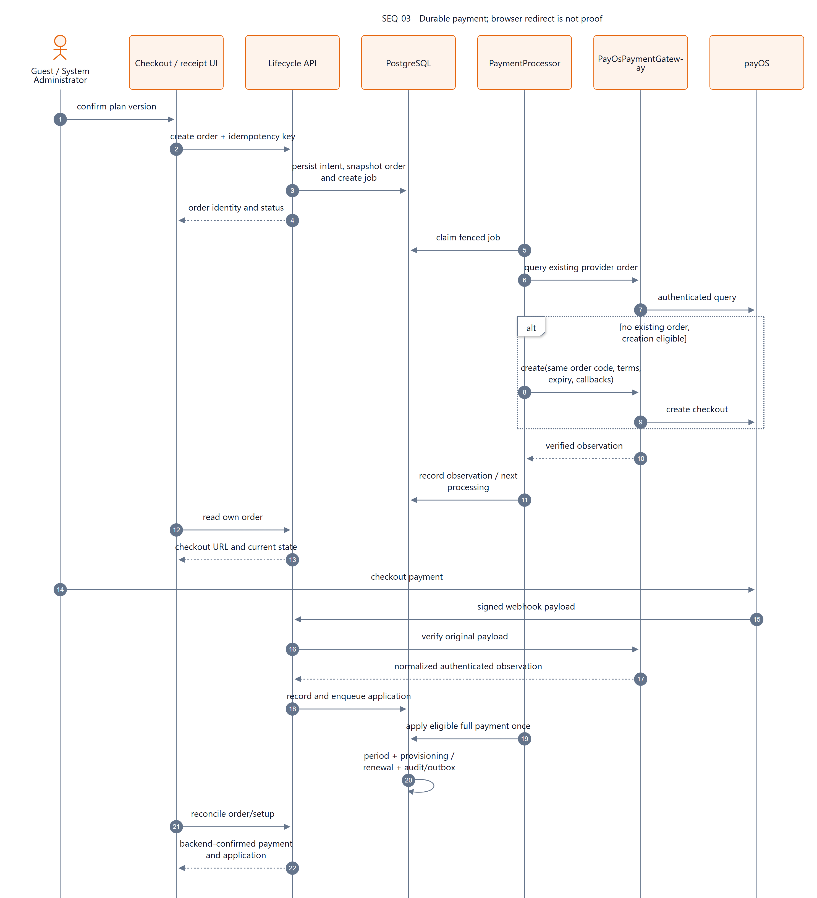

#### 3.2.3 Concurrent seat admission and renewal sequence

[Mermaid source: SEQ-04](../documents/diagrams/mermaid/seq-04.mmd)

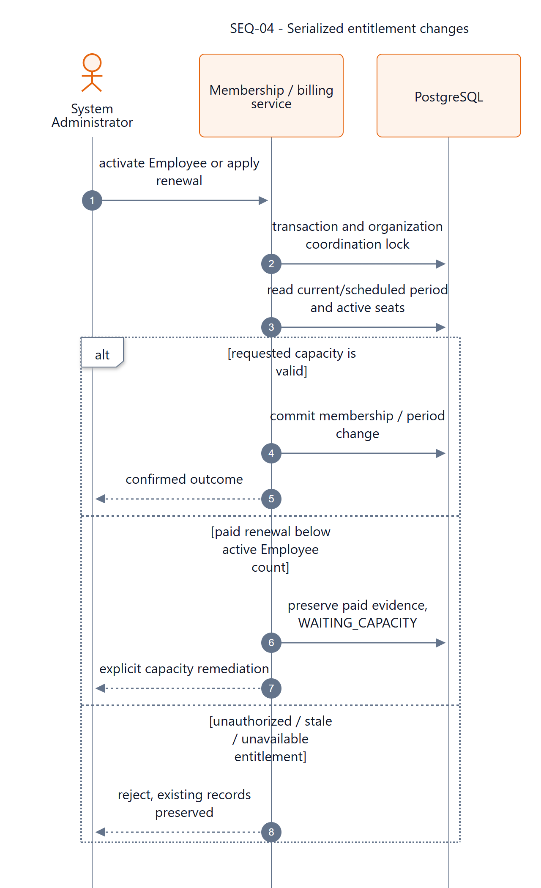

#### 3.2.4 Commercial lifecycle state machines

[Mermaid source: ST-05](../documents/diagrams/mermaid/st-05.mmd)

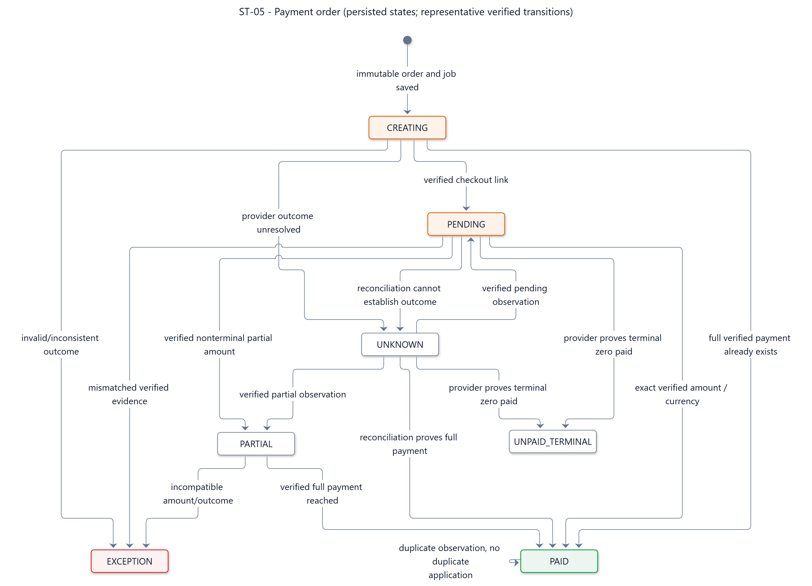

**Diagram notes (ST-05):**

- Diagram summarizes ordinary branches, not every adapter edge. Local expiry or browser cancellation alone cannot prove terminal unpaid. Business retry/replacement creates a permitted new order under the intent.

[Mermaid source: ST-06](../documents/diagrams/mermaid/st-06.mmd)

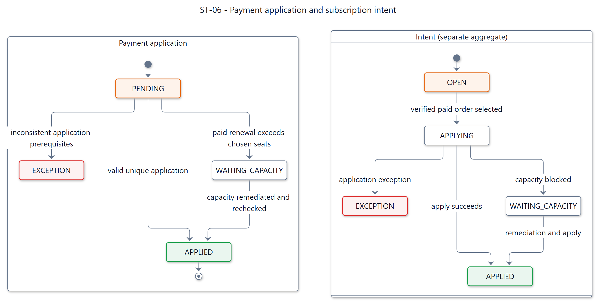

**Diagram notes (ST-06):**

- APPLIED requires period and applied-at references. These states do not replace payment_order.payment_status.

[Mermaid source: ST-07](../documents/diagrams/mermaid/st-07.mmd)

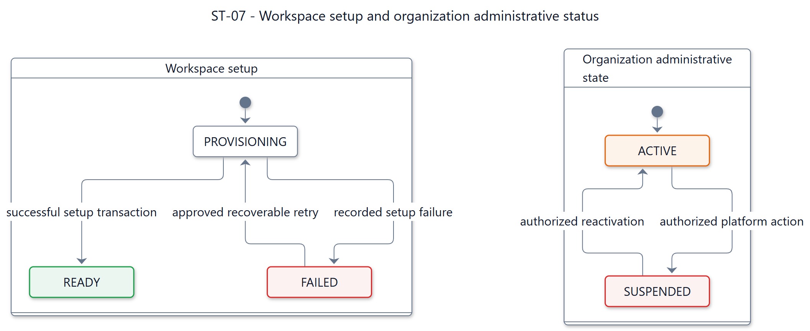

**Diagram notes (ST-07):**

- Persisted setup and suspension vocabularies are separate. The current successful initial purchase may create READY atomically; the schema's FAILED state does not prove every failure is separately stored.

[Mermaid source: ST-08](../documents/diagrams/mermaid/st-08.mmd)

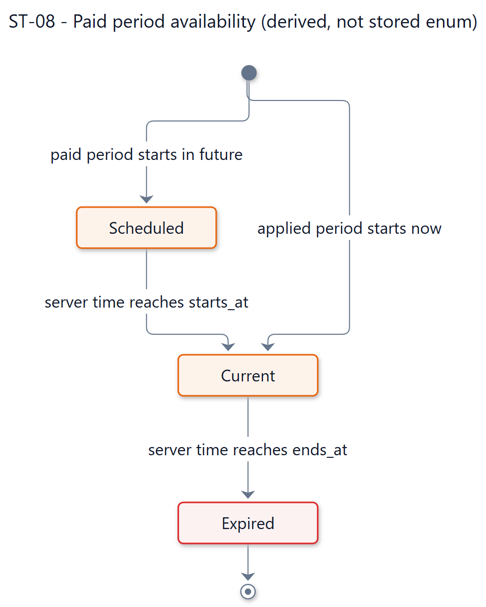

**Diagram notes (ST-08):**

- Interval boundary semantics and non-overlap are enforced by policy/DDL. Renewal adds another paid period; it does not edit the expired record. Administrative suspension can deny access in any time state.

Plan versions are immutable value snapshots with a current-plan pointer, not an approval lifecycle. Updating a plan creates a successor version; purchased references do not move. This is a version graph rather than a fictitious DRAFT/APPROVED enum.

### 3.3 Organization Catalog, Role Publication and Learning Offerings

#### 3.3.1 Class Diagram and Class Specifications

[Mermaid source: CLS-03](../documents/diagrams/mermaid/cls-03.mmd)

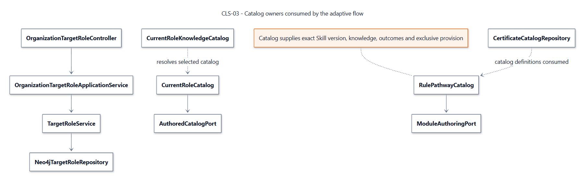

**Diagram notes (CLS-03):**

- Planned names express responsibilities, not existing Java classes. Legacy APIs cannot be treated as the completed v0.11 authoring model.

| Class / responsibility | Specification |
| --- | --- |
| [OrganizationTargetRoleController](../backend/src/main/java/com/adaptlearngraph/apis/OrganizationTargetRoleController.java) | Current legacy controller behind explicit property gate; old role/domain/track/status model. Its client role-header handling is not the target trusted assignment contract. |
| `TargetRoleService`, `Neo4jTargetRoleRepository` | Existing legacy creation/query/update/versioning machinery. Reuse requires schema/authorization reconciliation, not direct enabling against review data. |
| `MicroSkillService`, `PrerequisiteService` | Existing skill and directed-cycle validation code; associated write APIs are legacy-gated. |
| Planned `Job PositionAdministration` / `ExpertAssignment` | Persist organization/department ownership, active references and assignment history; reject foreign or inactive grants. |
| Planned `RoleConfigurationWorkflow` | Draft configuration version, submission and L&D decision; separate authored requirements from publication authority. |
| Planned `OfferingWorkflow` | Coordinates a versioned module/content/assessment bundle, return/resubmit and approval. |
| Planned authorization/repository/projection/content ports | Derive trusted scope; preserve relational workflow history; publish recoverable graph projections; authorize private object access. |

The frontend WF-04/WF-07 layouts and SRS field rules apply. Additional target columns/DTOs must be designed and approved before implementation. Current `assignedExpertId`, local company storage and graph `reviewStatus` are not interchangeable assignment/publication authorities.

#### 3.3.2 Target role handoff sequence

[Mermaid source: SEQ-05](../documents/diagrams/mermaid/seq-05.mmd)

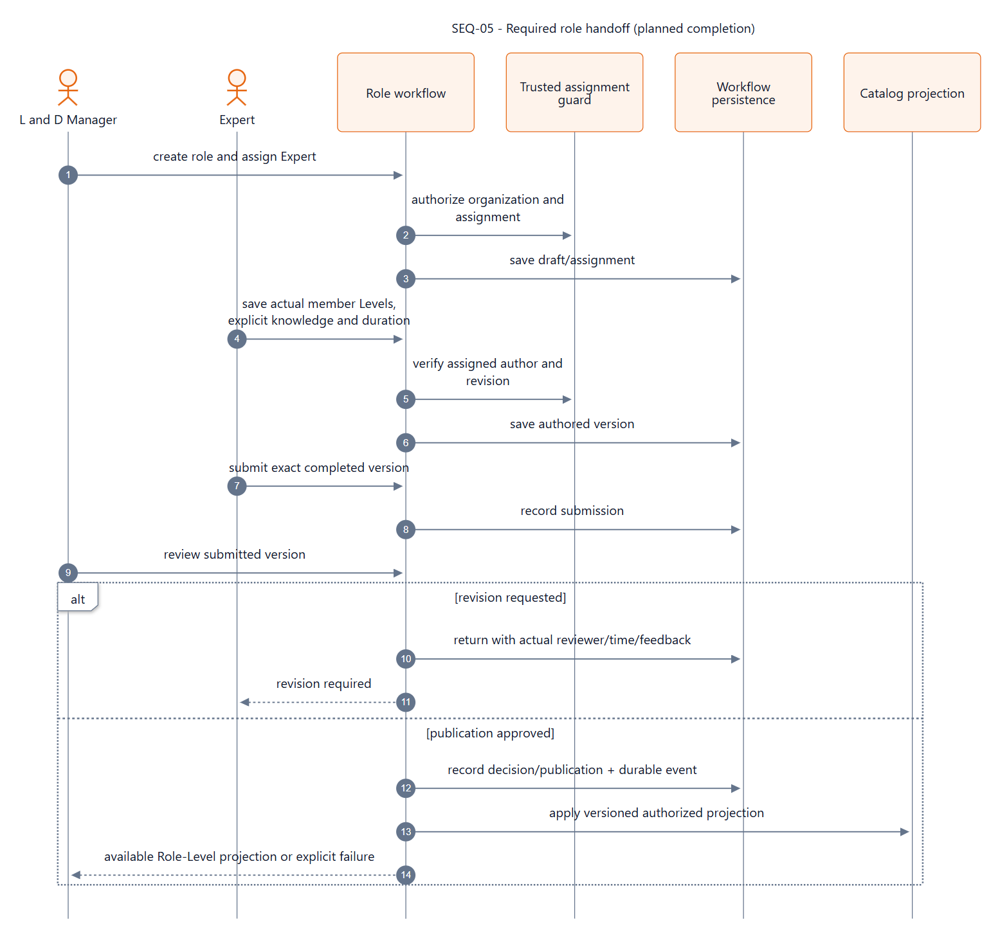

#### 3.3.3 Offering approval and private-content sequence

[Mermaid source: SEQ-06](../documents/diagrams/mermaid/seq-06.mmd)

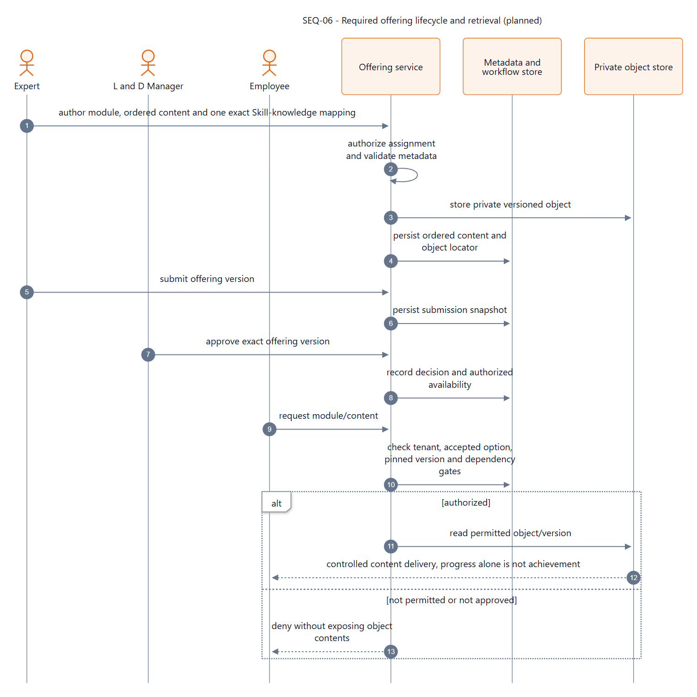

#### 3.3.4 Catalog and content lifecycle state machines

[Mermaid source: ST-09](../documents/diagrams/mermaid/st-09.mmd)

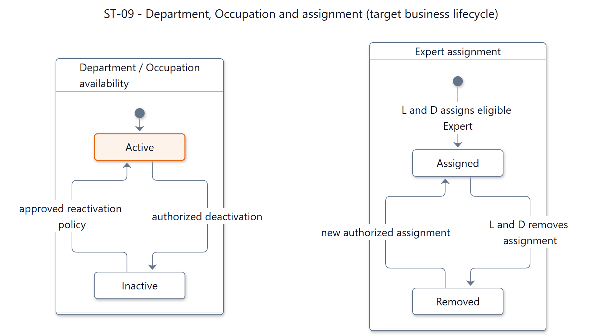

**Diagram notes (ST-09):**

- Target lifecycle; complete CRUD/assignment persistence is not delivered. Department deletion requires an approved reference-preserving policy. Historical assessment and review records are not cascade-deleted.

[Mermaid source: ST-10](../documents/diagrams/mermaid/st-10.mmd)

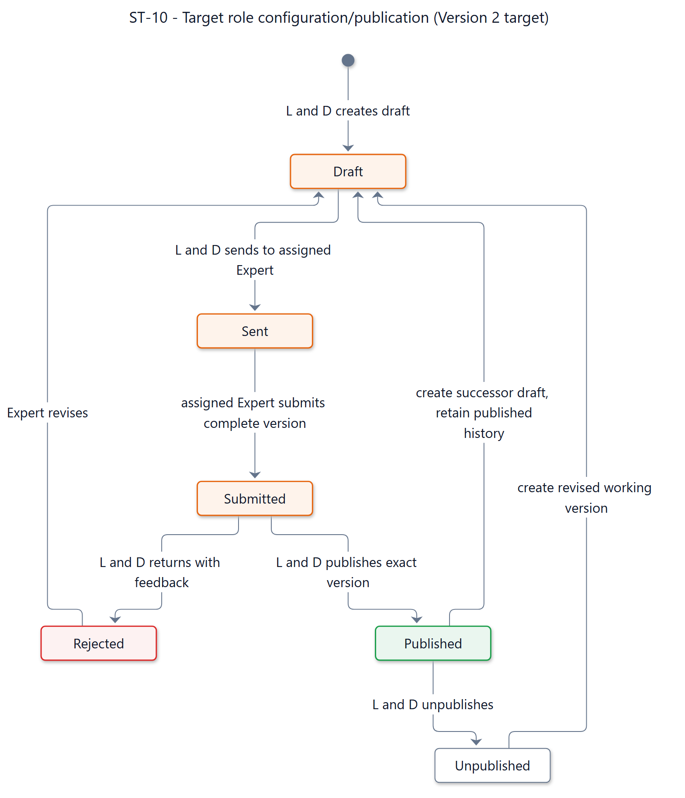

**Diagram notes (ST-10):**

- These are target workflow states, not the legacy physical enum. Legacy DRAFT/SENT/REJECTED/ACTIVE authoring has different authority. No direct Expert-to-Published transition is allowed by Version 2.

[Mermaid source: ST-11](../documents/diagrams/mermaid/st-11.mmd)

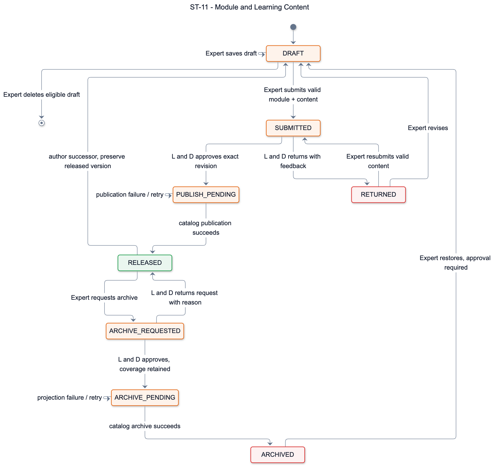

**Diagram notes (ST-11):**

- Current Module-document states are DRAFT, SUBMITTED, RETURNED, PUBLISH_PENDING and RELEASED. The responsible Expert edits/submits; L&D returns with feedback or approves the exact revision. Publication failure remains pending for authorized retry; successful catalog projection releases the revision.
- Lessons are reviewed as part of the whole Module. Editing a released Module creates a successor draft and preserves the published predecessor/history. Archive/restore is outside this concise main-flow view. This does not claim that the complete module-assessment bundle is implemented; ACT-04 in the SRS remains the broader target. Learning access is separately authorized.

[Mermaid source: ST-12](../documents/diagrams/mermaid/st-12.mmd)

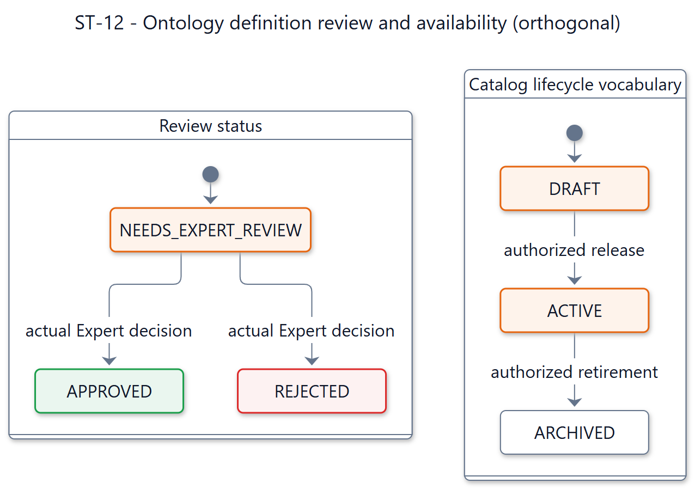

**Diagram notes (ST-12):**

- Applies to principal catalog nodes/relationships including MicroSkill. This shows documented vocabularies and target transitions; dataset import alone does not execute a business review. ACTIVE plus NEEDS_EXPERT_REVIEW is not approved publication.

### 3.4 Baseline, Assessment Evidence and IRT

#### 3.4.1 Class Diagram and Class Specifications

[Mermaid source: CLS-04](../documents/diagrams/mermaid/cls-04.mmd)

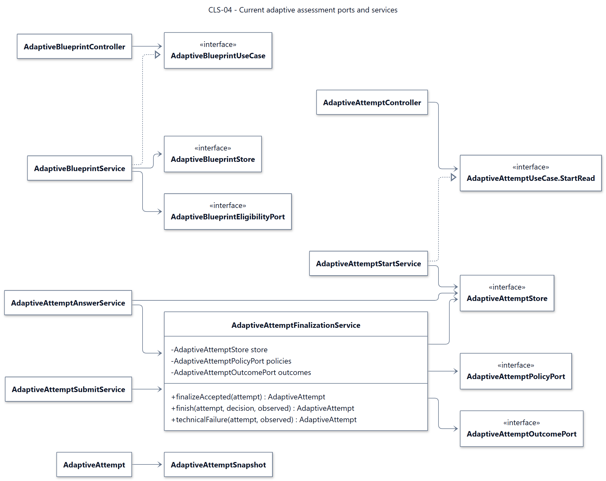

| Class / contract | Specification |
| --- | --- |
| `AdaptiveBlueprintService` | Authorized Draft/save/preview/finalize/disable/discard with exact identity/revision/current-pointer checks and idempotent receipts. |
| `AdaptiveBlueprintStore` / JDBC implementation | Transactional blueprint/registry/activation persistence; read-only history/list queries and coordinated writes. |
| `AdaptiveBlueprintEligibilityPort` | Resolve current or pinned available pool from permitted catalog, bank and technical versions; no fabricated default bank/model. |
| [WorkspaceBaselineResources](../backend/src/main/java/com/adaptlearngraph/repository/WorkspaceBaselineResources.java) | Read explicit V32 tenant/Job Position/resource binding; null pins mean not ready. |
| [WorkspaceBaselineConfiguration](../backend/src/main/java/com/adaptlearngraph/config/WorkspaceBaselineConfiguration.java) | Composition root for trusted session/entitlement adapters, JDBC stores, Neo4j catalog and attempt services. Profile: `workspace-baseline & local & !local-baseline-demo & !prod`. |
| `AdaptiveAttemptStartService` | New admission, resume and replay under trusted learner/selection/current configuration; pins full Job Position scope, content and timing. |
| `AdaptiveAttemptAnswerService` | Revision/position-bound response acceptance, server correctness and adaptive next-item/finalization. |
| `AdaptiveAttemptSubmitService` | Explicit manual submission, idempotency and shared terminal policy. |
| [AdaptiveAttemptFinalizationService](../backend/src/main/java/com/adaptlearngraph/services/AdaptiveAttemptFinalizationService.java) | Shared answer/manual/deadline terminal policy; checks actual progress against pinned IRT outcomes; invalidates inconsistent/insufficient attempts without invented mastery. |
| `AdaptiveAttemptPolicyPort` | Load pinned technical parameters; distinguishes dependency unavailability from incompatible policy. |
| `AdaptiveAttemptOutcomePort` | Persist terminal state, result/evidence and permitted profile initialization once. |
| `CalibrationService`, `PromotionService` | Fit candidate IRT parameters and promote effective selection in authorized scope; actual calibration evidence is distinct from a demo fitted file. |

#### 3.4.2 Draft, preview and activation sequence

[Mermaid source: SEQ-07](../documents/diagrams/mermaid/seq-07.mmd)

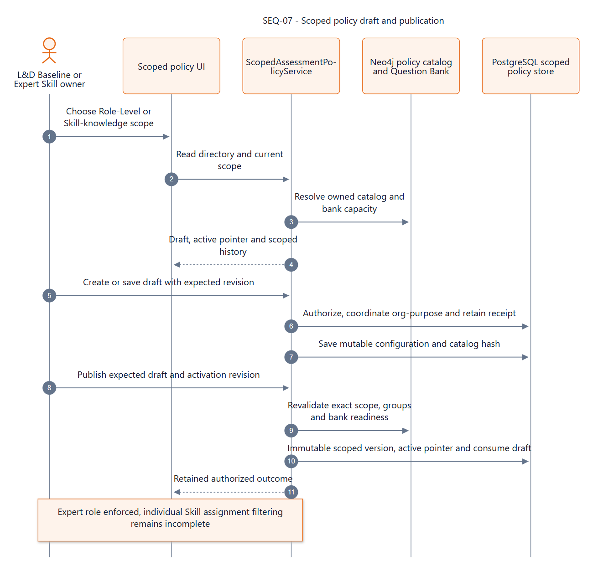

**Diagram notes (SEQ-07):**

- Existing attempts and initialized profiles retain original pins. Historical version reads do not depend on current catalog availability.

#### 3.4.3 Start, answer and finalize sequence

[Mermaid source: SEQ-08](../documents/diagrams/mermaid/seq-08.mmd)

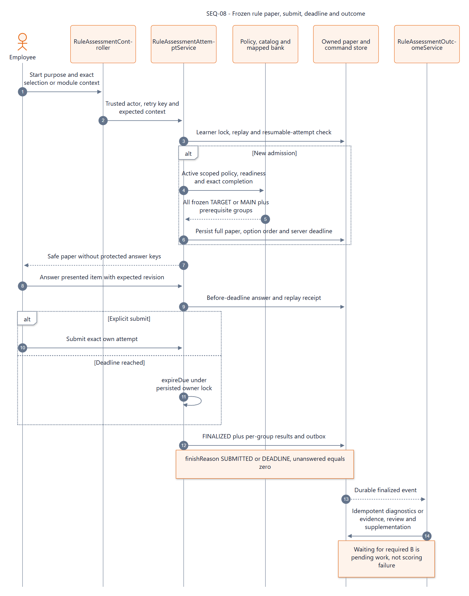

The last read arrow is a logical persistence path through an authorized application read use case, not direct browser database access.

#### 3.4.4 Assessment lifecycle state machines

[Mermaid source: ST-13](../documents/diagrams/mermaid/st-13.mmd)

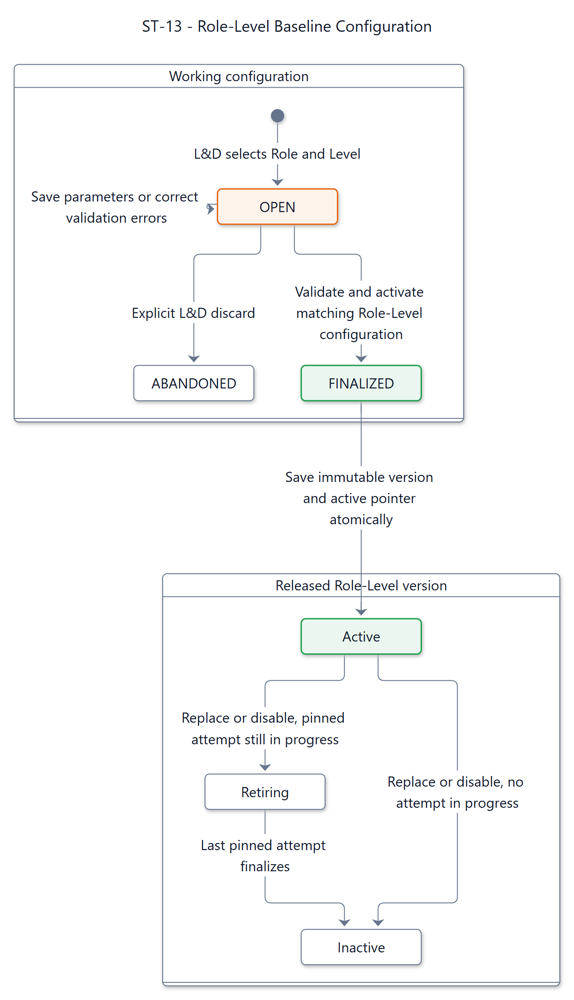

**Diagram notes (ST-13):**

- Approved Role-Level target: OPEN errors stay editable and never activate. Successful validation finalizes the draft and publishes the matching immutable active version atomically. Active/Retiring/Inactive are availability projections; attempts retain their pinned version. No schema enum migration is asserted.

[Mermaid source: ST-14](../documents/diagrams/mermaid/st-14.mmd)

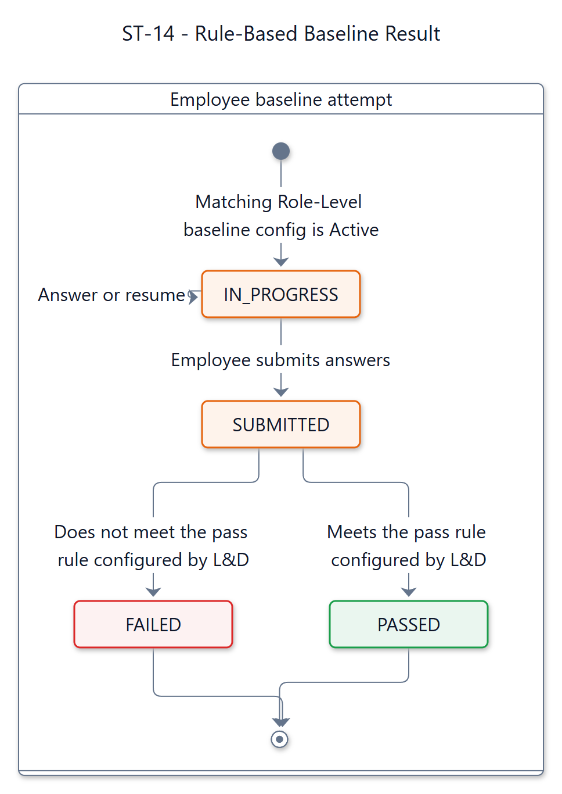

**Diagram notes (ST-14):**

- The Employee starts with an Active baseline configuration for the selected Role-Level, answers/resumes and explicitly submits. The system applies the pass rule configured by L&D and transitions from SUBMITTED to PASSED or FAILED. Example only: when the configured rule is at least 7 correct answers out of 10, 7–10 passes and 0–6 fails; 7/10 is not a hard-coded universal threshold. This diagram has no evidence-sufficiency gate, AUTO_SUBMITTED or adaptive-stop/deadline submission branch. These are approved target business states, not a claim that physical database enums have already changed.

[Mermaid source: ST-16](../documents/diagrams/mermaid/st-16.mmd)

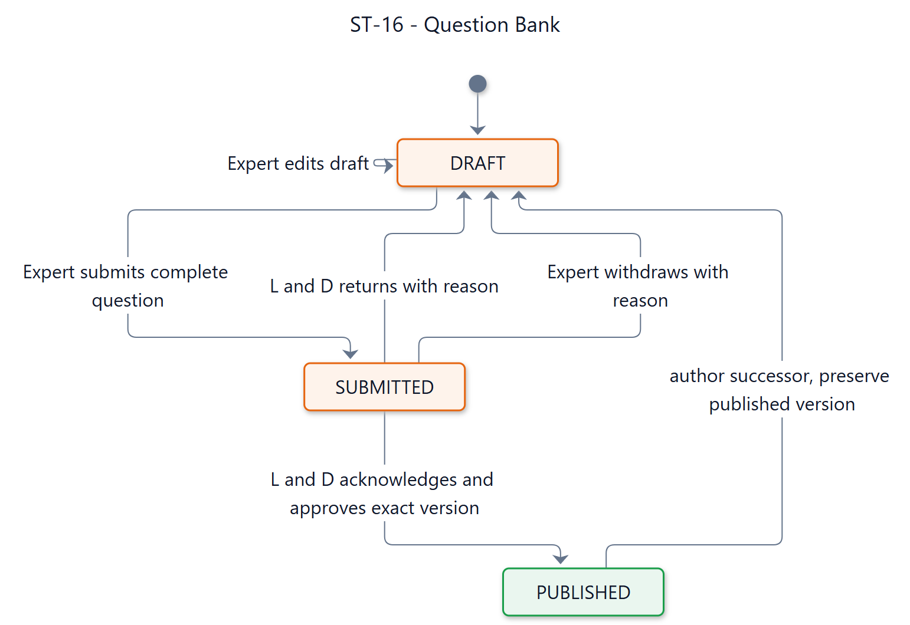

**Diagram notes (ST-16):**

- This is the current organization Question Bank candidate lifecycle: DRAFT, SUBMITTED and PUBLISHED. Only the responsible Expert edits/submits/withdraws; L&D acknowledges and approves the exact submitted version, or returns it with a reason to DRAFT. Submitted content is locked, and stale/invalid commands do not transition state.
- A successor creates a new draft; it does not mutate the immutable published predecessor or existing assessment pins. Retirement/reactivation is a separate question-availability lifecycle. ACT-10 in the SRS covers the concise authoring/review activity. Physical `item_version` / `assessment_version` publication fields remain separate foundations and are not substituted for this authoring workflow; module-exam construction and calibration remain separate.

Legacy `assessment_assignment` has ACTIVE/REVOKED/CLOSED and legacy blueprint working rows have OPEN/FINALIZED/ABANDONED. They remain in the physical dictionary for history/compatibility; they are not substitutes for the current adaptive attempt lifecycle. Module/RIASEC completion must use purpose-specific approved state/retake contracts rather than blindly copying baseline admission rules.

### 3.5 Role Selection, Guidance and Adaptive Learning

#### 3.5.1 Class Diagram and Class Specifications

[Mermaid source: CLS-05](../documents/diagrams/mermaid/cls-05.mmd)

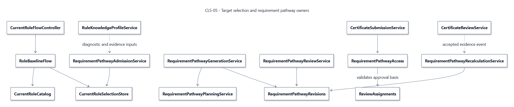

**Diagram notes (CLS-05):**

- Current composition uses ports/adapters around RoleBaselineFlow. Planned class names are responsibilities, not existing implementations. General pathway/tracing is not inferred from baseline profile initialization.

| Class / responsibility | Specification |
| --- | --- |
| [CurrentRoleFlowController](../backend/src/main/java/com/adaptlearngraph/apis/CurrentRoleFlowController.java) | Employee roles/details, current selection/next step, selection command and mastery routes. |
| [RoleBaselineFlow](../backend/src/main/java/com/adaptlearngraph/services/RoleBaselineFlow.java) | Trusted role choice, replay/CAS coordination and baseline/profile next-step orchestration. Selection is not itself assessment admission. |
| `CurrentRoleCatalog` | Reads current string-ID Job Position/Role/Level requirements through graph adapter. |
| `CurrentRoleSelectionStore` | Selection history, expected selection comparison, retry receipt, audit/outbox and learner coordination. |
| Applicable Job Position profile | Stable required skill set and applicable baseline binding; newer catalog requirements do not retroactively alter initialized profiles. |
| Planned `GuidanceService` | Minimized evidence/interest context, authorized candidates, validated LLM output and provenance; Employee retains choice. |
| Planned `CompetencyUpdateService` | Versioned evidence-to-mastery updates and role gaps; idempotent source observation consumption. |
| Planned `PathwayGenerationService` | Prerequisite-aware approved coverage, module deduplication, initial reviewable pathway and remaining-step recalculation. |
| Planned `InitialPathwayReviewService` | Assigned Expert includes/excludes/confirms exact initial version; preserves decision identity and applicable override rationale. |

#### 3.5.2 Current role selection and next-step sequence

[Mermaid source: SEQ-09](../documents/diagrams/mermaid/seq-09.mmd)

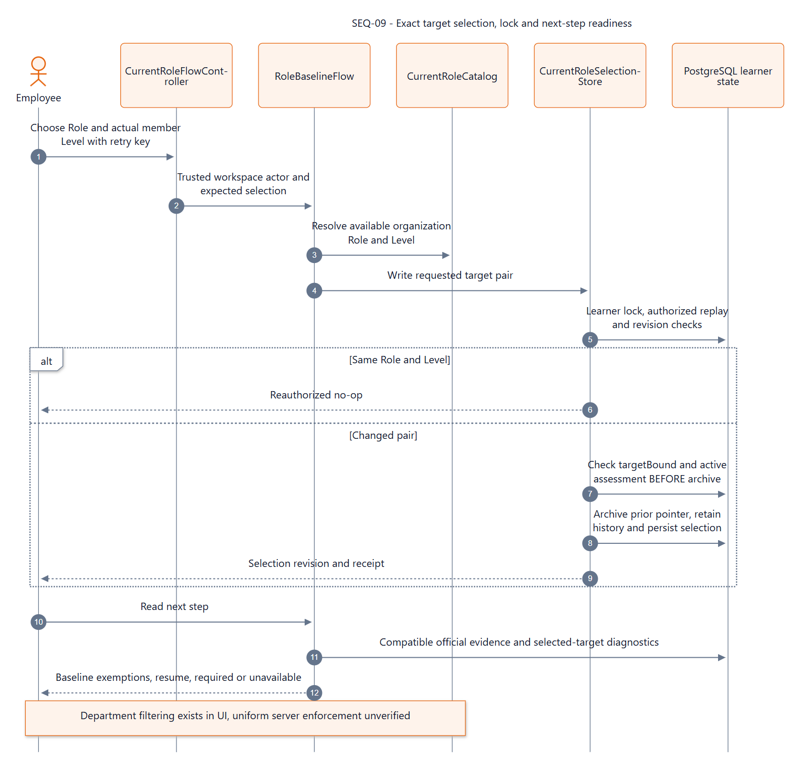

**Diagram notes (SEQ-09):**

- A failed post-commit read does not erase the selected role. Low valid mastery counts as present; unknown is not zero.

#### 3.5.3 Planned guidance, review and adaptation sequence

[Mermaid source: SEQ-10](../documents/diagrams/mermaid/seq-10.mmd)

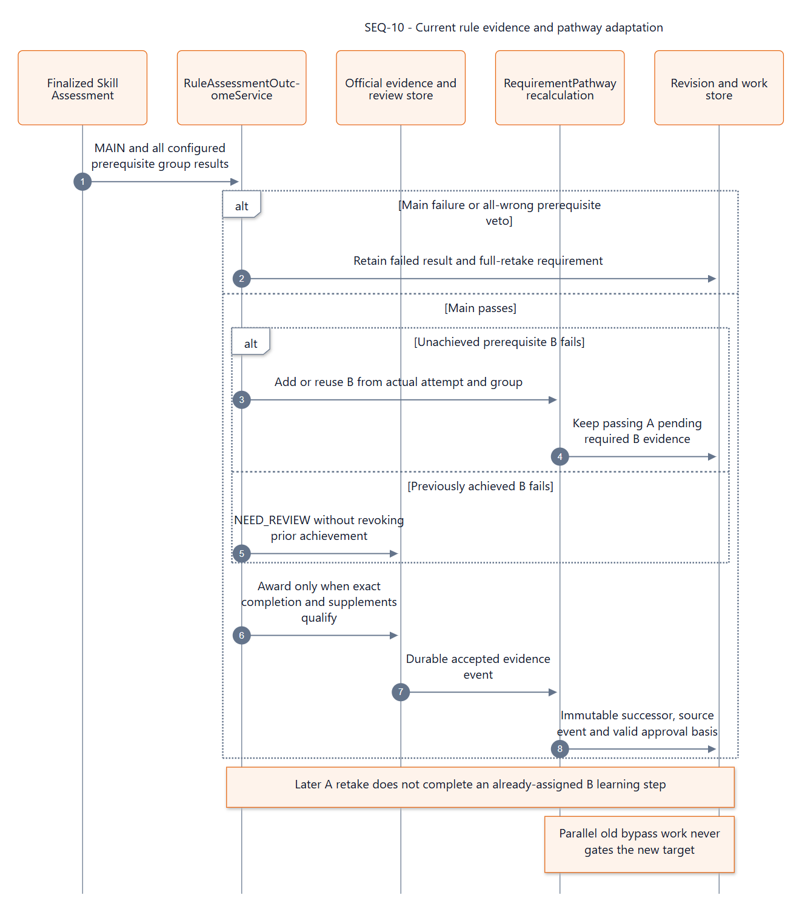

Logical database arrows from actors stand for authorized use-case calls, not direct browser database connections. Module learning/progress uses the reusable API/use-case/port pattern and private retrieval sequence in section 3.3; no separate unauthorized content path is implied.

#### 3.5.4 Selection, profile and pathway lifecycle state machines

[Mermaid source: ST-17](../documents/diagrams/mermaid/st-17.mmd)

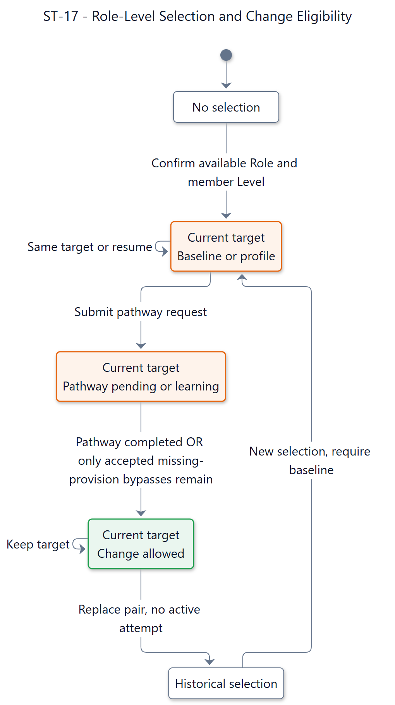

**Diagram notes (ST-17):**

- Approved target eligibility is derived from current selection and pathway outcomes. Same-target reads/replays do not replace history. A different Role or Level is allowed only after completion or when only accepted missing-module-and-certificate bypasses remain, with no attempt in progress. Pending review, generation errors and ordinary incomplete work retain the target. Replacement ends the old selection and creates its successor atomically; new baseline admission requires matching Active configuration.

[Mermaid source: ST-18](../documents/diagrams/mermaid/st-18.mmd)

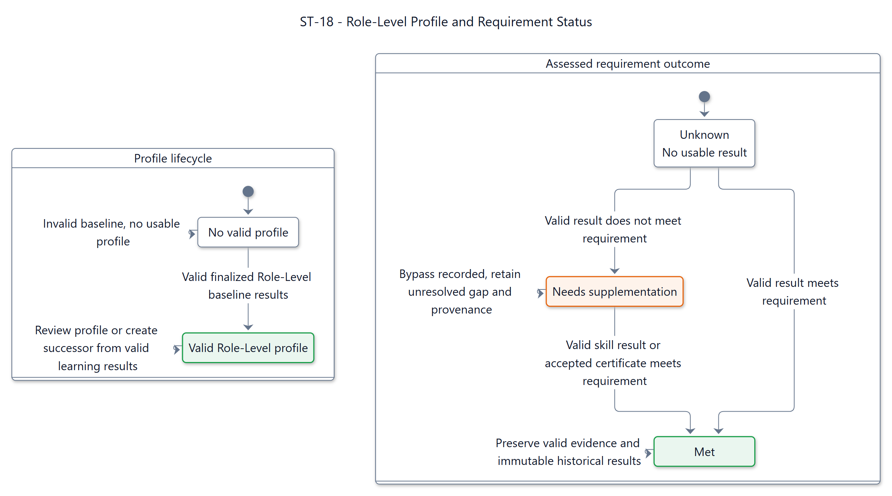

**Diagram notes (ST-18):**

- The approved target initializes a Role-Level profile from valid finalized baseline results. Met and Needs supplementation describe requirement outcomes; Unknown means no usable result. Bypass preserves Needs supplementation and provenance, never achievement. Accepted learning/assessment or certificate evidence updates successor profile revisions; historical results remain immutable. These target states are not a claim of deployed enum/storage changes.

[Mermaid source: ST-19](../documents/diagrams/mermaid/st-19.mmd)

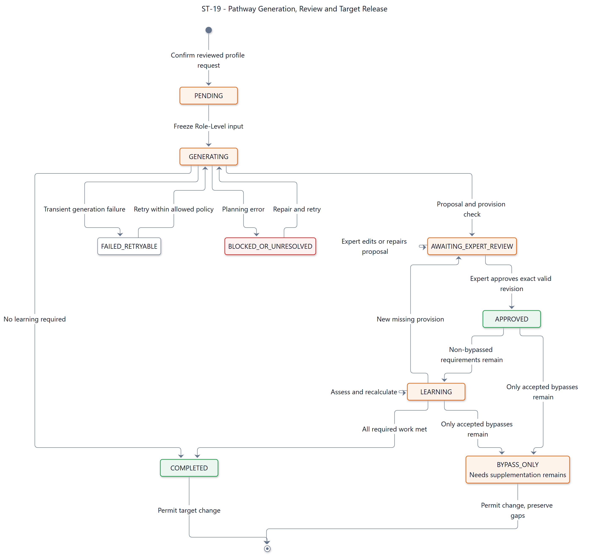

**Diagram notes (ST-19):**

- The approved target retains initial Expert review of an exact valid revision. Missing both module and certificate provision can be explicitly bypassed by Expert; ordinary failures, cycles and invalid configuration cannot. Completion or bypass-only permits target change; bypass does not award achievement. Automatic recalculation retains approval lineage without fabricated review metadata. A newly discovered missing-provision decision is scoped, not mandatory full re-review on every adaptation. No-learning-required completes without artificial tasks. These are target lifecycle concepts, not assertions that every label is a current PostgreSQL enum.

A pathway successor may be produced automatically after valid updated skill evidence; preserve genuine initial approval lineage. Implementation and physical state mapping remain outside this diagram-only revision.

[Mermaid source: ST-23](../documents/diagrams/mermaid/st-23.mmd)

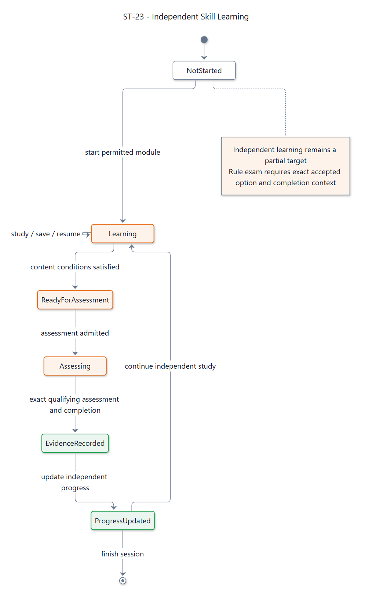

**Diagram notes (ST-23):**

- Companion to ACT-07: NotStarted, Learning, ReadyForAssessment, Assessing, EvidenceRecorded and ProgressUpdated are target business states, not implemented enum values. Full persisted independent-learning context and module-assessment integration are not claimed complete.
- Content completion alone is not mastery. Assessment admission/grading and valid evidence are separate from lesson progress. Further study may continue in the independent context; finishing a session implies neither skill certification nor replacement of the selected Role pathway.

### 3.6 Development Summaries and ROI

#### 3.6.1 Class Diagram and Class Specifications

[Mermaid source: CLS-06](../documents/diagrams/mermaid/cls-06.mmd)

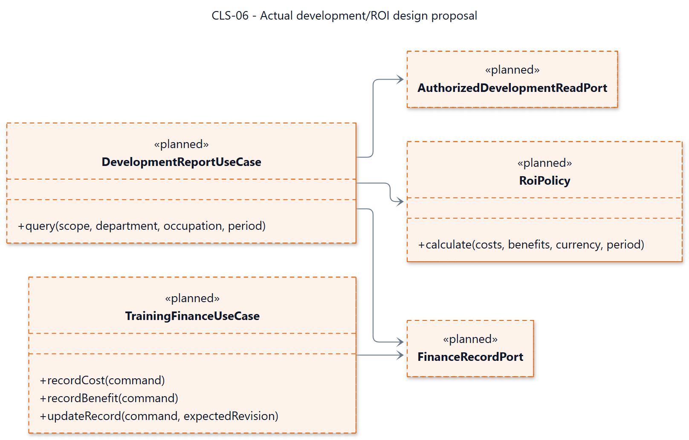

**Diagram notes (CLS-06):**

- Current analytics_snapshot/cohort/roi_scenario tables are foundations. This proposal does not invent an existing actual-finance controller or table.

| Class / responsibility | Specification |
| --- | --- |
| Planned `DevelopmentReportUseCase` | L&D organization-scoped filters, snapshot freshness and aggregation over actual evidence. |
| Planned `TrainingFinanceUseCase` | Actual cost/benefit identity, amount/currency/period/supporting basis, author and revision; approved schema required. |
| Planned `RoiPolicy` | Explicit comparable-currency/time policy and denominator handling; no inference of benefits from proficiency percentages. |
| Existing `analytics_snapshot`, `cohort_snapshot`, `cohort_member`, `roi_scenario` | Retained schema foundation for snapshot/scenario work; not a proven ledger of actual spending and benefits. |

#### 3.6.2 Financial record and report sequence

[Mermaid source: SEQ-11](../documents/diagrams/mermaid/seq-11.mmd)

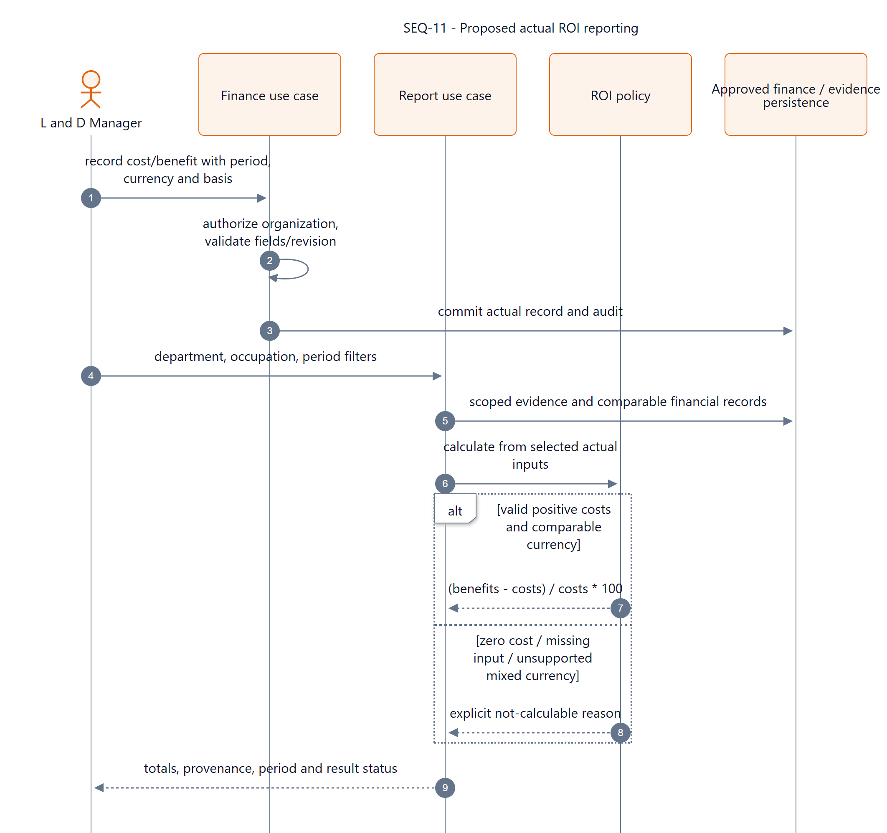

#### 3.6.3 Reporting record lifecycle

Actual financial record approval/locking/retention is not specified by Version 2 and is not implemented by `roi_scenario`; no invented approved-finance enum is presented. Proposed records support revisioned correction with audit and no silent overwrite of historical report inputs.

[Mermaid source: ST-20](../documents/diagrams/mermaid/st-20.mmd)

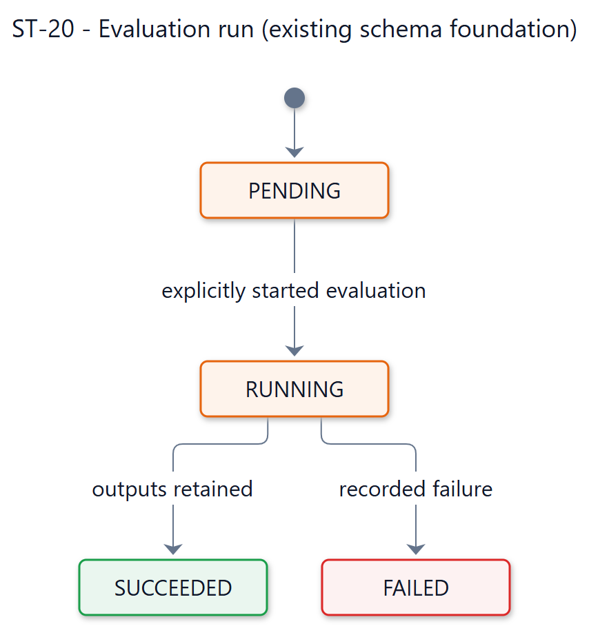

**Diagram notes (ST-20):**

- Evaluation run status is not a production ROI acceptance result. Successful execution must retain dataset/model/seed and artifact identity. No evaluation benchmark was run by this documentation task.

### 3.7 Notifications, Audit and Asynchronous Recovery

#### 3.7.1 Class Diagram and Class Specifications

[Mermaid source: CLS-07](../documents/diagrams/mermaid/cls-07.mmd)

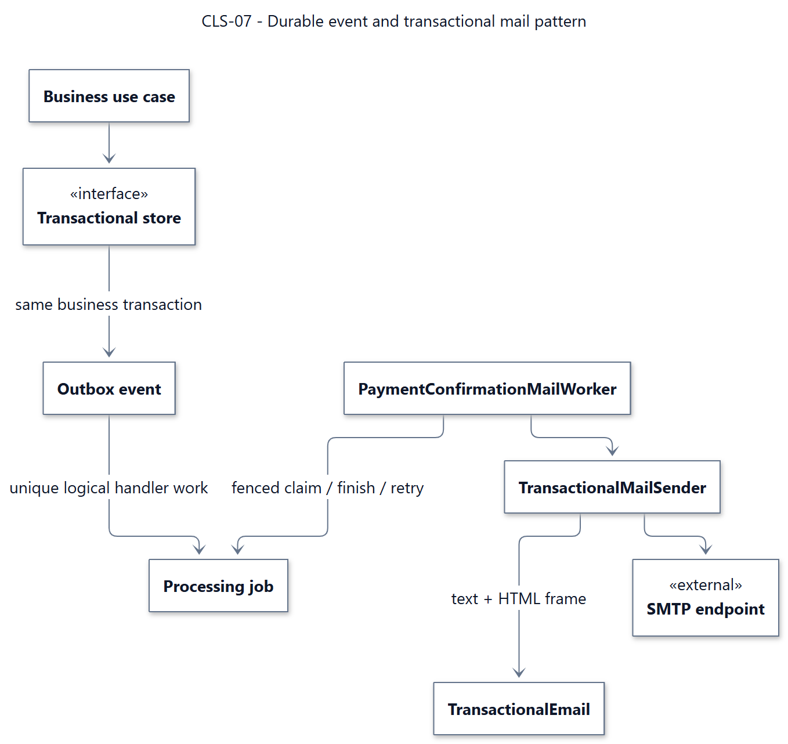

| Class / record | Specification |
| --- | --- |
| `outbox_event` | Durable event identity, aggregate/source revision, payload and correlation; inserted with relevant business changes. |
| `processing_job` | Handler-specific status, attempts, lease/fence, schedule and error state. |
| `processing_receipt` | Logical event/handler completion identity for replay protection. |
| `PaymentConfirmationMailWorker` | Sends first logically confirmed payment notice to stored purchaser; fenced 120-second lease, maximum five attempts, recorded failure state. |
| `TransactionalMailSender`, `TransactionalEmail` | Shared sender/frame and plaintext alternative reused for transactional messages. |
| `audit_event` | Append-only actual action/outcome trace; read contracts must apply platform/workspace privacy scope. |

#### 3.7.2 Notification and failure recovery sequence

[Mermaid source: SEQ-12](../documents/diagrams/mermaid/seq-12.mmd)

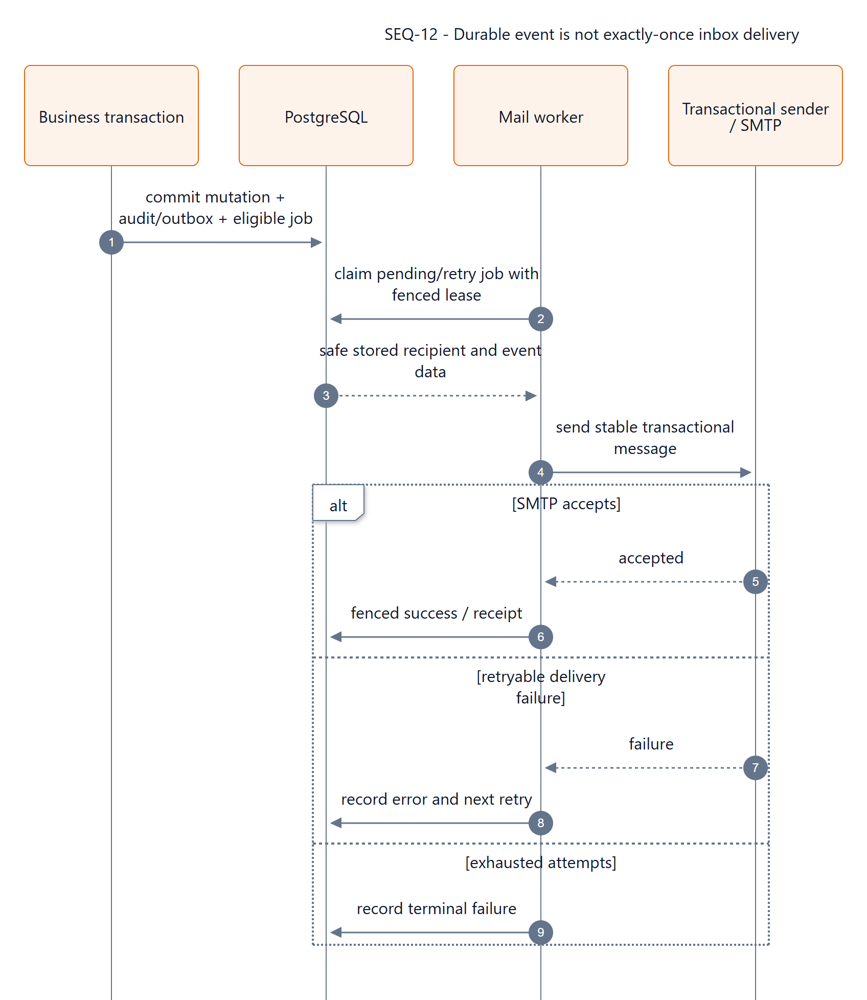

**Diagram notes (SEQ-12):**

- Crash after SMTP acceptance but before committed receipt may repeat delivery; preserve logical event identity. Payment application remains committed independently.

#### 3.7.3 Processing job state machine

[Mermaid source: ST-21](../documents/diagrams/mermaid/st-21.mmd)

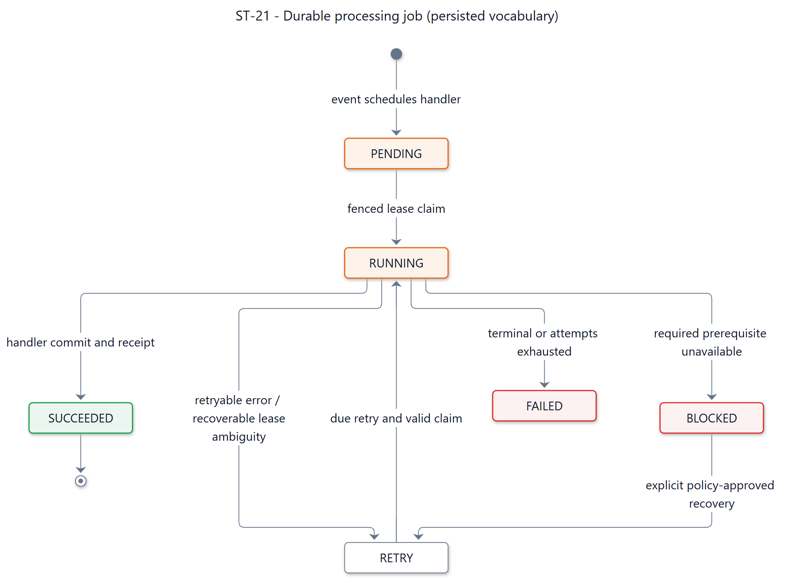

**Diagram notes (ST-21):**

- Not every handler uses every allowed status. Handler-specific retry policy determines actual transitions. An expired lease cannot commit as the current worker owner.

#### 3.7.4 Lifecycle coverage and immutable records

| Principal entity / aggregate | Lifecycle diagram | Qualification |
| --- | --- | --- |
| Organization registration | ST-01 | Current persisted states. |
| Verification proof / activation invitation | ST-02 | Derived from proof/expiry/consumption fields. |
| Account/membership | ST-03 | Access booleans and pending invitation, not invented account status enum. |
| Workspace session | ST-04 | Current assurance scopes and terminal expiry/logout. |
| Payment order | ST-05 | Current persisted vocabulary and ordinary verified branches. |
| Payment application / subscription intent | ST-06 | Separate persisted aggregates. |
| Workspace / organization | ST-07 | Setup readiness versus administrative suspension. |
| Subscription period | ST-08 | Time-derived availability; immutable period record. |
| Department/Job Position / Expert assignment | ST-09 | Target business lifecycle, incomplete implementation. |
| Target role | ST-10 | Required target publication workflow, not legacy enum equivalence. |
| Module and Learning Content | ST-11 | Current authoring/review/publication states; whole-Module lesson review. Complete module-assessment bundle remains separate. |
| MicroSkill and other graph definitions | ST-12 | Orthogonal review/availability vocabularies; no automatic approval. |
| Baseline Draft / released blueprint | ST-13 | Persisted working state and derived active/retiring/inactive. |
| Baseline attempt | ST-14 | Explicit submission followed by L&D-configured PASSED / FAILED result. |
| Question Bank candidate | ST-16 | Current DRAFT/SUBMITTED/PUBLISHED review; immutable published versions and successor drafts. Availability is separate. |
| Employee role selection | ST-17 | Target/history and guarded replacement after completion or bypass-only. |
| Mastery/profile | ST-18 | Role-Level initialization; Met / Needs supplementation / Unknown with provenance. |
| Recommendation / pathway | ST-19 | Initial review, learning loop, completion and bypass-only target release. |
| Evaluation run | ST-20 | Schema foundation, no inferred benchmark pass. |
| Processing job / email delivery work | ST-21 | Handler-dependent durable state machine. |
| Independent skill learning | ST-23 | Target business states corresponding to ACT-07; not persisted enums or a completed assessment integration. |
| Plan version, provider observation, attempt response/result, audit/outbox event, command receipt | Immutable/versioned facts rather than independent status lifecycle | Created from an authorized event, retained for history/replay; correction creates a new version/event where the contract allows it. No artificial state machine is added. |
| RIASEC profile, actual finance records and guidance result | Target lifecycle not yet approved | Preserve source/version/provenance; approve exact physical state/retake/correction rules before implementation. SRS and proposed sequences define business participation without claiming missing enums exist. |

### 3.8 API and Error Contract Cross-Reference

This is a route-family inventory, not a replacement for controller DTO contracts. Existing command families have operation-specific fields; they are not normalized into a fabricated universal API.

| Family / principal paths | Purpose / actor | Important contract boundary |
| --- | --- | --- |
| Registration API and `/api/v1/registration/subscription/*` | Guest registration session, plans and initial order/status | Verification/MFA stage and ownership separate from workspace session. |
| Workspace authentication/member activation controllers | Sign-in, identity lookup, MFA/recovery, logout and activation | Server principal and single-use proofs; do not use client actor role as authority. |
| `/api/v1/platform/subscription-plans` | Platform existing plan reads/updates | Expected version; immutable successors; current VND-only terms. |
| `/api/v1/platform/workspaces` and `/{organizationId}/suspension` | Platform workspace listing/control | Administrative suspension separate from paid period. |
| `/api/v1/organizations/{organizationId}/subscription/*` | System Administrator billing/member support | Trusted organization and action-specific entitlement/recovery rules. |
| `/api/v1/subscription/orders/{orderId}` | Owned payment result | Use actual owner-authorized route; no invented organization-order read endpoint. |
| `/api/v1/payments/payos/webhook` | Provider observation | Original signature-verified fields; raw callback is not accepted on trust. |
| `/api/v1/employee/target-roles`, `/target-roles/{id}` | Current Employee catalog reads | Trusted tenant and available current-schema Role. |
| `/api/v1/employee/target-role-selection`, `/next-step`, `/mastery` | Role selection/readiness/profile | Idempotency key, expected selection and safe own profile output. |
| `/api/v1/ld/adaptive-baseline-blueprints` | L&D paged versions/Drafts | Authorized filters/counts first; default page size 20, max 100 in documented contract. |
| `/api/v1/ld/adaptive-baseline-blueprints/job positions/{job positionId}/working` | Save Draft | Expected working identity/revision and exact replay semantics. |
| Same job position family: `/test`, `/finalize`, `/disable`, `/working/discard`, `/working/convert` | Preview, activation/deactivation, explicit discard/conversion | Expected current pair for fresh lifecycle writes; server revalidation; no invented preview token. |
| `/api/v1/employee/baseline-attempts` and `/{attemptId}` | Start/read/resume | Derived Job Position scope and pinned resources; no client-owned score/timing. |
| Attempt `/{attemptId}/answers`, `/submit`, `/result`, plus `/history` | Answers, finalization and own results | Idempotency/revision/ownership; answer-key/internal-parameter filtering. |
| Legacy organization target-role/skill/prerequisite routes | Retained older authoring model | Explicit property gates; not default current-ontology write support. |
| `/api/v1/system/status`, `/actuator/health` | Technical state | Health is not full readiness/acceptance and exposes no detailed secrets. |
| Planned content, AI, ROI and broad audit APIs | Remaining product scope | Do not assign fictitious implemented endpoints; design/approve contracts before code. |

**Error behavior:** authentication/authorization, invalid input, stale revisions, idempotency conflicts, dependency unavailability and domain readiness are distinct. Preserve actual domain error codes/HTTP mappings per controller. Existing registration uses structured failures and field-specific feedback; baseline/selection also exposes operation-specific code contracts. Detailed error text is safe and actionable, without stack traces or secrets. See SRS application messages for current versus proposed wording.

### 3.9 Verification, Limitations and Submission Readiness

#### 3.9.1 Documentation validation performed

<!-- VALIDATION_SUMMARY:START -->

**Executed locally on 29 October 2026.**

| Check | Actual result | Scope / qualification |
| --- | --- | --- |
| ACT-05 Role-Level diagram revision, 2026-11-06 | Passed | 16 selected Mermaid sources parsed/rendered; 15 updated SVGs XML-validated; ST-16 original artifacts retained. Nine source/preservation/link checks passed, including all scoped target attributes, guarded role change and retained physical dictionary. Visual review completed. [Dedicated evidence](../documents/diagrams/review2-role-level-20261106.md). Documentation only; no runtime/schema acceptance claimed. |
| Learning / Question Bank report synchronization, 2026-11-02 | Passed | Report3 references ACT-04/07/10; Report4 references ST-11/16/23 with matching captions, notes and lifecycle coverage. All12 scoped Mermaid-source/PNG links resolve; six PNG headers/dimensions and SVG XML are valid. Existing report anchors retained. Diagram rendering was checked during their preceding edits; this synchronization ran document/link checks only, not application/database tests or full report requalification. |
| DOCX template-body structure | Passed | 26 fixed SRS headings and 7 fixed SDD headings checked in order; feature placeholders expanded into the relevant numbered sections. Stale SRS template TOC was reconciled to its body. |
| Functional requirement coverage | Passed | 48 distinct source FRs, 48 detailed SRS function sections, 48 use-case table entries and diagram nodes; original actor/domain identities retained. |
| Local references | Passed | 313 local file/anchor links resolved after the visual refresh, including the design-token reference; no missing target file or section anchor detected. |
| Reference freshness, 2026-10-30 | Existing gaps | Checked 313 local references: 25 already-unresolved file/anchor targets were present before this color-only change. No new broken reference was introduced. Source/migration reconciliation is outside this update; earlier reference passes remain dated historical evidence. |
| White-background visibility, 2026-10-30 | Passed | Rerendered all 69 diagrams to XML-valid white-background SVG with Mermaid 12.2.0 / CLI 12.0.0. Browser-computed canvas and neutral container fills are white. Checked 2176 visible stroked elements: minimum contrast against white 3.37:1. Main dark text is 17.87:1 against white; white entry/sequence-number labels retain dark fills. State, sequence and database previews were inspected inside a dark surrounding page. |
| Diagram source syntax | Passed | After the full visual refresh, all 69 themed Mermaid diagrams parsed and rendered using Mermaid 12.2.0 and Mermaid CLI 12.0.0. A punctuation issue in existing state-transition labels was normalized so descriptive text does not become unintended state nodes. |
| Diagram rendering | Passed | All 69 refreshed diagrams rendered locally to XML-valid SVG with system-font fallback and no remote assets. Nine contact sheets and representative detail views were visually reviewed; overly wide first-pass layouts were revised before delivery. Dense schema views intentionally retain all data and support SVG zoom. |
| Diagram content preservation | Passed | Compared pre-refresh and final source: all 864 business edges/messages/transitions, class/entity members, node identities, actor-owned activity steps, 86 Java packages, 69 frontend directories, 48 FR details and database dictionary content were retained. Only presentation, wrapping and descriptive punctuation changed. |
| Visual readability | Passed | Backend package height reduced from 7,926 to 4,973 SVG units; frontend width from 1,116 to 839. Sequence diagrams have a 28% median width reduction. Primary text contrast is 17.9:1 on white and 16.4:1 on the tint; white entry labels are 4.9:1. Some diagrams are deliberately taller to keep chronological flow and readable text. |
| Package diagram completeness | Passed | All 81 main Java plus 5 test-only packages remain visible through namespace headers and relative labels. All 66 frontend source plus 3 verification directories remain visible through nested path labels. The same 55 Java and 10 frontend import edges are retained; invisible spacers have no business semantics. |
| Migration correspondence | Passed | All 32 current migration sources matched successful applied Flyway CRC32 checksums. Source SHA-256 values were rechecked after report assembly. |
| Physical model coverage | Passed | Eight physical ERDs cover 113 owned tables and draw each of 237 foreign keys exactly once. External table references are marked. |
| Data dictionary coverage | Passed | All 916 columns, 808 constraints, 278 indexes and 112 non-internal triggers captured in the table dictionaries. Requiredness and exact composite key definitions are retained. |
| Source scope / obsolete artifacts | Reconciled | Older 89-table JSON catalog was excluded as current truth; v0.9 runtime-input and v0.11 review ontology packages are distinguished; gated legacy APIs and local-only baseline composition are explicit. |
| Output boundary | Passed | Two English Markdown reports in `Review 2` display PNG diagrams; editable source is linked under `documents/diagrams/mermaid`. Existing application code, migrations and database contents were not changed by this task. |
| Application tests, provider operations and deployment | Not run | No new product acceptance, benchmark, live payment/email, staging/production readiness or rollback result is claimed. |

<!-- VALIDATION_SUMMARY:END -->

The read-only schema query verified **source-to-applied-DDL consistency**, not runtime correctness of every service or formal semantic correctness of every business rule. Report diagram syntax/link/coverage checks are documentation checks, not application test passes.

#### 3.9.2 Verification required for implementation acceptance

| Level | Required focus |
| --- | --- |
| Unit/component | Domain transitions, field/nullability validation, single-role/MFA policy, immutable terms, selection/admission, IRT/terminal policy and UI feedback. |
| API/authorization | All six roles; owner/tenant/assignment scope; CSRF/session behavior; no client-selected identity authority; protected answer/file projections. |
| Integration | Flyway lineage, all required fields, composite tenant FKs, payment/seat concurrency, attempt replay/versions, graph snapshot drift and durable recovery. |
| System/Playwright | Onboarding/billing/user activation, L&D configuration and Employee start/resume/results; future publication/content/AI/pathway/ROI flows only after actual integration. |
| Research/performance | SRS Hit Rate@5, graph <=150ms, 300-user <=500ms workload and ordinary 30-user/two-tenant P95 <=2s target; frozen inputs and raw outputs. |
| Deployment/provider | Approved live payOS/email acceptance, real TLS/secrets, staging/production readiness, backup/restore and compatible rollback. |

Follow [testing guides](../documents/testing/README.md). Existing successful records remain limited to their original dates/contracts. No build, application suite, browser business flow, benchmark, live payment/email or deployment was rerun for this documentation-only task.

#### 3.9.3 Manual review navigation

1. Open this SDD and the SRS in VS Code. Compare template numbered sections, then follow one FR through requirements, design, state and storage ownership.
2. Inspect the migration ledger and any table's expanded dictionary. Compare PK/FK/check definitions with its linked original migration; do not use the obsolete stored JSON as current truth.
3. Preview `SYS-01`, `GRAPH-01`, `ST-14` and each `DB-*` diagram locally with a Mermaid-capable Markdown viewer. External references in a grouped physical diagram are intentional.
4. Verify that Nginx/MinIO/local LLM, staging and AI model/version declarations are visibly planned/not evidenced, while actual Caddy, versions and local baseline profile gates are explicit.
5. For separately approved runtime review, use development default `http://127.0.0.1:8088` (or configured override), valid test identities and two isolated organizations. Expect missing baseline resources to block new starts rather than produce demo success.
6. Supply real team AI-model records, hosting/branch policy and remaining product decisions before treating this review draft as a final signed institutional submission.

#### 3.9.4 Source references

| Reference | Evidence role |
| --- | --- |
| [Report 4 template](../documents/Report4_Software%20Design%20Document.docx) | Document body structure and required class/sequence/table descriptions. |
| [SRS](Report3_Software%20Requirement%20Specification.md) | All 48 functions, activities, screens, authorization and NFRs. |
| [Version 2](../documents/FA26SE267_KNOWLEDGE_GRAPH_BASED_ADAPTIVE_LEARNING__haht43_Version_2.md) | Intended product/technology scope. |
| [Feature catalog](../documents/features/README.md) | Stable FR-domain mapping and source-inspected snapshots. |
| [Architecture](../documents/ARCHITECTURE.md) | Target/technical baseline and integration lineage, reconciled with current source. |
| [PostgreSQL migrations](../backend/src/main/resources/db/migration) | Executable current DDL; verified V1-V32. |
| [Baseline lifecycle](../documents/technical/baseline/Job Position%20Baseline%20Lifecycle%20and%20Transition.md) | Current version/availability/retry design. |
| [Role/baseline flow](../documents/technical/baseline/Role%20Selection%20and%20Job Position%20Baseline.md) | Selection, coverage and admission boundaries. |
| [Ontology review](../documents/dataset/ONTOLOGY.md) | Latest v0.11 review data, metadata and provenance. |
| [Neo4j import guide](../documents/dataset/NEO4J_IMPORT_GUIDE.md) | Controlled snapshot import and non-destructive boundaries. |
| [Testing evidence index](../documents/testing/README.md) | Actual historical test scopes and exclusions. |
