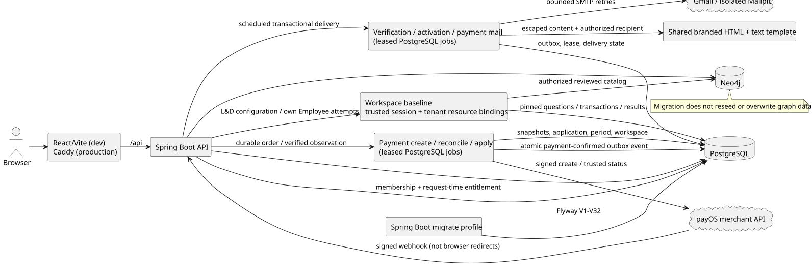
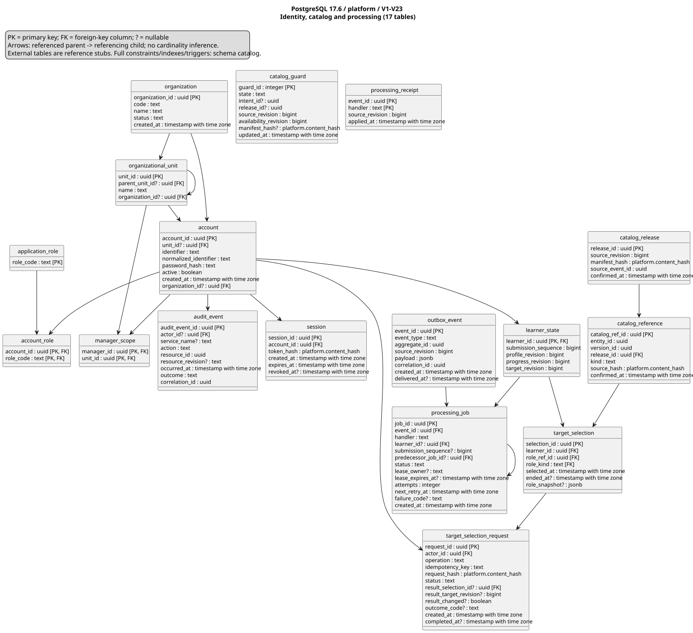
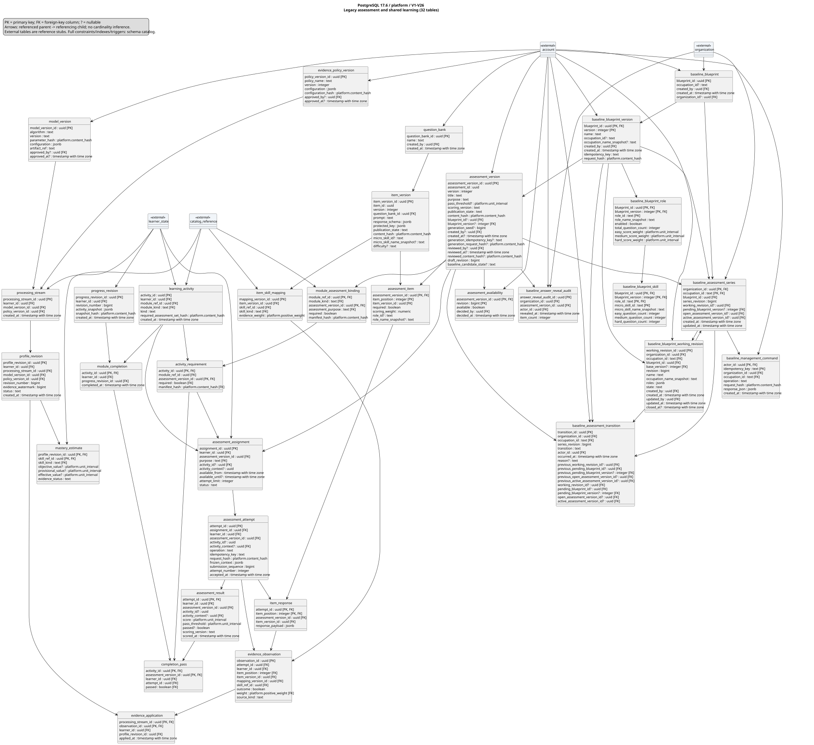
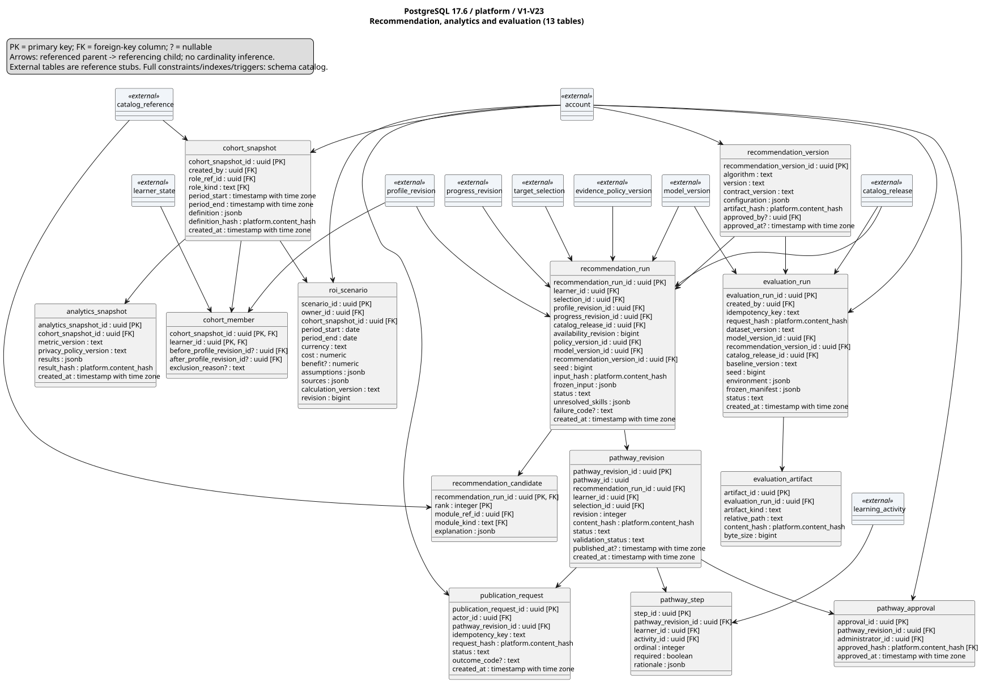
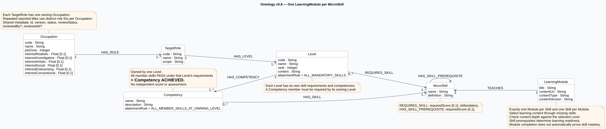

# Current Project Architecture

## Current Scope Alignment

**Product baseline:** [System Overview](adapt_learn_graph_system_overview.md). **Aligned:** 2026-10-14. Product responsibility changes below supersede earlier SaaS assumptions; the technical snapshot that follows is dated evidence, not proof of revised functionality.

The deployment serves one organization. Human actors are System Administrator, L&D Manager, Expert, and Employee. Multi-organization registration/workspaces, subscriptions, payments and PayOS are outside product scope. Existing organization identifiers, account assignments, table names and actor codes remain technical compatibility data until an explicit forward migration is agreed; documentation does not silently remove fields or map privileges.

| Boundary | Current product owner/responsibility | Design or migration gap |
| --- | --- | --- |
| Identity and administration | System Administrator owns accounts, access roles, technical settings and activity monitoring | Agree current actor-code mapping, account lifecycle, settings inventory and audit-read permissions; no automatic mapping from old administrator codes |
| Discipline catalog | L&D manages disciplines and assigns/removes Experts; Experts author assigned-discipline content | Discipline identity, content membership and assignment history are not established by the V5 `JobDomain` label |
| Target roles | L&D creates/assigns; Expert configures competencies/skills/proficiency/importance and submits completion; L&D publishes/unpublishes | Separate configuration-completion and publication contract from legacy `ACTIVE` status; L&D must not edit Expert requirements |
| Learning offerings | Expert authors modules, lesson/practice content and module assessments; L&D approves or returns revisions | Module/content storage, versioned content membership, submission/approval state and learning availability require design |
| Baseline assessment | L&D defines competency coverage, question selection and scoring; Employee completes | Revalidate per-role settings/attempt policies against baseline before role guidance/selection; Expert does not own baseline configuration |
| RIASEC and role guidance | Employee completes RIASEC; system uses baseline/RIASEC to suggest roles/comments; Expert confirms/revises/rejects; Employee selects/confirms | Interest result, AI data contract and review workflow/versioning require design; legacy soft-skill evidence is not RIASEC |
| Pathways | System generates from gaps; Expert reviews/adjusts/confirms before Employee starts | Initial access gate, review state, module overrides and later evidence-driven revision policy require design |
| Individual skill learning | Employee selects skill and accesses the mapped approved Module without changing role pathway | Separate independent progress/context from pathway selection; reuse valid assessment evidence through tracing boundary |
| Competency and adaptation | System traces estimates, calculates gaps, updates progress and revises remaining learning when needs change | Model/thresholds, evidence replay/versioning and override preservation remain open; failure-only triggers are superseded |
| Monitoring | L&D views profiles/gaps/results/progress; System Administrator views permitted audit/operational activity | Privacy/read contracts and metrics; no platform subscription/organization-count workspace |

Neo4j continues to describe catalog relationships; PostgreSQL continues to describe transactional identity, assessment, evidence and learning state. No new node, property, table, enum or cross-store synchronization is implemented by this document update. [neo4j_schema.md](neo4j_schema.md) retains the technical field inventory and records the same design gaps. Dataset preview fields are not automatically runtime schema fields.

Current requirement traceability is in [features/README.md](features/README.md), including REQ-047 through REQ-059. Historical tests and diagrams must be reviewed against new acceptance before being used to claim feature completion. Do not rewrite a previous passing run as proof of publication, RIASEC, discipline authorization or independent learning.

## Technical Baseline Snapshot

**Runtime baseline: 2026-10-02; ontology schema update: 2026-10-14.** This is a runnable database/deployment baseline plus tested local implementation bases for REQ-001-F01 View Target Roles and REQ-001-F02 Choose Target Role; it is not an implementation of all drafted functions. Unit, API/security, PostgreSQL/Neo4j integration, Compose and scoped Playwright evidence for REQ-001 are recorded under `documents/testing`. Production security remains deny-by-default until the real Identity authorization contract is integrated.

## Runtime topology



[PlantUML source](diagrams/runtime-topology.puml)

- One Spring Boot backend owns HTTP, security, migrations, and the future feature modules. There is no separate Python recommendation service or additional backend framework. PostgreSQL and Neo4j are data stores, not application servers.
- The `migrate` profile runs Flyway first, then the Neo4j migrator under a PostgreSQL advisory lock, and exits. Compose starts the API only after that process succeeds. The `local` and `prod` API profiles do not run Flyway. A failed graph migration can leave PostgreSQL migrated; rerunning `migrate` is safe and checks Neo4j migration checksums.
- Development Compose enables a repeatable, **sample-only** cross-store seed: stable Neo4j catalog IDs for two organization-scoped target roles match immutable PostgreSQL catalog references plus the organization/account/learner fixture. The second role supports local change/concurrency/system checks. The seed does not create a target selection or reset learner revisions on an existing volume. Production initializes an empty catalog and never creates sample accounts or billing records. Docker named volumes persist both databases across restarts.
- [compose.dev.yml](../compose.dev.yml) runs Vite with live source mounts and publishes services on loopback. [compose.prod.yml](../compose.prod.yml) builds static assets into Caddy and publishes only the HTTP web entry point on loopback. Database and API containers have no published production ports.

## Ownership and data

| Store | Current responsibility | Current baseline |
| --- | --- | --- |
| PostgreSQL 17.6 | Organizations, accounts/roles, target selections, assessments, mastery/evidence, pathways, audit, outbox, analytics and benchmark records | Forward-only Flyway V1-V7 in [db/migration](../backend/src/main/resources/db/migration); V7 adds F02 command idempotency and immutable role display snapshots. |
| Neo4j 5.26 Community | Ontology 0.9.0: Occupation, TargetRole, Level, Competency, MicroSkill and LearningModule; legacy runtime adapters are still pending conversion | V1 remains the legacy baseline; V2 adds Level/Competency/Course constraints and V3 adds Occupation ID/code constraints. V4 retires the Course constraint, leaving 14 domain constraints plus SchemaMigration.version. No catalog data or learner results are rewritten. |

## Database diagrams

### PostgreSQL

The three views below include every column of the 53 migrated tables through V7. `?` marks a nullable column; `[PK]` and `[FK]` mark key participation. Arrows point from a referenced table to a referencing table when both are in the same view; cross-view foreign keys remain marked on their columns.



[Identity and catalog PlantUML source](diagrams/postgresql.puml)

The PlantUML source includes V7. Regenerate the checked-in SVG when Docker/PlantUML tooling is available.



[Assessment and learning PlantUML source](diagrams/postgresql-assessment.puml)



[Pathway and analytics PlantUML source](diagrams/postgresql-pathway.puml)

`organization_id` is currently nullable on `organizational_unit` and `account` to preserve older records. The catalog references shown here are PostgreSQL snapshots, not extra Neo4j nodes.

### Neo4j

The current ontology contract has six entity labels and seven relationship types, defined in [neo4j_schema.md](neo4j_schema.md) and [dataset 0.9.0](dataset/ONTOLOGY.md).



[PlantUML source](diagrams/neo4j.puml)

Each TargetRole belongs to one Occupation and owns three local Levels. Each Level owns its competency groups and skill requirements, with no direct link to learning content. Competency achievement is derived from all member skills passing the owning Level's requirements; there is no independent score. Only MicroSkills use HAS_SKILL_PREREQUISITE; Course and its edges are removed. There are 48 independent reported-title TargetRoles; recommendation uses each role’s Level requirements directly. Occupation stores six normalized RIASEC values sourced from O*NET 31.0. The catalog has 85 Modules and 79 skills with 181 many-to-many TEACHES mappings. Module practice and role/Level suitability remain pending expert review. Rubric configuration, content bodies and learner results remain outside the ontology graph.

**Legacy runtime adapter contract (pending migration):** All catalog nodes use stable `id` and `code` keys. `TargetRole.organizationId` provides the initial tenant-scoping contract; `seniority` is the domain-neutral grade code (`P1`–`P5` for `PROFESSIONAL`, `M3`–`M4` for `MANAGEMENT`) used for role discovery, while each domain/role family owns the grade's detailed meaning. `responsibilities` supports employee-facing detail. `version` (e.g. `1.0`, `1.1`) and `assignedExpertId` support the expert authoring lifecycle and successor drafts. Relationships also carry lifecycle `status`, `createdAt`, and `updatedAt`; their additional fields are shown on the relevant arrows. Learner mastery, assessment results, and pathway state belong in PostgreSQL, not on Neo4j nodes.

V2 adds ontology entity constraints and V3 adds Occupation constraints after the preserved V1 baseline; V4 drops only the retired Course ID constraint; no catalog or learner data is deleted. The technical SchemaMigration label is not an ontology entity. Community uniqueness constraints do not enforce publication, score ranges, ownership, teaching coverage and duplicate pairs, membership completeness or acyclicity; the v0.9 importer validates these invariants.

**Runtime compatibility:** DevelopmentCatalogSeeder, Neo4jTargetRoleCatalogAdapter, Neo4jTargetRoleMapper and role-selection domain/API contracts still use the legacy model. They have not been converted by this schema change. Import the new seed in an isolated database until the runtime and cross-store references are migrated. The legacy development seeder now refuses an Occupation catalog instead of mixing legacy fixtures into it. The current dataset is under dataset/; existing learner decisions must retain their original catalog context.

PostgreSQL V2-V5 contain a versioned `catalog_reference`/`catalog_release` contract, whereas the legacy runtime uses stable `id`/`code`; ontology 0.9.0 adds version metadata but no separate graph version nodes. No cross-store synchronizer or catalog CRUD API is implemented yet. V7 keeps the selection FK to `catalog_reference`, adds `target_selection.role_snapshot`, and adds `target_selection_request` for command idempotency. Successful request outcomes persist the selection, target revision, and original `changed` value so an idempotent replay returns the same observable result. F02 uses the trusted learner as the outbox aggregate, the target revision as source revision, and the request ID as correlation ID; selection, request outcome, audit, and outbox writes share the caller's PostgreSQL transaction. The snapshot is nullable only for pre-V7 compatibility; new F02 writes must populate it. The provisional runtime adapter rechecks F01 availability under the trusted organization and then resolves exactly one `TARGET_ROLE` reference from the PostgreSQL release whose catalog guard is `OPEN`; mismatch is a dependency failure and the command never creates a reference. The local migrate flow may seed matching cross-store references, but that seed is not a published production release.

F02's temporary assessment guard and `SUPERSEDED` pathway archive mapping are local/demo adapters behind application ports. They load only with the explicit local-dependency property and are absent from the production profile. The real assessment/pathway adapters must share the learner lock/revision transaction contract or provide an owner-approved equivalent before F02 is production-complete.

F02's HTTP adapter is currently a local-only vertical slice. Its configured-actor security chain permits only GET/PUT on `/api/v1/employee/target-role-selection` when the local actor flag is enabled and excludes that endpoint from CSRF because no browser-authenticated principal exists yet. The production security chain is unchanged and denies the endpoint until the real Identity/Security adapter is delivered.

The local assessment guard is controlled server-side through `TARGET_SELECTION_LOCAL_ASSESSMENT_IN_PROGRESS`, which Compose passes to the API container with a default of `false`. It exists only to exercise the provisional `AssessmentActivityGuardPort`; production must replace it with the assessment owner's lifecycle query. The frontend repository has a scoped Playwright system runner that targets the Compose web proxy with an installed Chrome executable; Vitest remains limited to `src/**/*.test.{ts,tsx}` so unit/component and browser suites do not cross-discover each other.

## Backend structure

```text
backend/
  pom.xml, Dockerfile
  src/main/java/com/adaptlearngraph/
    AdaptLearnGraphApplication.java
    platform/            startup, status API, migration orchestration
    catalog/             Target-role domain/use case/API, Neo4j adapter, constraints and development-only seed
    identity/            security boundary; account APIs not yet built
    assessment/          reserved feature package
    competency/          reserved feature package
    learning/            F02 target-role selection domain, application ports/service, HTTP and PostgreSQL/local adapters
    recommendation/      reserved feature package
    pathway/             reserved feature package
    synchronization/     reserved feature package
    analytics/           reserved feature package
    evaluation/          reserved feature package
  src/main/resources/
    application*.yml     local, prod, migrate, starter, worker profiles
    db/migration/        PostgreSQL Flyway V1-V7
    db/neo4j/            graph constraints packaged in the backend JAR
  src/test/java/com/adaptlearngraph/
    platform/            unit, security, database and graph tests
    architecture/        module dependency rules
frontend/               existing src/app, src/features, src/shared layout
documents/features/     drafted functions and their current decisions
documents/diagrams/     PlantUML sources, PostgreSQL generator, rendered SVGs
documents/testing/      unit, integration, and system test plans
compose.dev.yml, compose.prod.yml, .env.example
```

Each backend feature package uses `api` (HTTP), `application` (use cases/ports), `domain` (Spring-independent policy) and `infrastructure` (PostgreSQL/Neo4j/integrations). `catalog` applies this structure for the recorded REQ-001-F01 baseline: controllers call `TargetRoleQueryUseCase`, the application service reads trusted actor context and `TargetRoleCatalogPort`, and the Neo4j adapter maps driver records into domain outputs. Existing placeholders remain placeholders; add current-scope implementations only after contracts are clarified, not as empty scaffolding. Billing is excluded from current product scope. The frontend baseline has feature-local target-role browse/detail and selection API/type/query boundaries. The routed F02 page composes an active-selection summary and catalog that share the server selection query; catalog cards and detail use it for active-state and confirmation. The mutation receives one prepared idempotency key and invalidates that query after success. The unreferenced legacy page-level mock hero/write handler was removed; F02 does not synchronize server selection into localStorage. `TargetRoleSelector`, `useEmployeeLearningState`, `NotificationDropdown`, and their overview/assessment/gap/pathway child consumers remain a separate migration follow-up.

## Technologies

| Layer | Technology in use |
| --- | --- |
| Backend | Java 21, Maven, Spring Boot 3.5.16 (Web MVC, Security, Validation, Actuator, Data JPA/JDBC), Flyway, Neo4j Java driver |
| Persistence | PostgreSQL 17.6, Neo4j 5.26 Community; JPA is available, but there are no domain entities/repositories yet |
| Frontend | React 19, TypeScript 6, Vite 8, React Router 7, TanStack Query, vis-network; Caddy 2 serves production assets and proxies `/api` |
| Delivery | Docker multi-stage builds and Docker Compose; Node 22 for frontend builds |
| Testing | JUnit 5, Spring Boot Test/Security Test, Testcontainers (PostgreSQL and Neo4j), ArchUnit; see [testing/README.md](testing/README.md) |

## Run and verify

From the repository root with Docker Desktop running:

```powershell
docker compose -f compose.dev.yml up --build -d
Invoke-RestMethod http://127.0.0.1:8088/api/v1/system/status
docker compose -f compose.dev.yml ps
```

Dev frontend: `http://127.0.0.1:8088`; API: `http://127.0.0.1:18080`; PostgreSQL host port `15432`; Neo4j Browser: `http://127.0.0.1:7474` (Bolt `7687`). The dev Compose file uses explicit local-only fallback passwords; override them with `.env` for a shared development machine. The raw backend default is `local` and needs reachable databases plus `DB_PASSWORD` and `NEO4J_PASSWORD`. The `starter` profile is an intentional no-database test mode, not the deployed API.

For production-mode Compose, supply nonempty `DB_PASSWORD` and `NEO4J_PASSWORD` in a private `.env` or secret-injection environment, then run:

```powershell
docker compose -f compose.prod.yml up --build -d
Invoke-RestMethod http://127.0.0.1:8088/api/v1/system/status
```

Production publishes HTTP on `127.0.0.1:${WEB_PORT:-8088}`. Place a separately managed HTTPS ingress/reverse proxy in front before external access; TLS domain, certificates, secret storage, backups and observability still need an operator decision. The Compose profiles start correctly but **do not make the unfinished product or authorization system production-ready**. Do not use `down -v` on databases whose data must be kept.

## Decisions to confirm

1. **Catalog identity and history:** How should stable ontology IDs and the legacy Neo4j V5 contract map to the existing PostgreSQL `catalog_reference` fields (`entity_id`, `version_id`, `release_id`), and how are in-progress attempts/pathways pinned when the graph changes? Do not assume a fake graph version.
2. **Single-organization catalog and publication:** Retain existing `organizationId` compatibility fields until a forward migration is agreed. Design discipline assignment and L&D publication gates through the owning catalog/authorization boundaries; unpublished roles must not be treated as available merely because they are `ACTIVE`.
3. **Actor-code migration:** Existing `EMPLOYEE`, `DOMAIN_EXPERT`, `ORGANIZATION_ADMINISTRATOR`, `PLATFORM_ADMINISTRATOR`, `LEARNER`, `LD_MANAGER` and `ADMINISTRATOR` codes are legacy technical data, not the current actor list. Agree an explicit migration to System Administrator, L&D Manager, Expert and Employee permissions without granting unintended privileges.
4. **Graph operational metadata:** Confirm whether the non-domain `SchemaMigration` label is acceptable alongside seven ontology labels and the five legacy V5 catalog labels, or whether migration history must be stored outside Neo4j.
5. **Catalog learning content:** The dev catalog is illustrative only. Dataset 0.9.0 has documented sources and still requires expert review. Confirm production discipline/role/skill data, many-to-many module/skill content mapping, contentUri deployment and L&D approval; current scope is not dummy-only. Keep existing `LearningModule.sourceUrl` semantics until a versioned storage contract is agreed.
6. **Open feature rules:** The feature index marks the functions as drafts, including unfinished baseline Bayesian parameters and other acceptance details. Confirm each contract before adding business migrations, APIs, or system tests for it.
7. **Deployment, tests and integrations:** Choose production HTTPS/domain, secret manager, backup/restore, monitoring and automation/CI. Confirm baseline/RIASEC AI guidance and any operational email contracts before integration. PayOS/billing are excluded; no non-Spring Boot backend runtime is proposed.


## Admin Research RQ2 implementation — 2026-10-21

The user approved an Admin Research workspace for RQ2. This scoped addition supersedes historical-only benchmark statements for REQ-033-F02, REQ-034-F01/F02 and REQ-035-F01. RQ1 and RQ3 are deferred. It does not alter the operational catalog or other product-scope decisions above.

The evaluation subsystem follows domain → application/ports → infrastructure adapters, with separate API controllers. PostgreSQL V8 adds `platform.research_run` and `platform.research_graph` (two tables beyond the prior 53-table baseline); complete fields, nullability, status and artifacts are documented in [RQ2 API](research/RQ2/API.md). The legacy evaluation_run remains unused for RQ2 because model/recommendation versions and learner-account references do not apply.

`compose.research.yml` adds a dedicated Neo4j Community instance and persistent volume, with configured CPU/heap/page-cache limits. The adapter compares database IDs before imports and rejects foreign nodes. It adds only technical label ResearchNode and a unique ResearchNode.id constraint to the isolated instance. All six ontology entity labels, seven relationships and their v0.9.0 property sets remain unchanged. JSON graph artifacts preserve nullable metadata; Neo4j omits null properties as specified. No benchmark migration runs against the operational graph.

An enabled Research API owns one PostgreSQL session advisory lock; a partial unique index additionally prevents concurrent runs. A single executor generates each selected snapshot, persists it, imports it, warms the database and measures real shortestPath traversals. State and successful sample checkpoints persist every 50 measured queries. On restart, incomplete runs become FAILED while retained artifacts remain accessible. Every run freezes its source SHA-256 and Markdown rules. See [generation and measurement rules](research/RQ2/RULES.md).

The Admin sidebar links to `/admin/research`. Research reuses the existing portal ADMIN context and has no separate account/access form. The local profile accepts explicit actor headers, consistent with other current local vertical slices; this is a development bridge. Outside local, header claims are ignored and a server-authenticated ROLE_ADMIN principal is required. Mutations retain CSRF protection. The UI guards direct navigation before WorkspaceLayout can change actor context and lists RQ1, RQ2, RQ3 in numeric order. Research is disabled by default; the local Compose overlay explicitly enables it. Production identity/HTTPS rollout is outside this implementation.

PDFBox renders English PDF reports from persisted successful runs. Results include aggregate/per-depth mean and nearest-rank P95, source/configuration, node/edge counts, environment and limitations. CSV contains raw successful query timings; JSON contains the run snapshot and frozen rules. Generation/import/warm-up are excluded from query metrics. These structural workload measurements do not establish recommendation accuracy or learning effectiveness.

Research Compose uses lightweight HTTP health probes for both Neo4j instances; the worker performs the database identity/schema/count checks through Bolt. Portal polling preserves its CSRF cookie; mutations still require a matching token.

RQ2 measured-query configuration (rq2-v2): the existing research_run.payload.iterations field now holds the Admin-selected integer N (3..100000, default 1000) per selected graph size. No table/column/store responsibility changes. Catalog exposes minIterations/maxIterations. Run progress, stored samples, history and reports all use the frozen value; warm-up remains 30 and dataset generation is independent of N.

### RQ2 v3 approved research protocol (2026-10-21)

The user approved multi-seed/round measurement and actual distinct workload counts. This supersedes v2 configuration for new UI studies. PostgreSQL retains all protocol/measurement fields; no ontology schema expansion. `Run.protocol={seeds:long[1..10] distinct safe nonnegative, pairsPerHop:int[1..10000], rounds:int[1..10]}`, defaults1..5/500/3, upper total <=1000000. `totalQueries:int` begins as upper bound and becomes the frozen actual workload total; `planReady:boolean` indicates that transition. Compatibility slots seed=first seed, iterations=pairs*3*rounds, warmup=0 for v3; actual warm-up per Trial. See API.md for full field semantics, validation and legacy fallback.

Each Result has optional Trial(seed,round,uniqueByHop,warmupQueries,structure(averageDegree,maxDegree),attempted,errors,timeouts). Each Metrics adds nullable medianMs; Sample adds outcome SUCCESS/ERROR/TIMEOUT and nullable error. Missing historical fields remain unavailable, with SUCCESS default for old samples. Metrics count successes only; no-success metrics are rendered unavailable; attempted/error counts always accompany them. Raw samples include failures, no retry. Finished measurement with failures is SUCCEEDED with disclosed failure counts; planning/import/warm-up/interruption failure is FAILED. Phase checkpoints retain partial trials every100 attempts.

V9 adds seed to research_graph, backfilled from payload, and makes PK(run_id,node_count,seed); all previous snapshots remain intact. ResearchStore gets seed-qualified lookup. The service first freezes every dataset/workload in PostgreSQL, then loads/imports one at a time into dedicated Neo4j, full-pass warm-up once, shuffled repeated measurement rounds. Per-round generation/import provenance repeats and must not be summed. Descriptive variation is over per-round means; it is not a confidence interval and percentiles are not averaged. All six ontology types/seven edge types and complete property mappings remain enforced by OntologyGenerator/Neo4jResearchGraph. No learner state is generated.

The RQ2 UI reads protocol defaults/bounds from the backend catalog and polls summaries every5seconds. Query failures log the first exception per seed/size/round for diagnostics while retaining sanitized error text in exported samples. PDF pagination keeps each trial block together.

RQ2 latency presentation paginates the existing result summaries by seed on the frontend, one seed per page with every size/round/depth retained. Run changes reset the local page; exports and aggregate variation remain study-wide. No API, database or measurement changes.

RQ2 count-input revision (2026-10-23): the frontend now accepts an integer number of datasets per graph size, defaulting to catalog.defaultSeeds.length, bounded by maxSeeds. It derives explicit seeds[1..N] before calling the unchanged startStudy API. No new persisted datasetCount field: protocol.seeds remains the source of truth and its length is the count. Historical/custom seed arrays remain readable; existing domain/ports/Neo4j schema and measurements are unchanged.
