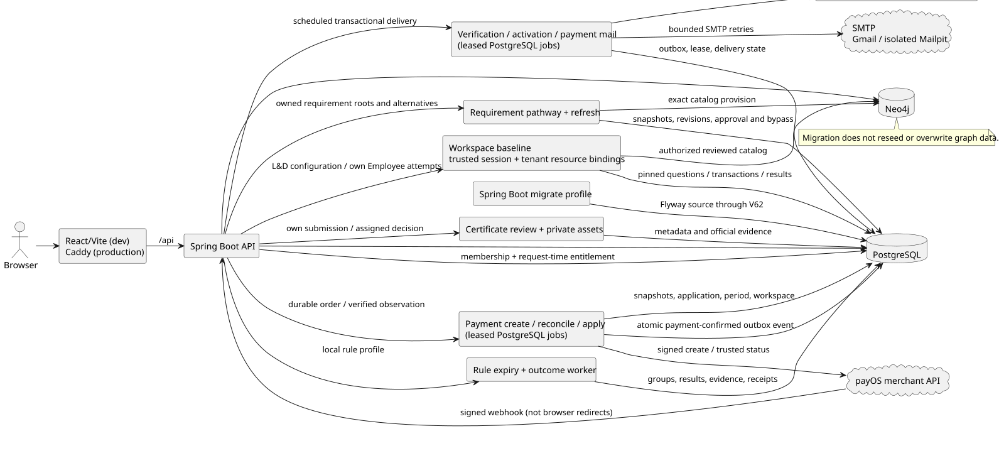
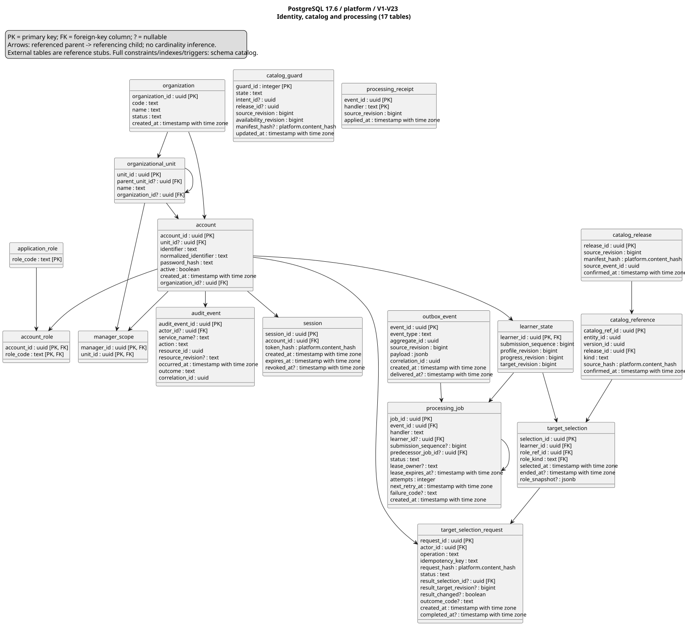
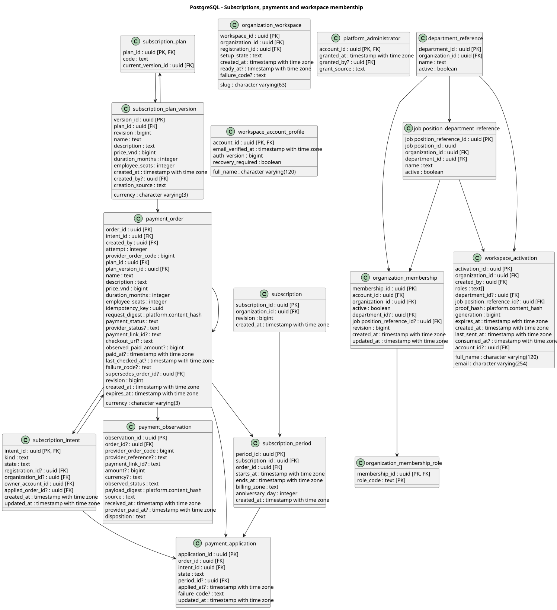
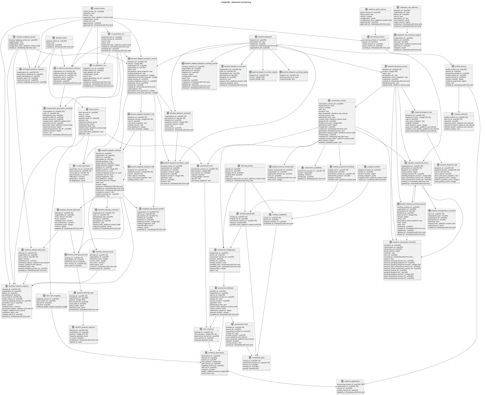
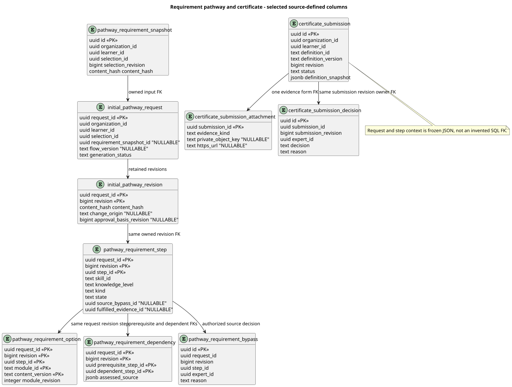
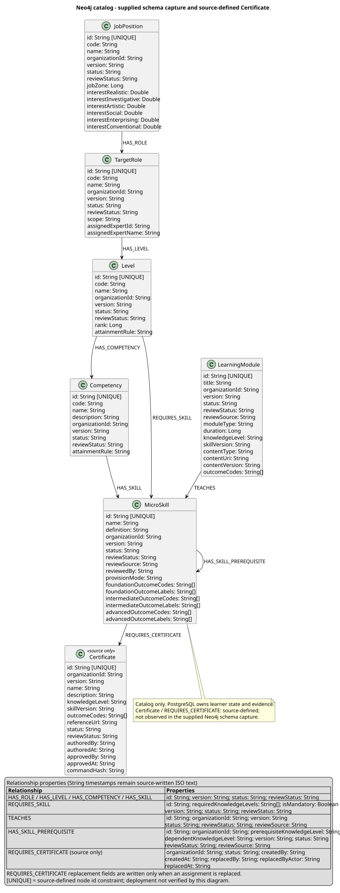

# Current Project Architecture

Current source update2026-11-09: one module teaches one complete Skill at one knowledge level. The new rule flow matches organization + Skill + knowledge level + Skill version, including every valid released module without Outcome Code filtering. New question mappings use the append-only `assessment_item_skill_scope` sidecar (forward V63); historical OC fields and hashes remain readable. Compose mounts `ontology_seed-skill-level.json` with checksum-pinned OC-free question/module manifests. Skill/module authoring uses the shared viewport-bounded Dialog/Body. Local follow-up2026-11-09: V63 and backend without-oc-20261109 were applied after user approval; health/JAR and authenticated GETs were verified. Existing history remains immutable; fresh bootstrap and full UI/behavior remain unverified. See [the current contract](technical/Organization%20Rule%20Assessment%20and%20Pathway.md#16-outcome-code-retirement--source-update-2026-11-09).

## Organization-rule assessment/pathway — source 2026-11-07

Selected Role/member Level determines explicit requiredKnowledgeLevels. Baseline and skill assessment share a rule engine with **separate scoped policies and deadlines: L&D Baseline per organization+Role+member Level, Expert Skill Assessment per organization+Skill+knowledge**. PostgreSQL owns frozen attempts/groups/results, diagnostic versus official evidence, certificate decisions and requirement-root pathways; Neo4j remains catalog-only. Keep Java 21/Spring Boot 3.5, existing auth/tenant/assignment/entitlement, JPA/SDN, content/review/progress and audit/outbox.

[Current target schema/API and ordered flow](technical/Organization%20Rule%20Assessment%20and%20Pathway.md) supersedes older whole-Job-Position baseline, IRT/numeric mastery-gap and optimizer descriptions. Current local workspace source implements the rule flow; this document update neither migrates a database nor proves full runtime behavior. Catalog keeps existing Role/Level/Skill topology; PostgreSQL owns learner requirement snapshots and steps.

- Baseline records only assessed skill-level diagnostics. A's result never creates unassessed prerequisite B; A needing learning gets A alternatives. Skill assessment may later discover B and add **Cần bổ sung**.
- Module + passing assessment with required conditions, or approved certificate, creates official achievement. Baseline and bypass do not. Official prerequisite failure gives NEED_REVIEW without revocation.
- Initial Expert approval covers requirement-root choices; valid supplementation recalculates automatically. Retakes always include main and ALL prerequisite groups.
- Lock Role AND Level from request submission. Release on mandatory-work completion/bypass-only. After another target is chosen, old bypass needs are parallel learning and never gate its other skills, even when provision appears.
- Preserve current FE design. Change fields/data binding for Question Bank classification, separate policy configs, alternatives and certificate evidence. Mocks do not prove integration.
- Affected old dev flow records need not be migrated; matching forward V50–V62 and explicitly gated development seed definitions now exist in source; applied state remains unverified here. Unrelated/shared data and research/evidence/backups remain; no DB reset occurs here.


## Workspace Baseline Integration (2026-10-28)

The current rule runtime uses `local,workspace-baseline`, excludes demo/prod profiles, and requires the workspace property; pathway/certificate additionally requires `pathway.initial.enabled`. Real session/membership/entitlement remain. ScopedAssessmentPolicyService owns directory/draft/activation; RuleAssessmentAttemptService owns both purposes; RequirementPathway services own request, generation, review, access and recalculation. Legacy factory methods retained in WorkspaceBaselineConfiguration without @Bean are not active IRT wiring.

PostgreSQL retains three distinct migration lineages through V62 in source. The workspace profile defaults to `db/workspace-migration`; an explicit location override must match the whole installed history. V52–V56 add rule papers/evidence/requirement revisions; V57–V62 add scoped drafts/activation, editor progress, owned bank sources, abandoned history, option overrides/no new module price and scope-local version labels. [Current source-defined schema/API](technical/Organization%20Rule%20Assessment%20and%20Pathway.md#4-postgresql-schema-mapping) is not an applied schema receipt.

At accepted request, Role and Level lock under learner transaction before later archive/write. Baseline only consumes selected target groups; Skill Assessment uses exact completed accepted option plus all prerequisite groups. Frozen paper/history/deadline survive resume/config changes; server expiry finalizes once. Result jobs distinguish finalized scoring from pending supplementation/official evidence. New genuine evidence and catalog refresh publish successor revisions with original approval basis, preserving started content and history.

The Docker Linux engine was unavailable in this documentation task, so live PG/Neo4j metadata, active policies and current learner state were not inspected. No service start, seed, migration, learner action or executable test occurred. Historical 2026-10-28 results retain their original environment and numerical flow, not current rule-engine acceptance.

## Confirmed Product Target

**Source:** [Capstone Register Version 2](FA26SE267_KNOWLEDGE_GRAPH_BASED_ADAPTIVE_LEARNING__haht43_Version_2.md), especially section 3.2(c). **Aligned:** 2026-10-21. [Product Overview](PRODUCT_OVERVIEW.md) and [feature contracts](features/README.md) describe the confirmed scope.

The target is a subscription-based, multi-organization platform with six human actors: Guest, Platform Administrator, System Administrator, L&D Manager, Expert and Employee. The System is an automated performer. Organization membership, role/assignment permissions and subscription entitlements must be enforced independently. Platform administration does not imply unrestricted access to private employee answers or learning files.

| Boundary                    | Required responsibility                                                                                                                                                            | Design or migration gap                                                                                                                                                                                                                               |
| --------------------------- | ---------------------------------------------------------------------------------------------------------------------------------------------------------------------------------- | ----------------------------------------------------------------------------------------------------------------------------------------------------------------------------------------------------------------------------------------------------- |
| Registration and workspaces | Guest registers organization/contact/admin details, verifies email, resumes registration and tracks setup; System provisions and assigns initial System Administrator              | Registration and the connected subscription/provisioning/session handoff are locally verified. Historical live Gmail AC-09 remains Blocked. Production setup/reference-data availability is separate.                                                 |
| Subscriptions and payments  | Guest purchases; System Administrator renews and views period/seats/history; Platform Administrator updates existing plans; System verifies payments and maintains access          | Local lifecycle completed under revisions 2/3: immutable versions/orders, real payOS adapter, durable jobs/application, renewal periods, serialized seats and request-time access. Live payOS acceptance was explicitly excluded, not claimed Passed. |
| Identity and departments    | System Administrator manages accounts, memberships, organization roles, departments, employee assignments and workspace settings                                                   | Forward actor-code mapping, department lifecycle/history, session and permission contracts; no account hard-delete requirement                                                                                                                        |
| Organization oversight      | Platform Administrator views/updates organizations and designated administrators, suspends/reactivates workspaces and monitors platform activity                                   | Authorized platform read/write boundary, administrative access transitions and auditable changes                                                                                                                                                      |
| Job Position catalog          | L&D manages job positions, attaches each to a department and assigns/removes Experts                                                                                                 | Organization ownership, department references, Expert assignment history and content authorization are not established by a legacy `JobDomain` label or O\*NET seed alone                                                                             |
| Target roles                | L&D creates/assigns; Expert configures competencies/skills/proficiency/importance and submits/revises; L&D publishes/unpublishes or returns revisions                              | Separate completion, publication and revision contracts from legacy `ACTIVE`; L&D publication must not edit Expert requirements                                                                                                                       |
| Learning offerings          | Expert authors/organizes modules, content, mappings and module assessments, then submits; L&D approves or returns revisions                                                        | PostgreSQL content/review, private assets and catalog projections; one skill/knowledge level per module, multiple equivalent alternatives per requirement                                                                                      |
| Assessment                  | L&D configures baseline coverage/selection/scoring; Expert configures module questions/skill/difficulty/selection/scoring; System delivers/scores and calculates RIASEC profiles   | Attempt/version policies, RIASEC instrument and replay-safe submissions; legacy per-role baseline defaults are not a current approved contract                                                                                                        |
| AI role guidance            | System uses assessment evidence and RIASEC interests with a local LLM; Employee directly views suggestions/comments and selects/confirms a published organization role             | Internal inference API, minimized inputs, result/version contract and failure handling; no Expert guidance-review gate                                                                                                                                |
| Pathways                    | System generates from gaps; Expert reviews/includes/excludes/confirms initial pathway; assessment results drive automatic remaining-pathway recalculation                          | Initial learning gate, override preservation, versioning and recovery; no failure-only trigger restriction                                                                                                                                            |
| Independent learning        | Employee selects a skill and accesses its mapped approved modules/content without editing the role pathway                                                                         | Independent progress context and reusable assessment evidence; not a one-module-per-skill constraint                                                                                                                                                  |
| Development and ROI         | L&D views profiles/gaps/results/progress/department summaries; filters by department, job position and period; records costs/monetary benefits with period/currency/supporting basis | Reporting dimensions, source records, aggregation, ROI formula, zero-cost and currency policies; Employee sees own progress                                                                                                                           |
| Notifications and audit     | System sends verification/payment/workflow emails and records administrative/payment/content/role/assessment/pathway events; administrators read permitted activity                | SMTP/Gmail integration, durable event delivery, retention, privacy and platform versus workspace read scopes                                                                                                                                          |

### Target Data and Integration Ownership

| Component      | Required ownership                                                                                                                                                                                                                                                                                                     |
| -------------- | ---------------------------------------------------------------------------------------------------------------------------------------------------------------------------------------------------------------------------------------------------------------------------------------------------------------------- |
| Spring Boot    | Business APIs, authorization, payment verification, private content access, workflow orchestration, rule-based assessment, requirement-driven pathway orchestration and recovery. No separate Python backend is required.                                                                                                                            |
| PostgreSQL     | Organizations, registrations, plans and purchased versions, payment orders/history, workspace status, entitlements, accounts/memberships, departments, employee assignments, job position-department links, costs/benefits, workflow states, module/content metadata, assessments, evidence, progress, audit and outbox. |
| Neo4j          | Organization-scoped existing ontology, explicit required knowledge levels, exact prerequisite pairs, single-skill modules and certificate definitions. No private learner results/progress/content bodies on catalog nodes.                                                                                                              |
| MinIO          | Private uploaded files and representative module content; access authorized by the backend for the organization and offering. Object possession or a client-supplied organization ID is not authorization.                                                                                                             |
| payOS          | Checkout, payment-status queries and signature-verified webhooks; the backend checks order, organization, purchased plan version, amount/currency and duplicate outcomes. A browser redirect is not payment evidence.                                                                                                  |
| Local LLM      | Internally hosted inference for AI-assisted role suggestions/explanations; RIASEC is an interest signal, never mastery evidence.                                                                                                                                                                                       |
| SMTP via Gmail | Account-verification, payment-status and workflow email delivery.                                                                                                                                                                                                                                                      |
| Delivery       | On-premises Docker Compose, Nginx web/reverse proxy and GitHub Actions CI/CD. The existing Caddy deployment below is a baseline, not this completed target.                                                                                                                                                            |

These are ownership requirements, not new physical columns, enum values or deployed services. Existing migrations, IDs and catalog history must be retained until explicit forward migrations and cross-store projection/recovery contracts are implemented. [neo4j_schema.md](neo4j_schema.md) remains the existing dataset field inventory: its single-catalog and one-to-one `TEACHES` rules need migration, not silent reinterpretation. Historical tests/diagrams demonstrate only their recorded contract versions, not Version 2 completion.

## Technical Baseline Snapshot

**Runtime baseline: 2026-10-02; ontology schema update: 2026-10-14.** This is a runnable database/deployment baseline plus tested local implementation bases for REQ-001-F01 View Target Roles and REQ-001-F02 Choose Target Role; it is not an implementation of all drafted functions. Unit, API/security, PostgreSQL/Neo4j integration, Compose and scoped Playwright evidence for REQ-001 are recorded under `documents/testing`. Production security remains deny-by-default until the real Identity authorization contract is integrated.

## Runtime topology

### Connected Subscription Lifecycle (2026-10-23)

[Approved revisions 2/3 and local delivery](features/Subscription%20lifecycle/README.md#local-delivery-2026-10-23) connect all 12 subscription functions. PostgreSQL owns immutable plan versions/order snapshots, purchase/renewal intents, verified payment observations, unique application, workspace provisioning, subscription periods, memberships/roles and activation state. V9/V10 add these tables; V11 prevents overlapping paid periods. Existing registration IDs/history and legitimate nulls are retained.

The payos-java 2.0.1 adapter (Jackson BOM 2.21.8) calls the official merchant API, verifies signed responses and original webhook JSON fields, and never accepts redirects/browser storage as payment proof. Durable PostgreSQL jobs create/reconcile/apply using the same order identity, fenced leases and retry state. Successful initial application atomically creates the logical organization/workspace, initial administrator membership and paid period; no separate tenant database or fabricated catalog content is created.

Workspace/platform sessions are distinct from registration sessions. Server membership/roles, MFA assurance, current paid periods and administrative status guard existing protected API families. Employee seats are counted transactionally and admissions serialize with renewal changes. Reference lookups require real same-organization department/job position data; their CRUD/population remains upstream, not part of this lifecycle.

Guest plan/checkout/setup, platform plan configuration, organization subscription/renewal and workspace sign-in now use real APIs. React Query scopes data to trusted account/organization context; mutation clients obtain CSRF, and route guards supplement rather than replace backend authorization. Supporting Employee activation uses a captured/real SMTP adapter and a recipient-chosen password; Employee-only accounts do not require MFA, administrators do.

**Administrator W2 follow-up (2026-10-26):** `/admin/users` and `/admin/subscription` now live in their existing `administration/user-management` and `administration/subscription` owners and reuse WorkspaceLayout rather than the standalone subscription shell. Users owns list/detail/create/profile edit/activate-deactivate and pending invitations; Subscription contains billing/renewal/seat summaries only. The layout's opt-in trusted presentation uses real identity/organization/logout while retaining the requested demo role navigation, which does not grant backend roles. User profile edits use existing tables and preserve registration snapshots; no migration/dependency was added. Workspace profile name takes precedence for current workspace reads, without changing registration/security evidence. Suspended member-directory reads are distinct from allowed billing reads; expired organizations retain bounded user deactivation for seat remediation. [W2 evidence](testing/system/REQ-022-admin-pages.md).

Local verification used a separate Compose test image with test-only provider/fixture endpoints, PostgreSQL/Neo4j and Mailpit at `http://127.0.0.1:8092/`. Those fixtures are not in the production image. No live merchant/email call occurred. The retained development database remains V8 pending separately authorized migration. [Evidence](testing/README.md#subscription-lifecycle-local-delivery) distinguishes local completion from provider acceptance and production readiness.

### Platform organization directory projection (2026-11-04)

`GET /api/v1/platform/workspaces` retains `organizationId`, `name`, administrative `status` and provisioning `setupState`. Its read-only extension adds `subscription: { status, current }` and `administrators`. `current` is null outside an active paid period; otherwise it exposes only the purchased plan `name`, `startsAt` and `endsAt`. Coverage uses one server instant and half-open periods `[startsAt, endsAt)`: ACTIVE for current coverage, SCHEDULED for future-only coverage, EXPIRED for historical coverage without a current/future period, and NONE when no paid period exists. These states do not derive from administrative suspension.

Administrators are current `ORGANIZATION_ADMINISTRATOR` membership-role assignments, not a permanent designation of the original registrant. Each projection contains `accountId`, nullable `fullName` (current profile, then legitimate registration-name fallback), `email`, membership `active` and `accountActive`; inactive assignments remain visible. Missing assignments produce an empty list. Organization, account and membership tenant IDs must match. Two batched JPA projections load administrator display data and paid-period display fields for the provisioned organization IDs; no tenant billing/history API is reused or newly authorized.

The existing trusted platform guard, no-store response and suspension transaction/audit remain the owners. `PUT /api/v1/platform/workspaces/{organizationId}/suspension` requires a non-null boolean `suspended` plus existing session/CSRF authorization; missing/null intent is rejected rather than defaulting to reactivation. Confirmation occurs in the UI, not as a substitute for server authorization. Reactivation changes only administrative status, never paid dates or setup readiness. No profile-write endpoint, storage/schema migration or new dependency is introduced. [API/persistence evidence](testing/integration/REQ-064-manage-organizations-20261104.md).

### Onboarding presentation and transactional mail (2026-10-26)

- Guest organization/account entry, verification/MFA, plan selection, payment and workspace progress reuse one Guest layout. Organization and account entry are separate UI steps but retain the same atomic registration API command; unsaved credentials are not persisted in the browser.
- New payOS callbacks target `/guest/payment-result?order=...` or `/admin/subscription/payment-result?order=...`. Existing checkout callbacks remain usable; old Administrator callbacks redirect to the order-specific result. Administrator receipts use the existing owner-authorized `GET /api/v1/subscription/orders/{orderId}`, not a new organization-order endpoint.
- Receipt views map the existing immutable order terms, `providerOrderCode`, amounts, `createdAt`, `expiresAt` and nullable `confirmedAt`. The last field is system verification time, not bank settlement time. No bank transaction reference, counterparty account or raw provider payload is invented or exposed.
- `PaymentProcessor` passes the purchased plan name to the existing payOS adapter. Checkout includes a single named item with quantity one and the exact snapshot price. Transfer descriptions use a short normalized plan marker and order suffix, within the nine-character limit applicable to non-linked bank accounts. Provider order identity/signatures, not the memo, remain reconciliation authority.
- Shared infrastructure `TransactionalEmail` / `TransactionalMailSender` supplies one responsive HTML frame and plaintext alternative to registration verification, member activation and subscription payment confirmation. Email palette values are centralized and rendered inline for mail-client compatibility; browser components continue to use design tokens.
- The first verified PAID transition atomically inserts `SUBSCRIPTION_PAYMENT_CONFIRMED` with source revision zero and one `PAYMENT_CONFIRMATION_EMAIL` job into the existing outbox/job tables. `PaymentConfirmationMailWorker` sends to the stored purchaser account identifier, with a fenced 120-second lease, at most five attempts and recorded retry/failure state. It uses the existing SMTP settings and `subscription.worker.enabled` switch.
- Payment scheduling only considers payment-processing handlers; a failed email job cannot suppress reconciliation or activation. SMTP acceptance does not prove inbox delivery, and at-least-once SMTP delivery can repeat after an acceptance/crash ambiguity despite one logical event and stable message identity. Historical payments are not automatically backfilled.

No schema, plan pricing, entitlement policy, identity boundary or dependency changes are introduced by this refinement.

### Single-role identity and platform seed (2026-10-28)

The approved account policy supersedes earlier platform-MFA and multiple-role behavior described in historical slices above. Platform accounts use password-only sessions without fabricated email-verification or MFA evidence; Organization Administrators still require both email verification and MFA. Activated Expert/L&D/Employee accounts use passwords without MFA. Session `mfaVerified` remains an actual assurance fact, not an exemption flag.

Flyway V12 adds a unique membership-role key, a deferred exactly-one-role guard, a one-role constraint for pending invitations and account-locked platform/organization mutual exclusion. It refuses ambiguous existing active data instead of choosing a role or deleting records; consumed historical invitation snapshots are retained. The API keeps its `roles[]` wire shape but requires exactly one allowed role on creation/edit/activation. Employee role replacement initializes missing learner state and retains learning history when moving away.

`PlatformAdministratorBootstrap` now performs an opt-in idempotent seed from `PLATFORM_ADMIN_SEED_EMAIL` and `PLATFORM_ADMIN_SEED_PASSWORD`. It reuses existing account/password-hash/grant tables, creates no registration/TOTP or fake verification timestamp, rejects conflicting organization identities and never silently overwrites credentials. A seed-only account's optional display name remains absent, so the UI displays its actual email.

After normal migration, run `docker compose -f compose.dev.yml run --rm --no-deps platform-seed`. The tools-profile service runs non-web with `platform-bootstrap`, not a public HTTP bootstrap endpoint. Configure secrets privately in the existing ignored `.env`; do not put passwords in command arguments/source/chat. Repeating the same configuration is idempotent; changing it is not a password-reset operation. Use `--profile tools` if resolving this service through `docker compose config`, and do not print the resulting secret-bearing configuration.

Login entry maps the single trusted role to the existing platform, organization-admin, Expert, L&D or Employee route. A shared session context supplies real header identity and server logout to the role layouts; demo navigation remains non-authoritative. The later A1 presentation refinement makes `/activate` and `/login` share `WorkspaceAuthLayout` and the existing illustrated login styles. `/active` is a non-redirect alias preserving the proof fragment. No activation API/session behavior or database contract changes in A1. [Layout evidence](testing/system/REQ-037-activation-layout.md).

All current transactional messages embed the supplied brand PNG as MIME `cid:alg-brand-logo`; the shared renderer keeps HTML/plain alternatives and escaping. The PNG is a mail-client-compatible copy of the user-supplied logo, not the unrelated frontend favicon.

The guarded dev update backed up PostgreSQL, preserved environment/data, applied V12, seeded one configured Platform Administrator and verified actual login/platform API/logout at `:8088`. [Evidence and manual checks](testing/system/REQ-037-single-role-activation.md). No Neo4j schema or dependency changes; unrelated prototype page content is not re-certified.

### Registration-first slice (2026-10-21)

#### Guarded optional integrations (2026-10-30)

The shared domain `IntegrationPolicy`, wired by `IntegrationPolicyConfiguration`, reads independent `PAYOS_ENABLED`, `EMAIL_VERIFICATION_ENABLED` and `MFA_ENABLED` switches (all default true). Any disabled switch requires an explicit `local`/`dev` profile and no `prod`/`production` profile; startup rejects other environments and warns on permitted development bypass. This qualifies the historical mandatory email/MFA/payment descriptions below; it does not change production policy.

Registration and workspace authentication compute required stages from trusted policy and actual proofs. Skipped email leaves `email_verified_at` null; skipped MFA leaves the session's actual `mfaVerified` false and retains existing credentials. Internal subscription actors carry a server-owned MFA requirement separately from MFA proof, preserving authorization while allowing the approved local flow. Reenabling checks missing actual proof, including existing bypass sessions. Only registration verification delivery is suppressed by the email flag, not unrelated mail.

Forward-only [combined workspace V43](../backend/src/main/resources/db/workspace-migration/V43__development_integration_bypass.sql) (upstream originally V37) adds `organization_registration.email_verification_bypassed` and `mfa_bypassed` (non-null, default false). Its progress checks allow skipped email with null real proof; completion still requires `completed_at`, which is retained historically when reenabling sends an account back to verification. Successful real verification clears the relevant bypass marker.

This migration also adds nullable `payment_order.development_bypassed_at` and explicit `DEV_BYPASSED` status. Their CHECK requires that status and timestamp together, with null received amount, paid timestamp, checkout/link and provider status. Only a fresh internal `CREATING` order without external evidence can be converted; repeated bypass is idempotent and existing external pending/paid evidence is preserved. The existing locked payment application provisions the workspace/period once, with a development-specific audit outcome and no payment-confirmation email or provider observation. Disabled payOS processing never calls the gateway or accepts webhooks. Frontend progression remains server-stage/status-driven and labels bypass orders as not paid.

No public API fields or Neo4j schema changes are introduced. The switches are documented in [.env.example](../.env.example). Recreate the API after changing environment values; the first code update also requires the normal image build and forward migration. Do not delete volumes or replace private cryptographic keys. [Dated local evidence](testing/system/REQ-060-061-028-integration-flags-20261030.md) separates development verification from live-provider acceptance.

[Approved REQ-060-F01-F03](features/Organization%20onboarding/README.md#implementation-results-2026-10-21) adds real identity-domain/application ports with JDBC, SMTP and cryptography adapters. The registration-only filter chain and controller enforce staged server-owned sessions; other production APIs remain deny-by-default. The database-free `starter` and non-web worker profiles do not instantiate registration endpoints.

Flyway V8 adds registration, email proof, TOTP, recovery-code, throttle and Spring Session JDBC tables. Existing account, outbox/job and audit stores are reused. Registration creates no organization, department/unit, membership, role, subscription or workspace. Optional industry/headcount and not-yet-completed timestamps remain nullable.

The API process schedules leased registration email jobs with bounded retries and encrypted proof payloads. Passwords are PBKDF2-hashed; TOTP secrets are AES-GCM encrypted; verification/recovery digests and throttle keys use HMAC. Recovery revokes actor versions and requires factor replacement. Registration/slug retention has no automatic expiry in this local slice; production retention/key rotation remain separate work.

The React flow calls `/api/v1/registration` through the existing proxy and uses `/guest/resume`, not demo login/localStorage proof. No Neo4j changes are needed. [Unit](testing/unit/REQ-060-registration.md), [integration](testing/integration/REQ-060-registration.md) and [system](testing/system/REQ-060-registration.md) evidence records local checks; live Gmail remains blocked, so this is not production completion.

The [revision 13 public landing](features/Organization%20onboarding/README.md#public-landing-and-guest-entry-revision-13) is the frontend entry at `/`; `/home` and `/guest` redirect there. It links to the existing `/guest/register` (also `/register`), secure `/guest/resume` and separate `/login`. Enterprise sign-in no longer contains guest signup/resume links; its demo behavior is otherwise unchanged. The landing is route-lazy-loaded with Motion 14.5.0, EN/VI copy, shared design tokens and reduced-motion handling. Its graph is explicitly illustrative; no new persistence, identity authority or API contract is introduced.



[PlantUML source](diagrams/runtime-topology.puml)

- One Spring Boot backend owns HTTP, security, migrations, and the future feature modules. There is no separate Python recommendation service or additional backend framework. PostgreSQL and Neo4j are data stores, not application servers.
- The `migrate` profile runs Flyway first, then the Neo4j migrator under a PostgreSQL advisory lock, and exits. Compose starts the API only after that process succeeds. The `local` and `prod` API profiles do not run Flyway. A failed graph migration can leave PostgreSQL migrated; rerunning `migrate` is safe and checks Neo4j migration checksums.
- Development Compose enables a repeatable, **sample-only** cross-store seed: stable Neo4j catalog IDs for two organization-scoped target roles match immutable PostgreSQL catalog references plus the organization/account/learner fixture. The second role supports local change/concurrency/system checks. The seed does not create a target selection or reset learner revisions on an existing volume. Production initializes an empty catalog and never creates sample accounts or billing records. Docker named volumes persist both databases across restarts.
- [compose.dev.yml](../compose.dev.yml) runs Vite with live source mounts and publishes services on loopback. [compose.prod.yml](../compose.prod.yml) builds static assets into Caddy and publishes only the HTTP web entry point on loopback. Database and API containers have no published production ports.

## Ownership and data

| Store                | Current responsibility                                                                                                                                                                                 | Current baseline                                                                                                                                                                                                                                                        |
| -------------------- | ------------------------------------------------------------------------------------------------------------------------------------------------------------------------------------------------------ | ----------------------------------------------------------------------------------------------------------------------------------------------------------------------------------------------------------------------------------------------------------------------- |
| PostgreSQL 17.6      | Organizations, registration/workspace sessions, memberships/roles, subscription/payment history and periods, activation, target selections, assessments/evidence, pathways, audit/outbox and analytics | Forward-only Flyway V1-V11 in [db/migration](../backend/src/main/resources/db/migration); V8 registration, V9/V10 lifecycle/identity and V11 period guard. Verified in isolated databases; retained development still V8.                                               |
| Neo4j 5.26 Community | Ontology 0.8.0: Job Position, TargetRole, Level, Competency, MicroSkill and LearningModule; legacy runtime adapters are still pending conversion                                                         | V1 remains the legacy baseline; V2 adds Level/Competency/Course constraints and V3 adds Job Position ID/code constraints. V4 retires the Course constraint, leaving 14 domain constraints plus SchemaMigration.version. No catalog data or learner results are rewritten. |

## Database diagrams

Use the current [physical mapping](technical/Organization%20Rule%20Assessment%20and%20Pathway.md#4-postgresql-schema-mapping) for the changed flow. Identity/subscription figures below remain historical inventory. Assessment/pathway and Neo4j figures have been updated from current source definitions; none is a new live database capture.

### PostgreSQL

Identity/subscription views retain the dated V11 snapshot. Assessment/pathway views now show selected current scoped-policy, rule-paper, evidence and requirement-revision tables from source through V62. `?` marks a nullable column; `[PK]` and `[FK]` mark key participation. Arrows point from a referenced table to a referencing table when both are in the same view; cross-view foreign keys remain marked on their columns.



[Identity and catalog PlantUML source](diagrams/postgresql.puml)

The PostgreSQL sources were regenerated from the isolated V8 catalog on 2026-10-21. Identity/registration and runtime SVGs were rendered locally with PlantUML 1.2025.10.

On 2026-10-23 the sources were regenerated from the isolated V11 lifecycle catalog. The identity, subscription and runtime SVGs were rendered locally and XML-validated:



[Subscription schema PlantUML source](diagrams/postgresql-subscription.puml)



[Assessment and learning PlantUML source](diagrams/postgresql-assessment.puml)



[Pathway and analytics PlantUML source](diagrams/postgresql-pathway.puml)

`organization_id` is currently nullable on `organizational_unit` and `account` to preserve older records. The catalog references shown here are PostgreSQL snapshots, not extra Neo4j nodes.

### Neo4j

The existing catalog figure now lists all properties of the six labels and seven directed relationship types in the supplied Neo4j capture, with relationship properties in its legend. Certificate/REQUIRES_CERTIFICATE remain source-defined and are marked source only because they were not observed in that capture. See [capture/source differences and constraints](neo4j_schema.md#diagram-scope--2026-11-08). PostgreSQL owns learner state and evidence. This documentation update did not query or change a live database.



[PlantUML source](diagrams/neo4j.puml)

In the existing dataset, each TargetRole belongs to one Job Position and owns three local Levels. Each Level owns competency groups and skill requirements, with no direct link to learning content. Competency achievement is derived from member skills; there is no independent score. Competency nodes strictly store auto-generated `id` (UUID), unique semantic level-scoped `code` (`ontology_v011_competency_code` constraint, e.g. `COMP-DEV-J01`, `COMP-QA-M01`), `name`, `description`, `attainmentRule`, `status`, and `version`. Only MicroSkills use HAS_SKILL_PREREQUISITE; Course and its edges are removed. There are 48 reported-title TargetRoles and 79 Modules, one per skill. Job Position stores six normalized RIASEC values sourced from O\*NET 31.0. These are dataset 0.8.0 facts, not Version 2 cardinality or scoring requirements: the product requires organization-scoped, many-to-many module/skill coverage. Module suitability remains pending Expert review. Rubric configuration, content bodies and learner results remain outside the ontology graph.

**Legacy runtime adapter contract (pending migration):** All catalog nodes use stable `id` and `code` keys. `TargetRole.organizationId` provides the initial tenant-scoping contract; `seniority` is the domain-neutral grade code (`P1`–`P5` for `PROFESSIONAL`, `M3`–`M4` for `MANAGEMENT`) used for role discovery, while each domain/role family owns the grade's detailed meaning. `responsibilities` supports employee-facing detail. `version` (e.g. `1.0`, `1.1`) and `assignedExpertId` support the expert authoring lifecycle and successor drafts. Relationships also carry lifecycle `status`, `createdAt`, and `updatedAt`; their additional fields are shown on the relevant arrows. Learner mastery, assessment results, and pathway state belong in PostgreSQL, not on Neo4j nodes.

V2 adds ontology entity constraints and V3 adds Job Position constraints after the preserved V1 baseline; V4 drops only the retired Course ID constraint; no catalog or learner data is deleted. The technical SchemaMigration label is not an ontology entity. Community uniqueness constraints do not enforce publication, score ranges, ownership, one-to-one TEACHES, membership completeness or acyclicity; the v0.8 importer validates these invariants.

**Runtime compatibility:** DevelopmentCatalogSeeder, Neo4jTargetRoleCatalogAdapter, Neo4jTargetRoleMapper and role-selection domain/API contracts still use the legacy model. They have not been converted by this schema change. Import the new seed in an isolated database until the runtime and cross-store references are migrated. The legacy development seeder now refuses an Job Position catalog instead of mixing legacy fixtures into it. The current dataset is under dataset/; existing learner decisions must retain their original catalog context.

PostgreSQL V2-V5 contain a versioned `catalog_reference`/`catalog_release` contract, whereas the legacy runtime uses stable `id`/`code`; ontology 0.8.0 adds version metadata but no separate graph version nodes. Current module authoring has a retryable graph publication projection; legacy catalog CRUD remains separately gated and does not establish a general synchronizer. V7 keeps the selection FK to `catalog_reference`, adds `target_selection.role_snapshot`, and adds `target_selection_request` for command idempotency. Successful request outcomes persist the selection, target revision, and original `changed` value so an idempotent replay returns the same observable result. F02 uses the trusted learner as the outbox aggregate, the target revision as source revision, and the request ID as correlation ID; selection, request outcome, audit, and outbox writes share the caller's PostgreSQL transaction. The snapshot is nullable only for pre-V7 compatibility; new F02 writes must populate it. The provisional runtime adapter rechecks F01 availability under the trusted organization and then resolves exactly one `TARGET_ROLE` reference from the PostgreSQL release whose catalog guard is `OPEN`; mismatch is a dependency failure and the command never creates a reference. The local migrate flow may seed matching cross-store references, but that seed is not a published production release.

F02's temporary assessment guard and `SUPERSEDED` pathway archive mapping are local/demo adapters behind application ports. They load only with the explicit local-dependency property and are absent from the production profile. The real assessment/pathway adapters must share the learner lock/revision transaction contract or provide an owner-approved equivalent before F02 is production-complete.

F02's HTTP adapter is currently a local-only vertical slice. Its configured-actor security chain permits only GET/PUT on `/api/v1/employee/target-role-selection` when the local actor flag is enabled and excludes that endpoint from CSRF because no browser-authenticated principal exists yet. The production security chain is unchanged and denies the endpoint until the real Identity/Security adapter is delivered.

The local assessment guard is controlled server-side through `TARGET_SELECTION_LOCAL_ASSESSMENT_IN_PROGRESS`, which Compose passes to the API container with a default of `false`. It exists only to exercise the provisional `AssessmentActivityGuardPort`; production must replace it with the assessment owner's lifecycle query. The frontend repository has a scoped Playwright system runner that targets the Compose web proxy with an installed Chrome executable; Vitest remains limited to `src/**/*.test.{ts,tsx}` so unit/component and browser suites do not cross-discover each other.

## Backend structure

```text
backend/
  pom.xml, Dockerfile
  src/main/java/com/adaptlearngraph/
    AdaptLearnGraphApplication.java
    apis/                Controller layer: REST controllers
    endpoints/           Controller layer: ApiEndpoints base routes used by @RequestMapping
    advice/              Controller layer: controller-scoped exception handlers
    responseDto/         Controller layer: HTTP response models
    model/dtos/file/response/  Controller layer: file download responses
    services/            Business layer: use-case contracts, services, workers, adaptive/pathway algorithms
    dtos/                Data layer: commands, request and response DTO records returned by application services
    entities/            Data layer: persistence mappings only (JPA @Entity, Spring Data Neo4j @Node, converters)
      domain/            Data layer: immutable domain models, value objects and domain policies
    repository/          Data layer: data-access contracts, Spring Data JPA/Neo4j repositories and their adapters
    config/              Infrastructure: Spring configuration, security chains, bootstrap and seeds
    constants/           Infrastructure: fixed identifiers
    exception/           Infrastructure: custom business exceptions
    helper/              Infrastructure: JSON codecs, ModelMapper factory/TypeMap registrars, mail and payment gateway
    jwt/                 Infrastructure: session authentication support (no JWT tokens are issued)
    utility/             Infrastructure: cryptography, IRT psychometrics and command-line tools
  src/main/resources/
    application*.yml     local, prod, migrate, starter, worker profiles
    db/migration/        PostgreSQL canonical lineage through V62; workspace/module histories are separate
    db/neo4j/            graph constraints packaged in the backend JAR
  src/test/java/com/adaptlearngraph/
    <layer>/             tests live in the same layer package as the class under test
    architecture/        LayeredArchitectureTest (ArchUnit layer rules)
    development/         local development seeding tools
frontend/               existing src/app, src/features, src/shared layout
documents/features/     drafted functions and their current decisions
documents/diagrams/     PlantUML sources, PostgreSQL generator, rendered SVGs
documents/testing/      unit, integration, and system test plans
compose.dev.yml, compose.prod.yml, .env.example
```

The backend follows a layered architecture rooted at `com.adaptlearngraph`. Requests flow `apis` (controllers, routes from `endpoints`, failures mapped by `advice`) -> `services` (business logic; use-case interfaces such as `TargetRoleQueryUseCase` and their implementations) -> `repository` (data-access contracts such as `TargetRoleCatalogPort`, Spring Data repositories and their JPA/SDN adapters) -> `entities` (persistence mappings) and `entities.domain` (immutable domain models). Controllers depend only on DTOs: application services in `services` return `dtos` records mapped through the shared ModelMapper, and `responseDto` holds controller-only HTTP models. Infrastructure packages (`config`, `constants`, `exception`, `helper`, `jwt`, `utility`) support every layer. [LayeredArchitectureTest](../backend/src/test/java/com/adaptlearngraph/architecture/LayeredArchitectureTest.java) forbids lower layers from depending on the controller layer keeps `entities.domain` free of Spring and persistence APIs, limits `entities` mappings to JPA/SDN mapping metadata, forbids `apis`/`endpoints`/`advice` from depending on `entities` or `repository` and from exposing `@Entity`/`@Node`/`entities` types in handler signatures; repository implementations may implement contracts declared by business use cases. Subscription/payment capabilities are required by Version 2 but not established by this baseline. The frontend F02 slice uses a shared server selection query and prepared idempotency key; it does not synchronize selection into localStorage. `TargetRoleSelector`, `useEmployeeLearningState`, `NotificationDropdown` and their overview/assessment/gap/pathway consumers still require integration review. Prototype screens/stores do not prove persisted onboarding, payment, authorization or learning workflows.

## Persistence layer (ORM, 2026-11-03)

PostgreSQL and Neo4j access goes through Spring Data; hand-written JDBC/driver adapters were replaced domain by domain without schema or API changes.

- **Schema ownership:** Flyway (all three lineages) remains the only source of the PostgreSQL schema. Hibernate runs with `ddl-auto: validate`; `JpaSchemaValidationIntegrationTest` boots the mappings against each lineage. Domain-typed columns use `PostgresColumnTypes` (`content_hash`, `unit_interval`), `jsonb` uses `@JdbcTypeCode(SqlTypes.JSON)` and `text[]`/`uuid[]` use `@JdbcTypeCode(SqlTypes.ARRAY)`. Triggers, constraints and functions stay in the database and are not re-implemented in Java.
- **Mappings:** `entities/*Entity` are mutable JPA mappings (`@DynamicInsert/@DynamicUpdate`, owner/tenant columns `updatable = false`, append-only and trigger-frozen tables `@Immutable`) without business validation; `entities/*Node` are SDN read models. The validated immutable domain model lives in `entities.domain`.
- **Repositories and tenant isolation:** organization-owned repositories extend Spring Data `Repository` (+ `InsertOnlyRepository` for persist-and-flush inserts), never `JpaRepository`/`Neo4jRepository`, so there is no unscoped `findById`/`findAll`/`save`/`delete`; every method takes the organization id. `RepositoryTenantSurfaceTest` enforces this for JPA and SDN repositories, and per-domain integration tests prove organization B cannot read or write organization A's rows or nodes.
- **Native SQL kept on purpose** (each query carries a reason comment): `FOR UPDATE [OF ...] [SKIP LOCKED]`/`FOR SHARE` row locks (lock ids natively, then read through a JPQL projection), fenced lease updates for workers, `ON CONFLICT` idempotency and seeds, `clock_timestamp()`/`now()`-based scheduling, `DISTINCT ON`, `LATERAL`/`jsonb` path filters, `set_config` (`SET LOCAL`) timeouts and `SET CONSTRAINTS ... IMMEDIATE`. Advisory locks go through `PostgresAdvisoryLocks`; unique violations through `PostgresErrors`. `JdbcCalibrationWorker` keeps one dedicated JDBC connection because its session-level `pg_try_advisory_lock` must outlive transactions.
- **Neo4j:** reads use `@Node` models, scoped SDN repositories and `Neo4jClient`; writes follow projection-save — `Neo4jTenantGuard` rejects ids owned by another (or no) organization, nodes are written with `MERGE`/`SET` Cypher, and relationship writes match both endpoints in the same organization. Catalog copy (`Neo4jWorkspaceCatalogWriter`) keeps deterministic ids and `UNWIND` batching through `Neo4jClient`. `Neo4jQuestionBankSkillReader` keeps the driver's async session so a stalled graph call cannot hold the caller's PostgreSQL transaction past its deadline.
- **Transactions:** `transactionManager` (JPA, primary) and `neo4jTransactionManager` (SDN) are named in `constants.TransactionManagers` and always selected explicitly; there is no chained transaction manager. Cross-store flows keep their existing order and compensation steps.
- **DTO mapping:** `config.ModelMapperConfiguration` builds one STRICT ModelMapper (`helper.ModelMapperFactory`: record module, `skipNull=false`, `validate()` at startup) from `helper.*Mappings` registrars with explicit TypeMaps/converters. Writes construct domain commands explicitly; organization, ids, revision, status and reviewer fields come from the path or trusted session, never from request bodies. Mapping tests assert that password hashes, TOTP secrets, tokens, payment signatures, request hashes, worker tokens and answer keys outside existing reviewer endpoints never appear in DTO JSON.
## Technologies

| Layer       | Technology in use                                                                                                                    |
| ----------- | ------------------------------------------------------------------------------------------------------------------------------------ |
| Backend     | Java 21, Maven, Spring Boot 3.5.16 (Web MVC, Security, Validation, Actuator, Data JPA, Data Neo4j), Flyway, ModelMapper 3.2 + record module |
| Persistence | PostgreSQL 17.6 via Spring Data JPA/Hibernate 6.6 (`ddl-auto: validate`, Flyway owns the schema); Neo4j 5.26 Community via Spring Data Neo4j 7 — see [Persistence layer](#persistence-layer-orm-2026-11-03) |
| Frontend    | React 19, TypeScript 6, Vite 8, React Router 7, TanStack Query, vis-network; Caddy 2 serves production assets and proxies `/api`     |
| Delivery    | Docker multi-stage builds and Docker Compose; Node 22 for frontend builds                                                            |
| Testing     | JUnit 5, Spring Boot Test/Security Test, Testcontainers (PostgreSQL and Neo4j), ArchUnit; see [testing/README.md](testing/README.md) |

## Run and verify

From the repository root with Docker Desktop running:

```powershell
docker compose -f compose.dev.yml up --build -d
Invoke-RestMethod http://127.0.0.1:8088/api/v1/system/status
docker compose -f compose.dev.yml ps
```

Dev frontend: `http://127.0.0.1:8088`; API: `http://127.0.0.1:18080`; PostgreSQL host port `15432`; Neo4j Browser: `http://127.0.0.1:7474` (Bolt `7687`). The dev Compose file uses explicit local-only fallback passwords; override them with `.env` for a shared development machine. The raw backend default is `local` and needs reachable databases plus `DB_PASSWORD` and `NEO4J_PASSWORD`. The `starter` profile is an intentional no-database test mode, not the deployed API.

The dev Neo4j service uses a 256 MiB initial JVM heap, a 512 MiB maximum heap and a 256 MiB page cache, leaving room for the API and other services in a shared local Docker VM. These bounds are local development settings; production memory configuration is unchanged.

For production-mode Compose, supply nonempty `DB_PASSWORD` and `NEO4J_PASSWORD` in a private `.env` or secret-injection environment, then run:

```powershell
docker compose -f compose.prod.yml up --build -d
Invoke-RestMethod http://127.0.0.1:8088/api/v1/system/status
```

Production publishes HTTP on `127.0.0.1:${WEB_PORT:-8088}`. Place a separately managed HTTPS ingress/reverse proxy in front before external access; TLS domain, certificates, secret storage, backups and observability still need an operator decision. The Compose profiles start correctly but **do not make the unfinished product or authorization system production-ready**. Do not use `down -v` on databases whose data must be kept.

## Implementation Decisions

1. **Catalog history and isolation:** Map stable graph IDs to PostgreSQL `catalog_reference` (`entity_id`, `version_id`, `release_id`), pin attempts/pathways to valid versions, and design organization ownership for every traversal and projection. Dataset uniqueness constraints alone do not provide tenant isolation.
2. **Commercial lifecycle:** Specify registration, email verification, versioned purchase/renewal, seat allocation/counting, workspace suspension/expiry and idempotent provisioning. Plan updates must not silently rewrite previous purchases. Cancellation is not a confirmed product function.
3. **Identity and organization structure:** Migrate legacy actor codes explicitly to the six-actor model without privilege expansion; design memberships, department deletion/reassignment history, job position-department references and Expert assignment enforcement.
4. **Catalog and content governance:** Specify completion/publication/return states, many-to-many module/skill coverage, versioned approval, private MinIO delivery and withdrawal effects. Retain legacy `sourceUrl` and dataset `contentUri` meanings until a forward mapping is approved.
5. **Assessment and adaptation:** Define baseline/module/RIASEC rules, mastery and gap calculations, local-LLM inputs/failures, initial Expert confirmation, recalculation and override preservation. No mandatory Expert AI-guidance review or failure-only adaptation.
6. **Reporting and audit:** Define employee/department aggregation, costs/benefits attribution, ROI calculation, zero-cost/mixed-currency behavior, event retention and notification delivery policies.
7. **Deployment and verification:** Implement the Nginx/GitHub Actions target and external integrations; choose HTTPS/domain, secret handling, backups and monitoring. Test complete workflows and isolation with at least two demo organizations. Preserve historical evidence; new requirements need new unit/integration/system evidence rather than relabeled passing runs.

## Question Bank authoring — R2 (2026-10-30)

Implementation targets the approved Question Bank subset of FR-05.06. Runtime acceptance is recorded separately in `testing/system/REQ-014-question-bank.md`; source implementation is not a production-readiness receipt. Expert `/expert/assessment-bank` and L&D `/ld-manager/question-bank` share the question directory, four statistics cards, MicroSkill grouping, filters and authoring/details/import dialogs. Browser company storage and mock presets are not part of these routed flows; scoped Skill policy configuration and timed rule Employee exams now use separate active services.

The bank owns working content in PostgreSQL; Neo4j supplies currently ACTIVE/APPROVED MicroSkill identity and name. New MCQs contain four distinct plain-text choices, one correct choice, one Skill, exact knowledgeLevel and trusted Skill version, mandatory designation and explanation; editorial difficulty is retired from the new flow. Editorial difficulty does not create/calibrate IRT parameters. Draft save requires prompt/skill; the backend generates an immutable Q-UUID code for each new question. Existing codes are retained; callers cannot choose new codes. Draft options, key, knowledge mapping and explanation may legitimately be incomplete; submission validates all fields including explanation.

### Persisted ownership and fields

| Store                     | Fields and responsibility                                                                                                                                                                                                           |
| ------------------------- | ----------------------------------------------------------------------------------------------------------------------------------------------------------------------------------------------------------------------------------- |
| `question_bank_workspace` | Organization PK, unique existing `question_bank_id`, staff-only JSON aggregate. One authoring workspace can adopt multiple owned source banks through V59 question_bank_scope, preserving each question.sourceBankId; an item identity spanning banks conflicts instead of being moved/rebound.                                        |
| Aggregate bank            | `id`, `organization`, `name`, `questions`, `history`, private per-actor `imports`, recipient-scoped `notices`.                                                                                                                      |
| Question                  | Stable `id`, normalized immutable `code`, nullable historical `createdBy/createdAt`, `owner`, optimistic `revision`, `retired`, pending RETIRE/REACTIVATE `request`, ordered `versions`. Missing legacy owner is not fabricated.    |
| Working version           | `id`, integer `number`, DRAFT/SUBMITTED/PUBLISHED state; `content`; editor/time, submitter/time, reviewer/time, return reason, exact-version `viewed` acknowledgements. Nullable facts remain absent until the actual event occurs. |
| Content                   | Plain `prompt`, `options`, nullable draft `correctAnswer`, required `skillId`, server-resolved `skillName`, nullable draft `knowledgeLevel/correctAnswer/explanation`, server-bound `skillVersion`, plus `mandatory`; difficulty is legacy only. No caller-selected reviewer or author.                                         |
| Audit                     | Event UUID, stable question/version, action, trusted actor, timestamp, reason and content snapshot. Transfers retain original creators/submitters/reviewers.                                                                        |
| Import receipt            | UUID/actor/expiry/committed flag, normalized rows, per-row errors/warnings, expected question revisions and matching-content identities. Preview is not publication.                                                                |
| `question_bank_identity`  | Stable question PK, bank FK, unique code within bank, retired flag used by future candidate selection. No deletion or published-history rewrite.                                                                                    |
| Notice                    | UUID, recipient, title/body without automatic answer content, created/read timestamps. Staff read only their own notices.                                                                                                           |
| `question_bank_mail`      | Notice PK, organization/recipient, title/body/time, status/attempts/next attempt, lease owner/expiry, safe error code. Independent fenced at-least-once SMTP retry.                                                                 |

Question Bank originally entered canonical V29 and workspace V36. These applied histories remain untouched. The merged source now has three explicit migration locations; accounts-dev uses the preserved Module V1–V41 plus Question Bank V42 under `classpath:db/module-migration`. Never select by latest version alone or combine lineages. See [migration inventory](technical/MIGRATION_LINEAGES.md) and the current deployment note below.

### Commands and consistency

Trusted session/membership/workspace entitlement resolves actors; only same-organization DOMAIN_EXPERT/LD_MANAGER may use the bank API. Commands recheck active membership/role under transaction locks. Per-organization advisory serialization plus expected question revision prevents competing writes. Only responsible Expert edits/submits/withdraws; peers read. L&D assigns/transfers with reason, reviews/returns, confirms retirement/reactivation. Submitted content is immutable; returning/withdrawing invalidates review acknowledgement. Transfer retains exact submitted content and original submitter.

L&D acknowledgement is tied to the submitted version. Approval atomically publishes that complete version; bulk approval validates all selected versions first and rolls back every decision on any failure. New complete versions project into existing `item_version` using protected A–D key/response schema and content hash; existing legacy DRAFT rows can publish only after authorized repair/review. Existing PUBLISHED rows remain immutable. Explanations/audits remain staff-only authoring data; no change to Employee answer-release policy.

A successor is a new candidate version; old published content remains eligible while it is draft/submitted. Approval does not replace pins or promote model parameters. Confirmed retirement disables the stable question across versions for future selection; pinned historical assessment/attempt definitions remain intact. Reactivation is explicit, validates current eligible published content and never publishes a draft.

Import uses .xlsx/JSON template columns without `code` and only creates new drafts. Each valid preview row receives a unique backend-generated `Q-<uppercase UUID>` code persisted in the preview; confirmation reuses that code and a committed receipt makes replay idempotent. Existing questions/versions are never updated by file import. New-only previews carry `generatedCodes=true`; old pending previews lacking this marker or carrying update expectations require a fresh upload. This additive field lives in the existing PostgreSQL JSON aggregate, not Neo4j; no SQL migration is needed. Code-bearing files are rejected with latest-template guidance. Normalized prompt plus four options still warns about matching content (including within the file), requiring explicit acknowledgement. Current skill eligibility and changed duplicate-content conditions are rechecked on confirm; any invalid row prevents the whole batch. Default limits10MiB/500 rows remain configurable. Edit/successor commands use existing question IDs and preserve their original codes.

Notifications are persisted with question mutation; email jobs are independent. SMTP failure does not roll back question decisions. Worker locks/leases jobs, checks current same-organization active staff recipient, retries then records failure, uses stable Message-ID; exactly-once email delivery is not claimed. Acceptance sends only to the isolated local Mailpit.

Catalog reads use `Neo4jQuestionBankSkillReader` with asynchronous Bolt I/O, a server transaction timeout and a bounded caller deadline (`question-bank.catalog.timeout-ms`, default10000, positive and at most30000). Timeout returns503 and starts nonblocking session cleanup. A disconnected graph response cannot indefinitely retain the caller's PostgreSQL transaction/advisory lock; a real PostgreSQL regression verifies rollback and a subsequent bank read. Query filters remain ACTIVE/APPROVED; unavailability never creates substitute skills.

The repeatable local acceptance harness may run the same packaged API artifact on host JDK21 with PostgreSQL/Neo4j/Mailpit in the dedicated Compose project. `backend/src/test/run-question-bank-api.sh` fixes fixture-only database/ports and bounds/refreshes local database connections. This host-API topology is recorded explicitly in the system evidence and is not a container performance or production deployment claim. The existing development stack/database remains separate.

Historical local8088 compatibility deployment note (2026-10-30; superseded by the full-artifact deployment below): the preserved accounts/module/content database uses a different historical migration lineage from this branch. Its compatibility runtime retains existing module/content code and dependencies, aligns existing V33–V41 SQL resources with unchanged database history, and appends Question Bank tables as V42. Branch canonical V29/workspace V36 remain unchanged. A plain branch artifact is not interchangeable with this local database; reconcile lineage before a future full deployment. Backup and actual smoke results are recorded in [Question Bank system evidence](testing/system/REQ-014-question-bank.md#existing-8088-deployment--2026-10-30).

Question Bank bulk-approval feedback follow-up (2026-10-30): frontend preflight uses existing state/owner and exact-version acknowledgement from BankView, shows code-specific remediation in shared Dialog, and keeps the backend authoritative for concurrency/eligibility. No API/entity/persistence contract or migration changed. See dedicated REQ-014 system evidence.

## Learning Module integration retained from the feature branch

The dated sections below retain historical migration numbers and behavior. Current source supports all three explicit [migration lineages](technical/MIGRATION_LINEAGES.md). R4 supersedes Job Position-gated creation, and the30 October retirement supersedes manual assignment admission. No creator/reviewer facts are fabricated to fill valid historical nulls.

### REQ-013 local authoring persistence — V33

The local `/api/v1/module-management` workflow implements reviewed Module authoring. This does not migrate legacy catalog/learning_activity references or certify the complete production learning boundary. The authenticated workspace session is reused; server identity, active membership and paid workspace entitlement are required, CSRF protects mutations, and DOMAIN_EXPERT is adapted to the module EXPERT role; Job Position grants and Module membership are explicit PostgreSQL records. Module reads/history are organization-scoped for Experts and L&D. Exactly one responsible Expert is recorded in Document.createdBy; only that account may update/delete/submit/request archive/restore. Job Position grants constrain creation scope and do not grant write access to another Expert’s Module; ordinary edits cannot change job position membership.

| Table                      | Columns and ownership                                                                                                                                                                                                                 |
| -------------------------- | ------------------------------------------------------------------------------------------------------------------------------------------------------------------------------------------------------------------------------------- |
| `module_authoring`         | `organization_id`, `module_id`, `document` JSONB; unique module_id. Document contains id, organizationId, job positionIds, immutable createdBy/createdAt, lockVersion, everReleased, archived, releasedRevision, revisions and history. |
| `module_authoring_content` | `organization_id`, `content_id`, `document` JSONB. Immutable content record: id, title, markdown, contentType, contentVersion, job positionIds, createdBy, createdAt. No backend URL fetch.                                             |
| `module_job position_grant`  | `organization_id`, `expert_id`, `job position_id`, `active`; primary key is the three identities.                                                                                                                                       |
| `module_grant_audit`       | `event_id`, `organization_id`, `expert_id`, `job position_id`, `active`, `changed_by`, `changed_at`; records every grant/revoke command with trusted actor/time.                                                                        |
| `module_learning_pin`      | `organization_id`, `learner_id`, `module_id`, `revision`, `started_at`; unique learner+Module within organization; FK to authoring aggregate. Existing pins survive archive.                                                          |

Revision fields are number, state, payload, editedBy, editedAt, decidedBy, decidedAt, feedback. Payload includes the complete 13-field Module contract, teachings with all eight relationship fields plus skill endpoint/name, and exact content snapshot. History event fields are sequence, revision, action, actorId, occurredAt, detail. Each edit adds a new payload revision; review transitions act on an unchanged submitted payload, and lifecycle events retain prior decisions. Changes include field names in audit; prior payloads allow comparison. Reviewer fields are not editor fields; catalog version is not authoring revision.

Commands serialize with an organization advisory transaction lock and Module row lock; expectedVersion prevents stale writes. A submitted package is not editable. Approval commits PUBLISH_PENDING before attempting the Neo4j transaction, then records RELEASED and the published revision only after graph success. ARCHIVE_PENDING works similarly. These durable states are a manually dispatched outbox equivalent: the L&D Retry action reapplies an idempotent projection; no scheduled dispatcher is claimed. A failed graph projection leaves the pending state for retry and does not advance the released revision. Graph and PostgreSQL are not a distributed transaction; learning admission uses PostgreSQL's released receipt, not a graph status alone.

Neo4j projection validates skill endpoints and coverage, preserves stable retained TEACHES IDs, and maps all current schema properties. Draft/revision/audit/Job Position membership do not add graph properties. Archive projection preserves the pinned payload in PostgreSQL; restore creates a draft and requires approval. Pin APIs serve new authoring packages only; integrating reviewed pathways and all historical learner activities remains required before treating them as the complete product learning boundary. Legacy Module write endpoints return 410 rather than bypassing review; legacy read compatibility remains distinct from this authoring API.

### Merge migration boundary — 2026-10-29

Main V1–V32 retain their identity/subscription/baseline lineage. Module authoring and catalog intake are appended as V33/V34 with unchanged SQL content. V34 owns `module_catalog_intake(module_id PRIMARY KEY, organization_id, document JSONB)`; Intake records the exact Module/TEACHES source, job positionIds, assignedBy/assignedAt, acceptedBy/acceptedAt, expertId (the one assigned Expert) and assignment history. Document.createdBy records the responsible Expert; imported content.createdBy stays null when original authorship is unknown. A legacy assignment migration records the previous document creator in audit instead of rewriting earlier revisions or reviewer identities. Imported drafts retain identity/source and cannot be hard-deleted.

The pre-merge `module-authoring-test` database has a different lineage from V8 onward, including Module V27/V28. It is not an upgrade target for this combined migration set. Do not repair/baseline/reset or run the combined migration task against it automatically. Preserve it and design a separate data-preserving transition if requested. Integration acceptance uses a separate disposable database.

Module API authorization uses the main authenticated session and workspace entitlement; client role headers and `baseline_demo_persona` cannot establish identity. Job Position grants remain a workflow access mechanism, not an assertion that a Module belongs exclusively to an Job Position. Changing that business model is outside this conflict repair.

### Opt-in local role accounts — 2026-10-29

[Local account tooling](../tools/dev-accounts/README.md) seeds five distinct roles into the dedicated `adapt_learn_graph_dev_accounts` database via test-source CLI, never a public endpoint or application startup default. Platform identity is organization-free; four company accounts share one workspace, exactly one membership role each. Employee has required department/job position reference and learner state. Synthetic email/subscription fixtures are local-only; Organization Administrator enrolls MFA through the existing login flow. Current migrations V1–V34 and normal application JAR are used, without modifying the legacy database, graph schema or authorization policy. Credentials/keys live only in ignored `local/dev-accounts`. This does not import the old Neo4j catalog.

### Single responsible Expert and canonical local entry — 2026-10-29

Document.createdBy is the creator/responsible Expert account ID. It is set from the trusted session for new modules and from the explicitly assigned intake Expert on acceptance; Save/Update DTOs cannot set or transfer it. Server ownership checks precede optimistic-version/state checks for update/delete/submit/request-archive/restore. L&D retains review/publication decisions without authoring rights. Expert peers in the same organization can view all module revisions/history even without shared Job Position grants; another organization cannot read the aggregate. Historical Job Position tags are retained as compatibility/audit metadata. New Module/content authoring is skill-based and does not require or authorize creation through those tags (R4, below).

Intake.expertId is persisted in the existing V34 JSONB document, validated against one active Expert membership in the current organization; only that Expert may receive it. With one eligible Expert an omitted selection resolves deterministically; multiple eligible Experts require an explicit selection. Historical intakes without expertId require a refreshed assignment before acceptance. No new graph ownership property, SQL table or migration version is added. `/catalog/Staff` supplies same-organization account display names for creator/editor/reviewer presentation; stored audit IDs and timestamps are retained.

The authorized local adoption copied1013 catalog nodes/5142 relationships exactly into the dedicated development graph, preserved23 module documents’ revision/decision arrays, and received246 unmanaged catalog modules. All269 imported/existing documents are assigned to expert@example.test with preserved source snapshots and explicit migration/assignment events. Previous pending-intake history is retained; no auto-approval occurs. Post-adoption verification modules are separate test records. Source databases remain intact; legacy Flyway SQL is not run against the new database. Tools are isolated test-source CLI programs, excluded from the normal application JAR. Private snapshots remain under ignored local/dev-accounts.

The same development accounts/database now use **http://localhost:8088** via Vite→API28180. Neo4j inspection is loopback HTTP28174/Bolt28187. Switching the public host/port does not reset accounts or convert the legacy database; users sign in again because localhost and127.0.0.1 have different cookies. No Docker image rebuild is required. See [ownership evidence](testing/system/REQ-013-single-expert.md).

### Learning Content runtime extension — V35–V38

The local Module authoring slice extends the existing owner/revision/L&D publication workflow with ordered lessons. Source implementation is in `LearningContent`, `LearningContentService`, `JdbcLearningContentAdapter`, `PrivateLearningAssets` and `ExcelLearningImport`. Runtime verification and remaining limits are recorded separately in `documents/testing/*/REQ-013-learning-content.md`; this section does not certify production readiness.

PostgreSQL remains the owner of content, workflow and learner state. `ModuleAuthoring.Content` adds `lessons` to its existing immutable snapshot fields. The legacy `markdown` field remains readable for compatibility; newly authored mixed-content records use `application/vnd.adapt-learning.lessons+json`. Each ordered lesson has `id`, `title`, `type` (`TEXT`/`VIDEO`), `body`, `bodyFormat` (`HTML`/`MARKDOWN`), `durationSeconds`, `durationSource` (`ESTIMATED`/`MANUAL`/`MEDIA`), `videoSource` (`UPLOAD`/`YOUTUBE`/`VIMEO`), `assetId`, and `videoUrl`. Type-specific fields are legitimately null. Draft lessons may be incomplete; submission requires at least one complete lesson and every included lesson valid. Stable lesson identity plus content equality determines whether progress can carry to a newer approved revision; titles and ordering do not identify a lesson.

V38 adds `coverage_updated_at` to lesson progress, separate from the general save/update time. Position-only heartbeats retain this server timing anchor so queued valid watched segments are not rejected simply because a position save arrived first; short interval and elapsed-time checks still apply.

V37 stores video duration as positive finite double-precision seconds, preserving exact media duration for the 90% threshold.

V36 adds a single Text lesson to stored legacy Markdown snapshots without replacing the body, creator, editor, reviewer, decisions or revision numbers. Missing content is represented by an empty lesson list and cannot be submitted or newly assigned. Unknown historical authors remain unknown.

| PostgreSQL table              | Ownership and fields                                                                                                                                                                                                                                                                                           |
| ----------------------------- | -------------------------------------------------------------------------------------------------------------------------------------------------------------------------------------------------------------------------------------------------------------------------------------------------------------- |
| `learning_upload_settings`    | Global singleton; video/image/ZIP byte limits, optimistic `version`, `changed_by`, `changed_at`. Defaults 200/5/500 MiB. Platform Administrator changes limits; existing accepted assets remain valid.                                                                                                         |
| `learning_settings_audit`     | Previous/next settings, actor, event time.                                                                                                                                                                                                                                                                     |
| `learning_asset`              | UUID, organization, uploader, private object key, original filename, validated media type, byte size, SHA-256, nullable video duration, creation time. MP4/image bytes are in private MinIO, not JSONB or Neo4j.                                                                                               |
| `learning_video_verification` | Organization, staff actor, external URL, playback duration and verification time. Staff playback preview and provider metadata checks precede submission/import. Verification cannot guarantee future provider availability.                                                                                   |
| `learning_import`             | Organization/actor-scoped preview document, state, creation/commit times. Contains module/lesson rows, expected module locks and validation errors. Confirmation revalidates authorization and state inside a PostgreSQL transaction; no partial module commit. Uploaded assets may exist before confirmation. |
| `manual_learning_pathway`     | Historical test-assignment records retained for data preservation. No current UI, creation API or learning admission grant.                                                                                                                                                                                    |
| `learning_lesson_progress`    | Organization, learner, module, pinned revision, stable lesson ID, playback position, merged distinct watched intervals, reached-end flag, explicit completion time, update time, coverage timing anchor. Server checks completion eligibility and version.                                                     |
| `learning_resume`             | Last active lesson per organization/learner/module and update time.                                                                                                                                                                                                                                            |
| `learning_version_switch`     | Learner-initiated from/to revision and switch time; prior progress rows are retained.                                                                                                                                                                                                                          |
| `learning_notification`       | Recipient/organization, unique event key, kind, module, title/body, created/read times, SMTP attempts/retry/error/sent state. Durable in-app delivery and at-least-once email with stable Message-ID; SMTP alone cannot promise exactly-once delivery.                                                         |

Manual test assignment was retired on 2026-10-30. Employee admission requires the current authorized generated pathway entry; stored manual rows, publication or knowledge of a module/object ID do not grant access. Expert peers retain read-only content preview, while only the responsible Expert may mutate their Module. L&D previews the complete lesson snapshot before deciding on the whole revision.

Private file delivery passes through backend authorization and supports single byte ranges for video. No public bucket or client-supplied organization establishes permission. Content uses sanitized rich HTML or converted Markdown; scripts/raw embeds and externally hosted lesson images are not accepted. YouTube/Vimeo playback uses provider player APIs; external media is not copied to MinIO. MP4 accepts a browser-oriented H.264 profile without transcoding. Upload limits are checked against actual bytes; ZIP extraction restricts paths, entry counts and expanded size.

Content completion requires explicit acknowledgement after reaching a Text lesson end or watching at least 90% of distinct Video content. Playback telemetry is checked for short, plausible intervals and merged on the server; it does not prove human attention or provide tamper-proof playback attestation. Content 100% is not assessment/module completion or mastery evidence. Existing learners remain pinned until explicitly accepting a newer approved version; only unchanged lesson content retains progress.

The main dev topology (`compose.yaml` → `compose.dev.yml`) includes private MinIO with a health-gated API connection at `http://minio:9000` and durable `local_learning_assets` storage; no storage host port or public bucket is configured. The API and MinIO share private environment credentials with local-only defaults; `MINIO_IMAGE` optionally selects an equivalent local image instead of the pinned official image. The separate accounts-dev topology retains its own private MinIO, SMTP capture and volumes in `compose.accounts-dev.yml`; `compose.learning-source-dev.yml` remains its optional source-built local fallback for unavailable upstream images. Production topology is unchanged. No real email delivery is required for local tests. There is no automatic deletion of uploaded/versioned assets or unconfirmed-import assets; staging retention and disk usage require operational attention until an explicitly approved safe cleanup policy exists.

### Skill-based Module authoring and numbered lesson review — R4 (2026-10-29)

New Module and content creation require authenticated Expert membership in the current organization, valid skill mappings and the existing content/workflow rules, not an Job Position selection or authoring grant. `Save.job positionIds` and content-input job position hints remain accepted for older clients but are ignored for new authoring; new records store an empty historical-tag list. Updating an existing owner-controlled Module preserves its stored historical tags and previous revisions, without requiring the new content to cover those tags. There is no automatic all-job position assignment or inferred job position membership. One responsible Expert, organization isolation and L&D whole-revision review remain enforced.

Excel/ZIP templates omit job positionIds. The old optional column is accepted as inert input; preview/commit retain full-batch validation and duplicate/owner protection. Historical catalog intake permissions remain a separate existing workflow, and its UI is labeled intake-only. No node/relationship/property or SQL migration is added by R4.

Revision details render ordered individual lesson cards with position/title/type/duration and the existing sanitized Text or authorized Video components. This presentation adds no per-lesson approval state: L&D still decides on the complete Module revision. [Unit](testing/unit/REQ-013-learning-content-R4.md), [integration](testing/integration/REQ-013-learning-content-R4.md) and [browser/manual evidence](testing/system/REQ-013-learning-content-R4.md) record actual verification status separately; this section does not certify blocked tests.

R4 media delivery correction: the Module workspace session filter revalidates the trusted identity and workspace entitlement on ASYNC redispatch as well as the initial request. StreamingResponseBody must not lose its authenticated principal when the servlet resumes. There is no public/permitAll media exception; original organization/asset admission remains enforced. The dedicated security regression tests and system evidence distinguish this defect from earlier resource-related startup failures.

### Employee roadmap/timeline with assigned content — R5 (2026-10-29)

`/employee/pathway` again resolves to the existing `AdaptivePathwayPage` owner and its roadmap/timeline presentation. The page reads persisted manual Expert-confirmed assignments and authorized versioned Module snapshots; it does not consume the prototype roadmap/timeline sample arrays, browser diagnostic-unlock state or simulated adaptation. Module–skill connections come from the snapshot's TEACHES mappings. Their displayed order is the confirmed manual assignment order, without inferred prerequisites, mastery or recommendation scores. R6 refines loading to the selected pathway only: unique Module snapshots are read with at most four concurrent requests; selection changes and explicit refresh perform fresh authorized reads without a cache.

The existing `GET /api/v1/module-management/learning/{id}/view` now supports an assigned released snapshot before a learning pin exists. This read does not pin a version, write progress or start learning. Existing pinned snapshots take precedence, including previously pinned archived releases; an unstarted archived/unreleased module remains unavailable. Explicit begin still pins the current release, and progress mutations still require that pin. Trusted Employee role, organization, confirmed assignment and workspace entitlement checks remain in place. The response fields, PostgreSQL V35–V38 ownership and all Neo4j mappings are unchanged.

The restored UI shows actual content lesson completion, separate from final Module exams/mastery. The private reader and version-switch rules remain unchanged. Local evidence and the retained R4 demo assignment are documented in [R5 browser/manual checks](testing/system/REQ-013-learning-content-R5.md). Generated/adaptive pathways remain a separate implementation dependency.

### Original Employee pathway and lesson presentation — R6 (2026-10-29)

The existing AdaptivePathwayPage and LearningModuleReaderPage owners reuse the original roadmap/timeline and sidebar-reader geometry with real assigned snapshots. A successful empty pathway response renders a blank body; loading/error/retry remain separate. The shared LessonVideo supports optional lesson controls driven by actual media events; native preview/provider playback remains available to existing callers. Text still uses the authorized sanitized preview, and progress/pinning/90% distinct watched coverage remain server-owned. No endpoint, persistent field, migration, seed or assignment was added. PostgreSQL V35–V38 and Neo4j TEACHES ownership remain unchanged. [R6 system evidence and manual checks](testing/system/REQ-013-learning-content-R6.md).

### Adaptive Pathway component integration — R7 (2026-10-29)

AssignedLearningPathways dispatches authorized assigned props to the existing InteractiveRoleRoadmap/AdaptivePathwayTimeline owners. Their AssignedPathwayPresentation reuses original graph styles and source layout with actual Module snapshots; Employee rendering does not invoke prototype stores or simulated mastery. Existing manager compact prototype caller remains outside this slice. No endpoint, persistent field, migration, seed, assignment or storage responsibility changes. Selected-path fresh reads, PostgreSQL lesson progress/pins and Neo4j TEACHES mappings remain unchanged. [R7 evidence](testing/system/REQ-013-learning-content-R7.md).

### Main / Module content integration — 2026-10-29

The initial-generation/review implementation from main and the Module content owner share the original roadmap/timeline components through separate typed props (`pathway` versus `assigned`). `/employee/pathway` retains initial role pathway generation/review; `/employee/pathway?view=assigned` retains existing explicit manual assignments, linked when such assignments exist. Successful empty initial responses have a blank body. Manual lesson navigation retains its return context; generated entries return to the initial pathway. No mastery is inferred from lesson completion.

Generated content admission reuses `InitialPathwayAccess.requireCurrentEntry` on protected content reads, including private assets. This revalidates the current exact approval, selection, binding, availability and prerequisite checks; it does not treat membership in a generated draft as permission. The content owner supplies only a protected reader URL for the exact released/pinned contentVersion with stored lessons. Internal segment prerequisites remain unavailable until their owner capability exists; no bypass or fabricated segment completion is added. Manual test-assignment admission was retired on 2026-10-30; historical rows no longer grant access. Live readiness, assignment/resource configuration and production activation remain the initial pathway owner's prerequisites.

Migration lineages are explicit: the retained Module database uses canonical `db/migration` V1–V38 unchanged plus V39 initial gap/pathway, V40 teaching-v2 and V41 Expert ordering/removal. Existing main workspace databases retain `db/workspace-migration` V1–V35 unchanged plus V36–V41 for Module authoring/intake/content/legacy lessons/video precision/coverage clock. `WORKSPACE_MIGRATION_LOCATION` selects the workspace lineage for compose.dev; accounts-dev retains the canonical default. Do not point a populated database at the other lineage, repair checksums or replay old numbered scripts. Neither lineage changes Neo4j schema. The dev API was clean-built after stale target resources initially caused duplicate migration detection; preserved account/content storage was backed up before the successful additive V38→V41 upgrade.

### Manual test pathway retirement — 2026-10-30

This supersedes the manual-assignment UI/admission and blank-empty-state descriptions in R5–R7 and the integration notes above. Expert Module Management retains import/authoring but exposes no manual assignment panel. Employee uses the existing initial pathway owner; the old assigned query no longer opens a test selector. Empty initial results retain a role-selection CTA. GET/POST `/api/v1/module-management/pathways` return 410 without reading/creating assignments. Historical assignment, content, pin and progress rows are retained; no migration or graph change. Content admission uses only the existing generated-entry authorization callback, including private assets. Actual initial generation/review/readiness gates remain required.

## Full merged accounts API deployment — 2026-11-01

The ordinary merged product JAR was deployed to API28180 behind http://localhost:8088, using existing real workspace sessions and private settings. **The accidental seed was explicitly authorized for reversal and has now been recovered; API8088 runs with both automatic seeds disabled.** It contains no test fixture runtime. All42 installed migrations validated against `classpath:db/module-migration`; startup performed no migration. The previous artifact and a readable PostgreSQL custom-format dump were backed up privately before replacing only the API service. No migration, catalog import, repair or volume removal occurred. Module/question records and MinIO objects were retained. However, main's default-on local account bootstrap unexpectedly added7 TechNova accounts/1 organization and aligned48 TargetRole ownership/assignment metadata; startup was therefore not side-effect-free. Accounts Compose now explicitly disables `workspace.dev-seed.enabled` through `WORKSPACE_DEV_SEED_ENABLED=false`. The user-authorized reversal restored the18 checked PostgreSQL tables to their pre-update backup and only the three assignment properties on48 Roles to the verified historical snapshot. After restart,270 foreign-key checks found0 orphans and no bootstrap ran again. The exact scope, historical graph-reference limitation and runtime smoke status remain in the system evidence. This replaces the30 October compatibility-artifact limitation, not the rule against mixing histories. [Current verification and manual checks](testing/system/REQ-013-014-merge-resolution.md).

## Latest main source alignment — 2026-11-01

The current source uses main's TargetRole API/domain contract without `domainCode` or role-level `seniority`. Level definitions remain the proficiency model; the frontend no longer sends those retired fields, filters by the removed seniority query, requires it in response parsing, or displays a fabricated P3/P4 tier. Legacy stored snapshots/properties are not deleted by this source change. Module ownership/content/review and organization-wide Question Bank contracts remain unchanged.

The organization catalog filter now admits an entitled Employee's read-only catalog requests with trusted EMPLOYEE identity. Employee writes remain denied, forged staff headers are overwritten and workspace scope remains authoritative. This does not authorize answer-bearing Question Bank or Module authoring reads/writes; their own server guards remain.

Main's guarded development-integration fields belong to PostgreSQL: `organization_registration.email_verification_bypassed`/`mfa_bypassed` are non-null booleans defaultfalse; `payment_order.development_bypassed_at` is nullable timestamptz tied to DEV_BYPASSED and cannot coexist with fabricated paid/provider facts. Main's existing persistence owns these fields. The identical SQL is appended as V43 in each combined lineage, preserving applied V1–V42. [Lineage/upgrade boundary](technical/MIGRATION_LINEAGES.md#latest-main-merge--source-v43-2026-11-01). The subsequent authorized runtime update applied only V43 to API28180 behind localhost8088, with both automatic seeds disabled. A fresh PostgreSQL custom-format dump, full Neo4j snapshot, previous artifact and private configuration were retained before replacement. Post-start comparison confirmed all144 existing PostgreSQL table projections,1030 graph nodes and5160 relationships unchanged;270 foreign-key checks found0 orphans. New bypass flags remain false and existing payment bypass timestamps remain null. Runtime/browser scope is recorded in [the system receipt](testing/system/REQ-001-013-014-main-20261101.md).

### L&D catalog and approval queue — 2026-11-01

The existing PostgreSQL-owned Module authoring list accepts optional `pendingOnly` (defaultfalse). True requires the authenticated L&D manager and filters current workflow states SUBMITTED, ARCHIVE_REQUESTED, PUBLISH_PENDING and ARCHIVE_PENDING before sorting/pagination/counting. Full lists remain the default. This adds no storage/domain fields, schema migrations or graph projections. Review/assignment mutation endpoints and ownership/version guards are unchanged.

The L&D catalog reads `/module-list`; the Approvals view reads `/modules?pendingOnly=true`. Catalog cards expose inspection/history, while review actions belong to the queue. Eligible legacy intake assignment moves into catalog details. Standalone L&D Learning content navigation is retired and its URL redirects to Modules; numbered lessons/content/history stay embedded in module review. The old job position-grant administration panel is no longer part of approvals; historical grants/APIs remain preserved, and explicit per-module intake assignment remains authoritative for receiving a module. [Current verification boundary](testing/system/REQ-013-ld-approval-queue.md).
## Multi-organization workspaces and starter catalog — 2026-11-02

**Routing.** Organization pages are served at `/workspace/{slug}/{area}/...`; the slug is `platform.organization_workspace.slug`, reserved at registration and returned as `workspaceSlug` by `/api/v1/workspace-auth/current`. The SPA computes `/workspace/{slug}` as its router basename, so in-app links stay workspace-relative; crossing between a workspace and guest/login/platform pages is a full page load. `WorkspaceBoundary` admits only the member's own slug, renders a generic "Workspace not found" page (with no tenant API calls) for other or unknown slugs, redirects legacy `/admin|employee|expert|ld-manager|manager|profile/...` paths to the member's slug and sends signed-out deep links to `/login?next=`; sign-in returns only to a same-slug workspace path. `/system-status` stays inside the workspace when opened there. Emails and payment callbacks that open workspace pages use `/workspace/{slug}/...` (`WorkspaceLinks`); public activation and guest payment links are unchanged.

**Isolation.** `WorkspaceEntitlementFilter` still requires the URL organization to equal the session organization; the `comp-technova`/`default-org` aliases are removed (400). Catalog repositories (job position, competency, macro-competency, micro-skill, prerequisite, target role, learning module, question-bank skill reader) filter every read and relationship match by `organizationId`; writes check ownership before `MERGE` by id (`Neo4jTenantGuard`, cross-tenant writes surface as 404) and module publication preserves `organizationId`. The unscoped `/api/v1/job positions` listing is removed. The frontend no longer falls back to a hard-coded organization id.

**Starter catalog.** `GET /api/v1/platform-catalog` (public, cacheable) exposes the selectable Job Position/TargetRole/MicroSkill/LearningModule nodes and edges of the mounted platform template (`platform.catalog.template-path`, default `/seed/ontology_seed.json`). `POST /api/v1/registration/catalog-closure` (guest registration session + CSRF) previews the closure: Job Position → its roles subtree; TargetRole → parent Job Position, Levels, Competencies, required MicroSkills, their prerequisite closure and the Modules teaching them; MicroSkill → prerequisite closure and teaching Modules; Module → taught skills and their prerequisites; only edges with both ends inside are kept (at most 300 selected items). The registration stores the selection in `platform.registration_catalog_selection`. Applying the first payment enqueues `platform.workspace_catalog_import`; `WorkspaceCatalogImportWorker` leases it, copies nodes with deterministic ids `UUID(catalog-copy:{organization}:{sourceId})`, remapped id properties, `organizationId`, `sourceId` and `sourceTemplateVersion`, and only then sets the workspace READY. Re-runs are idempotent; failures back off and after five attempts mark setup FAILED (`CATALOG_IMPORT_FAILED`). An empty selection becomes READY immediately. Schema: `V47__workspace_catalog_import.sql` in all three lineages.

[Verification and manual checks](testing/system/REQ-060-061-multi-org-workspace-20261102.md).

### Single-Skill Modules and optional learning — approved r2, 2026-11-05

The 0.12 catalog release narrows each Module to one outgoing TEACHES MicroSkill and removes teaching focus/difficulty from the active authoring/projection/import contract. Old releases, authored revision snapshots and frozen assessment/pathway pins remain historical. New direct provider reads use the versioned `single-skill-v1` policy without invented focus/difficulty; old policies/hashes remain readable. The content mapping audit reports eight Skills without a dedicated Module.

PostgreSQL V50 adds immutable `learning_module_completion` and `learning_self_study`; V51 supports the explicit new planning-policy shape alongside historical teaching rows. The final lesson transaction writes original Skill/Module/revision/content-version/real-time provenance once; V53 adds the exact knowledge/Skill-version sidecar used by rule-exam admission. Backfill requires complete original single-Skill evidence; ambiguous multi-Skill history is retained without guessed eligibility. The retained skill-only eligibility service is informational; CurrentRoleKnowledgeCatalog and RuleAssessmentContextJpaRepository enforce exact accepted-option completion for rule Skill Assessment. Optional same-Skill approved content in the same organization uses explicit self-study admission and the existing private reader/version/progress guards, without modifying pathway membership/order or mastery. [Contract/API and migration boundary](technical/Skill-Learning-Eligibility.md). Existing dev/accounts-dev data is not migrated by this source-only delivery; isolated verification is recorded separately.
