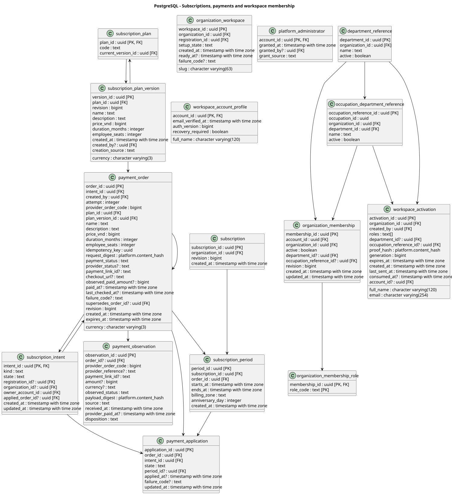

# Current Project Architecture

## Shared workspace adaptive integration

Real workspace identity/CSRF now composes the retained initial-pathway source. The [integration contract](technical/Workspace%20Adaptive%20Integration.md) records actor/tenant boundaries, portable development seed gates, separate migration lineage/volumes and view-only limits. Detailed Function rules are retained in [technical contracts](technical/initial-pathway/Initial%20pathway%20generation/Initial%20Pathway%20Flow%20and%20Data%20Design.md); domain REQ/FR anchors remain reserved. Current Role-first entry resolves the full-Occupation baseline before gap/confirmation; SRS discussion of another ordering does not silently change this accepted flow. Source/build checks are distinct from [new runtime verification still Not run](testing/system/REQ-002-041-042-workspace-integration.md).

## Workspace Baseline Integration (2026-10-28)

The combined main/local development runtime uses `local,workspace-baseline`. It retains real workspace login, single membership roles, entitlement checks and existing onboarding/billing. L&D baseline configuration and Employee role/attempt/result APIs reuse the incoming adaptive engine through trusted workspace adapters; demo personas are not enabled by default.

- PostgreSQL V1-V12 and their applied checksums remain unchanged. Incoming main assessment migrations V8-V26 are integrated as V13-V31; V32 adds `workspace_baseline_resource`. This lineage is for the existing V12 dev database. A database that already applied the original main assessment lineage must not be pointed at this migration directory without a separate migration design.
- A binding explicitly grants an organization an active occupation/department reference and Neo4j occupation identifier. Optional bank/model/mastery-mapping UUIDs represent unconfigured resources. Composite tenant foreign keys and the bank-owner guard reject cross-organization bindings; runtime catalog publication/review and model-promotion checks still apply.
- `WorkspaceBaselineConfiguration` revalidates the actual session, membership and entitlement. Baseline and identity operations share the application transaction manager. Role/attempt writes remain transactional and replay-safe; result reads check real organization membership, not the legacy demo role table.
- Frontend mutations use the existing workspace CSRF helper. Workspace feature queries live in an identity-keyed cache that is cleared on unmount/logout. No actor or organization supplied in browser storage establishes authority.
- Historical UUID role selections remain stored. If no current-schema selection exists, an explicit reselection notice is returned; integration does not fabricate compatible graph IDs or rewrite old evidence.
- Migration startup does not reseed Neo4j. The old insert-only demo seed is tools-only. Development has no automatically approved question bank or scoring model: missing resources are visible readiness states and cannot produce an assessment result.
- The dataset's DRAFT/NEEDS_EXPERT_REVIEW bank is not approved by integration. Publication, question import, actual calibration/promotion, AI guidance, RIASEC and production readiness remain outside this slice.

See the [schema and preservation evidence](testing/integration/REQ-002-workspace-baseline.md) and [browser/manual checks](testing/system/REQ-002-workspace-baseline.md). The live schema diagrams below are regenerated through V32.

## Confirmed Product Target

**Source:** [Capstone Register Version 2](FA26SE267_KNOWLEDGE_GRAPH_BASED_ADAPTIVE_LEARNING__haht43_Version_2.md), especially section 3.2(c). **Aligned:** 2026-10-21. [Product Overview](PRODUCT_OVERVIEW.md) and [feature contracts](features/README.md) describe the confirmed scope.

The target is a subscription-based, multi-organization platform with six human actors: Guest, Platform Administrator, System Administrator, L&D Manager, Expert and Employee. The System is an automated performer. Organization membership, role/assignment permissions and subscription entitlements must be enforced independently. Platform administration does not imply unrestricted access to private employee answers or learning files.

| Boundary | Required responsibility | Design or migration gap |
| --- | --- | --- |
| Registration and workspaces | Guest registers organization/contact/admin details, verifies email, resumes registration and tracks setup; System provisions and assigns initial System Administrator | Registration and the connected subscription/provisioning/session handoff are locally verified. Historical live Gmail AC-09 remains Blocked. Production setup/reference-data availability is separate. |
| Subscriptions and payments | Guest purchases; System Administrator renews and views period/seats/history; Platform Administrator updates existing plans; System verifies payments and maintains access | Local lifecycle completed under revisions 2/3: immutable versions/orders, real payOS adapter, durable jobs/application, renewal periods, serialized seats and request-time access. Live payOS acceptance was explicitly excluded, not claimed Passed. |
| Identity and departments | System Administrator manages accounts, memberships, organization roles, departments, employee assignments and workspace settings | Forward actor-code mapping, department lifecycle/history, session and permission contracts; no account hard-delete requirement |
| Organization oversight | Platform Administrator views/updates organizations and designated administrators, suspends/reactivates workspaces and monitors platform activity | Authorized platform read/write boundary, administrative access transitions and auditable changes |
| Occupation catalog | L&D manages occupations, attaches each to a department and assigns/removes Experts | Organization ownership, department references, Expert assignment history and content authorization are not established by a legacy `JobDomain` label or O*NET seed alone |
| Target roles | L&D creates/assigns; Expert configures competencies/skills/proficiency/importance and submits/revises; L&D publishes/unpublishes or returns revisions | Separate completion, publication and revision contracts from legacy `ACTIVE`; L&D publication must not edit Expert requirements |
| Learning offerings | Expert authors/organizes modules, content, mappings and module assessments, then submits; L&D approves or returns revisions | PostgreSQL content/approval metadata, private MinIO objects and versioned Neo4j learning-coverage projections; many modules per skill and many skills per module |
| Assessment | L&D configures baseline coverage/selection/scoring; Expert configures module questions/skill/difficulty/selection/scoring; System delivers/scores and calculates RIASEC profiles | Attempt/version policies, RIASEC instrument and replay-safe submissions; legacy per-role baseline defaults are not a current approved contract |
| AI role guidance | System uses assessment evidence and RIASEC interests with a local LLM; Employee directly views suggestions/comments and selects/confirms a published organization role | Internal inference API, minimized inputs, result/version contract and failure handling; no Expert guidance-review gate |
| Pathways | System generates from gaps; Expert reviews/includes/excludes/confirms initial pathway; assessment results drive automatic remaining-pathway recalculation | Initial learning gate, override preservation, versioning and recovery; no failure-only trigger restriction |
| Independent learning | Employee selects a skill and accesses its mapped approved modules/content without editing the role pathway | Independent progress context and reusable assessment evidence; not a one-module-per-skill constraint |
| Development and ROI | L&D views profiles/gaps/results/progress/department summaries; filters by department, occupation and period; records costs/monetary benefits with period/currency/supporting basis | Reporting dimensions, source records, aggregation, ROI formula, zero-cost and currency policies; Employee sees own progress |
| Notifications and audit | System sends verification/payment/workflow emails and records administrative/payment/content/role/assessment/pathway events; administrators read permitted activity | SMTP/Gmail integration, durable event delivery, retention, privacy and platform versus workspace read scopes |

### Target Data and Integration Ownership

| Component | Required ownership |
| --- | --- |
| Spring Boot | Business APIs, authorization, payment verification, private content access, workflow orchestration, graph traversal/knowledge tracing and recovery. No separate Python backend is required. |
| PostgreSQL | Organizations, registrations, plans and purchased versions, payment orders/history, workspace status, entitlements, accounts/memberships, departments, employee assignments, occupation-department links, costs/benefits, workflow states, module/content metadata, assessments, evidence, progress, audit and outbox. |
| Neo4j | Organization-scoped occupation/role/competency/skill relationships, prerequisites and many-to-many module learning coverage for traversal. No private learner results or content bodies on catalog nodes. |
| MinIO | Private uploaded files and representative module content; access authorized by the backend for the organization and offering. Object possession or a client-supplied organization ID is not authorization. |
| payOS | Checkout, payment-status queries and signature-verified webhooks; the backend checks order, organization, purchased plan version, amount/currency and duplicate outcomes. A browser redirect is not payment evidence. |
| Local LLM | Internally hosted inference for AI-assisted role suggestions/explanations; RIASEC is an interest signal, never mastery evidence. |
| SMTP via Gmail | Account-verification, payment-status and workflow email delivery. |
| Delivery | On-premises Docker Compose, Nginx web/reverse proxy and GitHub Actions CI/CD. The existing Caddy deployment below is a baseline, not this completed target. |

These are ownership requirements, not new physical columns, enum values or deployed services. Existing migrations, IDs and catalog history must be retained until explicit forward migrations and cross-store projection/recovery contracts are implemented. [neo4j_schema.md](neo4j_schema.md) remains the existing dataset field inventory: its single-catalog and one-to-one `TEACHES` rules need migration, not silent reinterpretation. Historical tests/diagrams demonstrate only their recorded contract versions, not Version 2 completion.

## Technical Baseline Snapshot

**Runtime baseline: 2026-10-02; ontology schema update: 2026-10-14.** This is a runnable database/deployment baseline plus tested local implementation bases for REQ-001-F01 View Target Roles and REQ-001-F02 Choose Target Role; it is not an implementation of all drafted functions. Unit, API/security, PostgreSQL/Neo4j integration, Compose and scoped Playwright evidence for REQ-001 are recorded under `documents/testing`. Production security remains deny-by-default until the real Identity authorization contract is integrated.

## Runtime topology

### Connected Subscription Lifecycle (2026-10-23)

[Approved revisions 2/3 and local delivery](features/Subscription%20lifecycle/README.md#local-delivery-2026-10-23) connect all 12 subscription functions. PostgreSQL owns immutable plan versions/order snapshots, purchase/renewal intents, verified payment observations, unique application, workspace provisioning, subscription periods, memberships/roles and activation state. V9/V10 add these tables; V11 prevents overlapping paid periods. Existing registration IDs/history and legitimate nulls are retained.

The payos-java 2.0.1 adapter (Jackson BOM 2.21.8) calls the official merchant API, verifies signed responses and original webhook JSON fields, and never accepts redirects/browser storage as payment proof. Durable PostgreSQL jobs create/reconcile/apply using the same order identity, fenced leases and retry state. Successful initial application atomically creates the logical organization/workspace, initial administrator membership and paid period; no separate tenant database or fabricated catalog content is created.

Workspace/platform sessions are distinct from registration sessions. Server membership/roles, MFA assurance, current paid periods and administrative status guard existing protected API families. Employee seats are counted transactionally and admissions serialize with renewal changes. Reference lookups require real same-organization department/occupation data; their CRUD/population remains upstream, not part of this lifecycle.

Guest plan/checkout/setup, platform plan configuration, organization subscription/renewal and workspace sign-in now use real APIs. React Query scopes data to trusted account/organization context; mutation clients obtain CSRF, and route guards supplement rather than replace backend authorization. Supporting Employee activation uses a captured/real SMTP adapter and a recipient-chosen password; Employee-only accounts do not require MFA, administrators do.

**Administrator W2 follow-up (2026-10-26):** `/admin/users` and `/admin/subscription` now live in their existing `administration/user-management` and `administration/subscription` owners and reuse WorkspaceLayout rather than the standalone subscription shell. Users owns list/detail/create/profile edit/activate-deactivate and pending invitations; Subscription contains billing/renewal/seat summaries only. The layout's opt-in trusted presentation uses real identity/organization/logout while retaining the requested demo role navigation, which does not grant backend roles. User profile edits use existing tables and preserve registration snapshots; no migration/dependency was added. Workspace profile name takes precedence for current workspace reads, without changing registration/security evidence. Suspended member-directory reads are distinct from allowed billing reads; expired organizations retain bounded user deactivation for seat remediation. [W2 evidence](testing/system/REQ-022-admin-pages.md).

Local verification used a separate Compose test image with test-only provider/fixture endpoints, PostgreSQL/Neo4j and Mailpit at `http://127.0.0.1:8092/`. Those fixtures are not in the production image. No live merchant/email call occurred. The retained development database remains V8 pending separately authorized migration. [Evidence](testing/README.md#subscription-lifecycle-local-delivery) distinguishes local completion from provider acceptance and production readiness.

### Onboarding presentation and transactional mail (2026-10-26)

- Guest organization/account entry, verification/MFA, plan selection, payment and workspace progress reuse one Guest layout. Organization and account entry are separate UI steps but retain the same atomic registration API command; unsaved credentials are not persisted in the browser.
- New payOS callbacks target `/guest/payment-result?order=...` or `/admin/subscription/payment-result?order=...`. Existing checkout callbacks remain usable; old Administrator callbacks redirect to the order-specific result. Administrator receipts use the existing owner-authorized `GET /api/v1/subscription/orders/{orderId}`, not a new organization-order endpoint.
- Receipt views map the existing immutable order terms, `providerOrderCode`, amounts, `createdAt`, `expiresAt` and nullable `confirmedAt`. The last field is system verification time, not bank settlement time. No bank transaction reference, counterparty account or raw provider payload is invented or exposed.
- `PaymentProcessor` passes the purchased plan name to the existing payOS adapter. Checkout includes a single named item with quantity one and the exact snapshot price. Transfer descriptions use a short normalized plan marker and order suffix, within the nine-character limit applicable to non-linked bank accounts. Provider order identity/signatures, not the memo, remain reconciliation authority.
- Shared infrastructure `TransactionalEmail` / `TransactionalMailSender` supplies one responsive HTML frame and plaintext alternative to registration verification, member activation and subscription payment confirmation. Email palette values are centralized and rendered inline for mail-client compatibility; browser components continue to use design tokens.
- The first verified PAID transition atomically inserts `SUBSCRIPTION_PAYMENT_CONFIRMED` with source revision zero and one `PAYMENT_CONFIRMATION_EMAIL` job into the existing outbox/job tables. `PaymentConfirmationMailWorker` sends to the stored purchaser account identifier, with a fenced 120-second lease, at most five attempts and recorded retry/failure state. It uses the existing SMTP settings and `subscription.worker.enabled` switch.
- Payment scheduling only considers payment-processing handlers; a failed email job cannot suppress reconciliation or activation. SMTP acceptance does not prove inbox delivery, and at-least-once SMTP delivery can repeat after an acceptance/crash ambiguity despite one logical event and stable message identity. Historical payments are not automatically backfilled.

No schema, plan pricing, entitlement policy, identity boundary or dependency changes are introduced by this refinement.

### Single-role identity and platform seed (2026-10-28)

The approved account policy supersedes earlier platform-MFA and multiple-role behavior described in historical slices above. Platform accounts use password-only sessions without fabricated email-verification or MFA evidence; Organization Administrators still require both email verification and MFA. Activated Expert/L&D/Employee accounts use passwords without MFA. Session `mfaVerified` remains an actual assurance fact, not an exemption flag.

Flyway V12 adds a unique membership-role key, a deferred exactly-one-role guard, a one-role constraint for pending invitations and account-locked platform/organization mutual exclusion. It refuses ambiguous existing active data instead of choosing a role or deleting records; consumed historical invitation snapshots are retained. The API keeps its `roles[]` wire shape but requires exactly one allowed role on creation/edit/activation. Employee role replacement initializes missing learner state and retains learning history when moving away.

`PlatformAdministratorBootstrap` now performs an opt-in idempotent seed from `PLATFORM_ADMIN_SEED_EMAIL` and `PLATFORM_ADMIN_SEED_PASSWORD`. It reuses existing account/password-hash/grant tables, creates no registration/TOTP or fake verification timestamp, rejects conflicting organization identities and never silently overwrites credentials. A seed-only account's optional display name remains absent, so the UI displays its actual email.

After normal migration, run `docker compose -f compose.dev.yml run --rm --no-deps platform-seed`. The tools-profile service runs non-web with `platform-bootstrap`, not a public HTTP bootstrap endpoint. Configure secrets privately in the existing ignored `.env`; do not put passwords in command arguments/source/chat. Repeating the same configuration is idempotent; changing it is not a password-reset operation. Use `--profile tools` if resolving this service through `docker compose config`, and do not print the resulting secret-bearing configuration.

Login entry maps the single trusted role to the existing platform, organization-admin, Expert, L&D or Employee route. A shared session context supplies real header identity and server logout to the role layouts; demo navigation remains non-authoritative. The later A1 presentation refinement makes `/activate` and `/login` share `WorkspaceAuthLayout` and the existing illustrated login styles. `/active` is a non-redirect alias preserving the proof fragment. No activation API/session behavior or database contract changes in A1. [Layout evidence](testing/system/REQ-037-activation-layout.md).

All current transactional messages embed the supplied brand PNG as MIME `cid:alg-brand-logo`; the shared renderer keeps HTML/plain alternatives and escaping. The PNG is a mail-client-compatible copy of the user-supplied logo, not the unrelated frontend favicon.

The guarded dev update backed up PostgreSQL, preserved environment/data, applied V12, seeded one configured Platform Administrator and verified actual login/platform API/logout at `:8088`. [Evidence and manual checks](testing/system/REQ-037-single-role-activation.md). No Neo4j schema or dependency changes; unrelated prototype page content is not re-certified.

### Registration-first slice (2026-10-21)

[Approved REQ-060-F01-F03](features/Organization%20onboarding/README.md#implementation-results-2026-10-21) adds real identity-domain/application ports with JDBC, SMTP and cryptography adapters. The registration-only filter chain and controller enforce staged server-owned sessions; other production APIs remain deny-by-default. The database-free `starter` and non-web worker profiles do not instantiate registration endpoints.

Flyway V8 adds registration, email proof, TOTP, recovery-code, throttle and Spring Session JDBC tables. Existing account, outbox/job and audit stores are reused. Registration creates no organization, department/unit, membership, role, subscription or workspace. Optional industry/headcount and not-yet-completed timestamps remain nullable.

The API process schedules leased registration email jobs with bounded retries and encrypted proof payloads. Passwords are PBKDF2-hashed; TOTP secrets are AES-GCM encrypted; verification/recovery digests and throttle keys use HMAC. Recovery revokes actor versions and requires factor replacement. Registration/slug retention has no automatic expiry in this local slice; production retention/key rotation remain separate work.

The React flow calls `/api/v1/registration` through the existing proxy and uses `/guest/resume`, not demo login/localStorage proof. No Neo4j changes are needed. [Unit](testing/unit/REQ-060-registration.md), [integration](testing/integration/REQ-060-registration.md) and [system](testing/system/REQ-060-registration.md) evidence records local checks; live Gmail remains blocked, so this is not production completion.

The [revision 13 public landing](features/Organization%20onboarding/README.md#public-landing-and-guest-entry-revision-13) is the frontend entry at `/`; `/home` and `/guest` redirect there. It links to the existing `/guest/register` (also `/register`), secure `/guest/resume` and separate `/login`. Enterprise sign-in no longer contains guest signup/resume links; its demo behavior is otherwise unchanged. The landing is route-lazy-loaded with Motion 14.5.0, EN/VI copy, shared design tokens and reduced-motion handling. Its graph is explicitly illustrative; no new persistence, identity authority or API contract is introduced.


[PlantUML source](diagrams/runtime-topology.puml)

- One Spring Boot backend owns HTTP, security, migrations, and the future feature modules. There is no separate Python recommendation service or additional backend framework. PostgreSQL and Neo4j are data stores, not application servers.
- The `migrate` profile runs Flyway first, then the Neo4j migrator under a PostgreSQL advisory lock, and exits. Compose starts the API only after that process succeeds. The `local` and `prod` API profiles do not run Flyway. A failed graph migration can leave PostgreSQL migrated; rerunning `migrate` is safe and checks Neo4j migration checksums.
- Development Compose enables a repeatable, **sample-only** cross-store seed: stable Neo4j catalog IDs for two organization-scoped target roles match immutable PostgreSQL catalog references plus the organization/account/learner fixture. The second role supports local change/concurrency/system checks. The seed does not create a target selection or reset learner revisions on an existing volume. Production initializes an empty catalog and never creates sample accounts or billing records. Docker named volumes persist both databases across restarts.
- [compose.dev.yml](../compose.dev.yml) runs Vite with live source mounts and publishes services on loopback. [compose.prod.yml](../compose.prod.yml) builds static assets into Caddy and publishes only the HTTP web entry point on loopback. Database and API containers have no published production ports.

## Ownership and data

| Store | Current responsibility | Current baseline |
| --- | --- | --- |
| PostgreSQL 17.6 | Organizations, registration/workspace sessions, memberships/roles, subscription/payment history and periods, activation, target selections, assessments/evidence, pathways, audit/outbox and analytics | Forward-only Flyway V1-V11 in [db/migration](../backend/src/main/resources/db/migration); V8 registration, V9/V10 lifecycle/identity and V11 period guard. Verified in isolated databases; retained development still V8. |
| Neo4j 5.26 Community | Ontology 0.8.0: Occupation, TargetRole, Level, Competency, MicroSkill and LearningModule; legacy runtime adapters are still pending conversion | V1 remains the legacy baseline; V2 adds Level/Competency/Course constraints and V3 adds Occupation ID/code constraints. V4 retires the Course constraint, leaving 14 domain constraints plus SchemaMigration.version. No catalog data or learner results are rewritten. |

## Database diagrams

### PostgreSQL

The four source views include every column of the 76 migrated tables through V11. `?` marks a nullable column; `[PK]` and `[FK]` mark key participation. Arrows point from a referenced table to a referencing table when both are in the same view; cross-view foreign keys remain marked on their columns.


[Identity and catalog PlantUML source](diagrams/postgresql.puml)

The PostgreSQL sources were regenerated from the isolated V8 catalog on 2026-10-21. Identity/registration and runtime SVGs were rendered locally with PlantUML 1.2025.10.

On 2026-10-23 the sources were regenerated from the isolated V11 lifecycle catalog. The identity, subscription and runtime SVGs were rendered locally and XML-validated:



[Subscription schema PlantUML source](diagrams/postgresql-subscription.puml)


[Assessment and learning PlantUML source](diagrams/postgresql-assessment.puml)


[Pathway and analytics PlantUML source](diagrams/postgresql-pathway.puml)

`organization_id` is currently nullable on `organizational_unit` and `account` to preserve older records. The catalog references shown here are PostgreSQL snapshots, not extra Neo4j nodes.

### Neo4j

The current ontology contract has six entity labels and seven relationship types, defined in [neo4j_schema.md](neo4j_schema.md) and [dataset 0.8.0](dataset/ONTOLOGY.md).


[PlantUML source](diagrams/neo4j.puml)

In the existing dataset, each TargetRole belongs to one Occupation and owns three local Levels. Each Level owns competency groups and skill requirements, with no direct link to learning content. Competency achievement is derived from member skills; there is no independent score. Competency nodes strictly store auto-generated `id` (UUID), unique semantic level-scoped `code` (`ontology_v011_competency_code` constraint, e.g. `COMP-DEV-J01`, `COMP-QA-M01`), `name`, `description`, `attainmentRule`, `status`, and `version`. Only MicroSkills use HAS_SKILL_PREREQUISITE; Course and its edges are removed. There are 48 reported-title TargetRoles and 79 Modules, one per skill. Occupation stores six normalized RIASEC values sourced from O*NET 31.0. These are dataset 0.8.0 facts, not Version 2 cardinality or scoring requirements: the product requires organization-scoped, many-to-many module/skill coverage. Module suitability remains pending Expert review. Rubric configuration, content bodies and learner results remain outside the ontology graph.

**Legacy runtime adapter contract (pending migration):** All catalog nodes use stable `id` and `code` keys. `TargetRole.organizationId` provides the initial tenant-scoping contract; `seniority` is the domain-neutral grade code (`P1`–`P5` for `PROFESSIONAL`, `M3`–`M4` for `MANAGEMENT`) used for role discovery, while each domain/role family owns the grade's detailed meaning. `responsibilities` supports employee-facing detail. `version` (e.g. `1.0`, `1.1`) and `assignedExpertId` support the expert authoring lifecycle and successor drafts. Relationships also carry lifecycle `status`, `createdAt`, and `updatedAt`; their additional fields are shown on the relevant arrows. Learner mastery, assessment results, and pathway state belong in PostgreSQL, not on Neo4j nodes.

V2 adds ontology entity constraints and V3 adds Occupation constraints after the preserved V1 baseline; V4 drops only the retired Course ID constraint; no catalog or learner data is deleted. The technical SchemaMigration label is not an ontology entity. Community uniqueness constraints do not enforce publication, score ranges, ownership, one-to-one TEACHES, membership completeness or acyclicity; the v0.8 importer validates these invariants.

**Runtime compatibility:** DevelopmentCatalogSeeder, Neo4jTargetRoleCatalogAdapter, Neo4jTargetRoleMapper and role-selection domain/API contracts still use the legacy model. They have not been converted by this schema change. Import the new seed in an isolated database until the runtime and cross-store references are migrated. The legacy development seeder now refuses an Occupation catalog instead of mixing legacy fixtures into it. The current dataset is under dataset/; existing learner decisions must retain their original catalog context.

PostgreSQL V2-V5 contain a versioned `catalog_reference`/`catalog_release` contract, whereas the legacy runtime uses stable `id`/`code`; ontology 0.8.0 adds version metadata but no separate graph version nodes. No cross-store synchronizer or catalog CRUD API is implemented yet. V7 keeps the selection FK to `catalog_reference`, adds `target_selection.role_snapshot`, and adds `target_selection_request` for command idempotency. Successful request outcomes persist the selection, target revision, and original `changed` value so an idempotent replay returns the same observable result. F02 uses the trusted learner as the outbox aggregate, the target revision as source revision, and the request ID as correlation ID; selection, request outcome, audit, and outbox writes share the caller's PostgreSQL transaction. The snapshot is nullable only for pre-V7 compatibility; new F02 writes must populate it. The provisional runtime adapter rechecks F01 availability under the trusted organization and then resolves exactly one `TARGET_ROLE` reference from the PostgreSQL release whose catalog guard is `OPEN`; mismatch is a dependency failure and the command never creates a reference. The local migrate flow may seed matching cross-store references, but that seed is not a published production release.

F02's temporary assessment guard and `SUPERSEDED` pathway archive mapping are local/demo adapters behind application ports. They load only with the explicit local-dependency property and are absent from the production profile. The real assessment/pathway adapters must share the learner lock/revision transaction contract or provide an owner-approved equivalent before F02 is production-complete.

F02's HTTP adapter is currently a local-only vertical slice. Its configured-actor security chain permits only GET/PUT on `/api/v1/employee/target-role-selection` when the local actor flag is enabled and excludes that endpoint from CSRF because no browser-authenticated principal exists yet. The production security chain is unchanged and denies the endpoint until the real Identity/Security adapter is delivered.

The local assessment guard is controlled server-side through `TARGET_SELECTION_LOCAL_ASSESSMENT_IN_PROGRESS`, which Compose passes to the API container with a default of `false`. It exists only to exercise the provisional `AssessmentActivityGuardPort`; production must replace it with the assessment owner's lifecycle query. The frontend repository has a scoped Playwright system runner that targets the Compose web proxy with an installed Chrome executable; Vitest remains limited to `src/**/*.test.{ts,tsx}` so unit/component and browser suites do not cross-discover each other.

## Backend structure

```text
backend/
  pom.xml, Dockerfile
  src/main/java/com/adaptlearngraph/
    AdaptLearnGraphApplication.java
    platform/            startup, status API, migration orchestration
    catalog/             Target-role domain/use case/API, Neo4j adapter, constraints and development-only seed
    identity/            registration/email/TOTP/recovery/session domain, ports, HTTP/JDBC/SMTP adapters and security boundary
    assessment/          reserved feature package
    competency/          reserved feature package
    learning/            F02 target-role selection domain, application ports/service, HTTP and PostgreSQL/local adapters
    recommendation/      reserved feature package
    pathway/             reserved feature package
    synchronization/     reserved feature package
    analytics/           reserved feature package
    evaluation/          reserved feature package
  src/main/resources/
    application*.yml     local, prod, migrate, starter, worker profiles
    db/migration/        PostgreSQL Flyway V1-V8
    db/neo4j/            graph constraints packaged in the backend JAR
  src/test/java/com/adaptlearngraph/
    platform/            unit, security, database and graph tests
    architecture/        module dependency rules
frontend/               existing src/app, src/features, src/shared layout
documents/features/     drafted functions and their current decisions
documents/diagrams/     PlantUML sources, PostgreSQL generator, rendered SVGs
documents/testing/      unit, integration, and system test plans
compose.dev.yml, compose.prod.yml, .env.example
```

Each backend feature package uses `api` (HTTP), `application` (use cases/ports), `domain` (Spring-independent policy) and `infrastructure` (PostgreSQL/Neo4j/integrations). `catalog` applies this structure for the recorded REQ-001-F01 baseline: controllers call `TargetRoleQueryUseCase`, the application service reads trusted actor context and `TargetRoleCatalogPort`, and the Neo4j adapter maps driver records into domain outputs. Existing placeholders remain placeholders; add implementations only after detailed contracts are clarified. Subscription/payment capabilities are required by Version 2 but not established by this baseline. The frontend F02 slice uses a shared server selection query and prepared idempotency key; it does not synchronize selection into localStorage. `TargetRoleSelector`, `useEmployeeLearningState`, `NotificationDropdown` and their overview/assessment/gap/pathway consumers still require integration review. Prototype screens/stores do not prove persisted onboarding, payment, authorization or learning workflows.

## Technologies

| Layer | Technology in use |
| --- | --- |
| Backend | Java 21, Maven, Spring Boot 3.5.16 (Web MVC, Security, Validation, Actuator, Data JPA/JDBC), Flyway, Neo4j Java driver |
| Persistence | PostgreSQL 17.6, Neo4j 5.26 Community; JPA is available, but there are no domain entities/repositories yet |
| Frontend | React 19, TypeScript 6, Vite 8, React Router 7, TanStack Query, vis-network; Caddy 2 serves production assets and proxies `/api` |
| Delivery | Docker multi-stage builds and Docker Compose; Node 22 for frontend builds |
| Testing | JUnit 5, Spring Boot Test/Security Test, Testcontainers (PostgreSQL and Neo4j), ArchUnit; see [testing/README.md](testing/README.md) |

## Run and verify

From the repository root with Docker Desktop running:

```powershell
docker compose -f compose.dev.yml up --build -d
Invoke-RestMethod http://127.0.0.1:8088/api/v1/system/status
docker compose -f compose.dev.yml ps
```

Dev frontend: `http://127.0.0.1:8088`; API: `http://127.0.0.1:18080`; PostgreSQL host port `15432`; Neo4j Browser: `http://127.0.0.1:7474` (Bolt `7687`). The dev Compose file uses explicit local-only fallback passwords; override them with `.env` for a shared development machine. The raw backend default is `local` and needs reachable databases plus `DB_PASSWORD` and `NEO4J_PASSWORD`. The `starter` profile is an intentional no-database test mode, not the deployed API.

For production-mode Compose, supply nonempty `DB_PASSWORD` and `NEO4J_PASSWORD` in a private `.env` or secret-injection environment, then run:

```powershell
docker compose -f compose.prod.yml up --build -d
Invoke-RestMethod http://127.0.0.1:8088/api/v1/system/status
```

Production publishes HTTP on `127.0.0.1:${WEB_PORT:-8088}`. Place a separately managed HTTPS ingress/reverse proxy in front before external access; TLS domain, certificates, secret storage, backups and observability still need an operator decision. The Compose profiles start correctly but **do not make the unfinished product or authorization system production-ready**. Do not use `down -v` on databases whose data must be kept.

## Implementation Decisions

1. **Catalog history and isolation:** Map stable graph IDs to PostgreSQL `catalog_reference` (`entity_id`, `version_id`, `release_id`), pin attempts/pathways to valid versions, and design organization ownership for every traversal and projection. Dataset uniqueness constraints alone do not provide tenant isolation.
2. **Commercial lifecycle:** Specify registration, email verification, versioned purchase/renewal, seat allocation/counting, workspace suspension/expiry and idempotent provisioning. Plan updates must not silently rewrite previous purchases. Cancellation is not a confirmed product function.
3. **Identity and organization structure:** Migrate legacy actor codes explicitly to the six-actor model without privilege expansion; design memberships, department deletion/reassignment history, occupation-department references and Expert assignment enforcement.
4. **Catalog and content governance:** Specify completion/publication/return states, many-to-many module/skill coverage, versioned approval, private MinIO delivery and withdrawal effects. Retain legacy `sourceUrl` and dataset `contentUri` meanings until a forward mapping is approved.
5. **Assessment and adaptation:** Define baseline/module/RIASEC rules, mastery and gap calculations, local-LLM inputs/failures, initial Expert confirmation, recalculation and override preservation. No mandatory Expert AI-guidance review or failure-only adaptation.
6. **Reporting and audit:** Define employee/department aggregation, costs/benefits attribution, ROI calculation, zero-cost/mixed-currency behavior, event retention and notification delivery policies.
7. **Deployment and verification:** Implement the Nginx/GitHub Actions target and external integrations; choose HTTPS/domain, secret handling, backups and monitoring. Test complete workflows and isolation with at least two demo organizations. Preserve historical evidence; new requirements need new unit/integration/system evidence rather than relabeled passing runs.

## Question Bank authoring — R2 (2026-10-30)

Implementation targets the approved Question Bank subset of FR-05.06. Runtime acceptance is recorded separately in `testing/system/REQ-014-question-bank.md`; source implementation is not a production-readiness receipt. Expert `/expert/assessment-bank` and L&D `/ld-manager/question-bank` share the question directory, four statistics cards, MicroSkill grouping, filters and authoring/details/import dialogs. Browser company storage and mock presets are not part of these routed flows; module Blueprint authoring/Employee exams remain separate.

The bank owns working content in PostgreSQL; Neo4j supplies currently ACTIVE/APPROVED MicroSkill identity and name. New MCQs contain four distinct plain-text choices, one correct choice, one skill and EASY/MEDIUM/HARD editorial difficulty. Editorial difficulty does not create/calibrate IRT parameters. Draft save requires only stable code/prompt/skill. Draft options, key, difficulty and explanation may legitimately be incomplete; submission validates all fields including explanation.

### Persisted ownership and fields

| Store | Fields and responsibility |
|---|---|
| `question_bank_workspace` | Organization PK, unique existing `question_bank_id`, staff-only JSON aggregate. Reuse sole existing bank or create one; ambiguous legacy multiple banks return409 without merging/rebinding. |
| Aggregate bank | `id`, `organization`, `name`, `questions`, `history`, private per-actor `imports`, recipient-scoped `notices`. |
| Question | Stable `id`, normalized immutable `code`, nullable historical `createdBy/createdAt`, `owner`, optimistic `revision`, `retired`, pending RETIRE/REACTIVATE `request`, ordered `versions`. Missing legacy owner is not fabricated. |
| Working version | `id`, integer `number`, DRAFT/SUBMITTED/PUBLISHED state; `content`; editor/time, submitter/time, reviewer/time, return reason, exact-version `viewed` acknowledgements. Nullable facts remain absent until the actual event occurs. |
| Content | Plain `prompt`, `options`, nullable draft `correctAnswer`, required `skillId`, server-resolved `skillName`, nullable draft `difficulty/explanation`. No caller-selected reviewer or author. |
| Audit | Event UUID, stable question/version, action, trusted actor, timestamp, reason and content snapshot. Transfers retain original creators/submitters/reviewers. |
| Import receipt | UUID/actor/expiry/committed flag, normalized rows, per-row errors/warnings, expected question revisions and matching-content identities. Preview is not publication. |
| `question_bank_identity` | Stable question PK, bank FK, unique code within bank, retired flag used by future candidate selection. No deletion or published-history rewrite. |
| Notice | UUID, recipient, title/body without automatic answer content, created/read timestamps. Staff read only their own notices. |
| `question_bank_mail` | Notice PK, organization/recipient, title/body/time, status/attempts/next attempt, lease owner/expiry, safe error code. Independent fenced at-least-once SMTP retry. |

Canonical lineage adds V29; `workspace-baseline` adds V36. Historical migrations are untouched. Do not deploy this main-based lineage into learning-module-manage's populated V41 workspace database: V36 there has a different applied meaning. Use the isolated Question Bank test stack or explicitly reconcile future deployment lineage.

### Commands and consistency

Trusted session/membership/workspace entitlement resolves actors; only same-organization DOMAIN_EXPERT/LD_MANAGER may use the bank API. Commands recheck active membership/role under transaction locks. Per-organization advisory serialization plus expected question revision prevents competing writes. Only responsible Expert edits/submits/withdraws; peers read. L&D assigns/transfers with reason, reviews/returns, confirms retirement/reactivation. Submitted content is immutable; returning/withdrawing invalidates review acknowledgement. Transfer retains exact submitted content and original submitter.

L&D acknowledgement is tied to the submitted version. Approval atomically publishes that complete version; bulk approval validates all selected versions first and rolls back every decision on any failure. New complete versions project into existing `item_version` using protected A–D key/response schema and content hash; existing legacy DRAFT rows can publish only after authorized repair/review. Existing PUBLISHED rows remain immutable. Explanations/audits remain staff-only authoring data; no change to Employee answer-release policy.

A successor is a new candidate version; old published content remains eligible while it is draft/submitted. Approval does not replace pins or promote model parameters. Confirmed retirement disables the stable question across versions for future selection; pinned historical assessment/attempt definitions remain intact. Reactivation is explicit, validates current eligible published content and never publishes a draft.

Import uses .xlsx/JSON template columns. The existing frontend XLSX parser produces rows; the server treats every row as untrusted, enforces configured request/row limits, applies the same code/prompt/skill minimum for incomplete drafts, validates and persists preview before confirm. Default limits10MiB/500 rows are exposed in session and configurable by `question-bank.import.max-bytes/max-rows`. Any invalid row blocks the batch. Own published code requires explicit successor confirmation; foreign/unassigned codes or active candidate block all writes. Normalized prompt plus four choices yields an acknowledgement warning for different codes. Confirm rechecks ownership, expected revisions, current MicroSkill eligibility and changed duplicate-content conditions; one transaction commits the entire batch.

Notifications are persisted with question mutation; email jobs are independent. SMTP failure does not roll back question decisions. Worker locks/leases jobs, checks current same-organization active staff recipient, retries then records failure, uses stable Message-ID; exactly-once email delivery is not claimed. Acceptance sends only to the isolated local Mailpit.

Catalog reads use `Neo4jQuestionBankSkillReader` with asynchronous Bolt I/O, a server transaction timeout and a bounded caller deadline (`question-bank.catalog.timeout-ms`, default10000, positive and at most30000). Timeout returns503 and starts nonblocking session cleanup. A disconnected graph response cannot indefinitely retain the caller's PostgreSQL transaction/advisory lock; a real PostgreSQL regression verifies rollback and a subsequent bank read. Query filters remain ACTIVE/APPROVED; unavailability never creates substitute skills.

The repeatable local acceptance harness may run the same packaged API artifact on host JDK21 with PostgreSQL/Neo4j/Mailpit in the dedicated Compose project. `backend/src/test/run-question-bank-api.sh` fixes fixture-only database/ports and bounds/refreshes local database connections. This host-API topology is recorded explicitly in the system evidence and is not a container performance or production deployment claim. The existing development stack/database remains separate.


Local8088 deployment note (2026-10-30): the preserved accounts/module/content database uses a different historical migration lineage from this branch. Its compatibility runtime retains existing module/content code and dependencies, aligns existing V33–V41 SQL resources with unchanged database history, and appends Question Bank tables as V42. Branch canonical V29/workspace V36 remain unchanged. A plain branch artifact is not interchangeable with this local database; reconcile lineage before a future full deployment. Backup and actual smoke results are recorded in [Question Bank system evidence](testing/system/REQ-014-question-bank.md#existing-8088-deployment--2026-10-30).


Question Bank bulk-approval feedback follow-up (2026-10-30): frontend preflight uses existing state/owner and exact-version acknowledgement from BankView, shows code-specific remediation in shared Dialog, and keeps the backend authoritative for concurrency/eligibility. No API/entity/persistence contract or migration changed. See dedicated REQ-014 system evidence.
