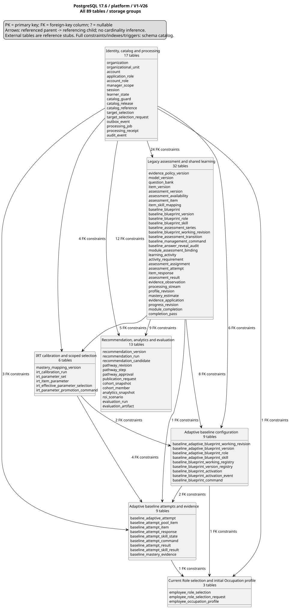

# Current project architecture

## Product contract and ownership

[System overview](adapt_learn_graph_system_overview.md) and approved feature contracts define required behavior. [Role-to-baseline contract](features/Target%20role%20selection/Role%20Selection%20and%20Occupation%20Baseline.md) defines current REQ-001/002 behavior; implementation status and external integration limitations are recorded separately in the [synchronization review](testing/system/REQ-001-002-final-synchronization-review.md). An architecture inventory is not production acceptance.

The product serves one organization; organization IDs and tenant isolation remain required query/command boundaries. Actors are System Administrator, L&D Manager, Expert and Employee. Temporary SRSv2 actor/SaaS/S2–S4 differences remain unresolved; this review does not adopt them or alter other owners' scope.

| Boundary | Current product owner/responsibility | Design or migration gap |
| --- | --- | --- |
| Identity and administration | System Administrator owns accounts, access roles, technical settings and activity monitoring | Agree current actor-code mapping, account lifecycle, settings inventory and audit-read permissions; no automatic mapping from old administrator codes |
| Discipline catalog | L&D manages disciplines and assigns/removes Experts; Experts author assigned-discipline content | Discipline identity, content membership and assignment history are not established by the V5 `JobDomain` label |
| Target roles | L&D creates/assigns; Expert configures competencies/skills/proficiency/importance and submits completion; L&D publishes/unpublishes | Separate configuration-completion and publication contract from legacy `ACTIVE` status; L&D must not edit Expert requirements |
| Learning offerings | Expert authors modules, lesson/practice content and module assessments; L&D approves or returns revisions | Module/content storage, versioned content membership, submission/approval state and learning availability require design |
| Baseline assessment | One Blueprint/org+Occupation, full deduplicated union/common bounds, profile-authoritative Role-first entry, pinned attempt/result/history | Required behavior is confirmed; current owner integration and validation limits are recorded in the synchronization review. |
| RIASEC and role guidance | Employee completes RIASEC; system uses baseline/RIASEC to suggest roles/comments; Expert confirms/revises/rejects; Employee selects/confirms | Interest result, AI data contract and review workflow/versioning require design; legacy soft-skill evidence is not RIASEC |
| Pathways | System generates from gaps; Expert reviews/adjusts/confirms before Employee starts | Initial access gate, review state, module overrides and later evidence-driven revision policy require design |
| Individual skill learning | Employee selects skill and accesses suitable mapped approved Modules without changing role pathway | Separate independent progress/context from pathway selection; reuse valid assessment evidence through tracing boundary |
| Competency and adaptation | System traces estimates, calculates gaps, updates progress and revises remaining learning when needs change | Model/thresholds, evidence replay/versioning and override preservation remain open; failure-only triggers are superseded |
| Monitoring | L&D views profiles/gaps/results/progress; System Administrator views permitted audit/operational activity | Privacy/read contracts and metrics; no platform subscription/organization-count workspace |

## Sources, processing, stores and output

- Java 21/Spring Boot 3.5 is the only production backend. Domain/application rules depend on ports. JDBC/Neo4j adapters map persistence at infrastructure boundaries; no separate Python runtime service or Redis state authority is introduced.
- Neo4j owns Occupation/TargetRole/Level/Competency/MicroSkill/LearningModule catalog relationships and shared version/review metadata. Publication and tenant visibility require owner validation beyond uniqueness constraints. Learner mastery/pathways never live in Neo4j.
- PostgreSQL owns identity/permissions, selection/history, configuration/activation, individual attempts/pools/responses/deadlines/result/evidence, profiles, technical calibration provenance, receipts/audit/outbox and downstream learner state.
- Employee selects current Role → server resolves Occupation → reads authoritative profile coverage → resumes pinned attempt or requires full-Occupation baseline if incomplete. Profile completeness is skill-record coverage, not proficiency. Existing profile/replacement-chain versions and skill sets remain bound.
- Sufficient genuine finalization initializes mastery with no score threshold; early insufficient manual submission is terminal with no mastery/profile. Result/history/My Mastery use safe own-record projections. Later-learning profile processing and downstream delivery remain explicit integration responsibilities.

## Runtime topology

[Source](diagrams/runtime-topology.puml). PostgreSQL and Neo4j start before schema migration, catalog/content initialization and API startup. Flyway changes PostgreSQL only. Initialization never generates Blueprint versions or learner completion/history. Deployment-specific activation and replacement instructions are operational records, separate from business contracts.

## Verified PostgreSQL storage

Read-only capture on 2026-10-23: PostgreSQL17.6, V1–V26 successful with all26 source checksums matching. [Catalog](diagrams/postgresql-schema-catalog.json): **89 platform tables,729 columns,628 constraints,189 FKs,213 indexes,99 user triggers,39 functions**. Flyway metadata is outside platform. [FK inventory](diagrams/postgresql-foreign-keys.md) includes composite relationships; counts do not prove actor authorization.

| View | Owned tables | Diagram |
| --- | ---: | --- |
| Identity, catalog and processing | 17 | [SVG](diagrams/postgresql.svg) |
| Legacy assessment and shared learning | 32 | [SVG](diagrams/postgresql-assessment.svg) |
| Recommendation, analytics and evaluation | 13 | [SVG](diagrams/postgresql-pathway.svg) |
| Adaptive baseline configuration | 9 | [SVG](diagrams/postgresql-adaptive-blueprint.svg) |
| Adaptive baseline attempts and evidence | 9 | [SVG](diagrams/postgresql-adaptive-attempt.svg) |
| IRT calibration and scoped selection | 6 | [SVG](diagrams/postgresql-irt.svg) |
| Current Role selection and initial Occupation profile | 3 | [SVG](diagrams/postgresql-role-profile.svg) |

Every table/column belongs to one detail group; external parents are reference stubs. [Generation, visual review and limitations](diagrams/README.md). The 20 October adaptive target is intentionally historical, not a current schema reference.

| Migration range | Structural responsibility |
| --- | --- |
| V1–V7 | Identity/catalog/evidence/learning/pathway/analytics and legacy selection/replay |
| V8–V17 | Item metadata, fixed Blueprint/series/history, manifests, working transitions, reveal audit |
| V18–V19 | Adaptive configuration/activation/technical versions and pinned attempts/result/evidence |
| V20–V22 | Conditional full/legacy scope, name/duration bounds and explicit Draft conversion receipts |
| V23 | Scoped future parameter selection and immutable promotion receipts |
| V24 | DISCARD command operation |
| V25 | Current string-ID selection/receipt namespace and immutable initialized Occupation profile |
| V26 | Terminal insufficient-evidence manual invalidation |

No applied migration is edited. Old UUID selection/reference and fixed/module structures remain historical/compatible storage; current catalog IDs are not silently cast/remapped. Current initialization records do not establish later-learning profile processing. [Field/transaction design](features/Baseline%20knowledge%20assessment/Adaptive%20Baseline%20Data%20Architecture.md).

## Catalog and version boundaries

[Neo4j schema](neo4j_schema.md) and [ontology source](dataset/ONTOLOGY.md) define ontology 0.9.0: six labels/seven relationship types, separate Levels and many-to-many LearningModule–MicroSkill teaching. The source-backed release has 833 nodes/4638 relationships, 85 Modules, 79 skills and 181 TEACHES mappings. Every Module teaches at least one skill and every skill has at least one provider; each Module–Skill pair is unique. Multiple providers are alternatives selected for actual skill gaps and role/Level suitability, not a requirement to study all providers. A Module used for several gaps appears once in the pathway, while mastery remains skill-specific. The earlier 2026-10-23 runtime capture observed Neo4j5.26.31, ontology0.8.0,827 nodes/4536 relationships and six ID uniqueness constraints; this is dated history, not proof of 0.9 deployment. Cardinality/ranges/prerequisite acyclicity/review/tenant visibility require application/import validation. These observations do not certify production publication.

Ontology/catalog version, Flyway migration, Blueprint release/Draft revision and model/mapping/parameter-set pins are separate identities. New scoped effective selection affects future Blueprint versions only; resume/result/history always use original exact pins. Numerical validity cannot be inferred from a storage label or successful API response.

## Consistency, authorization and compatibility

All applicable API/query boundaries resolve trusted actor/org and authorize before reading receipts or resource existence. Scope predicates precede counts/paging and protected reads. Current routing has one intended handler per profile; retained legacy readers never become a second active route implicitly.

Selection/start serialize learner coordination. Management uses exclusive scope/activation locks; genuinely new starts hold shared locks until attempt/pool/first-item/receipt commit. Save uses Draft-ID+revision CAS; lifecycle commands confirm current pair. Finalization/profile/evidence/outbox commit atomically; read projections never mark delivery. Cross-store fingerprints detect drift without claiming distributed transactions.

Forward-only compatibility preserves historical JSON/snapshots/pins/receipts/allowance. Rollback stops admission and uses a compatible reader; no down migration, reset, re-score, repin or old-only binary after new-format records. [Lifecycle and recovery contract](features/Baseline%20knowledge%20assessment/Occupation%20Baseline%20Lifecycle%20and%20Transition.md).

## Verification and remaining design work

See [synchronization review](testing/system/REQ-001-002-final-synchronization-review.md) for actual commands/results, temporary integration references, mismatches, security/dependency/rollback review and acceptance gaps. Builds, metadata and manual smoke are distinct from executable acceptance. Real Identity/grants/revocation, catalog publication/release, approved model/content/pilot validation, profile updates, activity/pathway integration and downstream delivery remain required. No current deployment/production readiness is asserted.
## Module–Skill cardinality alignment — 2026-10-26

User-approved REQ-016-F01/F02 correction replaces the one-to-one TEACHES rule with many-to-many. Node/property inventories and store ownership are unchanged. All metadata, content pointers and relationship properties are preserved; null review fields retain their unreviewed meaning. The v0.8 question-bank envelope remains immutable historical provenance; the new local demo envelope pins v0.9 without changing any item content or identity. Existing graph/catalog versions, attempts, mastery and pathway history must not be silently overwritten, rescored or repinned. See [verification and upgrade limits](testing/system/REQ-016-many-to-many-teaching.md).
