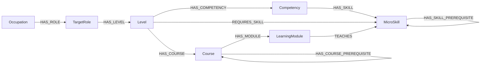

# Ontology — framework, fields and data provenance (0.7.0)

Updated 14 October 2026. English catalog. Skill rubric 1.2. All graph definitions and learning collections await expert review. No live database has been changed.

## Files and interpretation

The current catalog has 875 nodes and 5,431 relationships. [ontology_dataset.xlsx](ontology_dataset.xlsx) contains the seven entity tables, ten relationship tables, assessment configuration and expert review inputs. It is the editable data review artifact. The runnable seed is [import/ontology_seed.json](import/ontology_seed.json). Import preparation must synchronize any approved workbook edits with the seed before Neo4j import. See [Neo4j import instructions](NEO4J_IMPORT_GUIDE.md).

Source-backed names and definitions must be distinguished from local design decisions: O*NET supplies occupation/title/interest data, ESCO and SFIA/UK support skill alignment; competency grouping, local tiers, mandatory flags, numeric thresholds and curriculum prerequisites are proposals pending expert review.

## Source responsibilities

Five O*NET occupations and their Sample of reported job titles anchor the dataset. SFIA 9 and UK Government Digital and Data role/skill descriptions support skill definitions and local work-scope interpretations. ESCO concept identifiers support the retained skill mappings below; SKOS informs concept alignment, not numeric proficiency scoring.

Occupation ownership is now one-to-many: each TargetRole has one Occupation. The 48 reported-title occurrences create 48 role records, including separate Infrastructure Engineer and Systems Engineer records under their respective occupations. These are source-reported names with locally proposed scopes, not an official title-to-skill crosswalk.

Each role owns three local readiness Levels: Junior, Middle, Senior. Each Level owns its own competencies, skill requirements and course selection. Competencies group at least two skills and have no score or separate assessment. All member skills must PASS the owning Level's requirements for the competency to be ACHIEVED.

## Counts

| Entity | Records |
|---|---:|
| Occupations | 5 |
| TargetRoles | 48 |
| Levels | 144 |
| Competencies | 472 |
| MicroSkills | 79 |
| Courses | 42 |
| LearningModules | 85 |

| Relationship | Records |
|---|---:|
| HAS_ROLE | 48 |
| HAS_LEVEL | 144 |
| REQUIRES_SKILL | 1891 |
| HAS_COMPETENCY | 472 |
| HAS_SKILL | 1891 |
| HAS_MODULE | 133 |
| TEACHES | 181 |
| HAS_SKILL_PREREQUISITE | 11 |
| HAS_COURSE_PREREQUISITE | 28 |
| HAS_COURSE | 632 |

Total: **875 nodes, 5,431 relationships**. HAS_COURSE_PREREQUISITE contains 28 dependencies; HAS_SKILL_PREREQUISITE contains 11 readiness dependencies. Seven criteria across attainment and readiness rubrics remain outside the graph.

## Occupation Interests / RIASEC

[O*NET 31.0 Career Interest Types](https://www.onetcenter.org/dictionary/31.0/json/career_interest_types.html) supplies six numeric OI ratings per occupation. [Scales Reference](https://www.onetcenter.org/dictionary/31.0/json/scales_reference.html) defines OI minimum 1 and maximum 7. IH values are high-point category codes, not numeric interest scores; they are not used as the six ratings.

Database fields are interestRealistic, interestInvestigative, interestArtistic, interestSocial, interestEnterprising, interestConventional. Each is a numeric value in [0,1], computed as (raw OI value − 1)/6 and stored to six decimals. Compare/use the same transformation when handling another OI occupation vector. Do not assume a learner questionnaire uses this scale; convert its scores using that instrument's documented method first.

These fields describe occupational interests, not learner competence or skill/Level passing thresholds. Keep interests out of proficiency assessment. Source rows were updated in February 2026 and retrieved on 14 October 2026. The retained title/Job Zone evidence comes from the previous occupation collection; this release does not claim every source artifact was extracted from one database snapshot.

Raw source values (1–7):

| Occupation code | R | I | A | S | E | C |
|---|---:|---:|---:|---:|---:|---:|
| 15-1252.00 | 3.61 | 6.05 | 2.37 | 1.81 | 1.87 | 5.62 |
| 15-1243.00 | 2.63 | 5.63 | 2.16 | 1.91 | 2.68 | 6.12 |
| 15-1253.00 | 3.80 | 5.76 | 1.69 | 1.53 | 1.57 | 5.67 |
| 15-1299.08 | 4.10 | 5.46 | 1.88 | 2.10 | 3.03 | 5.76 |
| 15-1212.00 | 3.56 | 5.40 | 1.34 | 2.11 | 2.85 | 6.08 |

Normalized values (0–1) appear in the Occupations sheet and JSON. [Selected source rows and scale](sources/onet_interests_31_0_2026_10_14/selected_interests.json), full downloaded source files and SHA256 manifest are included in the release.

## Role inventory and proposed source mapping

| Role ID | Reported title | Occupation | Local profile | Scope references |
|---|---|---|---|---|
| ROLE-F72E5464F9B3 | Application Developer | 15-1252.00 | DEV | [reference 1](https://understand-digital-data-roles-skills.service.gov.uk/role/software-developer/); [reference 2](https://sfia-online.org/en/sfia-9/skills/systems-integration-and-build) |
| ROLE-58B047D9053E | Application Integration Engineer | 15-1252.00 | INTEGRATION | [reference 1](https://understand-digital-data-roles-skills.service.gov.uk/role/software-developer/); [reference 2](https://understand-digital-data-roles-skills.service.gov.uk/role/technical-architect/); [reference 3](https://sfia-online.org/en/sfia-9/skills/systems-integration-and-build) |
| ROLE-88FA0D759F84 | Developer | 15-1252.00 | DEV | [reference 1](https://understand-digital-data-roles-skills.service.gov.uk/role/software-developer/); [reference 2](https://sfia-online.org/en/sfia-9/skills/systems-integration-and-build) |
| ROLE-2F3EE4DCB9A3 | DevOps Engineer (Development Operations Engineer) | 15-1252.00 | DEVOPS | [reference 1](https://understand-digital-data-roles-skills.service.gov.uk/role/development-operations-devops-engineer/); [reference 2](https://sfia-online.org/en/sfia-9/skills/infrastructure-operations) |
| ROLE-8C851BC1DBAC-15125200 | Infrastructure Engineer | 15-1252.00 | INFRA | [reference 1](https://understand-digital-data-roles-skills.service.gov.uk/role/infrastructure-engineer/); [reference 2](https://sfia-online.org/en/sfia-9/skills/infrastructure-operations); [reference 3](https://sfia-online.org/en/sfia-9/skills/network-support) |
| ROLE-8C851BC1DBAC-15129908 | Infrastructure Engineer | 15-1299.08 | INFRA | [reference 1](https://understand-digital-data-roles-skills.service.gov.uk/role/infrastructure-engineer/); [reference 2](https://sfia-online.org/en/sfia-9/skills/infrastructure-operations); [reference 3](https://sfia-online.org/en/sfia-9/skills/network-support) |
| ROLE-DC8BCD8CC9FA | Software Architect | 15-1252.00 | SWARCH | [reference 1](https://understand-digital-data-roles-skills.service.gov.uk/role/technical-architect/); [reference 2](https://sfia-online.org/en/sfia-9/skills/solution-architecture); [reference 3](https://understand-digital-data-roles-skills.service.gov.uk/role/software-developer/) |
| ROLE-15F02B2EC48A | Software Developer | 15-1252.00 | DEV | [reference 1](https://understand-digital-data-roles-skills.service.gov.uk/role/software-developer/); [reference 2](https://sfia-online.org/en/sfia-9/skills/systems-integration-and-build) |
| ROLE-7838A77B1320 | Software Development Engineer | 15-1252.00 | DEV | [reference 1](https://understand-digital-data-roles-skills.service.gov.uk/role/software-developer/); [reference 2](https://sfia-online.org/en/sfia-9/skills/systems-integration-and-build) |
| ROLE-CBAF88DF6DE7 | Software Engineer | 15-1252.00 | DEV | [reference 1](https://understand-digital-data-roles-skills.service.gov.uk/role/software-developer/); [reference 2](https://sfia-online.org/en/sfia-9/skills/systems-integration-and-build) |
| ROLE-6B89F39CA50C-15125200 | Systems Engineer | 15-1252.00 | SYSARCH | [reference 1](https://understand-digital-data-roles-skills.service.gov.uk/role/technical-architect/); [reference 2](https://understand-digital-data-roles-skills.service.gov.uk/role/infrastructure-engineer/); [reference 3](https://sfia-online.org/en/sfia-9/skills/solution-architecture) |
| ROLE-6B89F39CA50C-15129908 | Systems Engineer | 15-1299.08 | SYSARCH | [reference 1](https://understand-digital-data-roles-skills.service.gov.uk/role/technical-architect/); [reference 2](https://understand-digital-data-roles-skills.service.gov.uk/role/infrastructure-engineer/); [reference 3](https://sfia-online.org/en/sfia-9/skills/solution-architecture) |
| ROLE-84156EF4FF37 | Data Architect | 15-1243.00 | DATARCH | [reference 1](https://understand-digital-data-roles-skills.service.gov.uk/role/data-architect/); [reference 2](https://sfia-online.org/en/sfia-9/skills/solution-architecture); [reference 3](https://understand-digital-data-roles-skills.service.gov.uk/role/data-governance-manager/) |
| ROLE-DE | Data Engineer | 15-1243.00 | DATAENG | [reference 1](https://understand-digital-data-roles-skills.service.gov.uk/role/data-engineer/); [reference 2](https://understand-digital-data-roles-skills.service.gov.uk/role/data-architect/) |
| ROLE-677AE5E25939 | Data Officer | 15-1243.00 | DATAGOV | [reference 1](https://understand-digital-data-roles-skills.service.gov.uk/role/data-governance-manager/); [reference 2](https://understand-digital-data-roles-skills.service.gov.uk/role/data-architect/) |
| ROLE-262E99D33528 | Database Analyst | 15-1243.00 | DBANALYSIS | [reference 1](https://understand-digital-data-roles-skills.service.gov.uk/role/data-architect/); [reference 2](https://understand-digital-data-roles-skills.service.gov.uk/role/data-engineer/); [reference 3](https://understand-digital-data-roles-skills.service.gov.uk/role/data-governance-manager/) |
| ROLE-5A07C8E3F89B | Database Architect | 15-1243.00 | DATARCH | [reference 1](https://understand-digital-data-roles-skills.service.gov.uk/role/data-architect/); [reference 2](https://sfia-online.org/en/sfia-9/skills/solution-architecture); [reference 3](https://understand-digital-data-roles-skills.service.gov.uk/role/data-governance-manager/) |
| ROLE-683035F817DC | Database Consultant | 15-1243.00 | DBANALYSIS | [reference 1](https://understand-digital-data-roles-skills.service.gov.uk/role/data-architect/); [reference 2](https://understand-digital-data-roles-skills.service.gov.uk/role/data-engineer/); [reference 3](https://understand-digital-data-roles-skills.service.gov.uk/role/data-governance-manager/) |
| ROLE-826EF8FFB24A | Database Developer | 15-1243.00 | DBDEV | [reference 1](https://understand-digital-data-roles-skills.service.gov.uk/role/data-engineer/); [reference 2](https://understand-digital-data-roles-skills.service.gov.uk/role/data-architect/); [reference 3](https://understand-digital-data-roles-skills.service.gov.uk/role/software-developer/) |
| ROLE-6C905B8EE52A | Database Programmer | 15-1243.00 | DBDEV | [reference 1](https://understand-digital-data-roles-skills.service.gov.uk/role/data-engineer/); [reference 2](https://understand-digital-data-roles-skills.service.gov.uk/role/data-architect/); [reference 3](https://understand-digital-data-roles-skills.service.gov.uk/role/software-developer/) |
| ROLE-B0C017CA7D49 | Enterprise Architect | 15-1243.00 | ENTERPRISE | [reference 1](https://understand-digital-data-roles-skills.service.gov.uk/role/enterprise-architect/); [reference 2](https://understand-digital-data-roles-skills.service.gov.uk/role/data-architect/); [reference 3](https://understand-digital-data-roles-skills.service.gov.uk/role/data-governance-manager/); [reference 4](https://sfia-online.org/en/sfia-9/skills/solution-architecture) |
| ROLE-D4665145D9A0 | Information Architect | 15-1243.00 | DATARCH | [reference 1](https://understand-digital-data-roles-skills.service.gov.uk/role/data-architect/); [reference 2](https://sfia-online.org/en/sfia-9/skills/solution-architecture); [reference 3](https://understand-digital-data-roles-skills.service.gov.uk/role/data-governance-manager/) |
| ROLE-3594A031F678 | Automation Tester | 15-1253.00 | QAAUTO | [reference 1](https://understand-digital-data-roles-skills.service.gov.uk/role/test-engineer/); [reference 2](https://understand-digital-data-roles-skills.service.gov.uk/role/development-operations-devops-engineer/) |
| ROLE-39F74565946B | Information Technology Analyst (IT Analyst) | 15-1253.00 | QAA | [reference 1](https://understand-digital-data-roles-skills.service.gov.uk/role/quality-assurance-test-analyst/); [reference 2](https://understand-digital-data-roles-skills.service.gov.uk/role/test-engineer/) |
| ROLE-B94440938DCB | Quality Assurance Analyst (QA Analyst) | 15-1253.00 | QAA | [reference 1](https://understand-digital-data-roles-skills.service.gov.uk/role/quality-assurance-test-analyst/); [reference 2](https://understand-digital-data-roles-skills.service.gov.uk/role/test-engineer/) |
| ROLE-1947F95DA9EB | Quality Assurance Engineer (QA Engineer) | 15-1253.00 | QAENG | [reference 1](https://understand-digital-data-roles-skills.service.gov.uk/role/test-engineer/); [reference 2](https://understand-digital-data-roles-skills.service.gov.uk/role/quality-assurance-test-analyst/) |
| ROLE-140C2EA5BCFA | Quality Engineer | 15-1253.00 | QAENG | [reference 1](https://understand-digital-data-roles-skills.service.gov.uk/role/test-engineer/); [reference 2](https://understand-digital-data-roles-skills.service.gov.uk/role/quality-assurance-test-analyst/) |
| ROLE-600114606368 | Software Quality Assurance Analyst (SQA Analyst) | 15-1253.00 | QAA | [reference 1](https://understand-digital-data-roles-skills.service.gov.uk/role/quality-assurance-test-analyst/); [reference 2](https://understand-digital-data-roles-skills.service.gov.uk/role/test-engineer/) |
| ROLE-6E51A03B5F7F | Software Quality Assurance Engineer (SQA Engineer) | 15-1253.00 | QAENG | [reference 1](https://understand-digital-data-roles-skills.service.gov.uk/role/test-engineer/); [reference 2](https://understand-digital-data-roles-skills.service.gov.uk/role/quality-assurance-test-analyst/) |
| ROLE-B2B4EB364379 | Software Quality Engineer | 15-1253.00 | QAENG | [reference 1](https://understand-digital-data-roles-skills.service.gov.uk/role/test-engineer/); [reference 2](https://understand-digital-data-roles-skills.service.gov.uk/role/quality-assurance-test-analyst/) |
| ROLE-B0E1A3444426 | Software Test Engineer | 15-1253.00 | QAENG | [reference 1](https://understand-digital-data-roles-skills.service.gov.uk/role/test-engineer/); [reference 2](https://understand-digital-data-roles-skills.service.gov.uk/role/quality-assurance-test-analyst/) |
| ROLE-6A2A26EB8380 | Test Engineer | 15-1253.00 | QAENG | [reference 1](https://understand-digital-data-roles-skills.service.gov.uk/role/test-engineer/); [reference 2](https://understand-digital-data-roles-skills.service.gov.uk/role/quality-assurance-test-analyst/) |
| ROLE-56B826705119 | IT Architect (Information Technology Architect) | 15-1299.08 | SYSARCH | [reference 1](https://understand-digital-data-roles-skills.service.gov.uk/role/technical-architect/); [reference 2](https://understand-digital-data-roles-skills.service.gov.uk/role/infrastructure-engineer/); [reference 3](https://sfia-online.org/en/sfia-9/skills/solution-architecture) |
| ROLE-BE3E290AD0CA | IT Engineer (Information Technology Engineer) | 15-1299.08 | INFRA | [reference 1](https://understand-digital-data-roles-skills.service.gov.uk/role/infrastructure-engineer/); [reference 2](https://sfia-online.org/en/sfia-9/skills/infrastructure-operations); [reference 3](https://sfia-online.org/en/sfia-9/skills/network-support) |
| ROLE-919BDC0216B4 | Network and Infrastructure Engineer | 15-1299.08 | INFRA | [reference 1](https://understand-digital-data-roles-skills.service.gov.uk/role/infrastructure-engineer/); [reference 2](https://sfia-online.org/en/sfia-9/skills/infrastructure-operations); [reference 3](https://sfia-online.org/en/sfia-9/skills/network-support) |
| ROLE-B01510AF5F34 | Solutions Architect | 15-1299.08 | SYSARCH | [reference 1](https://understand-digital-data-roles-skills.service.gov.uk/role/technical-architect/); [reference 2](https://understand-digital-data-roles-skills.service.gov.uk/role/infrastructure-engineer/); [reference 3](https://sfia-online.org/en/sfia-9/skills/solution-architecture) |
| ROLE-D047DF7D12BA | Systems Application Engineer | 15-1299.08 | INTEGRATION | [reference 1](https://understand-digital-data-roles-skills.service.gov.uk/role/software-developer/); [reference 2](https://understand-digital-data-roles-skills.service.gov.uk/role/technical-architect/); [reference 3](https://sfia-online.org/en/sfia-9/skills/systems-integration-and-build) |
| ROLE-7A06376BE513 | Systems Architect | 15-1299.08 | SYSARCH | [reference 1](https://understand-digital-data-roles-skills.service.gov.uk/role/technical-architect/); [reference 2](https://understand-digital-data-roles-skills.service.gov.uk/role/infrastructure-engineer/); [reference 3](https://sfia-online.org/en/sfia-9/skills/solution-architecture) |
| ROLE-4C23110A9ACE | Systems Consultant | 15-1299.08 | SYSANALYSIS | [reference 1](https://understand-digital-data-roles-skills.service.gov.uk/role/technical-architect/); [reference 2](https://understand-digital-data-roles-skills.service.gov.uk/role/infrastructure-engineer/); [reference 3](https://sfia-online.org/en/sfia-9/skills/solution-architecture) |
| ROLE-E53C178E5BA6 | Web Architect | 15-1299.08 | WEBARCH | [reference 1](https://understand-digital-data-roles-skills.service.gov.uk/role/technical-architect/); [reference 2](https://understand-digital-data-roles-skills.service.gov.uk/role/software-developer/); [reference 3](https://sfia-online.org/en/sfia-9/skills/solution-architecture) |
| ROLE-BC681F40F67B | Information Security Officer | 15-1212.00 | SECOFFICER | [reference 1](https://understand-digital-data-roles-skills.service.gov.uk/role/security-architect/); [reference 2](https://sfia-online.org/en/sfia-9/skills/information-security) |
| ROLE-9E24DD1E0AE6 | Information Security Specialist | 15-1212.00 | SECANALYSIS | [reference 1](https://understand-digital-data-roles-skills.service.gov.uk/role/security-architect/); [reference 2](https://sfia-online.org/en/sfia-9/skills/information-security); [reference 3](https://sfia-online.org/en/sfia-9/skills/security-operations); [reference 4](https://sfia-online.org/en/sfia-9/skills/vulnerability-assessment) |
| ROLE-AF49BFEFFAE0 | Information Systems Security Analyst | 15-1212.00 | SECANALYSIS | [reference 1](https://understand-digital-data-roles-skills.service.gov.uk/role/security-architect/); [reference 2](https://sfia-online.org/en/sfia-9/skills/information-security); [reference 3](https://sfia-online.org/en/sfia-9/skills/security-operations); [reference 4](https://sfia-online.org/en/sfia-9/skills/vulnerability-assessment) |
| ROLE-AAF660DA34D9 | Information Systems Security Officer (ISSO) | 15-1212.00 | SECOFFICER | [reference 1](https://understand-digital-data-roles-skills.service.gov.uk/role/security-architect/); [reference 2](https://sfia-online.org/en/sfia-9/skills/information-security) |
| ROLE-AC875FDD2CC1 | Information Technology Security Analyst (IT Security Analyst) | 15-1212.00 | SECANALYSIS | [reference 1](https://understand-digital-data-roles-skills.service.gov.uk/role/security-architect/); [reference 2](https://sfia-online.org/en/sfia-9/skills/information-security); [reference 3](https://sfia-online.org/en/sfia-9/skills/security-operations); [reference 4](https://sfia-online.org/en/sfia-9/skills/vulnerability-assessment) |
| ROLE-39DE5AAEA190 | Network Security Analyst | 15-1212.00 | NETSEC | [reference 1](https://understand-digital-data-roles-skills.service.gov.uk/role/security-architect/); [reference 2](https://sfia-online.org/en/sfia-9/skills/network-support); [reference 3](https://sfia-online.org/en/sfia-9/skills/security-operations); [reference 4](https://sfia-online.org/en/sfia-9/skills/information-security) |
| ROLE-FE0775936B97 | Security Analyst | 15-1212.00 | SECANALYSIS | [reference 1](https://understand-digital-data-roles-skills.service.gov.uk/role/security-architect/); [reference 2](https://sfia-online.org/en/sfia-9/skills/information-security); [reference 3](https://sfia-online.org/en/sfia-9/skills/security-operations); [reference 4](https://sfia-online.org/en/sfia-9/skills/vulnerability-assessment) |
| ROLE-410E150F21A9 | Systems Analyst | 15-1212.00 | SECANALYSIS | [reference 1](https://understand-digital-data-roles-skills.service.gov.uk/role/security-architect/); [reference 2](https://sfia-online.org/en/sfia-9/skills/information-security); [reference 3](https://sfia-online.org/en/sfia-9/skills/security-operations); [reference 4](https://sfia-online.org/en/sfia-9/skills/vulnerability-assessment) |

## Level skill selection and score policy

The local progression separates guided bounded execution, independent defined-scope work, and complex change/review. This is informed by [SFIA responsibilities](https://sfia-online.org/en/sfia-9/responsibilities) and the role references above. Junior/Middle/Senior are not exact SFIA responsibility levels or UK employment grades. Architect/officer Junior tiers describe learning readiness, not an assertion of junior job eligibility.

[Skill tier policy](sources/ontology_v06_design/skill_tier_policy.json) records minimum local rank for each of the 79 definitions. [Per-Level selections](sources/ontology_v06_design/level_skill_selection.json) explicitly lists included and deferred skills for all 144 Levels. Architecture alternatives, optimization, complex automation and assurance are generally introduced after foundational guided tasks; architecture impact/governance compliance/security policy ownership are deferred to Senior. Foundational prerequisite closure can lower a skill's minimum learning tier. Exact choices are project proposals requiring expert confirmation, not official framework requirements. Some neighboring tiers legitimately share a skill set and differ in task context and score.

Competency group membership is intersected with its owning Level's selected skills. Groups with one surviving skill are merged into a supporting group or an existing group so every competency retains multiple skills. This grouping is a local modeling choice, not an official competency taxonomy.

Existing requiredScore, isMandatory and expectedOutcome are retained for requirements still included. Attainment rubric references are explicitly migrated to version 1.2 in release 0.7.0. Removed lower-tier requirements are recorded as deferred skills; Data Engineer no longer has all 16 skills at every Level. Relationship IDs are regenerated for the new snapshot; historical learner results must remain tied to their original snapshot.

| Tier | Typical threshold | Security/control threshold |
|---|---:|---:|
| Junior | 0.60 | 0.65 |
| Middle | 0.75 | 0.80 |
| Senior | 0.90 | 0.95 |

Some retained Data Engineer thresholds differ, as explicitly stored in REQUIRES_SKILL. All cutoffs and local task templates are proposals, not ESCO/SFIA/O*NET scoring standards. All current requirements are mandatory within their selected Level; changing optionality is a future expert decision.

## New MicroSkills and source locators

Thirty-one new outcomes extend the 48 retained non-AI skill definitions. They are source-supported, locally decomposed actions; no claim of verbatim official SFIA/UK MicroSkill status is made.

| ID | Local name | Definition | Supporting source and locator |
|---|---|---|---|
| MS-CORE01 | Implement programs and scripts | Write and check executable logic for a specified software or automation task. | [source](https://understand-digital-data-roles-skills.service.gov.uk/role/software-developer/) — Programming and build |
| MS-CORE02 | Manage source changes with version control | Record and review source changes so a tested version can be identified and recovered. | [source](https://git-scm.com/book/en/v2/Getting-Started-About-Version-Control) — About Version Control |
| MS-CORE03 | Translate requirements into verifiable changes | Connect a stated user or service need to a bounded implementation and explicit checks. | [source](https://understand-digital-data-roles-skills.service.gov.uk/role/software-developer/) — User focus; systems design |
| MS-CORE04 | Deploy a controlled software release | Apply an agreed deployment procedure and verify the released service and rollback path. | [source](https://understand-digital-data-roles-skills.service.gov.uk/role/development-operations-devops-engineer/) — Service support; programming and build |
| MS-ARC01 | Model solution components and boundaries | Describe the components, interfaces and constraints of a proposed solution. | [source](https://sfia-online.org/en/sfia-9/skills/solution-architecture) — Solution architecture |
| MS-ARC02 | Compare architecture alternatives | Compare feasible designs against agreed quality, cost and risk criteria. | [source](https://sfia-online.org/en/sfia-9/skills/solution-architecture) — Solution architecture |
| MS-ARC03 | Specify integration contracts | Define and check the information exchange and failure behaviour between systems. | [source](https://sfia-online.org/en/sfia-9/skills/systems-integration-and-build) — Systems integration and build |
| MS-ARC04 | Specify measurable service quality targets | State testable availability, performance and other agreed quality expectations. | [source](https://understand-digital-data-roles-skills.service.gov.uk/role/technical-architect/) — Technical design throughout the life cycle; making architectural decisions |
| MS-ARC05 | Document and explain architecture decisions | Record a design decision and explain its consequences to the relevant audience. | [source](https://understand-digital-data-roles-skills.service.gov.uk/role/technical-architect/) — Architecture communication |
| MS-ARC06 | Assess architecture change impact | Identify interfaces and quality constraints affected by a proposed design change. | [source](https://sfia-online.org/en/sfia-9/skills/solution-architecture) — Solution architecture |
| MS-INF01 | Configure and verify network connectivity | Configure a bounded network connection and check addressing, routing and name resolution. | [source](https://sfia-online.org/en/sfia-9/skills/network-support) — Network support |
| MS-INF02 | Provision infrastructure resources | Prepare compute, storage or network resources against an agreed service specification. | [source](https://sfia-online.org/en/sfia-9/skills/infrastructure-operations) — Infrastructure operations |
| MS-INF03 | Automate infrastructure procedures | Implement and verify scripts for repeatable infrastructure tasks. | [source](https://understand-digital-data-roles-skills.service.gov.uk/role/infrastructure-engineer/) — Coding and scripting |
| MS-INF04 | Maintain configuration records | Keep infrastructure configuration and change records aligned with the deployed state. | [source](https://sfia-online.org/en/sfia-9/skills/configuration-management) — Configuration management |
| MS-INF05 | Monitor service health | Collect and interpret service measurements and alerts against agreed operating limits. | [source](https://sfia-online.org/en/sfia-9/skills/infrastructure-operations) — Infrastructure operations |
| MS-INF06 | Investigate infrastructure faults | Use observable service evidence to isolate a fault and verify a controlled remedy. | [source](https://understand-digital-data-roles-skills.service.gov.uk/role/infrastructure-engineer/) — Problem management; IT infrastructure |
| MS-INF07 | Verify backup and recovery procedures | Demonstrate restoration of a bounded service or dataset using an agreed recovery procedure. | [source](https://sfia-online.org/en/sfia-9/skills/storage-management) — Storage management |
| MS-INF08 | Apply infrastructure hardening and updates | Apply approved secure configuration and updates, then check operation and protection. | [source](https://sfia-online.org/en/sfia-9/skills/infrastructure-operations) — Infrastructure operations |
| MS-SEC01 | Analyse information security risks | Identify a bounded security risk, its affected assets and a justified treatment proposal. | [source](https://sfia-online.org/en/sfia-9/skills/information-security) — Information security |
| MS-SEC02 | Select and verify security controls | Choose controls for a stated threat or requirement and check their intended protection. | [source](https://understand-digital-data-roles-skills.service.gov.uk/role/security-architect/) — Designing secure systems; enabling and informing risk-based decisions |
| MS-SEC03 | Configure identity and access controls | Configure and test authentication or authorization rules against an agreed access policy. | [source](https://sfia-online.org/en/sfia-9/skills/identity-and-access-management) — Identity and access management |
| MS-SEC04 | Investigate security alerts | Interpret a security alert and supporting records to decide a justified next action. | [source](https://sfia-online.org/en/sfia-9/skills/security-operations) — Security operations |
| MS-SEC05 | Execute a security incident response procedure | Apply an agreed incident procedure while preserving records and verifying containment. | [source](https://sfia-online.org/en/sfia-9/skills/security-operations) — Security operations |
| MS-SEC06 | Assess technical vulnerabilities | Identify and validate findings in an authorized assessment scope and explain their impact. | [source](https://sfia-online.org/en/sfia-9/skills/vulnerability-assessment) — Vulnerability assessment |
| MS-SEC07 | Verify vulnerability remediation | Apply or coordinate an agreed remedy and check that the relevant finding is resolved. | [source](https://sfia-online.org/en/sfia-9/skills/security-operations) — Security operations |
| MS-SEC08 | Document security control assurance | Connect a security requirement, control and check result in a reviewable assurance record. | [source](https://sfia-online.org/en/sfia-9/skills/information-security) — Information security |
| MS-SEC09 | Communicate security recommendations | Explain a security finding, decision or control to the audience responsible for action. | [source](https://understand-digital-data-roles-skills.service.gov.uk/role/security-architect/) — Communication (security architect) |
| MS-SEC10 | Maintain security policy procedures | Keep an agreed security policy and its operating procedures consistent with the stated scope. | [source](https://sfia-online.org/en/sfia-9/skills/information-security) — Information security |
| MS-GOV01 | Define data ownership responsibilities | Identify the accountable owner and handling responsibilities for a specified dataset. | [source](https://understand-digital-data-roles-skills.service.gov.uk/role/data-governance-manager/) — Data governance |
| MS-GOV02 | Document data governance rules | Record agreed rules for data handling, sharing and quality within a defined scope. | [source](https://understand-digital-data-roles-skills.service.gov.uk/role/data-governance-manager/) — Data governance |
| MS-GOV03 | Check data lifecycle compliance | Check evidence of data handling against agreed lifecycle and governance rules. | [source](https://understand-digital-data-roles-skills.service.gov.uk/role/data-governance-manager/) — Data governance; data compliance |

[New skill evidence](sources/onet_five_occupations_2026_10_14/new_skill_evidence.json) identifies the local derivation and source verification. The original retained skill evidence below is unchanged; the old AI subset is outside this five-occupation snapshot.

## Skill catalogue and evidence

`sourceConceptUri` is present only for reused concepts. A blank URI means a local derived outcome, not a missing invented URI. `sourceVerification = SOURCE_REVIEWED` means that the cited content was inspected, not that a standards body endorsed the local mapping. Existing ESCO concepts retain their verified v1.2.1 API snapshots in [the evidence manifest](sources/ontology_2026_10_12/manifest.json). New technical references were reviewed on 12 October 2026.

### DE: 16 catalogued skills

| ID | English skill name | Local definition | Derivation | Evidence and sourceLocator |
|---|---|---|---|---|
| MS-DE01 | create data models | Represent entities, relationships and constraints in a data model. | REUSED_CONCEPT | [E-DE01][E-DE01] — Concept description |
| MS-DE02 | develop data processing applications | Implement programs that transform input data into specified outputs. | REUSED_CONCEPT | [E-DE02][E-DE02] — Concept description |
| MS-DE03 | implement data warehousing techniques | Apply warehouse structures and loading techniques to analytical data. | REUSED_CONCEPT | [E-DE03][E-DE03] — Concept description |
| MS-DE04 | Document source-to-target mappings | Record how source fields become target fields, including transformation rules. | DERIVED_OUTCOME | [ON-DE][ON-DE], [UK-DE][UK-DE] — Data engineer responsibilities |
| MS-DE05 | Verify data quality | Check records against explicit completeness, accuracy and consistency rules. | DERIVED_OUTCOME | [ON-DE][ON-DE] — Tasks: Verify the structure, accuracy, or quality of warehouse data |
| MS-DE06 | Maintain metadata documentation | Record dataset meaning, ownership and structural metadata. | DERIVED_OUTCOME | [ON-DE][ON-DE], [UK-DE][UK-DE] — Metadata management |
| MS-DE07 | Monitor pipeline operations | Observe pipeline runs and investigate operational failures. | DERIVED_OUTCOME | [SF-DENG][SF-DENG] — DENG Levels 2, 4, 5: monitoring operations/performance |
| MS-DE08 | Design data integration flows | Specify how data moves between source and destination systems. | DERIVED_OUTCOME | [UK-DE][UK-DE] — Data integration design: Working/Practitioner |
| MS-DE09 | Profile source datasets | Summarise missing values, duplicates and distributions before ingestion. | DERIVED_OUTCOME | [UK-DE][UK-DE] — Data analysis and synthesis: data profiling and source system analysis |
| MS-DE10 | Implement data extraction | Extract source records into a controlled staging area. | DERIVED_OUTCOME | [ON-DE][ON-DE] — Tasks: extraction procedures from operational systems |
| MS-DE11 | Implement transformation rules | Convert values and enforce business rules during data processing. | DERIVED_OUTCOME | [ON-DE][ON-DE] — Tasks: business rules and warehouse transformation processes |
| MS-DE12 | Orchestrate retry-safe pipeline tasks | Order dependent tasks and make retries preserve correct outputs. | DERIVED_OUTCOME | [T-AIR][T-AIR] — Creating a task; repeatable results during retries |
| MS-DE13 | Optimise warehouse workloads | Compare access speed and loading cost before selecting a warehouse optimisation. | DERIVED_OUTCOME | [ON-DE][ON-DE] — Tasks: balance data access, batch loading and resource use |
| MS-DE14 | Apply secure data handling | Apply access restrictions and approved handling controls to datasets. | DERIVED_OUTCOME | [UK-DE][UK-DE] — Data compliance and security; data integration design |
| MS-DE15 | Test data pipelines | Write checks for transformation logic and end-to-end data flow. | DERIVED_OUTCOME | [ON-DE][ON-DE] — Tasks: warehouse test files, unit and integration tests |
| MS-DE16 | Trace data dependencies | Identify downstream consumers affected by a dataset change. | DERIVED_OUTCOME | [UK-DE][UK-DE] — Metadata management: integration impact analysis |

### FS: 16 catalogued skills

| ID | English skill name | Local definition | Derivation | Evidence and sourceLocator |
|---|---|---|---|---|
| MS-FS01 | design user interface | Specify user interface structure and interactions for a user task. | REUSED_CONCEPT | [E-FS01][E-FS01] — Concept description |
| MS-FS02 | Implement accessible user interfaces | Implement interfaces that support keyboard and assistive technology use. | DERIVED_OUTCOME | [UK-FE][UK-FE] — Accessibility: Working/Practitioner |
| MS-FS03 | design application interfaces | Define interfaces through which application components exchange information. | REUSED_CONCEPT | [E-FS03][E-FS03] — Concept description |
| MS-FS04 | use query languages | Retrieve and manipulate data using a query language. | REUSED_CONCEPT | [E-FS04][E-FS04] — Concept description |
| MS-FS05 | integrate system components | Connect components and verify their combined behaviour. | REUSED_CONCEPT | [E-FS05][E-FS05] — Concept description |
| MS-FS06 | debug software | Locate and correct causes of software defects. | REUSED_CONCEPT | [E-FS06][E-FS06] — Concept description |
| MS-FS07 | perform software unit testing | Verify individual units of software with repeatable automated checks. | REUSED_CONCEPT | [E-FS07][E-FS07] — Concept description |
| MS-FS08 | conduct ICT code review | Review source changes and give actionable technical feedback. | REUSED_CONCEPT | [E-FS08][E-FS08] — Concept description |
| MS-FS09 | Implement responsive layouts | Adapt layout and content to different viewport sizes. | DERIVED_OUTCOME | [T-RESP][T-RESP] — Flexible layouts and media queries |
| MS-FS10 | Use semantic HTML | Choose elements whose meaning matches the content and interaction. | DERIVED_OUTCOME | [T-SEM][T-SEM] — Semantics in HTML |
| MS-FS11 | Handle asynchronous web requests | Handle successful responses, HTTP failures and request cancellation in the interface. | DERIVED_OUTCOME | [T-FETCH][T-FETCH] — Handling the response; cancelling a request |
| MS-FS12 | Validate application inputs | Enforce input constraints and provide usable validation feedback on client and server. | DERIVED_OUTCOME | [T-VALID][T-VALID] — Client-side validation does not replace server-side validation |
| MS-FS13 | Enforce application authorization | Check permissions for protected actions and resources. | DERIVED_OUTCOME | [T-AUTH][T-AUTH] — Validate permissions on every request; deny by default |
| MS-FS14 | Use database transactions | Commit related updates atomically and roll back unsuccessful operations. | DERIVED_OUTCOME | [T-TX][T-TX] — Transaction blocks and rollback |
| MS-FS15 | Improve existing software structure | Revise existing implementation while checking that required behaviour is preserved. | DERIVED_OUTCOME | [ON-FS][ON-FS] — Tasks: modify existing software and validate changes |
| MS-FS16 | Configure continuous integration | Run build and test steps automatically when code changes. | DERIVED_OUTCOME | [T-CI][T-CI] — Workflows, jobs, steps and event triggers |

### QA: 16 catalogued skills

| ID | English skill name | Local definition | Derivation | Evidence and sourceLocator |
|---|---|---|---|---|
| MS-QA01 | plan software testing | Set test scope, approach, resources and completion conditions. | REUSED_CONCEPT | [E-QA01][E-QA01] — Concept description |
| MS-QA02 | develop ICT test suite | Organise test cases into a suite linked to intended behaviours. | REUSED_CONCEPT | [E-QA02][E-QA02] — Concept description |
| MS-QA03 | execute software tests | Run specified tests and record observed results. | REUSED_CONCEPT | [E-QA03][E-QA03] — Concept description |
| MS-QA04 | report test findings | Communicate test results and defects with supporting evidence. | REUSED_CONCEPT | [E-QA04][E-QA04] — Concept description |
| MS-QA05 | replicate customer software issues | Reproduce a reported issue under identified conditions. | REUSED_CONCEPT | [E-QA05][E-QA05] — Concept description |
| MS-QA06 | develop automated software tests | Implement repeatable automated tests with meaningful assertions. | REUSED_CONCEPT | [E-QA06][E-QA06] — Concept description |
| MS-QA07 | execute integration testing | Test interactions and data exchange between components. | REUSED_CONCEPT | [E-QA07][E-QA07] — Concept description |
| MS-QA08 | Perform structured exploratory testing | Investigate software using a defined exploratory testing charter. | DERIVED_OUTCOME | [SF-TEST][SF-TEST] — TEST Level 3: structured exploratory testing |
| MS-QA09 | Apply equivalence partitioning | Select representative cases from distinct valid and invalid input classes. | DERIVED_OUTCOME | [T-CTFL][T-CTFL] — 4.2.1 Equivalence Partitioning, page 39 |
| MS-QA10 | Apply boundary value analysis | Test values at and around the boundaries of ordered input classes. | DERIVED_OUTCOME | [T-CTFL][T-CTFL] — 4.2.2 Boundary Value Analysis, page 40 |
| MS-QA11 | Prioritise tests by risk | Order tests using failure likelihood and product impact. | DERIVED_OUTCOME | [T-CTFL][T-CTFL] — 5.1.5 Test Case Prioritization; 5.2 Risk Management |
| MS-QA12 | Prepare test data and environments | Set up controlled inputs and system conditions required for repeatable tests. | DERIVED_OUTCOME | [T-CTFL][T-CTFL] — 1.4.1 Test Activities and Tasks: test implementation |
| MS-QA13 | Classify defect impact | Describe defect severity and propose a repair priority with evidence. | DERIVED_OUTCOME | [T-CTFL][T-CTFL] — 5.5 Defect Management: severity and priority |
| MS-QA14 | Run regression tests | Check that changes have not broken previously working behaviour. | DERIVED_OUTCOME | [ON-QA][ON-QA] — Tasks: regression testing and testing system modifications |
| MS-QA15 | Execute performance tests | Measure response behaviour under a defined workload and environment. | DERIVED_OUTCOME | [ON-QA][ON-QA] — Tasks: performance monitoring and production-like test environments |
| MS-QA16 | Investigate flaky automated tests | Use retry results and controlled reruns to diagnose inconsistent test outcomes. | DERIVED_OUTCOME | [T-FLAKY][T-FLAKY] — Retries; flaky classification; worker isolation |

### ESCO concept URIs (documentation only)

| Internal skill ID | sourceConceptUri |
|---|---|
| MS-DE01 | http://data.europa.eu/esco/skill/fbafa41f-cd05-4109-a649-8b44d306d779 |
| MS-DE02 | http://data.europa.eu/esco/skill/f9670490-8aa4-4540-b121-d440a8294aab |
| MS-DE03 | http://data.europa.eu/esco/skill/fd6d2981-3d4a-4ce2-9741-cfc98c5b74bd |
| MS-FS01 | http://data.europa.eu/esco/skill/fd33c66c-70c4-40e6-b87c-5495bd3bf26e |
| MS-FS03 | http://data.europa.eu/esco/skill/b0096dc5-2e2d-4bc1-8172-05bf486c3968 |
| MS-FS04 | http://data.europa.eu/esco/skill/75f839c2-fd9a-4ad3-8921-6e734608568d |
| MS-FS05 | http://data.europa.eu/esco/skill/ed8de897-adbe-4f0e-b4d2-534953e64c72 |
| MS-FS06 | http://data.europa.eu/esco/skill/2522a6ce-3202-4ac8-9f5b-b9cb5a3a83a1 |
| MS-FS07 | http://data.europa.eu/esco/skill/7961413f-61d0-4722-9cd9-20a050a29899 |
| MS-FS08 | http://data.europa.eu/esco/skill/9d1b08b3-ba1e-41f6-a466-1ac1e62eb5f0 |
| MS-QA01 | http://data.europa.eu/esco/skill/5d74614d-32c8-4ca4-9818-6980e52424b1 |
| MS-QA02 | http://data.europa.eu/esco/skill/7253d98c-4a6d-4e37-8b6c-accca9f4b639 |
| MS-QA03 | http://data.europa.eu/esco/skill/913e7e83-b8f8-4574-b1ca-1b38f3fd974a |
| MS-QA04 | http://data.europa.eu/esco/skill/561c2525-5bd8-4d86-8f45-820f4be7db93 |
| MS-QA05 | http://data.europa.eu/esco/skill/eb3aa8c1-fb14-47b4-a352-b7975abd2480 |
| MS-QA06 | http://data.europa.eu/esco/skill/6a322874-e32f-4cd8-9683-badce67a7f73 |
| MS-QA07 | http://data.europa.eu/esco/skill/ea412de3-9d7a-4943-8d8c-c6d3c7495d0e |

## Source register

Source evidence is documentation-only. Date for this review: 12 October 2026. ESCO snapshots use v1.2.1; SFIA links target version 9; ISTQB is v4.0.1. Other URLs may change independently of this dataset. Archived API responses and their checksums establish the retained ESCO evidence; the web references are cited pages, not claimed frozen copies.

| Reference | Framework | Location |
|---|---|---|
| [UK-DE][UK-DE] | GOV_UK | Role responsibilities and skill descriptions |
| [UK-AI][UK-AI] | GOV_UK | Role responsibilities and skill descriptions |
| [UK-FS][UK-FS] | GOV_UK | Role responsibilities and skill descriptions |
| [UK-FE][UK-FE] | GOV_UK | Role responsibilities and skill descriptions |
| [UK-QA][UK-QA] | GOV_UK | Role responsibilities and skill descriptions |
| [ON-DE][ON-DE] | ONET | Occupation-specific tasks |
| [ON-AI][ON-AI] | ONET | Occupation-specific tasks |
| [ON-FS][ON-FS] | ONET | Occupation-specific tasks |
| [ON-QA][ON-QA] | ONET | Occupation-specific tasks |
| [SF-DENG][SF-DENG] | SFIA | SFIA 9 skill description and responsibility levels |
| [SF-DTAN][SF-DTAN] | SFIA | SFIA 9 skill description and responsibility levels |
| [SF-MLNG][SF-MLNG] | SFIA | SFIA 9 skill description and responsibility levels |
| [SF-PROG][SF-PROG] | SFIA | SFIA 9 skill description and responsibility levels |
| [SF-SINT][SF-SINT] | SFIA | SFIA 9 skill description and responsibility levels |
| [SF-TEST][SF-TEST] | SFIA | SFIA 9 skill description and responsibility levels |
| [T-ML-PREP][T-ML-PREP] | SCIKIT_LEARN | Preprocessing, leakage and controlling randomness |
| [T-ML-EVAL][T-ML-EVAL] | SCIKIT_LEARN | Prediction metrics and scoring |
| [T-ML-SAVE][T-ML-SAVE] | SCIKIT_LEARN | Model persistence and environment compatibility |
| [F-ESCO][F-ESCO] | ESCO | Framework overview or reference specification |
| [F-ESCO-O][F-ESCO-O] | ESCO | Framework overview or reference specification |
| [F-EXT][F-EXT] | ESCO | Framework overview or reference specification |
| [F-SKOS][F-SKOS] | SKOS | Framework overview or reference specification |
| [F-SFIA][F-SFIA] | SFIA | Framework overview or reference specification |
| [F-ELM][F-ELM] | ELM | Framework overview or reference specification |
| [E-ROLE-DE][E-ROLE-DE] | ESCO | Official ESCO API concept record; English preferred label and description |
| [E-ROLE-AI][E-ROLE-AI] | ESCO | Official ESCO API concept record; English preferred label and description |
| [E-ROLE-FS][E-ROLE-FS] | ESCO | Official ESCO API concept record; English preferred label and description |
| [E-ROLE-QA][E-ROLE-QA] | ESCO | Official ESCO API concept record; English preferred label and description |
| [E-DE01][E-DE01] | ESCO | Official ESCO API concept record; English preferred label and description |
| [E-DE02][E-DE02] | ESCO | Official ESCO API concept record; English preferred label and description |
| [E-DE03][E-DE03] | ESCO | Official ESCO API concept record; English preferred label and description |
| [E-AI01][E-AI01] | ESCO | Official ESCO API concept record; English preferred label and description |
| [E-AI04][E-AI04] | ESCO | Official ESCO API concept record; English preferred label and description |
| [E-AI05][E-AI05] | ESCO | Official ESCO API concept record; English preferred label and description |
| [E-FS01][E-FS01] | ESCO | Official ESCO API concept record; English preferred label and description |
| [E-FS03][E-FS03] | ESCO | Official ESCO API concept record; English preferred label and description |
| [E-FS04][E-FS04] | ESCO | Official ESCO API concept record; English preferred label and description |
| [E-FS05][E-FS05] | ESCO | Official ESCO API concept record; English preferred label and description |
| [E-FS06][E-FS06] | ESCO | Official ESCO API concept record; English preferred label and description |
| [E-FS07][E-FS07] | ESCO | Official ESCO API concept record; English preferred label and description |
| [E-FS08][E-FS08] | ESCO | Official ESCO API concept record; English preferred label and description |
| [E-QA01][E-QA01] | ESCO | Official ESCO API concept record; English preferred label and description |
| [E-QA02][E-QA02] | ESCO | Official ESCO API concept record; English preferred label and description |
| [E-QA03][E-QA03] | ESCO | Official ESCO API concept record; English preferred label and description |
| [E-QA04][E-QA04] | ESCO | Official ESCO API concept record; English preferred label and description |
| [E-QA05][E-QA05] | ESCO | Official ESCO API concept record; English preferred label and description |
| [E-QA06][E-QA06] | ESCO | Official ESCO API concept record; English preferred label and description |
| [E-QA07][E-QA07] | ESCO | Official ESCO API concept record; English preferred label and description |
| [T-CV][T-CV] | SCIKIT_LEARN | Cross-validation iterators; stratification; grouped and time series data |
| [T-TUNE][T-TUNE] | SCIKIT_LEARN | Grid search and randomized parameter optimization |
| [T-RESP][T-RESP] | MDN | Media queries and flexible layouts |
| [T-SEM][T-SEM] | MDN | Semantic HTML |
| [T-FETCH][T-FETCH] | MDN | Handling responses and cancelling requests |
| [T-VALID][T-VALID] | MDN | Client-side checks and the need for server-side validation |
| [T-AUTH][T-AUTH] | OWASP | Least privilege; deny by default; validate permissions on every request |
| [T-TX][T-TX] | POSTGRESQL | BEGIN, COMMIT, ROLLBACK and atomic updates |
| [T-CI][T-CI] | GITHUB_DOCS | Workflows, jobs and steps for CI/CD |
| [T-AIR][T-AIR] | APACHE_AIRFLOW | Writing a DAG; creating a task; retries and repeatable task results |
| [T-CTFL][T-CTFL] | ISTQB | Sections 4.2.1, 4.2.2, 5.1.5, 5.2, 5.5 and 1.4.1 |
| [T-FLAKY][T-FLAKY] | PLAYWRIGHT | Failed versus flaky tests; retries and isolated workers |

## Prerequisite evidence

All edges below are internally synthesized LEARNING_READINESS proposals with NEEDS_EXPERT_REVIEW. Source support does not imply that the publisher defines this exact prerequisite or that it is universally necessary.

| Edge ID | Dependent skill | Foundation skill | Rationale | Supporting official resource |
|---|---|---|---|---|
| REL-PR-001 | MS-DE03 | MS-DE01 | Represent keys, relationships and record grain before implementing warehouse structures. | [PostgreSQL tutorial](https://www.postgresql.org/docs/current/tutorial.html) |
| REL-PR-002 | MS-DE13 | MS-DE03 | Establish a working warehouse before measuring changes to its workloads. | [PostgreSQL tutorial](https://www.postgresql.org/docs/current/tutorial.html) |
| REL-PR-003 | MS-DE15 | MS-DE02 | Understand the transformation input/output behaviour before testing a data pipeline. | [pytest getting started](https://docs.pytest.org/en/stable/getting-started.html) |
| REL-PR-013 | MS-FS09 | MS-FS01 | Identify the intended interface structure before adapting its layout. | [MDN responsive design](https://developer.mozilla.org/en-US/docs/Learn_web_development/Core/CSS_layout/Responsive_Design) |
| REL-PR-014 | MS-FS05 | MS-FS03 | Understand the component contract before connecting components. | [MDN Fetch guide](https://developer.mozilla.org/en-US/docs/Web/API/Fetch_API/Using_Fetch) |
| REL-PR-015 | MS-FS14 | MS-FS04 | Understand data-changing operations before grouping them in a transaction. | [PostgreSQL transactions](https://www.postgresql.org/docs/current/tutorial-transactions.html) |
| REL-PR-016 | MS-FS16 | MS-FS07 | Provide a meaningful automated check before wiring the test stage of this CI pathway. | [GitHub Actions introduction](https://docs.github.com/en/actions/get-started/understand-github-actions) |
| REL-PR-017 | MS-QA06 | MS-QA02 | Specify expected test cases before automating their execution. | [Playwright writing tests](https://playwright.dev/docs/writing-tests) |
| REL-PR-018 | MS-QA10 | MS-QA09 | Identify ordered input partitions before testing their boundaries. | [ISTQB CTFL 4.0.1 syllabus](https://istqb.org/?download_id=3345&sdm_process_download=1) |
| REL-PR-019 | MS-QA14 | MS-QA03 | Execute and record a test reliably before interpreting repeat runs after a change. | [ISTQB CTFL 4.0.1 syllabus](https://istqb.org/?download_id=3345&sdm_process_download=1) |
| REL-PR-020 | MS-QA16 | MS-QA06 | Understand automated setup and assertions before diagnosing flaky outcomes. | [Playwright retries](https://playwright.dev/docs/test-retries) |

## Current framework source register

| Reference key | Verified source |
|---|---|
| UK-SW | [source](https://understand-digital-data-roles-skills.service.gov.uk/role/software-developer/) |
| UK-DO | [source](https://understand-digital-data-roles-skills.service.gov.uk/role/development-operations-devops-engineer/) |
| UK-TA | [source](https://understand-digital-data-roles-skills.service.gov.uk/role/technical-architect/) |
| UK-EA | [source](https://understand-digital-data-roles-skills.service.gov.uk/role/enterprise-architect/) |
| UK-INF | [source](https://understand-digital-data-roles-skills.service.gov.uk/role/infrastructure-engineer/) |
| UK-SA | [source](https://understand-digital-data-roles-skills.service.gov.uk/role/security-architect/) |
| UK-DA | [source](https://understand-digital-data-roles-skills.service.gov.uk/role/data-architect/) |
| UK-DE | [source](https://understand-digital-data-roles-skills.service.gov.uk/role/data-engineer/) |
| UK-DG | [source](https://understand-digital-data-roles-skills.service.gov.uk/role/data-governance-manager/) |
| UK-QAA | [source](https://understand-digital-data-roles-skills.service.gov.uk/role/quality-assurance-test-analyst/) |
| UK-QAE | [source](https://understand-digital-data-roles-skills.service.gov.uk/role/test-engineer/) |
| SF-RESP | [source](https://sfia-online.org/en/sfia-9/responsibilities) |
| SF-ARCH | [source](https://sfia-online.org/en/sfia-9/skills/solution-architecture) |
| SF-ITOP | [source](https://sfia-online.org/en/sfia-9/skills/infrastructure-operations) |
| SF-SCTY | [source](https://sfia-online.org/en/sfia-9/skills/information-security) |
| SF-IAMT | [source](https://sfia-online.org/en/sfia-9/skills/identity-and-access-management) |
| SF-SCOP | [source](https://sfia-online.org/en/sfia-9/skills/security-operations) |
| SF-VUAS | [source](https://sfia-online.org/en/sfia-9/skills/vulnerability-assessment) |
| SF-NTAS | [source](https://sfia-online.org/en/sfia-9/skills/network-support) |
| SF-CFMG | [source](https://sfia-online.org/en/sfia-9/skills/configuration-management) |
| SF-SINT | [source](https://sfia-online.org/en/sfia-9/skills/systems-integration-and-build) |
| SF-STMG | [source](https://sfia-online.org/en/sfia-9/skills/storage-management) |
| T-VCS | [source](https://git-scm.com/book/en/v2/Getting-Started-About-Version-Control) |

## Learning collections and Course dependencies

The 27 previously authored DE/FS/QA courses and 54 lesson/practice modules are retained. Fifteen additional collections cover architecture, delivery foundations, governance, infrastructure and security at the three local tiers. Their 31 reusable modules provide official-resource links and locally authored guided-reading/practice scaffolds. They are not official courses or full reviewed tool-specific lessons. Detailed teaching/labs and role-specific examples remain pending organization authoring. A reference or module completion is not proof of assessed skill mastery.

Level HAS_COURSE selects same-tier collections by intersection with required skills; this is an explicitly local recommendation mapping. Some collections include additional skills beyond that Level's assessment set. A course is not guaranteed to cover all skills for the Level by itself. All 79 skill definitions have at least one teaching/reference module, but edge coverage does not demonstrate pedagogical adequacy or approval.

For each of the 14 course topics, Middle requires the Junior course, and Senior requires the Middle course: 28 dependencies. This is a local curriculum policy supported by increasing autonomy/complexity in SFIA, not an official prerequisite asserted by SFIA or O*NET. [Course dependency evidence](sources/ontology_v06_design/course_prerequisite_evidence.json) records every proposal. Users must pass the prerequisite course before accessing the dependent course. Skill mastery can also be demonstrated through independent approved assessment; course completion is not a Level attainment gate.

A HAS_SKILL_PREREQUISITE B and A HAS_COURSE_PREREQUISITE B each point from dependent A to foundation B, with different typed conditions. Cross-type links, self-loops and cycles are invalid. Expand prerequisites outside selected course lists. HAS_MODULE.sequence is order within a Course; reused modules must be evaluated in their Course context, not treated as one global completion/order instance.

## Deterministic scoring and prerequisite contracts in 0.7.0

[Scoring contract](#assessment-calculation-and-readiness-contract) is the normative calculation and evidence specification. `actualScore = SUM(weight_i * rating_i / 4)`, with integer ratings 0–4 and positive weights summing to 1. A missing required criterion gives NOT_ASSESSED and actualScore=null before considering failures in other criteria. Do not fill zero or renormalize; compare unrounded scores using >=. Attainment rubric RUB-SKILL-01 is now version 1.2. Its weights remain 0.40/0.25/0.20/0.15 and correctness/autonomy minima are explicitly 3. The VERIFICATION zero anchor now describes observed invalid checks; missing evidence is not zero.

The separate RUB-READINESS-01 v1.0 has foundation correctness/verification/reasoning weights 0.50/0.30/0.20 and minimum correctness rating 3. Eleven versioned readiness tasks specify the foundation outcome, bounded prompt and required evidence. Proposed readiness threshold is 0.75 on each HAS_SKILL_PREREQUISITE edge. These tasks, weights and cutoffs are local proposals requiring expert calibration; none is an official ESCO/SFIA threshold. The readiness result must match the exact learner, edge, foundation skill, task, rubric and catalog context. Course prerequisites separately require PASSED for the prerequisite Course. All definitions remain pending review.

`rubricDefinitions`, `assessmentPolicies` and `readinessAssessments` are external assessment configuration, not ontology nodes or Neo4j properties. The calculation and import boundaries were checked with 14 contract tests. Production backend integration is not included.

## Canonical profiles and recommendation diversity

Keep all 48 occupation-owned reported-title records, and add `canonicalProfileKey` as a real TargetRole property. Twenty existing local skill profiles now define twenty canonical presentation groups. Titles are retained to preserve provenance; this does not assert that similar job titles are universally interchangeable. Infrastructure Engineer and Systems Engineer keep separate occupation-owned IDs while sharing the appropriate profile keys.

[Canonical audit](#canonical-profiles-and-recommendation-diversity) confirms one skill/threshold/mandatory vector across J/M/S within each group and no identical vectors across the twenty groups in this release. ExpectedOutcome wording and occupation context may differ, so assessment evidence is not automatically interchangeable. These are authored profiles, not evidence of twenty empirically distinct occupations.

For RQ1, group candidates by (canonicalProfileKey, selected Level code) before presenting top-k. Emit one profile result with matching occupation/role alternatives. Preserve per-occupation interest similarity and the actual role selected for assessment. Do not sum votes/scores simply because a profile has more reported titles. Do not randomly split aliases of the same profile across training/test sets or count 48 title records as 48 independent skill profiles. The specific ranking formula remains a separate research decision.

## Expert review package

Workbook sheets Requirement Review, Level Review and Profile Review provide editable pending decisions. The editable review templates are preserved in the Excel workbook. These rows are review artifacts only; the importer ignores them and never applies them automatically. Require a reason, reviewer, review time and supporting example before publishing an adopted decision. A new reviewed seed must be regenerated and validated after decisions are accepted.

All 1,891 isMandatory flags and 0.60–0.95 attainment thresholds remain unchanged proposals. Skill counts range from 3 to 20 because local profiles have different scope and the tier filter excludes advanced actions; counts do not establish completeness or equal granularity. Junior Information Security Officer and Information Systems Security Officer have only 3 selected skills, with 5 at Middle, and are specifically marked HIGH coverage-review priority. Their broad professional scope is not validated by these short inventories. Experts should add missing outcomes, remove redundant requirements, assess mandatory/optional status and score representative task evidence before approving these profiles.

Occupation RIASEC is a career-interest reference vector. Learner instrument, answers/results, scoring version and assessment timestamp must be stored separately; compare only after explicit compatible normalization. Interest similarity never contributes to proficiency actualScore or a mandatory skill threshold.

## Course content and skill-gap matching review

The 632 proposed HAS_COURSE associations were audited against module teaching content and Level requirements. There are 151 one-skill intersections and 326 intersections of at most two skills. Low overlap alone is not a rejection criterion. Generic reading collections and transferred domain-specific scenarios require role/tier content review before publication.

HAS_COURSE is candidate membership only. A Course must contain a Module teaching an actual required learner gap; return the matching Module/Skill IDs as the reason. Then check content-context approval, publication, Course PASSED prerequisites and Skill readiness PASS results. All current records remain pending review.

[Course recommendation contract](#course-recommendation-rules) · [Content audit](#course-content-audit) · [632-pair expert review](#course-content-audit).

## Graph model and fields

| Relationship | Direction | Meaning |
|---|---|---|
| HAS_ROLE | Occupation → TargetRole | One Occupation owns many TargetRoles; each TargetRole has exactly one owning Occupation. |
| HAS_LEVEL | TargetRole → Level | Each role owns many Levels; each Level belongs to exactly one role. |
| HAS_COMPETENCY | Level → Competency | Each Level owns its own competencies; each competency belongs to exactly one Level. |
| HAS_SKILL | Competency → MicroSkill | Each competency groups one or more skills. Skill definitions can be reused by different competencies and Levels. |
| REQUIRES_SKILL | Level → MicroSkill | Each Level defines its own skill set and assessment requirements. Sets may overlap across Levels but need not be identical. |
| HAS_COURSE | Level → Course | Each Level selects one or more courses. Courses may be reused across Levels. |
| HAS_MODULE | Course → LearningModule | Each Course contains one or more modules, ordered by sequence. Modules may be reused. |
| TEACHES | LearningModule → MicroSkill | Each module teaches one or more skills. A skill may be taught by multiple modules. |
| HAS_COURSE_PREREQUISITE | Course → Course | A → B means B must be passed before learning A. |
| HAS_SKILL_PREREQUISITE | MicroSkill → MicroSkill | A → B means foundation B must be demonstrated before learning A. |

HAS_SKILL_PREREQUISITE allows only MicroSkill → MicroSkill; HAS_COURSE_PREREQUISITE allows only Course → Course. The shared HAS_PREREQUISITE type is retired and rejected by the importer. FOR_LEVEL and Competency → HAS_COURSE are replaced by Level → HAS_COURSE. Competency ownership moves from TargetRole to Level.

Reported titles shared by different O*NET occupations now create separate TargetRole records per owning occupation, even when their names match. Use distinct IDs and codes; do not enforce global name uniqueness.

## Fields

Every node and relationship carries id, version, status, reviewStatus, reviewedBy and reviewedAt. Status describes lifecycle; reviewStatus describes actual review. Publication requires ACTIVE and APPROVED with a real reviewer and review time.

| Node | Business fields | Explanation |
|---|---|---|
| Occupation | code, name, jobZone, interestRealistic, interestInvestigative, interestArtistic, interestSocial, interestEnterprising, interestConventional | O*NET occupation anchor with six normalized RIASEC scores; jobZone is not the role's Junior/Middle/Senior grade. |
| TargetRole | code, name, scope, canonicalProfileKey | Reported title and locally defined work scope. Flat exports use occupationId; the graph represents ownership with HAS_ROLE. |
| Level | code, name, rank, context, attainmentRule | Role-specific tier and expected autonomy/context. Flat exports use targetRoleId. attainmentRule=ALL_MANDATORY_SKILLS. |
| Competency | name, description, attainmentRule | Level-specific skill grouping. Flat exports use levelId. attainmentRule=ALL_MEMBER_SKILLS_AT_OWNING_LEVEL. No separate score, threshold or rubric. |
| MicroSkill | name, definition | Reusable definition. Learner score and Level threshold are not properties of this node. |
| Course | title, description | Learning collection; flat exports may use levelIds representing HAS_COURSE links. |
| LearningModule | title, learningOutcome, moduleType, contentUri, contentType, contentVersion | Lesson/practice with content stored outside the graph and referenced by contentUri. |

Parent IDs in flat exports are import conveniences, not duplicate graph ownership fields.

| Relationship field | Type | Explanation |
|---|---|---|
| REQUIRES_SKILL.requiredScore | Float [0,1] | Passing threshold for this particular Level and skill. |
| REQUIRES_SKILL.isMandatory | Boolean | Whether this skill is required for overall Level attainment. |
| REQUIRES_SKILL.expectedOutcome | String | Evidence/task and performance expected in this Level's context. |
| REQUIRES_SKILL.rubricId, rubricVersion | String | Exact assessment configuration references; rubric lives outside the ontology. |
| HAS_MODULE.sequence | Positive Integer | Module order within this Course; unique within the Course. |
| HAS_COURSE_PREREQUISITE.requiredCompletionStatus | Enum PASSED | Learner must pass the prerequisite Course before the dependent Course is unlocked. Completion is a learner record outside the ontology. |
| HAS_SKILL_PREREQUISITE.readinessOutcome | String | Foundation performance needed to learn the dependent skill. This is a learning dependency, not an implicit Level assessment requirement. |

## Competency and Level attainment

Competency is a derived capability grouping, not an independently scored assessment. Evaluate it for a learner using the requirements of its owning Level and the selected catalog/rubric versions.

1. Resolve every HAS_SKILL member against the owning Level's REQUIRES_SKILL edges.
2. If any requirement is absent or unapproved, return CATALOG_NOT_READY.
3. All member skills PASS → ACHIEVED. A known failed member → NOT_YET_ACHIEVED. Otherwise incomplete compatible evidence → NOT_ASSESSED.

Having a skill means a compatible assessment passes the owning Level's threshold and outcome; a course completion or a profile checkbox alone is insufficient. No competency score is averaged or added to the Level score. Store learner results separately from shared ontology definitions.

Level attainment requires every mandatory REQUIRES_SKILL to pass. Competency adds no second assessment gate. Optional skills can still be required for a particular competency without becoming mandatory for the entire Level.

## Pathway validation

Every competency member must have a requirement under its owning Level. Require non-empty competency skill sets and non-empty mandatory Level requirements. Levels may have different skills and courses; do not generate identical sets merely by copying another tier. SFIA and UK descriptions inform local scope; numerical thresholds remain local proposals pending expert calibration.

Prerequisite edges point from the dependent item to its prerequisite. Reject self-loops, duplicate edges, wrong endpoint types and cycles independently in both Course and MicroSkill graphs. Expand transitive prerequisites, including prerequisites outside the selected Level's course set.

HAS_MODULE.sequence is module order within one Course. It does not replace Course prerequisites or skill prerequisites. Validate that the combined Course, module-order and skill dependencies admit a feasible pathway; reject incompatible ordering. A prerequisite skill taught only in a dependent course can create an infeasible pathway even when each individual graph is acyclic.

Course completion does not imply skill mastery or Level attainment. A skill assessment can independently demonstrate mastery; Course prerequisites control course access. Missing course/module teaching coverage produces PATHWAY_UNRESOLVED, not fabricated learning content.

## Source and migration boundary

O*NET remains the source for occupations and sample reported titles; SFIA and UK role frameworks support local Level and skill design. Source locators and verification evidence stay in documentation and evidence manifests, outside database seed fields. The ontology structure and numeric cutoffs are project design decisions, not an official framework schema.

The current 0.7.0 seed implements occupation-owned roles, Level-owned competencies and Level HAS_COURSE links. The 0.5 snapshot is archived. The backend's legacy catalog adapters and live databases have not been migrated. Keep historical learner evidence pinned to its original catalog version.

## RIASEC storage

The six interest fields on Occupation are Float [0,1]. O*NET 31.0 OI values use 1–7; normalize (raw − 1)/6 and store to six decimals. R, I, A, S, E, C mean Realistic, Investigative, Artistic, Social, Enterprising and Conventional. These are occupational-interest descriptors, not assessed competence. All six values must exist; missing data must remain unavailable rather than become zero. Source raw values, URLs, dates and verification evidence stay in the source package, outside graph properties. See [source specification](#source-responsibilities).

## Scoring and readiness fields (0.7.0)

The [scoring contract](#assessment-calculation-and-readiness-contract) defines actualScore, evidence completeness, minimum ratings, exact version context and state precedence. See Rubric Guide in Excel for the same rules.

| Location | Fields | Storage/meaning |
|---|---|---|
| TargetRole | canonicalProfileKey | Real graph property for local profile grouping; 48 title records belong to 20 groups. It is not an assessment equivalence or an official O*NET profile ID. |
| HAS_SKILL_PREREQUISITE | requiredScore, rubricId, rubricVersion, readinessOutcome, readinessAssessmentId, readinessAssessmentVersion | Readiness threshold and exact foundation task/rubric references; endpoints must both be MicroSkill. |
| HAS_COURSE_PREREQUISITE | requiredCompletionStatus=PASSED | Required completion state of the prerequisite Course; endpoints must both be Course. No skill score/rubric fields. |
| rubricDefinitions | isRequired, minimumPassingRating, weight, score0..score4, evidenceRule | Versioned criterion configuration outside Neo4j. All current criteria are required. |
| assessmentPolicies | actualScoreFormula, rating range/type, missing-evidence policy, comparison, criticalCheckIds | Explicit calculation configuration outside Neo4j. No additional critical checks in these versions. |
| readinessAssessments | assessmentId/version, forSkillId, dependentSkillId, taskPrompt, outcome, evidenceRequirements, supportPolicy | Eleven locally proposed tasks outside Neo4j, referenced by Skill prerequisite edges. |

actualScore = SUM(weight * rating / 4). Missing assessable evidence for any required criterion returns NOT_ASSESSED and null, never zero or a partial average. Scores are compared before rounding. All scoring policies, tasks and definitions require actual expert approval before official decisions.

## Flat export versus graph properties

| Excel/JSON field | Graph relationship | Import behaviour |
|---|---|---|
| TargetRoles.occupationId | Occupation HAS_ROLE TargetRole | Validate the single parent, then omit occupationId from node properties. |
| Levels.targetRoleId | TargetRole HAS_LEVEL Level | Validate the parent, then omit targetRoleId. |
| Competencies.levelId | Level HAS_COMPETENCY Competency | Validate the parent, then omit levelId. |
| Courses.levelIds | Level HAS_COURSE Course | Parse as an array in JSON; compare against all incoming HAS_COURSE links, then omit levelIds. Never store a JSON-encoded string on Course. |

The relationship records are imported after these ID-to-edge consistency checks by import/import_neo4j.py. Missing or conflicting links are rejected, not silently inferred. After import, graph edges are the authoritative query model. Rubric/configuration and expert review tabs are not imported into graph entities. Learner results and learner RIASEC assessments remain separate from the catalog.

## Assessment calculation and readiness contract

## Formula and typed inputs

For an assessment using an exact rubric version:

`actualScore = sum(weight_i * rating_i / 4)`

Each rating is an integer in {0,1,2,3,4}; a missing rating is null. Every weight must be positive and weights must sum exactly to 1 using decimal arithmetic. All authored criteria are required (`isRequired=true`). Optional criteria and weight renormalization are not supported by these rubric versions. Store/compare the unrounded score in [0,1]; rounding is a presentation concern only. Use decimal arithmetic internally; the backend may use a decimal numeric type for persistence.

| Rubric | Version | Criterion weights | Additional criterion minimum |
|---|---|---|---|
| RUB-SKILL-01 | 1.2 | CORRECTNESS 0.40; VERIFICATION 0.25; AUTONOMY 0.20; REASONING 0.15 | CORRECTNESS >=3 and AUTONOMY >=3 |
| RUB-READINESS-01 | 1.0 | FOUNDATION_CORRECTNESS 0.50; FOUNDATION_VERIFICATION 0.30; FOUNDATION_REASONING 0.20 | FOUNDATION_CORRECTNESS >=3 |

`rubricDefinitions` contains criterion anchors, evidence rules, isRequired and minimumPassingRating. `assessmentPolicies` contains formula, scale, comparison and missing-evidence semantics. Both are configuration outside Neo4j. No extra critical checks are declared in either policy version (`criticalCheckIds=[]`). Additional safety/security/task gates require an explicitly versioned approved task/policy; the backend must not invent them. Existing minimum correctness/autonomy gates remain explicit.

## Evidence contract and decision precedence

An official assessment input identifies learnerId, catalogVersion, assessmentId/version, rubricId/version and the exact requirement ID. Attainment also identifies the owning Level; readiness identifies the prerequisite edge and its prerequisite skill. Evidence from a different task, Level or rubric version is not automatically interchangeable. Any reuse must be explicitly approved and recorded as an equivalence, otherwise require the exact context.

For each criterion supply `rating`, `evidenceState` and `evidenceRefs`:

- AVAILABLE: the evidence is accessible, attributable to the learner and assessable for the stated task. This means evidence can be scored, not that its performance is good.
- MISSING: no sufficient submission is available.
- INVALID: submission is unusable for this assessment context (for example inaccessible or wrong task). It cannot be treated as a demonstrated zero.

A genuine observed failure with inspectable evidence can receive rating 0. The v1.2 VERIFICATION zero anchor now describes invalid checks observed in submitted work. It no longer equates absence of evidence with score zero.

Apply these decisions in order:

1. Required catalog definitions, selected rubric policy and assessment task must be approved and context-compatible. Otherwise `CATALOG_NOT_READY`, actualScore=null. Current catalog definitions are pending review, so official decisions are blocked; test cases may explicitly simulate an approved catalog.
2. Reject invalid configuration as `INVALID_CONFIGURATION`, actualScore=null: unknown/missing criteria, duplicate criterion IDs, invalid weights, unsupported optional criteria or malformed minimum ratings. Reject malformed result inputs as `INVALID_INPUT`, actualScore=null: unknown criteria, non-integer/out-of-range ratings or invalid evidence/check states. Do not coerce booleans into numeric ratings.
3. If any required criterion lacks assessable evidence/references or a rating, return `NOT_ASSESSED`, actualScore=null. This takes precedence over a known failure in another criterion. Never fill missing values with zero, drop the criterion, average only available evidence or renormalize weights.
4. For complete inputs compute the formula. A failed explicit criterion minimum gives `FAIL` even if the weighted score reaches the threshold. Otherwise `actualScore >= requiredScore` gives `PASS`; below threshold gives `FAIL`. Return the computed score for either complete outcome.

Future explicit critical-check contracts must supply the complete check list, with true/false/null results. Missing checks produce NOT_ASSESSED before numeric scoring; a completed failed check gives FAIL. Current policy versions require an empty critical-check list; any future implementation must version additional checks explicitly.

Example: C=3, V=4, A=3, R=2 yields `(0.40*3 + 0.25*4 + 0.20*3 + 0.15*2)/4 = 0.775`. It passes threshold 0.775 and fails 0.77501. If V has no assessable evidence, return NOT_ASSESSED and null regardless of the other ratings.

## Skill readiness

`(dependent:MicroSkill)-[p:HAS_SKILL_PREREQUISITE]->(foundation:MicroSkill)` means the learner needs foundation readiness before learning the dependent skill.

Resolve p.readinessAssessmentId and p.readinessAssessmentVersion in `readinessAssessments`. Confirm forSkillId equals the foundation ID and dependentSkillId equals the dependent ID. Use p.rubricId/version to score its explicit taskPrompt, outcome and evidence requirements. The eleven proposed thresholds are p.requiredScore=0.75, pending expert calibration. Use the same formula and missing-evidence rules above with the readiness rubric's own criteria.

Readiness PASS unlocks this dependency; FAIL or NOT_ASSESSED does not. CATALOG_NOT_READY means readiness cannot be decided. Do not silently substitute the foundation skill's Junior/Middle/Senior attainment score, because task context and rubric differ. No expiry is imposed in this snapshot; reuse requires the same learner, prerequisite edge/catalog, task and rubric versions, and non-revoked evidence. If adding an expiry policy later, version and apply it explicitly.

## Course prerequisite

`(dependent:Course)-[p:HAS_COURSE_PREREQUISITE]->(foundation:Course)` requires a completion record for the same learner and foundation Course with status `PASSED`, at the selected catalog/content context. IN_PROGRESS, FAILED, COMPLETED without PASSED, and missing records do not satisfy it. There is no score/rubric on this edge. Course completion is an external service contract and cannot be inferred from module visits or skill readiness. Authors must approve the actual Course completion policy before issuing PASSED.

Both dependency graphs must be acyclic. Expand transitive prerequisites. Module ordering is scoped to (Course, LearningModule), allowing a module definition to be reused across courses without pretending one global order or completion record applies everywhere.

## Derived competency and Level

Competency ACHIEVED requires all member skills to PASS under its owning Level. No competency score is calculated. Level attainment requires every isMandatory=true requirement to pass; do not average skill scores to compensate for a failed mandatory skill. Unapproved/incomplete catalog definitions produce CATALOG_NOT_READY. For otherwise valid definitions, all required outcomes PASS gives MET/ACHIEVED; a known failure gives NOT_YET_MET/NOT_YET_ACHIEVED; otherwise missing assessments gives NOT_ASSESSED. This aggregation rule is distinct from missing-criterion precedence inside one skill assessment.

## Learner Interests are separate

Occupation.interest* values are occupational RIASEC reference vectors, not learner results. Store each learner assessment separately with learnerId, assessmentId, instrumentId, instrumentVersion, assessedAt, rawScores, normalizedScores and normalizationMethodVersion. A validated instrument/scoring procedure must define how its six raw scores are converted. Do not assume learner raw ranges equal O*NET OI 1–7, and never write learner results onto Occupation nodes. Career-interest similarity may support recommendation; it must not change actualScore or serve as a skill pass threshold.

## Course recommendation rules

## Candidate matching

For the selected role and exact Level, load its complete REQUIRES_SKILL set. Construct the confirmed gap set from compatible skill assessment results under those requirements: FAIL means an assessed gap. NOT_ASSESSED means assessment is missing; present an assessment action or an explicitly labelled learning option rather than silently treating it as demonstrated failure. CATALOG_NOT_READY blocks official decisions.

For each linked Course traverse HAS_MODULE and then TEACHES. Compute:

`matchedGaps = requiredSkillGaps ∩ UNION(module.TEACHES)`

Keep the Course only if matchedGaps is non-empty. Return each matching Module ID, its matched skill IDs and contentUri so the reason can be shown and reviewed. An overlap of one is sufficient when it addresses the actual learner gap. Counts of linked Levels/profiles and overlap with the entire Level inventory are audit indicators, not substitutes for learner gap matching.

Example: if the only gap is MS-CORE02 (version control), CRS-CORE-J-READ matches through MOD-READ-CORE02. The same Course is not a gap match when the only gap is MS-FS06 (debugging), even when it has HAS_COURSE for the selected Level. Matching a version-control module does not make the programming/release modules equally relevant.

The matching rules were checked with six tests for empty gaps, single-skill coverage, wrong-Level skills and actual Course–Module–Skill traversal.

## Final eligibility

Before returning an official recommendation require:

1. Complete selected role/Level/catalog and assessment configuration are approved and context-compatible. Do not discard unapproved requirements to shrink the gap set.
2. Course, relevant Module/content version and all traversed associations are published. Require ACTIVE, APPROVED, a real reviewer/time, and deployed content matching the reviewed version.
3. An actual content review confirms the matching Module's outcome, task scenario, tool assumptions and depth fit the role and Level. A shared skill ID or framework link alone is insufficient. Record approval at the (Level, Course, matching Module, matched Skill) context so approval for one skill is not stretched to all others. The Course content audit below supplies local findings; expert approval remains required.
4. All Course prerequisites have compatible PASSED records and all required Skill prerequisites have readiness PASS under their versioned assessment contracts. Expand dependencies transitively. Unmet prerequisites produce a labelled preparation step or blocked candidate, never an unlocked Course.
5. The Course/module sequence and skill dependencies admit a feasible pathway. Highlighting a matched Module does not authorize skipping required Course modules. If focusing a Module requires a lighter route, authors must define and approve that route explicitly.

The current seed is pending review, so no official Course recommendation is eligible. The current local audit found plausible conceptual reuse as well as context/depth gaps; none of its local classifications changes reviewStatus to APPROVED.

## Context adaptation and ranking boundary

The current CORE collections are general source-reading/practice scaffolds. They can support foundation gaps across roles, but role-specific labs and Middle/Senior depth remain pending authoring. QA automation, application services and data engineering collections have specific examples and tools; inspect their fit when transferred to another profile.

Prefer approved role/outcome fit and demonstrated gap coverage in ranking. Do not boost a Course because it appears under many role titles. Group role alternatives by canonicalProfileKey/tier as defined in the canonical-profile contract. Total Course relevance and workload/prerequisite cost may differ from the relevance of one matching Module; the exact ranking weights are outside this dataset contract.

If no approved content covers a confirmed gap, return PATHWAY_UNRESOLVED for that gap. Keep unknown/blocked and covered gaps visible; an unrelated Course is not a substitute.

[Content audit](#course-content-audit) and [632-pair content evidence](sources/local_review/course_link_content_audit.json).

## Course content audit

## Verified coverage

632 Level–Course pairs; 151 intersect exactly one required skill; 326 intersect at most two. All 85 module content files and nine linked local topic lessons were read; declared teaching skills appear in the associated content. This verifies stated scope, not depth, learning effectiveness or role suitability.

A one-skill match can be useful for a one-skill learner gap. Do not remove a link solely for low overlap, or rank a course by the number of Level links it has.

## Broadest course reuse

| Course | Levels | Profiles | One-skill pairs | At most two | Content finding |
|---|---:|---:|---:|---:|---|
| CRS-CORE-J-READ | 30 | 12 | 7 | 22 | Modules are generic source-reading/practice scaffolds for programming, version control, requirements and controlled release. These foundations can transfer across technical roles; no role-specific worked lab is embedded. |
| CRS-CORE-M-READ | 30 | 12 | 7 | 22 | Modules are generic source-reading/practice scaffolds for programming, version control, requirements and controlled release. These foundations can transfer across technical roles; no role-specific worked lab is embedded. |
| CRS-CORE-S-READ | 30 | 12 | 7 | 22 | Modules are generic source-reading/practice scaffolds for programming, version control, requirements and controlled release. These foundations can transfer across technical roles; no role-specific worked lab is embedded. |
| CRS-FS-M-QUALITY | 20 | 9 | 2 | 14 | Lessons use application interfaces, request/authorization/transaction flows and automated code checks. A query/unit-test gap can justify a targeted module, but a software-service scenario needs review for database/security/QA work. |
| CRS-FS-S-QUALITY | 20 | 9 | 2 | 14 | Lessons use application interfaces, request/authorization/transaction flows and automated code checks. A query/unit-test gap can justify a targeted module, but a software-service scenario needs review for database/security/QA work. |
| CRS-DE-J-MODEL | 17 | 9 | 1 | 7 | Lessons use data models, warehouse/pipeline operations and data-quality fixtures. Adapt the exercise to the linked role when its primary task is architecture, integration or systems analysis. |
| CRS-DE-M-MODEL | 17 | 9 | 1 | 7 | Lessons use data models, warehouse/pipeline operations and data-quality fixtures. Adapt the exercise to the linked role when its primary task is architecture, integration or systems analysis. |
| CRS-DE-S-MODEL | 17 | 9 | 1 | 7 | Lessons use data models, warehouse/pipeline operations and data-quality fixtures. Adapt the exercise to the linked role when its primary task is architecture, integration or systems analysis. |
| CRS-INF-J-READ | 20 | 8 | 3 | 4 | Modules are source-reading/practice scaffolds for infrastructure outcomes; provide an approved sandbox and role/tier-specific operational lab before approval. |
| CRS-INF-M-READ | 20 | 8 | 3 | 4 | Modules are source-reading/practice scaffolds for infrastructure outcomes; provide an approved sandbox and role/tier-specific operational lab before approval. |
| CRS-INF-S-READ | 20 | 8 | 3 | 4 | Modules are source-reading/practice scaffolds for infrastructure outcomes; provide an approved sandbox and role/tier-specific operational lab before approval. |
| CRS-SEC-M-READ | 20 | 8 | 1 | 12 | Modules are source-reading/practice scaffolds for security outcomes; provide an approved sandbox, role-specific control/incident scenario and tier-specific exercise before approval. |
| CRS-SEC-S-READ | 20 | 8 | 1 | 12 | Modules are source-reading/practice scaffolds for security outcomes; provide an approved sandbox, role-specific control/incident scenario and tier-specific exercise before approval. |
| CRS-FS-J-SERVICE | 19 | 8 | 8 | 11 | Lessons use application interfaces, request/authorization/transaction flows and automated code checks. A query/unit-test gap can justify a targeted module, but a software-service scenario needs review for database/security/QA work. |
| CRS-FS-M-SERVICE | 19 | 8 | 8 | 11 | Lessons use application interfaces, request/authorization/transaction flows and automated code checks. A query/unit-test gap can justify a targeted module, but a software-service scenario needs review for database/security/QA work. |

## Findings and required changes

- CORE J/M/S: generic programming/version-control/requirements/release foundations can transfer across the twelve linked profiles. For example, a QA role with a version-control gap should match the version-control module, not be assigned programming modules merely because the whole Course is linked. The shared modules contain a general sandbox instruction, not role-specific worked labs. Middle/Senior rely on Level.expectedOutcome outside the Course; tier-specific exercises must be authored and approved.
- ARC/CORE/GOV/INF/SEC reading collections: provide framework scope and a practice scaffold. They support candidate discovery but need detailed teaching and role/tier-specific labs before publication. The report flags reading-only collections and missing tier-specific labs.
- QA-AUTO mapped to developer/database/integration profiles: unit-test or integration-test concepts can transfer, but the provided worked example and resources centre on test automation/Playwright. Review test object and framework fit; one shared MS-FS07 skill does not justify treating every module as relevant.
- FS-SERVICE mapped to database/security/QA profiles: query, authorization or interface checks may target a real gap. The current inventory-transfer/API scenario needs adaptation when the target work is database architecture or security analysis.
- DE courses mapped to architecture/integration/system-analysis profiles: data models and mappings can be relevant, but warehouse/pipeline exercises may exceed the actual selected skill gap or use a different role context. Identify the exact matching module and an appropriate evidence task.

These are content adaptation findings, not claims that the associated concepts are irrelevant. No link has been expert-approved by this audit. Content suitability requires an assessor to confirm the matched outcome, scenario, tool assumptions, depth and prerequisite burden.

## Recommendation rule

Treat HAS_COURSE as candidate membership only. Resolve Level REQUIRES_SKILL, Course HAS_MODULE and Module TEACHES. Retain a candidate only when at least one module teaches a confirmed missing skill required by the selected Level. Return matching module IDs and skill IDs as the explanation. Unassessed skills are diagnostic needs unless the product explicitly asks the learner to learn them; do not silently label them demonstrated failures.

After gap matching, check actual content-context approval, publication states and both prerequisite types. Current definitions are pending review, so matching results are preview candidates, not official recommendations. Expand course/skill prerequisites separately and preserve module sequence; relevant-module highlighting does not authorize skipping required course modules. Additional prerequisite courses can be returned as labelled preparation steps even when they do not address the original gap directly.

## Retained supporting files

`import/` contains the JSON seed, three import/validation scripts and referenced lesson content. `sources/` preserves official O*NET/ESCO snapshots and local mapping/tier/prerequisite evidence. `sources/local_review/` contains the current [canonical profile audit](sources/local_review/canonical_profile_audit.json) and [Course content audit](sources/local_review/course_link_content_audit.json); these are local review findings, not official source datasets or expert approval. The Excel workbook retains requirement/Level/profile review sheets. Superseded snapshots, release ZIPs, previews, duplicate Markdown files and intermediate checks have been removed.
