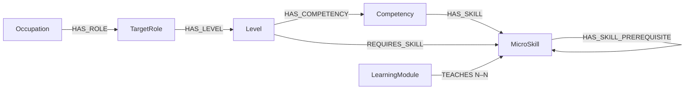

# Ontology — framework, fields and data provenance (0.11.0)

Updated 28 October 2026. English catalog; all definitions remain NEEDS_EXPERT_REVIEW. No live database has been changed.

## Files and framework

[ontology_dataset.xlsx](ontology_dataset.xlsx) and [import/ontology_seed-v011.json](import/ontology_seed-v011.json) describe the same catalog: **994 nodes and 5,121 relationships**. The workbook contains six entity sheets, seven relationship sheets and expert review inputs. [Neo4j import instructions](NEO4J_IMPORT_GUIDE.md) describe validation and isolated import. [Vietnamese field reference](../neo4j_schema.md) explains every graph field.

O*NET supplies Occupations, sample reported titles and occupation RIASEC. ESCO supports concept alignment for retained skills; SFIA 9 and UK Government Digital and Data support skills, scope and autonomy. SKOS informs concept alignment, not numeric scoring. The model is a local application ontology informed by these sources, not an official ESCO/O*NET ontology or certified equivalence. Competency grouping, local Junior/Middle/Senior tiers, thresholds, mandatory flags and prerequisites remain local proposals.



Each role owns three Levels; each Level owns competency groups and skill requirements. Competency is derived from all member skills passing at the owning Level, with no independent score. A Module teaches one or more skills; a skill may have several teaching Modules. This release requires teaching coverage for every skill. There is no Course, Level–Module link or global module sequence.

## Teaching focus and difficulty — 2026-10-28

The v0.11 review catalog replaces instructionLevel with **two independent required text properties on each TEACHES relationship**:

| Property | Allowed values | Meaning |
|---|---|---|
| teachingFocus | PRIMARY / SUPPORTING / INCIDENTAL | Main instructional objective, supporting practice, or provided context only. |
| difficultyLevel | LOW / MEDIUM / HIGH | Difficulty of the tasks for that particular skill in the Module. |

PRIMARY identifies the objective the package is designed to teach directly. SUPPORTING has an explicit supporting exercise; it does not automatically replace a PRIMARY treatment. INCIDENTAL is exposure/context, with no instructional objective or mastery credit and must not be treated as closing a skill gap. Display labels may be Primary/Supporting/Incidental; JSON and graph use the uppercase enums above.

Both properties belong to the exact Module–Skill pair, not globally to a Module or MicroSkill. A Module may contain PRIMARY + HIGH for one skill, SUPPORTING + MEDIUM for another and INCIDENTAL + LOW for a third. Changing teachingFocus does not determine difficulty. Difficulty is not calculated from a numeric gap, requiredScore, legacy coverage, or a selected role title. No scoring/ranking engine is implemented by this catalog change.

The current review package has **994 nodes and 5,121 relationships**, including **246 LearningModules and 664 TEACHES pairs**. It retains all 85 existing modules and 181 teaching pairs, and adds **161 locally authored focused practice packages**, each with a primary objective, a supporting exercise and incidental context. Every one of the 79 skills now has a PRIMARY option at LOW, MEDIUM and HIGH. This is a review-dataset completeness criterion, not a universal graph cardinality rule requiring every future catalog to have three providers.

| Teaching focus | Pairs |
|---|---:|
| PRIMARY | 246 |
| SUPPORTING | 257 |
| INCIDENTAL | 161 |

Difficulty counts across all roles: LOW 372, MEDIUM 178, HIGH 114. For example, MOD-FOCUS-CORE01-HIGH teaches MS-CORE01 as PRIMARY/HIGH, MS-CORE02 as SUPPORTING/MEDIUM and MS-CORE03 as INCIDENTAL/LOW. MOD-READ-CORE01 remains a PRIMARY/LOW option for MS-CORE01, while MOD-FOCUS-CORE01-MEDIUM provides PRIMARY/MEDIUM.

All 85 original module IDs and original duration/price estimates are retained. Exactly one leading skill is PRIMARY; remaining practice is SUPPORTING. Nine formerly co-primary packages now have clearer titles, revised content references and version 1.3, with narrowed supporting tasks rather than unchanged co-primary work. Original content files are preserved for historical pins. Existing task modes (guided, independent, complex review) inform the authoring choices, not learner scores. These decisions remain NEEDS_EXPERT_REVIEW.

The 161 new packages include distinct guided/independent/complex tasks, supporting work, contextual material, evidence checks and assessment boundaries. They are **lesson/lab scaffolds pending expert authoring, sandbox assets and approval**, not complete production courses or official O*NET/ESCO mappings. The supplied contextual skill is not a newly asserted prerequisite. Prices/durations are review estimates, not vendor quotes or measured learning gains.

Six node labels, seven relationship types and store ownership remain unchanged. Keep existing skill prerequisites; module completion does not establish mastery. A selected Module is counted once for duration/price even when it addresses several gaps. The original instructionLevel/coverage representations and v0.9 runtime seed remain historical; no current runtime graph, API or learner history is migrated.

## Independent role-Level requirements

Each TargetRole owns distinct Level nodes. Each Level has its own REQUIRES_SKILL set and requiredScore values; sets may overlap or differ and are not constrained to be nested. Module selection occurs through missing skills; no direct Level–Module edge is added.

Application Developer currently has 11 required skills at Junior, 14 at Middle and 14 at Senior. MS-CORE01 thresholds are 0.60 / 0.75 / 0.90. MS-FS08, MS-FS15 and MS-FS16 occur at Middle/Senior but not Junior in this role. Those requirements and all non-teaching relationships are preserved. A Senior target does not make every recommended module HIGH; readiness and compatible evidence still govern suitability.

[Current files, provenance and manual checks](TEACHING_FOCUS_DIFFICULTY.md).

## Counts

| Entity | Records |
|---|---:|
| Occupation | 5 |
| TargetRole | 48 |
| Level | 144 |
| Competency | 472 |
| MicroSkill | 79 |
| LearningModule | 246 |

| Relationship | Records |
|---|---:|
| HAS_ROLE | 48 |
| HAS_LEVEL | 144 |
| HAS_COMPETENCY | 472 |
| HAS_SKILL | 1891 |
| REQUIRES_SKILL | 1891 |
| TEACHES | 664 |
| HAS_SKILL_PREREQUISITE | 11 |

## Occupation Interests / RIASEC

[O*NET 31.0 Career Interest Types](https://www.onetcenter.org/dictionary/31.0/json/career_interest_types.html) supplies six numeric OI ratings per occupation. [Scales Reference](https://www.onetcenter.org/dictionary/31.0/json/scales_reference.html) defines OI minimum 1 and maximum 7. IH values are high-point category codes, not numeric interest scores; they are not used as the six ratings.

Database fields are interestRealistic, interestInvestigative, interestArtistic, interestSocial, interestEnterprising, interestConventional. Each is a numeric value in [0,1], computed as (raw OI value − 1)/6 and stored to six decimals. Compare/use the same transformation when handling another OI occupation vector. Do not assume a learner questionnaire uses this scale; convert its scores using that instrument's documented method first.

These fields describe occupational interests, not learner competence or skill/Level passing thresholds. Keep interests out of proficiency assessment. Source rows were updated in February 2026 and retrieved on 14 October 2026. The retained title/Job Zone evidence comes from the previous occupation collection; this release does not claim every source artifact was extracted from one database snapshot.

Raw source values (1–7):

| Occupation code | R | I | A | S | E | C |
|---|---:|---:|---:|---:|---:|---:|
| 15-1252.00 | 3.61 | 6.05 | 2.37 | 1.81 | 1.87 | 5.62 |
| 15-1243.00 | 2.63 | 5.63 | 2.16 | 1.91 | 2.68 | 6.12 |
| 15-1253.00 | 3.80 | 5.76 | 1.69 | 1.53 | 1.57 | 5.67 |
| 15-1299.08 | 4.10 | 5.46 | 1.88 | 2.10 | 3.03 | 5.76 |
| 15-1212.00 | 3.56 | 5.40 | 1.34 | 2.11 | 2.85 | 6.08 |

Normalized values (0–1) appear in the Occupations sheet and JSON. [Selected source rows and scale](sources/onet_interests_31_0_2026_10_14/selected_interests.json), full downloaded source files and SHA256 manifest are included in the release.

## Role inventory and proposed source mapping

| Role ID | Reported title | Occupation | Local profile | Scope references |
|---|---|---|---|---|
| ROLE-F72E5464F9B3 | Application Developer | 15-1252.00 | DEV | [reference 1](https://understand-digital-data-roles-skills.service.gov.uk/role/software-developer/); [reference 2](https://sfia-online.org/en/sfia-9/skills/systems-integration-and-build) |
| ROLE-58B047D9053E | Application Integration Engineer | 15-1252.00 | INTEGRATION | [reference 1](https://understand-digital-data-roles-skills.service.gov.uk/role/software-developer/); [reference 2](https://understand-digital-data-roles-skills.service.gov.uk/role/technical-architect/); [reference 3](https://sfia-online.org/en/sfia-9/skills/systems-integration-and-build) |
| ROLE-88FA0D759F84 | Developer | 15-1252.00 | DEV | [reference 1](https://understand-digital-data-roles-skills.service.gov.uk/role/software-developer/); [reference 2](https://sfia-online.org/en/sfia-9/skills/systems-integration-and-build) |
| ROLE-2F3EE4DCB9A3 | DevOps Engineer (Development Operations Engineer) | 15-1252.00 | DEVOPS | [reference 1](https://understand-digital-data-roles-skills.service.gov.uk/role/development-operations-devops-engineer/); [reference 2](https://sfia-online.org/en/sfia-9/skills/infrastructure-operations) |
| ROLE-8C851BC1DBAC-15125200 | Infrastructure Engineer | 15-1252.00 | INFRA | [reference 1](https://understand-digital-data-roles-skills.service.gov.uk/role/infrastructure-engineer/); [reference 2](https://sfia-online.org/en/sfia-9/skills/infrastructure-operations); [reference 3](https://sfia-online.org/en/sfia-9/skills/network-support) |
| ROLE-8C851BC1DBAC-15129908 | Infrastructure Engineer | 15-1299.08 | INFRA | [reference 1](https://understand-digital-data-roles-skills.service.gov.uk/role/infrastructure-engineer/); [reference 2](https://sfia-online.org/en/sfia-9/skills/infrastructure-operations); [reference 3](https://sfia-online.org/en/sfia-9/skills/network-support) |
| ROLE-DC8BCD8CC9FA | Software Architect | 15-1252.00 | SWARCH | [reference 1](https://understand-digital-data-roles-skills.service.gov.uk/role/technical-architect/); [reference 2](https://sfia-online.org/en/sfia-9/skills/solution-architecture); [reference 3](https://understand-digital-data-roles-skills.service.gov.uk/role/software-developer/) |
| ROLE-15F02B2EC48A | Software Developer | 15-1252.00 | DEV | [reference 1](https://understand-digital-data-roles-skills.service.gov.uk/role/software-developer/); [reference 2](https://sfia-online.org/en/sfia-9/skills/systems-integration-and-build) |
| ROLE-7838A77B1320 | Software Development Engineer | 15-1252.00 | DEV | [reference 1](https://understand-digital-data-roles-skills.service.gov.uk/role/software-developer/); [reference 2](https://sfia-online.org/en/sfia-9/skills/systems-integration-and-build) |
| ROLE-CBAF88DF6DE7 | Software Engineer | 15-1252.00 | DEV | [reference 1](https://understand-digital-data-roles-skills.service.gov.uk/role/software-developer/); [reference 2](https://sfia-online.org/en/sfia-9/skills/systems-integration-and-build) |
| ROLE-6B89F39CA50C-15125200 | Systems Engineer | 15-1252.00 | SYSARCH | [reference 1](https://understand-digital-data-roles-skills.service.gov.uk/role/technical-architect/); [reference 2](https://understand-digital-data-roles-skills.service.gov.uk/role/infrastructure-engineer/); [reference 3](https://sfia-online.org/en/sfia-9/skills/solution-architecture) |
| ROLE-6B89F39CA50C-15129908 | Systems Engineer | 15-1299.08 | SYSARCH | [reference 1](https://understand-digital-data-roles-skills.service.gov.uk/role/technical-architect/); [reference 2](https://understand-digital-data-roles-skills.service.gov.uk/role/infrastructure-engineer/); [reference 3](https://sfia-online.org/en/sfia-9/skills/solution-architecture) |
| ROLE-84156EF4FF37 | Data Architect | 15-1243.00 | DATARCH | [reference 1](https://understand-digital-data-roles-skills.service.gov.uk/role/data-architect/); [reference 2](https://sfia-online.org/en/sfia-9/skills/solution-architecture); [reference 3](https://understand-digital-data-roles-skills.service.gov.uk/role/data-governance-manager/) |
| ROLE-DE | Data Engineer | 15-1243.00 | DATAENG | [reference 1](https://understand-digital-data-roles-skills.service.gov.uk/role/data-engineer/); [reference 2](https://understand-digital-data-roles-skills.service.gov.uk/role/data-architect/) |
| ROLE-677AE5E25939 | Data Officer | 15-1243.00 | DATAGOV | [reference 1](https://understand-digital-data-roles-skills.service.gov.uk/role/data-governance-manager/); [reference 2](https://understand-digital-data-roles-skills.service.gov.uk/role/data-architect/) |
| ROLE-262E99D33528 | Database Analyst | 15-1243.00 | DBANALYSIS | [reference 1](https://understand-digital-data-roles-skills.service.gov.uk/role/data-architect/); [reference 2](https://understand-digital-data-roles-skills.service.gov.uk/role/data-engineer/); [reference 3](https://understand-digital-data-roles-skills.service.gov.uk/role/data-governance-manager/) |
| ROLE-5A07C8E3F89B | Database Architect | 15-1243.00 | DATARCH | [reference 1](https://understand-digital-data-roles-skills.service.gov.uk/role/data-architect/); [reference 2](https://sfia-online.org/en/sfia-9/skills/solution-architecture); [reference 3](https://understand-digital-data-roles-skills.service.gov.uk/role/data-governance-manager/) |
| ROLE-683035F817DC | Database Consultant | 15-1243.00 | DBANALYSIS | [reference 1](https://understand-digital-data-roles-skills.service.gov.uk/role/data-architect/); [reference 2](https://understand-digital-data-roles-skills.service.gov.uk/role/data-engineer/); [reference 3](https://understand-digital-data-roles-skills.service.gov.uk/role/data-governance-manager/) |
| ROLE-826EF8FFB24A | Database Developer | 15-1243.00 | DBDEV | [reference 1](https://understand-digital-data-roles-skills.service.gov.uk/role/data-engineer/); [reference 2](https://understand-digital-data-roles-skills.service.gov.uk/role/data-architect/); [reference 3](https://understand-digital-data-roles-skills.service.gov.uk/role/software-developer/) |
| ROLE-6C905B8EE52A | Database Programmer | 15-1243.00 | DBDEV | [reference 1](https://understand-digital-data-roles-skills.service.gov.uk/role/data-engineer/); [reference 2](https://understand-digital-data-roles-skills.service.gov.uk/role/data-architect/); [reference 3](https://understand-digital-data-roles-skills.service.gov.uk/role/software-developer/) |
| ROLE-B0C017CA7D49 | Enterprise Architect | 15-1243.00 | ENTERPRISE | [reference 1](https://understand-digital-data-roles-skills.service.gov.uk/role/enterprise-architect/); [reference 2](https://understand-digital-data-roles-skills.service.gov.uk/role/data-architect/); [reference 3](https://understand-digital-data-roles-skills.service.gov.uk/role/data-governance-manager/); [reference 4](https://sfia-online.org/en/sfia-9/skills/solution-architecture) |
| ROLE-D4665145D9A0 | Information Architect | 15-1243.00 | DATARCH | [reference 1](https://understand-digital-data-roles-skills.service.gov.uk/role/data-architect/); [reference 2](https://sfia-online.org/en/sfia-9/skills/solution-architecture); [reference 3](https://understand-digital-data-roles-skills.service.gov.uk/role/data-governance-manager/) |
| ROLE-3594A031F678 | Automation Tester | 15-1253.00 | QAAUTO | [reference 1](https://understand-digital-data-roles-skills.service.gov.uk/role/test-engineer/); [reference 2](https://understand-digital-data-roles-skills.service.gov.uk/role/development-operations-devops-engineer/) |
| ROLE-39F74565946B | Information Technology Analyst (IT Analyst) | 15-1253.00 | QAA | [reference 1](https://understand-digital-data-roles-skills.service.gov.uk/role/quality-assurance-test-analyst/); [reference 2](https://understand-digital-data-roles-skills.service.gov.uk/role/test-engineer/) |
| ROLE-B94440938DCB | Quality Assurance Analyst (QA Analyst) | 15-1253.00 | QAA | [reference 1](https://understand-digital-data-roles-skills.service.gov.uk/role/quality-assurance-test-analyst/); [reference 2](https://understand-digital-data-roles-skills.service.gov.uk/role/test-engineer/) |
| ROLE-1947F95DA9EB | Quality Assurance Engineer (QA Engineer) | 15-1253.00 | QAENG | [reference 1](https://understand-digital-data-roles-skills.service.gov.uk/role/test-engineer/); [reference 2](https://understand-digital-data-roles-skills.service.gov.uk/role/quality-assurance-test-analyst/) |
| ROLE-140C2EA5BCFA | Quality Engineer | 15-1253.00 | QAENG | [reference 1](https://understand-digital-data-roles-skills.service.gov.uk/role/test-engineer/); [reference 2](https://understand-digital-data-roles-skills.service.gov.uk/role/quality-assurance-test-analyst/) |
| ROLE-600114606368 | Software Quality Assurance Analyst (SQA Analyst) | 15-1253.00 | QAA | [reference 1](https://understand-digital-data-roles-skills.service.gov.uk/role/quality-assurance-test-analyst/); [reference 2](https://understand-digital-data-roles-skills.service.gov.uk/role/test-engineer/) |
| ROLE-6E51A03B5F7F | Software Quality Assurance Engineer (SQA Engineer) | 15-1253.00 | QAENG | [reference 1](https://understand-digital-data-roles-skills.service.gov.uk/role/test-engineer/); [reference 2](https://understand-digital-data-roles-skills.service.gov.uk/role/quality-assurance-test-analyst/) |
| ROLE-B2B4EB364379 | Software Quality Engineer | 15-1253.00 | QAENG | [reference 1](https://understand-digital-data-roles-skills.service.gov.uk/role/test-engineer/); [reference 2](https://understand-digital-data-roles-skills.service.gov.uk/role/quality-assurance-test-analyst/) |
| ROLE-B0E1A3444426 | Software Test Engineer | 15-1253.00 | QAENG | [reference 1](https://understand-digital-data-roles-skills.service.gov.uk/role/test-engineer/); [reference 2](https://understand-digital-data-roles-skills.service.gov.uk/role/quality-assurance-test-analyst/) |
| ROLE-6A2A26EB8380 | Test Engineer | 15-1253.00 | QAENG | [reference 1](https://understand-digital-data-roles-skills.service.gov.uk/role/test-engineer/); [reference 2](https://understand-digital-data-roles-skills.service.gov.uk/role/quality-assurance-test-analyst/) |
| ROLE-56B826705119 | IT Architect (Information Technology Architect) | 15-1299.08 | SYSARCH | [reference 1](https://understand-digital-data-roles-skills.service.gov.uk/role/technical-architect/); [reference 2](https://understand-digital-data-roles-skills.service.gov.uk/role/infrastructure-engineer/); [reference 3](https://sfia-online.org/en/sfia-9/skills/solution-architecture) |
| ROLE-BE3E290AD0CA | IT Engineer (Information Technology Engineer) | 15-1299.08 | INFRA | [reference 1](https://understand-digital-data-roles-skills.service.gov.uk/role/infrastructure-engineer/); [reference 2](https://sfia-online.org/en/sfia-9/skills/infrastructure-operations); [reference 3](https://sfia-online.org/en/sfia-9/skills/network-support) |
| ROLE-919BDC0216B4 | Network and Infrastructure Engineer | 15-1299.08 | INFRA | [reference 1](https://understand-digital-data-roles-skills.service.gov.uk/role/infrastructure-engineer/); [reference 2](https://sfia-online.org/en/sfia-9/skills/infrastructure-operations); [reference 3](https://sfia-online.org/en/sfia-9/skills/network-support) |
| ROLE-B01510AF5F34 | Solutions Architect | 15-1299.08 | SYSARCH | [reference 1](https://understand-digital-data-roles-skills.service.gov.uk/role/technical-architect/); [reference 2](https://understand-digital-data-roles-skills.service.gov.uk/role/infrastructure-engineer/); [reference 3](https://sfia-online.org/en/sfia-9/skills/solution-architecture) |
| ROLE-D047DF7D12BA | Systems Application Engineer | 15-1299.08 | INTEGRATION | [reference 1](https://understand-digital-data-roles-skills.service.gov.uk/role/software-developer/); [reference 2](https://understand-digital-data-roles-skills.service.gov.uk/role/technical-architect/); [reference 3](https://sfia-online.org/en/sfia-9/skills/systems-integration-and-build) |
| ROLE-7A06376BE513 | Systems Architect | 15-1299.08 | SYSARCH | [reference 1](https://understand-digital-data-roles-skills.service.gov.uk/role/technical-architect/); [reference 2](https://understand-digital-data-roles-skills.service.gov.uk/role/infrastructure-engineer/); [reference 3](https://sfia-online.org/en/sfia-9/skills/solution-architecture) |
| ROLE-4C23110A9ACE | Systems Consultant | 15-1299.08 | SYSANALYSIS | [reference 1](https://understand-digital-data-roles-skills.service.gov.uk/role/technical-architect/); [reference 2](https://understand-digital-data-roles-skills.service.gov.uk/role/infrastructure-engineer/); [reference 3](https://sfia-online.org/en/sfia-9/skills/solution-architecture) |
| ROLE-E53C178E5BA6 | Web Architect | 15-1299.08 | WEBARCH | [reference 1](https://understand-digital-data-roles-skills.service.gov.uk/role/technical-architect/); [reference 2](https://understand-digital-data-roles-skills.service.gov.uk/role/software-developer/); [reference 3](https://sfia-online.org/en/sfia-9/skills/solution-architecture) |
| ROLE-BC681F40F67B | Information Security Officer | 15-1212.00 | SECOFFICER | [reference 1](https://understand-digital-data-roles-skills.service.gov.uk/role/security-architect/); [reference 2](https://sfia-online.org/en/sfia-9/skills/information-security) |
| ROLE-9E24DD1E0AE6 | Information Security Specialist | 15-1212.00 | SECANALYSIS | [reference 1](https://understand-digital-data-roles-skills.service.gov.uk/role/security-architect/); [reference 2](https://sfia-online.org/en/sfia-9/skills/information-security); [reference 3](https://sfia-online.org/en/sfia-9/skills/security-operations); [reference 4](https://sfia-online.org/en/sfia-9/skills/vulnerability-assessment) |
| ROLE-AF49BFEFFAE0 | Information Systems Security Analyst | 15-1212.00 | SECANALYSIS | [reference 1](https://understand-digital-data-roles-skills.service.gov.uk/role/security-architect/); [reference 2](https://sfia-online.org/en/sfia-9/skills/information-security); [reference 3](https://sfia-online.org/en/sfia-9/skills/security-operations); [reference 4](https://sfia-online.org/en/sfia-9/skills/vulnerability-assessment) |
| ROLE-AAF660DA34D9 | Information Systems Security Officer (ISSO) | 15-1212.00 | SECOFFICER | [reference 1](https://understand-digital-data-roles-skills.service.gov.uk/role/security-architect/); [reference 2](https://sfia-online.org/en/sfia-9/skills/information-security) |
| ROLE-AC875FDD2CC1 | Information Technology Security Analyst (IT Security Analyst) | 15-1212.00 | SECANALYSIS | [reference 1](https://understand-digital-data-roles-skills.service.gov.uk/role/security-architect/); [reference 2](https://sfia-online.org/en/sfia-9/skills/information-security); [reference 3](https://sfia-online.org/en/sfia-9/skills/security-operations); [reference 4](https://sfia-online.org/en/sfia-9/skills/vulnerability-assessment) |
| ROLE-39DE5AAEA190 | Network Security Analyst | 15-1212.00 | NETSEC | [reference 1](https://understand-digital-data-roles-skills.service.gov.uk/role/security-architect/); [reference 2](https://sfia-online.org/en/sfia-9/skills/network-support); [reference 3](https://sfia-online.org/en/sfia-9/skills/security-operations); [reference 4](https://sfia-online.org/en/sfia-9/skills/information-security) |
| ROLE-FE0775936B97 | Security Analyst | 15-1212.00 | SECANALYSIS | [reference 1](https://understand-digital-data-roles-skills.service.gov.uk/role/security-architect/); [reference 2](https://sfia-online.org/en/sfia-9/skills/information-security); [reference 3](https://sfia-online.org/en/sfia-9/skills/security-operations); [reference 4](https://sfia-online.org/en/sfia-9/skills/vulnerability-assessment) |
| ROLE-410E150F21A9 | Systems Analyst | 15-1212.00 | SECANALYSIS | [reference 1](https://understand-digital-data-roles-skills.service.gov.uk/role/security-architect/); [reference 2](https://sfia-online.org/en/sfia-9/skills/information-security); [reference 3](https://sfia-online.org/en/sfia-9/skills/security-operations); [reference 4](https://sfia-online.org/en/sfia-9/skills/vulnerability-assessment) |

## Level skill selection and score policy

The local progression separates guided bounded execution, independent defined-scope work, and complex change/review. This is informed by [SFIA responsibilities](https://sfia-online.org/en/sfia-9/responsibilities) and the role references above. Junior/Middle/Senior are not exact SFIA responsibility levels or UK employment grades. Architect/officer Junior tiers describe learning readiness, not an assertion of junior job eligibility.

[Skill tier policy](sources/ontology_v06_design/skill_tier_policy.json) records minimum local rank for each of the 79 definitions. [Per-Level selections](sources/ontology_v06_design/level_skill_selection.json) explicitly lists included and deferred skills for all 144 Levels. Architecture alternatives, optimization, complex automation and assurance are generally introduced after foundational guided tasks; architecture impact/governance compliance/security policy ownership are deferred to Senior. Foundational prerequisite closure can lower a skill's minimum learning tier. Exact choices are project proposals requiring expert confirmation, not official framework requirements. Some neighboring tiers legitimately share a skill set and differ in task context and score.

Competency group membership is intersected with its owning Level's selected skills. Groups with one surviving skill are merged into a supporting group or an existing group so every competency retains multiple skills. This grouping is a local modeling choice, not an official competency taxonomy.

Existing requiredScore and isMandatory are retained for included requirements. Assessment descriptions and rubric references are retained only as historical documentation outside the graph. Removed lower-tier requirements are recorded as deferred skills; Data Engineer no longer has all 16 skills at every Level. Relationship IDs are regenerated for the new snapshot; historical learner results must remain tied to their original snapshot.

| Tier | Typical threshold | Security/control threshold |
|---|---:|---:|
| Junior | 0.60 | 0.65 |
| Middle | 0.75 | 0.80 |
| Senior | 0.90 | 0.95 |

Some retained Data Engineer thresholds differ, as explicitly stored in REQUIRES_SKILL. All cutoffs and local task templates are proposals, not ESCO/SFIA/O*NET scoring standards. All current requirements are mandatory within their selected Level; changing optionality is a future expert decision.

## New MicroSkills and source locators

Thirty-one new outcomes extend the 48 retained non-AI skill definitions. They are source-supported, locally decomposed actions; no claim of verbatim official SFIA/UK MicroSkill status is made.

| ID | Local name | Definition | Supporting source and locator |
|---|---|---|---|
| MS-CORE01 | Implement programs and scripts | Write and check executable logic for a specified software or automation task. | [source](https://understand-digital-data-roles-skills.service.gov.uk/role/software-developer/) — Programming and build |
| MS-CORE02 | Manage source changes with version control | Record and review source changes so a tested version can be identified and recovered. | [source](https://git-scm.com/book/en/v2/Getting-Started-About-Version-Control) — About Version Control |
| MS-CORE03 | Translate requirements into verifiable changes | Connect a stated user or service need to a bounded implementation and explicit checks. | [source](https://understand-digital-data-roles-skills.service.gov.uk/role/software-developer/) — User focus; systems design |
| MS-CORE04 | Deploy a controlled software release | Apply an agreed deployment procedure and verify the released service and rollback path. | [source](https://understand-digital-data-roles-skills.service.gov.uk/role/development-operations-devops-engineer/) — Service support; programming and build |
| MS-ARC01 | Model solution components and boundaries | Describe the components, interfaces and constraints of a proposed solution. | [source](https://sfia-online.org/en/sfia-9/skills/solution-architecture) — Solution architecture |
| MS-ARC02 | Compare architecture alternatives | Compare feasible designs against agreed quality, cost and risk criteria. | [source](https://sfia-online.org/en/sfia-9/skills/solution-architecture) — Solution architecture |
| MS-ARC03 | Specify integration contracts | Define and check the information exchange and failure behaviour between systems. | [source](https://sfia-online.org/en/sfia-9/skills/systems-integration-and-build) — Systems integration and build |
| MS-ARC04 | Specify measurable service quality targets | State testable availability, performance and other agreed quality expectations. | [source](https://understand-digital-data-roles-skills.service.gov.uk/role/technical-architect/) — Technical design throughout the life cycle; making architectural decisions |
| MS-ARC05 | Document and explain architecture decisions | Record a design decision and explain its consequences to the relevant audience. | [source](https://understand-digital-data-roles-skills.service.gov.uk/role/technical-architect/) — Architecture communication |
| MS-ARC06 | Assess architecture change impact | Identify interfaces and quality constraints affected by a proposed design change. | [source](https://sfia-online.org/en/sfia-9/skills/solution-architecture) — Solution architecture |
| MS-INF01 | Configure and verify network connectivity | Configure a bounded network connection and check addressing, routing and name resolution. | [source](https://sfia-online.org/en/sfia-9/skills/network-support) — Network support |
| MS-INF02 | Provision infrastructure resources | Prepare compute, storage or network resources against an agreed service specification. | [source](https://sfia-online.org/en/sfia-9/skills/infrastructure-operations) — Infrastructure operations |
| MS-INF03 | Automate infrastructure procedures | Implement and verify scripts for repeatable infrastructure tasks. | [source](https://understand-digital-data-roles-skills.service.gov.uk/role/infrastructure-engineer/) — Coding and scripting |
| MS-INF04 | Maintain configuration records | Keep infrastructure configuration and change records aligned with the deployed state. | [source](https://sfia-online.org/en/sfia-9/skills/configuration-management) — Configuration management |
| MS-INF05 | Monitor service health | Collect and interpret service measurements and alerts against agreed operating limits. | [source](https://sfia-online.org/en/sfia-9/skills/infrastructure-operations) — Infrastructure operations |
| MS-INF06 | Investigate infrastructure faults | Use observable service evidence to isolate a fault and verify a controlled remedy. | [source](https://understand-digital-data-roles-skills.service.gov.uk/role/infrastructure-engineer/) — Problem management; IT infrastructure |
| MS-INF07 | Verify backup and recovery procedures | Demonstrate restoration of a bounded service or dataset using an agreed recovery procedure. | [source](https://sfia-online.org/en/sfia-9/skills/storage-management) — Storage management |
| MS-INF08 | Apply infrastructure hardening and updates | Apply approved secure configuration and updates, then check operation and protection. | [source](https://sfia-online.org/en/sfia-9/skills/infrastructure-operations) — Infrastructure operations |
| MS-SEC01 | Analyse information security risks | Identify a bounded security risk, its affected assets and a justified treatment proposal. | [source](https://sfia-online.org/en/sfia-9/skills/information-security) — Information security |
| MS-SEC02 | Select and verify security controls | Choose controls for a stated threat or requirement and check their intended protection. | [source](https://understand-digital-data-roles-skills.service.gov.uk/role/security-architect/) — Designing secure systems; enabling and informing risk-based decisions |
| MS-SEC03 | Configure identity and access controls | Configure and test authentication or authorization rules against an agreed access policy. | [source](https://sfia-online.org/en/sfia-9/skills/identity-and-access-management) — Identity and access management |
| MS-SEC04 | Investigate security alerts | Interpret a security alert and supporting records to decide a justified next action. | [source](https://sfia-online.org/en/sfia-9/skills/security-operations) — Security operations |
| MS-SEC05 | Execute a security incident response procedure | Apply an agreed incident procedure while preserving records and verifying containment. | [source](https://sfia-online.org/en/sfia-9/skills/security-operations) — Security operations |
| MS-SEC06 | Assess technical vulnerabilities | Identify and validate findings in an authorized assessment scope and explain their impact. | [source](https://sfia-online.org/en/sfia-9/skills/vulnerability-assessment) — Vulnerability assessment |
| MS-SEC07 | Verify vulnerability remediation | Apply or coordinate an agreed remedy and check that the relevant finding is resolved. | [source](https://sfia-online.org/en/sfia-9/skills/security-operations) — Security operations |
| MS-SEC08 | Document security control assurance | Connect a security requirement, control and check result in a reviewable assurance record. | [source](https://sfia-online.org/en/sfia-9/skills/information-security) — Information security |
| MS-SEC09 | Communicate security recommendations | Explain a security finding, decision or control to the audience responsible for action. | [source](https://understand-digital-data-roles-skills.service.gov.uk/role/security-architect/) — Communication (security architect) |
| MS-SEC10 | Maintain security policy procedures | Keep an agreed security policy and its operating procedures consistent with the stated scope. | [source](https://sfia-online.org/en/sfia-9/skills/information-security) — Information security |
| MS-GOV01 | Define data ownership responsibilities | Identify the accountable owner and handling responsibilities for a specified dataset. | [source](https://understand-digital-data-roles-skills.service.gov.uk/role/data-governance-manager/) — Data governance |
| MS-GOV02 | Document data governance rules | Record agreed rules for data handling, sharing and quality within a defined scope. | [source](https://understand-digital-data-roles-skills.service.gov.uk/role/data-governance-manager/) — Data governance |
| MS-GOV03 | Check data lifecycle compliance | Check evidence of data handling against agreed lifecycle and governance rules. | [source](https://understand-digital-data-roles-skills.service.gov.uk/role/data-governance-manager/) — Data governance; data compliance |

[New skill evidence](sources/onet_five_occupations_2026_10_14/new_skill_evidence.json) identifies the local derivation and source verification. The original retained skill evidence below is unchanged; the old AI subset is outside this five-occupation snapshot.

## Skill catalogue and evidence

`sourceConceptUri` is present only for reused concepts. A blank URI means a local derived outcome, not a missing invented URI. `sourceVerification = SOURCE_REVIEWED` means that the cited content was inspected, not that a standards body endorsed the local mapping. Existing ESCO concepts retain their verified v1.2.1 API snapshots in [the evidence manifest](sources/ontology_2026_10_12/manifest.json). New technical references were reviewed on 12 October 2026.

### DE: 16 catalogued skills

| ID | English skill name | Local definition | Derivation | Evidence and sourceLocator |
|---|---|---|---|---|
| MS-DE01 | create data models | Represent entities, relationships and constraints in a data model. | REUSED_CONCEPT | [E-DE01][E-DE01] — Concept description |
| MS-DE02 | develop data processing applications | Implement programs that transform input data into specified outputs. | REUSED_CONCEPT | [E-DE02][E-DE02] — Concept description |
| MS-DE03 | implement data warehousing techniques | Apply warehouse structures and loading techniques to analytical data. | REUSED_CONCEPT | [E-DE03][E-DE03] — Concept description |
| MS-DE04 | Document source-to-target mappings | Record how source fields become target fields, including transformation rules. | DERIVED_OUTCOME | [ON-DE][ON-DE], [UK-DE][UK-DE] — Data engineer responsibilities |
| MS-DE05 | Verify data quality | Check records against explicit completeness, accuracy and consistency rules. | DERIVED_OUTCOME | [ON-DE][ON-DE] — Tasks: Verify the structure, accuracy, or quality of warehouse data |
| MS-DE06 | Maintain metadata documentation | Record dataset meaning, ownership and structural metadata. | DERIVED_OUTCOME | [ON-DE][ON-DE], [UK-DE][UK-DE] — Metadata management |
| MS-DE07 | Monitor pipeline operations | Observe pipeline runs and investigate operational failures. | DERIVED_OUTCOME | [SF-DENG][SF-DENG] — DENG Levels 2, 4, 5: monitoring operations/performance |
| MS-DE08 | Design data integration flows | Specify how data moves between source and destination systems. | DERIVED_OUTCOME | [UK-DE][UK-DE] — Data integration design: Working/Practitioner |
| MS-DE09 | Profile source datasets | Summarise missing values, duplicates and distributions before ingestion. | DERIVED_OUTCOME | [UK-DE][UK-DE] — Data analysis and synthesis: data profiling and source system analysis |
| MS-DE10 | Implement data extraction | Extract source records into a controlled staging area. | DERIVED_OUTCOME | [ON-DE][ON-DE] — Tasks: extraction procedures from operational systems |
| MS-DE11 | Implement transformation rules | Convert values and enforce business rules during data processing. | DERIVED_OUTCOME | [ON-DE][ON-DE] — Tasks: business rules and warehouse transformation processes |
| MS-DE12 | Orchestrate retry-safe pipeline tasks | Order dependent tasks and make retries preserve correct outputs. | DERIVED_OUTCOME | [T-AIR][T-AIR] — Creating a task; repeatable results during retries |
| MS-DE13 | Optimise warehouse workloads | Compare access speed and loading cost before selecting a warehouse optimisation. | DERIVED_OUTCOME | [ON-DE][ON-DE] — Tasks: balance data access, batch loading and resource use |
| MS-DE14 | Apply secure data handling | Apply access restrictions and approved handling controls to datasets. | DERIVED_OUTCOME | [UK-DE][UK-DE] — Data compliance and security; data integration design |
| MS-DE15 | Test data pipelines | Write checks for transformation logic and end-to-end data flow. | DERIVED_OUTCOME | [ON-DE][ON-DE] — Tasks: warehouse test files, unit and integration tests |
| MS-DE16 | Trace data dependencies | Identify downstream consumers affected by a dataset change. | DERIVED_OUTCOME | [UK-DE][UK-DE] — Metadata management: integration impact analysis |

### FS: 16 catalogued skills

| ID | English skill name | Local definition | Derivation | Evidence and sourceLocator |
|---|---|---|---|---|
| MS-FS01 | design user interface | Specify user interface structure and interactions for a user task. | REUSED_CONCEPT | [E-FS01][E-FS01] — Concept description |
| MS-FS02 | Implement accessible user interfaces | Implement interfaces that support keyboard and assistive technology use. | DERIVED_OUTCOME | [UK-FE][UK-FE] — Accessibility: Working/Practitioner |
| MS-FS03 | design application interfaces | Define interfaces through which application components exchange information. | REUSED_CONCEPT | [E-FS03][E-FS03] — Concept description |
| MS-FS04 | use query languages | Retrieve and manipulate data using a query language. | REUSED_CONCEPT | [E-FS04][E-FS04] — Concept description |
| MS-FS05 | integrate system components | Connect components and verify their combined behaviour. | REUSED_CONCEPT | [E-FS05][E-FS05] — Concept description |
| MS-FS06 | debug software | Locate and correct causes of software defects. | REUSED_CONCEPT | [E-FS06][E-FS06] — Concept description |
| MS-FS07 | perform software unit testing | Verify individual units of software with repeatable automated checks. | REUSED_CONCEPT | [E-FS07][E-FS07] — Concept description |
| MS-FS08 | conduct ICT code review | Review source changes and give actionable technical feedback. | REUSED_CONCEPT | [E-FS08][E-FS08] — Concept description |
| MS-FS09 | Implement responsive layouts | Adapt layout and content to different viewport sizes. | DERIVED_OUTCOME | [T-RESP][T-RESP] — Flexible layouts and media queries |
| MS-FS10 | Use semantic HTML | Choose elements whose meaning matches the content and interaction. | DERIVED_OUTCOME | [T-SEM][T-SEM] — Semantics in HTML |
| MS-FS11 | Handle asynchronous web requests | Handle successful responses, HTTP failures and request cancellation in the interface. | DERIVED_OUTCOME | [T-FETCH][T-FETCH] — Handling the response; cancelling a request |
| MS-FS12 | Validate application inputs | Enforce input constraints and provide usable validation feedback on client and server. | DERIVED_OUTCOME | [T-VALID][T-VALID] — Client-side validation does not replace server-side validation |
| MS-FS13 | Enforce application authorization | Check permissions for protected actions and resources. | DERIVED_OUTCOME | [T-AUTH][T-AUTH] — Validate permissions on every request; deny by default |
| MS-FS14 | Use database transactions | Commit related updates atomically and roll back unsuccessful operations. | DERIVED_OUTCOME | [T-TX][T-TX] — Transaction blocks and rollback |
| MS-FS15 | Improve existing software structure | Revise existing implementation while checking that required behaviour is preserved. | DERIVED_OUTCOME | [ON-FS][ON-FS] — Tasks: modify existing software and validate changes |
| MS-FS16 | Configure continuous integration | Run build and test steps automatically when code changes. | DERIVED_OUTCOME | [T-CI][T-CI] — Workflows, jobs, steps and event triggers |

### QA: 16 catalogued skills

| ID | English skill name | Local definition | Derivation | Evidence and sourceLocator |
|---|---|---|---|---|
| MS-QA01 | plan software testing | Set test scope, approach, resources and completion conditions. | REUSED_CONCEPT | [E-QA01][E-QA01] — Concept description |
| MS-QA02 | develop ICT test suite | Organise test cases into a suite linked to intended behaviours. | REUSED_CONCEPT | [E-QA02][E-QA02] — Concept description |
| MS-QA03 | execute software tests | Run specified tests and record observed results. | REUSED_CONCEPT | [E-QA03][E-QA03] — Concept description |
| MS-QA04 | report test findings | Communicate test results and defects with supporting evidence. | REUSED_CONCEPT | [E-QA04][E-QA04] — Concept description |
| MS-QA05 | replicate customer software issues | Reproduce a reported issue under identified conditions. | REUSED_CONCEPT | [E-QA05][E-QA05] — Concept description |
| MS-QA06 | develop automated software tests | Implement repeatable automated tests with meaningful assertions. | REUSED_CONCEPT | [E-QA06][E-QA06] — Concept description |
| MS-QA07 | execute integration testing | Test interactions and data exchange between components. | REUSED_CONCEPT | [E-QA07][E-QA07] — Concept description |
| MS-QA08 | Perform structured exploratory testing | Investigate software using a defined exploratory testing charter. | DERIVED_OUTCOME | [SF-TEST][SF-TEST] — TEST Level 3: structured exploratory testing |
| MS-QA09 | Apply equivalence partitioning | Select representative cases from distinct valid and invalid input classes. | DERIVED_OUTCOME | [T-CTFL][T-CTFL] — 4.2.1 Equivalence Partitioning, page 39 |
| MS-QA10 | Apply boundary value analysis | Test values at and around the boundaries of ordered input classes. | DERIVED_OUTCOME | [T-CTFL][T-CTFL] — 4.2.2 Boundary Value Analysis, page 40 |
| MS-QA11 | Prioritise tests by risk | Order tests using failure likelihood and product impact. | DERIVED_OUTCOME | [T-CTFL][T-CTFL] — 5.1.5 Test Case Prioritization; 5.2 Risk Management |
| MS-QA12 | Prepare test data and environments | Set up controlled inputs and system conditions required for repeatable tests. | DERIVED_OUTCOME | [T-CTFL][T-CTFL] — 1.4.1 Test Activities and Tasks: test implementation |
| MS-QA13 | Classify defect impact | Describe defect severity and propose a repair priority with evidence. | DERIVED_OUTCOME | [T-CTFL][T-CTFL] — 5.5 Defect Management: severity and priority |
| MS-QA14 | Run regression tests | Check that changes have not broken previously working behaviour. | DERIVED_OUTCOME | [ON-QA][ON-QA] — Tasks: regression testing and testing system modifications |
| MS-QA15 | Execute performance tests | Measure response behaviour under a defined workload and environment. | DERIVED_OUTCOME | [ON-QA][ON-QA] — Tasks: performance monitoring and production-like test environments |
| MS-QA16 | Investigate flaky automated tests | Use retry results and controlled reruns to diagnose inconsistent test outcomes. | DERIVED_OUTCOME | [T-FLAKY][T-FLAKY] — Retries; flaky classification; worker isolation |

### ESCO concept URIs (documentation only)

| Internal skill ID | sourceConceptUri |
|---|---|
| MS-DE01 | http://data.europa.eu/esco/skill/fbafa41f-cd05-4109-a649-8b44d306d779 |
| MS-DE02 | http://data.europa.eu/esco/skill/f9670490-8aa4-4540-b121-d440a8294aab |
| MS-DE03 | http://data.europa.eu/esco/skill/fd6d2981-3d4a-4ce2-9741-cfc98c5b74bd |
| MS-FS01 | http://data.europa.eu/esco/skill/fd33c66c-70c4-40e6-b87c-5495bd3bf26e |
| MS-FS03 | http://data.europa.eu/esco/skill/b0096dc5-2e2d-4bc1-8172-05bf486c3968 |
| MS-FS04 | http://data.europa.eu/esco/skill/75f839c2-fd9a-4ad3-8921-6e734608568d |
| MS-FS05 | http://data.europa.eu/esco/skill/ed8de897-adbe-4f0e-b4d2-534953e64c72 |
| MS-FS06 | http://data.europa.eu/esco/skill/2522a6ce-3202-4ac8-9f5b-b9cb5a3a83a1 |
| MS-FS07 | http://data.europa.eu/esco/skill/7961413f-61d0-4722-9cd9-20a050a29899 |
| MS-FS08 | http://data.europa.eu/esco/skill/9d1b08b3-ba1e-41f6-a466-1ac1e62eb5f0 |
| MS-QA01 | http://data.europa.eu/esco/skill/5d74614d-32c8-4ca4-9818-6980e52424b1 |
| MS-QA02 | http://data.europa.eu/esco/skill/7253d98c-4a6d-4e37-8b6c-accca9f4b639 |
| MS-QA03 | http://data.europa.eu/esco/skill/913e7e83-b8f8-4574-b1ca-1b38f3fd974a |
| MS-QA04 | http://data.europa.eu/esco/skill/561c2525-5bd8-4d86-8f45-820f4be7db93 |
| MS-QA05 | http://data.europa.eu/esco/skill/eb3aa8c1-fb14-47b4-a352-b7975abd2480 |
| MS-QA06 | http://data.europa.eu/esco/skill/6a322874-e32f-4cd8-9683-badce67a7f73 |
| MS-QA07 | http://data.europa.eu/esco/skill/ea412de3-9d7a-4943-8d8c-c6d3c7495d0e |

## Source register

Source evidence is documentation-only. Date for this review: 12 October 2026. ESCO snapshots use v1.2.1; SFIA links target version 9; ISTQB is v4.0.1. Other URLs may change independently of this dataset. Archived API responses and their checksums establish the retained ESCO evidence; the web references are cited pages, not claimed frozen copies.

| Reference | Framework | Location |
|---|---|---|
| [UK-DE][UK-DE] | GOV_UK | Role responsibilities and skill descriptions |
| [UK-AI][UK-AI] | GOV_UK | Role responsibilities and skill descriptions |
| [UK-FS][UK-FS] | GOV_UK | Role responsibilities and skill descriptions |
| [UK-FE][UK-FE] | GOV_UK | Role responsibilities and skill descriptions |
| [UK-QA][UK-QA] | GOV_UK | Role responsibilities and skill descriptions |
| [ON-DE][ON-DE] | ONET | Occupation-specific tasks |
| [ON-AI][ON-AI] | ONET | Occupation-specific tasks |
| [ON-FS][ON-FS] | ONET | Occupation-specific tasks |
| [ON-QA][ON-QA] | ONET | Occupation-specific tasks |
| [SF-DENG][SF-DENG] | SFIA | SFIA 9 skill description and responsibility levels |
| [SF-DTAN][SF-DTAN] | SFIA | SFIA 9 skill description and responsibility levels |
| [SF-MLNG][SF-MLNG] | SFIA | SFIA 9 skill description and responsibility levels |
| [SF-PROG][SF-PROG] | SFIA | SFIA 9 skill description and responsibility levels |
| [SF-SINT][SF-SINT] | SFIA | SFIA 9 skill description and responsibility levels |
| [SF-TEST][SF-TEST] | SFIA | SFIA 9 skill description and responsibility levels |
| [T-ML-PREP][T-ML-PREP] | SCIKIT_LEARN | Preprocessing, leakage and controlling randomness |
| [T-ML-EVAL][T-ML-EVAL] | SCIKIT_LEARN | Prediction metrics and scoring |
| [T-ML-SAVE][T-ML-SAVE] | SCIKIT_LEARN | Model persistence and environment compatibility |
| [F-ESCO][F-ESCO] | ESCO | Framework overview or reference specification |
| [F-ESCO-O][F-ESCO-O] | ESCO | Framework overview or reference specification |
| [F-EXT][F-EXT] | ESCO | Framework overview or reference specification |
| [F-SKOS][F-SKOS] | SKOS | Framework overview or reference specification |
| [F-SFIA][F-SFIA] | SFIA | Framework overview or reference specification |
| [F-ELM][F-ELM] | ELM | Framework overview or reference specification |
| [E-ROLE-DE][E-ROLE-DE] | ESCO | Official ESCO API concept record; English preferred label and description |
| [E-ROLE-AI][E-ROLE-AI] | ESCO | Official ESCO API concept record; English preferred label and description |
| [E-ROLE-FS][E-ROLE-FS] | ESCO | Official ESCO API concept record; English preferred label and description |
| [E-ROLE-QA][E-ROLE-QA] | ESCO | Official ESCO API concept record; English preferred label and description |
| [E-DE01][E-DE01] | ESCO | Official ESCO API concept record; English preferred label and description |
| [E-DE02][E-DE02] | ESCO | Official ESCO API concept record; English preferred label and description |
| [E-DE03][E-DE03] | ESCO | Official ESCO API concept record; English preferred label and description |
| [E-AI01][E-AI01] | ESCO | Official ESCO API concept record; English preferred label and description |
| [E-AI04][E-AI04] | ESCO | Official ESCO API concept record; English preferred label and description |
| [E-AI05][E-AI05] | ESCO | Official ESCO API concept record; English preferred label and description |
| [E-FS01][E-FS01] | ESCO | Official ESCO API concept record; English preferred label and description |
| [E-FS03][E-FS03] | ESCO | Official ESCO API concept record; English preferred label and description |
| [E-FS04][E-FS04] | ESCO | Official ESCO API concept record; English preferred label and description |
| [E-FS05][E-FS05] | ESCO | Official ESCO API concept record; English preferred label and description |
| [E-FS06][E-FS06] | ESCO | Official ESCO API concept record; English preferred label and description |
| [E-FS07][E-FS07] | ESCO | Official ESCO API concept record; English preferred label and description |
| [E-FS08][E-FS08] | ESCO | Official ESCO API concept record; English preferred label and description |
| [E-QA01][E-QA01] | ESCO | Official ESCO API concept record; English preferred label and description |
| [E-QA02][E-QA02] | ESCO | Official ESCO API concept record; English preferred label and description |
| [E-QA03][E-QA03] | ESCO | Official ESCO API concept record; English preferred label and description |
| [E-QA04][E-QA04] | ESCO | Official ESCO API concept record; English preferred label and description |
| [E-QA05][E-QA05] | ESCO | Official ESCO API concept record; English preferred label and description |
| [E-QA06][E-QA06] | ESCO | Official ESCO API concept record; English preferred label and description |
| [E-QA07][E-QA07] | ESCO | Official ESCO API concept record; English preferred label and description |
| [T-CV][T-CV] | SCIKIT_LEARN | Cross-validation iterators; stratification; grouped and time series data |
| [T-TUNE][T-TUNE] | SCIKIT_LEARN | Grid search and randomized parameter optimization |
| [T-RESP][T-RESP] | MDN | Media queries and flexible layouts |
| [T-SEM][T-SEM] | MDN | Semantic HTML |
| [T-FETCH][T-FETCH] | MDN | Handling responses and cancelling requests |
| [T-VALID][T-VALID] | MDN | Client-side checks and the need for server-side validation |
| [T-AUTH][T-AUTH] | OWASP | Least privilege; deny by default; validate permissions on every request |
| [T-TX][T-TX] | POSTGRESQL | BEGIN, COMMIT, ROLLBACK and atomic updates |
| [T-CI][T-CI] | GITHUB_DOCS | Workflows, jobs and steps for CI/CD |
| [T-AIR][T-AIR] | APACHE_AIRFLOW | Writing a DAG; creating a task; retries and repeatable task results |
| [T-CTFL][T-CTFL] | ISTQB | Sections 4.2.1, 4.2.2, 5.1.5, 5.2, 5.5 and 1.4.1 |
| [T-FLAKY][T-FLAKY] | PLAYWRIGHT | Failed versus flaky tests; retries and isolated workers |


## Prerequisite evidence

All edges below are internally synthesized LEARNING_READINESS proposals with NEEDS_EXPERT_REVIEW. Source support does not imply that the publisher defines this exact prerequisite or that it is universally necessary.

| Edge ID | Dependent skill | Foundation skill | Rationale | Supporting official resource |
|---|---|---|---|---|
| REL-PR-001 | MS-DE03 | MS-DE01 | Represent keys, relationships and record grain before implementing warehouse structures. | [PostgreSQL tutorial](https://www.postgresql.org/docs/current/tutorial.html) |
| REL-PR-002 | MS-DE13 | MS-DE03 | Establish a working warehouse before measuring changes to its workloads. | [PostgreSQL tutorial](https://www.postgresql.org/docs/current/tutorial.html) |
| REL-PR-003 | MS-DE15 | MS-DE02 | Understand the transformation input/output behaviour before testing a data pipeline. | [pytest getting started](https://docs.pytest.org/en/stable/getting-started.html) |
| REL-PR-013 | MS-FS09 | MS-FS01 | Identify the intended interface structure before adapting its layout. | [MDN responsive design](https://developer.mozilla.org/en-US/docs/Learn_web_development/Core/CSS_layout/Responsive_Design) |
| REL-PR-014 | MS-FS05 | MS-FS03 | Understand the component contract before connecting components. | [MDN Fetch guide](https://developer.mozilla.org/en-US/docs/Web/API/Fetch_API/Using_Fetch) |
| REL-PR-015 | MS-FS14 | MS-FS04 | Understand data-changing operations before grouping them in a transaction. | [PostgreSQL transactions](https://www.postgresql.org/docs/current/tutorial-transactions.html) |
| REL-PR-016 | MS-FS16 | MS-FS07 | Provide a meaningful automated check before wiring the test stage of this CI pathway. | [GitHub Actions introduction](https://docs.github.com/en/actions/get-started/understand-github-actions) |
| REL-PR-017 | MS-QA06 | MS-QA02 | Specify expected test cases before automating their execution. | [Playwright writing tests](https://playwright.dev/docs/writing-tests) |
| REL-PR-018 | MS-QA10 | MS-QA09 | Identify ordered input partitions before testing their boundaries. | [ISTQB CTFL 4.0.1 syllabus](https://istqb.org/?download_id=3345&sdm_process_download=1) |
| REL-PR-019 | MS-QA14 | MS-QA03 | Execute and record a test reliably before interpreting repeat runs after a change. | [ISTQB CTFL 4.0.1 syllabus](https://istqb.org/?download_id=3345&sdm_process_download=1) |
| REL-PR-020 | MS-QA16 | MS-QA06 | Understand automated setup and assertions before diagnosing flaky outcomes. | [Playwright retries](https://playwright.dev/docs/test-retries) |


## Current framework source register

| Reference key | Verified source |
|---|---|
| UK-SW | [source](https://understand-digital-data-roles-skills.service.gov.uk/role/software-developer/) |
| UK-DO | [source](https://understand-digital-data-roles-skills.service.gov.uk/role/development-operations-devops-engineer/) |
| UK-TA | [source](https://understand-digital-data-roles-skills.service.gov.uk/role/technical-architect/) |
| UK-EA | [source](https://understand-digital-data-roles-skills.service.gov.uk/role/enterprise-architect/) |
| UK-INF | [source](https://understand-digital-data-roles-skills.service.gov.uk/role/infrastructure-engineer/) |
| UK-SA | [source](https://understand-digital-data-roles-skills.service.gov.uk/role/security-architect/) |
| UK-DA | [source](https://understand-digital-data-roles-skills.service.gov.uk/role/data-architect/) |
| UK-DE | [source](https://understand-digital-data-roles-skills.service.gov.uk/role/data-engineer/) |
| UK-DG | [source](https://understand-digital-data-roles-skills.service.gov.uk/role/data-governance-manager/) |
| UK-QAA | [source](https://understand-digital-data-roles-skills.service.gov.uk/role/quality-assurance-test-analyst/) |
| UK-QAE | [source](https://understand-digital-data-roles-skills.service.gov.uk/role/test-engineer/) |
| SF-RESP | [source](https://sfia-online.org/en/sfia-9/responsibilities) |
| SF-ARCH | [source](https://sfia-online.org/en/sfia-9/skills/solution-architecture) |
| SF-ITOP | [source](https://sfia-online.org/en/sfia-9/skills/infrastructure-operations) |
| SF-SCTY | [source](https://sfia-online.org/en/sfia-9/skills/information-security) |
| SF-IAMT | [source](https://sfia-online.org/en/sfia-9/skills/identity-and-access-management) |
| SF-SCOP | [source](https://sfia-online.org/en/sfia-9/skills/security-operations) |
| SF-VUAS | [source](https://sfia-online.org/en/sfia-9/skills/vulnerability-assessment) |
| SF-NTAS | [source](https://sfia-online.org/en/sfia-9/skills/network-support) |
| SF-CFMG | [source](https://sfia-online.org/en/sfia-9/skills/configuration-management) |
| SF-SINT | [source](https://sfia-online.org/en/sfia-9/skills/systems-integration-and-build) |
| SF-STMG | [source](https://sfia-online.org/en/sfia-9/skills/storage-management) |
| T-VCS | [source](https://git-scm.com/book/en/v2/Getting-Started-About-Version-Control) |


## Module mappings and source provenance

The catalog restores 85 original source-linked module definitions and 181 teaching pairs from retained evidence. [Mapping manifest](sources/local_review/module_skill_mapping_v09.json) records the exact recovery method: invert skillId/sourceModuleIds in the earlier consolidation manifest and restore the referenced module definitions/content from the historical source package. No teaching pair has been inferred from a title or shared topic.

Of the 85 modules, 31 teach one skill, 12 teach two and 42 teach three. A skill may have several alternative or progressively deeper modules. These mappings are local teaching proposals, not mappings certified by ESCO/SFIA/O*NET; all remain NEEDS_EXPERT_REVIEW.

Earlier consolidation files, Course records and Course audits under sources/ are historical evidence only. Course and Course prerequisites are not restored. The short reading scaffolds still require detailed lab authoring and role/Level suitability review before official use.

## Graph field and import boundary

Common fields: id, version, status, reviewStatus, reviewedBy, reviewedAt. Node business fields and types are detailed in [schema](../neo4j_schema.md).

- REQUIRES_SKILL: requiredScore in [0,1], isMandatory.
- HAS_SKILL_PREREQUISITE: requiredScore in [0,1], interpreted as foundation readiness.
- TEACHES: teachingFocus (PRIMARY/SUPPORTING/INCIDENTAL) and difficultyLevel (LOW/MEDIUM/HIGH), both required and independent per Module–Skill pair. instructionLevel is retired.
- Other relationships: common metadata only.
- expectedOutcome, rubricId, rubricVersion, readinessOutcome, readinessAssessmentId and readinessAssessmentVersion are absent from graph records.
- TargetRoles.occupationId, Levels.targetRoleId and Competencies.levelId are export join fields only; the importer validates their corresponding ownership edges and omits them from graph properties.
- Sources/provenance, rubric definitions, assessment prompts, results and learner state stay outside Neo4j. The seed now contains only six node sections and relationships.

ID uniqueness does not enforce teaching coverage. The import validator permits multiple providers and multiple taught skills, and rejects orphan modules/skills, duplicate teaching pairs, wrong endpoints, unknown types, retired fields, cycles and invalid thresholds. Future catalog write APIs must enforce the same invariants transactionally.

## Recommendation and adaptive pathway

Resolve the learner's selected Level and REQUIRES_SKILL. Distinguish confirmed gaps from unassessed skills. Find all approved teaching Modules for a gap through incoming TEACHES, then filter for role/Level depth, content availability and readiness. Unknown skills require diagnosis or an explicit decision to learn them.

For each candidate compute matchedGaps = taughtSkills(module) intersect confirmedRequiredGaps. Empty intersections are not gap recommendations. Return matched skill IDs and content references as explanations. A Module can address several gaps; add it once per planned learning step with the selected skill activities. Multiple providers are alternatives: the presence of mappings does not require completing every provider. Ranking and selection weights remain a recommendation-service design decision.

Expand skill prerequisites from dependent to foundation and confirm readiness through external assessment evidence. Readiness gates the dependent skill activity, not automatically every skill in every teaching Module. When one Module teaches both foundation and dependent skills, its approved content order must allow foundation learning and a readiness check before the dependent activity. If this cannot be delivered, choose another foundation Module or report PATHWAY_UNRESOLVED. Do not derive an AND dependency on all teaching providers or blindly turn the skill DAG into module dependencies.

Evidence updates the assessed skill(s) only. Module completion does not PASS all mapped skills or every Level requirement. New assessment evidence may justify selecting another Module, remedial practice or changing the remaining pathway; one wrong answer alone does not require recalculation. Initial pathways remain subject to Expert review. Publication, assessment mapping and feasible activity ordering are required; structural coverage alone is insufficient.

## TargetRole independence and expert review

All 48 TargetRoles remain independent records. Recommendation uses each selected role's Level and REQUIRES_SKILL; roles with the same requirements can yield the same skill gaps or pathway. There is no profile-grouping property or grouped role ranking. The former profile audit in sources/local_review/ is historical design evidence only and must not drive the active catalog.

All 1,891 isMandatory flags and 0.60–0.95 attainment thresholds remain proposals. Level inventories range from 3 to 20 skills; the shortest security-role inventories require completeness review. The Requirement Review and Level Review workbook sheets retain expert inputs. They do not automatically update seed data or approve records. Official use requires ACTIVE + APPROVED with actual reviewer and review time.

## Assessment calculation and readiness contract

Rubrics are documented outside the graph. [Historical assessment reference](sources/ontology_v07_history/assessment_reference.json) preserves earlier task descriptions, evidence requirements and rubric anchors for author review, not automatic runtime loading. Backend assessment configuration must explicitly select the task/rubric version for each Level–Skill requirement or dependent–foundation skill pair before scoring. Graph thresholds alone cannot select a test.

For an assessment using an exact rubric version:

`actualScore = sum(weight_i * rating_i / 4)`

Each rating is an integer in {0,1,2,3,4}; a missing rating is null. Every weight must be positive and weights must sum exactly to 1 using decimal arithmetic. All authored criteria are required (`isRequired=true`). Optional criteria and weight renormalization are not supported by these rubric versions. Store/compare the unrounded score in [0,1]; rounding is a presentation concern only. Use decimal arithmetic internally; the backend may use a decimal numeric type for persistence.

| Rubric | Version | Criterion weights | Additional criterion minimum |
|---|---|---|---|
| RUB-SKILL-01 | 1.2 | CORRECTNESS 0.40; VERIFICATION 0.25; AUTONOMY 0.20; REASONING 0.15 | CORRECTNESS >=3 and AUTONOMY >=3 |
| RUB-READINESS-01 | 1.0 | FOUNDATION_CORRECTNESS 0.50; FOUNDATION_VERIFICATION 0.30; FOUNDATION_REASONING 0.20 | FOUNDATION_CORRECTNESS >=3 |

The historical assessment reference contains `rubricDefinitions` with criterion anchors, evidence rules, isRequired and minimumPassingRating. `assessmentPolicies` contains formula, scale, comparison and missing-evidence semantics. These are draft reference material outside the import seed; implementing an assessment service still requires an explicit versioned mapping. No extra critical checks are declared in either policy version (`criticalCheckIds=[]`). Additional safety/security/task gates require an explicitly versioned approved task/policy; the backend must not invent them. Existing minimum correctness/autonomy gates remain explicit.

## Evidence contract and decision precedence

An official assessment input identifies learnerId, catalogVersion, assessmentId/version, rubricId/version and the exact requirement ID. Attainment also identifies the owning Level; readiness identifies the prerequisite edge and its prerequisite skill. Evidence from a different task, Level or rubric version is not automatically interchangeable. Any reuse must be explicitly approved and recorded as an equivalence, otherwise require the exact context.

For each criterion supply `rating`, `evidenceState` and `evidenceRefs`:

- AVAILABLE: the evidence is accessible, attributable to the learner and assessable for the stated task. This means evidence can be scored, not that its performance is good.
- MISSING: no sufficient submission is available.
- INVALID: submission is unusable for this assessment context (for example inaccessible or wrong task). It cannot be treated as a demonstrated zero.

A genuine observed failure with inspectable evidence can receive rating 0. The v1.2 VERIFICATION zero anchor now describes invalid checks observed in submitted work. It no longer equates absence of evidence with score zero.

Apply these decisions in order:

1. Required catalog definitions, selected rubric policy and assessment task must be approved and context-compatible. Otherwise `CATALOG_NOT_READY`, actualScore=null. Current catalog definitions are pending review, so official decisions are blocked; test cases may explicitly simulate an approved catalog.
2. Reject invalid configuration as `INVALID_CONFIGURATION`, actualScore=null: unknown/missing criteria, duplicate criterion IDs, invalid weights, unsupported optional criteria or malformed minimum ratings. Reject malformed result inputs as `INVALID_INPUT`, actualScore=null: unknown criteria, non-integer/out-of-range ratings or invalid evidence/check states. Do not coerce booleans into numeric ratings.
3. If any required criterion lacks assessable evidence/references or a rating, return `NOT_ASSESSED`, actualScore=null. This takes precedence over a known failure in another criterion. Never fill missing values with zero, drop the criterion, average only available evidence or renormalize weights.
4. For complete inputs compute the formula. A failed explicit criterion minimum gives `FAIL` even if the weighted score reaches the threshold. Otherwise `actualScore >= requiredScore` gives `PASS`; below threshold gives `FAIL`. Return the computed score for either complete outcome.

Future explicit critical-check contracts must supply the complete check list, with true/false/null results. Missing checks produce NOT_ASSESSED before numeric scoring; a completed failed check gives FAIL. Current policy versions require an empty critical-check list; any future implementation must version additional checks explicitly.

Example: C=3, V=4, A=3, R=2 yields `(0.40*3 + 0.25*4 + 0.20*3 + 0.15*2)/4 = 0.775`. It passes threshold 0.775 and fails 0.77501. If V has no assessable evidence, return NOT_ASSESSED and null regardless of the other ratings.


## Skill readiness

A HAS_SKILL_PREREQUISITE B requires readiness for foundation B before learning A. Only requiredScore remains on this edge, with a proposed 0.75 threshold on the 11 retained pairs. Task/rubric lookup is external and must identify both skill endpoints and catalog version. Missing mapping or unapproved task gives CATALOG_NOT_READY; missing evidence gives NOT_ASSESSED. Neither grants readiness. Attainment scores and readiness scores are not interchangeable without an explicit approved equivalence.

## Release and runtime boundary

Excel, JSON, import validation, schema and diagram describe 0.11.0. The original 85-module/181-pair recovery description is historical provenance; current expansion and its local authoring basis are documented above. Historical graph scripts/migrator are retained only in test scope; production migration does not run them, and legacy development seeders are removed. Legacy role/skill CRUD remains opt-in and must not operate on this catalog until the owning contracts are converted. The local Compose seed still pins the v0.9 catalog and its new baseline import envelope; it does not overwrite a non-empty v0.8 graph. Existing calibration and assessment history retain their original byte-pinned source records. See the current [architecture](../ARCHITECTURE.md) and [REQ-016 verification/upgrade limits](../testing/system/REQ-016-many-to-many-teaching.md).

Keep import/, sources/ and the two Markdown files with the workbook. Historical source evidence is retained for traceability; only import/ontology_seed-v011.json supplies active graph data.


## Exactly one PRIMARY per Module — confirmed 2026-10-28

Every Module must have **exactly one** TEACHES relationship with teachingFocus=PRIMARY. Zero or two-or-more primary links are invalid, including replacements that leave a module without its primary skill. A MicroSkill may still be PRIMARY in many different Modules at the same or different difficulties. SUPPORTING and INCIDENTAL links remain optional; they do not count as additional primary objectives.

All 246 current Modules satisfy the rule; 664 teaching pairs remain populated (246 PRIMARY, 257 SUPPORTING, 161 INCIDENTAL). Every skill retains PRIMARY LOW/MEDIUM/HIGH choices. Nine alternative packages (DE01, FS03 and FS07 at each difficulty, IDs ending -ALT) provide same-primary/same-difficulty options with different supporting skills and verification tasks. These are locally authored scaffolds pending review, not vendor courses or validated learning gains.

The nine formerly co-primary MODEL/SERVICE/AUTO packages now have one main objective, smaller supporting work and content version 1.3 in new -single-primary.md files. Existing IDs, difficulty values, prerequisite/Level requirements and all original price/duration values are preserved. The revised titles/content pointers are audited in revisedExistingModules in the authoring manifest; historical original files and v0.10/v0.9 seeds remain unchanged.

The isolated import validator enforces the count and tests reject both zero and multiple PRIMARY links. Neo4j uniqueness constraints alone cannot enforce this relationship aggregate; future catalog write APIs must apply it transactionally. No runtime API/database upgrade is claimed.

Manual check: open Teaching Map or Module Checks in the workbook. Every module must have Primary count=1 and structural result OK. Compare MOD-DE-J-MODEL-01 with MOD-FOCUS-DE01-LOW-ALT: both teach MS-DE01 as PRIMARY/LOW, but use different supporting skills/tasks. Skill Options must retain nonzero counts for all three difficulties. On an optional isolated review graph at http://localhost:7479/browser/, run:

```cypher
MATCH (m:LearningModule)
OPTIONAL MATCH (m)-[t:TEACHES {teachingFocus:'PRIMARY'}]->(:MicroSkill)
WITH m, count(t) AS primaryCount
WHERE primaryCount <> 1
RETURN m.id, primaryCount;
```

Expected: no rows. This is a manual procedure; no live runtime database is changed.
