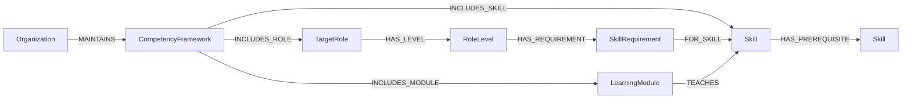

# Khung ontology cho dữ liệu do organization cung cấp

Ngày đối chiếu nguồn: 09/10/2026. Trạng thái: đề xuất khung; chưa triển khai ontology hình thức, sửa database hoặc tạo dataset nghiệp vụ.

## 1. Phạm vi đã làm rõ

**Platform định nghĩa khung ontology dùng chung; organization cung cấp và chịu trách nhiệm về nội dung dữ liệu theo khung đó.**

Phạm vi hiện tại là class, property, ngữ nghĩa, ràng buộc và căn cứ tham chiếu. Không yêu cầu platform xây sẵn danh mục nghề/kỹ năng, chọn bộ ESCO để import, xác lập rubric hoặc thẩm định ngưỡng cho từng doanh nghiệp.

| Trách nhiệm platform | Trách nhiệm organization |
|---|---|
| Định nghĩa Role, RoleLevel, Skill, LearningModule và các quan hệ hợp lệ | Cung cấp tên, mô tả và danh sách cụ thể |
| Quy định cấu trúc yêu cầu năng lực và thang đánh giá | Cung cấp yêu cầu, mức đích, rubric và nội dung đánh giá |
| Quy định cấu trúc quan hệ học tập, tiên quyết | Cung cấp module, kỹ năng được dạy và tiên quyết |
| Quy định định danh, phiên bản, phạm vi sở hữu và validation | Quản lý, duyệt và cập nhật dữ liệu của mình |
| Hỗ trợ đối sánh với concept bên ngoài | Có thể cung cấp mapping khi có căn cứ |

Đề xuất này thay giả định “catalog và ngưỡng chung toàn platform” trong bản đề xuất trước. Bộ tài liệu schema v3 vẫn giữ nguyên để tham chiếu lịch sử; nội dung đó chưa được đồng bộ theo phạm vi mới.

## 2. Cơ sở chuẩn và giới hạn tuyên bố

| Nguồn chính thức | Nội dung làm căn cứ | Áp dụng vào khung |
|---|---|---|
| [ESCO — Occupations pillar](https://esco.ec.europa.eu/en/about-esco/escopedia/escopedia/occupations-pillar) | Khái niệm nghề và liên kết tới knowledge, skills/competences essential hoặc optional | Căn cứ mô hình nghề–kỹ năng; việc đưa yêu cầu xuống RoleLevel là mở rộng của platform |
| [ESCO — Extending ESCO](https://esco.ec.europa.eu/en/about-esco/escopedia/escopedia/extending-esco) | Cho phép mở rộng classification với concept chi tiết hơn; classification và extension có thể do các tổ chức khác nhau quản lý | Căn cứ cho khả năng có từ vựng riêng và liên kết với ESCO khi phù hợp |
| [W3C SKOS Reference](https://www.w3.org/TR/skos-reference/) | Concept, ConceptScheme, nhãn, định nghĩa, hierarchy và mapping | Chuẩn tổ chức từ vựng role/skill của organization |
| [European Learning Model](https://europa.eu/europass/elm-browser/index.html) | Ontology cho lĩnh vực học tập và các application profile | Nguồn tham khảo bổ sung cho learning; chưa xác nhận mapping chính xác từng class/property |
| [W3C SHACL](https://www.w3.org/TR/shacl/) | Kiểm tra RDF graph theo các điều kiện | Cơ chế biểu diễn validation nếu khung được phát hành dưới dạng RDF |

Nền chính đề xuất là **mô hình nghề–kỹ năng tham chiếu ESCO + từ vựng theo SKOS + các mở rộng nghiệp vụ được khai báo rõ**. ELM dùng khi đặc tả phần học tập sâu hơn. SFIA là nguồn nội dung tùy chọn cho tổ chức, không phải điều kiện nhập dữ liệu và không cần làm trụ cột ở bước xây khung hiện tại.

“Có căn cứ từ chuẩn” khác với “đã chứng minh tuân thủ chuẩn”. Muốn tuyên bố tương thích, cần vocabulary chính xác, bảng ánh xạ và validation thực thi. Organization có thể dùng kỹ năng riêng chưa có mapping ESCO; thiếu mapping ngoài không tự làm dữ liệu sai khung.

## 3. Khung khái niệm tối thiểu

Tên dưới đây là tên nội bộ của platform. Các ràng buộc số lượng là đề xuất nghiệp vụ, không phải yêu cầu nguyên bản của ESCO/SKOS.

Hai ô Skill biểu diễn các instance khác nhau của cùng loại. Mapping ra concept ngoài là tùy chọn và không thể hiện trong sơ đồ để giữ khung dễ đọc.

| Class | Định nghĩa / ràng buộc đề xuất | Căn cứ |
|---|---|---|
| Organization | Bên quản lý dữ liệu; không phải một skill concept | Nhu cầu sản phẩm |
| CompetencyFramework | Bộ role, skill và module có ID, phiên bản và organization sở hữu | Khái niệm nội bộ; phần từ vựng role/skill tổ chức bằng SKOS ConceptScheme; toàn framework không đồng nhất với ConceptScheme |
| TargetRole | Vai trò nghề nghiệp do organization định nghĩa; thuộc một frameworkf | Tham chiếu khái niệm nghề của ESCO; có thể biểu diễn phần từ vựng bằng SKOS Concept |
| RoleLevel | Cấp kỳ vọng của đúng một TargetRole; rank chỉ so trong cùng role | Mở rộng nghiệp vụ |
| Skill | Khái niệm kỹ năng hoặc kiến thức, có nhãn và định nghĩa; thuộc framework | ESCO làm cơ sở miền; SKOS Concept làm cơ sở từ vựng |
| SkillRequirement | Yêu cầu có phiên bản, gắn đúng một RoleLevel và một Skill; chứa mandatory, mức đích và tham chiếu thang/rubric | Mở rộng quan hệ nghề–kỹ năng để biểu diễn yêu cầu theo cấp |
| LearningModule | Tài nguyên học do organization khai báo, xác định các kỹ năng được dạy | Mở rộng nghiệp vụ học tập; ELM là nguồn đối chiếu bổ sung |

RoleCategory có thể bổ sung để nhóm role. Nếu chỉ gom nhóm hiển thị, có thể tham chiếu SKOS Collection; nếu là một khái niệm phân loại nghề thì phải định nghĩa nghĩa riêng trước khi dùng hierarchy. Không bắt buộc dùng ISCO.

## 4. Các quan hệ và thuộc tính chuẩn hóa

| Phần của khung | Quy tắc / căn cứ |
|---|---|
| Skill/TargetRole identifier | ID/URI ổn định; không dùng tên làm định danh |
| preferredLabel | Khi xuất SKOS dùng skos:prefLabel; tối đa một nhãn ưu tiên cho mỗi ngôn ngữ |
| alternativeLabels / definition | Đối chiếu skos:altLabel / skos:definition |
| vocabulary membership | Dùng skos:inScheme cho concept role/skill trong scheme tương ứng |
| broader / narrower | Phân cấp ngữ nghĩa khái niệm; không mang nghĩa tiên quyết hoặc cấp nhân sự |
| external mapping | Có thể dùng skos:exactMatch, closeMatch, broadMatch, narrowMatch sau khi xét đúng nghĩa; không tự mapping theo tên giống nhau |
| HAS_LEVEL / HAS_REQUIREMENT / FOR_SKILL | Quan hệ nội bộ với domain/range như sơ đồ; không khai báo tương đương quan hệ ESCO khi chưa chứng minh |
| TEACHES | LearningModule → Skill; chỉ nói tài nguyên hướng tới phát triển kỹ năng, không bảo đảm người học đã đạt |
| HAS_PREREQUISITE | Skill phụ thuộc → Skill tiên quyết; mặc định AND, không tự nối, không có chu trình; đây là quy tắc platform |

Định danh, ownership, version và reference là bắt buộc theo loại thực thể. Trường sourceFramework/sourceConceptUri chỉ bắt buộc khi bản ghi thực sự tuyên bố tái sử dụng hoặc mapping nguồn ngoài. Tách riêng phiên bản schema của platform và phiên bản nội dung framework của organization.

Mức đích phải kèm định nghĩa thang đo. Nếu MVP chọn 0–100 thì đó là quy ước platform; organization cung cấp rubric và ngưỡng trên thang đó. Không so điểm khác rubric chỉ vì cùng nằm trong khoảng 0–100.

## 5. Phạm vi dữ liệu tổ chức

- Mặc định mỗi framework thuộc đúng một organization; role, skill, module và requirement nằm trong phạm vi framework của mình.
- ID phải tránh va chạm giữa tổ chức; mã nghiệp vụ có thể chỉ cần duy nhất trong framework.
- Reference nội bộ phải cùng framework, trừ reference tới nguồn ngoài được khai báo rõ.
- Hai tổ chức có kỹ năng cùng tên hoặc cùng mapping ESCO vẫn có requirement, rubric và kết quả riêng.
- SKOS ConceptScheme mô tả tổ chức từ vựng, không thực thi phân quyền. Backend phải kiểm tra organization trong mọi thao tác đọc/ghi.
- Platform kiểm tra cấu trúc và tính nhất quán; organization chịu trách nhiệm tính đúng chuyên môn. Dữ liệu qua validation không tự có nghĩa là rubric hay ngưỡng đã được thẩm định khoa học.

Các quy tắc ownership trên là đề xuất kiến trúc tenant theo nhu cầu sản phẩm, không phải quy tắc ESCO.

## 6. Bằng chứng cần có để bảo vệ khung

1. **Từ điển class/property:** định nghĩa, domain/range, kiểu dữ liệu và cardinality.
2. **Ma trận truy xuất chuẩn:** mỗi thành phần → nguồn và mục tham chiếu → tái sử dụng/đối sánh/tham khảo/mở rộng → lý do.
3. **Bộ ràng buộc:** trường bắt buộc, reference, ownership, phiên bản và quan hệ hợp lệ. Nếu dùng SHACL thì cần RDF graph; Neo4j cần validation ứng dụng/Cypher hoặc bước chuyển RDF, không mặc nhiên chạy được SHACL trên property graph.
4. **Ví dụ cấu trúc nhỏ:** hai organization, các ID giả và một vài liên kết để minh họa không va chạm, đúng/sai cardinality và reference. Không cần bộ dữ liệu nghề thực hay điểm chuẩn được thẩm định ở giai đoạn này.
5. **Câu hỏi kiểm chứng khung:** xác định được yêu cầu của role-level nào, thuộc tổ chức nào, module dạy kỹ năng nào, dữ liệu nào sai cấu trúc và khái niệm nào có mapping ngoài.

Hoàn thành các mục này sẽ tạo đặc tả khung có thể kiểm chứng. Tài liệu hiện tại chốt phạm vi và đề xuất cấu trúc có nguồn; chưa phải bản RDF/OWL, SHACL hoặc chứng nhận tuân thủ đã hoàn tất.
