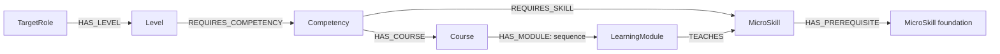

# Ontology fields, publication and assessment rules

## Current Scope Alignment

**Product authority:** [System Overview](../adapt_learn_graph_system_overview.md); aligned 2026-10-14. The release-specific fields/rubric below are preview design, not automatically approved runtime schema or current assessment policy.
Expert reviews subject-matter definitions and calibrates evidence; L&D publishes Expert-completed target roles and approves learning modules/courses/assessments. Dataset `APPROVED` metadata does not by itself prove L&D publication or organizational approval. L&D owns baseline competency coverage/question selection/scoring; Expert configures module assessments. Proficiency/tracing models and RIASEC instruments remain open.
Preserve released values/history and reconcile discipline membership, separate publication/approval, courses and independent learning with [architecture](../ARCHITECTURE.md) before implementation. Do not silently copy preview fields into V5 or rewrite archived approvals.

## Dataset Release Baseline

Catalog version: 0.3.1. Rubric version: 1.1. Updated 12 October 2026.

The supplied `ontology_v03_high_priority_fixed.xlsx` is the baseline for this release. Its detailed requirement tasks and rubric 1.1 supersede the earlier generated v0.3 wording. The reviewed workbook, this document, the dataset specification and `ontology_v031_en.json` form one release. Earlier v0.3 exports are historical and must not be mixed with this release.

## 1. Model

There are six graph node types and seven relationship types. Rubrics are versioned assessment configuration, not additional ontology nodes. Each Competency belongs to one Level. Shared MicroSkills hold definitions; REQUIRES_SKILL holds the context and threshold. No CompetencyRequirement or SkillRequirement node is introduced.

## 2. Common fields

The following fields apply to all six node types and all seven relationship types:

| Field | Type | Meaning and validation |
|---|---|---|
| id | string | Stable ID; unique per record type. Preserve IDs from the supplied workbook. |
| version | string | Catalog content version, currently 0.3.1; separate from rubricVersion. |
| status | enum | Lifecycle: DRAFT, ACTIVE or ARCHIVED. ACTIVE means present in the working catalog, not automatically approved. |
| reviewStatus | enum | NEEDS_EXPERT_REVIEW, APPROVED or REJECTED. DRAFT is not a reviewStatus in this release. |
| reviewedBy | string or null | Actual reviewer identity. Required for APPROVED. Null while pending. |
| reviewedAt | ISO-8601 datetime or null | Actual approval/review time with timezone. Required for APPROVED. Do not fabricate timestamps. |

No reviewer or approval time was supplied, so all nodes and relationships are NEEDS_EXPERT_REVIEW. Their original ACTIVE lifecycle values are retained. The four rubric criteria also need expert review and have lifecycle DRAFT. A source citation or an author-generated seed does not constitute organization approval. The package change log records the previous review labels.

## 3. Node-specific fields

### TargetRoles

| Field | Type | Explanation |
|---|---|---|
| code | string | Unique role code in the organization. |
| name | string | English role name. |
| scope | text | Work covered by the local role profile. |

### Levels

| Field | Type | Explanation |
|---|---|---|
| targetRoleId | string | Parent role in flat exports; represented by HAS_LEVEL in Neo4j. |
| code | enum | J, M or S; unique within a role. |
| name | string | Junior, Middle or Senior. |
| rank | integer | 1, 2 or 3; ordering does not automatically award attainment. |
| context | text | Expected complexity and permitted support. |
| attainmentRule | enum | ALL_MANDATORY_SKILLS_AND_COMPETENCY_EVIDENCE. |

### Competencies

| Field | Type | Explanation |
|---|---|---|
| levelId | string | Owning level in flat exports; represented by REQUIRES_COMPETENCY in Neo4j. |
| name | string | Integrated capability label. |
| outcomeStatement | text | Work the learner must demonstrate in this level. |
| acceptanceCriteria | text | Required integrated evidence; evaluated separately from individual skill scores. |
| evidenceType | enum | WORK_SAMPLE_AND_REVIEW for this release. |

### MicroSkills

| Field | Type | Explanation |
|---|---|---|
| name | string | Shared skill label. |
| definition | text | Meaning of the skill; no learner score or level threshold here. |

### Courses

| Field | Type | Explanation |
|---|---|---|
| title | string | Learning and practice collection title. |
| description | text | Scope of linked local lessons and practice tasks. |

### LearningModules

| Field | Type | Explanation |
|---|---|---|
| title | string | Learning and practice module title. |
| learningOutcome | text | Level-specific tasks and evidence to submit. Newlines are actual line breaks. |
| moduleType | enum | LESSON_AND_PRACTICE. Content references are defined below. |

All node-specific fields above are required in the current seed. Flat parent IDs are transport fields; avoid persisting both redundant properties and graph edges. Relational implementations may use them as foreign keys.

The approval fields are persisted workflow metadata. In contrast, sourceConceptUri, sourceLocator, sourceVerification, sourceRefs and derivationType remain in source documentation only. They are excluded from business records in the seed.

## 4. Relationships

All flat relationship records include `type`, `fromId` and `toId`. They identify edge type and endpoints for import, not extra node properties. Endpoints must exist and match the declared types. Avoid duplicate endpoint pairs within an active catalog version.

| Type | From | To | Cardinality | Additional fields |
|---|---|---|---|---|
| HAS_LEVEL | TargetRole | Level | 1:N; one role per level | None |
| REQUIRES_COMPETENCY | Level | Competency | 1:N; one level per competency | None |
| REQUIRES_SKILL | Competency | MicroSkill | N:N | isMandatory, expectedOutcome, requiredScore, rubricId, rubricVersion |
| HAS_COURSE | Competency | Course | N:N | None |
| HAS_MODULE | Course | LearningModule | N:N | sequence |
| TEACHES | LearningModule | MicroSkill | N:N | None |
| HAS_PREREQUISITE | MicroSkill | MicroSkill | N:N, acyclic | prerequisiteScope, readinessOutcome |

| Field | Type | Explanation |
|---|---|---|
| isMandatory | boolean | True means required for competency attainment. All 201 current requirements are true. |
| expectedOutcome | text | Authoritative level-specific task, context and evidence specification from the supplied workbook. |
| requiredScore | decimal [0,1] | Inclusive minimum normalized score; compare unrounded values. Required on every active requirement. |
| rubricId | string | Versioned rubric reference, RUB-SKILL-01. |
| rubricVersion | string | 1.1 for all 201 requirements; resolve the exact version, not latest implicitly. |
| sequence | positive integer | Position within a course; unique per course. This is not a skill prerequisite. |

### Learning content references

LearningModule.moduleType is LESSON_AND_PRACTICE. `contentUri` (required string) is a package-relative storage key, for example `content/modules/MOD-DE-J-MODEL-01.md`; `contentType` is `text/markdown`; `contentVersion` is `1.0`. Resolve contentUri relative to the directory containing the seed. These keys refer to real packaged files, not invented public URLs. An application can map the same keys into its object storage and render Markdown. No upload, storage deployment or application renderer was implemented in this task.

The package contains 72 module documents and 12 shared topic lessons. Each shared lesson includes explanation, an authored illustrative example and a self-check with an answer; each module references its topic and verified official learning resources and retains its specific practice/evidence instructions. The lessons are introductory seed content, not a claim of complete professional training. Source URLs remain in Markdown rather than database provenance fields. A content-version change requires renewed module review. Official use must validate content existence and the expected manifest hash as well as approval state.

### HAS_PREREQUISITE

MicroSkill A -[:HAS_PREREQUISITE]-> MicroSkill B means B is a learning foundation for A in this local curriculum. Cardinality N:N; no self-edge, duplicate active pair or directed cycle. Common approval/version fields apply. Additional required fields: `prerequisiteScope` = LEARNING_READINESS and `readinessOutcome` (text describing what foundational behaviour must be demonstrated).

These 20 edges are source-supported local teaching-order proposals, not official ESCO prerequisite edges. The rationale and exact source for each edge are in the dataset specification. Sources may describe an operational dependency or an instructional sequence; they do not prescribe our graph. For example, the selected tuning pathway uses cross-validation, although alternative valid tuning workflows exist.

Readiness requires an approved assessment of B with compatible task/level context, or an explicit reviewed demonstration meeting readinessOutcome. Course completion alone is insufficient. A raw score from another level must not automatically unlock A. Prerequisites schedule learning; they do not silently add new mandatory role-attainment skills. When a prerequisite is outside the target role inventory, offer a reviewed bridging module without awarding that other role's level.

Expand transitive prerequisites before ordering recommendations. Inside a module, teach prerequisite skills first. Between modules, combine prerequisite constraints with HAS_MODULE.sequence; detect conflicts rather than discard one constraint. Published pathway generation must inspect the full declared dependency closure: an unapproved edge must produce CATALOG_NOT_READY, not disappear through filtering. An absent teaching module produces PATHWAY_UNRESOLVED. Reject cycles on authoring/import; do not guess an order for a cycle.

## 5. Rubric configuration fields

Rubric rows are uniquely identified by `(rubricId, rubricVersion, criterionId)`. They are supporting definitions rather than graph nodes. Required fields are rubricId, rubricVersion, criterionId, weight, criterionName, score0, score1, score2, score3, score4, evidenceRule, status and reviewStatus. Approval requires reviewedBy and reviewedAt. Each referenced version must contain exactly the four intended criteria; all weights must be positive and sum to 1. The score0–score4 columns describe ordinal criterion ratings, not five different thresholds.

## 6. Publication gate before official use

`publishable(record) = status == ACTIVE AND reviewStatus == APPROVED AND reviewedBy is present AND reviewedAt is a valid timestamp`

This is a necessary record-level gate; structural and rubric checks must also pass. The entire release currently has zero publishable records. A pending or rejected catalog dependency produces CATALOG_NOT_READY, not a learner FAIL or NOT_ASSESSED.

For official attainment:

1. Load the complete target role/level definition for the chosen catalog version, including every required competency and mandatory skill requirement. Validate non-empty lists, parent consistency, endpoints and exact rubric references.
2. Check the role, level, HAS_LEVEL edge, every required competency and REQUIRES_COMPETENCY edge, every mandatory REQUIRES_SKILL edge and its MicroSkill, and the full referenced rubric version.
3. Require publication approval for all these dependencies. Do not first filter unapproved mandatory requirements away and then pass the approved subset. Do not use an ALL over an empty result to award attainment.
4. If a LearningModule supplies the official assigned task, also approve that module and the course and resource links actually used to select it. Unused pending modules need not block an otherwise approved independent assessment.
5. Only after this gate may the assessment subsystem evaluate learner evidence.

For published learning recommendations, check the relevant role/competency route, course, module, taught skill and all traversed relationships. A prototype preview may inspect pending content, but it must not produce official attainment. The `ACTIVE AND APPROVED` filter is appropriate for browsing; it is insufficient as the whole level-attainment query.

Approval records must come from an actual authorized reviewer. This document defines the required behavior; the workbook does not implement or prove backend enforcement.

## 7. Rubric 1.1 and attainment

Use the four criterion descriptors in the workbook. Rate each criterion with an integer from 0 to 4 within the assigned level/task context:

`normalisedScore = (0.40 * CORRECTNESS + 0.25 * VERIFICATION + 0.20 * AUTONOMY + 0.15 * REASONING) / 4`

Unlike the previous draft rubric 1.0, rubric 1.1 evaluates autonomy within the assigned level allowance. Results are not portable across levels merely because the MicroSkill ID matches. Guided Junior work and independent Senior work require different task evidence even if their normalized scores happen to match.

| Level | Standard threshold | Selected stricter threshold | Permitted context |
|---|---|---|---|
| Junior | 0.60 | 0.65 | Supplied designs, examples and planned guidance. |
| Middle | 0.75 | 0.80 | Independent routine work; clarification and normal peer review allowed. |
| Senior | 0.90 | 0.95 | Complex or cross-component work, alternatives and review. |

The per-edge thresholds remain local, uncalibrated policy hypotheses. They are not scores prescribed by ESCO, SFIA or DDaT. Do not use them as an external certification standard.

Skill PASS requires complete evidence, a score meeting requiredScore, CORRECTNESS >= 3, AUTONOMY >= 3 and every pre-agreed critical check passed. A known failed critical gate is FAIL even if other evidence is missing. Otherwise missing ratings/evidence give NOT_ASSESSED and no numeric score; assessed failure is FAIL. Do not replace missing evidence with 0 or renormalize weights. Zero is a valid demonstrated failure rating.

Agree task-specific critical checks before assessment and record applicability. Do not invent a universal security or leakage check for unrelated work. The rubric explicitly prevents high scores in other dimensions from compensating for failed critical checks or inadequate correctness/autonomy.

Competency attainment requires all mandatory skill passes AND accepted integrated work against the competency acceptanceCriteria. Level attainment requires every linked competency to pass. Any known failed required outcome gives NOT_YET_MET; otherwise outstanding evidence gives NOT_ASSESSED; otherwise MET. Catalog readiness is checked first. Course/module completion alone is not attainment.

Examples retained from the supplied rubric: ratings (3,2,3,2) produce 0.65; ratings (4,4,3,4) produce 0.95. Ratings (2,4,4,4) produce 0.80 but fail the correctness gate. These are arithmetic demonstrations, not fabricated learner results.

## 8. Learning and prerequisite scope

Confirmed scope: the platform will provide learning content and use a skill prerequisite graph. The package supplies actual local Markdown content and 20 reviewed-source-based prerequisite proposals. Both content and edges still await organizational approval. See the schema extensions above for storage resolution, dependency direction and pathway rules.

## 9. Required-skill scope review

All 67 Junior requirement rows in the supplied workbook were inspected; all use bounded tasks with supplied inputs, a design/template or guidance. For example, DE08 describes a supplied flow at Junior, while design judgement becomes stronger at higher levels. DE13 starts with one guided optimization, AI11 with a bounded search, AI16 with a supplied maintenance scenario, and QA15 with a supplied workload.

The 201 mandatory flags are retained as a coherent prototype baseline, not silently changed without an organization role policy. The same skill inventory does not mean the same expected performance. Senior task complexity, rubric context, numeric thresholds and integrated competency evidence all differ. Organization experts should specifically review the breadth of Junior DE13, AI11, AI16 and QA15 before production use. A narrower role profile may make selected edges optional; that is a policy change and must update the attainment definition, module recommendations and version together.

## 10. Versioning and handoff

Catalog version 0.3.1, rubric 1.1, source evidence references and approval state must travel together. Threshold-only changes need a catalog version change; changes to rating meanings require a rubric version change. Preserve historical decisions with the definition versions used. Approval may not be carried forward to changed content without the required review.

See the dataset specification for exact counts, actual course/module records and source mappings. The packaged manifest lists SHA-256 hashes for the workbook, seed, documents and source evidence. No source-provenance fields are added to the application database.
