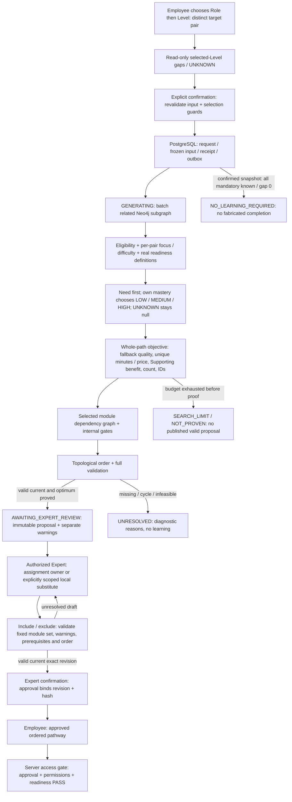
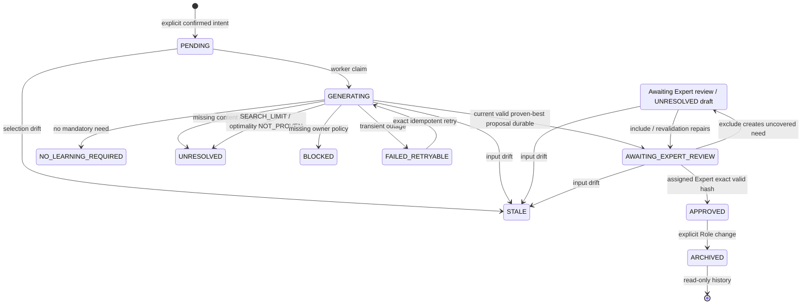
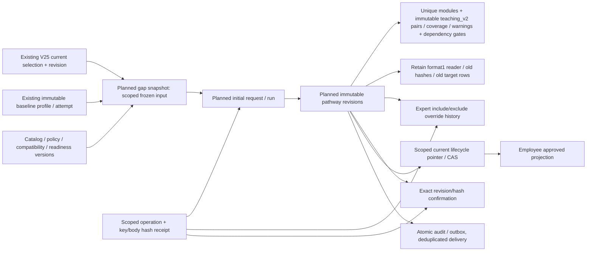

# Planned initial gap/pathway flow, states and data

Updated2026-10-28. **Confirmed design; scoped C2 source/build exists, not deployed/runtime-verified schema.** Mermaid requires a supporting viewer; no live DB image/rendering/runtime success claimed. [Canonical policy/design](../technical/initial-pathway/Initial%20pathway%20generation/Initial%20Pathway%20Flow%20and%20Data%20Design.md#14-confirmed-catalog011-policy-and-implementation-contract--2026-10-28) and [source/build receipt](../testing/system/REQ-041-042-v011-source-build.md).

## Product and algorithm flow



## Sequence and transaction boundary

```mermaid
sequenceDiagram
    actor Employee
    participant API as Java API / trusted actor
    participant PG as PostgreSQL
    participant Graph as Neo4j catalog (read-only)
    participant Worker as Planner worker
    actor Expert
    Employee->>API: Preview roleId + levelId
    API->>PG: Read authoritative own profile / selection
    API->>Graph: Validate membership; read selected Level requirements / publication
    API-->>Employee: Gaps + UNKNOWN + gapInputHash / expected selection (no learner writes)
    Employee->>API: Confirm roleId + levelId + expected gap / selection + key
    API->>PG: Reauthorized receipt lookup before new-command preconditions
    API->>PG: Scoped resulting selection / planningInputHash / request / receipt / outbox (planned UoW)
    API-->>Employee: Durable request ID / PENDING or GENERATING (or retained replay)
    Worker->>PG: Claim frozen request / replay check
    Worker->>Graph: Batch relevant skills / prerequisites / providers
    Worker->>Worker: Exact bands / focus coverage / dedup objective search / topo / validate
    alt Optimality proved and current valid
        Worker->>PG: Current claim token + fresh input CAS + proposal / audit / outbox
    else Search exhausted before proof
        Worker->>PG: Run SEARCH_LIMIT / NOT_PROVEN; no valid current proposal
    end
    Expert->>API: Assigned proposal read / include or exclude
    API->>API: Fixed-set coverage / warnings / dependencies; no automatic module replacement
    API->>PG: New immutable draft revision + override / receipt
    Expert->>API: Confirm expected revision + hash + key
    API->>PG: Exact approval / review pointer / receipt transaction if current valid
    Employee->>API: Read current pathway / request module access
    API->>PG: Read own approved exact revision
    API->>API: Recheck content / permissions / actual readiness
    API-->>Employee: Ordered path / safe locks or denied access
```

Graph snapshots and revalidation are used; no distributed PostgreSQL/Neo4j ACID transaction. Worker graph calls are not inside long learner locks.

## State separation



APPROVED does not mean every module unlocked. Each applicable backend access still checks real versioned readiness/publication/permissions. Post-learning recalculation is not drawn.

This is the visible lifecycle, not a single persisted enum. Canonical design section5.2 separately proposes generationStatus/reviewStatus/validationStatus: generation SUCCEEDED plus valid draft displays AWAITING_EXPERT_REVIEW; an excluded invalid draft still awaits review but displays UNRESOLVED; exact approval displays APPROVED. Initial generation UNRESOLVED/BLOCKED without a proposal has no include/exclude target. Optional no-gap acknowledgement and stale reviewed-draft refresh commands remain undefined/Proposed, not automatic transitions.

## Logical data relationship — planned format2 extension, not DDL



Source includes V27 and new unapplied V28/format2; external DB head is unverified. Retain format1 hashes/receipts/approvals; no immutable-history backfill, fake UUID, rank1..5 cap or Neo4j schema edit. Source/build and later manual/UI on the DB-capable machine are separate milestones; no Docker requirement or executable-test authority follows from this diagram.
