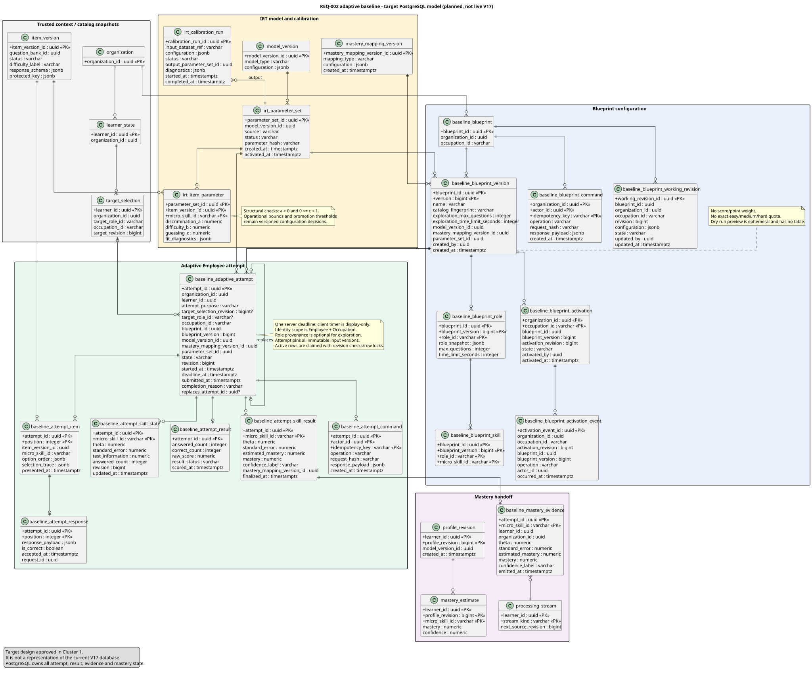

# Adaptive Baseline Data Architecture

## Status and boundary

- Requirement: REQ-002, with downstream REQ-041 mastery integration.
- Status: **Target design — Cluster 1; not implemented in PostgreSQL V17.**
- PostgreSQL is authoritative for Blueprint versions, adaptive attempts, responses, deadlines, results, IRT parameter versions, calibration provenance and mastery evidence.
- Neo4j remains authoritative for published Occupation/TargetRole/MicroSkill catalog relationships. PostgreSQL stores the immutable identifiers and snapshots needed to reproduce an attempt.
- IRT estimation and item selection run in the Java application. Redis is not required for the initial design and must never own attempt, deadline or result state.

The current V17 schema supports the old shared Generate → Review → Publish assessment lifecycle. It does not support a reload-safe in-progress adaptive attempt or versioned 3PL parameters. The forward migration is a Cluster 2 task; applied V1–V17 files must not be edited.



[PlantUML source](../../diagrams/postgresql-adaptive-baseline-target.puml)

## Storage flow

```text
L&D saves/finalizes a valid working Blueprint
  -> validates catalog/eligible item capacity
  -> dry-run selects an answer-safe sample without persistence
  -> atomically makes that immutable version current for organization + Occupation

Employee starts/resumes for role requirement or occupation exploration
  -> pins required Occupation plus optional target selection provenance
  -> pins Blueprint + model + mapping + parameter versions
  -> server stores deadline and first presented item
  -> each accepted answer atomically stores response, provisional theta/SE and next item
  -> manual submit, evidence stop or deadline finalizes once
  -> immutable per-skill theta/SE/point mastery/conservative mastery produces idempotent mastery evidence
```

## Target tables

### Blueprint configuration

| Table | Purpose and main invariant |
| --- | --- |
| `baseline_blueprint` | Stable identity unique by `organization_id + occupation_id`. |
| `baseline_blueprint_working_revision` | The sole mutable draft with optimistic `revision`; its exact representation may remain normalized or use validated JSON during migration. |
| `baseline_blueprint_version` | Immutable configuration snapshot. Stores the voluntary Occupation exploration question bound/duration, active-role/catalog fingerprint and pinned model/mapping/parameter versions. It has no backend default: L&D must explicitly save the suggested or edited exploration duration. |
| `baseline_blueprint_role` | Immutable snapshot of each role that was `ACTIVE` at finalization plus its required positive maximum-question bound and duration. Draft/inactive/archived/removed roles are excluded. It has no total score and no difficulty score weights. |
| `baseline_blueprint_skill` | Immutable deduplicated MicroSkill membership for an active role. It has no per-skill points or exact easy/medium/hard quotas. |
| `baseline_blueprint_activation` | One serialized technical current pointer per organization + Occupation. It changes atomically when a valid configuration is finalized; this is not a separate review/publish stage. Disabling clears availability without deleting versions. |
| `baseline_blueprint_activation_event` | Append-only activate/replace/disable history tied to the pointer revision; switching the pointer never erases who changed availability. |
| `baseline_blueprint_command` | Idempotency receipt for save/finalize-and-switch/disable. Dry-run remains read-like and does not create a receipt or domain history. |

The L&D preview is intentionally not a table. It validates and samples through an ephemeral API; it creates no assessment, attempt, result, active pointer or mastery evidence.

### IRT and calibration

| Table | Purpose and main invariant |
| --- | --- |
| `model_version` | Existing versioned algorithm/configuration identity; its configuration owns estimator/MAP prior, minimum-evidence and `SE` stop settings. The adaptive baseline pins the exact version. |
| `mastery_mapping_version` | Immutable point/conservative formulas and positive `k` mapping `theta + SE` to mastery `0..1`. It prevents later formula changes from rewriting history. |
| `irt_parameter_set` | Immutable named set of item parameters, sourced from seeded defaults or a calibration run. Calibration creates a candidate; only System Administrator promotion makes it eligible for new Blueprints. |
| `irt_item_parameter` | Parameter tuple per `item_version_id + micro_skill_id`: discrimination `a`, difficulty `b`, guessing `c`, plus optional fit diagnostics. Structural constraints are `a > 0` and `0 <= c < 1`; agreed operational bounds belong to versioned calibration configuration. |
| `irt_calibration_run` | Append-only job record: input dataset/simulation reference, configuration, status, convergence diagnostics and output parameter set. A run never mutates parameters pinned by an attempt. |

Difficulty labels remain useful for authoring/search and cold-start coverage, but adaptive selection uses calibrated `b` and information. A hard item can legitimately have weak discrimination; label and parameter are not interchangeable. MAP prior, minimum-evidence gate and `SE` target are initially backend constants inside immutable `model_version.configuration`; the conservative formula/`k` is in `mastery_mapping_version.configuration`. They are not L&D fields. Their future operational owner/UI is deferred.

### Employee attempt

| Table | Purpose and main invariant |
| --- | --- |
| `baseline_adaptive_attempt` | One Employee + Occupation state machine instance. It records `ROLE_REQUIREMENT` or `OCCUPATION_EXPLORATION`, optional target-selection provenance, all pinned versions, optimistic revision, server start/deadline, completion reason and optional `replaces_attempt_id`. Only an invalidated attempt that emitted no mastery may be replaced. |
| `baseline_attempt_item` | Immutable presented sequence. It pins the item version, skill, option order and selection trace so reload cannot change an already shown question. Unique `(attempt_id, position)` and `(attempt_id, item_version_id)` prevent duplicates. |
| `baseline_attempt_response` | One accepted response per presented position, with server-computed correctness and request identity. The client never submits correctness. |
| `baseline_attempt_skill_state` | Mutable, provisional theta/SE/information used only while selecting the next item. It is reproducible from accepted responses and pinned parameters. |
| `baseline_attempt_result` | Immutable overall completion summary and explanatory raw score `correct_count / answered_count`; raw score does not drive mastery. |
| `baseline_attempt_skill_result` | Immutable output per MicroSkill after the minimum-evidence gate: theta, SE, point `estimated_mastery`, conservative downstream `mastery` and confidence label. No row is created below the gate. |
| `baseline_attempt_command` | Idempotency receipt for start/answer/submit operations; same actor/key/request replays, conflicting reuse fails. |

Confirmed states are `IN_PROGRESS`, `SUBMITTED`, `AUTO_SUBMITTED` and `INVALIDATED`. There is no `INSUFFICIENT_EVIDENCE` result state and no deadline grace. Timeout with minimum evidence becomes `AUTO_SUBMITTED`; timeout/technical failure below the gate becomes `INVALIDATED` with no mastery and may be replaced. A mastery-producing completion permanently closes the Employee + Occupation allowance.

### Mastery handoff

| Table | Purpose and main invariant |
| --- | --- |
| `baseline_mastery_evidence` | Exactly-once handoff per attempt + MicroSkill, carrying theta, SE, point/conservative mastery, confidence and mapping/model provenance. Invalidated attempts emit none. |
| `processing_stream`, `profile_revision`, `mastery_estimate` | Existing downstream versioned projection. Baseline initializes the learner estimate; the same responses must not be applied again as independent BKT evidence. |

`mastery_estimate` remains a consumer-facing projection. The immutable attempt skill result is the reproducible source for baseline scoring and audit.

## Transaction and concurrency rules

1. Blueprint finalization locks the organization/Occupation current pointer, verifies the immutable version and eligible parameter set, advances its revision, appends the activation event and command receipt, then commits. There is no separate review/publish command.
2. Start resolves an authorized Occupation from the selected active role or voluntary Occupation choice, checks whether a mastery-producing baseline already closed the Employee + Occupation allowance, verifies the current active-role/catalog fingerprint, locks or creates its active-attempt key, then snapshots every version before the first item is exposed. Membership drift blocks new starts until L&D refreshes the Blueprint. A role-required attempt uses the active role pool/bound/duration; exploration uses the deduplicated union of active role pools and the exploration bound/duration.
3. Answer locks the attempt (or checks an optimistic revision), checks `IN_PROGRESS` and `deadline_at`, verifies the presented position, writes one response, updates affected skill state, chooses and writes at most one next item, records the receipt, then commits.
4. Submit/auto-submit locks the same attempt and is idempotent. The deadline check has no grace. With minimum evidence it writes overall/per-skill results and mastery evidence in one transaction; below the gate it invalidates without mastery. Both outcomes then prevent answer changes.
5. A deadline worker selects indexed `IN_PROGRESS` rows by `deadline_at` in bounded batches and may use `FOR UPDATE SKIP LOCKED`; PostgreSQL time is authoritative.
6. Every query/write is scoped by trusted `organization_id` and actor authorization. Client-supplied organization, learner, correctness, mastery, parameter or deadline fields are rejected/ignored by contract.
7. Immutable inputs may be cached in-process by version. A cache miss reloads PostgreSQL and cannot change a pinned attempt.

Required indexes include active Blueprint lookup by organization/Occupation, one `IN_PROGRESS` attempt per Employee + Occupation, one mastery-producing completion per Employee + Occupation, unique/non-cyclic replacement linkage, `IN_PROGRESS + deadline_at`, response request identity, attempt item uniqueness and calibration/parameter version lookup.

## Existing schema disposition

| Existing structure | Target disposition |
| --- | --- |
| `baseline_blueprint`, working revision and immutable Blueprint history | **Migrate/extend** while preserving history and organization/Occupation identity. |
| `easy_score_weight`, `medium_score_weight`, `hard_score_weight` | **Remove** in the forward cutover migration; do not add replacement point fields. |
| Exact role total and skill easy/medium/hard question counts | **Remove/migrate** to active-role/exploration maximum-duration pairs plus the system-owned minimum-evidence policy. |
| Shared baseline `assessment_version`, `assessment_item`, Review/Publish pointers/transitions and answer-reveal flow | **Deprecate for baseline** after consumer mapping. Keep generic/module assessment tables where another feature owns them. |
| Generic `assessment_attempt`, `item_response`, `assessment_result` | **Keep for legacy/module compatibility**; do not overload their fixed-manifest/score contract for adaptive baseline. |
| Existing `model_version`, processing and mastery projection | **Reuse by versioned integration**, adding only the provenance needed by the approved migration. |

No table or column is removed merely because this document marks it deprecated. Cluster 2 must first locate every code, query, seed, test and document consumer and implement a forward-only migration with an explicit rollback/compatibility plan.

## Decisions

- **Confirmed:** every Employee without a completed Occupation baseline must take it; role-required and voluntary Occupation entry paths; Employee + Occupation one-success allowance with optional role provenance; active-role/exploration pools and capacity-bound maxima; no per-question points or difficulty weights; derived raw score; adaptive 3PL; logistic point mastery plus conservative `logistic(theta - k × SE)` downstream mastery; below-gate invalidation/replacement; PostgreSQL authority; Java estimation; reload safety; no deadline grace; server auto-submit; in-progress snapshot survival after Blueprint replacement/disable; Employee result disclosure; immutable version pinning; ephemeral dry run; System Administrator calibration promotion; no Redis initially; no shared baseline Review/Publish lifecycle.
- **Provisional technical configuration:** table/column names and exact MAP/minimum-evidence/SE/`k`/parameter bounds are implementation-level, system-owned versioned configuration, initially supplied by backend code/config rather than L&D.
- **Open before Cluster 2:** none at the product-contract level. Cluster 2 must select safe initial technical constants and record them in the pinned version without changing the confirmed behavior.
- **Rejected:** baseline mastery cap, client-owned timer/correctness, persisting preview history, treating raw score as mastery, rewriting parameter values used by past attempts.
