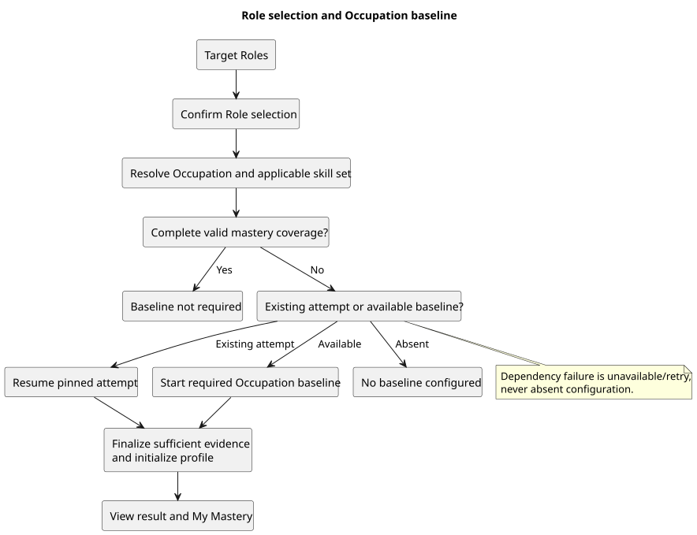

# Role selection and Occupation baseline

## Purpose and scope

Employee selects a desired Role, then receives the next step for its Occupation based on authoritative mastery coverage. This contract covers REQ-001-F01 browsing, REQ-001-F02 selection/change, REQ-002-F01 admission/completion and REQ-002-F02 version presentation. Result/history and My Mastery are protected read dependencies; gap calculation and pathway generation remain separate Functions.

[Diagram source](../../diagrams/role-baseline-flow.puml)

Dependency errors are retryable unavailable states, never missing mastery or absent configuration. Target Roles is a separate Employee page. English uses Role; Vietnamese uses Vị trí / Vị trí làm việc mong muốn. There is no independent Occupation-exploration entry in this flow.

## Actor, inputs and protected output

Authentication supplies an active Employee and trusted organization. L&D manages authorized Occupation configurations. Every query/command rechecks actor permission and tenant scope; UI routes never grant authorization.

| Function | Client input | Server responsibility/output |
| --- | --- | --- |
| REQ-001-F01 | Search, sort, Occupation filter, page, Role detail ID | Authorized current Role/Occupation/Level requirements; read-only |
| REQ-001-F02 | Role ID, expected selection ID, idempotency key | Recheck availability, serialize selection, return committed snapshot/revision |
| REQ-002-F01 | Start/resume, own attempt ID, expected revision, response or submit confirmation | Derive scope from selection; check coverage/allowance; pin sequence/deadline; score on server |
| REQ-002-F02 | Selected version/Draft ID; configuration; expected revisions; command key | Read exact record; Save sole Draft; Preview; Activate/Deactivate; confirmed Draft discard |

Client cannot set actor/tenant, ownership, coverage, mastery, status, correctness, technical pins or authoritative timing. Employee outputs exclude answer keys/rationales, internal theta/SE and foreign records.

## Sources, processing and storage

1. Read authorized catalog relationships: Occupation → HAS_ROLE → TargetRole → HAS_LEVEL → Level → REQUIRES_SKILL → MicroSkill. Current catalog IDs are stable strings; Level is separate requirement context, not a legacy seniority field or extra selection prerequisite. Publication and visibility remain required catalog responsibilities.
2. Recheck the selected Role and its unique owning Occupation. Under learner serialization, check exact receipt replay, expected selection and assessment activity. End the old selection and write snapshot/revision/receipt/audit/outbox atomically. Selection does not wait for baseline configuration and does not start an attempt.
3. After selection commits, read authoritative Employee mastery in PostgreSQL through the profile boundary. For a learner without a bound profile, resolve the deduplicated full Occupation skill union. Existing initialized profiles retain their original required skill set and applicable baseline version; newer catalog/version requirements are not imposed retroactively.
4. Coverage requires valid mastery for every applicable skill. Low or zero valid mastery counts as present; missing/UNKNOWN/null or invalidated evidence does not. An empty/malformed skill union is unavailable, never vacuous success. A terminal attempt alone does not certify an initialized profile.
5. If coverage is incomplete, resolve an own resumable attempt before new admission. Otherwise require usable Active configuration, allowance and complete dependency readiness. Missing configuration is distinct from stale/infeasible configuration or dependency failure.
6. New start rechecks trusted selection, coverage, current activation and feasibility; pins full Occupation pool/skills, selection provenance, Blueprint/catalog/model/mapping/parameters, content/options and server deadline. Selection and start are separate idempotent transactions. A failed post-selection read retains the committed selection and reconciles with GET.
7. Sufficient valid completion initializes profile from genuine finalized mastery with no passing-score threshold. Insufficient manual submission ends INVALIDATED/MANUAL without mastery/profile; linked replacement retains the original version/pool/snapshot. No historical re-score, repin or automatic repeat is permitted.

Neo4j owns catalog data. PostgreSQL owns selection/history, profile/evidence, configuration, attempts/results, receipts/audit/outbox and downstream learner state. No distributed ACID transaction between stores is assumed; readiness uses consistent versions/fingerprints and revalidation.

## Observable states and recovery

| Condition | Required outcome |
| --- | --- |
| No selection | Browse and explicitly choose; no automatic selection or attempt |
| Selected Role removed/retired/unauthorized | Explain unavailable prior selection; explicit replacement; preserve snapshot/history |
| Complete profile coverage | Baseline not required; downstream handoff does not certify proficiency or pathway readiness |
| Incomplete coverage and usable baseline | Required full-Occupation baseline, start/resume under existing rules |
| No Active baseline and no resumable attempt | No baseline configured / Chưa có baseline; retain selection |
| Same-Occupation Role change | Reuse applicable profile coverage; no separate Role allowance |
| Different Occupation | Evaluate destination independently; retain old mastery/history |
| Assessment in progress | Block Role change; offer resume/recovery; no silent cancellation |
| Completed result but missing profile | Pending/review-needed; no evidence-only completeness, automatic import, reset or retake |
| Stale selection/Draft/activation | Conflict, refresh and explicit reconfirmation |
| Timeout or unknown command outcome | Retain exact key/body; replay until known; after known success retry reads only |
| Catalog/profile/lifecycle dependency failure | Unavailable/retry; no partial selection/pathway mutation or false empty state |

Serialize selection/start on the same learner coordination boundary. Preserve exact receipt identities, same-role no-op, one active selection and history. Assessment and pathway owners supply lifecycle guards/archive operations; dependency failure must roll back a change. Delivery is separate from durable outbox insertion.

## Assessment settings and version identity — REQ-002-F02

- One stable Blueprint per organization+Occupation, one open Draft and one Active version. A Draft and released versions have distinct identities.
- Selecting a version renders that version's saved name/settings/status. The Active summary follows its pointer, never the current form or latest Draft.
- Create new/Edit opens the working form. If a Draft exists, explain and offer continuing it or confirmed deletion; never overwrite silently or create another Draft. Cancel unsaved editing is separate from persisted Draft discard.
- Save creates/updates only the sole Draft under ID+revision CAS and idempotency. Saving edited v1 settings never changes v1 or allocates v2; activation allocates the new immutable version.
- Preview is zero-write and bound to the saved Draft/revision. Activation confirms the current replacement pair and changes pointer atomically. Existing profiles and attempts retain their original bindings.
- Historical settings remain readable without current Catalog; new/changed configuration and activation require dependencies. Stale Draft URLs require reconciliation, not silent selection of another Draft.
- Name is required, at most 100 Unicode characters. Maximum questions is a positive feasible integer. Total duration is whole seconds within 30..120 seconds per maximum question; display rounding never changes the stored budget.

## Result and My Mastery

Result/history show the Employee's original attempt scope, completion, raw assessment score, skill mastery and confidence. My Mastery reads the Employee's authoritative profiles with Occupation, applicable baseline version and source provenance. Reads never create mastery, finalize attempts or start another baseline. Empty profiles receive an empty state; failures are explicit and retryable. Assessment score, mastery and confidence have different meanings; a low mastery score is not missing coverage. Subsequent learning updates belong to the profile/evidence processing contract and must not double-apply baseline responses as BKT transitions.

## Acceptance and dependencies

[Role-to-baseline acceptance mapping](../../testing/REQ-001-002-role-baseline-flow-test-plan.md) covers RB01–RB17/VB01–VB04. [Adaptive plan](../../testing/REQ-002-adaptive-baseline-test-plan.md) covers configuration, sequence, results, numerical behavior and concurrency. Include own/foreign tenant/actor, query bounds, empty/not-found, dependency failure, no-state-change reads, replay/race/rollback and retained-version cases. These mappings are plans; implementation and observed evidence are reported separately in [synchronization review](../../testing/system/REQ-001-002-final-synchronization-review.md).

Confirmed: Role-first entry, profile authority, evidence sufficiency without a score threshold, retained learner versions, early no-mastery invalidation, isolated version settings and confirmed Draft discard. Open: cross-owner production integration and remediation for genuinely missing/invalid profiles beyond the confirmed preservation rules. Provisional: exact model numerical constants pending numerical validation. Rejected: fabricated completion, history reset/re-score/repin, silent Draft overwrite or client identity override.

Confirmed | Proposed | Provisional | Open | Rejected.
