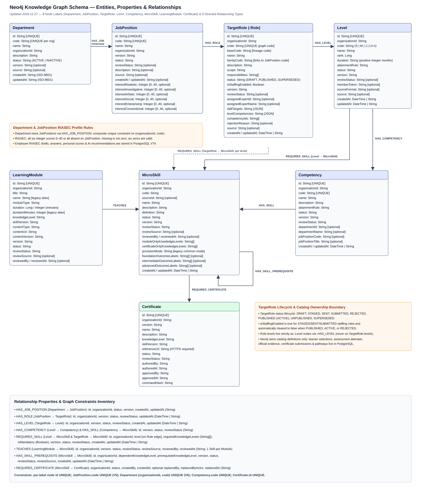
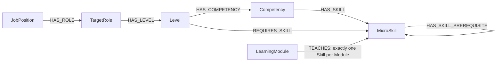
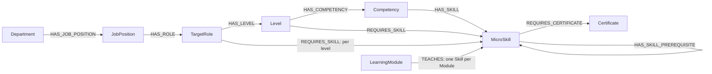

# Schema Neo4j — current source and historical inventory

> **Latest Neo4j Entities & Properties Update (2026-11-19):** The Neo4j Knowledge Graph schema comprises **8 node labels** (`Department`, `JobPosition`, `TargetRole`, `Level`, `Competency`, `MicroSkill`, `LearningModule`, `Certificate`) and **9 directed relationship patterns** (`HAS_JOB_POSITION`, `HAS_ROLE`, `HAS_LEVEL`, `HAS_COMPETENCY`, `HAS_SKILL`, `REQUIRES_SKILL` from `Level → MicroSkill` and `TargetRole → MicroSkill`, `TEACHES`, `HAS_SKILL_PREREQUISITE`, `REQUIRES_CERTIFICATE`). `TargetRole` tracks multi-version authoring and staffing lifecycle states (`DRAFT`, `STAGED`, `SENT`, `SUBMITTED`, `REJECTED`, `PUBLISHED`, `ACTIVE`, `UNPUBLISHED`, `SUPERSEDED`) along with `baseCode`, `familyCode`, `track`, `isStaffingEnabled`, `responsibilities`, `skillTargets`, `levelCompetencies`, `competencyIds`, and `rejectionReason`; `isStaffingEnabled` is enabled for `STAGED`/`SENT`/`SUBMITTED` staffing roles and cleared to `false` once `PUBLISHED`, `ACTIVE`, or `REJECTED`. Role levels are stored strictly as connected `:Level` nodes (`duration`, `rank`, `attainmentRule`, `memberToken`, `sourceFormat`) via `:HAS_LEVEL` (`r.levels` property is removed from `:TargetRole`). `Competency` nodes additionally store optional scoping metadata (`departmentId`, `departmentName`, `jobPositionCode`, `jobPositionTitle`).

> **Baseline/pathway consumer checkpoint 2026-11-18:** no new graph schema is introduced. Active consumers use explicit REQUIRES_SKILL.requiredKnowledgeLevels, exact prerequisite knowledge pairs, owned Skill version, one complete Skill/knowledge per released module and certificate-only definitions. Outcome Codes are excluded from matching; Level duration is interpreted as positive calendar months only when first approval pins PostgreSQL timing. [Current cross-store flow](technical/Organization%20Rule%20Assessment%20and%20Pathway.md#current-flow-2026-11-18). Existing graph topology/RIASEC updates remain unchanged.

<a id="riasec-current-source"></a>

## RIASEC — source hiện hành 18/11/2026

Source `2c2468b5` lưu hồ sơ Job Position **chỉ trong Neo4j**. Sáu property `interestRealistic`, `interestInvestigative`, `interestArtistic`, `interestSocial`, `interestEnterprising`, `interestConventional` là **Integer 0–40**: có đủ sáu hoặc không có cả sáu khi ghi tường minh. Sáu số 0 hợp lệ; thiếu không coalesce thành 0. Neo4j dùng native integer 64-bit; API/Java Integer giới hạn 0–40, từ chối Double/Float dù không có phần lẻ.

API bỏ cả sáu field thì giữ nguyên; sáu null tường minh xóa cả hồ sơ; còn lại phải đủ sáu số nguyên. AI đọc node ACTIVE cùng trusted organizationId, có ID/đủ sáu giá trị hợp lệ. Không lọc Department, norm khác 0 hay metadata provenance/hash. Chỉnh interest không thay learning-catalog fingerprint. Application/repository kiểm tra khoảng điểm/all-or-none; uniqueness constraint không tự bảo đảm các quy tắc này.

JobPosition có thêm `description` tùy chọn trong CRUD/read/input AI. AI chỉ nhận metadata/hồ sơ Job Position và sáu điểm Employee; không đọc Role/Skill/lịch sử học. PostgreSQL workspace V74 lưu nháp, đáp án/điểm cá nhân, AI state và snapshot gợi ý JSON; không thêm node learner/bảng profile thứ hai. Position ID trong JSON không phải FK liên database.

Hai seed `ontology_seed-skill-level.json` và `ontology_seed-prerequisite-knowledge.json` đã được duyệt thay 30 giá trị/file sang điểm demo 0–40. Receipt 17/11 ghi nhận cập nhật riêng 8 node local, không full seed. Điểm này **không phải** O*NET 31.0 đã chuẩn hóa/kiểm định. Phần v0.11/O*NET 0–1 bên dưới là lịch sử theo release, không phải API hiện tại và không cho phép tự chuyển đổi dữ liệu cũ.

[Feature fields](features/Departments%20and%20occupations/README.md#riasec-job-position-profiles) · [AI](features/Role%20guidance/README.md#riasec-job-position-exploration) · [V74/Neo4j storage](diagrams/riasec-storage.svg). Hình catalog cập nhật đầy đủ 8 node label và 9 relationship theo source hiện hành 19/11/2026.

Current source update 2026-11-09: Outcome Codes are retired from authoring, provider/question selection and evidence compatibility. Match the owned Skill + knowledge level + Skill version; retain release/review and content-version guards. Human-readable objectives remain. New Compose input is `ontology_seed-skill-level.json`; older captures/OC properties below remain historical only. The 2026-11-09 documentation update did not change the graph; the later approved RIASEC demo-profile application is separately scoped above. The local PostgreSQL V63/API follow-up was applied after user approval; it preserves original immutable snapshots and learner data.



<a id="diagram-scope--2026-11-08"></a>

### Diagram scope — 2026-11-19 (Complete 8-label Neo4j entity & property inventory)

The [PlantUML source](diagrams/neo4j.puml) and [Mermaid companion](diagrams/mermaid/graph-01.mmd) define all 8 catalog node labels (`Department`, `JobPosition`, `TargetRole`, `Level`, `Competency`, `MicroSkill`, `LearningModule`, `Certificate`) and 9 directed relationship patterns (`HAS_JOB_POSITION`, `HAS_ROLE`, `HAS_LEVEL`, `HAS_COMPETENCY`, `HAS_SKILL`, `REQUIRES_SKILL` on both `Level → MicroSkill` and `TargetRole → MicroSkill`, `TEACHES`, `HAS_SKILL_PREREQUISITE`, `REQUIRES_CERTIFICATE`). The current native SVG/PNG exports ([SVG](diagrams/neo4j.svg), [PNG](diagrams/neo4j.png)) render all current entity fields from `com.adaptlearngraph.entities.*Node` and `com.adaptlearngraph.repository.Neo4j*Repository`. Each node includes `id: String [UNIQUE]`; relationship properties and graph constraints are summarized in the diagram legend. These are Neo4j properties, not SQL foreign keys.

**Source cross-check.** The diagram reflects the union of active source definitions across [`DepartmentNode`](../backend/src/main/java/com/adaptlearngraph/entities/DepartmentNode.java), [`JobPositionNode`](../backend/src/main/java/com/adaptlearngraph/entities/JobPositionNode.java), [`TargetRoleNode`](../backend/src/main/java/com/adaptlearngraph/entities/TargetRoleNode.java), [`LevelNode`](../backend/src/main/java/com/adaptlearngraph/entities/LevelNode.java), [`CompetencyNode`](../backend/src/main/java/com/adaptlearngraph/entities/CompetencyNode.java), [`MicroSkillNode`](../backend/src/main/java/com/adaptlearngraph/entities/MicroSkillNode.java), [`LearningModuleNode`](../backend/src/main/java/com/adaptlearngraph/entities/LearningModuleNode.java), and [`CertificateCatalogRepository`](../backend/src/main/java/com/adaptlearngraph/repository/CertificateCatalogRepository.java), together with the constraint scripts in [`db/neo4j`](../backend/src/main/resources/db/neo4j). `LearningModuleNode.duration` uses Java `Integer` while the graph property supports `Long`/`Integer`. Seed null values are omitted on import. PostgreSQL continues to own learner state, assessments, and evidence.

## Registration structure import — 2026-11-19

A Guest-imported organization structure creates only `Department`, `JobPosition`, `TargetRole` and `Level` nodes linked by the existing `HAS_JOB_POSITION`, `HAS_ROLE` and `HAS_LEVEL` types. Written properties: every node `id`, `organizationId`, `code`, `name`, `status='ACTIVE'` (TargetRole: `status='STAGED'`, `isStaffingEnabled=true`, staged for staffing until skills are completed and published), `version='1.0'`, `source='REGISTRATION_IMPORT'`, `createdAt`/`updatedAt` (ISO strings); Department `description`; TargetRole `title`, `scope`, `description` (= scope), empty `skillTargets='[]'`/`levelCompetencies='{}'`/`competencyIds=[]`; Level `rank` (Long, from the file) and `attainmentRule='ALL_MANDATORY_SKILLS'`, with code `L{rank}`. Relationships carry `id`, `organizationId`, `status='ACTIVE'`, `version='1.0'`. Department head/email, O*NET interest/job-zone values, competencies and skills are absent rather than invented. No constraint or migration changes in Neo4j; existing `Department` (V6), `JobPosition` (V5) and per-label id constraints apply. [Writer](../backend/src/main/java/com/adaptlearngraph/repository/Neo4jWorkspaceCatalogWriter.java).

## Current source — 2026-11-07

**Source mapping, not an applied Neo4j capture.** Current tenant readers/writers implement knowledge/provision/certificate fields; live graph metadata was not accessible in this task. Keep existing ontology topology; add only Certificate linked from Skill. No intermediate requirement node.


REQUIRES_SKILL.requiredKnowledgeLevels replaces numeric requiredScore, explicitly and without inheritance. Module uses knowledgeLevel/skillVersion; retire active teachingFocus/difficultyLevel without duplicating level on TEACHES. HAS_SKILL_PREREQUISITE retains topology with exact dependent/prerequisite levels. Tenant-owned Skill uses disjoint moduleOnlyKnowledgeLevels/certificateOnlyKnowledgeLevels; readers retain common provisionMode compatibility; shared templates are read-only. Skill → REQUIRES_CERTIFICATE → Certificate holds one assigned definition per configured certificate-only skill/level, with required HTTPS referenceUrl; learner data stays outside graph.

Baseline never pre-adds unassessed prerequisites; skill assessment discovers shortages. Old bypass work on another target is parallel/non-gating. [Complete field/constraint mapping](technical/Organization%20Rule%20Assessment%20and%20Pathway.md#3-neo4j-physical-mapping). Existing counts and inventories below retain previous-release history. The linked catalog figure is source-defined, not a live capture. No graph/seed changes here.


<a id="current-contract--2026-11-05"></a>

## Previous single-Skill contract — 2026-11-05



Một Module dạy **đúng một MicroSkill**; một MicroSkill có thể có nhiều Module thay thế/bổ sung. Bỏ `teachingFocus` và `difficultyLevel` khỏi Module/TEACHES của release mới. Metadata chung của cạnh (`id`, `version`, lifecycle/review và reviewer/timestamp nullable hợp lệ) vẫn được giữ. Độ khó câu hỏi, requirement theo Role/Level và ngưỡng prerequisite không bị đổi.

Release [v0.12](dataset/import/ontology_seed-v012.json) có 994 node, 4.703 cạnh, 246 Module/246 TEACHES, 71 Skill có Module và 8 Skill thiếu Module được ghi trong [audit nội dung](dataset/import/single-skill-v012-audit.json). Không tạo nội dung hoặc phê duyệt giả để lấp chỗ thiếu. Ràng buộc số cạnh được kiểm tra tại writer/import/publication và preflight; unique constraint Neo4j không tự bảo đảm cardinality này.

Neo4j chỉ sở hữu catalog. PostgreSQL lưu tiến độ, bằng chứng hoàn thành bất biến theo org/learner/Module/revision/Skill và quyền tự học. Hoàn thành mọi lesson của một Module mở **điều kiện học tập** để thi Skill; không ghi nhận điểm/mastery, không khóa Module khác, không chuyển bằng chứng sang Skill mới khi Module đổi mapping. [Contract và bàn giao API](technical/Skill-Learning-Eligibility.md).

Đây là thay đổi source/dataset được kiểm chứng trên môi trường riêng. Chưa migration dev chính/accounts-dev. Các phần v0.11 bên dưới mô tả dữ liệu/hành vi lịch sử; không dùng phân loại/difficulty cũ làm contract authoring mới. SVG/PNG đã được tái tạo ngày 08/11/2026 theo capture được cung cấp và định nghĩa Certificate trong source; [PlantUML source](diagrams/neo4j.puml) và Mermaid trên mô tả contract mới.

## Historical v0.11 reference


Đây là khung ontology mới cho nền tảng phục vụ một organization. Tên node, relationship và field giữ bằng tiếng Anh để khớp với dữ liệu; phần giải thích dùng tiếng Việt. Tài liệu này mô tả đúng property được xuất sang Neo4j từ dataset v0.11.0. Trạng thái triển khai backend và database được ghi trong [ARCHITECTURE.md](ARCHITECTURE.md).


[Sơ đồ catalog hiện tại](diagrams/neo4j.svg) được dùng chung; phần inventory v0.11 dưới đây là lịch sử, không phải nội dung của hình hiện tại.


[File PlantUML](diagrams/neo4j.puml) · [Khung và nguồn dữ liệu](dataset/ONTOLOGY.md) · [Hướng dẫn import](dataset/NEO4J_IMPORT_GUIDE.md)

Catalog uses stable string Role/Job Position IDs and separate Levels. PostgreSQL owns learner selection, profiles, assessment evidence and pathway state; Neo4j owns catalog only. Existing attempts retain their original catalog/model pins. The source v0.11 release does not prove an existing database has been upgraded.


## 1. Cấu trúc tổng quát


**Ranh giới baseline đã chốt22/10/2026:** baseline mới đánh giá hợp MicroSkill của tất cả Role đang hoạt động trong Job Position, khử trùng theo ID; không tạo bài/pool riêng theo Role. Catalog adapter phải trả membership/version được phép qua port và phát hiện drift; quy tắc publication authoritative còn phụ thuộc chủ Catalog. PostgreSQL giữ Blueprint, snapshot đã pin, attempt, deadline, kết quả, mastery và lifecycle projection; không thêm learner/Retiring/pathway state vào Neo4j. Đây là đồng bộ contract, không sửa node/relationship/property hay import dữ liệu. Xem [thiết kế dữ liệu baseline](technical/baseline/Adaptive%20Baseline%20Data%20Architecture.md).


Schema hiện hành gồm **8 loại node (`Department`, `JobPosition`, `TargetRole`, `Level`, `Competency`, `MicroSkill`, `LearningModule`, `Certificate`) và 9 loại relationship**. Course được loại khỏi schema; LearningModule là đơn vị nội dung được chọn vào pathway, còn Certificate là định nghĩa chứng chỉ gắn với MicroSkill ở cấp độ kiến thức cấu hình `CERTIFICATE_ONLY`.



| Relationship | Hướng | Ý nghĩa |
|---|---|---|
| `HAS_JOB_POSITION` | Department → JobPosition | Một phòng ban có nhiều vị trí công việc; mỗi vị trí công việc thuộc về một phòng ban chủ quản. |
| `HAS_ROLE` | JobPosition → TargetRole | Một vị trí công việc có nhiều chức danh; mỗi TargetRole thuộc đúng một JobPosition. |
| `HAS_LEVEL` | TargetRole → Level | Một role có nhiều cấp độ; mỗi Level thuộc đúng một role. Cấp độ của role được lưu hoàn toàn dưới dạng node `:Level` qua `:HAS_LEVEL`. |
| `HAS_COMPETENCY` | Level → Competency | Mỗi Level sở hữu các năng lực riêng qua liên kết `HAS_COMPETENCY`. |
| `HAS_SKILL` | Competency → MicroSkill | Năng lực được cấu thành từ các skill; một skill có thể thuộc nhiều năng lực. |
| `REQUIRES_SKILL` | Level → MicroSkill & TargetRole → MicroSkill | Xác định skill và danh sách mức kiến thức yêu cầu (`requiredKnowledgeLevels`: `FOUNDATION`, `INTERMEDIATE`, `ADVANCED`) theo từng Level. |
| `TEACHES` | LearningModule → MicroSkill | Một Module dạy đúng một MicroSkill ở một `knowledgeLevel` và `skillVersion` xác định; một MicroSkill có thể có nhiều Module thay thế. |
| `HAS_SKILL_PREREQUISITE` | MicroSkill → MicroSkill | A → B với cặp (`dependentKnowledgeLevel`, `prerequisiteKnowledgeLevel`) xác định yêu cầu tiên quyết có hướng giữa hai kỹ năng. |
| `REQUIRES_CERTIFICATE` | MicroSkill → Certificate | Gắn định nghĩa chứng chỉ (`Certificate`) đang hiệu lực cho một `MicroSkill` ở cấp độ kiến thức `CERTIFICATE_ONLY`. |

Bộ skill của các Level được xác định riêng, có thể giao nhau. MicroSkill dùng chung định nghĩa; yêu cầu mức kiến thức (`requiredKnowledgeLevels`) có thể khác theo từng Level.

## 2. Các field chung của mọi node và relationship

Các field dưới đây được lưu trực tiếp thành property trên graph. Các bảng node ở phần sau liệt kê đầy đủ field nghiệp vụ và metadata theo source hiện hành.

| Field | Kiểu | Ý nghĩa và cách dùng |
|---|---|---|
| `id` | String | ID ổn định của bản ghi (`[UNIQUE]`). Dùng để nối và truy vấn; không dùng tên hiển thị làm khóa. |
| `organizationId` | String | Định danh tổ chức sở hữu bản ghi (đảm bảo cô lập dữ liệu multi-tenant). |
| `version` | String | Phiên bản bản ghi/catalog (ví dụ `1.0`, `1.1`, `0.11.0`, `0.12.0`). |
| `status` | Enum/String | Trạng thái vòng đời của node/cạnh (`ACTIVE`, `INACTIVE`, `ARCHIVED`, hoặc các trạng thái workflow của `TargetRole`). |
| `reviewStatus` | Enum/String | Trạng thái chuyên gia duyệt: `NEEDS_EXPERT_REVIEW`, `APPROVED`, `REJECTED`. |
| `reviewedBy` | String hoặc null | Danh tính người thực sự phê duyệt/rà soát. Không tự điền người duyệt khi dữ liệu chưa được duyệt. |
| `reviewedAt` | Chuỗi datetime ISO 8601 hoặc null | Thời điểm duyệt, có múi giờ; ví dụ `2026-10-14T10:00:00+07:00`. |
| `createdAt`, `updatedAt` | Neo4j DateTime hoặc chuỗi ISO 8601 | Thời điểm khởi tạo và cập nhật gần nhất của bản ghi. |

Điều kiện xuất bản: `status = ACTIVE`, `reviewStatus = APPROVED`, có `reviewedBy` và `reviewedAt` hợp lệ. `ACTIVE` không tự chứng minh đã được chuyên gia duyệt.

Neo4j không lưu property có giá trị null; bộ import bỏ các field null khỏi node/relationship.

## 3. Giải thích field trong từng node

### 3.0. Department — Phòng ban (`:Department`)

Department là đơn vị tổ chức/phòng ban trong doanh nghiệp (node label `:Department`, ánh xạ tại [`DepartmentNode.java`](../backend/src/main/java/com/adaptlearngraph/entities/DepartmentNode.java)), ví dụ `Software Engineering`, mã `ENG-SWE`. Phòng ban quản lý tập hợp các vị trí công việc (`JobPosition`) qua quan hệ `:HAS_JOB_POSITION`.

| Field | Kiểu | Ý nghĩa |
|---|---|---|
| `id` | String | Mã định danh duy nhất (UUID), ví dụ `dept-eng-swe`. Unique toàn hệ thống (`department_id`). |
| `organizationId` | String | Định danh tổ chức sở hữu phòng ban (multi-tenancy). |
| `code` | String | Mã viết tắt của phòng ban, ví dụ `ENG-SWE`, `ENG-DATA`. Unique theo `(organizationId, code)` (`department_code` — V6). |
| `name` | String | Tên đầy đủ của phòng ban, ví dụ `Software Engineering`. |
| `description` | String | Tóm tắt mục tiêu, phạm vi hoạt động chuyên môn của phòng ban. |
| `headOfDepartment` | String (optional) | Tên trưởng phòng / lãnh đạo phụ trách phòng ban. |
| `headEmail` | String (optional) | Email của lãnh đạo phòng ban. |
| `status` | String | Trạng thái hoạt động (`ACTIVE` hoặc `INACTIVE`). |
| `version` | String (optional) | Phiên bản cấu trúc (ví dụ `'1.0'` khi import từ cấu trúc tổ chức). |
| `source` | String (optional) | Nguồn khởi tạo (ví dụ `'REGISTRATION_IMPORT'` khi import lúc đăng ký). |
| `createdAt` | String | Thời gian tạo (ISO-8601). |
| `updatedAt` | String | Thời gian cập nhật gần nhất (ISO-8601). |

### 3.1. JobPosition — Vị trí công việc (`:JobPosition`)

JobPosition là vị trí công việc theo O*NET hoặc chuẩn tổ chức (node label `:JobPosition`, ánh xạ tại [`JobPositionNode.java`](../backend/src/main/java/com/adaptlearngraph/entities/JobPositionNode.java)), ví dụ `Software Developers`, mã `15-1252.00`. Nó là điểm neo để liên kết các `TargetRole` và lưu hồ sơ sở thích nghề nghiệp RIASEC.

| Field | Kiểu | Ý nghĩa |
|---|---|---|
| `id` | String | Mã định danh duy nhất (`job_position_id` constraint — V5). |
| `organizationId` | String | Định danh tổ chức sở hữu vị trí công việc. |
| `code` | String | Mã O*NET-SOC hoặc mã vị trí công việc của tổ chức; ví dụ `15-1252.00` (`job_position_code` constraint — V5). |
| `name` | String | Tên vị trí công việc; ví dụ `Software Developers`. |
| `description` | String (optional) | Mô tả chi tiết vị trí công việc (hỗ trợ CRUD và đầu vào ngữ cảnh cho AI RIASEC). |
| `jobZone` | Long / Integer | Nhóm mức chuẩn bị nghề nghiệp theo O*NET (mặc định `4`). Không dùng để suy ra Junior/Middle/Senior. |
| `status` | String | Trạng thái vòng đời (`ACTIVE`, `INACTIVE`, `ARCHIVED`). |
| `version` | String | Phiên bản catalog (ví dụ `0.9.0`, `0.11.0`, `1.0`). |
| `reviewStatus` | String (optional) | Trạng thái rà soát (`APPROVED`, `NEEDS_EXPERT_REVIEW`). |
| `source` | String (optional) | Nguồn khởi tạo (ví dụ `'REGISTRATION_IMPORT'`). |
| `createdAt`, `updatedAt` | String (optional) | Thời điểm tạo và cập nhật (ISO-8601). |
| `interestRealistic` | Integer [0..40] (optional) | Điểm R — sở thích hoạt động thực tế, kỹ thuật, thiết bị (source hiện hành dùng số nguyên 0–40; bản lịch sử v0.11 dùng Float [0,1]). |
| `interestInvestigative` | Integer [0..40] (optional) | Điểm I — sở thích nghiên cứu, phân tích và tìm hiểu vấn đề (Integer 0–40). |
| `interestArtistic` | Integer [0..40] (optional) | Điểm A — sở thích sáng tạo và biểu đạt nghệ thuật (Integer 0–40). |
| `interestSocial` | Integer [0..40] (optional) | Điểm S — sở thích hỗ trợ, hướng dẫn và giúp đỡ người khác (Integer 0–40). |
| `interestEnterprising` | Integer [0..40] (optional) | Điểm E — sở thích lãnh đạo, thuyết phục, quản lý hoặc kinh doanh (Integer 0–40). |
| `interestConventional` | Integer [0..40] (optional) | Điểm C — sở thích làm việc với dữ liệu, quy trình, quy tắc (Integer 0–40). |

Sáu điểm RIASEC trên `JobPosition` tuân thủ quy tắc **all-or-none** (có đủ cả 6 số nguyên 0–40 hoặc bỏ trống cả 6). Kết quả bài trắc nghiệm RIASEC cá nhân của learner và gợi ý AI được lưu riêng tại PostgreSQL (migration V74).

### 3.2. TargetRole — Chức danh mục tiêu (`:TargetRole`, `:Role`)

TargetRole biểu diễn chức danh mục tiêu thuộc một `JobPosition` (ánh xạ tại [`TargetRoleNode.java`](../backend/src/main/java/com/adaptlearngraph/entities/TargetRoleNode.java) và [`TargetRoleNodeRepository.java`](../backend/src/main/java/com/adaptlearngraph/repository/TargetRoleNodeRepository.java)), hỗ trợ quản lý đa phiên bản (`v1.0`, `v1.1`, ...) và quy trình phối hợp giữa L&D Manager và Domain Expert.

| Field | Kiểu | Ý nghĩa |
|---|---|---|
| `id` | String | Định danh duy nhất của phiên bản TargetRole trên graph (`[UNIQUE]`). |
| `organizationId` | String | Định danh tổ chức sở hữu chức danh mục tiêu. |
| `code` | String | Mã role duy nhất trên graph (khi có nhiều phiên bản hoặc trùng mã giữa các tenant sẽ mang hậu tố `#<orgId>#v<version>`). |
| `baseCode` | String | Mã role gốc ổn định dùng chung cho toàn bộ các phiên bản (`lineage`) của cùng một chức danh (ví dụ `JAVA-BE`). |
| `name` | String | Tên hiển thị chính thức của chức danh mục tiêu (ví dụ `Java Backend Developer`). |
| `title` | String (legacy alias) | Tên chức danh tương thích với template/import cấu trúc tổ chức (đồng bộ với `name`). |
| `familyCode` | String | Mã nhóm nghề / mã JobPosition liên kết (ví dụ `15-1252.00`, `DEV`). |
| `track` | Enum/String | Ngạch phát triển của chức danh: `PROFESSIONAL` hoặc `MANAGEMENT`. |
| `description` | String | Mô tả tổng quan chức năng, mục tiêu của chức danh. |
| `scope` | String | Phạm vi công việc chuyên môn của role (đồng bộ với `description` khi khởi tạo/cập nhật). |
| `responsibilities` | List\<String\> | Danh sách các trách nhiệm chính của chức danh mục tiêu. |
| `status` | Enum/String | Trạng thái vòng đời của phiên bản role: `DRAFT`, `STAGED`, `SENT`, `SUBMITTED`, `REJECTED`, `PUBLISHED`, `ACTIVE`, `UNPUBLISHED`, `SUPERSEDED`. |
| `isStaffingEnabled` | Boolean | Cờ đánh dấu role đang ở chế độ `STAGED FOR STAFFING` (bật `true` cho các role `STAGED`/`SENT`/`SUBMITTED` thuộc luồng staffing, và tự động tắt về `false` ngay khi role chuyển sang `PUBLISHED`, `ACTIVE`, hoặc `REJECTED`). |
| `version` | String | Phiên bản của định nghĩa role (ví dụ `1.0`, `1.1`). Khi xuất bản bản mới, bản `PUBLISHED`/`ACTIVE`/`UNPUBLISHED` trước đó của cùng `baseCode` sẽ chuyển sang `SUPERSEDED`. |
| `reviewStatus` | String (optional) | Trạng thái rà soát catalog (`APPROVED`, `NEEDS_EXPERT_REVIEW`, `REJECTED`). |
| `assignedExpertId` | String (optional) | Định danh của Domain Expert được L&D Manager phân công cấu hình năng lực và kỹ năng cho role. |
| `assignedExpertName` | String (optional) | Tên hiển thị của Domain Expert được phân công (nếu có trong snapshot). |
| `skillTargets` | String (JSON) | Chuỗi JSON lưu cấu hình chi tiết kỹ năng mục tiêu và `requiredKnowledgeLevels` theo từng cấp độ trong quá trình authoring. |
| `levelCompetencies` | String (JSON) | Chuỗi JSON ánh xạ tên từng Level với danh sách ID/code của các `Competency` thuộc Level đó. |
| `competencyIds` | List\<String\> | Danh sách tổng hợp ID các `Competency` được gắn với role. |
| `rejectionReason` | String (optional) | Lý do / ghi chú phản hồi của L&D Manager khi trả role (`REJECTED`) về cho Domain Expert chỉnh sửa. |
| `source` | String (optional) | Nguồn tạo node (ví dụ `'REGISTRATION_IMPORT'`). |
| `createdAt`, `updatedAt` | Neo4j DateTime / String | Thời điểm tạo và cập nhật gần nhất (chuyển đổi linh hoạt qua `LenientGraphInstantConverter`). |

**Lưu ý cấu trúc:** Property `r.levels` đã được loại bỏ hoàn toàn khỏi node `:TargetRole` (`REMOVE r.levels`); danh sách cấp độ của role được lưu hoàn toàn dưới dạng các node `:Level` kết nối qua quan hệ `(:TargetRole)-[:HAS_LEVEL]->(:Level)`.

### 3.3. Level — Cấp độ của role (`:Level`)

Level mô tả kỳ vọng năng lực, thời lượng dự kiến và thứ bậc trong một `TargetRole` cụ thể (ánh xạ tại [`LevelNode.java`](../backend/src/main/java/com/adaptlearngraph/entities/LevelNode.java)). Junior của role này là một node độc lập với Junior của role khác.

| Field | Kiểu | Ý nghĩa |
|---|---|---|
| `id` | String | Mã định danh duy nhất của Level (`[UNIQUE]`, ví dụ `<roleId>_LV_<rank>` hoặc UUID). |
| `organizationId` | String | Định danh tổ chức sở hữu Level. |
| `code` | String | Mã cấp độ trong phạm vi role sở hữu (`S`, `M`, `J`, `LV-1`, `L1`, ...). |
| `name` | String | Tên hiển thị của cấp độ (ví dụ `Senior`, `Middle`, `Junior`, `Fresher`). |
| `rank` | Long | Thứ bậc sắp xếp của cấp độ trong role (1, 2, 3, ...). |
| `duration` | String | Thời lượng học tập/phát triển dự kiến theo số tháng nguyên dương (ví dụ `"6 months"`, `"4 months"`, `"3 months"`). |
| `attainmentRule` | Enum/String | Quy tắc hoàn thành cấp độ; hiện là `ALL_MANDATORY_SKILLS` (đạt tất cả skill bắt buộc của Level). |
| `status` | String | Trạng thái hoạt động (`ACTIVE`, `INACTIVE`). |
| `version` | String | Phiên bản đồng bộ với `TargetRole` sở hữu. |
| `reviewStatus` | String (optional) | Trạng thái phê duyệt (`APPROVED`, `NEEDS_EXPERT_REVIEW`). |
| `memberToken` | String (optional) | Nhãn hiển thị ổn định của cấp độ trong projection `AUTHORED_ROLE_MEMBER_V1`. |
| `sourceFormat` | String (optional) | Định dạng nguồn tạo Level (ví dụ `'AUTHORED_ROLE_MEMBER_V1'`). |
| `source` | String (optional) | Nguồn import (ví dụ `'REGISTRATION_IMPORT'`). |
| `createdAt`, `updatedAt` | Neo4j DateTime / String | Thời điểm tạo và cập nhật gần nhất. |

### 3.4. Competency — Năng lực thuộc Level (`:Competency`)

Competency nhóm những `MicroSkill` cùng tạo nên một năng lực chuyên môn (ánh xạ tại [`CompetencyNode.java`](../backend/src/main/java/com/adaptlearngraph/entities/CompetencyNode.java) và [`Neo4jCompetencyRepository.java`](../backend/src/main/java/com/adaptlearngraph/repository/Neo4jCompetencyRepository.java)).

| Field | Kiểu | Ý nghĩa |
|---|---|---|
| `id` | String (UUID) | Khóa định danh chính duy nhất (`[UNIQUE]`). |
| `organizationId` | String | Định danh tổ chức sở hữu năng lực. |
| `code` | String | Mã năng lực ngắn gọn theo ngữ nghĩa (ví dụ `COMP-JAVA-CORE`, `COMP-DEV-J01`), có ràng buộc duy nhất `ontology_v011_competency_code`. |
| `name` | String | Tên năng lực để trình bày cho người học, chuyên gia và quản lý. |
| `description` | String | Giải thích phạm vi và ý nghĩa của nhóm kỹ năng. |
| `attainmentRule` | Enum/String | Mặc định `ALL_MEMBER_SKILLS_AT_OWNING_LEVEL`: đạt tất cả skill thành viên theo yêu cầu của Level sở hữu thì đạt Competency. |
| `status` | String | Trạng thái vòng đời (`ACTIVE`, `ARCHIVED`). |
| `version` | String | Phiên bản ontology (ví dụ `0.11.0`). |
| `reviewStatus` | String | Trạng thái phê duyệt của chuyên gia (`APPROVED`, `NEEDS_EXPERT_REVIEW`). |
| `departmentId` | String (optional) | ID phòng ban gắn với phạm vi của năng lực (nếu có). |
| `departmentName` | String (optional) | Tên phòng ban gắn với năng lực (nếu có). |
| `jobPositionCode` | String (optional) | Mã vị trí công việc (`JobPosition`) gắn với năng lực (nếu có). |
| `jobPositionTitle` | String (optional) | Tên vị trí công việc (`JobPosition`) gắn với năng lực (nếu có). |
| `createdAt`, `updatedAt` | Neo4j DateTime / String (optional) | Thời điểm tạo và cập nhật bản ghi. |

Competency không có điểm, ngưỡng điểm hoặc bài đánh giá độc lập. Kết quả đạt Competency của learner (`ACHIEVED`, `NOT_YET_ACHIEVED`, `NOT_ASSESSED`, `CATALOG_NOT_READY`) được suy ra từ kết quả đánh giá các `MicroSkill` thành viên và lưu ở dữ liệu learner tại PostgreSQL.

### 3.5. MicroSkill — Kỹ năng cụ thể (`:MicroSkill`)

MicroSkill là định nghĩa một kỹ năng có thể quan sát hoặc kiểm chứng, dùng lại giữa nhiều role, Level và Competency (ánh xạ tại [`MicroSkillNode.java`](../backend/src/main/java/com/adaptlearngraph/entities/MicroSkillNode.java) và [`Neo4jMicroSkillRepository.java`](../backend/src/main/java/com/adaptlearngraph/repository/Neo4jMicroSkillRepository.java)).

| Field | Kiểu | Ý nghĩa |
|---|---|---|
| `id` | String | Định danh duy nhất của kỹ năng (`[UNIQUE]`). |
| `organizationId` | String | Định danh tổ chức sở hữu kỹ năng. |
| `code` | String | Mã kỹ năng ngắn gọn trong tổ chức (ví dụ `MS-JAVA-OOP`, `MS-SPRING-SEC`). |
| `sourceId` | String (optional) | Mã tham chiếu gốc khi sao chép từ catalog mẫu (template). |
| `name` | String | Tên kỹ năng; ví dụ `Java OOP & SOLID Principles`. |
| `description` | String | Mô tả chi tiết kỹ năng trong trình biên tập ontology của tổ chức. |
| `definition` | String | Giải thích hành vi/phạm vi của skill (đồng bộ với `description` khi tạo/cập nhật). |
| `status` | String | Trạng thái vòng đời (`ACTIVE`, `INACTIVE`, `ARCHIVED`). |
| `version` | String | Phiên bản của định nghĩa kỹ năng (dùng để kiểm soát đồng thời lạc quan và gắn kết với `LearningModule.skillVersion` / `Certificate.skillVersion`). |
| `reviewStatus` | String | Trạng thái phê duyệt (`APPROVED`, `NEEDS_EXPERT_REVIEW`). |
| `reviewSource`, `reviewedBy`, `reviewedAt` | String (optional) | Nguồn duyệt, người duyệt và thời điểm duyệt (ISO-8601). |
| `moduleOnlyKnowledgeLevels` | List\<String\> | Danh sách các cấp độ kiến thức (`FOUNDATION`, `INTERMEDIATE`, `ADVANCED`) được cung cấp qua `LearningModule` (tách rời với `certificateOnlyKnowledgeLevels`). |
| `certificateOnlyKnowledgeLevels` | List\<String\> | Danh sách các cấp độ kiến thức được xác nhận qua chứng chỉ `Certificate`. |
| `provisionMode` | String (legacy optional) | Chế độ cung cấp dùng chung (`MODULE_ONLY`, `CERTIFICATE_ONLY`) được giữ ở tầng đọc để tương thích dữ liệu cũ; khi lưu mới sẽ chuyển sang hai danh sách theo cấp độ ở trên và xóa `provisionMode`. |
| `foundationOutcomeLabels`, `intermediateOutcomeLabels`, `advancedOutcomeLabels` | List\<String\> (optional) | Danh sách nhãn mục tiêu đầu ra dễ đọc cho từng cấp độ kiến thức (các mã `OutcomeCodes` cũ đã ngừng sử dụng và được xóa khi cập nhật). |
| `createdAt`, `updatedAt` | Neo4j DateTime / String | Thời điểm khởi tạo và cập nhật kỹ năng. |

### 3.6. LearningModule — Đơn vị nội dung học (`:LearningModule`)

LearningModule chứa metadata và tham chiếu nội dung bài học/thực hành trên graph (ánh xạ tại [`LearningModuleNode.java`](../backend/src/main/java/com/adaptlearngraph/entities/LearningModuleNode.java) và [`Neo4jModuleCatalogGraph.java`](../backend/src/main/java/com/adaptlearngraph/repository/Neo4jModuleCatalogGraph.java)). Mỗi Module đã xuất bản dạy đúng một `MicroSkill` qua quan hệ `TEACHES`.

| Field | Kiểu | Ý nghĩa |
|---|---|---|
| `id` | String | Định danh duy nhất của Module (`[UNIQUE]`). |
| `organizationId` | String | Định danh tổ chức sở hữu Module. |
| `title` | String | Tên Module hiển thị trong lộ trình học. |
| `name` | String (legacy alias) | Tên hiển thị tương thích với các truy vấn trình biên tập cũ. |
| `moduleType` | Enum/String | Loại nội dung: `LESSON_AND_PRACTICE` hoặc `RESOURCE_GUIDED_PRACTICE`. |
| `contentUri` | String | Đường dẫn hoặc định danh manifest nội dung (ví dụ `module-content:<content-id>` hoặc đường dẫn Markdown). |
| `contentType` | String | Định dạng nội dung (ví dụ `application/vnd.adapt-learning.lessons+json` hoặc `text/markdown`). |
| `contentVersion` | String | Phiên bản của nội dung bài học đã phát hành (khác với `version` của catalog). |
| `duration` | Long / Integer (> 0) | Thời lượng học dự kiến, tính bằng phút. |
| `durationMinutes` | Integer (legacy alias) | Trường tương thích thời lượng học tính bằng phút. |
| `knowledgeLevel` | Enum/String | Cấp độ kiến thức mà Module giảng dạy (`FOUNDATION`, `INTERMEDIATE`, `ADVANCED`). |
| `skillVersion` | String | Phiên bản của `MicroSkill` mà Module được biên soạn và phê duyệt theo. |
| `version` | String | Phiên bản catalog của node LearningModule. |
| `status` | String | Trạng thái vòng đời (`ACTIVE`, `ARCHIVED`). |
| `reviewStatus` | String | Trạng thái phê duyệt (`APPROVED`, `NEEDS_EXPERT_REVIEW`). |
| `reviewSource`, `reviewedBy`, `reviewedAt` | String (optional) | Nguồn duyệt, người duyệt và thời điểm duyệt (ISO-8601). |

### 3.7. Certificate — Định nghĩa chứng chỉ (`:Certificate`)

Certificate biểu diễn định nghĩa chứng chỉ bên ngoài gắn với một `MicroSkill` ở một cấp độ kiến thức `CERTIFICATE_ONLY` (được quản lý bởi [`CertificateCatalogRepository.java`](../backend/src/main/java/com/adaptlearngraph/repository/CertificateCatalogRepository.java), ràng buộc duy nhất tại [`certificate-constraints.cypher`](../backend/src/main/resources/db/neo4j/certificate-constraints.cypher)).

| Field | Kiểu | Ý nghĩa |
|---|---|---|
| `id` | String | Định danh duy nhất của định nghĩa chứng chỉ (`certificate_id_unique` constraint, định dạng `cert-<uuid>`). |
| `organizationId` | String | Định danh tổ chức sở hữu định nghĩa chứng chỉ. |
| `version` | String | Phiên bản định nghĩa chứng chỉ (mặc định `'1'`). |
| `name` | String | Tên chứng chỉ yêu cầu. |
| `description` | String | Mô tả phạm vi chứng chỉ. |
| `knowledgeLevel` | Enum/String | Cấp độ kiến thức được chứng chỉ công nhận (`FOUNDATION`, `INTERMEDIATE`, `ADVANCED`). |
| `skillVersion` | String | Phiên bản `MicroSkill` tương ứng tại thời điểm gắn chứng chỉ. |
| `referenceUrl` | String | Đường dẫn HTTPS chính thức để tra cứu thông tin chứng chỉ. |
| `status` | String | Trạng thái hiệu lực (`ACTIVE`, `INACTIVE`). |
| `reviewStatus` | String | Trạng thái phê duyệt (`APPROVED`). |
| `authoredBy`, `authoredAt` | String | Định danh Domain Expert khởi tạo và thời điểm tạo (ISO-8601). |
| `approvedBy`, `approvedAt` | String | Định danh người phê duyệt và thời điểm phê duyệt (ISO-8601). |
| `commandHash` | String | Mã băm SHA-256 của lệnh tạo dùng để kiểm tra tính lũy đẳng (idempotency replay). |

Hồ sơ nộp minh chứng của người học (file đính kèm, trạng thái chấm duyệt của Expert và bằng chứng đạt kỹ năng) được lưu tại PostgreSQL và MinIO, không lưu trên node `:Certificate`.


## 4. Field riêng trên các relationship


Mọi relationship cũng có bộ field chung ở mục 2. Các field `type`, `fromId`, `toId` trong JSON chỉ phục vụ xác định loại và hai đầu cạnh khi import, không trở thành property dư trên cạnh.


### 4.1. REQUIRES_SKILL

`Level → MicroSkill`: requiredKnowledgeLevels là danh sách rõ ràng, duy nhất, gồm FOUNDATION/INTERMEDIATE/ADVANCED; không tự suy cấp thấp hơn. Giữ isMandatory/metadata phù hợp. Không dùng requiredScore, phần trăm target hay numeric gap để sinh lộ trình hiện tại.

### 4.2. HAS_SKILL_PREREQUISITE

`dependent MicroSkill → prerequisite MicroSkill`: dependentKnowledgeLevel và prerequisiteKnowledgeLevel xác định cặp requirement chính xác. Reader assessment đi theo closure cấu hình, kiểm tra cycle/duplicate/bounds; malformed mapping là lỗi readiness. Baseline không thêm hoặc khóa B chỉ vì A có cạnh đến B. Chỉ shortage từ nhóm prerequisite thực sự đã đánh giá mới tạo/reuse bổ sung; B đã có official evidence chỉ NEED_REVIEW, không bị thu hồi achievement.

### 4.3. TEACHES — current single-Skill mapping

Mỗi Module có đúng một MicroSkill; một Skill có nhiều Module. Knowledge/Skill version nằm trên payload/projection Module, không sao chép level lên TEACHES. Lấy tất cả alternative đúng Skill/version/knowledge, có approved active complete released content. teachingFocus/difficultyLevel và minimum-mastery không điều khiển luồng hiện tại. Lịch sử v0.11 nhiều Skill/focus/difficulty giữ riêng trong dataset/research, không được diễn giải thành contract mới.

### 4.4. REQUIRES_CERTIFICATE

`MicroSkill → Certificate`: một active definition cho skill–knowledge CERTIFICATE_ONLY, có id/org/version/name/description/knowledgeLevel/skillVersion/referenceUrl HTTPS và lifecycle/author metadata. Không phải CERTIFIES theo chiều ngược trong GRAPH-01 cũ. Definition không chứa hồ sơ learner; submission/attachment/assigned decision/evidence ở PostgreSQL và bytes ở private storage. Writer khóa owned Skill và so expected version trước tạo/thay definition; không tự sửa template chung.

## 5. Dữ liệu đánh giá nằm ngoài Neo4j


Neo4j lưu định nghĩa catalog và ngưỡng `requiredScore`. Các dữ liệu sau thuộc phần assessment/tài liệu nghiệp vụ, không phải property của schema này:


- Mục tiêu thực hành, nhiệm vụ, bằng chứng cần nộp và hướng dẫn chấm.

- Rubric, tiêu chí, trọng số, phiên bản và mapping bài đánh giá với Level–Skill hoặc cặp skill tiên quyết.

- `actualScore`, kết quả đánh giá, tiến độ và lịch sử học của từng learner.


Quy tắc đã thống nhất: `actualScore = Σ(weight_i × rating_i / 4)`; thiếu bằng chứng ở tiêu chí bắt buộc thì `NOT_ASSESSED`, điểm là null. Backend assessment phải xác định rõ bài đánh giá và phiên bản tiêu chí trước khi so sánh với ngưỡng trong graph. Ngưỡng điểm không tự xác định được bài kiểm tra.


Xem [quy tắc assessment và minh chứng](dataset/ONTOLOGY.md#assessment-calculation-and-readiness-contract). Các đề xuất rubric cũ được giữ làm tài liệu tham khảo, không phải cấu hình runtime đã được duyệt.


## 6. Ranh giới field Excel/JSON và property Neo4j


| Field nối dữ liệu | Relationship tương ứng | Sau import |

|---|---|---|

| `TargetRoles.job positionId` | Job Position → HAS_ROLE → TargetRole | Bỏ field khỏi node; dùng cạnh để truy vấn nghề sở hữu. |

| `Levels.targetRoleId` | TargetRole → HAS_LEVEL → Level | Bỏ field khỏi node; dùng cạnh để truy vấn role sở hữu. |

| `Competencies.levelId` | Level → HAS_COMPETENCY → Competency | Bỏ field khỏi node; dùng cạnh để truy vấn Level sở hữu. |


Importer từ chối liên kết thiếu/sai thay vì tự suy đoán. Sau import, quan hệ graph là nguồn chính thức cho truy vấn cấu trúc. Sáu field RIASEC là property nghiệp vụ thực sự trên Job Position.


## 7. Các quy tắc nhất quán và recommendation


- Mỗi TargetRole thuộc đúng một Job Position; mỗi Level thuộc một role; mỗi Competency thuộc một Level.

- Role cùng tên trong các Job Position khác nhau có ID/code riêng. Không đặt ràng buộc tên role duy nhất toàn hệ thống.

- Mỗi Competency hiện có ít nhất hai skill; mọi skill thành viên có requirement tại Level sở hữu. Tập skill bắt buộc để đạt Level phải có ít nhất một phần tử.

- Đồ thị skill prerequisite phải không có chu trình, cạnh tự trỏ hoặc sai loại node. Mở rộng cả prerequisite gián tiếp.

- Sắp xếp Module theo skill prerequisite và trạng thái readiness của learner. Không chuyển tự động prerequisite Course cũ thành prerequisite skill.

- Tìm Module qua `Level → REQUIRES_SKILL → MicroSkill ← TEACHES ← LearningModule`, rồi kiểm tra nội dung phù hợp role/Level, publication và prerequisite. Không có cạnh trực tiếp từ Level tới Module.

- Thiếu nội dung phù hợp cho một gap → `PATHWAY_UNRESOLVED`. Một cạnh `TEACHES` hoặc tài liệu tham khảo không tự chứng minh nội dung đủ sâu hay đã được duyệt.

- Competency được suy ra từ skill; Level đạt khi đủ các skill bắt buộc. Module completion không tự thay thế kết quả đánh giá skill.


### Ràng buộc TEACHES và nội dung theo cấp độ

Một Module dạy đúng một Skill–knowledge; nhiều Module có thể là alternatives nếu đúng Skill + knowledge level + phiên bản Skill. Không bắt học mọi alternative và không hợp nhất mọi same-Skill Module thành proof. Thiếu module/definition hợp lệ giữ NEEDS_EXPERT_ACTION. Learner completion/history ở PostgreSQL; content completion không phải official achievement.

Initial pathway không mở prerequisite closure chưa được đánh giá; Skill Assessment mới dùng đủ MAIN + ALL prerequisite groups. Không dùng thứ tự hiển thị để khóa learning. Source chính: CurrentRoleKnowledgeCatalog, RulePathwayCatalog, RequirementPathwayAccess; mọi phát biểu về DB thật còn chưa xác minh.

## 8. Nguồn dữ liệu và trạng thái hiện tại


O*NET cung cấp Job Position, sample job titles và điểm sở thích nghề nghiệp. ESCO hỗ trợ đối chiếu định nghĩa skill; SFIA và UK hỗ trợ phạm vi công việc và mức tự chủ. Các grouping, tier, task, prerequisite và ngưỡng điểm là đề xuất của nhóm cần chuyên gia xác nhận.


[JSON seed](dataset/import/ontology_seed-v011.json) và [Excel review](dataset/ontology_dataset.xlsx) có **994 node, 5.121 relationship**: 5 Job Position, 48 TargetRole, 144 Level, 472 Competency, 79 MicroSkill, 246 LearningModule. Có 11 prerequisite skill; không còn Course. Đây là thống kê lịch sử v0.11, không phải snapshot graph hiện tại. compose.dev.yml hiện mount ontology_seed-prerequisite-knowledge.json; trạng thái DB thật chưa được đọc ở đợt này; xem ranh giới runtime trong [ARCHITECTURE.md](ARCHITECTURE.md). Learner assessment trong quá khứ giữ ngữ cảnh catalog và rubric gốc.


File nguồn, URI đối chiếu và minh chứng được giữ trong [ONTOLOGY.md](dataset/ONTOLOGY.md) và thư mục `dataset/sources/`, không đưa thành các property `sourceConceptUri`, `sourceLocator`, `sourceVerification` trên graph.


## 9. Tóm tắt property để triển khai

Mọi node và relationship đều mang bộ metadata chung: `id`, `organizationId`, `version`, `status`, cùng các trường rà soát/thời gian (`reviewStatus`, `reviewedBy`, `reviewedAt`, `createdAt`, `updatedAt`). Giá trị null không được lưu thành property Neo4j.

| Node | Tập hợp Property (bao gồm metadata & nghiệp vụ hiện hành) |
|---|---|
| `Department` | `id`, `organizationId`, `code`, `name`, `description`, `headOfDepartment`, `headEmail`, `status`, `version`, `source`, `createdAt`, `updatedAt` |
| `JobPosition` | `id`, `organizationId`, `code`, `name`, `description`, `jobZone`, `status`, `version`, `reviewStatus`, `source`, `createdAt`, `updatedAt`, `interestRealistic`, `interestInvestigative`, `interestArtistic`, `interestSocial`, `interestEnterprising`, `interestConventional` (Integer 0–40) |
| `TargetRole` (`:Role`) | `id`, `organizationId`, `code`, `baseCode`, `name`, `title`, `familyCode`, `track`, `description`, `scope`, `responsibilities`, `status` (`DRAFT`, `STAGED`, `SENT`, `SUBMITTED`, `REJECTED`, `PUBLISHED`, `ACTIVE`, `UNPUBLISHED`, `SUPERSEDED`), `isStaffingEnabled`, `version`, `reviewStatus`, `assignedExpertId`, `assignedExpertName`, `skillTargets` (JSON), `levelCompetencies` (JSON), `competencyIds`, `rejectionReason`, `source`, `createdAt`, `updatedAt` |
| `Level` | `id`, `organizationId`, `code`, `name`, `rank`, `duration`, `attainmentRule`, `status`, `version`, `reviewStatus`, `memberToken`, `sourceFormat`, `source`, `createdAt`, `updatedAt` |
| `Competency` | `id`, `organizationId`, `code`, `name`, `description`, `attainmentRule`, `status`, `version`, `reviewStatus`, `departmentId`, `departmentName`, `jobPositionCode`, `jobPositionTitle`, `createdAt`, `updatedAt` |
| `MicroSkill` | `id`, `organizationId`, `code`, `sourceId`, `name`, `description`, `definition`, `status`, `version`, `reviewStatus`, `reviewSource`, `reviewedBy`, `reviewedAt`, `moduleOnlyKnowledgeLevels`, `certificateOnlyKnowledgeLevels`, `provisionMode` (legacy reader compatibility), `foundationOutcomeLabels`, `intermediateOutcomeLabels`, `advancedOutcomeLabels`, `createdAt`, `updatedAt` |
| `LearningModule` | `id`, `organizationId`, `title`, `name`, `moduleType`, `contentUri`, `contentType`, `contentVersion`, `duration`, `durationMinutes`, `knowledgeLevel`, `skillVersion`, `version`, `status`, `reviewStatus`, `reviewSource`, `reviewedBy`, `reviewedAt` |
| `Certificate` | `id`, `organizationId`, `version`, `name`, `description`, `knowledgeLevel`, `skillVersion`, `referenceUrl`, `status`, `reviewStatus`, `authoredBy`, `authoredAt`, `approvedBy`, `approvedAt`, `commandHash` |

| Relationship | Hướng | Property trên cạnh |
|---|---|---|
| `HAS_JOB_POSITION` | `Department → JobPosition` | `id`, `organizationId`, `status`, `version`, `createdAt`, `updatedAt` |
| `HAS_ROLE` | `JobPosition → TargetRole` | `id`, `organizationId`, `version`, `status`, `reviewStatus`, `updatedAt` |
| `HAS_LEVEL` | `TargetRole → Level` | `id`, `organizationId`, `version`, `status`, `reviewStatus`, `createdAt`, `updatedAt` |
| `HAS_COMPETENCY` | `Level → Competency` | `id`, `version`, `status`, `reviewStatus` |
| `HAS_SKILL` | `Competency → MicroSkill` | `id`, `version`, `status`, `reviewStatus` |
| `REQUIRES_SKILL` | `Level → MicroSkill` & `TargetRole → MicroSkill` | `id`, `organizationId`, `level` (trên cạnh từ TargetRole), `requiredKnowledgeLevels` (`String[]`), `isMandatory` (`Boolean`), `version`, `status`, `reviewStatus`, `createdAt`, `updatedAt` |
| `TEACHES` | `LearningModule → MicroSkill` | `id`, `organizationId`, `version`, `status`, `reviewStatus`, `reviewSource`, `reviewedBy`, `reviewedAt` (đúng 1 MicroSkill mỗi Module) |
| `HAS_SKILL_PREREQUISITE` | `MicroSkill → MicroSkill` | `id`, `organizationId`, `dependentKnowledgeLevel`, `prerequisiteKnowledgeLevel`, `version`, `status`, `reviewStatus`, `reviewSource`, `createdAt`, `updatedAt` |
| `REQUIRES_CERTIFICATE` | `MicroSkill → Certificate` | `organizationId`, `status`, `createdBy`, `createdAt`, và tùy chọn khi thay thế: `replacedBy`, `replacedByActor`, `replacedAt` |

Mỗi TargetRole được xử lý riêng theo Level và bộ requirement. Các role có cùng skill có thể tạo ra lộ trình giống nhau; không có cơ chế gom role bằng mã profile.

Các field đã bỏ khỏi graph: `TargetRole.levels` (chuyển hoàn toàn sang node `:Level` qua `:HAS_LEVEL`), `TargetRole.domainCode`, `TargetRole.seniority`, `instructionLevel`, `outcomeCoverage`, `learningOutcome`, `canonicalProfileKey`, `expectedOutcome`, `rubricId`, `rubricVersion`, `readinessOutcome`, `readinessAssessmentId`, `readinessAssessmentVersion`. Không có node Course, quan hệ Course hoặc cạnh trực tiếp Level–LearningModule trong schema này.


## Exactly one PRIMARY per Module — confirmed 2026-10-28


Every Module must have **exactly one** TEACHES relationship with teachingFocus=PRIMARY. Zero or two-or-more primary links are invalid, including replacements that leave a module without its primary skill. A MicroSkill may still be PRIMARY in many different Modules at the same or different difficulties. SUPPORTING and INCIDENTAL links remain optional; they do not count as additional primary objectives.


All 246 current Modules satisfy the rule; 664 teaching pairs remain populated (246 PRIMARY, 257 SUPPORTING, 161 INCIDENTAL). Every skill retains PRIMARY LOW/MEDIUM/HIGH choices. Nine alternative packages (DE01, FS03 and FS07 at each difficulty, IDs ending -ALT) provide same-primary/same-difficulty options with different supporting skills and verification tasks. These are locally authored scaffolds pending review, not vendor courses or validated learning gains.


The nine formerly co-primary MODEL/SERVICE/AUTO packages now have one main objective, smaller supporting work and content version 1.3 in new -single-primary.md files. Existing IDs, difficulty values, prerequisite/Level requirements and all original price/duration values are preserved. The revised titles/content pointers are audited in revisedExistingModules in the authoring manifest; historical original files and v0.10/v0.9 seeds remain unchanged.


The isolated import validator enforces the count and tests reject both zero and multiple PRIMARY links. Neo4j uniqueness constraints alone cannot enforce this relationship aggregate; future catalog write APIs must apply it transactionally. No runtime API/database upgrade is claimed.


Manual check: open Teaching Map or Module Checks in the workbook. Every module must have Primary count=1 and structural result OK. Compare MOD-DE-J-MODEL-01 with MOD-FOCUS-DE01-LOW-ALT: both teach MS-DE01 as PRIMARY/LOW, but use different supporting skills/tasks. Skill Options must retain nonzero counts for all three difficulties. On an optional isolated review graph at http://localhost:7479/browser/, run:


```cypher

MATCH (m:LearningModule)

OPTIONAL MATCH (m)-[t:TEACHES {teachingFocus:'PRIMARY'}]->(:MicroSkill)

WITH m, count(t) AS primaryCount

WHERE primaryCount <> 1

RETURN m.id, primaryCount;

```


Expected: no rows. This is a manual procedure; no live runtime database is changed.


### Question Bank authoring boundary — 2026-10-30

Question banks, question versions, protected answers, review/assignment history, import receipts and notifications are PostgreSQL-owned. No QuestionBank/Question graph node or new relation is introduced. Authoring resolves exactly one currently active approved MicroSkill and snapshots its name per version. It does not attach exclusive Job Position ownership or infer IRT calibration/mastery. Existing Module/assessment/baseline references are preserved. See ARCHITECTURE.md, Question Bank authoring R2; actual verification remains in dedicated REQ-014 evidence.


Question Bank bulk-approval feedback (2026-10-30) is a frontend-only change. No Neo4j labels, properties, relationships, or catalog eligibility rules were changed.

Question Bank automatic codes (2026-11-01): Q-UUID generation and creation-only import receipts belong to PostgreSQL Question Bank authoring. No Neo4j properties/relationships or skill publication rules change.

## Merged Module and content boundary — 2026-11-01

The v0.11 catalog remains authoritative: six node types, seven relationship types, thirteen LearningModule properties and eight TEACHES properties. Module-to-skill coverage remains many-to-many with exactly one PRIMARY skill per Module. No Job Position relationship or new graph field is introduced. PostgreSQL owns the responsible Expert, intake, immutable revisions, numbered Text/Video lessons, review history, content-version pins and progress; MinIO owns private bytes. Mixed lesson manifests use `module-content:<content-id>`, `application/vnd.adapt-learning.lessons+json` and their immutable contentVersion. Legacy Markdown remains readable. New creation/import is skill-based; historical job position tags confer no editing rights. Manual test assignment is retired; actual generated-pathway approval and live entry/version/prerequisite checks authorize learning.

[Historical runtime/import notes](technical/module-management-history/neo4j-runtime-notes.md) retain earlier environment counts and dated refinements. [Current merge verification](testing/integration/REQ-013-014-merge-resolution.md) distinguishes disposable-store tests from the existing8088 deployment. No graph import or schema change was performed in this merge. The first full-artifact startup unexpectedly ran main's local bootstrap and changed48 TargetRole ownership/assignment properties. The user-authorized recovery restored only the three seed assignment properties from the verified historical snapshot; all other properties were unchanged. API restarted with both seeds disabled;48/48 Role property maps remained matched after restart. See [recovery evidence](testing/system/REQ-013-014-merge-resolution.md#authorized-seed-recovery-and-restart--2026-11-01).

### Latest main field alignment — 2026-11-01

TargetRole API/domain no longer exposes `domainCode` or role-wide `seniority`; actual Level definitions remain separate. No graph label/property/relationship, import or stored historical record is changed by this source merge. The V43 development-integration audit fields are PostgreSQL-owned; they add no graph schema. [Source contract and authorization](ARCHITECTURE.md#latest-main-source-alignment--2026-11-01).

The subsequent authorized V43 API update retained the complete immediate pre-update graph (1030 nodes,5160 relationships), verified by exact node/relationship property and endpoint comparison after startup. No graph import, historical property cleanup or seed was performed; [current system receipt](testing/system/REQ-001-013-014-main-20261101.md).

L&D catalog/approval separation (2026-11-01) adds no Neo4j fields or relationships. Pending selection uses PostgreSQL current Module workflow states; the catalog projection, lessons and historical review records are retained. [Runtime/read verification](testing/integration/REQ-013-ld-approval-queue.md).

### Module responsibility metadata — 2026-11-18

Module creator/importer and responsible Expert remain PostgreSQL authoring-document metadata, not Neo4j catalog properties. `createdBy`/`createdAt` retain the recorded creator; `responsibleExpertId` is the mutable editing owner. Transfer history retains previous/new responsible IDs, the Manager actor and server time. Forward V70 initializes missing owners from recorded creators and preserves seed/null provenance. Module/TEACHES schema and content/review snapshots are unchanged; see [ownership/API contract](ARCHITECTURE.md#module-responsibility-transfer--2026-11-18).
