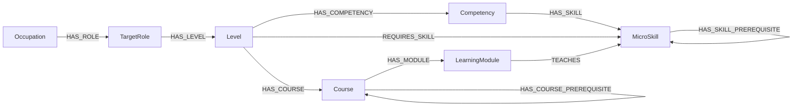

# Schema Neo4j — Ontology v0.7

Đây là khung ontology đã chốt cho nền tảng phục vụ một organization. Tên node, relationship và field giữ bằng tiếng Anh để khớp với dữ liệu; phần giải thích dùng tiếng Việt. Tài liệu này mô tả schema đích. Trạng thái triển khai backend và database được ghi trong [ARCHITECTURE.md](ARCHITECTURE.md).


[File PlantUML](diagrams/neo4j.puml) · [Khung và nguồn dữ liệu](dataset/ONTOLOGY.md) · [Hướng dẫn import](dataset/NEO4J_IMPORT_GUIDE.md)

## 1. Cấu trúc tổng quát

Schema gồm **7 loại node và 10 loại relationship**.



| Relationship | Hướng | Ý nghĩa |
|---|---|---|
| `HAS_ROLE` | Occupation → TargetRole | Một nghề có nhiều chức danh; mỗi TargetRole thuộc đúng một Occupation. |
| `HAS_LEVEL` | TargetRole → Level | Một role có nhiều cấp độ; mỗi Level thuộc đúng một role. Dataset hiện có Junior, Middle, Senior cho mỗi role. |
| `HAS_COMPETENCY` | Level → Competency | Mỗi Level sở hữu các năng lực riêng; mỗi Competency thuộc đúng một Level. |
| `HAS_SKILL` | Competency → MicroSkill | Năng lực được cấu thành từ các skill. Mỗi Competency hiện có ít nhất hai skill; một skill có thể thuộc nhiều năng lực. |
| `REQUIRES_SKILL` | Level → MicroSkill | Xác định skill và yêu cầu đánh giá để đạt Level. Ngưỡng điểm nằm trên quan hệ này. |
| `HAS_COURSE` | Level → Course | Các khóa học ứng viên phù hợp với Level. Một Course có thể dùng cho nhiều Level. |
| `HAS_MODULE` | Course → LearningModule | Course chứa các Module theo thứ tự `sequence`; Module có thể được dùng lại trong nhiều Course. |
| `TEACHES` | LearningModule → MicroSkill | Module dạy các skill; một skill có thể được dạy bởi nhiều Module. |
| `HAS_COURSE_PREREQUISITE` | Course → Course | A → B nghĩa là phải đạt Course B trước khi học Course A. |
| `HAS_SKILL_PREREQUISITE` | MicroSkill → MicroSkill | A → B nghĩa là phải xác nhận readiness của skill B trước khi học skill A. |

Bộ skill và Course của các Level được xác định riêng, có thể giao nhau. MicroSkill dùng chung định nghĩa; yêu cầu thực hiện và ngưỡng điểm có thể khác theo từng Level.

## 2. Các field chung của mọi node và relationship

Các field dưới đây được lưu trực tiếp thành property trên graph. Các bảng node ở phần sau liệt kê field nghiệp vụ bổ sung.

| Field | Kiểu | Ý nghĩa và cách dùng |
|---|---|---|
| `id` | String | ID ổn định của bản ghi. Dùng để nối và truy vấn; không dùng tên hiển thị làm khóa. Import kiểm tra ID không trùng trong từng tập bản ghi node/relationship. |
| `version` | String | Phiên bản catalog, hiện là `0.7.0`. Giúp xác định bộ định nghĩa mà dữ liệu thuộc về; không đồng nghĩa với phiên bản rubric hay nội dung học. |
| `status` | Enum/String | Trạng thái vòng đời: `DRAFT`, `ACTIVE`, `ARCHIVED`. Dataset hiện dùng `ACTIVE` cho các node và relationship. |
| `reviewStatus` | Enum/String | Trạng thái chuyên gia duyệt: `NEEDS_EXPERT_REVIEW`, `APPROVED`, `REJECTED`. Dataset hiện đang chờ duyệt. |
| `reviewedBy` | String hoặc null | Danh tính người thực sự phê duyệt/rà soát. Không tự điền người duyệt khi dữ liệu chưa được duyệt. |
| `reviewedAt` | Chuỗi datetime ISO 8601 hoặc null | Thời điểm duyệt, có múi giờ; ví dụ `2026-10-14T10:00:00+07:00`. Khi dùng kiểu thời gian Neo4j trong tương lai cần thống nhất với bộ import; seed hiện dùng chuỗi. |

Điều kiện xuất bản: `status = ACTIVE`, `reviewStatus = APPROVED`, có `reviewedBy` và `reviewedAt` hợp lệ. `ACTIVE` không tự chứng minh đã được chuyên gia duyệt.

Neo4j không lưu property có giá trị null; bộ import bỏ các field null khỏi node/relationship. `version` là metadata của snapshot hiện tại, không tạo thêm node phiên bản. Việc dùng lại cùng ID cho nhiều snapshot trong một graph cần một thiết kế lịch sử riêng; bộ import hiện chỉ nhận graph trống hoặc đúng snapshot đã có.

## 3. Giải thích field trong từng node

### 3.1. Occupation — Nghề nghiệp

Occupation là nghề theo O*NET, ví dụ `Software Developers`, mã `15-1252.00`. Nó là điểm neo để truy nguyên các reported job title và hồ sơ sở thích nghề nghiệp.

| Field | Kiểu | Ý nghĩa |
|---|---|---|
| `code` | String | Mã O*NET-SOC của nghề; ví dụ `15-1252.00`. Giữ nguyên mã nguồn để đối chiếu. |
| `name` | String | Tên nghề từ O*NET; ví dụ `Software Developers`. |
| `jobZone` | Integer | Nhóm mức chuẩn bị nghề nghiệp theo O*NET, phản ánh yêu cầu tổng quát về đào tạo, kinh nghiệm và giáo dục. Không dùng để suy ra Junior/Middle/Senior. |
| `interestRealistic` | Float [0,1] | R — sở thích hoạt động thực tế, kỹ thuật, thiết bị hoặc xây dựng/sửa chữa. |
| `interestInvestigative` | Float [0,1] | I — sở thích nghiên cứu, phân tích và tìm hiểu vấn đề. |
| `interestArtistic` | Float [0,1] | A — sở thích sáng tạo và biểu đạt nghệ thuật. |
| `interestSocial` | Float [0,1] | S — sở thích hỗ trợ, hướng dẫn và giúp đỡ người khác. |
| `interestEnterprising` | Float [0,1] | E — sở thích lãnh đạo, thuyết phục, quản lý hoặc hoạt động kinh doanh. |
| `interestConventional` | Float [0,1] | C — sở thích làm việc với dữ liệu, quy trình, quy tắc và tổ chức thông tin. |

Sáu điểm là **hồ sơ sở thích của nghề**, lấy từ O*NET 31.0, không phải kết quả RIASEC của một learner. Thang OI nguồn là 1–7; quy đổi bằng `(điểm gốc − 1) / 6`, lưu sáu chữ số thập phân. Ví dụ Investigative của Software Developers: `6.05 → 0.841667`. Không thay điểm thiếu bằng 0; không dùng RIASEC làm ngưỡng đạt skill.

Kết quả RIASEC của learner phải lưu riêng theo learner, công cụ/phiên bản và phương pháp tính điểm. Khi so sánh với nghề phải có quy tắc chuẩn hóa phù hợp với công cụ đó.

### 3.2. TargetRole — Chức danh mục tiêu

TargetRole biểu diễn chức danh người học hướng tới trong một Occupation, ví dụ `Application Developer`.

| Field | Kiểu | Ý nghĩa |
|---|---|---|
| `code` | String | Mã role ổn định và duy nhất trong catalog. Các role cùng tên thuộc hai Occupation có mã riêng. |
| `name` | String | Tên chức danh, hiện lấy từ “Sample of reported job titles” của O*NET. |
| `scope` | String | Phạm vi công việc của role: làm gì, phụ trách phần nào. Đây là mô tả do nhóm tổng hợp theo nguồn và cần chuyên gia xác nhận. |
| `canonicalProfileKey` | String | Mã nhóm profile do nhóm định nghĩa, ví dụ `PROFILE-DEV`. Gom các role có cùng bộ yêu cầu skill để tránh recommendation lặp; 48 role hiện thuộc 20 nhóm. |

`canonicalProfileKey` là property nghiệp vụ thực sự trên node. Nó không phải mã O*NET và không tự xác nhận các tên role đồng nghĩa trong mọi organization. Khi learner chọn role, đánh giá vẫn dùng requirement của Level thuộc role đó; bằng chứng đánh giá giữa các role không tự động thay thế cho nhau.

`occupationId` xuất hiện trong Excel/JSON để nối dữ liệu. Sau import, quan hệ `Occupation → HAS_ROLE → TargetRole` biểu diễn ownership; `occupationId` không được lưu trên node.

### 3.3. Level — Cấp độ của role

Level mô tả kỳ vọng năng lực và mức tự chủ trong một TargetRole cụ thể. Junior của role này là một node khác Junior của role khác.

| Field | Kiểu | Ý nghĩa |
|---|---|---|
| `code` | String | Mã cấp độ: `J`, `M`, `S`. Duy nhất trong phạm vi role sở hữu. |
| `name` | String | Tên hiển thị: `Junior`, `Middle`, `Senior`. |
| `rank` | Integer | Thứ bậc: Junior = 1, Middle = 2, Senior = 3. Dùng để sắp xếp; không phải điểm đánh giá. |
| `context` | String | Ngữ cảnh thực hiện công việc và mức hỗ trợ/tự chủ được phép ở cấp độ này. Giúp assessor hiểu kỳ vọng khi chấm. |
| `attainmentRule` | Enum/String | Hiện là `ALL_MANDATORY_SKILLS`: chỉ đạt Level khi tất cả skill bắt buộc của Level đều đạt. |

Skill thuộc Level và ngưỡng điểm được xác định qua `REQUIRES_SKILL`. Level không lưu điểm trung bình để bù cho một skill bắt buộc bị trượt. `targetRoleId` chỉ dùng nối Excel/JSON; sau import ownership nằm trên `HAS_LEVEL`.

Junior/Middle/Senior là các tier của nhóm, tham khảo SFIA và UK; không phải phép ánh xạ chính thức một-một sang cấp SFIA hoặc ngạch công việc UK.

### 3.4. Competency — Năng lực thuộc Level

Competency nhóm những MicroSkill cùng tạo nên một năng lực của Level. Mỗi Competency thuộc đúng một Level và được suy ra từ kết quả skill của learner.

| Field | Kiểu | Ý nghĩa |
|---|---|---|
| `name` | String | Tên năng lực để trình bày cho người học và người quản lý. |
| `description` | String | Giải thích phạm vi và ý nghĩa của nhóm skill. |
| `attainmentRule` | Enum/String | Hiện là `ALL_MEMBER_SKILLS_AT_OWNING_LEVEL`: đạt tất cả skill thành viên theo yêu cầu của Level sở hữu thì đạt Competency. |

Competency không có điểm, ngưỡng điểm hoặc bài đánh giá độc lập. Mỗi skill trong `HAS_SKILL` phải có `REQUIRES_SKILL` tương ứng ở Level sở hữu. `levelId` chỉ dùng nối Excel/JSON; ownership trên graph là `HAS_COMPETENCY`.

Kết quả suy ra cho một learner:

- Đủ tất cả kết quả `PASS` hợp lệ → `ACHIEVED`.
- Có skill đã xác định trượt → `NOT_YET_ACHIEVED`.
- Chưa có đủ kết quả tương thích và chưa có skill trượt → `NOT_ASSESSED`.
- Thiếu hoặc chưa duyệt định nghĩa bắt buộc → `CATALOG_NOT_READY`.

Các kết quả này được lưu trong dữ liệu learner, không gắn thành trạng thái chung của node Competency.

### 3.5. MicroSkill — Kỹ năng cụ thể

MicroSkill là định nghĩa một kỹ năng có thể quan sát hoặc kiểm chứng, dùng lại giữa nhiều role, Level và Module.

| Field | Kiểu | Ý nghĩa |
|---|---|---|
| `name` | String | Tên skill; ví dụ `Manage source changes with version control`. |
| `definition` | String | Giải thích hành vi/phạm vi của skill, giúp phân biệt với skill khác. Đây là định nghĩa chung, không phải nhiệm vụ riêng của mọi Level. |

Node không lưu `actualScore` hoặc `requiredScore`. `requiredScore` nằm trên quan hệ từ Level; `actualScore` thuộc kết quả đánh giá của từng learner. Như vậy một skill có thể yêu cầu mức thực hiện khác nhau ở Junior và Senior.

### 3.6. Course — Khóa học

Course là tập hợp Module có thứ tự để học và thực hành. Một Course có thể phục vụ nhiều Level và có Course tiên quyết.

| Field | Kiểu | Ý nghĩa |
|---|---|---|
| `title` | String | Tên hiển thị của khóa học. |
| `description` | String | Mô tả mục tiêu, phạm vi và nội dung của khóa học; các khóa đọc/thực hành mẫu phải được mô tả đúng giới hạn nội dung. |

`levelIds` là danh sách ID nối trong Excel/JSON, biểu diễn các liên kết `Level → HAS_COURSE → Course`. Bộ import kiểm tra danh sách khớp các cạnh rồi bỏ field này khỏi node. Không lưu nguyên chuỗi JSON `levelIds` thành property.

`HAS_COURSE` xác định khóa học ứng viên. Recommendation phải kiểm tra Module trong Course có dạy skill learner đang thiếu, nội dung phù hợp role/Level, trạng thái duyệt và các prerequisite. Hoàn thành Course không tự động chứng minh đã đạt mọi skill.

### 3.7. LearningModule — Đơn vị nội dung học

LearningModule chứa mục tiêu học tập và tham chiếu nội dung bài học/thực hành. Module dạy skill qua `TEACHES` và có thể dùng trong nhiều Course.

| Field | Kiểu | Ý nghĩa |
|---|---|---|
| `title` | String | Tên Module hiển thị trong khóa học. |
| `learningOutcome` | String | Đầu ra học tập: learner cần làm hoặc chứng minh được điều gì sau Module. |
| `moduleType` | Enum/String | Loại nội dung. `LESSON_AND_PRACTICE`: bài học kèm thực hành; `RESOURCE_GUIDED_PRACTICE`: hướng dẫn đọc nguồn và thực hành mẫu. |
| `contentUri` | String | Đường dẫn hoặc định danh nội dung thực tế. Seed hiện dùng đường dẫn tương đối tính từ thư mục chứa JSON seed, ví dụ `content/modules/MOD-READ-CORE02.md`. |
| `contentType` | String | Định dạng nội dung; hiện là `text/markdown`, giúp ứng dụng chọn cách đọc/hiển thị. |
| `contentVersion` | String | Phiên bản của nội dung được tham chiếu, ví dụ `1.1`. Cần khớp bản nội dung đã được duyệt và triển khai. |

`contentVersion` khác `version`: field chung `version` chỉ phiên bản catalog, còn `contentVersion` chỉ bản bài học. Nội dung bài học lưu ngoài Neo4j; database lưu tham chiếu. Thứ tự Module thuộc từng Course được lưu trên `HAS_MODULE.sequence`, không đặt một thứ tự toàn cục trên Module.

## 4. Field riêng trên các relationship

Mọi relationship cũng có bộ field chung ở mục 2. Các field `type`, `fromId`, `toId` trong JSON chỉ phục vụ xác định loại và hai đầu cạnh khi import, không trở thành property dư trên cạnh.

### 4.1. REQUIRES_SKILL

| Field | Kiểu | Ý nghĩa |
|---|---|---|
| `requiredScore` | Float [0,1] | Ngưỡng điểm để skill đạt trong Level này. Dataset hiện đề xuất 0.60–0.95, chờ hiệu chuẩn. |
| `isMandatory` | Boolean | Skill có bắt buộc để đạt Level hay không. Tất cả 1.891 requirement hiện là true và đang chờ chuyên gia rà. |
| `expectedOutcome` | String | Nhiệm vụ, ngữ cảnh và bằng chứng cần đạt ở Level này. |
| `rubricId` | String | Mã bộ tiêu chí đánh giá; hiện dùng `RUB-SKILL-01`. |
| `rubricVersion` | String | Phiên bản chính xác của rubric; hiện là `1.2`. |

### 4.2. HAS_MODULE

| Field | Kiểu | Ý nghĩa |
|---|---|---|
| `sequence` | Integer > 0 | Thứ tự Module trong một Course. Không trùng trong Course đó; cùng Module có thể có thứ tự khác trong Course khác. |

### 4.3. HAS_SKILL_PREREQUISITE

A → B nghĩa là xác nhận skill nền tảng B trước khi học skill A. Đây là điều kiện sẵn sàng học, không tự thêm B vào tập skill bắt buộc để đạt Level.

| Field | Kiểu | Ý nghĩa |
|---|---|---|
| `readinessOutcome` | String | Hành vi nền tảng cần chứng minh để học skill phụ thuộc. |
| `requiredScore` | Float [0,1] | Ngưỡng điểm readiness; cả 11 cạnh hiện đề xuất `0.75`, chờ chuyên gia duyệt. |
| `rubricId` | String | Rubric readiness riêng: `RUB-READINESS-01`. |
| `rubricVersion` | String | Phiên bản rubric readiness, hiện `1.0`. |
| `readinessAssessmentId` | String | Mã bài kiểm tra nền tảng được định nghĩa trong cấu hình ngoài graph. |
| `readinessAssessmentVersion` | String | Phiên bản bài kiểm tra nền tảng, hiện `1.0`. |

Kết quả phải khớp learner, skill nền tảng, quan hệ tiên quyết và phiên bản task/rubric/catalog. Readiness `PASS` đáp ứng điều kiện; `FAIL` hoặc `NOT_ASSESSED` chưa đáp ứng. Không tự dùng kết quả đánh giá skill theo Level thay cho readiness vì rubric và nhiệm vụ khác nhau.

### 4.4. HAS_COURSE_PREREQUISITE

| Field | Kiểu | Ý nghĩa |
|---|---|---|
| `requiredCompletionStatus` | Enum/String | Hiện là `PASSED`: learner phải có kết quả đạt Course nền tảng B trước khi học A, tương thích với phiên bản catalog/nội dung. |

Cạnh này không có ngưỡng skill hoặc rubric readiness. Kết quả Course của learner được lưu ngoài ontology. `IN_PROGRESS`, `FAILED`, `COMPLETED` mà chưa `PASSED`, hoặc thiếu kết quả đều chưa đáp ứng điều kiện.

Các quan hệ `HAS_ROLE`, `HAS_LEVEL`, `HAS_COMPETENCY`, `HAS_SKILL`, `HAS_COURSE`, `TEACHES` chỉ có metadata chung, không có field nghiệp vụ bổ sung trong snapshot này.

## 5. Công thức actualScore và cấu hình ngoài graph

```text
actualScore = Σ(weight_i × rating_i / 4)
```

`rating_i` là số nguyên 0–4; các trọng số dương và tổng bằng 1. So sánh điểm chưa làm tròn với `requiredScore` bằng `>=`.

| Rubric | Trọng số | Điều kiện tối thiểu |
|---|---|---|
| Đạt skill — `RUB-SKILL-01` v1.2 | CORRECTNESS 0.40; VERIFICATION 0.25; AUTONOMY 0.20; REASONING 0.15 | CORRECTNESS và AUTONOMY đều có rating >=3. |
| Readiness — `RUB-READINESS-01` v1.0 | FOUNDATION_CORRECTNESS 0.50; FOUNDATION_VERIFICATION 0.30; FOUNDATION_REASONING 0.20 | FOUNDATION_CORRECTNESS có rating >=3. |

Thiếu bằng chứng chấm được hoặc rating ở bất kỳ tiêu chí bắt buộc nào → `NOT_ASSESSED`, `actualScore = null`. Không điền 0, bỏ tiêu chí hay chuẩn hóa lại trọng số. Quy tắc thiếu dữ liệu này có ưu tiên trước một lỗi đã biết ở tiêu chí khác trong cùng bài đánh giá. Một thất bại quan sát được với bằng chứng chấm được có thể nhận rating 0.

Với đầu vào đầy đủ, đạt các điều kiện tối thiểu và ngưỡng điểm → `PASS`; không đạt → `FAIL`. Định nghĩa bắt buộc chưa duyệt hoặc không tương thích → `CATALOG_NOT_READY`; cấu hình sai → `INVALID_CONFIGURATION`; đầu vào sai → `INVALID_INPUT`.

| Tập cấu hình JSON | Nội dung | Nơi lưu |
|---|---|---|
| `rubricDefinitions` | Các tiêu chí: `criterionId`, `weight`, `isRequired`, `minimumPassingRating`, mốc `score0`–`score4`, `evidenceRule` và metadata duyệt. | Cấu hình assessment ngoài Neo4j. |
| `assessmentPolicies` | Công thức, thang rating, cách xử lý thiếu bằng chứng, phép so sánh và `criticalCheckIds`. Hai phiên bản hiện không có critical check bổ sung. | Cấu hình assessment ngoài Neo4j. |
| `readinessAssessments` | Mã/phiên bản task, skill nền tảng và skill phụ thuộc, prompt, outcome, evidence requirements và mức hỗ trợ cho phép. | Cấu hình assessment ngoài Neo4j; cạnh prerequisite tham chiếu bằng ID/phiên bản. |

`actualScore`, kết quả learner, bằng chứng, tiến độ và completion không lưu trên các node định nghĩa chung. Quy tắc tính điểm đầy đủ nằm trong [tài liệu ontology](dataset/ONTOLOGY.md#assessment-calculation-and-readiness-contract).

## 6. Ranh giới field Excel/JSON và property Neo4j

| Field nối dữ liệu | Relationship tương ứng | Sau import |
|---|---|---|
| `TargetRoles.occupationId` | Occupation → HAS_ROLE → TargetRole | Bỏ field khỏi node; dùng cạnh để truy vấn nghề sở hữu. |
| `Levels.targetRoleId` | TargetRole → HAS_LEVEL → Level | Bỏ field khỏi node; dùng cạnh để truy vấn role sở hữu. |
| `Competencies.levelId` | Level → HAS_COMPETENCY → Competency | Bỏ field khỏi node; dùng cạnh để truy vấn Level sở hữu. |
| `Courses.levelIds` | Level → HAS_COURSE → Course | Đọc thành danh sách ID, kiểm tra khớp các cạnh rồi bỏ khỏi node. |

Importer từ chối liên kết thiếu/sai thay vì tự suy đoán. Sau import, quan hệ graph là nguồn chính thức cho truy vấn cấu trúc. `canonicalProfileKey` và sáu field RIASEC là property nghiệp vụ thực sự, được giữ trên node tương ứng.

## 7. Các quy tắc nhất quán và recommendation

- Mỗi TargetRole thuộc đúng một Occupation; mỗi Level thuộc một role; mỗi Competency thuộc một Level.
- Role cùng tên trong các Occupation khác nhau có ID/code riêng. Không đặt ràng buộc tên role duy nhất toàn hệ thống.
- Mỗi Competency hiện có ít nhất hai skill; mọi skill thành viên có requirement tại Level sở hữu. Tập skill bắt buộc để đạt Level phải có ít nhất một phần tử.
- Hai đồ thị prerequisite phải không có chu trình, cạnh tự trỏ hoặc sai loại node. Mở rộng cả prerequisite gián tiếp.
- Kết hợp thứ tự Module trong Course với prerequisite để kiểm tra lộ trình khả thi. Module dùng lại được xét trong ngữ cảnh Course tương ứng.
- `HAS_COURSE` chỉ tạo ứng viên: phải có Module dạy skill learner đang thiếu, rồi kiểm tra nội dung phù hợp role/Level, publication và prerequisite. Course khớp một skill gap vẫn có thể hữu ích.
- Thiếu nội dung phù hợp cho một gap → `PATHWAY_UNRESOLVED`. Một cạnh `TEACHES` hoặc tài liệu tham khảo không tự chứng minh nội dung đủ sâu hay đã được duyệt.
- Competency được suy ra từ skill; Level đạt khi đủ các skill bắt buộc. Course completion không tự thay thế kết quả đánh giá skill.

## 8. Nguồn dữ liệu và trạng thái hiện tại

O*NET cung cấp Occupation, sample job titles và điểm sở thích nghề nghiệp. ESCO hỗ trợ đối chiếu định nghĩa skill; SFIA và UK hỗ trợ phạm vi công việc và mức tự chủ. Các grouping, tier, task, prerequisite và ngưỡng điểm là đề xuất của nhóm cần chuyên gia xác nhận.

[JSON seed hiện tại](dataset/import/ontology_seed.json) và [Excel review](dataset/ontology_dataset.xlsx) có 875 node, 5.431 relationship: 5 Occupation, 48 TargetRole, 144 Level, 472 Competency, 79 MicroSkill, 42 Course, 85 LearningModule. Cả 11 prerequisite skill và 28 prerequisite Course đều chờ duyệt. Learner assessment trong quá khứ phải giữ ngữ cảnh catalog và rubric gốc.

File nguồn, URI đối chiếu và minh chứng được giữ trong [ONTOLOGY.md](dataset/ONTOLOGY.md) và thư mục `dataset/sources/`, không đưa thành các property `sourceConceptUri`, `sourceLocator`, `sourceVerification` trên graph.
