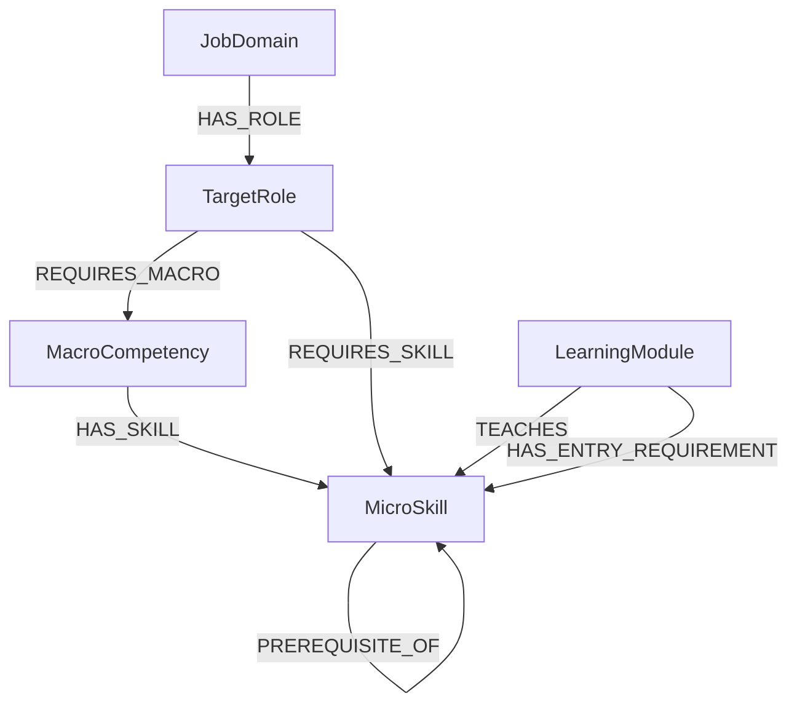

# Neo4j ontology — catalog 0.7.0

## Current Scope Alignment

**Product authority:** [System Overview](adapt_learn_graph_system_overview.md). **Aligned:** 2026-10-14. This document separates the proposed ontology 0.7.0 from the existing V5 runtime schema; it does not assert that all revised product concepts are represented or implemented.

- The product serves one organization with System Administrator, L&D Manager, Expert, and Employee. Existing `organizationId` is compatibility/scope metadata, not a requirement for multi-organization registration or billing.
- L&D manages disciplines and Expert assignments, creates/assigns target roles, configures baseline rules, publishes completed roles, and approves learning offerings. Expert owns assigned-discipline content and assigned-role requirements. These permissions are not enforced merely by graph labels.
- `JobDomain` groups roles in V5. Do not silently rename it to Discipline or infer discipline assignments/membership: that mapping remains a design decision.
- Separate Expert configuration completion from L&D publication. Existing `TargetRole.status`/`assignedExpertId` do not alone establish this workflow or authorize Employee availability.
- Modules now contain courses/content and require L&D organizational approval. V5 `LearningModule.sourceUrl` is retained; course membership, content versions, submission/approval and independent learning availability require an agreed extension/mapping.
- Baseline/RIASEC evidence, reviewed AI role guidance, competency estimates, progress and pathways are transactional concerns. Initial Expert confirmation gates pathway start; new evidence can change remaining learning needs. RIASEC is interest evidence, not knowledge mastery.
- Required proficiency/relative importance, skill descriptions and prerequisites must be mapped under an agreed model. Do not add mock/dataset attributes to runtime entities without architecture approval.

No runtime properties, nullability or data are migrated by this documentation alignment. [Architecture](ARCHITECTURE.md) records the design gaps; [feature catalog](features/README.md) records current requirements. Released ontology datasets use their own preview schema and are not automatically a replacement for V5.


## Proposed ontology catalog

Catalog 0.7.0 and its Excel/JSON/import scripts implement this model. The current dataset is consolidated under dataset/. No live database has been modified.


[PlantUML source](diagrams/neo4j.puml).

## Structure and cardinality

| Relationship | Direction | Meaning |
|---|---|---|
| HAS_ROLE | Occupation → TargetRole | One Occupation owns many TargetRoles; each TargetRole has exactly one owning Occupation. |
| HAS_LEVEL | TargetRole → Level | Each role owns many Levels; each Level belongs to exactly one role. |
| HAS_COMPETENCY | Level → Competency | Each Level owns its own competencies; each competency belongs to exactly one Level. |
| HAS_SKILL | Competency → MicroSkill | Each competency groups one or more skills. Skill definitions can be reused by different competencies and Levels. |
| REQUIRES_SKILL | Level → MicroSkill | Each Level defines its own skill set and assessment requirements. Sets may overlap across Levels but need not be identical. |
| HAS_COURSE | Level → Course | Each Level selects one or more courses. Courses may be reused across Levels. |
| HAS_MODULE | Course → LearningModule | Each Course contains one or more modules, ordered by sequence. Modules may be reused. |
| TEACHES | LearningModule → MicroSkill | Each module teaches one or more skills. A skill may be taught by multiple modules. |
| HAS_COURSE_PREREQUISITE | Course → Course | A → B means B must be passed before learning A. |
| HAS_SKILL_PREREQUISITE | MicroSkill → MicroSkill | A → B means foundation B must be demonstrated before learning A. |

HAS_SKILL_PREREQUISITE allows only MicroSkill → MicroSkill; HAS_COURSE_PREREQUISITE allows only Course → Course. The shared HAS_PREREQUISITE type is retired and rejected by the importer. FOR_LEVEL and Competency → HAS_COURSE are replaced by Level → HAS_COURSE. Competency ownership moves from TargetRole to Level.

Reported titles shared by different O*NET occupations now create separate TargetRole records per owning occupation, even when their names match. Use distinct IDs and codes; do not enforce global name uniqueness.

## Fields

Every node and relationship carries id, version, status, reviewStatus, reviewedBy and reviewedAt. Status describes lifecycle; reviewStatus describes actual review. Publication requires ACTIVE and APPROVED with a real reviewer and review time.

| Node | Business fields | Explanation |
|---|---|---|
| Occupation | code, name, jobZone, interestRealistic, interestInvestigative, interestArtistic, interestSocial, interestEnterprising, interestConventional | O*NET occupation anchor with six normalized RIASEC scores; jobZone is not the role's Junior/Middle/Senior grade. |
| TargetRole | code, name, scope, canonicalProfileKey | Reported title and locally defined work scope. Flat exports use occupationId; the graph represents ownership with HAS_ROLE. |
| Level | code, name, rank, context, attainmentRule | Role-specific tier and expected autonomy/context. Flat exports use targetRoleId. attainmentRule=ALL_MANDATORY_SKILLS. |
| Competency | name, description, attainmentRule | Level-specific skill grouping. Flat exports use levelId. attainmentRule=ALL_MEMBER_SKILLS_AT_OWNING_LEVEL. No separate score, threshold or rubric. |
| MicroSkill | name, definition | Reusable definition. Learner score and Level threshold are not properties of this node. |
| Course | title, description | Learning collection; flat exports may use levelIds representing HAS_COURSE links. |
| LearningModule | title, learningOutcome, moduleType, contentUri, contentType, contentVersion | Lesson/practice with content stored outside the graph and referenced by contentUri. |

Parent IDs in flat exports are import conveniences, not duplicate graph ownership fields.

| Relationship field | Type | Explanation |
|---|---|---|
| REQUIRES_SKILL.requiredScore | Float [0,1] | Passing threshold for this particular Level and skill. |
| REQUIRES_SKILL.isMandatory | Boolean | Whether this skill is required for overall Level attainment. |
| REQUIRES_SKILL.expectedOutcome | String | Evidence/task and performance expected in this Level's context. |
| REQUIRES_SKILL.rubricId, rubricVersion | String | Exact assessment configuration references; rubric lives outside the ontology. |
| HAS_MODULE.sequence | Positive Integer | Module order within this Course; unique within the Course. |
| HAS_COURSE_PREREQUISITE.requiredCompletionStatus | Enum PASSED | Learner must pass the prerequisite Course before the dependent Course is unlocked. Completion is a learner record outside the ontology. |
| HAS_SKILL_PREREQUISITE.readinessOutcome | String | Foundation performance needed to learn the dependent skill. This is a learning dependency, not an implicit Level assessment requirement. |

## Competency and Level attainment

Competency is a derived capability grouping, not an independently scored assessment. Evaluate it for a learner using the requirements of its owning Level and the selected catalog/rubric versions.

1. Resolve every HAS_SKILL member against the owning Level's REQUIRES_SKILL edges.
2. If any requirement is absent or unapproved, return CATALOG_NOT_READY.
3. All member skills PASS → ACHIEVED. A known failed member → NOT_YET_ACHIEVED. Otherwise incomplete compatible evidence → NOT_ASSESSED.

Having a skill means a compatible assessment passes the owning Level's threshold and outcome; a course completion or a profile checkbox alone is insufficient. No competency score is averaged or added to the Level score. Store learner results separately from shared ontology definitions.

Level attainment requires every mandatory REQUIRES_SKILL to pass. Competency adds no second assessment gate. Optional skills can still be required for a particular competency without becoming mandatory for the entire Level.

## Pathway validation

Every competency member must have a requirement under its owning Level. Require non-empty competency skill sets and non-empty mandatory Level requirements. Levels may have different skills and courses; do not generate identical sets merely by copying another tier. SFIA and UK descriptions inform local scope; numerical thresholds remain local proposals pending expert calibration.

Prerequisite edges point from the dependent item to its prerequisite. Reject self-loops, duplicate edges, wrong endpoint types and cycles independently in both Course and MicroSkill graphs. Expand transitive prerequisites, including prerequisites outside the selected Level's course set.

HAS_MODULE.sequence is module order within one Course. It does not replace Course prerequisites or skill prerequisites. Validate that the combined Course, module-order and skill dependencies admit a feasible pathway; reject incompatible ordering. A prerequisite skill taught only in a dependent course can create an infeasible pathway even when each individual graph is acyclic.

Course completion does not imply skill mastery or Level attainment. A skill assessment can independently demonstrate mastery; Course prerequisites control course access. Missing course/module teaching coverage produces PATHWAY_UNRESOLVED, not fabricated learning content.

## Source and migration boundary

O*NET remains the source for occupations and sample reported titles; SFIA and UK role frameworks support local Level and skill design. Source locators and verification evidence stay in documentation and evidence manifests, outside database seed fields. The ontology structure and numeric cutoffs are project design decisions, not an official framework schema.

The current seed in dataset/import/ontology_seed.json implements occupation-owned roles, Level-owned competencies and Level HAS_COURSE links. Superseded dataset snapshots were removed during cleanup. The backend's legacy catalog adapters and live databases have not been migrated. Keep historical learner evidence pinned to its original catalog version.

## RIASEC storage

The six interest fields on Occupation are Float [0,1]. O*NET 31.0 OI values use 1–7; normalize (raw − 1)/6 and store to six decimals. R, I, A, S, E, C mean Realistic, Investigative, Artistic, Social, Enterprising and Conventional. These are occupational-interest descriptors, not assessed competence. All six values must exist; missing data must remain unavailable rather than become zero. Source raw values, URLs, dates and verification evidence stay in the source package, outside graph properties. See [source specification](dataset/ONTOLOGY.md).

## Scoring and readiness fields (0.7.0)

The [scoring contract](dataset/ONTOLOGY.md#assessment-calculation-and-readiness-contract) defines actualScore, evidence completeness, minimum ratings, exact version context and state precedence. See Rubric Guide in Excel for the same rules.

| Location | Fields | Storage/meaning |
|---|---|---|
| TargetRole | canonicalProfileKey | Real graph property for local profile grouping; 48 title records belong to 20 groups. It is not an assessment equivalence or an official O*NET profile ID. |
| HAS_SKILL_PREREQUISITE | requiredScore, rubricId, rubricVersion, readinessOutcome, readinessAssessmentId, readinessAssessmentVersion | Readiness threshold and exact foundation task/rubric references; endpoints must both be MicroSkill. |
| HAS_COURSE_PREREQUISITE | requiredCompletionStatus=PASSED | Required completion state of the prerequisite Course; endpoints must both be Course. No skill score/rubric fields. |
| rubricDefinitions | isRequired, minimumPassingRating, weight, score0..score4, evidenceRule | Versioned criterion configuration outside Neo4j. All current criteria are required. |
| assessmentPolicies | actualScoreFormula, rating range/type, missing-evidence policy, comparison, criticalCheckIds | Explicit calculation configuration outside Neo4j. No additional critical checks in these versions. |
| readinessAssessments | assessmentId/version, forSkillId, dependentSkillId, taskPrompt, outcome, evidenceRequirements, supportPolicy | Eleven locally proposed tasks outside Neo4j, referenced by Skill prerequisite edges. |

actualScore = SUM(weight * rating / 4). Missing assessable evidence for any required criterion returns NOT_ASSESSED and null, never zero or a partial average. Scores are compared before rounding. All scoring policies, tasks and definitions require actual expert approval before official decisions.

## Flat export versus graph properties

| Excel/JSON field | Graph relationship | Import behaviour |
|---|---|---|
| TargetRoles.occupationId | Occupation HAS_ROLE TargetRole | Validate the single parent, then omit occupationId from node properties. |
| Levels.targetRoleId | TargetRole HAS_LEVEL Level | Validate the parent, then omit targetRoleId. |
| Competencies.levelId | Level HAS_COMPETENCY Competency | Validate the parent, then omit levelId. |
| Courses.levelIds | Level HAS_COURSE Course | Parse as an array in JSON; compare against all incoming HAS_COURSE links, then omit levelIds. Never store a JSON-encoded string on Course. |

The relationship records are imported after these ID-to-edge consistency checks. Missing or conflicting links are rejected, not silently inferred. After import, graph edges are the authoritative query model. Rubric/configuration and expert review tabs are not imported into graph entities. Learner results and learner RIASEC assessments remain separate from the catalog.

## Legacy V5 runtime technical inventory

This section preserves the technical inventory received from origin/main. It describes the legacy runtime contract and is not the import contract of dataset 0.7.0. Use [dataset/ONTOLOGY.md](dataset/ONTOLOGY.md) for the source-backed catalog and [import guide](dataset/NEO4J_IMPORT_GUIDE.md) for the isolated review graph.

### 1. Phạm vi schema

Schema Neo4j hiện tại gồm:

- 5 node: `JobDomain`, `TargetRole`, `MacroCompetency`, `MicroSkill`, `LearningModule`.
- 7 relationship: `HAS_ROLE`, `REQUIRES_MACRO`, `HAS_SKILL`, `REQUIRES_SKILL`, `PREREQUISITE_OF`, `TEACHES`, `HAS_ENTRY_REQUIREMENT`.
- Không có node `LearningProgram`.
- User, assessment result, learner mastery và learning pathway được lưu trong PostgreSQL.

Các field đã loại bỏ:

```text
mandatory
sourceRefs
configVersion
datasetVersion
basis
evidenceStatus
moduleType
level
enrollmentModel
priceStatus
lastVerifiedAt
durationStatus
primary
```

`coverageType` đã được đổi tên thành `coverage`.

---

### 2. Sơ đồ tổng quát



---

### 3. Quy ước chung

#### 3.1 Ký hiệu

| Ký hiệu | Ý nghĩa |
|---|---|
| Không có `?` | Field bắt buộc |
| `?` | Field tùy chọn, có thể `null` |
| `[0,1]` | Số thực từ `0.0` đến `1.0` |

#### 3.2 Phân biệt `id` và `code`

| Field | Giải thích |
|---|---|
| `id` | ID kỹ thuật duy nhất, thường dùng UUID |
| `code` | Mã nghiệp vụ ổn định, dùng để import và truy vấn |

Ví dụ:

```json
{
  "id": "6c77c6cb-f33f-4447-b619-30c06ec38283",
  "code": "SPRING_BOOT"
}
```

Không dùng `name` làm khóa vì tên hiển thị có thể thay đổi.

#### 3.3 `status`

Đề xuất dùng ba trạng thái:

| Giá trị | Ý nghĩa |
|---|---|
| `DRAFT` | Đang chuẩn bị, thuật toán chưa sử dụng |
| `ACTIVE` | Đã được phép sử dụng |
| `RETIRED` | Ngừng dùng cho dữ liệu mới nhưng vẫn giữ để tra cứu lịch sử |

#### 3.4 Field thời gian

| Field | Giải thích |
|---|---|
| `createdAt` | Thời điểm tạo node hoặc relationship |
| `updatedAt` | Thời điểm cập nhật gần nhất |

Nên lưu theo UTC và ISO 8601:

```text
2026-09-24T14:30:00Z
```

---

## 4. Chi tiết node

### 4.1 `JobDomain`

#### Mục đích

Phân nhóm các target role theo domain. Phạm vi dữ liệu hiện tại có thể gồm `ICT`, `DATA` và `AI`.

#### Cấu trúc

```text
JobDomain {
    id,
    code,
    name,
    description?,
    status,
    createdAt,
    updatedAt
}
```

#### Giải thích field

| Field | Kiểu | Bắt buộc | Giải thích |
|---|---|---:|---|
| `id` | String/UUID | Có | ID kỹ thuật duy nhất của domain |
| `code` | String | Có | Mã ổn định như `ICT`, `DATA`, `AI` |
| `name` | String | Có | Tên domain hiển thị |
| `description` | String | Không | Mô tả phạm vi của domain |
| `status` | Enum | Có | `DRAFT`, `ACTIVE` hoặc `RETIRED` |
| `createdAt` | DateTime | Có | Thời điểm tạo |
| `updatedAt` | DateTime | Có | Thời điểm cập nhật gần nhất |

#### Ví dụ

```json
{
  "id": "domain-001",
  "code": "ICT",
  "name": "Information and Communication Technology",
  "description": "Software and information technology roles",
  "status": "ACTIVE",
  "createdAt": "2026-09-01T00:00:00Z",
  "updatedAt": "2026-09-24T00:00:00Z"
}
```

---

### 4.2 `TargetRole`

#### Mục đích

Biểu diễn vị trí nghề nghiệp mà learner chọn làm mục tiêu.

#### Cấu trúc

```text
TargetRole {
    id,
    code,
    name,
    familyCode,
    track,
    organizationId,
    seniority?,
    assignedExpertId?,
    version,
    description?,
    responsibilities?,
    status,
    createdAt,
    updatedAt,
    rejectionReason?
}
```

#### Giải thích field

| Field | Kiểu | Bắt buộc | Giải thích |
|---|---|---:|---|
| `id` | String/UUID | Có | ID kỹ thuật duy nhất |
| `code` | String | Có | Mã role, ví dụ `JAVA_BACKEND_P3`, `ROLE-AI-ARCH` |
| `name` | String | Có | Tên role hiển thị |
| `familyCode` | String | Có | Nhóm các role cùng nghề, ví dụ `JAVA_BACKEND`, `AI_ML` |
| `track` | Enum | Có | Nhánh `PROFESSIONAL` hoặc `MANAGEMENT` |
| `organizationId` | String/UUID | Có | Organization sở hữu và được phép sử dụng role |
| `seniority` | Enum | Không | Grade nghề nghiệp: `P1`–`P5` cho `PROFESSIONAL`, `M3`–`M4` cho `MANAGEMENT` |
| `assignedExpertId` | String | Không | ID của Domain Expert được phân công thiết lập micro-skills |
| `version` | String | Có | Phiên bản role (`1.0`, `1.1`), hỗ trợ successor draft |
| `description` | String | Không | Mô tả trách nhiệm hoặc phạm vi công việc |
| `responsibilities` | List<String> | Không | Danh sách trách nhiệm chính để hiển thị ở role detail |
| `status` | Enum | Có | `DRAFT`, `SENT`, `REJECTED`, `ACTIVE`, hoặc `RETIRED` |
| `createdAt` | DateTime | Có | Thời điểm tạo |
| `updatedAt` | DateTime | Có | Thời điểm cập nhật |
| `rejectionReason` | String | Không | Lý do từ chối và phản hồi từ Domain Expert khi trạng thái là `REJECTED` |

Field `level` đã bị loại bỏ. `code` và `name` vẫn có thể chứa grade nghiệp vụ như `JAVA_BACKEND_P3`, nhưng runtime phải dùng field `seniority` riêng để hiển thị và filter cấp độ.

`seniority` là grade code dùng cho discovery/filter và không thay thế `track`. `PROFESSIONAL` chỉ dùng `P1`–`P5`; `MANAGEMENT` chỉ dùng `M3`–`M4`. Cùng một grade có thể mang mô tả năng lực/chức danh khác nhau giữa Finance, IT hoặc các domain khác; catalog của từng domain/role family sở hữu ý nghĩa chi tiết đó. Hậu tố như `P3` trong `code` vẫn không được dùng để suy luận seniority ở runtime.

`version` và `assignedExpertId` hỗ trợ quy trình phân công Domain Expert và tạo successor draft (phiên bản kế nhiệm) cho target role mà không làm gãy các ràng buộc lộ trình của học viên đã đăng ký phiên bản trước.

#### Ví dụ

```json
{
  "id": "role-001",
  "code": "JAVA_BACKEND_P3",
  "name": "Java Backend Developer P3",
  "familyCode": "JAVA_BACKEND",
  "track": "PROFESSIONAL",
  "organizationId": "00000000-0000-0000-0000-000000000001",
  "seniority": "P3",
  "assignedExpertId": "expert-rivera",
  "version": "1.0",
  "description": "Develops and maintains Java backend applications",
  "responsibilities": [
    "Build and maintain Java backend services",
    "Review API and persistence designs"
  ],
  "status": "ACTIVE",
  "createdAt": "2026-09-01T00:00:00Z",
  "updatedAt": "2026-09-24T00:00:00Z"
}
```

---

### 4.3 `MacroCompetency`

#### Mục đích

Phân nhóm các micro-skill thành ba nhóm năng lực lớn:

```text
KNOWLEDGE
COMMUNICATION
INNOVATION
```

#### Cấu trúc

```text
MacroCompetency {
    id,
    code,
    name,
    description?,
    status,
    createdAt,
    updatedAt
}
```

#### Giải thích field

| Field | Kiểu | Bắt buộc | Giải thích |
|---|---|---:|---|
| `id` | String/UUID | Có | ID kỹ thuật duy nhất |
| `code` | String | Có | Mã như `KNOWLEDGE` |
| `name` | String | Có | Tên hiển thị |
| `description` | String | Không | Giới hạn và phạm vi của macro |
| `status` | Enum | Có | Trạng thái macro |
| `createdAt` | DateTime | Có | Thời điểm tạo |
| `updatedAt` | DateTime | Có | Thời điểm cập nhật |

Macro không lưu `weight` hoặc `targetLevel`. Khi cần điểm macro, backend tổng hợp từ mastery của các micro-skill thuộc macro đó.

---

### 4.4 `MicroSkill`

#### Mục đích

Đây là tầng tính toán chính cho skill gap, prerequisite, recommendation và learner mastery.

#### Cấu trúc

```text
MicroSkill {
    id,
    code,
    name,
    description?,
    status,
    createdAt,
    updatedAt
}
```

#### Giải thích field

| Field | Kiểu | Bắt buộc | Giải thích |
|---|---|---:|---|
| `id` | String/UUID | Có | ID kỹ thuật duy nhất |
| `code` | String | Có | Mã skill như `SPRING_BOOT` |
| `name` | String | Có | Tên skill hiển thị |
| `description` | String | Không | Mô tả learner cần biết hoặc làm được gì |
| `status` | Enum | Có | Trạng thái skill |
| `createdAt` | DateTime | Có | Thời điểm tạo |
| `updatedAt` | DateTime | Có | Thời điểm cập nhật |

Mastery của learner không nằm trên node này vì mỗi learner có mastery khác nhau. Mastery được lưu trong PostgreSQL.

---

### 4.5 `LearningModule`

#### Mục đích

Biểu diễn một đơn vị học có thể được Recommendation Engine đưa vào pathway.

#### Cấu trúc

```text
LearningModule {
    id,
    code,
    title,
    provider,
    platform,
    sourceUrl,
    durationHours?,
    priceAmount?,
    currency?,
    status,
    createdAt,
    updatedAt
}
```

#### Giải thích field

| Field | Kiểu | Bắt buộc | Giải thích |
|---|---|---:|---|
| `id` | String/UUID | Có | ID kỹ thuật duy nhất |
| `code` | String | Có | Mã module ổn định |
| `title` | String | Có | Tên khóa học/module |
| `provider` | String | Có | Đơn vị tạo nội dung, ví dụ IBM |
| `platform` | String | Có | Nền tảng cung cấp, ví dụ Coursera |
| `sourceUrl` | String/URL | Có | URL gốc của module thật |
| `durationHours` | Decimal | Không | Số giờ ước lượng, dùng để xếp hạng hoặc tối ưu pathway |
| `priceAmount` | Decimal | Không | Giá module tại thời điểm thu thập dữ liệu |
| `currency` | String | Không | Mã tiền tệ, ví dụ `USD`, `VND` |
| `status` | Enum | Có | Trạng thái module |
| `createdAt` | DateTime | Có | Thời điểm tạo |
| `updatedAt` | DateTime | Có | Thời điểm cập nhật |

Quy tắc giá:

- `priceAmount = 0` nghĩa là đã xác nhận module miễn phí.
- `priceAmount = null` nghĩa là chưa có dữ liệu giá.
- Nếu `priceAmount` khác `null`, `currency` phải có giá trị.

---

## 5. Chi tiết relationship

### 5.1 Quy tắc chung

Relationship không có `id`. Neo4j tìm relationship bằng:

```text
node nguồn + relationship type + node đích
```

Tất cả relationship giữ ba field quản trị:

| Field | Kiểu | Giải thích |
|---|---|---|
| `status` | Enum | Relationship đang `DRAFT`, `ACTIVE` hay `RETIRED` |
| `createdAt` | DateTime | Thời điểm tạo relationship |
| `updatedAt` | DateTime | Thời điểm cập nhật relationship |

---

### 5.2 `HAS_ROLE`

```text
(:JobDomain)-[:HAS_ROLE]->(:TargetRole)
```

Cho biết role thuộc domain nào.

| Field | Kiểu | Giải thích |
|---|---|---|
| `status` | Enum | Trạng thái mapping domain–role |
| `createdAt` | DateTime | Thời điểm tạo |
| `updatedAt` | DateTime | Thời điểm cập nhật |

Ví dụ:

```text
ICT ──HAS_ROLE──> Java Backend Developer P3
```

Mỗi role chỉ nên thuộc một domain đang `ACTIVE`.

---

### 5.3 `REQUIRES_MACRO`

```text
(:TargetRole)-[:REQUIRES_MACRO]->(:MacroCompetency)
```

Cho biết role sử dụng macro nào để tổ chức và tổng hợp skill.

| Field | Kiểu | Giải thích |
|---|---|---|
| `status` | Enum | Trạng thái mapping role–macro |
| `createdAt` | DateTime | Thời điểm tạo |
| `updatedAt` | DateTime | Thời điểm cập nhật |

Relationship này không chứa `weight` hoặc `targetLevel`.

---

### 5.4 `HAS_SKILL`

```text
(:MacroCompetency)-[:HAS_SKILL]->(:MicroSkill)
```

Cho biết micro-skill thuộc macro nào.

| Field | Kiểu | Giải thích |
|---|---|---|
| `status` | Enum | Trạng thái mapping macro–skill |
| `createdAt` | DateTime | Thời điểm tạo |
| `updatedAt` | DateTime | Thời điểm cập nhật |

Do `primary` đã bị loại bỏ, schema hiện tại hiểu mỗi micro-skill chỉ thuộc một macro.

---

### 5.5 `REQUIRES_SKILL`

```text
(:TargetRole)-[:REQUIRES_SKILL]->(:MicroSkill)
```

Cho biết role yêu cầu skill nào và cần đạt mức nào.

| Field | Kiểu | Giải thích |
|---|---|---|
| `targetMastery` | Float `[0,1]` | Mức mastery role yêu cầu |
| `status` | Enum | Trạng thái requirement |
| `createdAt` | DateTime | Thời điểm tạo |
| `updatedAt` | DateTime | Thời điểm cập nhật |

#### Skill gap

```text
gap = max(0, targetMastery - currentMastery)
```

Ví dụ:

```text
targetMastery  = 0.70
currentMastery = 0.45
gap            = 0.25
```

Do `mandatory` đã bị loại bỏ, mọi `REQUIRES_SKILL` đang `ACTIVE` đều được xem là skill bắt buộc của role.

---

### 5.6 `PREREQUISITE_OF`

```text
(:MicroSkill)-[:PREREQUISITE_OF]->(:MicroSkill)
```

Biểu diễn dependency tổng quát giữa hai skill.

| Field | Kiểu | Giải thích |
|---|---|---|
| `minMastery` | Float `[0,1]` | Mức tối thiểu của skill nguồn trước khi học skill đích |
| `status` | Enum | Trạng thái dependency |
| `createdAt` | DateTime | Thời điểm tạo |
| `updatedAt` | DateTime | Thời điểm cập nhật |

Ví dụ:

```text
Java Core
    ──PREREQUISITE_OF {minMastery: 0.60}
    ──> Spring Boot
```

Không cho phép:

- Self-loop thật: `Skill A → Skill A`.
- Cycle: `A → B → C → A`.

Vòng cong trên diagram chỉ biểu diễn relationship giữa hai node cùng label `MicroSkill`.

---

### 5.7 `TEACHES`

```text
(:LearningModule)-[:TEACHES]->(:MicroSkill)
```

Cho biết module dạy skill nào và mức độ bao phủ của skill đó trong module.

| Field | Kiểu | Giải thích |
|---|---|---|
| `outcomeMastery` | Float `[0,1]` | Mức kiến thức module được kỳ vọng hỗ trợ đối với skill |
| `coverage` | Enum | Mức độ skill được bao phủ trong module |
| `status` | Enum | Trạng thái mapping module–skill |
| `createdAt` | DateTime | Thời điểm tạo |
| `updatedAt` | DateTime | Thời điểm cập nhật |

#### Giá trị `coverage`

| Giá trị | Mức gợi ý | Ý nghĩa |
|---|---:|---|
| `INTRODUCTION_OR_REVIEW` | `0.30` | Giới thiệu hoặc ôn lại skill |
| `SUPPORTING` | `0.50` | Skill đóng vai trò hỗ trợ |
| `CORE` | `0.70` | Skill là nội dung chính |
| `ADVANCED` | `0.85` | Module dạy skill chuyên sâu |

Ví dụ một module dạy nhiều skill:

```text
Spring Boot Fundamentals
  ├──TEACHES {outcomeMastery: 0.70, coverage: CORE}
  │  └──> Spring Boot
  └──TEACHES {outcomeMastery: 0.30, coverage: INTRODUCTION_OR_REVIEW}
     └──> REST API
```

`outcomeMastery` không được gán trực tiếp thành learner mastery. Learner vẫn cần assessment; Knowledge Tracing cập nhật mastery thật trong PostgreSQL.

---

### 5.8 `HAS_ENTRY_REQUIREMENT`

```text
(:LearningModule)-[:HAS_ENTRY_REQUIREMENT]->(:MicroSkill)
```

Cho biết learner cần đạt skill đầu vào nào trước khi bắt đầu một module cụ thể.

| Field | Kiểu | Giải thích |
|---|---|---|
| `minMastery` | Float `[0,1]` | Mức learner cần đạt ở skill đầu vào |
| `status` | Enum | Trạng thái entry requirement |
| `createdAt` | DateTime | Thời điểm tạo |
| `updatedAt` | DateTime | Thời điểm cập nhật |

Ví dụ:

```text
Advanced Spring Boot
    ──HAS_ENTRY_REQUIREMENT {minMastery: 0.80}
    ──> Java Core
```

Khác biệt:

| Relationship | Phạm vi |
|---|---|
| `PREREQUISITE_OF` | Dependency chung giữa hai skill |
| `HAS_ENTRY_REQUIREMENT` | Điều kiện riêng của một module |

---

## 6. Ràng buộc dữ liệu cần validate

### 6.1 Node

| Rule | Mục đích |
|---|---|
| `id` unique | Không có hai node cùng ID |
| `code` unique trong cùng label | Không có hai skill hoặc role trùng code |
| `status` thuộc enum cho phép | Tránh trạng thái tự do |
| `TargetRole.organizationId` là UUID hợp lệ | Giữ tenant scope có thể kiểm tra trực tiếp |
| `TargetRole.seniority` thuộc `P1`–`P5` hoặc `M3`–`M4` và khớp `track` | Search/filter không phụ thuộc tên/code; professional và management không trộn grade |
| Mỗi phần tử `TargetRole.responsibilities` không rỗng | Không trả nội dung detail hỏng |
| `updatedAt >= createdAt` | Dữ liệu thời gian hợp lệ |
| `sourceUrl` hợp lệ | Module phải trỏ đến nguồn học thật |
| `durationHours > 0` nếu có | Thời lượng phải hợp lệ |
| `priceAmount >= 0` nếu có | Giá không được âm |
| Có `currency` khi có `priceAmount` | Giá phải có đơn vị tiền tệ |

### 6.2 Relationship

| Rule | Mục đích |
|---|---|
| Không duplicate cùng type giữa cùng hai node | Không tính trùng requirement hoặc outcome |
| `targetMastery`, `minMastery`, `outcomeMastery` thuộc `[0,1]` | Chuẩn hóa điểm |
| Không prerequisite cycle | Tránh pathway lặp vô hạn |
| Role `ACTIVE` có ít nhất một `REQUIRES_SKILL` active | Role phải có yêu cầu skill |
| Module `ACTIVE` có ít nhất một `TEACHES` active | Module phải dạy ít nhất một skill |
| Mỗi skill thuộc một macro active | Phù hợp việc đã bỏ `primary` |

---

## 7. Ví dụ Cypher hoàn chỉnh

```cypher
CREATE (domain:JobDomain {
  id: randomUUID(),
  code: 'ICT',
  name: 'Information and Communication Technology',
  status: 'ACTIVE',
  createdAt: datetime(),
  updatedAt: datetime()
})

CREATE (role:TargetRole {
  id: randomUUID(),
  code: 'JAVA_BACKEND_P3',
  name: 'Java Backend Developer P3',
  familyCode: 'JAVA_BACKEND',
  track: 'PROFESSIONAL',
  organizationId: '00000000-0000-0000-0000-000000000001',
  seniority: 'P3',
  description: 'Develops and maintains Java backend applications',
  responsibilities: [
    'Build and maintain Java backend services',
    'Review API and persistence designs'
  ],
  status: 'ACTIVE',
  createdAt: datetime(),
  updatedAt: datetime()
})

CREATE (skill:MicroSkill {
  id: randomUUID(),
  code: 'SPRING_BOOT',
  name: 'Spring Boot',
  status: 'ACTIVE',
  createdAt: datetime(),
  updatedAt: datetime()
})

CREATE (domain)-[:HAS_ROLE {
  status: 'ACTIVE',
  createdAt: datetime(),
  updatedAt: datetime()
}]->(role)

CREATE (role)-[:REQUIRES_SKILL {
  targetMastery: 0.70,
  status: 'ACTIVE',
  createdAt: datetime(),
  updatedAt: datetime()
}]->(skill);
```

---

## 8. Luồng sử dụng schema

```text
Learner chọn TargetRole
        ↓
Đọc REQUIRES_SKILL.targetMastery
        ↓
So sánh với learner mastery trong PostgreSQL
        ↓
Tính skill gap
        ↓
Duyệt PREREQUISITE_OF
        ↓
Tìm LearningModule qua TEACHES
        ↓
Kiểm tra HAS_ENTRY_REQUIREMENT
        ↓
Xếp hạng module bằng gap, durationHours và priceAmount
        ↓
Tạo pathway và lưu trong PostgreSQL
```

Schema này giữ lại các field trực tiếp phục vụ catalog, quản trị lifecycle và thuật toán; các field evidence và version đã được loại bỏ theo phạm vi mới nhất.
