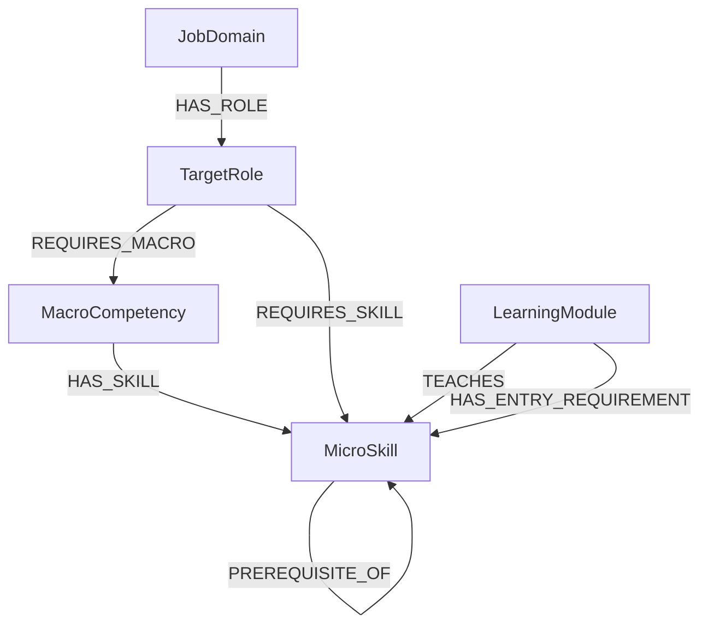

# NEO4J SCHEMA V5 — GIẢI THÍCH NODE VÀ RELATIONSHIP

## 1. Phạm vi schema

Schema Neo4j hiện tại gồm:

- 5 node: `JobDomain`, `TargetRole`, `MacroCompetency`, `MicroSkill`, `LearningModule`.
- 7 relationship: `HAS_ROLE`, `REQUIRES_MACRO`, `HAS_SKILL`, `REQUIRES_SKILL`, `PREREQUISITE_OF`, `TEACHES`, `HAS_ENTRY_REQUIREMENT`.
- Không có node `LearningProgram`.
- User, assessment result, learner mastery và learning pathway được lưu trong PostgreSQL.

Các field đã loại bỏ:

```text
mandatory
sourceRefs
configVersion
datasetVersion
basis
evidenceStatus
moduleType
level
enrollmentModel
priceStatus
lastVerifiedAt
durationStatus
primary
```

`coverageType` đã được đổi tên thành `coverage`.

---

## 2. Sơ đồ tổng quát



---

## 3. Quy ước chung

### 3.1 Ký hiệu

| Ký hiệu | Ý nghĩa |
|---|---|
| Không có `?` | Field bắt buộc |
| `?` | Field tùy chọn, có thể `null` |
| `[0,1]` | Số thực từ `0.0` đến `1.0` |

### 3.2 Phân biệt `id` và `code`

| Field | Giải thích |
|---|---|
| `id` | ID kỹ thuật duy nhất, thường dùng UUID |
| `code` | Mã nghiệp vụ ổn định, dùng để import và truy vấn |

Ví dụ:

```json
{
  "id": "6c77c6cb-f33f-4447-b619-30c06ec38283",
  "code": "SPRING_BOOT"
}
```

Không dùng `name` làm khóa vì tên hiển thị có thể thay đổi.

### 3.3 `status`

Đề xuất dùng ba trạng thái:

| Giá trị | Ý nghĩa |
|---|---|
| `DRAFT` | Đang chuẩn bị, thuật toán chưa sử dụng |
| `ACTIVE` | Đã được phép sử dụng |
| `RETIRED` | Ngừng dùng cho dữ liệu mới nhưng vẫn giữ để tra cứu lịch sử |

### 3.4 Field thời gian

| Field | Giải thích |
|---|---|
| `createdAt` | Thời điểm tạo node hoặc relationship |
| `updatedAt` | Thời điểm cập nhật gần nhất |

Nên lưu theo UTC và ISO 8601:

```text
2026-09-24T14:30:00Z
```

---

# 4. Chi tiết node

## 4.1 `JobDomain`

### Mục đích

Phân nhóm các target role theo domain. Phạm vi dữ liệu hiện tại có thể gồm `ICT`, `DATA` và `AI`.

### Cấu trúc

```text
JobDomain {
    id,
    code,
    name,
    description?,
    status,
    createdAt,
    updatedAt
}
```

### Giải thích field

| Field | Kiểu | Bắt buộc | Giải thích |
|---|---|---:|---|
| `id` | String/UUID | Có | ID kỹ thuật duy nhất của domain |
| `code` | String | Có | Mã ổn định như `ICT`, `DATA`, `AI` |
| `name` | String | Có | Tên domain hiển thị |
| `description` | String | Không | Mô tả phạm vi của domain |
| `status` | Enum | Có | `DRAFT`, `ACTIVE` hoặc `RETIRED` |
| `createdAt` | DateTime | Có | Thời điểm tạo |
| `updatedAt` | DateTime | Có | Thời điểm cập nhật gần nhất |

### Ví dụ

```json
{
  "id": "domain-001",
  "code": "ICT",
  "name": "Information and Communication Technology",
  "description": "Software and information technology roles",
  "status": "ACTIVE",
  "createdAt": "2026-09-01T00:00:00Z",
  "updatedAt": "2026-09-24T00:00:00Z"
}
```

---

## 4.2 `TargetRole`

### Mục đích

Biểu diễn vị trí nghề nghiệp mà learner chọn làm mục tiêu.

### Cấu trúc

```text
TargetRole {
    id,
    code,
    name,
    familyCode,
    track,
    organizationId,
    seniority,
    description?,
    responsibilities?,
    status,
    createdAt,
    updatedAt
}
```

### Giải thích field

| Field | Kiểu | Bắt buộc | Giải thích |
|---|---|---:|---|
| `id` | String/UUID | Có | ID kỹ thuật duy nhất |
| `code` | String | Có | Mã role, ví dụ `JAVA_BACKEND_P3` |
| `name` | String | Có | Tên role hiển thị |
| `familyCode` | String | Có | Nhóm các role cùng nghề, ví dụ `JAVA_BACKEND` |
| `track` | Enum | Có | Nhánh `PROFESSIONAL` hoặc `MANAGEMENT` |
| `organizationId` | String/UUID | Có | Organization sở hữu và được phép sử dụng role |
| `seniority` | Enum | Có | Grade nghề nghiệp: `P1`–`P5` cho `PROFESSIONAL`, `M3`–`M4` cho `MANAGEMENT` |
| `description` | String | Không | Mô tả trách nhiệm hoặc phạm vi công việc |
| `responsibilities` | List<String> | Không | Danh sách trách nhiệm chính để hiển thị ở role detail |
| `status` | Enum | Có | Trạng thái role |
| `createdAt` | DateTime | Có | Thời điểm tạo |
| `updatedAt` | DateTime | Có | Thời điểm cập nhật |

Field `level` đã bị loại bỏ. `code` và `name` vẫn có thể chứa grade nghiệp vụ như `JAVA_BACKEND_P3`, nhưng runtime phải dùng field `seniority` riêng để hiển thị và filter cấp độ.

`seniority` là grade code dùng cho discovery/filter và không thay thế `track`. `PROFESSIONAL` chỉ dùng `P1`–`P5`; `MANAGEMENT` chỉ dùng `M3`–`M4`. Cùng một grade có thể mang mô tả năng lực/chức danh khác nhau giữa Finance, IT hoặc các domain khác; catalog của từng domain/role family sở hữu ý nghĩa chi tiết đó. Hậu tố như `P3` trong `code` vẫn không được dùng để suy luận seniority ở runtime.

### Ví dụ

```json
{
  "id": "role-001",
  "code": "JAVA_BACKEND_P3",
  "name": "Java Backend Developer P3",
  "familyCode": "JAVA_BACKEND",
  "track": "PROFESSIONAL",
  "organizationId": "00000000-0000-0000-0000-000000000001",
  "seniority": "P3",
  "description": "Develops and maintains Java backend applications",
  "responsibilities": [
    "Build and maintain Java backend services",
    "Review API and persistence designs"
  ],
  "status": "ACTIVE",
  "createdAt": "2026-09-01T00:00:00Z",
  "updatedAt": "2026-09-24T00:00:00Z"
}
```

---

## 4.3 `MacroCompetency`

### Mục đích

Phân nhóm các micro-skill thành ba nhóm năng lực lớn:

```text
KNOWLEDGE
COMMUNICATION
INNOVATION
```

### Cấu trúc

```text
MacroCompetency {
    id,
    code,
    name,
    description?,
    status,
    createdAt,
    updatedAt
}
```

### Giải thích field

| Field | Kiểu | Bắt buộc | Giải thích |
|---|---|---:|---|
| `id` | String/UUID | Có | ID kỹ thuật duy nhất |
| `code` | String | Có | Mã như `KNOWLEDGE` |
| `name` | String | Có | Tên hiển thị |
| `description` | String | Không | Giới hạn và phạm vi của macro |
| `status` | Enum | Có | Trạng thái macro |
| `createdAt` | DateTime | Có | Thời điểm tạo |
| `updatedAt` | DateTime | Có | Thời điểm cập nhật |

Macro không lưu `weight` hoặc `targetLevel`. Khi cần điểm macro, backend tổng hợp từ mastery của các micro-skill thuộc macro đó.

---

## 4.4 `MicroSkill`

### Mục đích

Đây là tầng tính toán chính cho skill gap, prerequisite, recommendation và learner mastery.

### Cấu trúc

```text
MicroSkill {
    id,
    code,
    name,
    description?,
    status,
    createdAt,
    updatedAt
}
```

### Giải thích field

| Field | Kiểu | Bắt buộc | Giải thích |
|---|---|---:|---|
| `id` | String/UUID | Có | ID kỹ thuật duy nhất |
| `code` | String | Có | Mã skill như `SPRING_BOOT` |
| `name` | String | Có | Tên skill hiển thị |
| `description` | String | Không | Mô tả learner cần biết hoặc làm được gì |
| `status` | Enum | Có | Trạng thái skill |
| `createdAt` | DateTime | Có | Thời điểm tạo |
| `updatedAt` | DateTime | Có | Thời điểm cập nhật |

Mastery của learner không nằm trên node này vì mỗi learner có mastery khác nhau. Mastery được lưu trong PostgreSQL.

---

## 4.5 `LearningModule`

### Mục đích

Biểu diễn một đơn vị học có thể được Recommendation Engine đưa vào pathway.

### Cấu trúc

```text
LearningModule {
    id,
    code,
    title,
    provider,
    platform,
    sourceUrl,
    durationHours?,
    priceAmount?,
    currency?,
    status,
    createdAt,
    updatedAt
}
```

### Giải thích field

| Field | Kiểu | Bắt buộc | Giải thích |
|---|---|---:|---|
| `id` | String/UUID | Có | ID kỹ thuật duy nhất |
| `code` | String | Có | Mã module ổn định |
| `title` | String | Có | Tên khóa học/module |
| `provider` | String | Có | Đơn vị tạo nội dung, ví dụ IBM |
| `platform` | String | Có | Nền tảng cung cấp, ví dụ Coursera |
| `sourceUrl` | String/URL | Có | URL gốc của module thật |
| `durationHours` | Decimal | Không | Số giờ ước lượng, dùng để xếp hạng hoặc tối ưu pathway |
| `priceAmount` | Decimal | Không | Giá module tại thời điểm thu thập dữ liệu |
| `currency` | String | Không | Mã tiền tệ, ví dụ `USD`, `VND` |
| `status` | Enum | Có | Trạng thái module |
| `createdAt` | DateTime | Có | Thời điểm tạo |
| `updatedAt` | DateTime | Có | Thời điểm cập nhật |

Quy tắc giá:

- `priceAmount = 0` nghĩa là đã xác nhận module miễn phí.
- `priceAmount = null` nghĩa là chưa có dữ liệu giá.
- Nếu `priceAmount` khác `null`, `currency` phải có giá trị.

---

# 5. Chi tiết relationship

## 5.1 Quy tắc chung

Relationship không có `id`. Neo4j tìm relationship bằng:

```text
node nguồn + relationship type + node đích
```

Tất cả relationship giữ ba field quản trị:

| Field | Kiểu | Giải thích |
|---|---|---|
| `status` | Enum | Relationship đang `DRAFT`, `ACTIVE` hay `RETIRED` |
| `createdAt` | DateTime | Thời điểm tạo relationship |
| `updatedAt` | DateTime | Thời điểm cập nhật relationship |

---

## 5.2 `HAS_ROLE`

```text
(:JobDomain)-[:HAS_ROLE]->(:TargetRole)
```

Cho biết role thuộc domain nào.

| Field | Kiểu | Giải thích |
|---|---|---|
| `status` | Enum | Trạng thái mapping domain–role |
| `createdAt` | DateTime | Thời điểm tạo |
| `updatedAt` | DateTime | Thời điểm cập nhật |

Ví dụ:

```text
ICT ──HAS_ROLE──> Java Backend Developer P3
```

Mỗi role chỉ nên thuộc một domain đang `ACTIVE`.

---

## 5.3 `REQUIRES_MACRO`

```text
(:TargetRole)-[:REQUIRES_MACRO]->(:MacroCompetency)
```

Cho biết role sử dụng macro nào để tổ chức và tổng hợp skill.

| Field | Kiểu | Giải thích |
|---|---|---|
| `status` | Enum | Trạng thái mapping role–macro |
| `createdAt` | DateTime | Thời điểm tạo |
| `updatedAt` | DateTime | Thời điểm cập nhật |

Relationship này không chứa `weight` hoặc `targetLevel`.

---

## 5.4 `HAS_SKILL`

```text
(:MacroCompetency)-[:HAS_SKILL]->(:MicroSkill)
```

Cho biết micro-skill thuộc macro nào.

| Field | Kiểu | Giải thích |
|---|---|---|
| `status` | Enum | Trạng thái mapping macro–skill |
| `createdAt` | DateTime | Thời điểm tạo |
| `updatedAt` | DateTime | Thời điểm cập nhật |

Do `primary` đã bị loại bỏ, schema hiện tại hiểu mỗi micro-skill chỉ thuộc một macro.

---

## 5.5 `REQUIRES_SKILL`

```text
(:TargetRole)-[:REQUIRES_SKILL]->(:MicroSkill)
```

Cho biết role yêu cầu skill nào và cần đạt mức nào.

| Field | Kiểu | Giải thích |
|---|---|---|
| `targetMastery` | Float `[0,1]` | Mức mastery role yêu cầu |
| `status` | Enum | Trạng thái requirement |
| `createdAt` | DateTime | Thời điểm tạo |
| `updatedAt` | DateTime | Thời điểm cập nhật |

### Skill gap

```text
gap = max(0, targetMastery - currentMastery)
```

Ví dụ:

```text
targetMastery  = 0.70
currentMastery = 0.45
gap            = 0.25
```

Do `mandatory` đã bị loại bỏ, mọi `REQUIRES_SKILL` đang `ACTIVE` đều được xem là skill bắt buộc của role.

---

## 5.6 `PREREQUISITE_OF`

```text
(:MicroSkill)-[:PREREQUISITE_OF]->(:MicroSkill)
```

Biểu diễn dependency tổng quát giữa hai skill.

| Field | Kiểu | Giải thích |
|---|---|---|
| `minMastery` | Float `[0,1]` | Mức tối thiểu của skill nguồn trước khi học skill đích |
| `status` | Enum | Trạng thái dependency |
| `createdAt` | DateTime | Thời điểm tạo |
| `updatedAt` | DateTime | Thời điểm cập nhật |

Ví dụ:

```text
Java Core
    ──PREREQUISITE_OF {minMastery: 0.60}
    ──> Spring Boot
```

Không cho phép:

- Self-loop thật: `Skill A → Skill A`.
- Cycle: `A → B → C → A`.

Vòng cong trên diagram chỉ biểu diễn relationship giữa hai node cùng label `MicroSkill`.

---

## 5.7 `TEACHES`

```text
(:LearningModule)-[:TEACHES]->(:MicroSkill)
```

Cho biết module dạy skill nào và mức độ bao phủ của skill đó trong module.

| Field | Kiểu | Giải thích |
|---|---|---|
| `outcomeMastery` | Float `[0,1]` | Mức kiến thức module được kỳ vọng hỗ trợ đối với skill |
| `coverage` | Enum | Mức độ skill được bao phủ trong module |
| `status` | Enum | Trạng thái mapping module–skill |
| `createdAt` | DateTime | Thời điểm tạo |
| `updatedAt` | DateTime | Thời điểm cập nhật |

### Giá trị `coverage`

| Giá trị | Mức gợi ý | Ý nghĩa |
|---|---:|---|
| `INTRODUCTION_OR_REVIEW` | `0.30` | Giới thiệu hoặc ôn lại skill |
| `SUPPORTING` | `0.50` | Skill đóng vai trò hỗ trợ |
| `CORE` | `0.70` | Skill là nội dung chính |
| `ADVANCED` | `0.85` | Module dạy skill chuyên sâu |

Ví dụ một module dạy nhiều skill:

```text
Spring Boot Fundamentals
  ├──TEACHES {outcomeMastery: 0.70, coverage: CORE}
  │  └──> Spring Boot
  └──TEACHES {outcomeMastery: 0.30, coverage: INTRODUCTION_OR_REVIEW}
     └──> REST API
```

`outcomeMastery` không được gán trực tiếp thành learner mastery. Learner vẫn cần assessment; Knowledge Tracing cập nhật mastery thật trong PostgreSQL.

---

## 5.8 `HAS_ENTRY_REQUIREMENT`

```text
(:LearningModule)-[:HAS_ENTRY_REQUIREMENT]->(:MicroSkill)
```

Cho biết learner cần đạt skill đầu vào nào trước khi bắt đầu một module cụ thể.

| Field | Kiểu | Giải thích |
|---|---|---|
| `minMastery` | Float `[0,1]` | Mức learner cần đạt ở skill đầu vào |
| `status` | Enum | Trạng thái entry requirement |
| `createdAt` | DateTime | Thời điểm tạo |
| `updatedAt` | DateTime | Thời điểm cập nhật |

Ví dụ:

```text
Advanced Spring Boot
    ──HAS_ENTRY_REQUIREMENT {minMastery: 0.80}
    ──> Java Core
```

Khác biệt:

| Relationship | Phạm vi |
|---|---|
| `PREREQUISITE_OF` | Dependency chung giữa hai skill |
| `HAS_ENTRY_REQUIREMENT` | Điều kiện riêng của một module |

---

# 6. Ràng buộc dữ liệu cần validate

## 6.1 Node

| Rule | Mục đích |
|---|---|
| `id` unique | Không có hai node cùng ID |
| `code` unique trong cùng label | Không có hai skill hoặc role trùng code |
| `status` thuộc enum cho phép | Tránh trạng thái tự do |
| `TargetRole.organizationId` là UUID hợp lệ | Giữ tenant scope có thể kiểm tra trực tiếp |
| `TargetRole.seniority` thuộc `P1`–`P5` hoặc `M3`–`M4` và khớp `track` | Search/filter không phụ thuộc tên/code; professional và management không trộn grade |
| Mỗi phần tử `TargetRole.responsibilities` không rỗng | Không trả nội dung detail hỏng |
| `updatedAt >= createdAt` | Dữ liệu thời gian hợp lệ |
| `sourceUrl` hợp lệ | Module phải trỏ đến nguồn học thật |
| `durationHours > 0` nếu có | Thời lượng phải hợp lệ |
| `priceAmount >= 0` nếu có | Giá không được âm |
| Có `currency` khi có `priceAmount` | Giá phải có đơn vị tiền tệ |

## 6.2 Relationship

| Rule | Mục đích |
|---|---|
| Không duplicate cùng type giữa cùng hai node | Không tính trùng requirement hoặc outcome |
| `targetMastery`, `minMastery`, `outcomeMastery` thuộc `[0,1]` | Chuẩn hóa điểm |
| Không prerequisite cycle | Tránh pathway lặp vô hạn |
| Role `ACTIVE` có ít nhất một `REQUIRES_SKILL` active | Role phải có yêu cầu skill |
| Module `ACTIVE` có ít nhất một `TEACHES` active | Module phải dạy ít nhất một skill |
| Mỗi skill thuộc một macro active | Phù hợp việc đã bỏ `primary` |

---

# 7. Ví dụ Cypher hoàn chỉnh

```cypher
CREATE (domain:JobDomain {
  id: randomUUID(),
  code: 'ICT',
  name: 'Information and Communication Technology',
  status: 'ACTIVE',
  createdAt: datetime(),
  updatedAt: datetime()
})

CREATE (role:TargetRole {
  id: randomUUID(),
  code: 'JAVA_BACKEND_P3',
  name: 'Java Backend Developer P3',
  familyCode: 'JAVA_BACKEND',
  track: 'PROFESSIONAL',
  organizationId: '00000000-0000-0000-0000-000000000001',
  seniority: 'P3',
  description: 'Develops and maintains Java backend applications',
  responsibilities: [
    'Build and maintain Java backend services',
    'Review API and persistence designs'
  ],
  status: 'ACTIVE',
  createdAt: datetime(),
  updatedAt: datetime()
})

CREATE (skill:MicroSkill {
  id: randomUUID(),
  code: 'SPRING_BOOT',
  name: 'Spring Boot',
  status: 'ACTIVE',
  createdAt: datetime(),
  updatedAt: datetime()
})

CREATE (domain)-[:HAS_ROLE {
  status: 'ACTIVE',
  createdAt: datetime(),
  updatedAt: datetime()
}]->(role)

CREATE (role)-[:REQUIRES_SKILL {
  targetMastery: 0.70,
  status: 'ACTIVE',
  createdAt: datetime(),
  updatedAt: datetime()
}]->(skill);
```

---

# 8. Luồng sử dụng schema

```text
Learner chọn TargetRole
        ↓
Đọc REQUIRES_SKILL.targetMastery
        ↓
So sánh với learner mastery trong PostgreSQL
        ↓
Tính skill gap
        ↓
Duyệt PREREQUISITE_OF
        ↓
Tìm LearningModule qua TEACHES
        ↓
Kiểm tra HAS_ENTRY_REQUIREMENT
        ↓
Xếp hạng module bằng gap, durationHours và priceAmount
        ↓
Tạo pathway và lưu trong PostgreSQL
```

Schema này giữ lại các field trực tiếp phục vụ catalog, quản trị lifecycle và thuật toán; các field evidence và version đã được loại bỏ theo phạm vi mới nhất.
