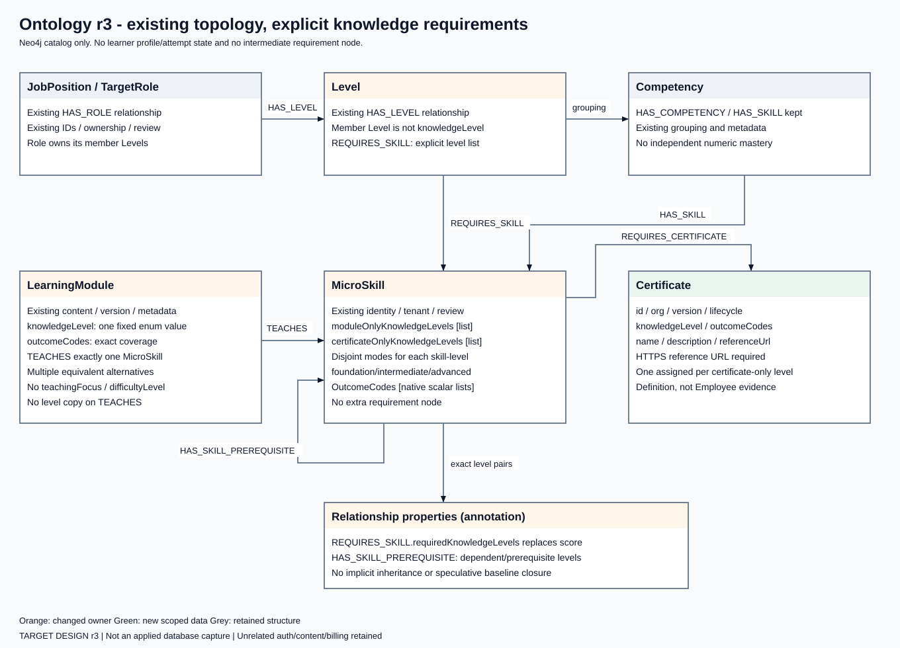
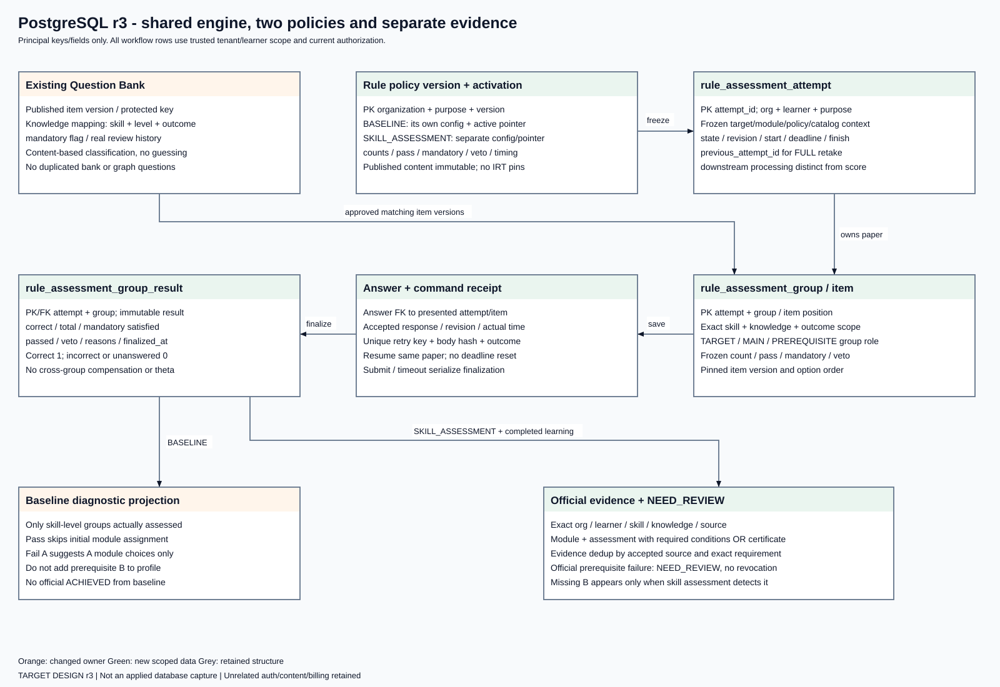
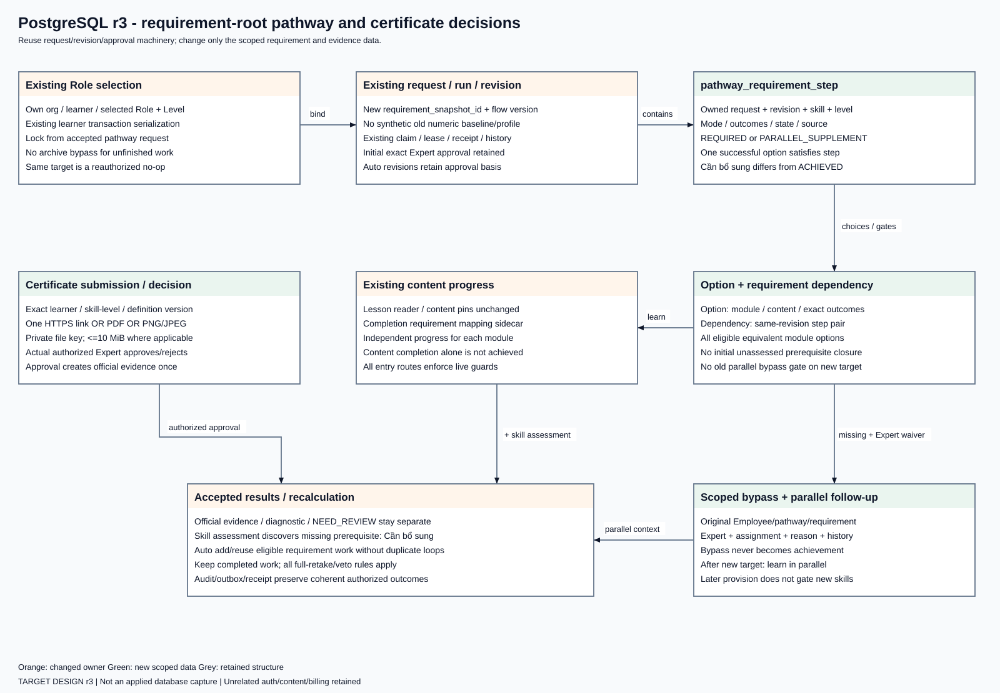
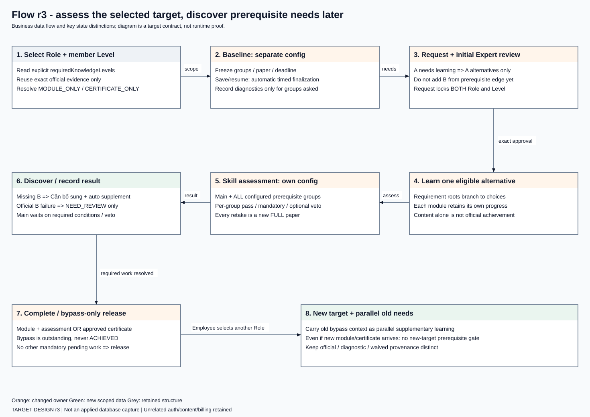

# Organization-rule assessment and pathway — target design r3

Design revision: 2026-11-05-r3. Latest user-confirmed flow direction; technical mappings below complete that direction for implementation. **Target schema/API design, not deployed schema or runtime evidence.** Existing source still uses numeric baseline/optimizer paths. Only this flow changes; unrelated tables/auth/features retain their owners. No new `SkillKnowledgeRequirement` node/table/type is required.

## 1. Scope and ownership

| Store | Owns in this flow | Kept outside this change |
| --- | --- | --- |
| Neo4j | Existing Role/member Level/Skill ontology, explicit knowledge requirements, exact prerequisite pairs, published Module projections and Certificate definitions | Existing topology/identities and unrelated catalog metadata |
| PostgreSQL | Two separate policies, Question Bank mappings, frozen attempts/answers/group results, official evidence/NEED_REVIEW, submissions/decisions, bypass, requirement-root pathway revisions/progress | Auth/accounts/membership/entitlement/billing/department/Job Position, RIASEC, AI inference and ROI infrastructure |
| Existing private object storage | Certificate PDF/image and current learning assets | No public evidence URLs or raw file bytes in PG/Neo4j |

Existing tenant/assignment/entitlement enforcement remains mandatory. New IDs use owning conventions, UUID for PG workflow records and text for catalog IDs; do not globally convert V50 text learner/organization keys. Cross-store references pin IDs and versions, not SQL FKs into Neo4j. Shared template catalog is read-only: org-specific mode/outcome/prerequisite edits require existing authored tenant scope, never mutate a globally shared Skill to configure one organization.

## 2. Target diagrams

[PNG/source inventory](../diagrams/README.md#target-design-r3--2026-11-05). Images show scoped target ownership and principal keys/fields, not an exhaustive live DB export. Existing account/content/audit infrastructure is referenced, not redesigned.

## 3. Neo4j physical mapping

Keep existing labels JobPosition, TargetRole, Level, Competency, MicroSkill, LearningModule and existing HAS_ROLE/HAS_LEVEL/HAS_COMPETENCY/HAS_SKILL/REQUIRES_SKILL/TEACHES/HAS_SKILL_PREREQUISITE topology.

| Element | Target fields / invariant |
| --- | --- |
| Level → REQUIRES_SKILL → MicroSkill | Replace numeric `requiredScore` use with `requiredKnowledgeLevels: List<String>`; nonempty unique explicit subset FOUNDATION/INTERMEDIATE/ADVANCED. Retain isMandatory and legitimate relationship metadata. No implicit level inheritance. |
| Tenant-owned MicroSkill | `moduleOnlyKnowledgeLevels`, `certificateOnlyKnowledgeLevels`: unique disjoint lists from the fixed levels; one configured mode per skill/level. A configured mode may lack content, producing Cần bổ sung/NEEDS_EXPERT_ACTION. Absence of mode is unresolved configuration, never fallback. |
| Tenant-owned MicroSkill outcomes | `foundationOutcomeCodes`, `intermediateOutcomeCodes`, `advancedOutcomeCodes`: stable required outcome-code lists, with existing definition/authoring descriptions. These are native scalar lists, not unsupported Neo4j map-valued properties or another ontology node. Codes have organization/skill/level scope. |
| LearningModule | Add `knowledgeLevel` and `outcomeCodes` to existing versioned module authoring payload and its published graph projection. Exactly one skill through TEACHES. Retire teachingFocus/difficultyLevel from active Module/TEACHES contract; retain title/type/content/version/duration/price/ownership/review fields. Knowledge level is not duplicated on TEACHES. |
| MicroSkill → HAS_SKILL_PREREQUISITE → MicroSkill | Replace numeric readiness use with `dependentKnowledgeLevel`, `prerequisiteKnowledgeLevel`; retain id/version/review metadata. Identity includes org + dependent skill/level + prerequisite skill/level. Multiple distinct level pairs between skills are allowed; duplicate pairs/self exact requirement/cycles are rejected. Same skill with explicitly different levels is permitted if acyclic. |
| MicroSkill → REQUIRES_CERTIFICATE → Certificate | New certificate-only extension. Certificate has stable id, organizationId, name/description, knowledgeLevel, outcomeCodes, mandatory HTTPS referenceUrl and existing version/lifecycle metadata. No knowledgeLevel duplicate on the edge. One active assigned Certificate per org/skill/level configured CERTIFICATE_ONLY; no active certificate assignment for MODULE_ONLY. A node is a definition, never an Employee upload. |

Application/import/publication validators enforce mode disjointness, cardinality, exact outcomes, ownership, publication and acyclicity; Neo4j uniqueness alone does not enforce relationship degree or list predicates. Existing scoped IDs/uniqueness remain. Add Certificate ID uniqueness using the repository's existing ID convention; scope/exact-pair duplicate validation runs in the owning write transaction. No index drop/constraint rewrite for unrelated labels.

Module alternatives must teach the exact skill/level and cover required outcome codes, be approved/active/access-ready and retain pinned content versions. Identical skill ID alone is not equivalence. Published authoring projection is not an independently editable second truth.

## 4. PostgreSQL schema mapping

The names below define the scoped target mapping. `organization_id`, `learner_id`, `actor_id`, `created_at`, revision/hash and composite tenant references apply wherever relevant. They are omitted from some compact field lists, not from implementation. All times are timestamptz; stable workflow IDs UUID; catalog IDs text; counters/revisions integer/bigint; controlled values text with CHECK; structured immutable snapshots JSONB with validated shape. Do not encode substantive rules as arbitrary SQL/script supplied by an organization.

### 4.1 Policies, questions and papers

| Table / existing owner | Principal fields and constraints |
| --- | --- |
| Existing Question Bank authoring/version document | Extend skill mapping with knowledgeLevel, one outcomeCode, mandatory boolean. Keep existing responsible Expert, L&D review, answer keys, immutable published versions and import identity. Published new-flow mapping must be complete; legacy unclassified items are not silently sampled. |
| `assessment_item_knowledge_mapping` | item_version_id FK to existing published item_version; org, skill_id, knowledge_level, outcome_code, mandatory, mapping_version/hash. One complete exact mapping per version. Publish atomically with item definition; no duplicate bank or copied answer key. |
| `assessment_rule_policy_version` | id, org, purpose BASELINE/SKILL_ASSESSMENT, version, configuration JSONB/hash, actual created/published actor/time. Unique org+purpose+version. Published content immutable. Correct-count/mandatory/sampling/timer/retake/veto rules are purpose-specific. |
| `assessment_rule_policy_activation` | PK org+purpose, current_policy_version_id, revision, changed_by/at; composite FK requires same org/purpose and published version. **Two independent configs and activation pointers**, even though engine/tables are shared. |
| `rule_assessment_attempt` | id, org/learner, purpose, selected Role/member Level/selection revision or pathway requirement/module context, policy id/hash, catalog/requirement snapshots, state/revision, started_at/deadline_at/finished_at, previous_attempt_id, result-processing status. No theta/SE/mastery parameters. |
| `rule_assessment_group` | attempt_id, group_id, exact skill/level/outcomes, group_role TARGET/MAIN/PREREQUISITE, count/required-correct/mandatory/veto snapshot. PK attempt+group, unique exact logical group per attempt. Group role is contextual, never a fixed question type. |
| `rule_assessment_item` | attempt/group, item_position, published item_version_id, mapping identity, frozen option order/scoring reference. Unique item version across paper and position within paper; trusted staff key never projected to Employee. |
| `rule_assessment_answer` | attempt/item, accepted response/is_correct, answer revision, accepted_at, source command. One current accepted answer per presented item; attempts/results preserve final accepted answer state and command history. Late/stale answers cannot overwrite finalization. |
| `rule_assessment_group_result` | attempt/group PK/FK, correct_count, total_count, mandatory_satisfied, passed, veto_triggered, reasons, finalized_at. Counts bounded by frozen paper; result immutable after finalization. Result decision and downstream-processing status are separate. |
| `rule_assessment_command` | org+actor+operation+resource+retry_key uniqueness, body_hash, retained outcome/status, attempt/revision references and actual time. Same key/body replay returns accepted outcome after current authorization; changed body conflicts. |

Composite FKs bind group/item/answer/result to the same owned attempt and valid published item/mapping. One active attempt per owning assessment context is enforced by transaction/partial uniqueness; exact purpose/context key is explicit, not a global one-attempt-ever allowance. Index org+learner+purpose/state and pending deadlines/processing; new policies need no per-Role copy. Keep existing general assessment/reporting tables for unrelated consumers until exact retirement audit; do not indiscriminately DROP them.

Policy validation: total > 0; requiredCorrectCount 1..total; mandatory count included within total; matching approved bank sufficient; configured timing and retake settings valid. No business threshold defaults. Correct=1, incorrect/unanswered=0. Questions selected once, mandatory first then random-fill without duplicates. Insufficient group bank produces explicit readiness failure before a usable attempt, not cross-group fill or a partial successful paper.

At start, freeze policy/groups/questions and deadline. Resume keeps all of them. Answer and finalization serialize against attempt revision. Deadline worker and manual submit use the same finalize operation: all unanswered=0, one immutable outcome with expiry/submit reason; no deadline extension on reload and no duplicate result consumption. Automatic timer finalization is required for both separately configured purposes.

### 4.2 Profile, learning provenance and certificate

| Table / owner | Principal fields and constraints |
| --- | --- |
| `skill_knowledge_evidence` | id, owned learner, skill_id/knowledge_level/outcome-version snapshot, source_kind MODULE_ASSESSMENT/CERTIFICATE, source id/version, actual achieved_at. Append accepted official sources; dedup source+exact requirement. No BASELINE/BYPASS achievement source. Multiple genuine accepted evidence sources are allowed. |
| `skill_knowledge_review` | id, owned learner/exact requirement, source attempt/group, NEED_REVIEW/reason, created_at and optional resolved-by provenance. Does not revoke official evidence. |
| Existing `learning_module_completion` / `learning_self_study` | Keep existing owner, identity types, lesson/content pins and immutable normal-runtime provenance. Add `learning_completion_requirement` sidecar FK to original org/learner/module/revision, with knowledge_level/outcome/catalog snapshots for new-flow compatibility. No second lesson-progress system. Affected old dev evidence may be rebuilt instead of backfilled. |
| `certificate_submission` | id, org/learner, exact skill/level, definition id/version/snapshot, current revision/status, submitted_at, optional replaces_submission_id. Pending/rejected is Cần bổ sung, never official evidence. |
| `certificate_submission_attachment` | submission FK, evidence_kind LINK/PDF/IMAGE, HTTPS URL OR private object key, media type/size/hash; enforce exactly one evidence form per submission and scoped file ownership. No public file URL/raw bytes. |
| `certificate_submission_decision` | submission/revision, approve/reject, authorized Expert+assignment snapshot, reason, actual decided_at, source retry identity. One accepted decision per submitted revision, immutable; approval creates exact evidence/outbox atomically once. |

The profile projection combines **separate** diagnostics, official evidence, Cần bổ sung and NEED_REVIEW with provenance. Baseline only exposes skill/level groups actually assessed; A's pass/fail never creates B merely because B is a prerequisite. No inference of official achievement from raw numeric mastery or job title. Compatible official evidence exempts exact later baseline groups, but does not exempt prerequisite groups in a skill retake.

Evidence upload: one HTTPS link OR one PDF OR one PNG/JPEG; max 10 MiB/file subject to any tighter applicable platform limit. Validate actual content/media and size, not extension only. Do not fetch remote links/redirects server-side to accept evidence. Private read reauthorizes own learner or assigned reviewer. No generalized issuer-verification/expiry/revocation service is included; catalog retirement affects future submissions without rewriting accepted decisions.

### 4.3 Existing pathway machinery, new requirement projections

| Table / existing owner | Target change |
| --- | --- |
| Existing employee_role_selection/request | Keep IDs/snapshots/retry history. Guard every change under existing learner transaction lock before archive/write; preserve exact member Level binding. No parallel target-lock table. |
| `pathway_requirement_snapshot` | New owned selection/revision, exact required knowledge/outcomes/provision, actually assessed diagnostics/official evidence and catalog/policy identities/hash. No numeric gap or speculative prerequisite closure. |
| Existing initial_pathway_request | Add flow_version and requirement_snapshot_id for new flow. Old gap_snapshot_id/FK need not be filled by a synthetic numeric profile: make old/new snapshot references conditional on flow_version. Keep old historical shape only if retained data requires it; do not rewrite applied V27. |
| Existing run/revision/current/approval/receipt | Reuse claim/lease, revision/hash, assignment, command replay and exact initial approval. Add change_origin, source event identity and approval_basis_revision for automatic supplemental revisions; never fabricate an Expert approval for an auto revision. |
| `pathway_requirement_step` | owned request/revision, step_id, skill_id/knowledge_level/outcome/provision snapshot, kind REQUIRED/PARALLEL_SUPPLEMENT, source bypass if parallel, state/reason/ordinal, fulfilled source. Unique logical requirement+kind+source within revision; Cần bổ sung is display wording, not loss of underlying reason. |
| `pathway_requirement_option` | step FK, module_id/content_version and compatible outcomes; unique module/version per step, with saved chosen/available context. Content progress refers to existing owner rather than duplicated lesson rows. CERTIFICATE_ONLY step instead binds one definition. |
| `pathway_requirement_dependency` | same-owned-revision from/to step IDs, source assessed prerequisite/canonical exact pair; reject self/duplicate/cycles. Do not create gates from baseline-only unassessed prerequisites or from a carried PARALLEL_SUPPLEMENT into ordinary new-target steps. |
| `pathway_requirement_bypass` | exact owned learner/request/step/requirement, actual Expert/assignment, reason/time/decision identity and supersession provenance. Not achievement; unique accepted decision source. |

Index current-request owned revision + required/blocking states, option step/module, dependency endpoints, bypass source and pending review scope. Composite FKs prohibit cross-org/pathway/revision links. Catalog definition IDs are frozen text refs validated against scoped catalog, not SQL FKs to Neo4j.

## 5. Ordered business flow and completion

1. Employee selects published Role and member Level. Read explicit requiredKnowledgeLevels and exact official evidence; only target MODULE_ONLY requirements needing baseline are sampled. Certificate-only goes to evidence provision. No whole-Job-Position union.
2. Baseline returns diagnostic per actually assessed group. A pass skips initial A learning; A Cần bổ sung creates A module choices. **Do not add or gate B from A's prerequisite edge at this stage.** Missing/insufficient is not failed. Diagnostic reuse stays in same unchanged request/context, not next-target exemption.
3. Request submission locks Role AND Level; pending generation/review counts as locked. Generate exact target needs with all equivalent module choices/single certificate. Initial assigned Expert approves requirement choices/order or resolves missing provision/scoped bypass. No optimizer or mandatory completion of every alternative.
4. Employee learns one valid choice, keeping independent progress on each. Skill assessment includes main + all configured prerequisite groups and uses its own active policy/timer. Complete content alone awards nothing.
5. Main below its rule stays incomplete. Main passes but unachieved prerequisite shortage exists: introduce that exact B as Cần bổ sung, keep main group result pending required supplementation and recalculate without duplicate A/B. Already officially achieved B instead gets NEED_REVIEW, not forced relearning/revocation. All-wrong veto, if enabled, still blocks main and requires full retake; no prior group carry-over.
6. Accepted module+assessment with required conditions or certificate approval creates official exact evidence once. Finalize/decision/profile/pathway events have consistent PG transaction outcomes and durable retryable delivery; no network notification failure becomes false rollback/success.
7. Bypass remains Cần bổ sung/waived. Within the same target, later provision follows not-started relock / started content preserved but pending completion / completed result retained with supplementation. When bypass-only lets Employee choose a new target, carry old bypass items into the new view as PARALLEL_SUPPLEMENT, queryable with original source and available provision. **Even after provision appears, these old items do not gate new-target skills.** No silent target reopening/replacement.
8. Release target when no mandatory non-bypassed blocking work remains. Optional alternatives, NEED_REVIEW and carried parallel items do not hold the lock. Failed/stale/returned requests remain bound for repair/retry; no unapproved self-cancel/unlock feature. Reauthorize same-target no-op and exact retries as well.

If a new target independently requires the same skill/level as a carried item, preserve explicit source/context: do not accidentally convert the old parallel item's non-gating status into a prerequisite for other new steps. Such display/data merging must retain the accepted bypass provenance and must not invent official achievement.

## 6. API and UI contract delta

Reuse existing owning controllers/ports; exact HTTP additions stay in their feature owner and use existing error/CSRF patterns. No parallel auth, duplicate beans/routes or JDBC backdoor to bypass JPA/SDN ownership.

| Surface | Required delta |
| --- | --- |
| Role catalog/selection/gap preview | requiredKnowledgeLevels instead of requiredScore/mastery/gap; exact Level; diagnostics versus official status; server lock reason/release, no selection writes on preview. |
| Manage Question Bank | Existing workspace: knowledge level, assessed outcome and mandatory fields replace obsolete active-flow difficulty fields. Preserve prompt/options/key/explanation and review/import/history. Content-based level classification is authorized; no automatic EASY→FOUNDATION mapping or fabricated reviewer metadata. |
| L&D policy configuration | Distinct Baseline and Skill Assessment configuration state/save/activate/time limits. Same visual system; separate purpose caches/mutations so changing one cannot silently change the other. |
| Employee assessment | purpose, groups/questions, persisted attempt/revision/deadline, saved answers, per-group result/reason, timeout/retake/recovery; do not expose staff answers or rely on browser timer authority. |
| Pathway/review | skill/knowledge requirement roots → module alternatives, saved option progress, certificate and Cần bổ sung/bypass/parallel state, exact approval lineage and live guards. |
| Expert certificate | Add certificate tab in existing catalog workspace; list skill+level, Add, required reference URL. Review exact Employee submission/definition with private evidence and actual decision history. |
| Employee evidence | link/PDF/image form, pending/rejected/approved with reason/history, bounded upload/retry and private access. |

Preserve current FE design: WorkspaceLayout, shared components/tokens/IBM Plex Sans/typography, sizes/spacing/density/responsive layout, graph/timeline visual styling and EN/VI. Cần bổ sung corresponds to Needs supplementation in EN. Role remains Role / Vị trí. Detailed new tab/dialog placement and changed structure need C2 user review before UI implementation; no pixel redesign or mock-as-integration claim.

## 7. Data transition, retirement and seed design

Affected old development flow data/history need not be migrated/preserved solely for legacy numeric behavior. Build matching new definitions/seeds before runtime consumers: explicit Role-Level levels; same catalog IDs where still meaningful; module knowledge/outcome classification; actual Question Bank level mapping; two independent policy inputs; exact prerequisite pairs; single certificate modes; deliberate missing-content cases. No fabricated content/reviewer/times or blanket publication. Ambiguous questions/modules remain explicitly unready rather than guessed. Development seeds are examples, not production authority or executable oracles.

Retire new-flow consumers of IRT parameter/calibration/mastery mapping, theta/SE/confidence, numeric gap snapshots, mastery-thirds/focus/difficulty preference and branch-and-bound proof. `model_version`, generic profile/assessment/reporting structures cannot be dropped on a naming assumption: audit actual owners/FKs/triggers first. New-flow request sources must not require old numeric baseline/profile rows. Keep only genuinely needed compatibility for unaffected consumers; do not build a parallel numeric fallback.

No applied migration edits/checksum changes. Use an explicit forward scoped migration/seed transition for the selected existing lineage; an alternative clean lineage is not inferred from permission to discard affected dev records. Never combine db/migration and workspace/retained lineage locations. Exact PG instance/schema, Neo4j database/org/catalog, seed sources, unrelated/shared preservation and recovery boundaries are prerequisites to application/reset; no reset occurs in this document task. Retain research/evidence/failures/backups; normal new-flow attempts/resume/history are required.

## 8. Source implementation gap and review boundary

Inspected baseline HEAD ddfae767: RoleBaselineFlow/CurrentRoleCatalog still use requiredScore and whole Job Position scope; CurrentRoleSelectionStore archives pathways on changed selection; InitialPathwayAdmission also writes selection; InitialProblemBuilder pre-expands prerequisites; InitialPathwayPlanner/RoleGap remain numeric/optimizer-oriented; SkillLearningService/V50 are skill-only. Existing authored tenant routing and real content/review/history are reuse points, not proof this target is implemented.

Source layering remains Java 21/Spring Boot 3.5 with domain/ports/use cases, JPA/SDN and existing DTO mapping. Compile/build/type-check/lint can be used in the authorized C2 scope with executable tests disabled. No executable-test creation/execution or test-document authoring under current workflow. Static docs/render checks are not behavior/integration/performance/production evidence. Research/Version 2 knowledge-tracing/CBF/HitRate obligations need explicit reconciliation outside this flow's implementation claims.
