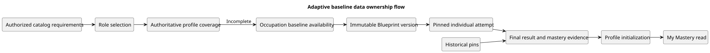

# Adaptive Baseline Data Architecture

## Ownership and processing boundary

Java 21/Spring Boot 3.5 implements application/domain rules behind ports. Neo4j owns authorized versioned catalog relationships. PostgreSQL owns selection, profiles, configuration/activation, attempts/pools/responses/deadlines, result/evidence, technical versions, receipts/audit/outbox and downstream mastery/gap/pathway state. Learner state is never stored in Neo4j.

[Diagram source](../../diagrams/adaptive-baseline-data-flow.puml)

[Role-to-baseline contract](Role%20Selection%20and%20Occupation%20Baseline.md) defines visible flow. [Lifecycle/API contract](Occupation%20Baseline%20Lifecycle%20and%20Transition.md) defines exact revision/retry/lock semantics. [Schema catalog and drawings](../../diagrams/README.md) inventory actual storage; [synchronization review](../../testing/system/REQ-001-002-final-synchronization-review.md) records implementation limits separately from required behavior.

## Version identities

| Version | Meaning and owner |
| --- | --- |
| Ontology/catalog version and fingerprint | Catalog schema/release membership; Neo4j/source metadata; not a Flyway number |
| Flyway V1–V26 | PostgreSQL structural evolution, source checksum and application status |
| Blueprint ID + released version | Immutable Occupation assessment settings/scope/pins allocated at activation |
| Draft ID + revision | Sole mutable working configuration; revision is not a release number |
| Model/mapping/parameter set | Exact immutable numerical configuration/formulas/item tuples; scoped effective selection affects future versions only |
| Selection/profile provenance | Employee's committed revision and applicable skill set/attempt/version; newer releases do not rewrite it |

No lookup uses a global latest version to replace a historical pin.

## Configuration and compatibility storage

| Original V18 structure | Historical representation | Implemented V20-V22 compatibility |
| --- | --- | --- |
| baseline_blueprint | Stable organization+Occupation identity | Keep identity/cardinality and existing scope FK/registry |
| baseline_adaptive_blueprint_working_revision | OPEN/FINALIZED/ABANDONED; configuration JSON requires exploration+roles | Dual shape reader/validator; new configuration contains name+one occupationBounds pair; only one OPEN per scope |
| baseline_adaptive_blueprint_version | Immutable name/Occupation/fingerprint, exploration maximum/duration, technical pins | Add server-owned scope_policy and occupation_max_questions/occupation_time_limit_seconds; old values untouched |
| baseline_adaptive_blueprint_role | Immutable active Role snapshot plus per-Role maximum/duration | Keep membership/provenance; new format has no Role assessment bounds |
| baseline_adaptive_blueprint_skill | Role-to-skill snapshots, including shared skill memberships | Keep membership edges; derive one deduplicated skill set for new versions and validate shared ID/name/version consistency |
| baseline_blueprint_activation | Serialized scope/current version/revision/actor/time | Keep sole pointer; expected replacement target validated under lock |
| baseline_blueprint_activation_event | Immutable FINALIZE/DISABLE history | Keep old events; explicit activate/deactivate UI names do not rewrite them; extend operation vocabulary only if approved |
| baseline_blueprint_command | Actor/tenant/key/request hash/outcome | Preserve legacy namespace/decoding; new commands/no-op/conversion receipts explicitly versioned |
| baseline_blueprint_version_registry / baseline_blueprint_working_registry | Existing FIXED/ADAPTIVE version/working identity routing | Keep collision/history guarantees; ADAPTIVE alone does not distinguish old scope from new |

V20 conditional full/legacy representation uses explicit FULL_OCCUPATION_V2 for new versions; null historical policy retains original meaning. Full-format common bounds are positive/non-null; old per-Role/exploration bounds remain only for historical readers. Parent/child integrity, version/working registries and immutable-history triggers must remain coherent. V21 constrains new names/durations; V22 adds explicit conversion receipts; V24 extends command operations with DISCARD. Draft discard closes history, never deletes released versions or learner evidence.

## Selection and profile persistence

| V25 structure | Actual fields and structural guarantees |
| --- | --- |
| employee_role_selection | UUID selection_id PK; organization_id; learner_id FK; string role_id/occupation_id; role_snapshot JSON object; positive target_revision; selected_at/ended_at; unique org+learner+revision; partial unique org+learner current row |
| employee_role_selection_request | Org+learner+retry_key PK; request_hash; selection_id FK; response JSON object; created_at; immutable receipt trigger |
| employee_occupation_profile | Org+learner+Occupation PK; unique attempt_id; tenant/learner/Occupation composite attempt FK; Blueprint/version FK; catalog_fingerprint; nonempty required_skills array/mastery object; initialized_at; immutable initialization trigger |

Required production behavior reads authoritative profiles and preserves original version/skill provenance. The current physical profile table represents initialization records; later-learning profile ownership and updates are separate integration work recorded in the synchronization review. JSON checks enforce shape/nonemptiness; domain validation must additionally check numeric range, required-skill equality and sufficient genuine evidence. Selection/receipt FKs alone do not prove organization membership: account/learner joins and trusted org/actor predicates are required at every boundary.

## Technical and attempt storage

V18 model_version/mastery_mapping_version/irt_calibration_run/irt_parameter_set/irt_item_parameter retain exact version/provenance semantics. V23 scoped irt_effective_parameter_selection and immutable promotion receipts choose future Blueprint parameters by org+bank+model+mapping. Historical findPinned reads never substitute effective/current sets. Numerical validation and actual-pilot approval cannot be inferred from a storage status.

| Actual V19 structure with V20 compatibility | Retained invariant / implemented extension |
| --- | --- |
| baseline_adaptive_attempt | Trusted organization/learner/Occupation, one IN_PROGRESS and one mastery-producing completion per Employee+Occupation, server time/revision, purpose/role provenance and replacement link. V20 adds immutable scope policy for new attempts; common bounds are compared against the pinned version |
| baseline_attempt_pool_item | Exact eligible item-version/skill/parameter-set pool stored at start; new full-union pool never reconstructed from current Catalog |
| baseline_attempt_skill_state | Provisional theta/SE/information and minimum evidence for every pinned union skill; no unanswered prior becomes mastery |
| baseline_attempt_item / baseline_attempt_response | Unique nonrepeating presented sequence, fixed option order, accepted server correctness and exact request identity; immutable audit preserved |
| baseline_attempt_result / baseline_attempt_skill_result | Immutable explanatory raw counts and per-skill theta/SE/point/conservative mastery/confidence; new skill names resolve from full pinned union, old result names retain recorded role scope |
| baseline_mastery_evidence / outbox_event | Atomic idempotent initialization evidence/event; no result/evidence for invalidated below-minimum attempt; delivery/REQ-041 projection separate |
| baseline_attempt_command | Scoped old/new exact command receipts; replay must not reinterpret a historical start using the new policy |

V26 preserves terminal timing/immutability checks while allowing INVALIDATED/MANUAL before deadline for insufficient evidence. States remain IN_PROGRESS/SUBMITTED/AUTO_SUBMITTED/INVALIDATED; no extra insufficient-evidence result status or grace period exists. Full-scope result names read pinned union snapshots; historical readers retain original Role scope. Profile/mastery values require genuine sufficient final outcomes, with no score threshold and no double-counted BKT transition.

## Transaction order and consistency

1. Management serializes org+Occupation, checks authorization/replay/expected Draft ID+revision; unchanged Save preserves revision and returns immutable receipt. Preview is read-only.
2. Activate/Deactivate use exclusive scope coordination and activation locking; verify confirmed current pair/revisions, then atomically commit version/pointer/closed Draft/event/receipt. Counts never require learner/attempt locks.
3. Selection/start first serialize the trusted learner and check replay/allowance/activity. New start alone holds shared scope/activation locks through exact pool/skill/first-item/receipt insertion. Missing activation rows require scope serialization; locking an absent row is insufficient.
4. Catalog fingerprints/version rechecks detect cross-store drift; no distributed ACID claim. Conflict/dependency failure rolls back rather than trimming scope.
5. Resume/answer/finalization/worker use original pins and attempt locks independently of current availability. Accepted responses must precede the authoritative deadline. Finalize sufficient result/evidence/outbox/profile atomically or invalidate with no mastery/profile. Worker claims bounded expired rows recoverably.
6. List/status/result/history/My Mastery apply trusted actor/tenant predicates and safe projections. GET never starts/finalizes an attempt, creates a receipt, changes mastery or marks delivery. Failure is distinct from empty data.

## Retention, migration and acceptance

All applied migrations and historical data are retained. Forward compatible readers preserve old snapshots, hashes, responses, evidence and successful allowance; linked invalidated replacements retain the chain's original version/pool. Rollback stops new admission and uses compatible readers; no down migration, data reset/re-score/repin or legacy-only downgrade.

The [20 October target source](../../diagrams/postgresql-adaptive-baseline-target.puml) and [image](../../diagrams/postgresql-adaptive-baseline-target.svg) are superseded historical design, not current schema. Current generated inventory is V26. Storage inventory does not prove business authorization or concurrency correctness.

AB-C17–C18, AB-A02/A08–A11, AB-R01–R05, AB-S01–S02 and RB/VB cover schema compatibility, isolation, transactions, retained provenance and numerical/evidence boundaries. All current executable results remain separately documented; a schema capture is not test evidence.

Confirmed | Provisional: exact numerical constants | Open: cross-owner production integration and numerical validation | Rejected: history mutation, global-latest repinning or learner state in Neo4j.
> Historical main-branch design, retained for traceability. Current ownership is defined by [Assessment workflows](../../features/Assessment%20workflows/README.md) and [Role guidance](../../features/Role%20guidance/README.md); workspace integration is described in [Architecture](../../ARCHITECTURE.md). Demo assumptions below are not live tenant authorization.
