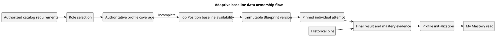

# Adaptive Baseline Data Architecture

**Current flow revision: 2026-11-05-r3.** [Target schema/API/flow](../Organization%20Rule%20Assessment%20and%20Pathway.md) supersedes this document's older active assessment/mastery/gap/optimizer assumptions. Material below is retained previous design/source/operation history, not proof of r3 being applied. Keep non-conflicting security/content/retry safeguards. Baseline covers selected Role–Level, records only assessed diagnostics and does not pre-add prerequisites; two separate policy configs share an engine; skill assessment discovers supplementation; cross-target old bypass work is parallel/non-gating. Old affected dev records may be rebuilt; new-flow history and unrelated/shared evidence/backups remain. Do not automatically run retained setup/reset/test commands below.

**2026-11-01 fresh-main correction:** [organization-policy storage/admission](#planned-organization-policy-storage-and-admission) uses forward SQL [workspace V44](../../../backend/src/main/resources/db/workspace-migration/V44__organization_assessment_policy.sql), [canonical V44](../../../backend/src/main/resources/db/migration/V44__organization_assessment_policy.sql) or [module V44](../../../backend/src/main/resources/db/module-migration/V44__organization_assessment_policy.sql), selecting only one lineage per database. Main V1–V43 remains unchanged; original local V29/V40 sources are archived outside active Flyway locations. The user selected fresh initialization, not retained-DB adoption/repair; [fresh-main guide](Fresh%20Main%20Bank%20Initialization.md) records the boundary. New versions are source until actually applied on the fresh stack. Diagrams/inventories remain dated snapshots; guard/concurrency acceptance is Not run. PostgreSQL owns policy/learner provenance; no Neo4j schema/data rewrite.

## Ownership and processing boundary

Java 21/Spring Boot 3.5 implements application/domain rules behind ports. Neo4j owns authorized versioned catalog relationships. PostgreSQL owns selection, profiles, configuration/activation, attempts/pools/responses/deadlines, result/evidence, technical versions, receipts/audit/outbox and downstream mastery/gap/pathway state. Learner state is never stored in Neo4j.

[Diagram source](../../diagrams/adaptive-baseline-data-flow.puml)

[Role-to-baseline contract](Role%20Selection%20and%20Job Position%20Baseline.md) defines visible flow. [Lifecycle/API contract](Job Position%20Baseline%20Lifecycle%20and%20Transition.md) defines exact revision/retry/lock semantics. [Schema catalog and drawings](../../diagrams/README.md) inventory actual storage; [synchronization review](../../testing/system/REQ-001-002-final-synchronization-review.md) records implementation limits separately from required behavior.

## Version identities

| Version | Meaning and owner |
| --- | --- |
| Ontology/catalog version and fingerprint | Catalog schema/release membership; Neo4j/source metadata; not a Flyway number |
| Flyway V1–V26 | PostgreSQL structural evolution, source checksum and application status |
| Blueprint ID + released version | Immutable Job Position assessment settings/scope/pins allocated at activation |
| Draft ID + revision | Sole mutable working configuration; revision is not a release number |
| Model/mapping/parameter set | Exact immutable numerical configuration/formulas/item tuples; scoped effective selection affects future versions only |
| Selection/profile provenance | Employee's committed revision and applicable skill set/attempt/version; newer releases do not rewrite it |

No lookup uses a global latest version to replace a historical pin.

## Planned authored-source provenance — revision19

The [authored consumer contract](../Workspace%20Adaptive%20Integration.md#authored-catalog-consumer-alignment--revision19) proposes source-format-aware projections, not a PostgreSQL catalog replica. Neo4j/source owner retains Role/Skill facts; a trusted versioned integration binding supplies missing Role→Job Position mapping through normal server configuration/owner port. This C1 creates no configuration values, table, SQL migration, backfill or graph mutation. Existing workspace_baseline_resource remains the exact org+Job Position bank/model/mapping tuple; its readiness is not catalog membership or publication authority.

New own snapshots may record a versioned `catalogSource` object containing `format`, `projectionHash`, `bindingRevision`, exact scoped binding identity and actual publication/version provenance. The proposed source object belongs to existing selection/Blueprint/frozen-input JSON; historical absent provenance selects the exact legacy reader/hash branch. In revised authored mode levelId is the exact stored member value scoped by roleId, never a synthetic graph-node FK/hash. Source format/projection provenance distinguishes its semantics from legacy real Level IDs. Retain original IDs, serialized receipts, profile/evidence/policy/technical pins and frozen approvals unchanged. Do not backfill old rows with today's mapping/hash or translate old Level IDs by label; missing expected provenance is integrity/unavailable, not permission to guess. Temporary server bindings are the user-selected integration source, not a new PostgreSQL catalog table.

Projection/schema versions differ from Flyway versions and owner Role.version. New projection hashes cover tenant, complete source facts and binding/rule provenance; a hash is not owner review/release approval. Before new writes revalidate the exact projection and authoritative release; source drift is stale, and PostgreSQL coordination does not serialize Neo4j. C2 must inspect existing JSON/guard codecs before extension; any required relational constraint/column change returns to C1. [CA19-06–08](../../testing/REQ-002-adaptive-baseline-test-plan.md#authored-catalog-alignment--revision19) plans schema/provenance/retention acceptance; none ran.

## Organization resource identity

The shared workspace lineage stores `platform.workspace_baseline_resource` in V32, keyed by organization_id+graph_job position_id and linked to the same-tenant Job Position reference. Its nullable question_bank_id/model_version_id/mastery_mapping_version_id form the configured resource tuple; null means unconfigured, not permission to select a default. The bank-owner guard checks the creator's organization. Technical eligibility must still validate the exact model/mapping/parameter provenance; the row and non-null pins alone do not certify readiness. Legacy V18–V26 version labels below refer to the retained baseline lineage, not equivalent workspace migration numbers or a live DB inspection.

Use the trusted organization and exact graph Job Position ID consistently from catalog grant through configuration, eligibility and new admission. Authorized Role discovery does not require the tuple to be assessment-ready or a Blueprint to be Active. Existing attempt/profile readers use their original scoped pins rather than today's tuple. This is the [organization integration contract](../Workspace%20Adaptive%20Integration.md#organization-scoped-source-and-operation-contract); no new table, migration, backfill or schema application is specified here.

## Configuration and compatibility storage

| Original V18 structure | Historical representation | Implemented V20-V22 compatibility |
| --- | --- | --- |
| baseline_blueprint | Stable organization+Job Position identity | Keep identity/cardinality and existing scope FK/registry |
| baseline_adaptive_blueprint_working_revision | OPEN/FINALIZED/ABANDONED; configuration JSON requires exploration+roles | Dual shape reader/validator; new configuration contains name+one job positionBounds pair; only one OPEN per scope |
| baseline_adaptive_blueprint_version | Immutable name/Job Position/fingerprint, exploration maximum/duration, technical pins | Add server-owned scope_policy and job position_max_questions/job position_time_limit_seconds; old values untouched |
| baseline_adaptive_blueprint_role | Immutable active Role snapshot plus per-Role maximum/duration | Keep membership/provenance; new format has no Role assessment bounds |
| baseline_adaptive_blueprint_skill | Role-to-skill snapshots, including shared skill memberships | Keep membership edges; derive one deduplicated skill set for new versions and validate shared ID/name/version consistency |
| baseline_blueprint_activation | Serialized scope/current version/revision/actor/time | Keep sole pointer; expected replacement target validated under lock |
| baseline_blueprint_activation_event | Immutable FINALIZE/DISABLE history | Keep old events; explicit activate/deactivate UI names do not rewrite them; extend operation vocabulary only if approved |
| baseline_blueprint_command | Actor/tenant/key/request hash/outcome | Preserve legacy namespace/decoding; new commands/no-op/conversion receipts explicitly versioned |
| baseline_blueprint_version_registry / baseline_blueprint_working_registry | Existing FIXED/ADAPTIVE version/working identity routing | Keep collision/history guarantees; ADAPTIVE alone does not distinguish old scope from new |

V20 conditional full/legacy representation uses explicit FULL_JOB_POSITION_V2 for new versions; null historical policy retains original meaning. Full-format common bounds are positive/non-null; old per-Role/exploration bounds remain only for historical readers. Parent/child integrity, version/working registries and immutable-history triggers must remain coherent. V21 constrains new names/durations; V22 adds explicit conversion receipts; V24 extends command operations with DISCARD. Draft discard closes history, never deletes released versions or learner evidence.

## Selection and profile persistence

| V25 structure | Actual fields and structural guarantees |
| --- | --- |
| employee_role_selection | UUID selection_id PK; organization_id; learner_id FK; string role_id/job position_id; role_snapshot JSON object; positive target_revision; selected_at/ended_at; unique org+learner+revision; partial unique org+learner current row |
| employee_role_selection_request | Org+learner+retry_key PK; request_hash; selection_id FK; response JSON object; created_at; immutable receipt trigger |
| employee_job position_profile | Org+learner+Job Position PK; unique attempt_id; tenant/learner/Job Position composite attempt FK; Blueprint/version FK; catalog_fingerprint; nonempty required_skills array/mastery object; initialized_at; immutable initialization trigger |

Required production behavior reads authoritative profiles and preserves original version/skill provenance. The current physical profile table represents initialization records; later-learning profile ownership and updates are separate integration work recorded in the synchronization review. JSON checks enforce shape/nonemptiness; domain validation must additionally check numeric range, required-skill equality and sufficient genuine evidence. Selection/receipt FKs alone do not prove organization membership: account/learner joins and trusted org/actor predicates are required at every boundary.

## Technical and attempt storage

V18 model_version/mastery_mapping_version/irt_calibration_run/irt_parameter_set/irt_item_parameter retain exact version/provenance semantics. V23 scoped irt_effective_parameter_selection and immutable promotion receipts choose future Blueprint parameters by org+bank+model+mapping. Historical findPinned reads never substitute effective/current sets. Numerical validation and actual-pilot approval cannot be inferred from a storage status.

| Actual V19 structure with V20 compatibility | Retained invariant / implemented extension |
| --- | --- |
| baseline_adaptive_attempt | Trusted organization/learner/Job Position, one IN_PROGRESS and one mastery-producing completion per Employee+Job Position, server time/revision, purpose/role provenance and replacement link. V20 adds immutable scope policy for new attempts; common bounds are compared against the pinned version |
| baseline_attempt_pool_item | Exact eligible item-version/skill/parameter-set pool stored at start; new full-union pool never reconstructed from current Catalog |
| baseline_attempt_skill_state | Provisional theta/SE/information and minimum evidence for every pinned union skill; no unanswered prior becomes mastery |
| baseline_attempt_item / baseline_attempt_response | Unique nonrepeating presented sequence, fixed option order, accepted server correctness and exact request identity; immutable audit preserved |
| baseline_attempt_result / baseline_attempt_skill_result | Immutable explanatory raw counts and per-skill theta/SE/point/conservative mastery/confidence; new skill names resolve from full pinned union, old result names retain recorded role scope |
| baseline_mastery_evidence / outbox_event | Atomic idempotent initialization evidence/event; no result/evidence for invalidated below-minimum attempt; delivery/REQ-041 projection separate |
| baseline_attempt_command | Scoped old/new exact command receipts; replay must not reinterpret a historical start using the new policy |

V26 preserves terminal timing/immutability checks while allowing INVALIDATED/MANUAL before deadline for insufficient evidence. States remain IN_PROGRESS/SUBMITTED/AUTO_SUBMITTED/INVALIDATED; no extra insufficient-evidence result status or grace period exists. Full-scope result names read pinned union snapshots; historical readers retain original Role scope. Profile/mastery values require genuine sufficient final outcomes, with no score threshold and no double-counted BKT transition.

## Transaction order and consistency

1. Management serializes org+Job Position, checks authorization/replay/expected Draft ID+revision; unchanged Save preserves revision and returns immutable receipt. Preview is read-only.
2. Activate/Deactivate use exclusive scope coordination and activation locking; verify confirmed current pair/revisions, then atomically commit version/pointer/closed Draft/event/receipt. Counts never require learner/attempt locks.
3. Selection/start first serialize the trusted learner and check replay/allowance/activity. New start alone holds shared scope/activation locks through exact pool/skill/first-item/receipt insertion. Missing activation rows require scope serialization; locking an absent row is insufficient.
4. Catalog fingerprints/version rechecks detect cross-store drift; no distributed ACID claim. Conflict/dependency failure rolls back rather than trimming scope.
5. Resume/answer/finalization/worker use original pins and attempt locks independently of current availability. Accepted responses must precede the authoritative deadline. Finalize sufficient result/evidence/outbox/profile atomically or invalidate with no mastery/profile. Worker claims bounded expired rows recoverably.
6. List/status/result/history/My Mastery apply trusted actor/tenant predicates and safe projections. GET never starts/finalizes an attempt, creates a receipt, changes mastery or marks delivery. Failure is distinct from empty data.

## Retention, migration and acceptance

All applied migrations and historical data are retained. Forward compatible readers preserve old snapshots, hashes, responses, evidence and successful allowance; linked invalidated replacements retain the chain's original version/pool. Rollback stops new admission and uses compatible readers; no down migration, data reset/re-score/repin or legacy-only downgrade.

The [20 October target source](../../diagrams/postgresql-adaptive-baseline-target.puml) and [image](../../diagrams/postgresql-adaptive-baseline-target.svg) are superseded historical design, not current schema. Current generated inventory is V26. Storage inventory does not prove business authorization or concurrency correctness.

AB-C17–C18, AB-A02/A08–A11, AB-R01–R05, AB-S01–S02 and RB/VB cover schema compatibility, isolation, transactions, retained provenance and numerical/evidence boundaries. All current executable results remain separately documented; a schema capture is not test evidence.

Confirmed | Provisional: existing technical constants | Open: cross-owner production integration and numerical validation | Rejected: history mutation, global-latest repinning or learner state in Neo4j.

## Planned organization policy storage and admission

C1 target for REQ-002-F02/F01, not live SQL. Reserve the next unused forward migration in C2 after checking both lineages; never edit applied V23–V39/checksums. Keep Blueprint technical-pin equality, allowance/replacement/history/result guards. New policy identity is additional to model/mapping/parameter IDs, never an alias for a modified global mapping.

| Planned PostgreSQL structure | Fields, types/nullability and integrity |
| --- | --- |
| baseline_assessment_policy_version | Non-null organization_id/policy_version_id UUID, version bigint>0, schema_version text, stop_se/high_confidence_se/medium_confidence_se/k double precision, configuration_hash SHA256, created_by UUID, created_at timestamptz. PK version ID; unique(org,version), unique(org,ID), unique(org,hash); same-tenant creator FK. Finite positive SE, high<medium, finite0<k<=10. Canonical hash covers schema tag/four typed values, excludes timestamps/actor. Immutable insert-only. |
| baseline_assessment_policy_activation | organization_id UUID PK; revision bigint>=0; current_policy_version_id nullable only before first activation; changed_by/changed_at nullable only at revision0. Composite(org,current) own-version FK. Effective switch increments revision. First authorized write creates scope row under org lock; GET/start/migration never creates it. No disable/delete path. |
| baseline_assessment_policy_command | PK(org,actor,command_key UUID); non-null operation SAVE_VERSION/ACTIVATE, canonical_request_hash, exact safe_response JSONB, created_at. Own-actor FK; immutable; operation included in request hash. Audit records real old/new pin/revision/actor/time. |
| baseline_assessment_policy_activation_event | Immutable event_id UUID PK, org UUID, activation_revision bigint>0, old_policy_version_id nullable only on first activation, new_policy_version_id/actor/command_key UUID and occurred_at, all remaining fields non-null. Unique(org,activation_revision), own old/new-version and actor/command FKs. Append only on actual switch; no-op is retained in command receipt/audit without a second event at the same revision. Existing generic audit_event is reused for the action, not assumed to contain this detailed policy history. |
| baseline_adaptive_attempt extension | Nullable assessment_policy_mode, assessment_policy_version_id UUID, assessment_policy_hash, assessment_policy_snapshot JSONB. Legacy rows remain all-null. New ORG_POLICY_V1 requires all fields and own-version FK; trigger checks exact hash/values against immutable version. Existing attempt immutability protects new fields. |
| baseline_attempt_skill_result / baseline_mastery_evidence extension | Nullable policy_version_id/hash, exactly matching own attempt for ORG_POLICY_V1; all-null for legacy. Retain existing technical-pin/evidence-equality/tenant FKs and finalization guards. Mapping ID alone does not identify overridden k; include new policy pin. |
| Outbox/profile provenance | New mode emits BASELINE_MASTERY_INITIALIZED_V2: original fields plus schemaVersion and assessmentPolicy{versionId,hash,values}. Old V1 type/payload unchanged. Upgrade owning decoders/consumers before new admission. Existing event/attempt dedup/genuine initialization retained. Profile mastery JSON keeps numeric semantics; reader joins original attempt/result policy, checks equality and adds policy identity to new-format profile hash. Legacy hash/reader branch remains byte-compatible. |

SQL checks reject NaN/infinity as well as invalid ranges. Only server constructs mode/ID/hash/snapshot. Nullable compatibility fields do not authorize missing policy on new workspace starts: authenticated use case requires ORG_POLICY_V1 before insert. Explicit gated local-demo and original-chain replacements retain legacy path. Enrollment means an own activation row has a non-null current policy after explicit first activation (no deactivate path); new root insert guards then require org policy, while linked legacy replacements validate predecessor mode/pins. DB constraints supplement trusted session authorization, not replace it.

### Planned transaction and failure order

1. Authorize trusted org/actor/role/entitlement before existence/list/receipt and replay. L&D policy commands never accept client tenant/actor or grant Employee permission. List/page use bounded consistent snapshots and no-store safe projections.
2. Policy writes acquire transaction-scoped advisory coordination keyed by org+POLICY before activation-row creation/locking; this serializes absent-row races. Save allocates own version or reuses canonical content, then commits version/receipt/audit; no activation. Activate CAS-checks expected revision under exclusive row lock; pointer/activation event/receipt/audit atomic. Neither command locks Blueprint/learner rows.
3. New start retains trusted learner/allowance coordination → shared Blueprint scope/activation locks → org policy coordination/shared activation-row lock → exact technical/pool/policy reads/rechecks → atomic attempt/pool/skill/first item/receipt. Missing active policy fails without creating a row. Org policy coordination is also used for absent-row verification; management never takes reverse learner/Blueprint locks. Identity commit-time revocation retains its existing owner contract; no cross-store ACID claim.
4. Replay/resume/original-chain replacement finds its authorized prior snapshot before current-policy lookup. Answer/submit/deadline worker locks original attempt and loads immutable pins; no dependency on current activation/catalog readiness. It never builds a continuation from current org defaults.
5. Finalization atomically persists result/skill/evidence policy provenance, V2 event and profile initialization. Fault rolls back all new outcome state; delivery remains recoverable/idempotent. Missing/corrupt expected provenance503 is distinct from genuine absence; no repair through latest policy.
6. Same actor/org/key/body replay returns original safe response after reauthorization; altered operation/body or stale expected activation revision409. Unknown commit reconciles exact receipt/pointer using retained key/body; replay never restores an old activation. Dependency503 differs from empty policy; no partial effects.

Exact pinned model/mapping JSON continues strict legacy decoding. For ORG_POLICY_V1, policy adapter overlays only four stored values into effective typed engine inputs in memory, carrying policy ID/hash alongside the original technical IDs. Prior/algorithm/minimum evidence/item-validity/parameter set stay unchanged. Never change persisted model/mapping JSON/hash. [Configure](Configure%20Baseline%20Assessment.md#organization-assessment-policy--planned) defines API, field validations and UI behavior.

### Planned rollout, legacy mapping and rollback

Forward additive schema → compatible old/new readers and V2 producer/consumers → explicit L&D Save then Activate → new policy-mode root admission. Existing org without explicit active policy is unavailable for new starts; UI suggestions or values explicitly copied from exact legacy JSON require normal Save/Activate. No migration/GET/seed auto-activates a default or backfills old attempts. Linked legacy replacements keep original applicable policy/mode. Legacy local-demo composition stays explicitly gated and is regression scope, not a fallback for workspace admission.

Keep technical/pool/Blueprint pins, history/allowance/CAS/outbox; extend provenance compatibly. No legacy public consumer removal in C1. [Fresh seed](../Workspace%20Adaptive%20Integration.md#planned-main-only-seed-and-tenant-routing--2026-11-01) is not live transfer. Rollback disables new policy-mode admission/mutations, retains forward schema and compatible readers/V2 consumers, and continues authorized original attempts. Legacy-only downgrade is unsafe after V2 state exists. No down migration/reset/rescore/repin.

Acceptance: [AP01–AP09](../../testing/REQ-002-adaptive-baseline-test-plan.md#organization-policy-and-calibration-amendment--2026-11-01), [MA09–MA10](../../testing/REQ-001-002-role-baseline-flow-test-plan.md#policy-and-clean-seed-extension--2026-11-01), [MG07–MG08](../../testing/REQ-041-042-initial-pathway-test-plan.md#policy-provenance-and-main-only-routing--2026-11-01). **Confirmed:** tenant-policy/history target and PostgreSQL ownership. **Proposed:** names/schema/locks/API/event/rollout design for C2 review. **Provisional:** existing technical defaults. **Open:** owner readiness/executable proof. **Rejected:** implicit active default, global JSON mutation, historical repin, synthetic approval, graph learner state.
> Historical main-branch design, retained for traceability. Current ownership is defined by [Assessment workflows](../../features/Assessment%20workflows/README.md) and [Role guidance](../../features/Role%20guidance/README.md); workspace integration is described in [Architecture](../../ARCHITECTURE.md). Demo assumptions below are not live tenant authorization.
